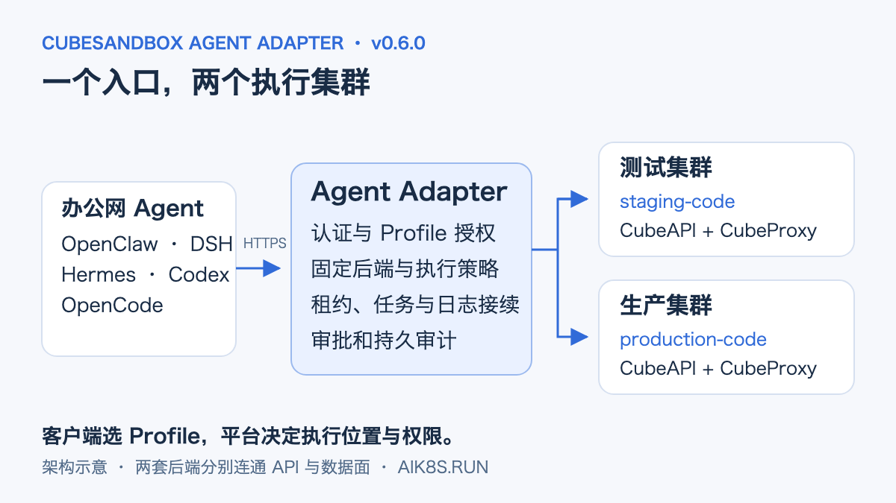
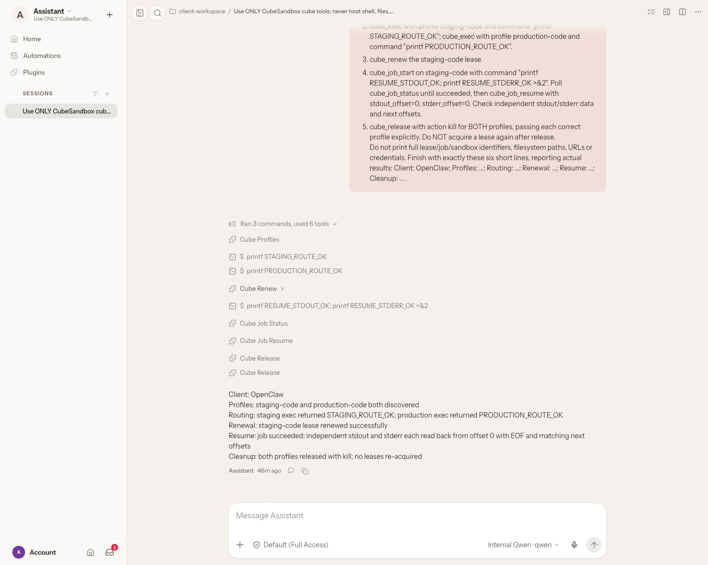
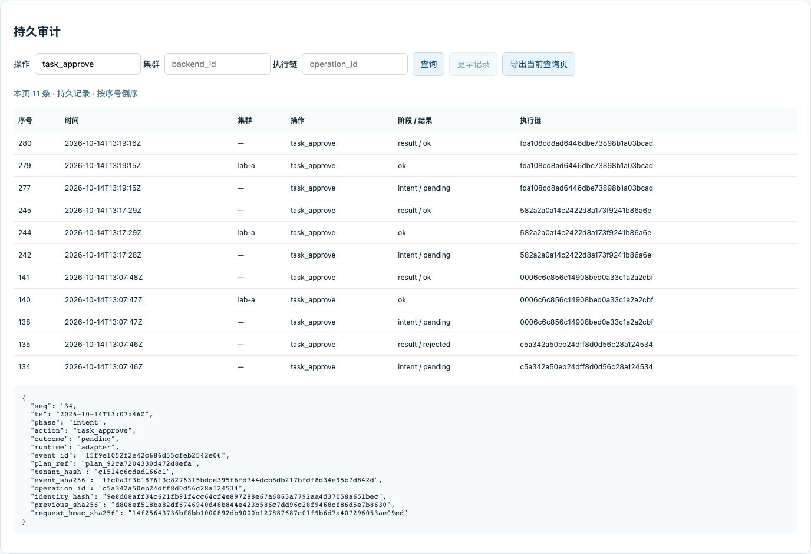
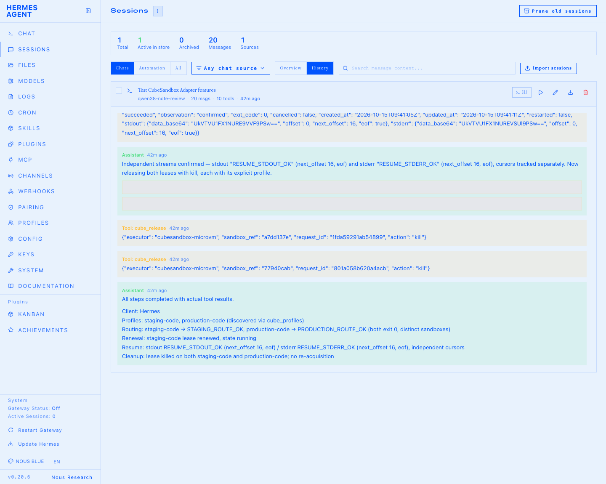

# CubeSandbox Agent Adapter v0.6：一个入口，多个执行集群

本地的 Agent 越来越好用，生产资源却不会因此搬到开发者的电脑上。数据清洗需要访问内网数据，训练任务要交给 GPU 集群，测试和生产又有各自的网络、镜像与权限。给每个客户端分别保存几套地址和长期凭据，很快就会变成另一份难以维护的配置。

[v0.5](cubesandbox-agent-adapter-v05.md) 解决了执行前先持久记账的问题。2026 年 10 月 15 日发布的 **Adapter v0.6.0**，把执行入口扩展到多个 CubeSandbox 后端：Agent 选择有权限的 Profile，平台决定具体集群、模板、网络和工具边界。同时补上内部 OpenClaw 模板、受控沙箱 MCP、长任务接续，以及能直接查询记录的 Light 控制台。

这次用了两个独立集群做创建、执行和隔离验收，也在 OpenClaw、DSH、Hermes、Codex、OpenCode 中实际调用了一遍。下面按使用场景展开，配置与截图对应 CubeSandbox v0.7.3 后端、Python SDK 0.7.3。



*架构示意。图中的测试、生产是执行环境角色，不是需要写进客户端的真实地址。*

## 先把两个集群变成可选择的执行环境

例如，数据检查先在 `staging-code` 运行，确认脚本和输出没有问题，再交给生产侧的命名任务。开发者始终使用同一个客户端、同一个 Adapter 地址，不需要拿到两个集群的 CubeAPI Key。

新增的 `cube_profiles` 返回当前身份有权使用的策略。每个 Profile 通过 `backend_id` 绑定后端；租约、Job、任务计划和回执继续携带这份绑定。即使会话名相同，选择不同 Profile 也不会复用到另一边的沙箱。

平台先准备后端注册表。下面的域名都是占位符，部署时替换为 Adapter 所在网络实际可达的入口：

```yaml
# backends.yaml
backends:
  staging:
    api_url: https://cube-api-staging.example.invalid
    api_key: ${FILE:/etc/cube-secrets/staging-key}
    proxy_host: cube-proxy-staging.example.invalid
    proxy_port: 80
    sandbox_domain: cube.app
  production:
    api_url: https://cube-api-production.example.invalid
    api_key: ${FILE:/etc/cube-secrets/production-key}
    proxy_host: cube-proxy-production.example.invalid
    proxy_port: 80
    sandbox_domain: cube.app
```

再为已有 READY 模板配置 Profile：

```yaml
# profiles.yaml
profiles:
  staging-code:
    backend_id: staging
    template: REPLACE_WITH_STAGING_READY_TEMPLATE_ID
    allow_internet_access: false
    network: {allow_public_traffic: false}
    keepalive_enabled: true
    max_keepalive_seconds: 3600
    sandbox_timeout_seconds: 300
    max_command_seconds: 1800
  production-code:
    backend_id: production
    template: REPLACE_WITH_PRODUCTION_READY_TEMPLATE_ID
    allow_internet_access: false
    network: {allow_public_traffic: false}
```

将两个文件与只读凭据文件挂载进 Adapter，并设置以下环境变量；Kubernetes 可通过 ConfigMap、Secret 与 Chart 的对应挂载项交付：

```dotenv
CUBE_ADAPTER_BACKENDS_FILE=/etc/cube-adapter/backends.yaml
CUBE_ADAPTER_PROFILES_FILE=/etc/cube-adapter/profiles.yaml
```

身份的 `allowed_profiles` 和 `allowed_actions` 仍决定最终权限。生产侧如果只允许训练提交或数据清洗，就给它配置 TaskTemplate 和 `task:*` 身份，而不是顺手开放原始 Shell。修改已审批任务的集群、模板或执行策略后，需要重新建计划和审批。

### 在 Agent 里跑一次双集群检查

两个授权 Profile 准备好后，可以给原生客户端这样的提示词：

```text
只使用 CubeSandbox 工具，不使用宿主 Shell 或文件工具。
先查询有权限的 Profile。
在 staging-code 执行 printf STAGING_ROUTE_OK；
在 production-code 执行 printf PRODUCTION_ROUTE_OK。
只续租 staging-code，最后用 kill 释放两边的沙箱。
汇报实际结果，不输出完整资源引用或连接凭据。
```

OpenClaw、DSH、Hermes 的租约类工具带上 `profile` 即可；Codex、OpenCode 通过 stdio MCP 使用时，先用 `cube_acquire` 分别获取租约，后续操作传对应的 `lease_ref`。

[](../../assets/rag-agent/cubesandbox-agent-adapter-v06/01-openclaw-features-light.png)

*OpenClaw Light 界面。本轮还执行了异步 Job 与日志接续，工具列表和最后的结果汇总都保留在图中，可点击查看原图。*

### 为什么只放行 CubeAPI 还不够

跨网接入要同时考虑两条链路：

- CubeAPI 负责模板查询、沙箱创建与生命周期管理；
- CubeProxy 承载命令、文件、PTY 和 Job 等数据面通信。

办公网只放行 CubeAPI 时，可能创建成功，却取不回执行结果。Adapter 需要能访问每一套后端的 API 和 Proxy，沙箱自身则需要到业务 API、模型网关或数据服务的出站权限。两者不能互相替代。

SDK 0.7.3 的数据面使用 HTTP，跨网应安排受控内网链路或隧道。新增后端配置不会自动打通路由，也不会修改宿主机 NAT、节点标签或 NetworkPolicy。对 Agent 开放 Adapter 的 HTTPS 地址，和让 Adapter 连通生产数据面，是两个部署步骤。

## 内部 OpenClaw 模板：把重复配置留给平台

每创建一个 OpenClaw 沙箱，都重新填写模型地址、API Key、默认模型和备用模型，并不适合团队使用。更麻烦的是，镜像入口可能再次生成配置，把刚写好的内容覆盖掉。

v0.6.0 可以用版本化 preset 固定内部模板 ID、初始化命令、预检和配置文件。模型支持默认模型、fallback 与别名；创建时会检查 provider 和 model ID 是否匹配，也会拒绝 provider 名称尾部空格这类难以察觉的问题。

下面是 preset 中 OpenClaw 配置文件的模型片段，`model-a`、`model-b` 需替换为内部服务真实注册的 ID；外层模板定义见[完整示例](https://github.com/aik8s/cubesandbox-agent-adapter/blob/v0.6.0/examples/production-features/templates.yaml)：

```yaml
models:
  providers:
    internal:
      baseUrl: ${FILE:/etc/cube-secrets/models/base-url}
      apiKey: ${FILE:/etc/cube-secrets/models/api-key}
      api: openai-completions
      models:
        - {id: model-a, name: Internal Primary}
        - {id: model-b, name: Internal Fallback}
agents:
  defaults:
    model:
      primary: internal/model-a
      fallbacks: [internal/model-b]
```

用 `CUBE_ADAPTER_TEMPLATE_PRESETS_FILE` 加载外层 preset，在 Profile 中引用 `template_preset`。Secret 在创建沙箱时解析并写入权限为 0600 的配置文件，不预先烘焙到共享镜像。内部镜像要去掉会覆盖配置的初始化逻辑，或用平台固定的 bootstrap 停止初始化、注入配置、重新启动应用，再做预检。

本轮在生产侧的临时沙箱里，先通过配置注入和结构预检，再由 `openclaw agent --local` 调用内部 Qwen 模型，拿到了约定应答：

```text
OPENCLAW_INTERNAL_MODEL_OK
```

这条记录覆盖嵌入式 CLI；gateway/TUI 与其他 fallback 模型各自需要应用级验证。模型服务的网络也要从沙箱里测，不能拿宿主机上的成功请求代替。详见[本次模型应答记录](https://github.com/aik8s/cubesandbox-agent-adapter/blob/v0.6.0/docs/assets/production-features/openclaw-model-live-2026-10-15.json)。

如果 Agent 拥有沙箱内的 root/Shell 权限，它仍能读取沙箱内配置。涉及敏感生产凭据时，应收窄到命名任务或受控 MCP 工具，不把 Secret 文件注入当成对 root 隐藏密钥的机制。

## 长任务：续租与日志接续分别处理

数据清洗、依赖构建和训练提交往往比一次聊天请求更长。这里需要分别管理沙箱寿命、命令时限和客户端日志游标。

Profile 的 `keepalive_enabled` 开启后台续租，`max_keepalive_seconds` 限制总寿命；后台只为存在活动 Job/PTY 的运行中租约续租。手动 `cube_renew` 受同一个寿命上限约束，续租不会放宽 `max_command_seconds`。续租周期还要小于初始沙箱超时的一半。

一次独立长任务测试把初始超时设为 15 秒、到期动作设为删除，并关闭自动恢复。35 秒 Job 跨 Adapter 重启完成，记录了 6 次续租，原命令没有重新启动。重启接续使用了加密、持久化的 Redis 状态；这和单进程内暂存一个 Job 引用不同。[原始结果](https://github.com/aik8s/cubesandbox-agent-adapter/blob/v0.6.0/docs/assets/production-features/live-results-2026-10-15.json)保留了这些参数。

客户端实测则用两路不同的标记验证游标：

```sh
printf RESUME_STDOUT_OK
printf RESUME_STDERR_OK >&2
```

`cube_job_resume` 接收独立的 `stdout_offset`、`stderr_offset`，返回 Base64 数据与各自的 `next_offset`。本轮从 0/0 开始读取，两路分别得到 16 字节；OpenCode 还用新的 16/16 游标继续读取，得到空内容与 EOF。

[](../../assets/rag-agent/cubesandbox-agent-adapter-v06/03-opencode-features-light.png)

*OpenCode Light 会话。第二次 `cube_job_resume` 用于核对 EOF，完整租约和 Job 引用已遮挡。*

客户端应持久化两个游标，按字节拼接后再解码 UTF-8。`cube_recover` 用于查找原租约和任务映射；已经过期的沙箱不会因此自动重建，状态未知的任务也不会自动重跑。业务产物需要另存到受控持久存储，沙箱删掉以后，状态库不能还原已经消失的日志文件。

## 让沙箱调用受控 MCP 工具

MCP 在这里有两层：Codex、OpenCode 通过本地 stdio MCP 调用 Adapter；Adapter 的 `cube_mcp_call` 则可以继续调用沙箱内 CubeSandbox v0.7.3 的 MCP gateway。

后者适合把生产数据检查、元数据查询或任务提交做成窄接口。平台在 `mcp-policies.yaml` 固定 server 启动命令、环境变量、允许的工具和参数 Schema，Agent 不能临时指定一个任意 server 或后端地址。

仓库的 `controlled-echo` 示例注册 `echo` 工具，只接收最长 256 字符的 `text`，拒绝额外字段，并设置 15 秒调用时限和输入、输出上限。实际业务可按同样方式封装数据检查工具，由 server 实现限制可读数据和可访问接口。

镜像要预装 gateway 和 server，模板暴露 50005，在 Profile 中绑定 `mcp_policy` 并关闭公共流量。MCP Profile 暂不开放 Checkpoint，以避免快照复用 gateway token。调用超时或结果无法确认时会保留未决意图并阻断执行，有副作用的操作不能直接盲重试。

## 审批和审计终于可以直接在页面看

Adapter 现在自带 Light 控制台。开启 `CUBE_ADAPTER_AUDIT_UI=1` 后访问 `/console`，可以查看执行策略、检查任务参数、独立审批，以及查询审计记录。远程访问要求 HTTPS，令牌只保留在当前页面内存。


*策略目录使用演示租户，展示代码、内部模板与沙箱 MCP 三种 Profile。*



*审计查询支持集群、操作和执行链过滤，可翻到更早记录、展开详情、导出当前页。截图为演示租户的审批记录。*

`auditor` 和 `approver` 只能查看本租户，管理员可跨租户查询。审批身份独立于请求身份，Agent 的工具列表里没有审批工具。查询本身也会被审计；审计库不可写时，页面不会绕过强审计继续执行。

### 从单副本 SQLite 到 PostgreSQL 多写入

SQLite 仍是默认方案，适合一个 Adapter 写入进程配合可靠本地盘或块存储。需要多个实例时，v0.6.0 增加了 PostgreSQL 权威审计，执行意图、完成状态和外送队列在同步事务中提交；运行状态由加密 Redis 保存。

多副本要共享 HMAC Key、加密状态配置、策略和命名空间，不能只把 `replicaCount` 从 1 改成 2，也不能让两个实例共用旧 SQLite PVC。

一次审计边界故障演练停止 PostgreSQL 后，两个 Adapter 均返回 503，受控测试后端调用数为 0。失联实例保持阻断，核对并重启后恢复；`pg_dump` 还原到独立数据库后，15 条事件及链摘要一致。此项使用可计数的测试后端隔离审计故障，真实 MicroVM 执行由另一个集群验收覆盖。[故障与恢复记录](https://github.com/aik8s/cubesandbox-agent-adapter/blob/v0.6.0/docs/assets/production-features/postgres-fault-restore-2026-10-15.json)中分别列出了两种范围。

数据库同步备库、可靠存储、WAL 归档与备份恢复需要单独建设。事件哈希链应配合独立保存的可信锚点核验；它不能阻止数据库管理员重写全部历史。JSONL、stdout 和 HTTP Collector 继续作为可重试副本，由接收端按 `event_id` 去重。

## 五个客户端实际跑到了哪一步

2026 年 10 月 15 日的客户端流程统一覆盖：Profile 发现、两个真实集群执行、只续租测试侧租约、异步 Job、独立 stdout/stderr 游标，以及两边 `kill` 释放。核验读取各客户端记录的工具返回值，分别检查状态、资源归属与字节内容。

| 客户端 | 接入方式 | 本轮 Cube 调用数 | 结果 |
| --- | --- | ---: | --- |
| OpenClaw | 原生 Tool Plugin | 9 | 通过 |
| DSH | Cordis Plugin | 9 | 通过 |
| Hermes | 原生 Tool Plugin | 9 | 通过 |
| Codex | stdio MCP | 11 | 通过 |
| OpenCode | stdio MCP | 12 | 通过 |
| 合计 | | **50** | |

MCP 客户端显式获取两份租约，原生插件隐式获取；OpenCode 额外读取了一次 EOF，因此调用次数不同。Hermes 界面显示的 10 次工具调用包含一次内置的 Schema 查询，表中只统计 Cube 工具。DSH 的截图来自相同流程的一次额外 Web 端复测，不再计入表中的 50 次。

[](../../assets/rag-agent/cubesandbox-agent-adapter-v06/02-dsh-features-light.png)

[](../../assets/rag-agent/cubesandbox-agent-adapter-v06/04-hermes-features-light.png)

*四张客户端截图均为本轮 Light 界面，Hermes 的完整租约和 Job 引用已遮挡。Codex 的结果保存在[脱敏工具核验记录](https://github.com/aik8s/cubesandbox-agent-adapter/blob/v0.6.0/docs/assets/production-features/clients-live-2026-10-15.json)中；Claude Code 的历史接入测试见 v0.5 文章，没有计入本轮结果。*

## 从哪里开始部署和尝试

先准备可访问的 CubeSandbox、READY 模板和 Agent 应用。Adapter 可以部署在办公网的服务器或 Kubernetes 中；它本身不需要 KVM，虚拟化条件由 CubeSandbox 计算节点提供。

单机先按 [Docker Compose 部署指南](https://github.com/aik8s/cubesandbox-agent-adapter/blob/v0.6.0/docs/deploy-docker.zh-CN.md)生成 `.env`，设置独立 Token/HMAC Key、CubeAPI、CubeProxy 与模板，然后启动固定版本：

```sh
git clone --branch v0.6.0 --depth 1 \
  https://github.com/aik8s/cubesandbox-agent-adapter.git
cd cubesandbox-agent-adapter

# 按部署指南准备 .env、后端与凭据后执行
docker compose pull adapter
docker compose up -d --no-build adapter
curl --fail http://127.0.0.1:18080/healthz
curl --fail http://127.0.0.1:18080/readyz
```

v0.6.0 镜像同时提供 Linux amd64、arm64，两种架构均完成版本、SDK 0.7.3 和非 root 运行验证。镜像为 `ghcr.io/aik8s/cubesandbox-agent-adapter:v0.6.0`，生产可固定 OCI Index digest：

```text
sha256:6924e514e6143c1828b231d3b2e94750970d22fd1d521c85d08db2145fb58551
```

建议从一个测试 Profile 开始，跑通创建、执行和释放，再添加第二个后端。生产凭据接入前先完成网络和身份验证，随后选择内部 preset 或命名任务；有多副本需求时，再引入 PostgreSQL 和加密 Redis。[生产功能示例](https://github.com/aik8s/cubesandbox-agent-adapter/tree/v0.6.0/examples/production-features)提供完整目录与 Helm HA values，数据库和同步备库不会由这些示例自动创建。

旧版本升级要保留审计卷、Token、HMAC Key 和已有 Profile。先停止写入、核对未决意图，再做 SQLite 离线导出与空目标库导入，比较数量、摘要和待投递队列后切换；不要删除旧库。运行中的旧租约保持原默认端点或先清理，没有策略绑定的旧计划需要重新创建。

三个原生插件从 19 个增至 25 个工具。升级 OpenClaw 插件后重跑安装器，可合并补齐六个新工具的允许列表，并保留已有允许项。新增路由、preset、沙箱 MCP、自动续租和控制台都要显式配置，不会因换镜像自动开放生产权限。

## 把这些能力组合成业务流程

对于数据清洗，可以让本地 Agent 先在测试 Profile 上检查样本与参数，正式任务使用固定 TaskTemplate、受限数据路径和输出白名单，审批后到生产侧执行。长任务通过 Redis 找回原 Job，用游标继续读取日志，重要产物写到持久存储；审计控制台按执行链核对计划、审批和结果。

对于训练任务，可以把 MicroVM 作为窄权限的提交与验证环境：固定训练参数和提交脚本，向 Kubernetes、Volcano 或内部训练平台发起任务，再返回任务引用和允许查看的指标。GPU 调度仍由训练平台负责，Adapter 不会把一个普通代码沙箱自动变成 GPU 集群。

v0.6.0 把这些步骤接到了一起：客户端沿用熟悉的 Agent，平台管理执行位置、模板与权限，长任务可以继续，操作记录也有地方查询。

## 参考与复现

- [Adapter v0.6.0 Release](https://github.com/aik8s/cubesandbox-agent-adapter/releases/tag/v0.6.0)：双架构镜像、Chart 与发布验证记录。
- [多集群、内部模板与持久审计](https://github.com/aik8s/cubesandbox-agent-adapter/blob/v0.6.0/docs/production-features.zh-CN.md)：配置字段、网络与迁移细节。
- [双集群验收脚本](https://github.com/aik8s/cubesandbox-agent-adapter/blob/v0.6.0/tests/acceptance/multi_backend_live.py)：创建、执行、隔离、拒绝、审计与清理。
- [客户端通用提示词](https://github.com/aik8s/cubesandbox-agent-adapter/blob/v0.6.0/tests/acceptance/feature-client-prompt.txt)与[返回值核验脚本](https://github.com/aik8s/cubesandbox-agent-adapter/blob/v0.6.0/tests/acceptance/verify_feature_clients.py)。
- [图片来源与用途](../../assets/rag-agent/cubesandbox-agent-adapter-v06/README.md)。
