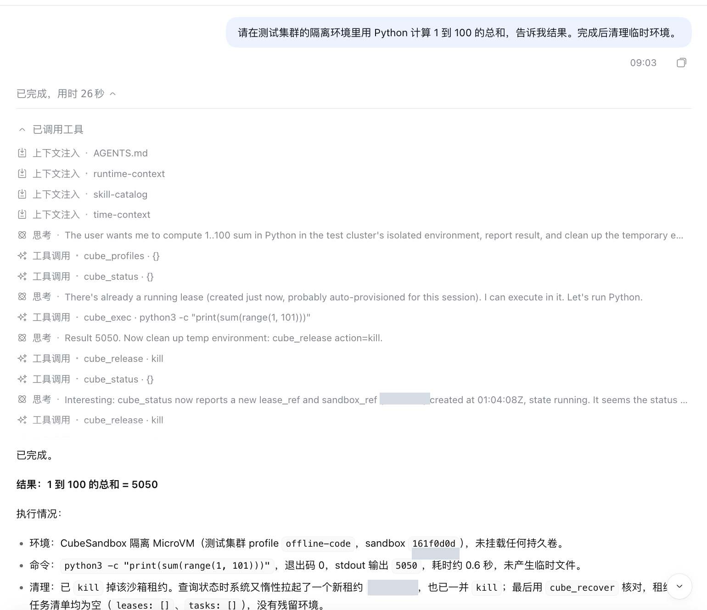
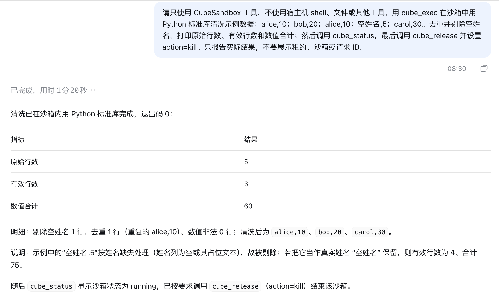
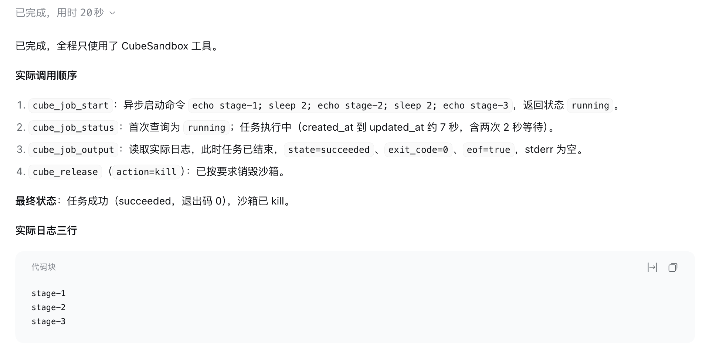

# CubeSandbox Agent Adapter v0.7：DSH 自动选择沙箱实战

普通用户不需要记住工具名称。安装 DSH 插件、配置可用的 Adapter 和后端后，可以直接要求 Agent「在测试集群的隔离环境里验证这段代码」。DSH 根据工具描述和指令选择工具，Adapter 负责身份、Profile、审计和租约，CubeSandbox 负责启动并运行 MicroVM。

本文使用 **Adapter v0.7.0、CubeSandbox v0.8.0** 和 DSH，在单个 x86_64 KVM 计算节点、XFS 后端的 Kubernetes 测试集群中验证自然语言路由。DSH headless 与 Web 使用同一版本的 Cordis 插件；下文分别保留自然语言调用的 Web 截图和其他实战截图。

## 安装与配置

先准备运行中的 CubeSandbox、READY 模板，以及 Adapter 到 CubeAPI 和 CubeProxy 的连通性。Adapter 和 DSH 之间还需要配置身份凭据。可以先参考 [Adapter v0.7.0 安装说明](https://github.com/aik8s/cubesandbox-agent-adapter/tree/v0.7.0#quick-start-kubernetes-adapter)部署服务，再为 DSH 安装插件：

```bash
git clone --branch v0.7.0 --depth 1 \
  https://github.com/aik8s/cubesandbox-agent-adapter.git
cd cubesandbox-agent-adapter

./scripts/install.sh dsh \
  --adapter-url https://adapter.example.invalid \
  --token-file /path/to/adapter-token \
  --profile web
```

将示例地址和 Token 文件替换为管理员提供的配置；`--profile web` 是 DSH 的配置档。生成的插件补丁默认使用 Adapter 的 `offline-code` Profile，需要其他已授权 Profile 时，在补丁中调整插件的 `config.profile`。Token 文件要限制读取权限，不要把 Token 放进提示词、截图或仓库。安装脚本会输出后续启动方式并生成配置补丁；按照本地 DSH 的启动方式应用它。已有 DSH 配置应先备份、合并，避免覆盖其他插件。使用 `file:` 安装本地插件时，升级源码后需要重新安装，重启本身不会更新已经复制的插件。

插件为模型提供 `cube_*` 工具描述，并注入关于可信任务、异步 Job 和异常处理的系统提示。**安装成功、工具被当前会话加载、身份允许操作、后端可达**这几项都成立，模型才有机会实际调用。

## 给 DSH 增加场景规则

DSH 的 `agent-instructions` 插件支持从工作区 `AGENTS.md` 加载指令；也支持从 `$DSH_HOME/AGENTS.md` 加载全局指引。下面示例适合放在经过信任的工作区 `AGENTS.md`，或由管理员合并到全局指引：

```markdown
# 隔离执行规则
当用户请求在测试集群的隔离环境中运行代码、验证脚本或处理测试数据时，优先使用 CubeSandbox 工具。用户无需提供工具名称。短任务使用短命令，长任务使用异步任务并按需读取状态与输出。用户要求清理时，结果取回后释放临时沙箱；释放后不要再调用会创建租约的状态工具。不得在远程执行失败时自动回退到本机 shell。涉及生产操作时遵循服务端的授权和审批，不得扩大权限。
```

如果已有 `AGENTS.md`，合并规则而不是覆盖原有内容。修改后在新会话中检查上下文是否加载了文件，再执行小任务；具体加载范围和字节预算取决于 DSH 的指令插件配置。全局指引会影响多个工作区，团队应结合本地开发需求审阅后再启用。

指令是模型的行为引导，不是强制访问控制。需要严格只走沙箱时，限制 DSH 宿主 Shell、文件工具和其他执行通道，并在服务端为身份设置允许的 Profile 和操作。SDK、插件或网络失败时不应悄悄切换到宿主机执行。

## 两轮自然语言实测

两轮均使用 DSH headless，提问里都没有插件或工具名称。第一轮使用插件原有的工具描述与系统提示，没有额外添加上述工作区规则：

```text
请在测试集群的隔离沙箱里做一次小验证：用 Python 计算 1 到 100 的总和，告诉我结果。完成后清理这次临时环境。
```

DSH 自行调用 `cube_doctor`、`cube_status`、`cube_exec` 等工具，执行结果为 **5050**，随后调用 `cube_release(action=kill)`。第一次释放后它又查询了 `cube_status`，插件按需创建了新租约；DSH 随后销毁该租约，并用 `cube_recover` 确认清单为空。此轮宿主 Shell 和文件工具并未硬禁用。

第二轮在隔离的临时工作区写入上面的 `AGENTS.md`，使用以下原始提问：

```text
请在测试集群的隔离环境里用 Python 检查这些测试分数：4、7、9、10，输出数量和平均分，完成后清理临时环境。
```

DSH 的调用依次是 `cube_status → cube_exec → cube_release`，结果为 **数量 4、平均分 7.5**，退出码为 0。随后通过 Adapter 的租约列表确认活动租约为 0。[脱敏验收记录](../../assets/rag-agent/cubesandbox-agent-adapter-v07/natural-routing-acceptance.json)保留两轮原始提问、工具序列和验证结果，不含凭据与资源引用。

随后在 DSH Web 再做一轮自然语言测试，输入同样没有工具名：

```text
请在测试集群的隔离环境里用 Python 计算 1 到 100 的总和，告诉我结果。完成后清理临时环境。
```

DSH 选择了 `cube_profiles`、`cube_status`、`cube_exec` 和 `cube_release` 等工具，返回 **5050**；释放后状态查询又创建了一个新租约，随后也已释放，最后通过 `cube_recover` 查到空清单。审计记录中可核对执行和两次释放。

[](../../assets/rag-agent/cubesandbox-agent-adapter-v07/dsh-natural-routing-light.png)

*DSH 原生 Light 界面；资源标识已遮盖。该截图对应本节的 Web 测试，不是前面的 headless 会话。*

这三轮说明所测模型和配置能自动选择沙箱，不能保证所有模型、提示词或工具权限组合都有相同行为。发布给团队前，应使用自己的常见任务和失败场景复测。

## Web 界面里的工具执行

下图是另一轮 DSH Web Light 会话。该轮提问明确要求使用 CubeSandbox 工具：它在沙箱里清洗虚构数据，5 条原始记录得到 3 条有效记录、合计 60，并释放沙箱。它展示的是原生客户端界面，不是上面两轮自然语言 headless 测试的截图。

[](../../assets/rag-agent/cubesandbox-agent-adapter-v07/dsh-explicit-cleaning-light.png)

异步任务的另一轮 Web 验证中，DSH 启动任务、查询状态、读取三阶段日志，并在任务成功后释放沙箱。

[](../../assets/rag-agent/cubesandbox-agent-adapter-v07/dsh-explicit-async-light.png)

## 使用边界与排查

- **目标环境**：Profile 决定允许使用的后端与模板；没有指定时只使用管理员配置的默认值，不要把“沙箱在集群中”理解成拥有集群管理员权限。
- **长任务与恢复**：较长命令使用异步 Job；读取游标只能接续输出，不代表应用自动保存训练进度。跨 Adapter 重启恢复租约还需要持久化运行状态及相关密钥。
- **快照**：`fs-only` 保存根文件系统，从它 fork 的沙箱冷启动，不恢复运行中的进程；外部挂载不随之回滚。旧模板可能需要以 v0.8.0 运行时重建。
- **清理**：插件会为部分租约类工具先获取租约，因此释放后调用 `cube_status` 可能再次创建沙箱。核对清理应使用不会自动 acquire 的清单接口，例如本次使用的 `cube_recover` 或 Adapter 租约列表。
- **安全策略**：训练提交和生产数据处理优先使用服务端固定的可信任务模板、最小权限身份和必要审批。Prompt 或 `AGENTS.md` 不能代替这些控制。

相关文档：[CubeSandbox v0.8.0 升级实战](cubesandbox-v080-upgrade-practice.md)、[Adapter v0.6 多集群实践](cubesandbox-agent-adapter-v06.md)、[Adapter v0.7.0 Release](https://github.com/aik8s/cubesandbox-agent-adapter/releases/tag/v0.7.0)。
