# CubeSandbox 故障演练：控制面中断、虚拟机强杀与快照恢复

沙箱平台是否可靠，不能只看创建速度。更实际的问题是：API 挂了任务还跑不跑，代理挂了是否只是失联，计算 Pod 重建以后能不能续跑，以及恢复出来的任务会不会重复执行外部操作。

这次在一套空闲的 Kubernetes 测试安装中，对 CubeSandbox 做了组件故障注入。正式结果使用**实际执行文件已核对的 v0.7.3 Rust Shim**，覆盖 12 类计划场景：11 类完成故障注入，HTTP 路径规则的基线未通过，因此没有注入对应故障；计算 Pod 重建另复测一次，失败同样保留。

最值得关注的三个结果是：控制面中断时，已运行任务通常继续；单个虚拟机运行时被强杀后，可以显式从完整快照恢复；但本轮 Pod 网络模式下，计算 Pod 重建让两个原任务都停止，后续恢复还遇到了端口映射冲突和 `NoResource`。这套配置尚未通过计算 Pod 恢复验收，不能按已具备自动恢复能力上线。

[复现脚本、脱敏结果与逐条接收记录](https://github.com/runzhliu/aik8s/tree/main/examples/cubesandbox-fault-drill)同时公开。本文是单计算节点的组件故障与恢复实验，不能代替跨节点、跨机房或节点断电演练。

## 1. 先确认升级到了哪个运行时

最初组件镜像已经标为 v0.7.3，但旧模板创建的沙箱仍使用节点上保留的 v0.7.1 Rust Shim。原因是 CubeSandbox 支持组件多版本共存，模板和快照会绑定组件版本；更新当前 toolbox，并不会让历史模板自动改用新版本。[组件多版本机制](https://github.com/TencentCloud/CubeSandbox/blob/v0.7.3/docs/guide/component-multiversion.md)

本轮没有直接篡改历史模板绑定，而是通过官方 OCI（Open Container Initiative，开放容器标准）镜像构建流程，新建一个模板，沿用相同源镜像、启动方式和 envd 客户端服务，再重新执行整套测试。

| 核对对象 | 历史模板 | 本轮新模板 |
| --- | --- | --- |
| 节点组件版本目录 | `cube-shim/v0.7.1` | `cube-shim/v0.7.3` |
| 实际进程 | Rust Shim 内嵌 VMM | Rust Shim 内嵌 VMM |
| 执行文件 SHA-256 前 12 位 | `9c5f4736e571` | `b538a14c67d0` |
| 正式矩阵 | 仅保留为历史 attempt | `r073a01`，Pod 追加 `r073a02` |

VMM 是 Virtual Machine Monitor，即虚拟机监控器。注入前，脚本要求目标进程带有本次沙箱 ID、执行文件位于组件版本目录，并持有 `anon_inode:kvm-vm` 句柄。本环境没有独立的 `cube-hypervisor` 进程，不能照着预想的进程名直接 kill。

两个二进制的 `--version` 都输出开发占位信息，因此这里以组件 manifest、真实执行路径和文件哈希交叉核对；没有把镜像标签或 CLI 版本字符串单独当作运行时证明。

## 2. 哪些组件属于同一个故障范围

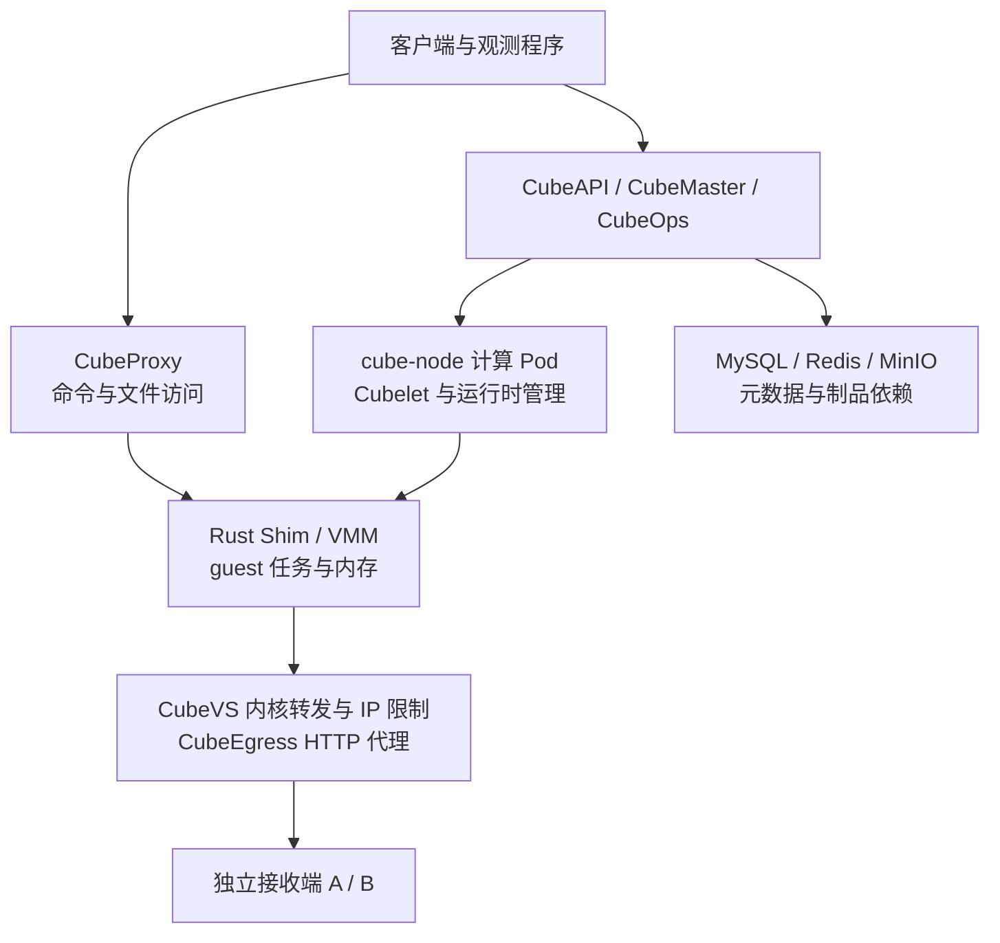

图中的连接表示功能关系，不代表所有流量逐跳经过每个组件。尤其要区分：guest 自己发出的业务请求，与客户端通过 CubeProxy 执行命令，是两条不同路径。

本次 `cube-node` 使用 Pod 网络，`hostPID: true`。这意味着容器里可见的 PID 1 是宿主机进程，绝不能用“杀 PID 1”模拟普通容器退出。脚本使用 PID、进程启动时间、命令哈希、容器 cgroup 和 KVM 句柄限制目标；暂停 Cubelet 与 Nginx 后，都由独立看护程序兜底恢复。

| 测试条件 | 本轮配置 |
| --- | --- |
| Kubernetes / 架构 | 1.30.4 / x86_64，单计算节点，KVM 后端 |
| CubeSandbox 控制组件 / Python SDK | v0.7.3 / 0.7.3 |
| 每个沙箱 | 2 vCPU、2000 MiB、约 1 GiB 根文件系统 |
| 任务 | Python 内存计数器、随机身份、状态摘要、HTTP 探针 |
| 快照包后端 | 本地 XFS；不是跨节点共享快照 |
| 依赖部署 | MySQL、Redis、MinIO 各 1 副本，持久卷保留 |
| 独立观测 | 两个接收 Pod 与被测沙箱分离，但位于同一物理节点 |
| 观测分辨率 | 接收端逐请求时间戳；监控采集 2 秒，速率窗口 8 秒 |

### 2.1 每项实验保持什么不变

除 VMM 和计算 Pod 场景使用两个沙箱外，每项只运行一个已创建成功的探针沙箱。故障期间没有持续发起新建、删除、快照或模型推理请求，任务只是内存计数与短 HTTP 请求。沙箱创建时设置 900 秒超时，观察的是短时中断，不是到期回收行为。

每次只停止一个指定组件，其余组件继续工作。CubeAPI、CubeMaster、CubeOps、CubeProxy 在各自场景中都是单副本；生命周期管理组件保持原部署，没有一并停止。依赖服务停机时保留原持久卷。计算节点、集群网络插件和接收端不属于本轮故障目标。

正式矩阵均使用新模板与已核对的 v0.7.3 执行文件，同时使用前述临时对齐后的出口 CIDR 配置。历史 v0.7.1 记录与配置排查 attempt 不混入正式结果。这里改变了模板绑定与配置，不能据此计算新旧版本的性能增益。

### 2.2 网络基线：IP 目标与 HTTP 路径是两种实验

IP 白名单场景中，A、B 是两个独立接收 Pod 的 IPv4 地址，端口均为 8080。沙箱设置 `allow_internet_access=False`，`network.allow_out` 只列出 A。guest 每轮依次访问 A、B，每个请求超时 0.8 秒，轮次间隔 0.35 秒，关闭连接复用和环境代理。

HTTP 路径规则场景则访问**同一个 A 接收 Pod 的 80 端口**：允许 `/probe/allow*`，拒绝同一 host 的其他路径，用 `/probe/deny` 作拒绝目标。这一项里的“允许 / 禁止”是不同路径，不是两个接收 Pod；也没有测试 HTTPS 解密、域名规则或 TLS（Transport Layer Security，传输层安全协议）握手。

独立环境预检曾在同时允许 A、B 时得到两个 HTTP 200，再检查仅允许 A 的情况。该预检没有记录与正式矩阵同等的运行时哈希，不能当作每个 v0.7.3 场景都重复过的无策略对照。正式 runner 每项实际执行的是受限基线：至少观察 10 秒，累计 A 接收不少于 3 次且 B 接收为 0 才继续。因此“B 为 0”是本轮未观察到放通的证据，不是覆盖所有绕过路径的安全证明。

### 2.3 探针各自证明什么

| 证据 | 实际检查 | 不代表什么 |
| --- | --- | --- |
| API 列表探针 | `GET /sandboxes` 返回 HTTP 200，正文可解析为 JSON 列表或对象 | 没有检查业务错误码或每一条资源状态；HTTP 200 的 JSON 错误对象也可能计为成功，不代表创建、删除、持久化写入或快照可用 |
| 命令探针 | 通过既有 SDK 连接执行命令，读取 guest 内本地 HTTP 状态接口 | 不是外部业务请求，不是重新认证，也不是新建一个沙箱 |
| 任务身份与计数 | 随机身份、内存计数、PID、摘要，以及成功读取到的状态 | 命令读不到时，不能只凭空白曲线判断 guest 已停止 |
| 独立接收记录 | 接收端记录场景、时间戳、目标与序号 | A、B 与被测组件仍共用物理节点，不能验证整台节点断电时的可用性 |
| 新建与清理检查 | 故障组件恢复后清理旧任务，再创建新任务执行 `printf recovered`，随后请求删除 | 没有在故障窗口持续验证全部增删改操作，也不是并发压测 |

API 与命令探测在每次采样中并行发起，两次采样之间再等待 0.6 秒；超时会降低样本数量，不能把各场景的分母当作相同采样频率。恢复轮询要求连续 3 次 API、命令和身份检查同时成功，最多等待 75 秒。计数是否推进和接收端是否有流量仍需另看记录，该布尔判据本身没有覆盖所有业务语义。

结果中的 `remaining_sandboxes` 在旧任务清理后、新建冒烟任务前读取；最终整轮结束另核对资源为空。`MEASURED` 表示完成了相应测量，不等于所有恢复验收通过；监控阶段值 3 表示测试流程结束，失败场景也可能出现这个值。

### 2.4 时间窗口从哪里开始

`baseline` 到 `fault_issued` 是故障前计数窗口；`fault_issued` 到 `fault_confirmed` 是动作过渡期，不计入表中的故障接收数；`fault_confirmed` 到 `restore_issued` 才是故障计数窗口。VMM 与 Pod 场景在前窗口里还进行了对照任务和快照准备，因此其前窗口更长。故障窗口还包含最后一次探针及对照任务读取，可能超过 14 秒观察预算，不等同于完整业务中断时长。

动作过渡期内，guest 请求和接收端记录继续，但控制器没有连续采样 API 与命令，本文不据此判断这段瞬态的可用性。监控阶段值 1 从 `fault_issued` 就开始，包含动作过渡期；表格的故障计数从 `fault_confirmed` 才开始，二者不能直接按图上阶段长度相除。阶段值 2 也只表示程序进入恢复步骤，不代表任务已经恢复。

下表单位均为秒，来自公开结果的相邻时间戳，保留两位小数。进程信号场景的“确认”仅表示精确身份核对及信号调用返回；服务缩容场景则等待匹配 Pod 清单为空；Pod 重建场景等待的是新 UID 的 Pod 达到 Running。三个条件的强度不同。

| 场景 / attempt | 故障前窗口 | 动作过渡期 | 故障窗口 |
| --- | ---: | ---: | ---: |
| CubeAPI / `r073a01` | 10.98 | 1.32 | 14.15 |
| CubeMaster / `r073a01` | 10.27 | 1.50 | 14.14 |
| CubeOps / `r073a01` | 10.91 | 2.27 | 14.29 |
| CubeProxy / `r073a01` | 10.51 | 1.71 | 14.53 |
| Cubelet / `r073a01` | 10.45 | 1.22 | 14.84 |
| VMM / `r073a01` | 15.03 | 1.17 | 14.98 |
| MySQL / `r073a01` | 11.04 | 4.80 | 14.10 |
| Redis / `r073a01` | 10.74 | 1.66 | 15.00 |
| MinIO / `r073a01` | 12.24 | 2.91 | 14.37 |
| CubeEgress IP / `r073a01` | 10.32 | 1.18 | 14.09 |
| CubeEgress HTTP / `r073a01` | 仅完成基线 | 未注入 | 未注入 |
| 计算 Pod / `r073a01` | 14.45 | 41.51 | 17.88 |
| 计算 Pod / `r073a02` | 15.46 | 44.14 | 17.81 |

接收数适合判断任务是否继续，不适合比较组件吞吐。监控采集为 2 秒、速率窗口为 8 秒，曲线边缘会滞后或平滑，不能当作精确退出时刻。每类只有一个正式 attempt，Pod 有两个；没有得到重复实验分布、长期可用率或恢复时长的 P95 / P99。

## 3. 控制面中断，任务与管理能力可以分离

下面 12 幅图展示的是**实验步骤**，不是逐跳网络拓扑或产品截图。按左到右阅读：蓝色表示保留或已观测到的运行，橙色表示故障目标或失败步骤，灰色表示准备与检查；橙色虚线框表示未执行的计划动作。列间箭头表示操作顺序，每幅图是一项独立实验。图示均可点击放大。

| 故障对象与动作 | 故障窗口 A 接收数 | B 接收数 | API 传输探针 / guest 命令成功数 | 任务与恢复结果 |
| --- | ---: | ---: | --- | --- |
| CubeAPI 缩容至 0 | 40 | 0 | 0/17；17/17 | 任务继续，恢复后新建执行与清理通过 |
| CubeMaster 缩容至 0 | 39 | 0 | 0/17；17/17 | 任务继续，恢复后新建执行与清理通过 |
| CubeOps 缩容至 0 | 41 | 0 | 17/17；17/17 | 任务继续；删除短暂失败后成功 |
| CubeProxy 缩容至 0 | 40 | 0 | 22/22；0/22 | 业务请求继续，客户端命令不可达 |
| Cubelet `SIGSTOP` | 42 | 0 | 0/8；8/8 | 原任务继续，`SIGCONT` 后管理恢复 |

这些动作逐个执行，上一项恢复并通过验收后才进入下一项。Cubelet 这里测试的是进程暂停，不能写成进程崩溃后自动重建。

### 3.1 CubeAPI：停止唯一 API 入口，保留既有任务连接

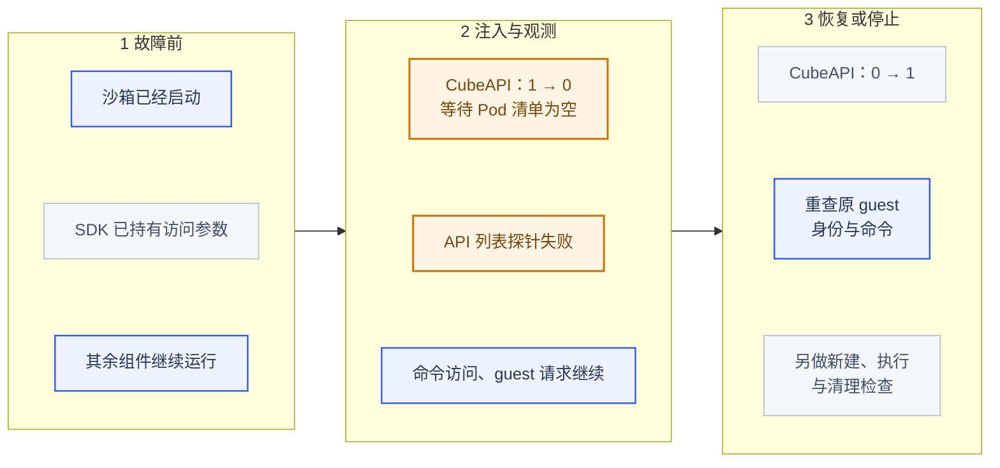

*仅停止 CubeAPI。中间一列是故障窗口的实际观测，右侧是后续恢复操作；既有 SDK 连接不等于故障期间能新建沙箱。*

| 项目 | 本项条件、操作与边界 |
| --- | --- |
| 前置条件 | 1 个沙箱已启动探针；SDK 已持有访问该 guest 的连接参数，CubeProxy、Cubelet 和其他控制组件正常 |
| 故障方式 | 将 `deploy/cube-api` 从 1 缩为 0，等待其匹配 Pod 全部消失；这是允许正常退出的服务停机，不是直接 `SIGKILL` |
| 观察与恢复 | 在 14.15 秒故障窗口内检查既有任务；随后恢复为 1 副本，轮询 API、命令和身份，再执行清理与新建检查 |
| 能支持的结论 | 本轮已启动任务的 HTTP 循环和既有命令访问，不依赖 CubeAPI 持续存活 |
| 不能外推 | 没有测试 API 故障期间的新建请求、新凭据签发、多副本负载切换或更长时间的控制面中断 |

### 3.2 CubeMaster：停止管理服务，观察已运行任务

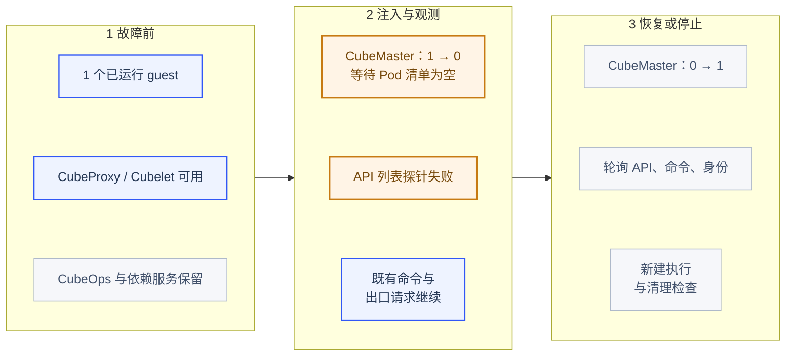

*停止的是管理组件，既有 guest 的运行时仍在。该实验没有在停机期间验证调度或持续提交任务变更。*

| 项目 | 本项条件、操作与边界 |
| --- | --- |
| 前置条件 | 1 个已运行任务；CubeAPI、CubeOps、CubeProxy、Cubelet 和依赖服务保持运行 |
| 故障方式 | 将 `deploy/cube-master` 从 1 缩为 0，等待其 Pod 清单为空，没有同时停止其他控制组件 |
| 观察与恢复 | 观察 14.14 秒；恢复原副本数，重新检查 API 列表、guest 身份和命令，然后新建执行与清理 |
| 能支持的结论 | 该短窗口内，既有 guest 和访问代理仍可工作，但列表路径不可用 |
| 不能外推 | 没有验证停机期间的调度、任务变更、过期清理、主备切换或崩溃时尚未提交的状态 |

### 3.3 CubeOps：短暂停止运营元数据服务

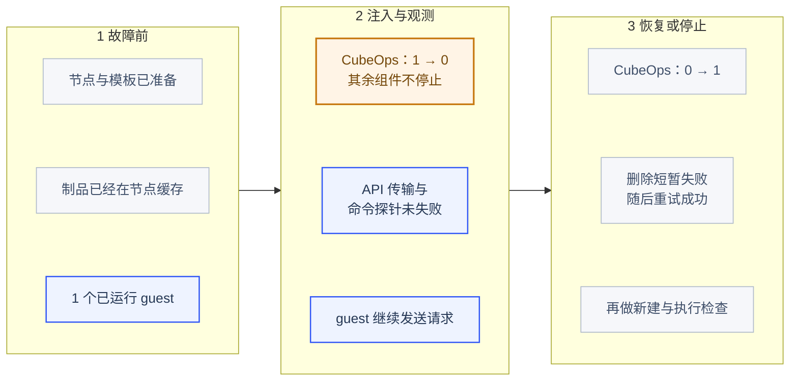

*只覆盖已经准备好的节点和热缓存任务；图中的短时成功不包含新节点加入、缺失版本下载或缓存过期。*

| 项目 | 本项条件、操作与边界 |
| --- | --- |
| 前置条件 | 节点、组件制品与模板已准备，1 个任务已经运行；其他控制组件继续工作 |
| 故障方式 | 将 `deploy/cube-ops` 从 1 缩为 0，确认相关 Pod 已全部删除 |
| 观察与恢复 | 在 14.29 秒窗口内检查既有任务和两个探针；恢复为 1 副本，删除重试后核对清单，再新建执行 |
| 能支持的结论 | 本轮短窗口中，既有任务、列表和命令路径没有观察到失败 |
| 不能外推 | 没有让节点登记或制品缓存过期，也没有测试新节点加入、缺失版本下载和长时间心跳中断；不能据此认为 CubeOps 可长期停用 |

### 3.4 CubeProxy：中断命令入口，直接观察 guest 出口

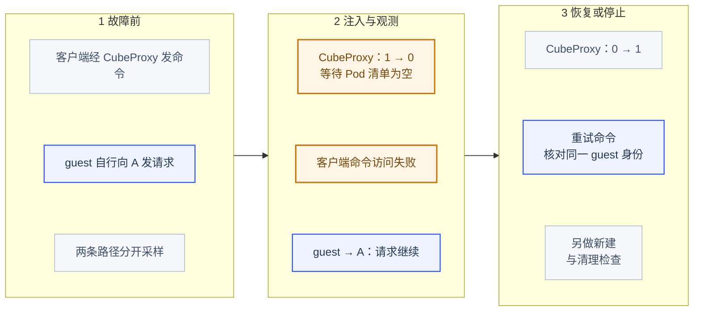

*故障切断的是客户端命令入口，没有主动切断 guest 出口。命令失败与业务请求继续可以同时发生。*

| 项目 | 本项条件、操作与边界 |
| --- | --- |
| 前置条件 | 1 个已运行任务自行向接收端发请求；客户端命令另经 CubeProxy，两个路径分开采样 |
| 故障方式 | 将唯一 `deploy/cube-proxy` 从 1 缩为 0，等待 Pod 清单为空；没有断开 guest 的网络接口 |
| 观察与恢复 | 观察 14.53 秒；恢复代理副本后重新使用 SDK 命令读取同一 guest 身份，再做新建与清理 |
| 能支持的结论 | 客户端命令不可达时，guest 的业务请求仍可继续；失联不必然等于执行停止 |
| 不能外推 | 没有验证代理的多副本切换、既有长连接、流式输出重连或命令请求是否可安全重试 |

### 3.5 Cubelet：暂停原进程，再继续原进程

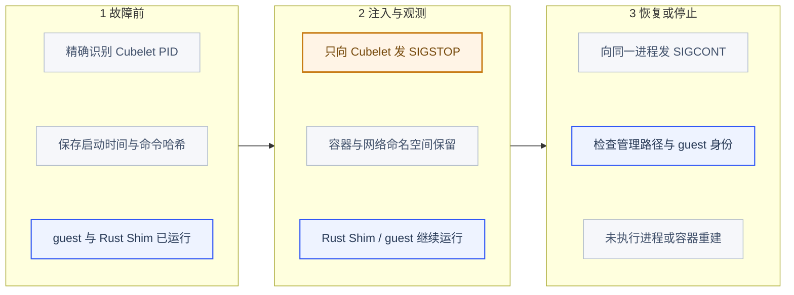

*暂停原进程，再继续原进程。没有关闭容器或销毁网络命名空间，不能按进程崩溃后的重建实验理解。*

| 项目 | 本项条件、操作与边界 |
| --- | --- |
| 前置条件 | 1 个已运行任务；通过容器 cgroup 和精确命令发现唯一 Cubelet，保存 PID、启动时间和命令哈希 |
| 故障方式 | 向该进程发送 `SIGSTOP`；保留容器、文件描述符、网络命名空间和 Rust Shim，不退出或重建容器 |
| 确认与观察 | 记录身份校验和信号调用返回，再观察 14.84 秒；没有额外轮询 `/proc` 的停止状态，不把信号返回当作完整进程状态追踪 |
| 恢复方式 | 对同一身份的进程发送 `SIGCONT`，再次检查任务、列表、命令和清理；独立看护只负责恢复被暂停的精确进程 |
| 结论边界 | 只覆盖管理进程短时不被调度的情况，不覆盖进程崩溃、内存不足终止、状态重载、容器重启或宿主机重启 |

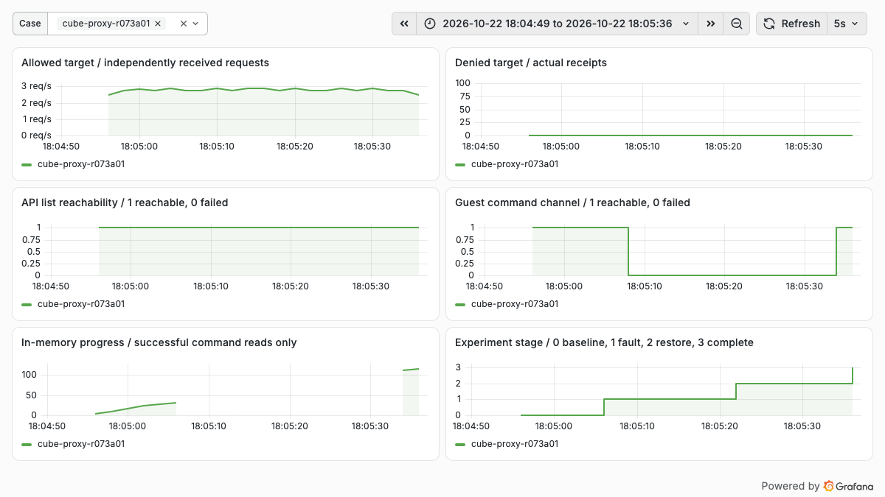

*真实监控截图，选择 `cube-proxy-r073a01`。允许目标仍持续接收请求；命令通道降为 0，恢复后再次为 1。内存计数器只显示命令成功读到的点，空白表示读不到，不表示任务停止。*

这对值班排障很实用：用户说“沙箱失联”，先区分是 guest 停止、出口断了，还是访问代理不可用。只看 API 返回值，会把仍在运行的任务误判为退出；只看接收端有流量，又会漏掉用户已经无法执行命令的问题。

## 4. 强杀单个 VMM：恢复的是快照时刻

VMM 场景额外启动一个不注入故障的对照沙箱。主任务先暂停自身计数更新，完成完整快照，再继续执行，最后强杀它实际使用的 Rust Shim。

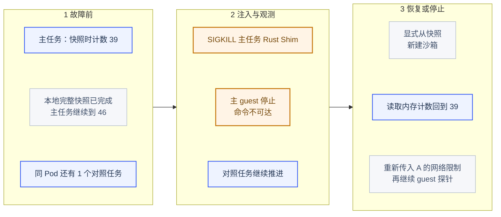

*步骤图中的恢复对象是新沙箱。快照中的 guest 身份与内存恢复，不意味着原 sandbox ID 或原宿主进程复活。*

| 项目 | 本项条件、操作与边界 |
| --- | --- |
| 前置条件 | 同一个计算 Pod 中有主任务与对照任务；只为主任务创建完整本地 XFS 快照，其余组件正常 |
| 故障目标 | 精确匹配主沙箱 ID、组件目录、执行文件哈希和 KVM 句柄的一个 Rust Shim；不杀对照任务，也不停止 Cubelet |
| 故障动作与确认 | 校验 PID 启动时间与命令哈希后调用 `SIGKILL`；记录信号返回，再用命令失败、接收停止和对照任务推进交叉观察，未将信号返回单独当作退出证明 |
| 恢复步骤 | 先请求清理旧沙箱对象，再用 `Sandbox.create(template=snapshot_id, ...)` 创建新对象；读取暂停中的内存状态，核对身份、计数、PID 和摘要后，才恢复 guest 内探针循环 |
| 网络条件 | 创建恢复对象时再次传入 `allow_internet_access=False` 与只允许 A 的 `network.allow_out`；本项不能证明网络策略无需重传就能从快照恢复 |
| 适用边界 | 事先已有可读完整快照，原节点、本地存储和控制面仍可用；不是无快照恢复，不是迁移，也不是重新连接原 sandbox ID |

这里恢复的是同一份 guest 执行状态，承载它的是新建的沙箱对象。公开结果中 `task_recovered` 的成功值不能理解为原运行时进程或原 sandbox ID 自动复活。对照任务用于检查单个 VMM 故障是否扩大到同节点另一个任务，并不代表它位于独立故障域。

| 检查点 | 实际结果 |
| --- | --- |
| 快照保存的内存计数 | 39，`held=true` |
| 强杀前最后一次读取 | 46 |
| 故障窗口主任务 A / B 接收数 | 0 / 0 |
| 对照任务计数 | 2 → 55，随机身份相同 |
| 显式从快照创建后的计数 | 39，`held=true` |
| 身份、PID、摘要和暂停标记 | 与快照一致 |
| 恢复动作 | 测试程序显式调用；没有自动切换 |

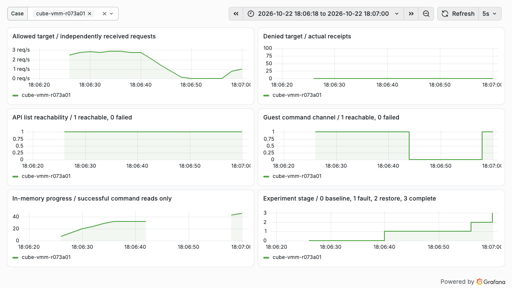

*主任务的接收速率降为 0，命令不可达，显式恢复后重新出现成功读取。精确的 39 → 46 → 39 来自 guest 原始状态记录，监控采样不承担毫秒级恢复计时。*

这次恢复证明的是：完整快照保留了 guest 内存和进程执行状态，而非重启脚本后重新读一个文件。但它恢复到 39，并不是强杀前的 46，快照之后的进度并没有自动保留。

独立接收端还记录到恢复后重放了序号 **40—45，共 6 个**已经接收过的允许请求。接收端位于快照之外，它不会随 guest 一起回滚。真实 Agent 如果已经提交订单、发送消息或写入外部数据库，内存恢复后再次执行同一步就可能产生重复副作用。

因此任务状态与业务幂等仍需单独设计：为外部写操作保存幂等键，恢复后对账已完成步骤，必要时由任务系统决定重试。恢复内存，并不等于恢复整个业务世界。

## 5. 计算 Pod 重建：原任务停了，恢复也失败了

这一项同时运行主任务与对照任务，然后删除承载它们的 `cube-node` Pod。新 Pod 创建后，UID 已变化，两个原 Rust Shim 进程均不再存活，两个 guest 的命令通道失效。主任务故障窗口 A、B 接收数均为 0；后续自动恢复轮询也未观察到主任务恢复。

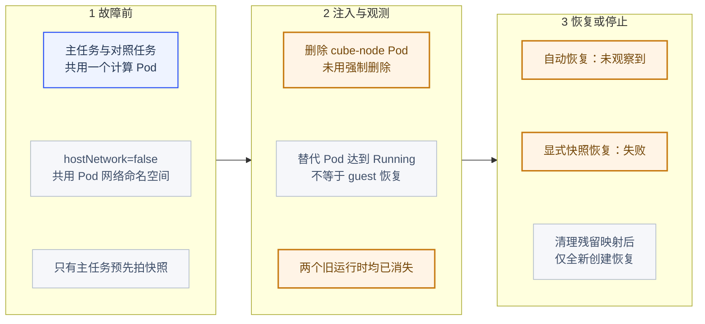

*替换 Pod 启动、原任务恢复、从快照创建、从模板全新创建是四个验收点。最后一项恢复，不能替前两项报成功。*

| 项目 | 本项条件、操作与边界 |
| --- | --- |
| 前置条件 | `hostNetwork` 为 false；两个任务共用一个计算 Pod 的网络命名空间；只为主任务预先创建本地 XFS 完整快照 |
| 故障方式 | `kubectl delete pod ... --wait=false`，未使用强制删除或零优雅退出时间；DaemonSet 负责创建替换 Pod |
| 计时起点 | 等到新 UID 的 Pod 达到 Running，最长等待 90 秒；不是以所有容器 Ready、节点重新登记或创建成功作为此阶段的开始条件 |
| 自动恢复观察 | 故障窗口之后才以 35 秒预算轮询主任务，不从删除 Pod 时计时；到人工恢复标记的两个阶段分别为 35.47 秒、39.16 秒，包含末次探针、进程核对及调用开销 |
| 人工恢复尝试 | 未自动恢复后，先请求清理两个旧对象，再只尝试从主任务快照创建恢复对象；没有对第二个任务实施快照恢复 |
| 故障半径检查 | 核对两个原运行时的 PID 身份已不存活；此处第二个任务用于观察同 Pod 的共同影响，不是独立故障域的存活对照 |
| 结论边界 | 仅针对这一 Pod 网络安装和这两次有快照的尝试；没有验证 hostNetwork、原地升级、无快照重建、跨节点或整机失效 |

`r073a01` 中新 Pod 达到 Running 花了 41.51 秒，`r073a02` 为 44.14 秒，均计入动作过渡期。其后 API 列表仍可返回，不等于原 guest 可执行：两个场景的故障窗口都只有 4 次命令探测，成功数均为 0。完整过程应分成“替换 Pod 启动”“原任务恢复”“从快照新建”和“全新模板创建”四个验收点，不能用第一个代替后三个。

首次显式恢复快照时报错，脱敏后保留关键结构：

```text
network runtime EnsureNetwork failed:
ifindex/listen_port 4/49983 already maps to host port 20078,
cannot map to 20000
```

这里的 `ifindex` 是 Linux 网络接口索引。新 Pod 的网络命名空间和接口生命周期已经变化，但宿主机上 pinned 的 CubeVS 端口映射仍然保留。新的分配器又从较低端口开始分配，遇到旧映射时，代码拒绝覆盖冲突项。[v0.7.3 端口映射冲突检查](https://github.com/TencentCloud/CubeSandbox/blob/v0.7.3/CubeNet/cubevs/port.go)

第一次尝试的快照已被测试清理流程删除，因此另做 `r073a02`，显式保留失败快照。第二次仍未自动恢复，新建检查再次出现同类映射冲突，不能把首次失败归结为偶然。

### 恢复了新建链路，没有宣称恢复了原任务

在 API 列表为空、确认没有存活的 CubeSandbox VMM 后，先备份并核对两张专属 Map，再短暂停止 Cubelet 写入。两次处理中，每张 Map 分别清理了 4 个孤儿条目：

```text
/sys/fs/bpf/local_port_mapping
/sys/fs/bpf/remote_port_mapping
```

清理针对确定无活跃 CubeSandbox 虚拟机的空闲安装，不是通用在线修复指令。没有卸载 eBPF 程序，没有清空 `/sys/fs/bpf`，也没有修改集群 CNI（Container Network Interface，容器网络接口）、OVS（Open vSwitch）或其他虚拟机的网络。

清理后，新建、执行与删除链路恢复；但第二次保留的快照仍返回 `NoResource`。查询时快照和副本元数据均显示 READY，副本地址却仍是重建前的 Pod 地址。这是继续定位调度与副本登记的线索，尚未通过修复对照证明它就是唯一根因；本文不把 `NoResource` 简化成“机器内存不够”。

因此，本项结论是**原任务未恢复，环境的新建链路已恢复**。没有为了得到成功截图直接改数据库、绑定旧地址或强行复用已消失的网络命名空间。

保留快照的清理请求也尝试连接旧 Pod 地址并超时，因此这份失败快照尚有清理尾项，留待副本登记问题定位后处理；它不占用运行中的虚拟机。这个尾项也记录在公开结果中。

官方同版本升级文档已经提醒：Pod 网络模式下，Big Pod 重建会中断沙箱网络，没有自动自愈，需要先排空。`hostNetwork` 能改变网络命名空间的生命周期，但官方仍要求按支持流程隔离、排空和验证，不能据此声称改成它就有高可用。[Kubernetes 升级与网络模式说明](https://github.com/TencentCloud/CubeSandbox/blob/v0.7.3/docs/guide/kubernetes/upgrade.md)

## 6. 依赖恢复，不能只测“列表又能打开了”

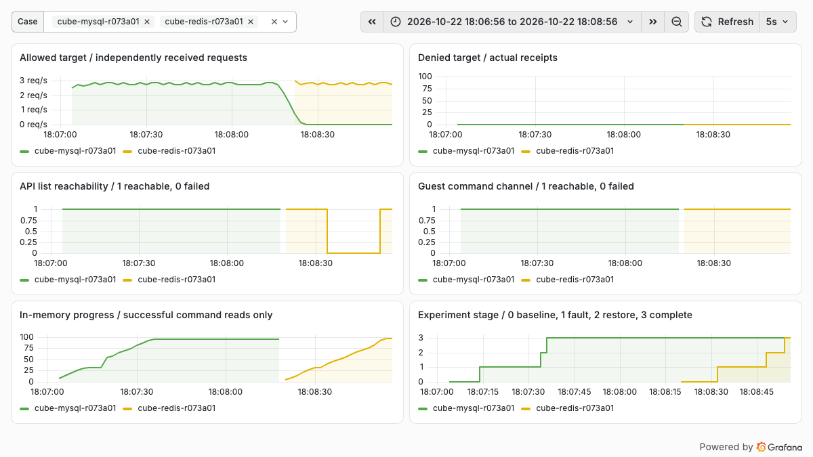

*两项独立实验依次执行。图中 API 列表和命令通道是探针可用性，不代表创建、删除、快照等所有操作都已恢复。*

| 依赖与故障动作 | 故障窗口 A / B | API 传输探针 / guest 命令成功数 | 恢复后额外发现 |
| --- | --- | --- | --- |
| MySQL StatefulSet 缩容至 0 | 40 / 0 | 17/17；17/17 | 删除连续遇到 7 次 DNS 名称不存在错误，第 8 次成功；重试跨度约 31 秒 |
| Redis StatefulSet 缩容至 0 | 42 / 0 | 0/8；8/8 | 删除经历连接失败、代理超时和最终不存在；列表确认资源为空，再创建执行成功 |
| MinIO StatefulSet 缩容至 0 | 41 / 0 | 17/17；17/17 | 已缓存任务继续；恢复后新建执行与清理通过 |

### 6.1 MySQL：保留数据卷的单实例服务停机

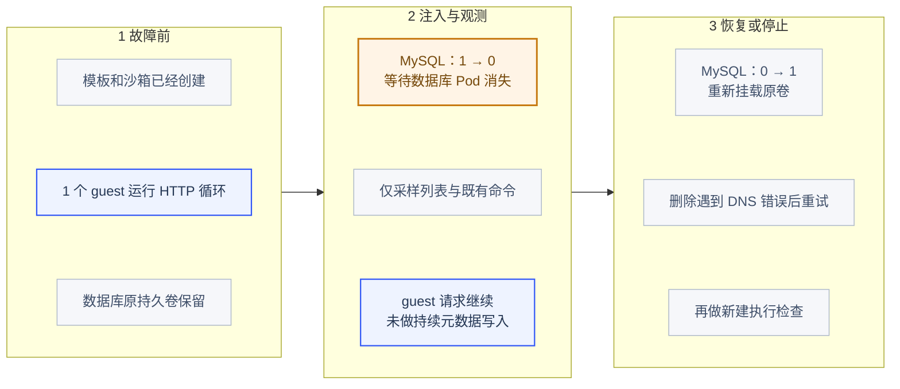

*这是一项保留数据卷的单实例服务停机实验。数据库不可用时，没有持续压测写事务或新建任务。*

| 项目 | 本项条件、操作与边界 |
| --- | --- |
| 前置条件 | 沙箱与模板已经创建，1 个 guest 在运行；数据库原持久卷保留，其他组件正常 |
| 故障方式 | 将 `sts/cube-mysql` 从 1 缩为 0，等待数据库 Pod 消失；允许正常退出，没有杀宿主机或损坏数据目录 |
| 故障窗口负载 | 观察 14.10 秒，只有既有任务、列表与命令探针；没有在数据库停机期间持续创建任务、写元数据或生成快照 |
| 恢复与核对 | 恢复原副本数并重挂原卷，继续检查探针；之后删除旧任务、核对清单、新建执行和请求删除，保留 7 次 DNS 失败及第 8 次成功记录 |
| 结论边界 | 不能由列表 17/17 推导数据库不是必要依赖；没有验证崩溃恢复、事务丢失、主从切换或数据库数据恢复，DNS 错误也不能单独归因于数据库引擎 |

### 6.2 Redis：保留数据卷，区分命令超时和实际资源状态

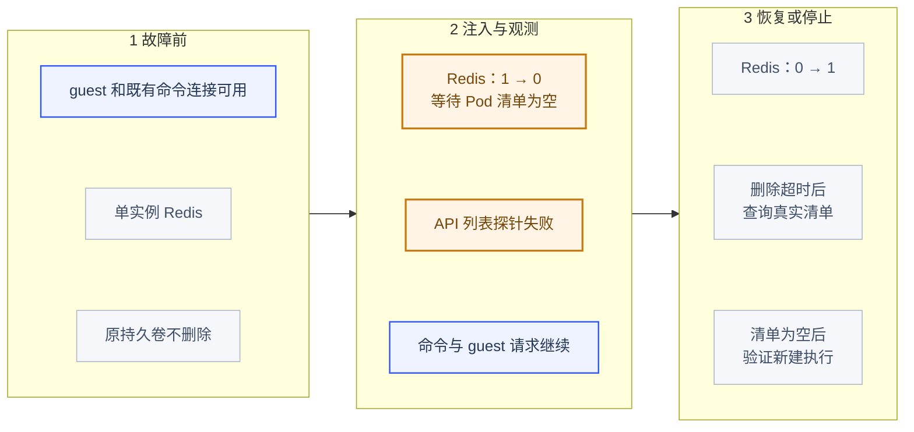

*恢复阶段同时看调用结果和真实资源清单；一次超时不能直接画成“操作没有执行”。没有测试主备切换。*

| 项目 | 本项条件、操作与边界 |
| --- | --- |
| 前置条件 | 1 个 guest 和既有命令连接已可用；Redis 为单实例，其持久卷不删除 |
| 故障方式 | 将 `sts/cube-redis` 从 1 缩为 0，确认匹配 Pod 全部消失；不是网络丢包或磁盘延迟注入 |
| 故障窗口负载 | 在 15.00 秒内采样既有任务；API 列表 0/8，命令 8/8，接收端仍有允许流量 |
| 恢复与核对 | 恢复为 1 副本；删除调用可能超时或最终返回不存在，以再次查询清单和新建执行结果交叉确认，不把超时直接当作未执行 |
| 结论边界 | 没有测试 Redis 主备、持久化机制、缓存大范围失效或长时间 TTL（Time to Live，生存时间）到期；不代表整个管理面可脱离 Redis 运行 |

### 6.3 MinIO：停止对象存储，观察已缓存的本地执行

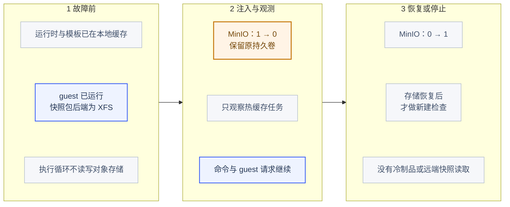

*图中的继续执行依赖已经准备好的本地状态；没有在 MinIO 停机时验证冷启动或 S3 快照恢复。*

| 项目 | 本项条件、操作与边界 |
| --- | --- |
| 前置条件 | 模板和运行时已在节点缓存，guest 已启动；本轮快照包后端为 XFS，执行循环不主动读写对象存储 |
| 故障方式 | 将 `sts/cube-minio` 从 1 缩为 0，等待其 Pod 消失，保留原持久卷 |
| 故障窗口负载 | 在 14.37 秒内仅采样既有任务、列表和命令；未安排缺少本地制品的任务或远端快照读取 |
| 恢复与核对 | 恢复对象存储副本，再执行本地模板的新建、命令和清理检查；不是在 MinIO 不可用时通过了冷启动 |
| 结论边界 | 只能说明这一热缓存路径继续执行，不能证明组件仓库、远程快照、数据卷或对象存储的高可用与完整性 |

MySQL 的现象说明，Pod Ready 或轻量列表探针恢复，不代表连接、名称解析和所有状态变更已经恢复。Redis 的现象则提醒：请求超时不代表服务端没有执行，不能在不核对资源状态的情况下无限重试创建或删除。

MinIO 本项只覆盖已缓存任务和恢复后的基本操作，没有在对象存储不可用期间执行需要远端读取的冷恢复。这一结果不能作为对象存储高可用或 S3（Simple Storage Service 兼容对象存储）快照容灾的证据。

## 7. IP 限制与 HTTP 路径规则必须分开验收

### 7.1 暂停 CubeEgress 的 Nginx，观察 IP 限制路径

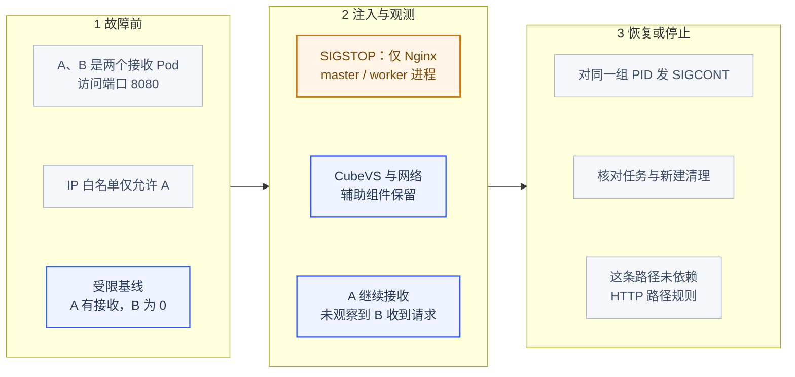

*实际暂停的是用户态 Nginx，而内核与网络辅助组件保留。这里观察 IP 约束路径，没有验证七层代理故障时的安全性。*

| 项目 | 本项条件、操作与边界 |
| --- | --- |
| 前置条件 | 只配置 A 的 IP 白名单，A、B 为不同接收 Pod 的 8080 端口；受限基线 A 有接收、B 为 0 |
| 故障目标 | 仅 `cube-egress` 容器 cgroup 中匹配到的 Nginx master / worker；Cubelet、Rust Shim、CubeVS 与 `cube-egress-net` 继续运行 |
| 故障与确认 | 逐个验证进程身份并发送 `SIGSTOP`，以信号调用返回开始后续观测；没有退出代理容器或卸载内核规则 |
| 观察与恢复 | 观察 14.09 秒后向同一组进程发送 `SIGCONT`，核对任务及新建清理结果 |
| 结论边界 | 本项并未建立 HTTP 路径过滤为流量必经条件；已有内核 IP 限制下 B 为 0，不能当作 Nginx 故障时七层规则仍生效的证据 |

三层 IP 白名单与七层 HTTP 路径规则，执行路径不同。暂停 CubeEgress 的 Nginx master 和 worker 后，IP 白名单场景故障窗口 A 收到 39 个请求，B 收到 0 个请求。可以确认这组配置下允许流量继续、没有观察到禁止目标收到请求；没有在故障期间撤掉规则再放开 B 作反向对照，不能仅凭 0 次接收认定所有阻断原因都来自 CubeVS，更不能推导成 HTTP 路径过滤也通过了故障验收。

### 7.2 HTTP 路径规则：基线失败，故障动作没有执行

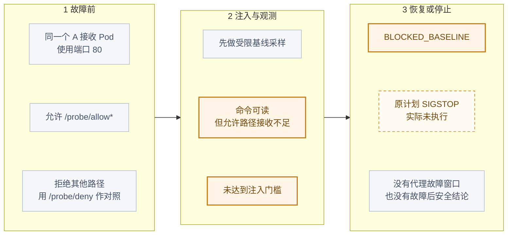

*这幅图停在注入前。图中的 SIGSTOP 是没有执行的计划动作，不能与上一项 IP 规则暂停实验合并为七层验证成功。*

| 项目 | 本项条件、操作与边界 |
| --- | --- |
| 规则与目标 | 对 A 的 IPv4 host 设置 `/probe/allow*` 允许规则及其他路径拒绝规则，访问同一 Pod 的 `/probe/allow` 与 `/probe/deny`，端口为 80 |
| 前置验收 | guest 命令可用还不够；必须同时出现至少 3 个允许路径接收记录且没有禁止路径接收，才允许暂停代理 |
| 实际执行到哪里 | 完成了基线采样，命令探针可读；允许路径没有满足接收门槛，控制器以 `BLOCKED_BASELINE` 停止，未发送 `SIGSTOP` |
| 配置排查 | 核对并临时对齐 guest CIDR 与代理监听 / 透明转发 CIDR 后仍未通过；该配置与正式矩阵记录一致，结束后恢复原值 |
| 结论边界 | 这一项没有故障窗口，也没有“代理中断后仍安全”的结果；当前原因尚未完成成功修复对照，不能将基线失败归因于某一个已证实的根因 |

HTTP 路径规则的允许请求在注入前就超时，因此对应场景记为 `BLOCKED_BASELINE`，没有故障注入。排查时发现 guest 网络段与出口代理监听配置不一致，曾临时对齐两处环境变量；新运行时下复查，允许路径仍未通过。正式矩阵注明使用这一临时对齐配置，结束时已恢复原值。

这里保留了问题边界：确认了 IP 规则场景，没有确认 HTTP 代理规则可用，更没有证明所有异常路径都满足 fail-closed，即故障时始终保持阻断。DNS、IPv6、已有长连接和规则加载瞬间应另设用例。

## 8. 官方界面与真实运行状态

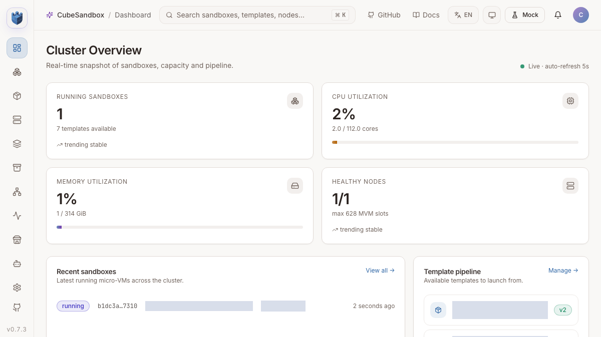

*真实官方 Console，Mock 模式关闭；内部节点、模板等环境标识用可见遮罩脱敏。该沙箱用于最终新建与命令验收，截图后回收，不是 Pod 故障中的原任务恢复成功截图。*

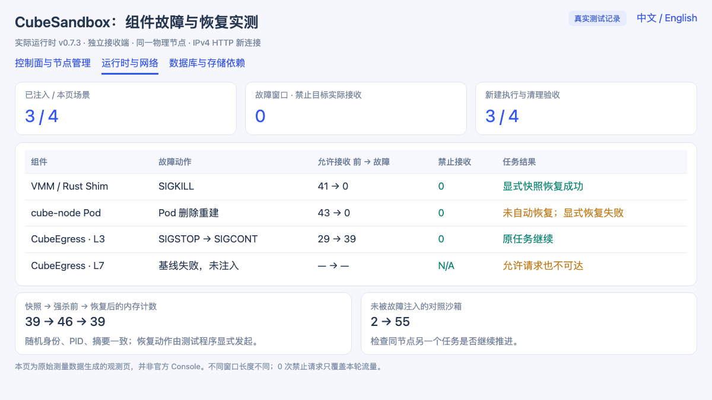

*这是配套脚本生成的观测页，不是官方 Console。VMM 显式快照恢复成功、计算 Pod 重建未恢复、HTTP 路径基线失败分别展示，失败项没有改成成功。*

## 9. 把演练变成可重复的恢复验收

配套程序将每个场景保存为独立 attempt，记录代码哈希、实际运行时哈希、动作时间、原始异常和接收端记录。私有配置、完整组件清单、快照 ID 和访问令牌保存在本地忽略目录；公开结果由字段白名单导出。

```bash
# 配置中使用自己的专用测试安装和两个接收端，先完成目录 README 的预检。
python3 examples/cubesandbox-fault-drill/watchdog.py \
  --config .local/cube-drill/private/settings.json

# 在另一终端逐项执行；不要并发运行故障场景。
python3 examples/cubesandbox-fault-drill/run_drill.py \
  --config .local/cube-drill/private/settings.json \
  --case vmm --attempt a01
```

建议按四道检查验收一次恢复：

1. **进程与接口**：组件就绪、实际运行时正确、原进程是否还在、接口和网络命名空间是否变化。
2. **任务与流量**：随机身份和计数是否延续，允许请求有接收，禁止目标没有接收。
3. **状态变更**：新建、执行、文件操作、删除和快照分别检查；不能只用一个列表接口代表全部管理能力。
4. **业务一致性**：快照后进度损失多少、有没有请求重放、外部系统如何幂等和对账。

本文实际执行了列表、命令、新建、删除、快照和状态核对；guest 文件接口用于装载探针。它不是所有文件系统故障与卷恢复场景的完整矩阵。

对于生产规划，先补齐计算节点隔离与排空、稳定的网络生命周期、元数据与快照的独立备份，再讨论跨节点恢复目标。本地 XFS 快照只具备原节点恢复条件；共享 S3 快照还涉及同步完成状态、兼容计算节点和实际读取能力，需要独立演练。[跨节点快照条件](https://github.com/TencentCloud/CubeSandbox/blob/v0.7.3/docs/guide/cross-node-snapshot.md)

本次没有执行宿主机重启、断电、跨节点或跨可用区恢复。结束时原组件副本数和临时环境变量恢复，实验沙箱回收，原有五台虚拟机保持相同 UID 并继续 Running / Ready。新版模板保留，供后续验证使用。

## 参考与配套

- [CubeSandbox v0.7.3 源码](https://github.com/TencentCloud/CubeSandbox/tree/v0.7.3)
- [复现代码与脱敏 JSON / CSV](https://github.com/runzhliu/aik8s/tree/main/examples/cubesandbox-fault-drill)
- [CubeSandbox 进程内存快照实测](cubesandbox-process-snapshot-recovery.md)
- [Microsandbox、BoxLite 与 OpenSandbox 故障实验](sandbox-runtime-failure-network-policy.md)
