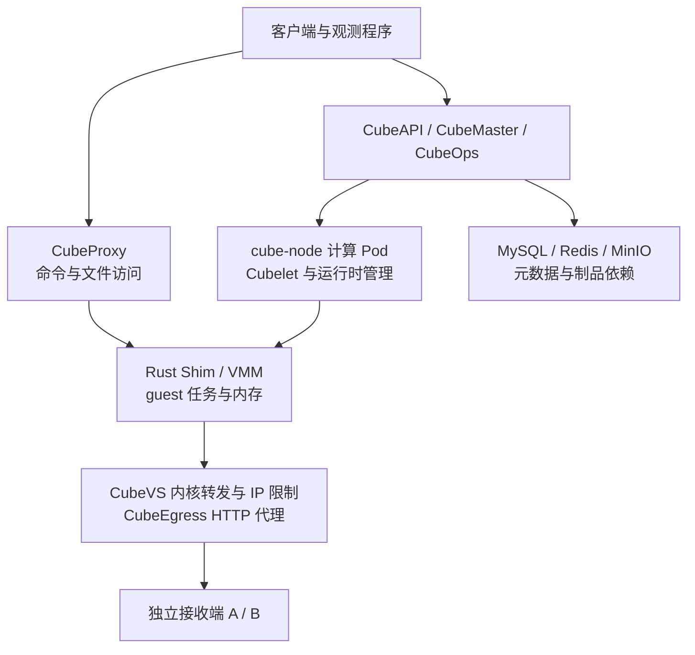

# CubeSandbox 故障演练：控制面中断、虚拟机强杀与快照恢复

沙箱平台是否可靠，不能只看创建速度。更实际的问题是：API 挂了任务还跑不跑，代理挂了是否只是失联，计算 Pod 重建以后能不能续跑，以及恢复出来的任务会不会重复执行外部操作。

这次在一套空闲的 Kubernetes 测试安装中，对 CubeSandbox 做了组件故障注入。正式结果使用**实际执行文件已核对的 v0.7.3 Rust Shim**，覆盖 12 类计划场景：11 类完成故障注入，HTTP 路径规则的基线未通过，因此没有注入对应故障；计算 Pod 重建另复测一次，失败同样保留。

最值得关注的三个结果是：控制面中断时，已运行任务通常继续；单个虚拟机运行时被强杀后，可以显式从完整快照恢复；但本轮 Pod 网络模式下，计算 Pod 重建让两个原任务都停止，后续恢复还遇到了端口映射冲突和 `NoResource`。计算 Pod 恢复失败需要作为上线前的阻塞项处理。

[复现脚本、脱敏结果与逐条接收记录](https://github.com/runzhliu/aik8s/tree/main/examples/cubesandbox-fault-drill)同时公开。本文是单计算节点的组件故障与恢复实验，不能代替跨节点、跨机房或节点断电演练。

## 1. 先确认升级到了哪个运行时

最初组件镜像已经标为 v0.7.3，但旧模板创建的沙箱仍使用节点上保留的 v0.7.1 Rust Shim。原因是 CubeSandbox 支持组件多版本共存，模板和快照会绑定组件版本；更新当前 toolbox，并不会让历史模板自动改用新版本。[组件多版本机制](https://github.com/TencentCloud/CubeSandbox/blob/v0.7.3/docs/guide/component-multiversion.md)

本轮没有直接篡改历史模板绑定，而是通过官方 OCI（Open Container Initiative，开放容器标准）镜像构建流程，新建一个模板，沿用相同源镜像、启动方式和 envd 客户端服务，再重新执行整套测试。

| 核对对象 | 历史模板 | 本轮新模板 |
| --- | --- | --- |
| 节点组件版本目录 | `cube-shim/v0.7.1` | `cube-shim/v0.7.3` |
| 实际进程 | Rust Shim 内嵌 VMM | Rust Shim 内嵌 VMM |
| 执行文件 SHA-256 前 12 位 | `9c5f4736e571` | `b538a14c67d0` |
| 正式矩阵 | 仅保留为历史 attempt | `r073a01`，Pod 追加 `r073a02` |

VMM 是 Virtual Machine Monitor，即虚拟机监控器。注入前，脚本要求目标进程带有本次沙箱 ID、执行文件位于组件版本目录，并持有 `anon_inode:kvm-vm` 句柄。本环境没有独立的 `cube-hypervisor` 进程，不能照着预想的进程名直接 kill。

两个二进制的 `--version` 都输出开发占位信息，因此这里以组件 manifest、真实执行路径和文件哈希交叉核对；没有把镜像标签或 CLI 版本字符串单独当作运行时证明。

## 2. 哪些组件属于同一个故障范围



图中的连接表示功能关系，不代表所有流量逐跳经过每个组件。尤其要区分：guest 自己发出的业务请求，与客户端通过 CubeProxy 执行命令，是两条不同路径。

本次 `cube-node` 使用 Pod 网络，`hostPID: true`。这意味着容器里可见的 PID 1 是宿主机进程，绝不能用“杀 PID 1”模拟普通容器退出。脚本使用 PID、进程启动时间、命令哈希、容器 cgroup 和 KVM 句柄限制目标；暂停 Cubelet 与 Nginx 后，都由独立看护程序兜底恢复。

| 测试条件 | 本轮配置 |
| --- | --- |
| Kubernetes / 架构 | 1.30.4 / x86_64，单计算节点，KVM 后端 |
| CubeSandbox 控制组件 / Python SDK | v0.7.3 / 0.7.3 |
| 每个沙箱 | 2 vCPU、2000 MiB、约 1 GiB 根文件系统 |
| 任务 | Python 内存计数器、随机身份、状态摘要、HTTP 探针 |
| 快照包后端 | 本地 XFS；不是跨节点共享快照 |
| 依赖部署 | MySQL、Redis、MinIO 各 1 副本，持久卷保留 |
| 独立观测 | 两个接收 Pod 与被测沙箱分离，但位于同一物理节点 |
| 观测分辨率 | 接收端逐请求时间戳；监控采集 2 秒，速率窗口 8 秒 |

### 两个目标，而不是只看客户端报错

A、B 都运行相同的 HTTP 接收器。先允许两者，验证网络本身可达；正式限制场景只允许 A，检查 B 是否真的收到请求。guest 每轮依次访问两个目标，每个请求超时 0.8 秒，轮次间隔 0.35 秒，关闭连接复用和环境代理。

故障前窗口至少 10 秒，确认故障动作完成后再观察至少 14 秒。API 和命令探测也可能占用时间，因此每个窗口长度不同，接收数适合判断“是否继续”，不能拿来比较组件吞吐性能。网络限制结论只覆盖本轮 IPv4 HTTP 新连接。

## 3. 控制面中断，任务与管理能力可以分离

| 故障对象与动作 | 故障窗口 A 接收数 | B 接收数 | API 列表 / 命令通道成功探测 | 任务与恢复结果 |
| --- | ---: | ---: | --- | --- |
| CubeAPI 缩容至 0 | 40 | 0 | 0/17；17/17 | 任务继续，恢复后新建执行与清理通过 |
| CubeMaster 缩容至 0 | 39 | 0 | 0/17；17/17 | 任务继续，恢复后新建执行与清理通过 |
| CubeOps 缩容至 0 | 41 | 0 | 17/17；17/17 | 任务继续；删除短暂失败后成功 |
| CubeProxy 缩容至 0 | 40 | 0 | 22/22；0/22 | 业务请求继续，客户端命令不可达 |
| Cubelet `SIGSTOP` | 42 | 0 | 0/8；8/8 | 原任务继续，`SIGCONT` 后管理恢复 |

这些动作逐个执行，上一项恢复并通过验收后才进入下一项。Cubelet 这里测试的是进程暂停，不能写成进程崩溃后自动重建。


*真实监控截图，选择 `cube-proxy-r073a01`。允许目标仍持续接收请求；命令通道降为 0，恢复后再次为 1。内存计数器只显示命令成功读到的点，空白表示读不到，不表示任务停止。*

这对值班排障很实用：用户说“沙箱失联”，先区分是 guest 停止、出口断了，还是访问代理不可用。只看 API 返回值，会把仍在运行的任务误判为退出；只看接收端有流量，又会漏掉用户已经无法执行命令的问题。

## 4. 强杀单个 VMM：恢复的是快照时刻

VMM 场景额外启动一个不注入故障的对照沙箱。主任务先暂停自身计数更新，完成完整快照，再继续执行，最后强杀它实际使用的 Rust Shim。

| 检查点 | 实际结果 |
| --- | --- |
| 快照保存的内存计数 | 39，`held=true` |
| 强杀前最后一次读取 | 46 |
| 故障窗口主任务 A / B 接收数 | 0 / 0 |
| 对照任务计数 | 2 → 55，随机身份相同 |
| 显式从快照创建后的计数 | 39，`held=true` |
| 身份、PID、摘要和暂停标记 | 与快照一致 |
| 恢复动作 | 测试程序显式调用；没有自动切换 |


*主任务的接收速率降为 0，命令不可达，显式恢复后重新出现成功读取。精确的 39 → 46 → 39 来自 guest 原始状态记录，监控采样不承担毫秒级恢复计时。*

这次恢复证明的是：完整快照保留了 guest 内存和进程执行状态，而非重启脚本后重新读一个文件。但它恢复到 39，并不是强杀前的 46，快照之后的进度并没有自动保留。

独立接收端还记录到恢复后重放了序号 **40—45，共 6 个**已经接收过的允许请求。接收端位于快照之外，它不会随 guest 一起回滚。真实 Agent 如果已经提交订单、发送消息或写入外部数据库，内存恢复后再次执行同一步就可能产生重复副作用。

因此任务状态与业务幂等仍需单独设计：为外部写操作保存幂等键，恢复后对账已完成步骤，必要时由任务系统决定重试。恢复内存，并不等于恢复整个业务世界。

## 5. 计算 Pod 重建：原任务停了，恢复也失败了

这一项同时运行主任务与对照任务，然后删除承载它们的 `cube-node` Pod。新 Pod 创建后，UID 已变化，两个原 Rust Shim 进程均不再存活，两个 guest 的命令通道失效。主任务故障窗口 A、B 接收数均为 0；额外等待 35 秒，也没有观察到自动恢复。

首次显式恢复快照时报错，脱敏后保留关键结构：

```text
network runtime EnsureNetwork failed:
ifindex/listen_port 4/49983 already maps to host port 20078,
cannot map to 20000
```

这里的 `ifindex` 是 Linux 网络接口索引。新 Pod 的网络命名空间和接口生命周期已经变化，但宿主机上 pinned 的 CubeVS 端口映射仍然保留。新的分配器又从较低端口开始分配，遇到旧映射时，代码拒绝覆盖冲突项。[v0.7.3 端口映射冲突检查](https://github.com/TencentCloud/CubeSandbox/blob/v0.7.3/CubeNet/cubevs/port.go)

第一次尝试的快照已被测试清理流程删除，因此另做 `r073a02`，显式保留失败快照。第二次仍未自动恢复，新建检查再次出现同类映射冲突，不能把首次失败归结为偶然。

### 恢复了新建链路，没有宣称恢复了原任务

在 API 列表为空、确认没有存活的 CubeSandbox VMM 后，先备份并核对两张专属 Map，再短暂停止 Cubelet 写入。两次处理中，每张 Map 分别清理了 4 个孤儿条目：

```text
/sys/fs/bpf/local_port_mapping
/sys/fs/bpf/remote_port_mapping
```

清理针对确定无活跃 CubeSandbox 虚拟机的空闲安装，不是通用在线修复指令。没有卸载 eBPF 程序，没有清空 `/sys/fs/bpf`，也没有修改集群 CNI（Container Network Interface，容器网络接口）、OVS（Open vSwitch）或其他虚拟机的网络。

清理后，新建、执行与删除链路恢复；但第二次保留的快照仍返回 `NoResource`。查询时快照和副本元数据均显示 READY，副本地址却仍是重建前的 Pod 地址。这是继续定位调度与副本登记的线索，尚未通过修复对照证明它就是唯一根因；本文不把 `NoResource` 简化成“机器内存不够”。

因此，本项结论是**原任务未恢复，环境的新建链路已恢复**。没有为了得到成功截图直接改数据库、绑定旧地址或强行复用已消失的网络命名空间。

保留快照的清理请求也尝试连接旧 Pod 地址并超时，因此这份失败快照尚有清理尾项，留待副本登记问题定位后处理；它不占用运行中的虚拟机。这个尾项也记录在公开结果中。

官方同版本升级文档已经提醒：Pod 网络模式下，Big Pod 重建会中断沙箱网络，没有自动自愈，需要先排空。`hostNetwork` 能改变网络命名空间的生命周期，但官方仍要求按支持流程隔离、排空和验证，不能据此声称改成它就有高可用。[Kubernetes 升级与网络模式说明](https://github.com/TencentCloud/CubeSandbox/blob/v0.7.3/docs/guide/kubernetes/upgrade.md)

## 6. 依赖恢复，不能只测“列表又能打开了”


*两项独立实验依次执行。图中 API 列表和命令通道是探针可用性，不代表创建、删除、快照等所有操作都已恢复。*

| 依赖与故障动作 | 故障窗口 A / B | 故障窗口 API / 命令探测 | 恢复后额外发现 |
| --- | --- | --- | --- |
| MySQL StatefulSet 缩容至 0 | 40 / 0 | 17/17；17/17 | 删除连续遇到 7 次 DNS 名称不存在错误，第 8 次成功；重试跨度约 31 秒 |
| Redis StatefulSet 缩容至 0 | 42 / 0 | 0/8；8/8 | 删除经历连接失败、代理超时和最终不存在；列表确认资源为空，再创建执行成功 |
| MinIO StatefulSet 缩容至 0 | 41 / 0 | 17/17；17/17 | 已缓存任务继续；恢复后新建执行与清理通过 |

MySQL 的现象说明，Pod Ready 或轻量列表探针恢复，不代表连接、名称解析和所有状态变更已经恢复。Redis 的现象则提醒：请求超时不代表服务端没有执行，不能在不核对资源状态的情况下无限重试创建或删除。

MinIO 本项只覆盖已缓存任务和恢复后的基本操作，没有在对象存储不可用期间执行需要远端读取的冷恢复。这一结果不能作为对象存储高可用或 S3（Simple Storage Service 兼容对象存储）快照容灾的证据。

## 7. IP 限制与 HTTP 路径规则必须分开验收

三层 IP 白名单与七层 HTTP 路径规则，执行路径不同。暂停 CubeEgress 的 Nginx master 和 worker 后，IP 白名单场景故障窗口 A 收到 39 个请求，B 收到 0 个请求。这表明本轮已有内核 IP 限制继续执行，不能推导成 HTTP 路径过滤也通过了故障验收。

HTTP 路径规则的允许请求在注入前就超时，因此对应场景记为 `BLOCKED_BASELINE`，没有故障注入。排查时发现 guest 网络段与出口代理监听配置不一致，曾临时对齐两处环境变量；新运行时下复查，允许路径仍未通过。正式矩阵注明使用这一临时对齐配置，结束时已恢复原值。

这里保留了问题边界：确认了 IP 规则场景，没有确认 HTTP 代理规则可用，更没有证明所有异常路径都满足 fail-closed，即故障时始终保持阻断。DNS、IPv6、已有长连接和规则加载瞬间应另设用例。

## 8. 官方界面与真实运行状态


*真实官方 Console，Mock 模式关闭；内部节点、模板等环境标识用可见遮罩脱敏。该沙箱用于最终新建与命令验收，截图后回收，不是 Pod 故障中的原任务恢复成功截图。*


*这是配套脚本生成的观测页，不是官方 Console。VMM 显式快照恢复成功、计算 Pod 重建未恢复、HTTP 路径基线失败分别展示，失败项没有改成成功。*

## 9. 把演练变成可重复的恢复验收

配套程序将每个场景保存为独立 attempt，记录代码哈希、实际运行时哈希、动作时间、原始异常和接收端记录。私有配置、完整组件清单、快照 ID 和访问令牌保存在本地忽略目录；公开结果由字段白名单导出。

```bash
# 配置中使用自己的专用测试安装和两个接收端，先完成目录 README 的预检。
python3 examples/cubesandbox-fault-drill/watchdog.py \
  --config .local/cube-drill/private/settings.json

# 在另一终端逐项执行；不要并发运行故障场景。
python3 examples/cubesandbox-fault-drill/run_drill.py \
  --config .local/cube-drill/private/settings.json \
  --case vmm --attempt a01
```

建议按四道检查验收一次恢复：

1. **进程与接口**：组件就绪、实际运行时正确、原进程是否还在、接口和网络命名空间是否变化。
2. **任务与流量**：随机身份和计数是否延续，允许请求有接收，禁止目标没有接收。
3. **状态变更**：新建、执行、文件操作、删除和快照分别检查；不能只用一个列表接口代表全部管理能力。
4. **业务一致性**：快照后进度损失多少、有没有请求重放、外部系统如何幂等和对账。

本文实际执行了列表、命令、新建、删除、快照和状态核对；guest 文件接口用于装载探针。它不是所有文件系统故障与卷恢复场景的完整矩阵。

对于生产规划，先补齐计算节点隔离与排空、稳定的网络生命周期、元数据与快照的独立备份，再讨论跨节点恢复目标。本地 XFS 快照只具备原节点恢复条件；共享 S3 快照还涉及同步完成状态、兼容计算节点和实际读取能力，需要独立演练。[跨节点快照条件](https://github.com/TencentCloud/CubeSandbox/blob/v0.7.3/docs/guide/cross-node-snapshot.md)

本次没有执行宿主机重启、断电、跨节点或跨可用区恢复。结束时原组件副本数和临时环境变量恢复，实验沙箱回收，原有五台虚拟机保持相同 UID 并继续 Running / Ready。新版模板保留，供后续验证使用。

## 参考与配套

- [CubeSandbox v0.7.3 源码](https://github.com/TencentCloud/CubeSandbox/tree/v0.7.3)
- [复现代码与脱敏 JSON / CSV](https://github.com/runzhliu/aik8s/tree/main/examples/cubesandbox-fault-drill)
- [CubeSandbox 进程内存快照实测](cubesandbox-process-snapshot-recovery.md)
- [Microsandbox、BoxLite 与 OpenSandbox 故障实验](sandbox-runtime-failure-network-policy.md)
