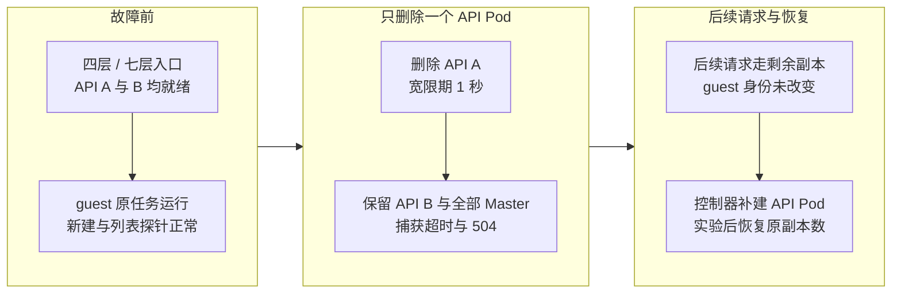
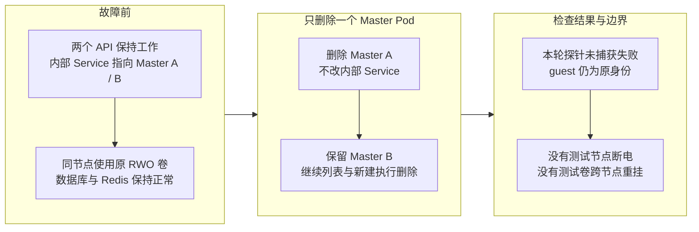
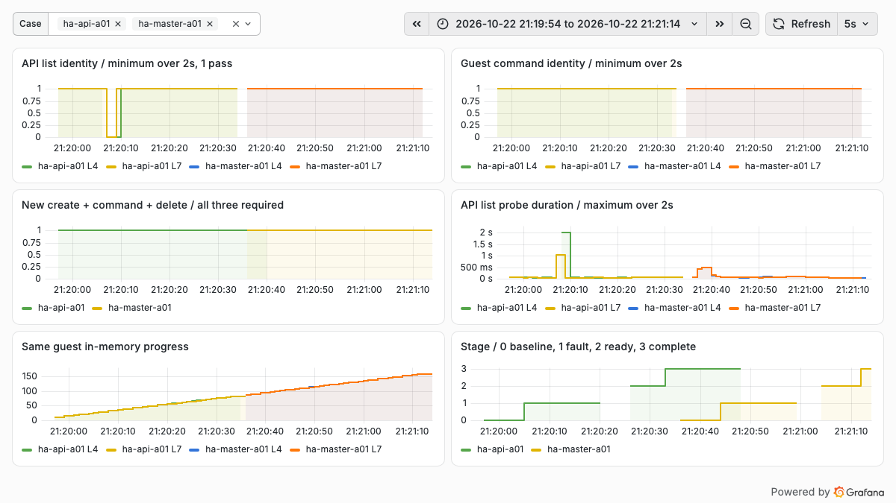
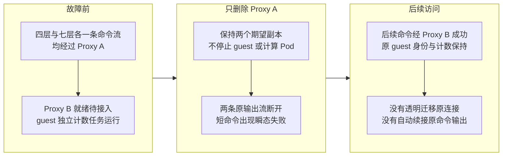

# CubeSandbox 多副本故障切换：API、Master 与 Proxy 的四层和七层入口实测

把 API、Master、Proxy 都扩成两个副本，再加一个负载均衡器，是否就可以认为沙箱平台具备高可用了？上一轮[单副本故障实验](cubesandbox-failure-recovery-practice.md)只能回答组件停止后任务是否继续，不能回答剩余副本能否接住请求。这次继续做多副本切换。

2026 年 10 月 22 日，在一套空闲测试安装中，将 CubeSandbox v0.7.3 的 API、Master、Proxy 分别临时扩到两个副本，再逐项删除一个 Pod。结果是：**Master 这轮未捕获请求失败；API 与 Proxy 都出现短暂失败；Proxy 的两条既有命令输出流全部断开，但独立的 guest 计数任务保持原身份并继续推进。**

三组共执行 33 次“新建→命令→删除”，全部完成，其中故障动作发出后启动的流程为 24 次。这个结果说明小规模新请求可以继续得到处理，不代表所有在途操作都无损，也不能推导出生产可用性百分比。[复现代码、691 条读取探针与完整分母](https://github.com/runzhliu/aik8s/tree/main/examples/cubesandbox-ha-drill)

## 1. 这次究竟测了什么

| 条件 | 实际配置 |
| --- | --- |
| Kubernetes / CubeSandbox / Python SDK | 1.30.4 / v0.7.3 / 0.7.3 |
| 实际 Rust Shim | SHA-256 前 12 位 `b538a14c67d0`，注入前核对 KVM 进程 |
| API、Master、Proxy | 各 2 副本，全部位于同一物理节点 |
| Master 存储 | 两个 Pod 在同节点挂载原 RWO 卷；未验证跨节点挂载 |
| 故障动作 | 每组只删除一个指定 Pod，宽限期 1 秒，期望副本数保持 2 |
| guest 工作负载 | 独立 Python 内存计数器、随机身份；另启命令读取状态 |
| 新请求 | API 列表、guest 命令；一个串行 worker 执行新建、命令、删除 |
| 长连接 | Proxy 场景中预先打开两条 Connect 命令输出流，分别走四层与七层 |
| 保持不变 | 主机、计算 Pod、网络插件、数据库、原模板与既有虚拟机 |

RWO 是 ReadWriteOnce，指单节点读写，**不等于只允许一个 Pod 挂载**。这次两个 Master 都在同一节点，所以可以同时使用原卷；不能据此认为它们能在两台节点上共享该卷。

本轮没有改变计算 Pod 的网络模式、重启主机或改 Helm release。前置实验 LB（Load Balancer，负载均衡器）自身也只有一个副本，因此没有验证整个入口层的高可用。

### 1.1 四层与七层是真实的两种转发

实验使用独立 OpenResty 实例，与产品 CubeProxy 分开部署：四层入口由 Nginx `stream` 按 TCP 连接转发；七层入口由 Nginx `http` 解析 HTTP 后转发。旧的实验桥接会缓冲整个响应，因此只用于管理与清理，没有用它测长流。

| 参数 | 四层与七层前置入口 |
| --- | --- |
| API 后端策略 | 两个预检确认的 Pod IP，轮询 |
| Proxy 后端策略 | 主备，故障前请求都经过指定主副本 |
| 失败处理 | 被动摘除，`max_fails=1`、`fail_timeout=60s` |
| 连接超时 | 1 秒 |
| 自动重放 | 前置 LB 关闭请求重放；控制器不重试变更请求 |
| 后端发现 | 每组开始前重新读取并 reload；组内后端列表不加入替换 Pod 的新 IP |
| 七层协议设置 | 保留 Host，HTTP/1.1 转发，关闭响应缓冲与 gzip |

API 列表探针使用新 HTTP 连接，要求响应成功且 JSON 含已知沙箱 ID；命令探针沿用 SDK 的连接池，通过 envd 读取 guest 回环接口，检查原身份与计数。这里没有把任意 HTTP 200 都当成功，也没有把列表可读当成增删改可用。

另通过四层 TLS（Transport Layer Security，传输层安全协议）透传入口完成了一次真实命令执行。该请求使用实验自签证书并关闭证书校验，仅证明这条透传路径可执行命令；没有验证生产域名、证书信任链、七层 TLS 终结或双向 TLS。

### 1.2 怎样区分失败与切换完成

每组先观察约 8 秒并检查基线，再发出删除动作；确认旧 Pod 不在清单中后继续观察，随后检查两个副本就绪，再观察约 7 秒。原始记录保留动作发出、删除调用返回、旧 Pod 消失、替换副本被检查到就绪及测量结束的时间。

“替换副本就绪”的检查安排在一段观察之后，**不是精确测得的新 Pod 启动耗时**。下表分母统一取故障动作发出到测量结束，包括删除过渡与后续恢复阶段；三组窗口分别为 28.26、27.84、28.66 秒，不能直接用不同分母比较性能。

准备阶段曾遇到 18080 端口未在模板登记、访问返回 404；另一次新模板准备未通过 49999 健康探测。两次均未注入故障。正式测量沿用已验证模板，改用现有 49983 命令端口读取 guest 内部状态，没有修改原模板端口或把失败预检覆盖成成功成绩。

## 2. API：剩余副本接住请求，但仍有瞬态错误

*这是故障步骤与保留对象示意，不是网络抓包或产品界面。删除 API 时没有停止 Master、Proxy 或 guest。*

删除一个 API Pod 后，四层列表探针成功 48/49，失败为一次 `ReadTimeout`；七层成功 50/51，失败为一次 HTTP 504。两个入口的 guest 命令探针分别成功 38/38 与 39/39。该组完整生命周期流程为 11/11，其中删除动作发出后启动的 8 次全部完成。

从首个失败样本的**请求开始时间**到下一个成功样本的请求开始时间，四层为 2.470 秒，七层为 1.496 秒。这只是离散探针的相邻观测间隔，不是精确业务中断时长；探针超时、采样间隔和连接状态都会影响它。单轮、少量错误不能证明七层必然比四层切换更快。

## 3. Master：同节点双副本可以继续服务，存储条件仍需单独验收

*这里验证的是同节点组件故障。共享宿主机与本地卷仍然是共同故障点。*

这一组四层与七层列表探针均为 51/51，guest 命令探针均为 37/37；完整生命周期流程为 11/11，删除动作之后启动的流程为 8/8。没有捕获到请求失败，不等于未采样的每个瞬间都可用。

v0.7.3 官方 Chart 明确支持 Master 多副本。默认 `Recreate` 策略的原因是原卷默认采用单节点读写，避免滚动升级时出现挂载冲突；如果采用完整配置的对象存储制品方案，或支持多节点读写的共享文件系统，才可以进一步调整多副本存储与滚动升级方式。**本轮没有把本地卷改成共享存储，也没有验证跨节点 Master 切换。**[官方副本与存储配置](https://github.com/TencentCloud/CubeSandbox/blob/v0.7.3/deploy/kubernetes/chart/values.yaml)

另外，部署时应核对实际协议。v0.7.3 的 CubeAPI 客户端通过 HTTP REST 调用 CubeMaster，使用内部 Service 可以提供基本分流；不能因为部分架构图写着 gRPC，就直接给这条路径配置 gRPC 网关。[实际客户端实现](https://github.com/TencentCloud/CubeSandbox/blob/v0.7.3/CubeAPI/src/cubemaster/mod.rs)

*截图来自真实实验看板。指标由控制器记录并导入 VictoriaMetrics，不是 CubeSandbox 原生导出指标。成功探针显示 2 秒窗口最小值，延迟显示 2 秒窗口最大值，避免短暂失败被显示采样漏掉；窗口聚合不改变下表的逐请求分母。计数曲线在成功命令读取时才产生点。*

## 4. Proxy：新请求可以切走，原命令流仍然会断

*Proxy 使用主备后端，是为了明确长流经过哪个故障目标，不是本轮测得的最佳生产均衡策略。*

长流是通过 envd 的 `process.Process/Start` 启动命令，持续读取同一个 guest 内存计数器并输出。客户端接收的是 `application/connect+json` 帧；它虽然使用类似 RPC 的方法路径，**并不是本轮验证过原生 gRPC 或 HTTP/2 流均衡**。

两个入口各收到 20 条有效状态消息，随后均以 `ChunkedEncodingError` 结束，断开时刻约在删除动作发出后 3.24 秒。控制器没有自动重开这两条流。之后的短命令重新成功，是**后续请求成功**，不是原输出流自动迁移或原命令结果可完整重放的证明。

这一组四层命令探针成功 36/38，七层成功 39/40；列表均为 55/55，完整生命周期流程为 11/11。独立计数任务保持原随机身份，三组结束时计数依次为 82、158、235，最初为 4。这里证明原计数进程仍在推进，没有单独证明失联的输出命令进程继续运行。

*右侧中部两条线代表故障前建立的原连接；变为 0 后没有自动续接。上方短命令探针恢复成功，同时左下计数继续增长，说明代理连接中断和 guest 任务退出是两件事。*

## 5. 完整分母与哪些结论还不能下

| 删除目标 | 四层列表 | 七层列表 | 四层命令 | 七层命令 | 动作后启动的完整生命周期 |
| --- | --- | --- | --- | --- | --- |
| 一个 API Pod | 48/49 | 50/51 | 38/38 | 39/39 | 8/8 |
| 一个 Master Pod | 51/51 | 51/51 | 37/37 | 37/37 | 8/8 |
| 一个 Proxy Pod | 55/55 | 55/55 | 36/38 | 39/40 | 8/8 |

表中为成功数 / 尝试数；前四列取故障动作发出到测量结束。生命周期各组基线另有 3 次成功，合计 33/33。读取探针包含基线时共 691 条，原始分母及失败类型均保留在公开 JSON / CSV 中，没有重试后覆盖。

这轮并不是等条件的四层／七层性能压测。列表使用新连接，命令使用 SDK 连接池；API 用轮询，Proxy 用主备；每种入口只做一次 Pod 删除。可以比较具体失败表现，不能据此给所有 LB 排名。

在途长流确实跨过了 Proxy 故障时刻；但三组生命周期流程没有恰好跨过删除动作发出的时刻。因此**没有验证“创建、删除或快照执行到一半时请求入口退出”的结果一致性**。这需要单独安排可确认进入处理阶段的变更操作，并检查重复资源、未知结果和补偿逻辑。

没有执行的项目还包括：WebSocket、原生 gRPC、HTTP/2 多路复用均衡、前置 LB 故障、主机断电、跨节点卷挂载、数据库或 Redis 主从切换，以及快照跨节点恢复。原生 gRPC 和 WebSocket 虽有产品配置支持，但不能用本轮命令流代替它们验收。[Proxy 协议配置](https://github.com/TencentCloud/CubeSandbox/blob/v0.7.3/CubeProxy/nginx.conf)

## 6. 用到生产时，怎样选择入口与副本

| 组件 | 建议起点 | 还要解决什么 |
| --- | --- | --- |
| CubeAPI | 七层入口，至少 2 副本分散到不同节点 | 鉴权、限流、超时、就绪摘除；变更请求按接口语义处理重试 |
| CubeProxy | 优先四层透传；确有统一网关需求再采用七层 | TLS、Host、命令流、WebSocket / gRPC 协议、排空与客户端重连 |
| CubeMaster | 内部 Service，多副本前先处理制品存储 | 共享数据库与 Redis；跨节点可读制品；实际存储故障切换 |
| CubeOps / 模板服务 | 根据组件支持配置多副本 | 对象存储或共享文件系统、任务协调与制品访问 |
| 生命周期管理器 | 保留官方多副本与选主机制 | 选主依赖、恢复请求、暂停清理等周期工作的切换 |

这是结合源码和本轮现象的部署建议，不是已在这套实验环境完成的生产拓扑。生命周期管理器的两个副本都能处理恢复请求，Leader 执行部分周期工作，不能把它简化成普通无状态 HTTP 服务。[生命周期管理器实现说明](https://github.com/TencentCloud/CubeSandbox/blob/v0.7.3/cube-lifecycle-manager/README.md)

Proxy 多副本还需要维护每个副本的本地缓存。官方实现会发现并逐个访问管理端点，刷新沙箱路由；把这种广播改成只访问一次普通 LB，可能只刷新其中一个副本。业务入口负载均衡与管理广播是不同需求。[缓存刷新实现](https://github.com/TencentCloud/CubeSandbox/blob/v0.7.3/CubeMaster/pkg/cubeproxy/admin.go)

正常升级时，应先停止向待退出副本送新流量，再让已有连接排空；进程突然退出时，客户端必须接受连接可能中断。重连后还需区分原命令是否完成、输出有没有持久化、能否查询执行 ID。盲目重发命令可能重复产生业务副作用。

本轮结束后，三个组件恢复原来各 1 副本，临时 LB 已删除，没有运行中的实验沙箱，新建执行删除复核通过，原 5 台虚拟机保留原 UID 并处于 Ready。上一轮计算 Pod 重建遗留快照没有被这轮改动。入口副本切换与沙箱运行时恢复，应分别保留验收结果。

## 参考与复现

- [CubeSandbox v0.7.3](https://github.com/TencentCloud/CubeSandbox/tree/v0.7.3)
- [本轮脚本、JSON 与 691 条读取探针](https://github.com/runzhliu/aik8s/tree/main/examples/cubesandbox-ha-drill)
- [上一轮单副本、VMM 与计算 Pod 故障实验](cubesandbox-failure-recovery-practice.md)
- [API Server 四层与七层负载均衡](../practices/kube-apiserver-load-balancing.md)
