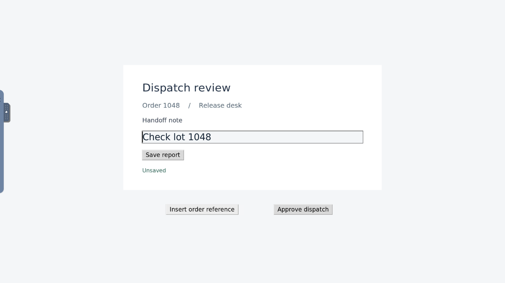
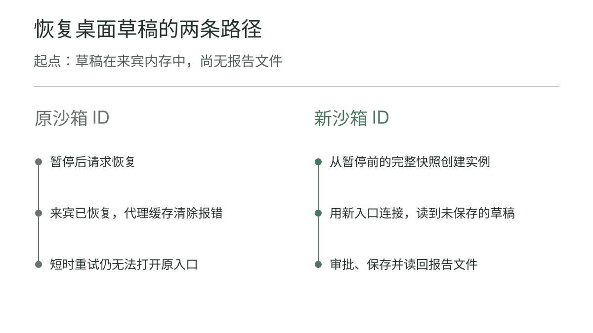
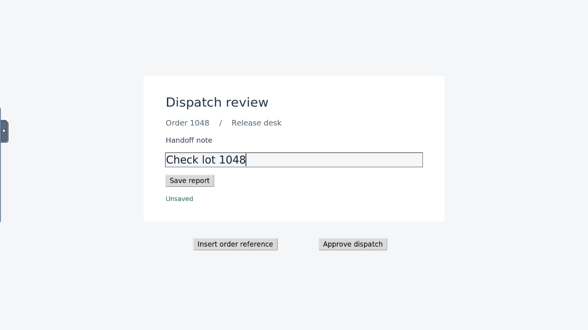
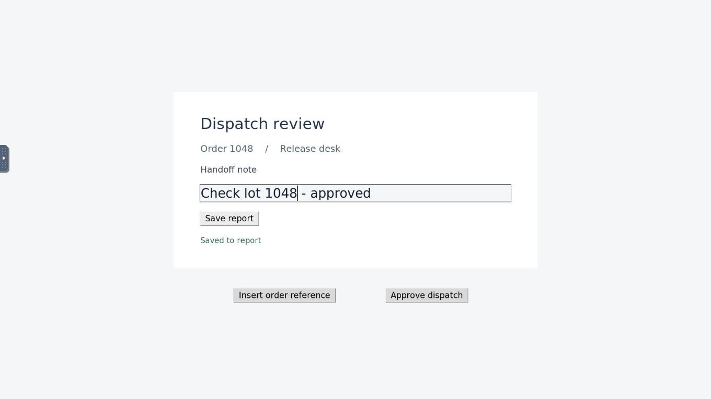

# 关掉浏览器以后，CubeSandbox 桌面里没保存的草稿还在吗？

桌面 Agent 把表单填到一半时断线，值班人员最关心两件事：草稿还在不在，自己能不能接着操作。本次原实例恢复时报了代理路由错误，从完整快照创建新实例却找回了未保存的草稿。接手者最终通过鼠标完成审批并写入文件；依赖远端键盘的编辑器仍不能据此验收。

*操作来自外部 Chromium 中的 noVNC。输入框已有 Check lot 1048，界面显示 Unsaved，驱动也确认目标报告文件不存在。*

## 浏览器到沙箱的实际路径

沙箱运行 Debian 13、Xvfb、x11vnc、websockify 和一个轻量 Tk 桌面应用。浏览器走沙箱对外开放的 9000 端口，请求 `/novnc/vnc.html`，通过 `/websockify` 交换屏幕和输入。只在客户端回环地址转发 HTTP 和 WebSocket，并保留沙箱路由头。直接访问沙箱的 6901 端口返回 404，尽管来宾内部该端口正在监听。

控制器使用 Playwright 模拟两次操作员接管，分别启动独立浏览器连接。远端鼠标能操作桌面按钮；本轮普通键盘输入没能写入该模板里的 Tk 输入框。为独立验证交接，使用应用的“插入订单号”和“审批”按钮写入草稿，最后点击保存。在来宾内做的验证包括读取最终文件，而非仅凭截图判断。

## 恢复一张桌面，涉及三处状态

Tk 输入框的内容在来宾应用进程里，最终报告要等用户点击保存才写入文件。Xvfb 维护显示内容，x11vnc 把桌面更新以 RFB 发给 noVNC；浏览器通过 WebSocket 重新建立一条连接。外面还有一层 CubeProxy，负责把带沙箱 ID 和端口的请求送到当前后端。关掉一个浏览器标签页、暂停来宾和丢失代理路由，对应三个不同的故障。只看到登录页或一张旧画面，不能证明这三处都已恢复。[noVNC 客户端 API](https://novnc.com/noVNC/docs/API.html)

*按实测和 v0.8.0 源码绘制，左侧为原 ID 的恢复尝试，右侧为新 ID 的接管。两条路径共用暂停前取得的桌面状态作为比较起点。*

`130593` 在 v0.8.0 中是通用的 Master 内部错误。定位本案靠的是同一响应里“已恢复，但 CubeProxy 仍保留旧路由”的文字。源码中，Cubelet 恢复成功并校验实例 ID 后，Master 会重写代理映射，再要求各 CubeProxy 副本清除旧后端缓存。一个副本未确认清除，Master 就可能向调用者返回失败，即便来宾已开始运行。记录支持把故障范围缩到这一步；仅凭这条消息还不能判定是管理端点发现、连通性还是鉴权问题。[v0.8.0 恢复顺序](https://github.com/TencentCloud/CubeSandbox/blob/v0.8.0/CubeMaster/pkg/service/sandbox/sandbox_resume_pause.go#L474-L545) · [各代理副本的缓存清除](https://github.com/TencentCloud/CubeSandbox/blob/v0.8.0/CubeMaster/pkg/cubeproxy/admin.go#L54-L90)

## 同一 ID 恢复和新建实例的结果

| 步骤 | 实际结果 |
| --- | --- |
| 关闭客户端，制作完整快照 | 内存里有草稿，目标文件不存在 |
| 暂停原实例 | 调用返回成功，252 ms |
| 恢复原实例 | 约 1,358 ms 后 API 返回 130593，代理保留暂停前的路由；短时重试未恢复浏览器访问 |
| 从完整快照新建，重新连接 | 新会话可见未保存的草稿，再次审批并保存成功 |

*这是新实例的真实帧缓冲截图。此时尚未点击审批，也没有重新填入订单号。*

*最终文件内容为 Check lot 1048 - approved；界面同时变为 Saved to report。两项证据分别验证了磁盘与画面。*

## 怎么设计真正可接手的桌面任务

完整快照能带走这个应用的内存状态，新实例需要重新获取入口并连接。业务若引用旧实例 ID、临时链接或外部租约，应在恢复时更新映射。验收至少包含重连、界面状态、一次真实操作和产物读回。对于终端、编辑器等主要依靠键盘的应用，仍需单独通过远端输入测试。本文使用 Debian 浏览器模板；社区另有 Ubuntu 桌面制作示例。

### 值班时先看什么

| 用户看到的现象 | 第一个有区分度的检查 |
| --- | --- |
| 原实例的桌面入口返回 404 | 核对模板暴露端口、沙箱 ID 和入口路径，再从来宾内检查服务监听。内部端口能连与办公浏览器能访问分别测。 |
| 网页正常，桌面始终不出现 | 在浏览器网络面板看 WebSocket 升级，再看 noVNC 是否完成 RFB 握手、是否收到新帧。HTTP 200 只能验收静态网页。 |
| 能看到桌面，也能按按钮，输入框没字 | 在固定字段键入短文本，从来宾应用读回。再分别检查输入焦点、键盘布局和键事件；本轮已确认鼠标路径可用，键盘根因仍未定位。 |
| 恢复操作报错，但消息称来宾已运行 | 留下原 ID 和错误全文，按副本核对路由刷新结果。若从快照新建，先把业务任务的活动实例指向新 ID，再交还操作权。 |

选择恢复策略要看谁拥有权威数据。单据已经保存到业务系统时，新桌面重新打开单据通常更简单；长时间手工编辑、尚无自动保存时，完整快照才保住这个实验里的草稿。快照之后已发送到外部系统的审批不会随来宾回退。接手前应按业务单号查询外部状态，并保证同一时刻只有一个操作员或 Agent 有权提交。本次 252 ms 是暂停调用耗时，1,358 ms 是失败的恢复调用耗时；两者都不能作为用户重新获得可操作桌面的恢复时间。

[下载本次观测记录](../../assets/data/cubesandbox-five-labs/desktop.json)

[下载实验脚本](../../assets/data/cubesandbox-five-labs/lab-sources.zip)。解压后按 README 设置测试端点和模板，入口为 `desktop.py`。

[社区 Ubuntu 桌面示例](https://github.com/TencentCloud/CubeSandbox/tree/v0.8.0/examples/ubuntu-desktop)
