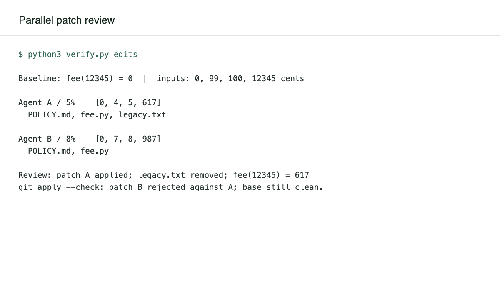
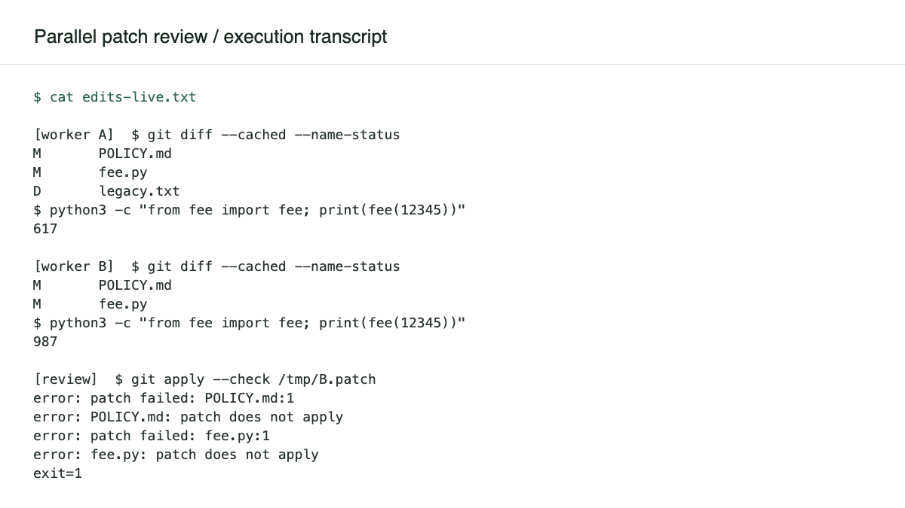

# 让两个编码 Agent 同时改一份代码，最后合哪一版？

团队让两个编码 Agent 并行时，首先要定的是谁写验收规则。我们让 A 按 5% 收费，B 按 8% 收费，双方在同一份代码的独立副本里修改和测试，竟都能交出全绿的结果。两个沙箱把改动分开，最终保留哪版，要靠团队在候选之外定义的计价规则。



*截图来自对归档补丁和测试结果运行的校验命令。两个候选都以相同四个整数分为输入。*

## 如何建立可比较的工作区

父沙箱初始化一个有三个文件的 Git 仓库，提交基线，再去掉目录的写权限。一次 `fork(count=2)` 得到两个子沙箱。每个子沙箱用 `git clone --no-hardlinks` 建自己的可写工作区。模型通过外部编排器并行收到任务，凭据留在编排器；两个代码工作区都禁用公网访问。父仓库开头始终返回 0。

模型返回文件内容和删除意图。驱动限制可修改路径，在对应子沙箱写文件、执行四个输入断言，再用 `git diff --cached` 导出补丁。首次选用的代码模板没有 Git，后续使用带 Git 和 Python 的模板完成这轮实验。复现前应在最终模板内实际检查这两条命令。

## 一份基线为何能派给两个人改

这里有两次复制，目的不同。CubeMaster 收到 `fork` 后，对源沙箱取一次快照，再基于同一快照派生多个实例；v0.8.0 在单个请求内最多并发执行 8 个派生操作。SDK 按子实例返回成功对象或错误，某个子实例失败时，已经成功的兄弟实例仍然存在。调度器因此要记录每个成功的 ID，保留通过的候选，只补足缺失项，任务结束时逐个回收。补跑也要固定到原基线；父工作区已经有新改动时，再做一次派生就不再是同一组对照。这个 8 是实现中的并发限制，没有给出团队应当启动多少 Agent 的答案。[CubeMaster 派生实现](https://github.com/TencentCloud/CubeSandbox/blob/v0.8.0/CubeMaster/pkg/service/httpservice/cube/fork.go#L32-L110) · [Python SDK 的部分成功约定](https://github.com/TencentCloud/CubeSandbox/blob/v0.8.0/sdk/python/cubesandbox/sandbox.py#L1156-L1172)

进入各自的来宾后再克隆 Git 仓库，是为了留下一个能核对的基线和一个方便导出改动的工作树。A 删除旧文件只会进入 A 的补丁。B 和父沙箱仍能查看基线。若改用同一个可写共享卷装工作树，两个独立来宾仍可能改到同一份文件。团队若只需并行编辑文本，而且参与者可共享同一套依赖，独立 Git 工作树就能满足这部分需求；当候选要安装不同依赖、执行构建或运行代码时，独立来宾还能把进程和运行环境一起分开。

## 两个补丁如何取舍

| 候选 | 输入 0、99、100、12345 分的结果 | 其他改动 |
| --- | --- | --- |
| A · 5% | 0、4、5、617 | 更新说明，删除旧文件 |
| B · 8% | 0、7、8、987 | 更新说明，保留旧文件 |

审阅者在父沙箱中新建第三个工作区，先检查 A，再应用并验证删除和 617 分结果。此时对 B 执行 `git apply --check` 返回非零。两个子工作区中的基线以及父仓库的工作树均保持干净。沙箱隔离了写入，Git 检查暴露了不兼容的文本改动；最终由审阅规则决定保留 5%。



*补拍时重跑了同一任务。A 删除了旧文件，B 保留它；第三个工作区检查 B 时同时报告了两处冲突。*

[查看原始输出摘录](../../assets/data/cubesandbox-five-labs/edits-live.txt)

## 用到团队开发时

可把提交号、任务要求、补丁、测试命令和结果一起交给审阅者。两个补丁即便改不同文件也可能产生业务冲突，合并后的集成测试仍要运行。社区 Kakurizai 还讨论共享基线与变化层，这里用原生 fork 和独立 Git 克隆验证工作流，未部署其业务系统。

### 测试通过，为什么还需要独立验收？

原来四个断言是按各自任务的费率生成的，所以 A 和 B 都得了 4/4。现在假设产品负责人已经定下 5% 向下取整，让两个候选交给**同一个**验收器，用原始输出离线复核。A 仍然是 4/4，B 只在输入 0 时正确，得 1/4。若只用零金额做冒烟测试，则连费率写错都发现不了。99 分和 100 分恰好跨过 5% 计费从 4 分到 5 分的边界。这些例子没有定义退款或负数的规则；业务一旦支持退款，要先补需求，再加验收样本。

可以据此分两种派工方式。**竞选方案**让多个 Agent 解决同一问题，由维护者事先固定业务样例，再从通过者中选一个。**并行分工**让不同 Agent 分别负责计价与账单展示，预先约定金额单位、舍入位置与公共接口，再在合并后的代码上测试整张账单。后一种情况下即便 Git 能干净应用两个补丁，一个模块返回“分”、另一个按“元”解释，结果仍会错。`git apply --check` 只覆盖补丁能否应用，业务验收器才负责这个问题。[Git 补丁检查说明](https://git-scm.com/docs/git-apply)

这次 A 与 B 收到的业务要求本来就不同；采纳 A 不能用作模型能力排名。要评估“多开几个 Agent 是否值得”，给单 Agent 和多 Agent 同一批任务、同一个独立验收器，同时记录每个通过方案消耗的模型调用、沙箱时间和人工审阅分钟数。本轮材料只回答隔离与审阅机制能否工作。

下载[原始数据](../../assets/data/cubesandbox-five-labs/edits.json)和[校验脚本](../../assets/data/cubesandbox-five-labs/verify.py)，放入同一目录后运行以下命令。

```sh
python3 verify.py edits
```

[下载实验脚本](../../assets/data/cubesandbox-five-labs/lab-sources.zip)。解压后按 README 设置测试端点和模板，入口为 `edit.py`。

[社区案例 Kakurizai](https://github.com/TencentCloud/CubeSandbox/blob/6843e3f97e67/docs/guide/usecases/kakurizai.md)
