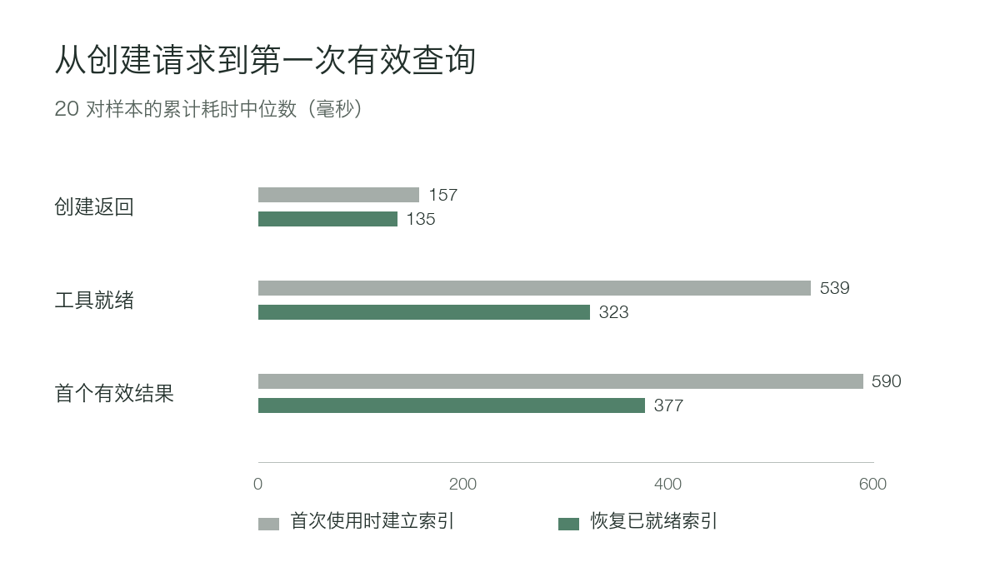
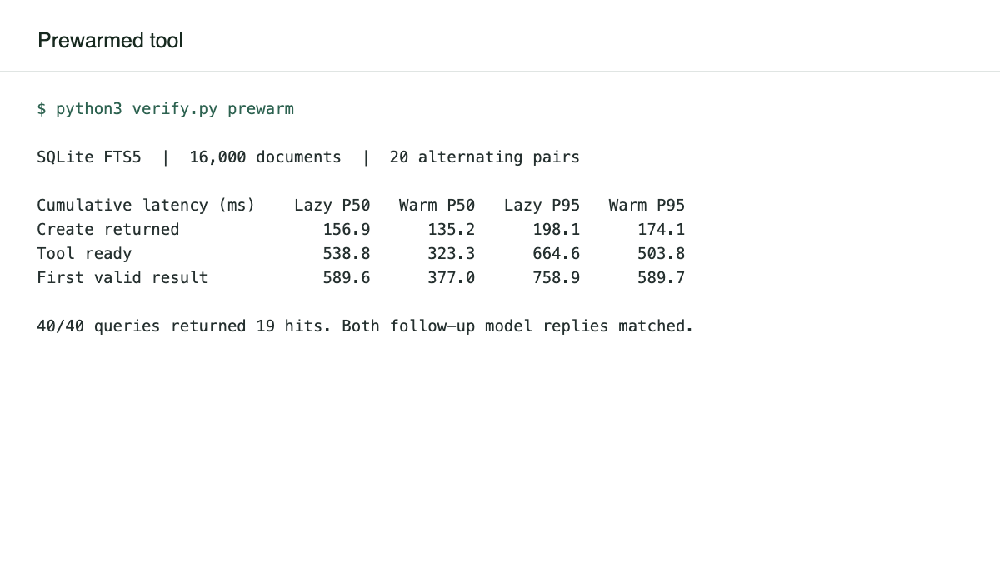

# CubeSandbox 预热实测：Agent 多久拿到第一个有效结果？

要决定给检索 Agent 做哪种模板，先确定用户从什么时候开始等：创建 API 一返回就停表，会漏掉第一次调用才建立的索引。我们在一台 KVM 节点上做了 20 对测试，把建好的索引放入完整快照，首个正确查询的中位耗时从 590 ms 降到 377 ms。想压低典型等待时间，这项改动有价值；想保证每次都在 1 秒内完成，还得单独检验最慢的恢复。



*三个时点都从发起创建开始计时。柱长表示各组 20 次的中位数，单位为毫秒。*

## 实验怎么做到只改变索引状态

同一基础模板、同一个常驻 Python HTTP 进程、同样的 16,000 条合成运维条目。先保存服务已启动但尚未建索引的完整快照，再用 SQLite FTS5 建立内存索引，保存第二份完整快照。因此两组都是快照启动；这里的冷态仅指索引未就绪。每轮恢复一份新的可写实例，结束即释放。

固定查询为 `component7 AND symptom3`。驱动从办公侧经 SDK 调用沙箱内的 HTTP 服务，两组依次执行 `/alive`、`/prepare`、`/query`。第一次探测校验预期初始状态，第二步幂等地确保就绪，第三步校验恰好命中 19 条。奇数轮先冷后热，偶数轮反过来。

## 预热省下的究竟是哪一步

假设把 Python、SQLite 和 16,000 条原始记录都装进镜像。新沙箱启动时，这些文件已经在磁盘上，但检索服务仍要创建数据库连接、分词并建立倒排索引。本例的数据库名是 `:memory:`，索引只存在于持有连接的服务进程里。仅把程序和依赖做成文件系统快照，下次启动仍要执行建索引代码。完整快照额外保存来宾内存，所以恢复后的同一个服务进程可以沿用已打开的连接。若应用把成品索引存成文件并在启动时打开，单独预制索引文件也值得作为对照，所需存储与启动成本要重新测量。[SQLite 内存数据库](https://www.sqlite.org/inmemorydb.html) · [v0.8.0 快照语义](https://github.com/TencentCloud/CubeSandbox/blob/v0.8.0/sdk/python/cubesandbox/sandbox.py#L853-L877)

制作模板时，探针决定快照会捕获哪一刻。本实验服务刚监听端口时，`/alive` 已返回 200，响应体中的 `ready` 仍为假。若只按 HTTP 状态码抓快照，就会把尚未建索引的状态复制给每一个会话。实际制作检索模板时，可让就绪探针查询一个固定样本，只有索引版本和命中结果都正确才返回成功；从制成的模板启动一个新实例，再执行同一查询。这样可以同时发现探针选早了和恢复后索引失效两类问题。

## 时间花在哪里

| 累计耗时（ms） | 冷态 P50 | 热态 P50 | 冷态 P95 | 热态 P95 |
| --- | ---: | ---: | ---: | ---: |
| 创建返回 | 157 | 135 | 198 | 174 |
| 工具就绪 | 539 | 323 | 665 | 504 |
| 首个有效结果 | 590 | 377 | 759 | 590 |

两组创建中位数只差约 22 ms，差距主要在建立索引的阶段拉开。40 次查询全部通过。计时外再让 DeepSeek 读取两种模式的工具结果，各一次，两个回答都是 19。样本包含 SDK、网络转发和命令分发的开销；模型生成耗时不在表内。P95 取每组排序后的第 19 个值。



*校验程序检查两个模型回答、40 个查询命中数和两个分组的样本量。*

## 哪些 Agent 值得预热

如果大量会话复用同版本的解析器、检索索引或工具依赖，可以把初始化工作提前到模板制作时。模型或索引频繁换版时，也要把重建快照的工时和存储算进去。网关凭据和用户资料应在会话建立后注入。一台共享节点上的短查询无法外推到跨节点拉取大快照或大模型首 token。

### 用自己的首请求时限做决定

把每次样本拆成三个区间，逐行相减再取中位数：创建返回到工具就绪，冷态 **373 ms**、热态 **181 ms**；工具就绪到拿到查询结果，分别为 **57 ms**、**55 ms**。前一个区间还包括两次探测和命令传递，不能把约 192 ms 全算成建索引的 CPU 时间。按轮次配对，首个有效结果的节省量中位数是 **195 ms**；两组各自中位数之差是 213 ms，二者统计口径不同。

同一份数据换一个服务目标，选型就可能改变。以下时限用于回看样本，并非实验预设的服务承诺。

| 从创建到正确结果的时限 | 冷态达标 | 热态达标 |
| --- | ---: | ---: |
| 500 ms | 0/20 | 17/20 |
| 600 ms | 11/20 | 19/20 |
| 1,000 ms | 20/20 | 19/20 |

唯一一次热态更慢发生在第 1 对，冷态 926 ms，热态 2,131 ms，其中热态创建返回就用了 1,705 ms。这次慢在创建阶段，现有记录无法再区分缓存、调度和存储。对于以 600 ms 为目标的交互式工具，这组数据支持小流量试用预热。若有 1 秒硬期限，先在多节点上分别测首次拉取和重复恢复，保留超时分母和快照大小。要估算模板制作值不值得，用每版会被创建的次数乘以**配对耗时差的均值**（本样本约 144 ms）；所得是累计少等的时间。构建工时、存储费用和 SLA 违约成本应分别核算。

下载[原始数据](../../assets/data/cubesandbox-five-labs/prewarm.json)和[校验脚本](../../assets/data/cubesandbox-five-labs/verify.py)，放入同一目录后运行以下命令。

```sh
python3 verify.py prewarm
```

[下载实验脚本](../../assets/data/cubesandbox-five-labs/lab-sources.zip)。解压后按 README 设置测试端点和模板，入口为 `prewarm.py`。

[社区预热服务教程](https://github.com/TencentCloud/CubeSandbox/blob/v0.8.0/docs/guide/tutorials/prewarm-template-service.md)
