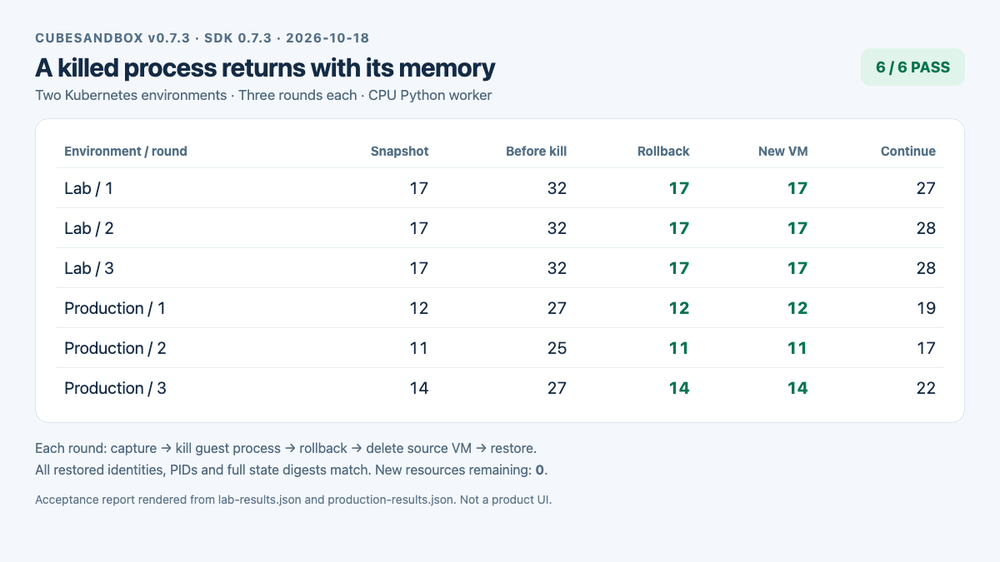
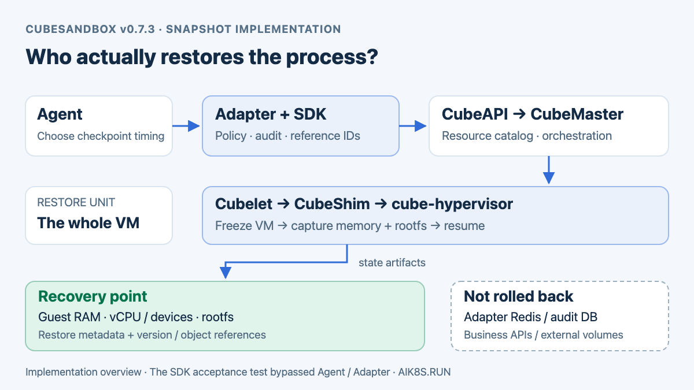
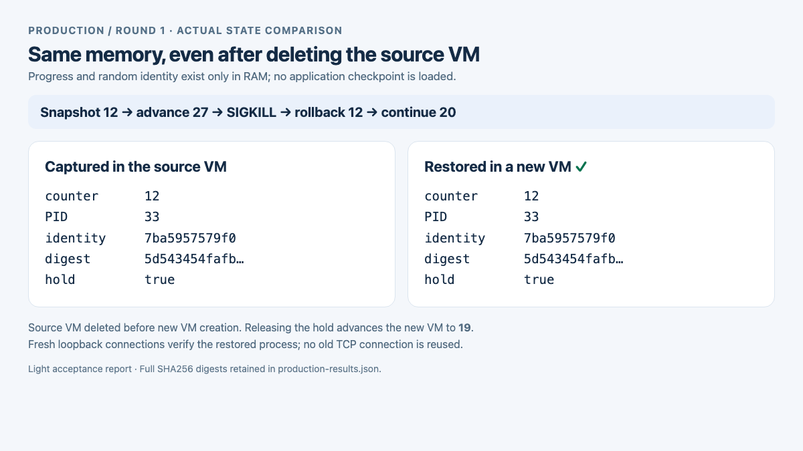

# CubeSandbox 快照实测：进程杀掉以后，能从原来的进度继续吗？

在[Adapter v0.6 的长任务实践](cubesandbox-agent-adapter-v06.md)里，后台 Job 可以跨客户端断线继续运行，Adapter 重启后也能接回状态、续读日志。那次任务一直留在原沙箱里，进程并没有被杀掉。

这次再往前走一步：让一个程序只在内存里保存进度，拍快照，故意杀掉进程，再恢复。随后删除整个原沙箱，用同一份快照创建新沙箱，检查进度还能不能找回来。

2026 年 10 月 18 日，两套 Kubernetes 环境上的 CubeSandbox v0.7.3 各完成三轮，六轮全部通过。进程的计数、随机身份、PID 和状态摘要都恢复到了快照时的值，恢复后能够继续递增。本文使用 Python SDK 0.7.3，测试没有修改现有部署、节点标签或网络配置。



*Light 模式实测报告。图片由本次脱敏 JSON 生成，在浏览器中截图；它不是 CubeSandbox 控制台界面。完整数值见文末结果文件。*

## 先把依赖关系讲清楚：谁把进程保存下来？

**内存恢复依赖 CubeSandbox 的 VM 快照能力。Agent 发起请求，Adapter 加上权限和资源管理，真正暂停、保存和恢复 VM 的是 CubeSandbox 节点上的运行时。** 这次脚本直接调用 SDK，跳过了 Agent 和 Adapter，验证的是这层底座能力。



*实现链路示意，依据 v0.7.3 源码整理，不是本次请求的运行时追踪截图。图中 Agent/Adapter 是接入方式；本次实测由 Python SDK 直接进入 CubeAPI。*

### Agent 和 Adapter 做到哪一步

以 OpenClaw 调用 `cube_checkpoint` 为例，完整接入链路是：

```text
Agent: cube_checkpoint
  → Adapter: authorize identity, lease, Profile and checkpoint policy
  → Python SDK: sandbox.create_snapshot()
  → CubeAPI: POST /sandboxes/{sandboxID}/snapshots
  → CubeMaster: register snapshot work, locate the source node
  → Cubelet: CommitSandbox, coordinate the node operation
  → CubeShim / cube-hypervisor: freeze VM, capture runtime state
  → Snapshot storage: retain memory, rootfs and restore metadata
```

Adapter 返回的 `checkpoint_ref` 是一个受权限保护的引用。它内部对应 CubeSandbox 返回的 `snapshot_id`，还关联租约、租户和 `backend_id`。**Adapter 不读取 Python 对象，不把 Guest RAM 存进 Redis，也不会根据聊天记录重新算出程序进度。** 调用 `cube_rollback` 时，它找到原快照，再通过 SDK 请求 CubeSandbox 恢复。[Adapter 对应实现](https://github.com/aik8s/cubesandbox-agent-adapter/blob/ac6a16494b83953d8c8efa8a734cc5f973e8478c/adapter/core.py#L1187)

CubeAPI 负责对外接口；CubeMaster 将快照作为平台资源管理，并把具体操作交给原节点的 Cubelet。节点上的 CubeShim 与仓库内的 `cube-hypervisor` VMM 协作。后者沿用了 Cloud Hypervisor 的相关实现；这里恢复的是虚拟机，不是用容器重启策略重新执行一遍 Shell。

### 快照里保存了什么，为什么 PID 也能回来

可恢复的状态需要几部分配合，不能只保存程序文件：

| 状态 | 保存的内容 | 在这次测试中的作用 |
| --- | --- | --- |
| Guest RAM | Guest 内核数据、进程地址空间、堆、栈和运行时对象 | 保留计数、随机身份、暂停标记，以及内核中的进程记录 |
| vCPU 与设备运行状态 | 执行位置、寄存器及受支持的虚拟设备状态 | 让 VM 恢复执行，而不是从程序入口重新启动 |
| rootfs 快照 | 沙箱根文件系统中的代码、依赖和可写文件 | 把根文件标记恢复到 `before-snapshot` |
| 恢复配置和元数据 | VM 规格、内核/镜像版本、内存与磁盘对象引用等 | 找到正确的快照对象，以兼容配置重建 VM |

从 VM 的外部看，Python 解释器的对象和 Guest 内核的进程表都是 Guest RAM 中的数据。恢复这份内存及执行状态后，程序不需要自己重新构造 `counter` 和 `identity`。表中的 PID **33 是 Guest 内的 PID**；原 VM 被删除再创建一台新 VM，并不要求宿主机上的进程 PID 也相同。

这也解释了“新沙箱 ID 不同，Guest PID 却相同”：平台创建的是一个新的沙箱资源，里面装载的是旧 VM 的执行现场。它不是从零启动一套 Guest 系统后，恰好又把 Python 分配成 PID 33。

### 创建和恢复在节点上怎样完成

v0.7.3 中支持协调快照的路径，会先冻结 VM，在同一个冻结窗口内捕获内存状态、提交 rootfs 的 CoW 快照，再恢复原 VM 执行。这样可以避免内存已经保存，而程序还在继续修改磁盘，导致两部分来自不同时间点。对应到源码，是 `CommitSandbox` 驱动 `SnapshotCapture`，完成 rootfs 操作后再发送 `SnapshotResume`。[节点协调代码](https://github.com/TencentCloud/CubeSandbox/blob/v0.7.3/Cubelet/services/cubebox/template_ops.go#L224)

快照在逻辑上提供完整可恢复状态，但不要求每次都物理复制所有字节：节点存储使用 CoW；内存路径可以在有效基底上使用增量/soft-dirty 捕获，缺少可用基底时退回 full。保存更少数据是实现优化，恢复时仍要有完整、正确的基底与状态。源码也保留了旧 Shim 的兼容分支，所以实际一致性能力需要同时核对节点运行时，不能只看 CubeAPI 版本。

恢复分两种入口：

1. `sandbox.rollback(snapshot_id)` 保留平台侧原沙箱标识，在内部撤掉当前 VM 执行现场，装载快照的内存、磁盘和配置，再恢复执行。它不是撤销刚才的 `SIGKILL`，而是把整台 VM 换回杀进程之前保存的状态；恢复失败也不意味着旧执行现场还能回来。
2. `Sandbox.create(template=snapshot_id)` 分配新的平台沙箱资源，将那份快照作为恢复源。`cube_fork` 使用的也是这种能力，再给新沙箱登记新租约；它不是自动生成新的训练 Job。

本次 `/hold` 只是测试程序暂停计数的应用层屏障，用于精确比较前后值。**真正冻结 VM 的动作由 CubeSandbox 完成**，并不依赖测试 HTTP 服务。回滚会中断旧连接，客户端需要重新连接；测试中的每次状态查询都建立新连接。[Shim 回滚说明](https://github.com/TencentCloud/CubeSandbox/blob/v0.7.3/CubeShim/docs/shimapi/rollback-snapshot.md)

### 快照、Redis 和审计库，各存一份什么

| 位置 | 存什么 | 不能替代什么 |
| --- | --- | --- |
| CubeSandbox 快照存储 | VM 内存、rootfs、恢复元数据；存储后端可以是节点本地 XFS 或共享 S3 路径 | 不能恢复外部数据库或挂载卷已经发生的业务变更 |
| Adapter 状态后端 | 租约、Job、检查点引用与后端的映射；默认在进程内存，配置可靠 Redis 后才可跨 Adapter 重启保存 | 只有 `snapshot_id` 没有对应快照对象，不能还原 VM |
| Adapter 审计库 | 谁请求了什么、执行意图、结果和审计链；由 SQLite 或 PostgreSQL 持久化 | 审计记录不包含恢复整台 VM 所需的内存镜像 |

Kubernetes 在这套部署里负责托管控制面、节点组件、Service 和持久存储等基础设施。这里没有使用 Kubernetes Job 重试或 Pod 重启来找回 Python 内存；快照资源和 VM 恢复由 CubeSandbox 管理。要实现“每隔一段时间保存，失败后选择恢复点”的自动流程，还需要上层任务管理逻辑决定保存时机、恢复策略，以及如何处理外部副作用。单独安装 Adapter 不会自动获得这套流程。

如果 OpenClaw 在办公网，执行沙箱在生产环境，**保存下来的是生产沙箱，不是办公网 Agent 的对话和计划**。Agent 自身的会话持久化由客户端或 Agent 框架完成；重新接入时，仍需要找到原租约、Job 或检查点引用。本次 SDK 测试验证进程恢复，没有把 Agent 会话恢复算作通过项。


## 怎样排除“脚本重新启动，然后从文件读进度”

测试程序由一个递增线程和一个只监听沙箱回环地址的 HTTP 服务组成。递增线程每 100 ms 加一，状态查询只读内存。程序启动时生成随机身份，不读取业务检查点，也不把进度保存成文件。

每次查询返回五项：`counter`、`held`、`identity`、`pid`、`digest`。其中摘要由随机身份与当前计数组合计算，公开记录只保留身份的短哈希，不输出原始随机值。

为了精确比较，拍快照前通过 `/hold` 暂停递增；HTTP 服务和进程仍在运行。这个应用层屏障让快照前后的计数有一个确定值，不会因为查询晚了几十毫秒就不同。恢复后调用 `/run`，观察同一个身份的计数继续增长。

这个设计还检查了已知进度之外的东西：PID 相同只能算辅助证据，真正用于判断的是**内存随机身份、计数、暂停标记与摘要同时一致**。重新运行脚本会生成新的身份，不能通过这些比较。

## 第一条路径：进程已经被杀，回滚把它带回来

正式三轮中的生产侧第一轮，观测值如下：

| 阶段 | 计数 | PID | 身份短哈希 |
| --- | ---: | ---: | --- |
| 拍快照时 | 12 | 33 | `7ba5957579f0` |
| 继续运行后 | 27 | 33 | `7ba5957579f0` |
| 杀掉进程，再执行回滚 | 12 | 33 | `7ba5957579f0` |
| 解除暂停，继续运行 | 20 | 33 | `7ba5957579f0` |

脚本在计数增长之后向这个测试 PID 发送 `SIGKILL`，确认回环 HTTP 查询已经失败，才调用 `source.rollback(snapshot_id)`。回滚完成后的查询重新成功，内存状态与快照前完全一致。另一个根文件标记也从 `after-snapshot` 回到了 `before-snapshot`。

这一步没有重新启动测试程序，没有加载模型文件，也没有从日志里解析计数。



*同一轮的真实状态记录。`digest` 比较使用完整 SHA256，图片显示短摘要便于阅读，完整值保存在 JSON 中。*

## 第二条路径：原沙箱删掉，用快照创建新沙箱

回滚验证结束后，脚本调用 `source.kill()` 删除原沙箱。接着使用先前的快照创建新沙箱：

```python
snapshot_id = source.create_snapshot().snapshot_id

# The source can be deleted; the snapshot is retained independently.
source.kill()
restored = Sandbox.create(
    template=snapshot_id,
    timeout=600,
    allow_internet_access=False,
)
```

这一轮新沙箱里，测试进程恢复到计数 **12**、PID **33**、身份短哈希 `7ba5957579f0`；完整状态摘要也与拍快照时一致。解除暂停后，计数增长到了 **19**。

这里保存下来的不只是工作目录。原沙箱删除后，快照里仍然包含能重新运行起来的进程状态。注意快照会重新带回相同的进程内身份；把它用于多个分支时，需要重新分配外部任务标识，不能直接把进程里保存的身份当成全局唯一的新任务 ID。

## 六轮实际结果

每轮都重复“拍快照 → 递增 → 杀进程 → 回滚 → 继续递增 → 删除原沙箱 → 从快照创建新沙箱 → 再次递增”。以下只列状态值，不把不同环境的客户端耗时混成性能榜。

| 环境 / 轮次 | 快照计数 | 杀进程前 | 回滚恢复 | 回滚后继续 | 新沙箱恢复 | 新沙箱继续 |
| --- | ---: | ---: | ---: | ---: | ---: | ---: |
| 测试 / 1 | 17 | 32 | 17 | 28 | 17 | 27 |
| 测试 / 2 | 17 | 32 | 17 | 28 | 17 | 28 |
| 测试 / 3 | 17 | 32 | 17 | 28 | 17 | 28 |
| 生产 / 1 | 12 | 27 | 12 | 20 | 12 | 19 |
| 生产 / 2 | 11 | 25 | 11 | 18 | 11 | 17 |
| 生产 / 3 | 14 | 27 | 14 | 21 | 14 | 22 |

六轮都核对了完整状态相等、恢复后增长和清理结果。正式测试前另做了一轮生产侧预检，也通过；上表仅统计随后固定流程的六轮。结束时两套环境均无本次新增沙箱和快照遗留，原有资源保留。

## 在自己的环境复现

准备能执行 Python 3 的 READY 代码模板，以及同时可达的 CubeAPI 和 CubeProxy。只在已获授权的环境运行；脚本会创建和删除临时沙箱、快照。它不修改集群资源配置，不安装额外服务，也不需要测试程序访问外网。

下载[完整验证脚本](../../assets/rag-agent/cubesandbox-process-snapshot/process_snapshot_probe.py)，在 SDK 客户端环境执行：

```sh
python3 -m venv .venv
. .venv/bin/activate
pip install 'cubesandbox==0.7.3'

# Replace example endpoints with controlled endpoints reachable by this client.
export CUBE_API_URL=https://cube-api.example.invalid
export CUBE_PROXY_NODE_IP=cube-proxy.example.invalid
export CUBE_PROXY_PORT_HTTP=80
export CUBE_TEMPLATE_ID=your-ready-code-template
# If authentication is enabled, inject CUBE_API_KEY from your Secret manager.

python process_snapshot_probe.py --environment lab --rounds 3 > results.json
```

脚本通过 SDK 启动测试进程，使用沙箱内部的回环 HTTP 查询状态。回滚后的查询重新建立连接，不复用快照前的 TCP 会话。CubeAPI 与数据面的跨网链路仍应经过受控内网或隧道；这里只设置 SDK 连接参数，不会自动创建网络通道。

结果包含逐轮状态、检查项和清理情况；`result` 为 `PASS` 且 `new_sandboxes_remaining`、`new_snapshots_remaining` 均为 0，才算本轮完成。遇到创建或恢复失败时，保留失败记录，不要直接重复可能已发生的外部操作。

## 接到 Adapter 上，还需要分清几件事

Adapter 的 `cube_checkpoint`、`cube_rollback`、`cube_fork` 是带策略和租约映射的入口，底层分别使用快照、回滚和从快照创建。本次进程内存验收直接调用 SDK，没有改变现有生产 Profile，也没有把 SDK 的结果当作各 Agent 原生工具已经复测。

当前有三个需要按场景处理的地方：

- `cube_job_resume` 接续的是日志游标，不执行 VM 回滚。Agent 断线、后台 Job 仍在运行时，用原 `job_ref` 继续查询即可。
- VM 回滚不会把外部 Redis 中的 Adapter Job 记录一起回滚；快照分支也不会自动复制成一套新的 Job 映射。接入完整任务恢复流程时，要协调进程状态与控制面记录，不能只看旧缓存中的完成状态。
- SDK 快照独立于原沙箱生命周期；Adapter 的 `cube_release(action=kill)` 则会清理该租约管理的快照。需要长期保留恢复点时，应先设计好保留与回收策略，不能先释放租约再假设检查点仍然存在。

这些区别决定了长任务应该选哪条路径：连接断开时接续观察；进程状态需要撤回时做受控 VM 恢复；需要换环境继续训练或清洗时，使用业务检查点和持久存储。

## 这次结果适用到哪里

本次工作负载是 CPU Python 进程，没有 GPU、外部挂载卷、数据库写入或对外长连接。递增线程在应用层屏障处拍快照，验证了这类运行进程的内存恢复；没有做宿主机断电、跨节点调度或数小时训练恢复实验。

外部服务不会随着 VM 回滚：已经提交的数据库事务、发送的消息、调用的模型 API 不会撤销。恢复后可能再次执行快照之后的动作，业务上仍要安排幂等键、检查点提交和去重。带挂载卷时，卷中数据也不随 VM 快照回到过去，之前的[带卷验收记录](https://github.com/aik8s/cubesandbox-agent-adapter/blob/ac6a16494b83953d8c8efa8a734cc5f973e8478c/docs/assets/cubesandbox-upstream/v073-production-volume-results-2026-10-14.json)已验证这一点。

跨节点恢复还有独立的存储与兼容性条件。官方 v0.7.3 文档区分节点本地 XFS 和共享 S3 快照后端，不能把“删除原沙箱后恢复成功”推导成“原宿主机丢失后也能恢复”。参见[跨节点快照指南](https://github.com/TencentCloud/CubeSandbox/blob/v0.7.3/docs/guide/cross-node-snapshot.md)。

这轮补齐的结论是：**在本次两套环境与 CPU 工作负载下，CubeSandbox 能从快照恢复被杀进程的内存状态，也能在删除原沙箱后将这份状态恢复到新沙箱，并继续执行。** 要把它用于生产长任务，下一层工作是任务映射、外部副作用和恢复点生命周期。

## 脚本、结果与参考

- [可复现验证脚本](../../assets/rag-agent/cubesandbox-process-snapshot/process_snapshot_probe.py)
- [测试环境三轮结果](../../assets/rag-agent/cubesandbox-process-snapshot/lab-results.json)
- [生产环境三轮结果](../../assets/rag-agent/cubesandbox-process-snapshot/production-results.json)
- [Light 验收报告](../../assets/rag-agent/cubesandbox-process-snapshot/report.html)
- [CubeSandbox v0.7.3：Snapshot、Rollback 与 Clone](https://github.com/TencentCloud/CubeSandbox/blob/v0.7.3/docs/guide/snapshot-rollback-clone.md)
- [Adapter 长任务、多集群与持久审计实践](cubesandbox-agent-adapter-v06.md)

- [v0.7.3 控制面快照接口](https://github.com/TencentCloud/CubeSandbox/blob/v0.7.3/CubeAPI/src/services/snapshots.rs)、[Master 快照任务实现](https://github.com/TencentCloud/CubeSandbox/blob/v0.7.3/CubeMaster/pkg/templatecenter/snapshot_ops.go)
- [v0.7.3 VMM 快照格式与恢复说明](https://github.com/TencentCloud/CubeSandbox/blob/v0.7.3/hypervisor/docs/snapshot_restore.md)
