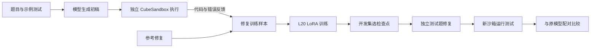
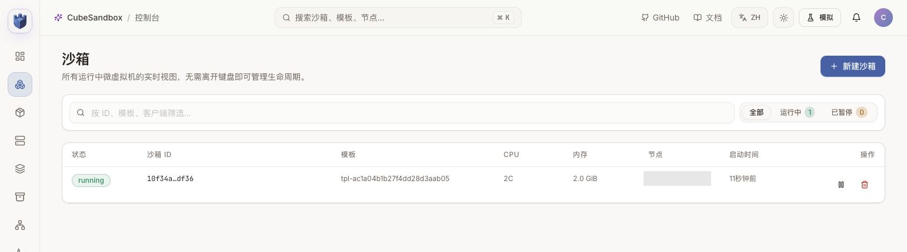
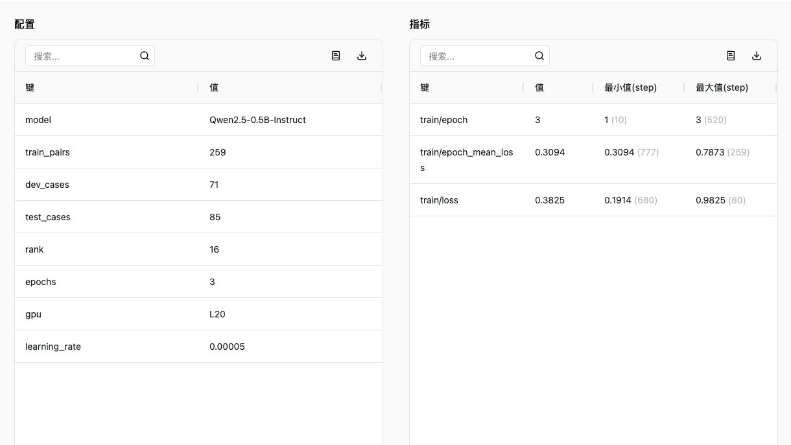
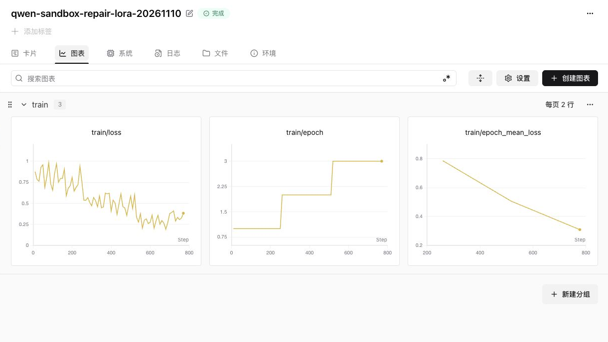
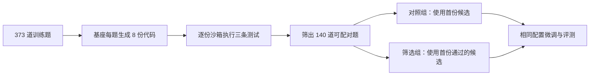
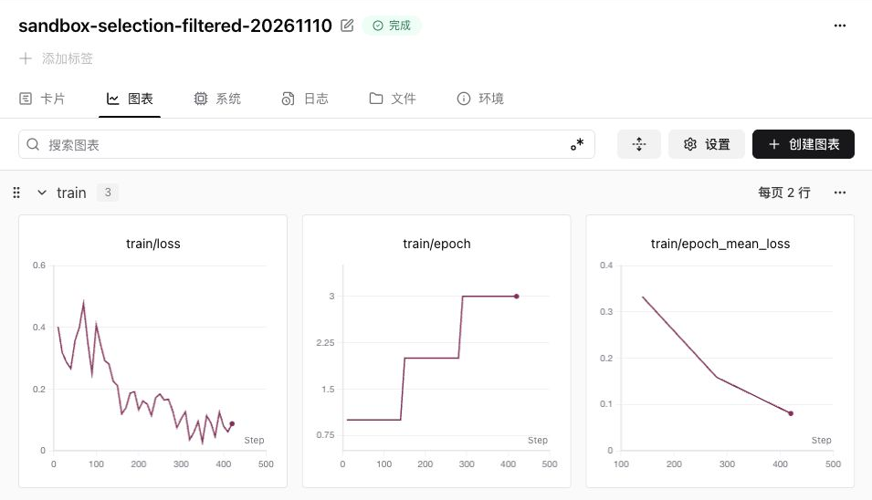

# 用沙箱辅助代码修复训练：CubeSandbox 与 Qwen 单卡实战

代码模型写错之后，能不能先执行、拿到错误，再学习如何修复？这次实战用一张 NVIDIA L20 微调 Qwen2.5-0.5B-Instruct，用 CubeSandbox 为每段代码创建独立运行环境，并记录测试和错误。

在原始模型第一次未通过示例测试的 85 道独立测试题上，原模型接收执行反馈后修对 5 题，微调模型修对 20 题、另有 1 题执行异常未判定。按两组均有结果的 84 题配对，18 题从失败变为通过，3 题从通过变为失败。

<strong>这说明本次代码修复训练观察到了改善，但不能说明提升由 CubeSandbox 或错误反馈单独造成。</strong>微调后不提供具体错误反馈也通过了 20/85；训练时不提供错误详情的补充对照通过了 16/85，另有 2 题未判定。沙箱在这里提供的是独立执行、文件状态隔离、清理和批量管理，而不是训练算法。

本文是一次小规模探索，环境地址、账号与节点信息已脱敏。代码题来源于 [MBPP](https://github.com/google-research/google-research/tree/master/mbpp)，公开题目可能被模型预训练见过；测试结论不代表通用编程能力或安全认证。相关背景参见[大模型训练沙箱综述](agent-rl-training-sandboxes.md)。

## 1. 为什么先改实验

上一轮用 373 条参考答案做监督微调，测试表现没有超过原模型。更重要的是，这种训练即使不使用沙箱，只要能读取可信的参考代码也可以进行：当时的沙箱主要用于检查已有答案，并未体现它给训练流程带来的独特价值。

新实验改为让模型先写代码，再用隔离环境执行示例测试。错误代码、执行输出和参考修复一起构成训练数据；评估阶段再对修复结果执行测试。沙箱的作用出现在模型<strong>真正需要运行代码、观察失败并反复重建环境</strong>的地方。



训练与沙箱位于不同环境；本次通过工作站手动传递批次文件。图中的数据流不是已实现的自动队列、跨集群直连或在线强化学习。训练方法是监督微调（SFT），不是强化学习。

## 2. 沙箱解决什么问题

| 环节 | 本次具体做法 | 能解决的问题与边界 |
| --- | --- | --- |
| 执行模型代码 | 每份候选创建独立沙箱，运行示例测试并记录标准输出、错误和退出状态 | 不必把代码直接放在训练器进程里运行；普通进程也能运行代码，但需要自行提供隔离和清理 |
| 还原状态 | 单题使用新实例，执行后销毁 | 减少文件残留干扰下一题；不能据此声称覆盖全部逃逸风险 |
| 反馈样本 | 将真实失败代码及错误信息与训练集参考修复配对 | 可以构造代码修复训练任务；错误反馈是否被模型有效使用仍需消融 |
| 评估 | 新建沙箱执行同一题的不同模型输出 | 提供统一的测试方式；测试质量、超时和基础设施错误仍需独立处理 |

实测中，在沙箱 A 写入临时文件后，沙箱 B 看不到该文件，而 A 仍可读取；两个实例随后销毁。这证明本次特定配置下的文件状态相互独立，不能推广为完整的安全隔离证明。



图 1：真实 CubeSandbox 控制台中的运行中实例。截图中的实例为展示环境单独创建，并非训练批次的同时运行截图；节点信息已遮挡。

本次创建请求设置了 `allow_internet_access=False`。但网络连通检查的允许访问对照也失败，因此<strong>没有验证禁网策略生效</strong>。测试与被测代码位于同一个客体环境，也未证明隐藏测试能够抵抗恶意程序读取。涉及不可信代码的正式环境还需独立验证网络、权限、资源和验证器边界。

## 3. 用真实执行失败构造训练样本

先用 Qwen2.5-0.5B-Instruct 对 563 道题生成代码。每题只给题目描述和第一条示例测试；通过沙箱运行后，收集初稿及其实际错误。训练候选来自 MBPP 训练题范围，参考解事先通过对应测试。

| 批次 | 原始题目 | 示例测试失败、进入修复流程 | 其他情况 |
| --- | ---: | ---: | --- |
| 训练 | 373 | 259 | 112 条通过；2 条执行异常，重试仍异常并排除 |
| 开发 | 90 | 71 | 19 条示例测试通过 |
| 最终测试 | 100 | 85 | 15 条示例测试通过 |

最终 100 题与训练题、开发题按 ID 分开，且没有出现在上一轮已查看的 200 道测试题中。这里的 15 条只表示<strong>第一条示例测试通过</strong>，没有据此声称它们通过完整测试。训练样本的目标修复来自公开数据集参考解，不是由沙箱自动生成。每题只取一份初稿；结果不等于在更大样本、不同随机种子下都成立。

例如，独立测试中的一题要求删除第一个字符串中出现在第二个字符串里的字符。模型初稿实际生成：

```python
def remove_dirty_chars(str1, str2):
    set1 = set(str1)
    set2 = set(str2)
    common_chars = set1.intersection(set2)
    return ''.join(common_chars)
```

沙箱执行题目给出的示例断言，实际返回 `AssertionError`。微调模型接收同一份代码和该错误反馈后生成：

```python
def remove_dirty_chars(string1, string2):
    result = [char for char in string1 if char not in string2]
    return ''.join(result)
```

这份输出通过了该题的三条数据集测试。它是一次真实的修复案例，不代表所有边界条件已被覆盖，也不能单独证明错误文本发挥了作用。

## 4. 单卡训练与 SwanLab 记录

| 项目 | 本次设置 |
| --- | --- |
| 模型 | Qwen2.5-0.5B-Instruct |
| GPU | 1 张 NVIDIA L20 |
| 训练数据 | 259 条初稿失败、带真实执行反馈及参考修复的样本 |
| 方法 | BF16 LoRA，rank 16，alpha 32；注意力及 MLP 投影层 |
| 优化 | AdamW，学习率 0.00005，batch size 1，3 轮，共 777 步 |
| 可训练参数 | 8,798,208 |
| 显存口径 | PyTorch 峰值已分配约 3.40 GiB，不等于整卡显存占用 |



图 2：真实 SwanLab 实验卡片中的模型、样本数、训练配置与损失；账号和主机信息已裁掉。`test_cases=85` 是初稿未通过示例测试、进入修复评估的题数。

3 轮训练的平均损失依次为 0.7874、0.5064、0.3094。训练脚本每 10 步上报最近窗口的损失，并在每轮结束上传平均值；曲线展示训练过程，<strong>损失下降本身不能证明修复效果提高</strong>。



图 3：真实 SwanLab 训练曲线，左、中、右分别为按步记录的损失、轮次及每轮平均损失，横轴为优化步数。

71 道开发题上，原模型带反馈的修复通过 4 题；第 1、2、3 轮检查点分别通过 12、15、14 题，第 1 轮有 2 题、第 3 轮有 1 题执行异常，重试仍无法判定。即使这些未知项全部通过，第 2 轮仍是最高或并列最高；因此选用较早的第 2 轮作为后续测试检查点。将保存的 LoRA 重新加载后，在 71 条开发输入上的原始生成文本与训练时完全一致。

## 5. 85 道独立题的六组对照

以下题目都先让原模型生成初稿，且该初稿未通过第一条示例测试。六组使用相同的题目、初稿、示例、解码参数及测试；“有反馈”额外提供沙箱的实际输出，“无反馈”提示没有执行结果。修复结果使用新的沙箱运行该题三条测试；第一条已经在提示中，其余两条未向模型展示。

| 模型 | 修复时的错误反馈 | 通过 | 测试未通过 | 执行未判定 |
| --- | --- | ---: | ---: | ---: |
| 原模型 | 有 | 5 | 80 | 0 |
| 原模型 | 无 | 7 | 77 | 1 |
| LoRA 第 2 轮 | 有 | 20 | 64 | 1 |
| LoRA 第 2 轮 | 无 | 20 | 65 | 0 |
| 无错误详情训练的 LoRA 第 3 轮 | 有 | 15 | 69 | 1 |
| 无错误详情训练的 LoRA 第 3 轮 | 无 | 16 | 67 | 2 |

另将这 85 道题的数据集参考解送入新沙箱执行全部测试，85 条均通过；这只能排除参考解不通过测试的情况，不能保证测试覆盖充分。各组未判定项均为接近命令超时的 `RemoteProtocolError`，分别重试一次仍异常；根因可能是被测代码超时或通信问题，本次没有区分，不能直接当作模型答错或成功。比较“原模型有反馈”和“微调后有反馈”时，84 道两组都完成测试的题目中，18 道从失败变为通过，3 道从通过变为失败，2 道都通过，61 道都失败。该配对集上通过数从 5/84 增至 20/84；另一道保持未判定。

<strong>反馈消融没有给出正向证据：</strong>微调模型有反馈和无反馈均通过 20 道；在两组都完成的 84 题中，有反馈相对无反馈改善 5 道、退化 4 道。因此不能声称模型已学会利用错误文本，也不能把训练收益归因于沙箱。随后补做了一组训练时不提供错误详情的对照：同样使用 259 道由沙箱筛选出的失败代码和相同参考修复、模型与训练参数，只把错误详情替换为不可用提示。该组在开发集选第 3 轮（16/71），重新加载后开发集 71/71 输出一致；它在最终集不带反馈通过 16 题、带反馈通过 15 题。与带反馈训练的模型比较时，选中的检查点分别经历 777 和 518 步，且每组只训练一次；这些探索结果不足以确定训练时加入错误详情是否带来收益。可能发生的是模型学到了修复任务的输出格式和一般模式；这只是待验证的解释。

[下载脱敏逐题结果](../../assets/data/cubesandbox-sft-practice/repair-results.json)。各训练配置只运行了一个随机种子，使用公开的简单代码题，训练和测试也可能存在语义相似；结果应看作探索而非生产收益或跨模型保证。之前 373 条普通代码 SFT 的负面结果没有被覆盖，两次使用的模型、训练目标和评测任务不同，不能直接比较分数。

### 额外检查：离开修复提示后还会怎样？

为了评估发布模型时的适用边界，我们另外选取 100 道按题目 ID 与前述实验分开的 MBPP 题目：只给任务描述和第一条示例，让模型直接生成代码，不提供待修代码或错误信息。基座通过 18 题，修复 LoRA 通过 21 题；基座另有 1 题两次执行均未判定。在两组都能判定的 99 题中，8 题由失败变通过、5 题由通过变失败。示例已经出现在输入中，另两条测试未向模型展示；代码仍在客体内执行，结果依赖这些有限的测试。

这组差异较小，不能证明 LoRA 的通用编程能力提高，也不能保证其他任务不退化。发布时应将它定位为针对特定提示格式的实验性代码修复 LoRA，披露数据来源、测试口径和失败案例；在完成额外验证前，本次不发布权重。

## 6. 让沙箱筛选训练答案：一组同题对照

前面的修复实验没有证明错误反馈本身带来了收益。为进一步检验“执行验证”能否改善训练数据，我们新增一组更直接的对照：基座模型先为每道训练题生成 8 份候选代码，在独立沙箱里逐份运行该题的 3 条测试，再从中选择通过测试的答案作为微调目标。这个流程是<strong>执行结果筛选监督微调数据</strong>，不是在线强化学习；普通容器或其他安全执行环境也可以实现同类验证。



从 373 道候选训练题生成 2,984 份答案。最初每题生成 3 份，观察到训练池通过率较低后追加 5 份；这一决定发生在查看开发集或最终测试结果之前。排除首个答案未通过语法或静态筛查的 100 题、没有通过答案的 127 题和存在未判定结果的 6 题后，保留 140 题。两组使用相同题目、模型、随机种子、LoRA 参数、3 轮训练及 420 个优化步：

| 组别 | 对同一道题使用的训练答案 |
| --- | --- |
| 未筛选对照组 | 第一份可执行候选，无论测试是否通过 |
| 沙箱验证筛选组 | 按生成顺序选第一份通过全部测试的候选 |

140 题中，74 题的首个候选未通过，筛选组改用了后续通过的候选；其余 66 题两组的目标一致。由于两组共同的题目集合本身经过执行结果筛选，这个实验比较的是<strong>目标答案的选择</strong>，并非“完全不用沙箱”的端到端成本比较。



图 4：筛选组真实训练页面的浅色截图，左为按步损失，中为轮次，右为每轮平均损失；账号和其他实验列表已裁掉。它记录训练过程，不单独证明效果。

先在 90 道开发题上比较各轮检查点，未筛选组依次通过 17、16、21 题，第 3 轮另有 1 题未判定；筛选组依次通过 27、28、30 题。两组都在查看最终测试前选定第 3 轮。开发题曾用于此前探索，因此它只用于选检查点，不当作全新盲测。随后在另一组按题目 ID 留出的 100 道测试题上，各组以相同提示和贪心解码各生成一次，再由新沙箱运行同样的测试：

| 模型 | 通过题数 | 未通过或未能执行的题数 | 未判定 |
| --- | ---: | ---: | ---: |
| 原始模型 | 28 | 72 | 0 |
| 未筛选对照 LoRA | 30 | 70 | 0 |
| 沙箱验证筛选 LoRA | 36 | 64 | 0 |

其中一道题要求按分数排序科目元组，给出的示例使用函数名 `subject_marks`。未筛选组输出的是：

```python
def custom_sort_tuples(tuples_list):
    return sorted(tuples_list, key=lambda x: (x[1], x[0]))
```

筛选组输出的是：

```python
def subject_marks(subject_marks):
    return sorted(subject_marks, key=lambda x: (x[1], x[0]))
```

两者排序思路相同，但前者的函数名与测试调用不一致，因此未通过；后者通过了该题三条测试。这个例子说明一部分差异可能来自<strong>遵循函数接口</strong>，不能把全部提升解释为模型掌握了更复杂的算法。

筛选组相对未筛选组有 10 题从未通过变为通过、4 题反向退化；相对原始模型有 12 题改善、4 题退化。每题只把第一条示例放进提示，另两条没有展示给模型，但三条均来自公开 MBPP，可能存在预训练污染，测试覆盖也有限。两组仅各运行一个种子，14 个分歧题按双侧精确 McNemar 检验得到约 0.18，不能将这 6 题的差距视为已稳定复现的普遍收益。筛选方式确实利用了执行结果，但<strong>不能据此把模型提升归因于 CubeSandbox 的特定隔离实现</strong>。

在看到第一轮结果后，我们补跑了随机种子 43，训练题和最终测试题保持不变。按照同一开发集选检查点，对照组选第 1 轮、筛选组选第 3 轮；最终分别通过 29/100 与 36/100。为检查训练步数的影响，另外比较两组第 3 轮（均为 420 步）：对照组通过 25/100，筛选组通过 36/100，逐题比较改善 12 题、退化 1 题。这次固定步数比较是在查看开发集结果后追加的探索，两次种子也重复使用同一测试集，不能代替全新数据集上的独立验证。

筛选组 LoRA 复制到独立目录并替换为公开基座模型名称后重新加载，在相同环境和生成参数下，90 条开发输入的原始输出与训练时保存的结果 90/90 一致。此检查证明本次适配器可以被重新加载，不代表其他环境和版本一定逐字一致。

[下载按题统计的脱敏结果](../../assets/data/cubesandbox-sft-practice/selection-results.json)。准备发布模型前，还需要在其他代码数据集、多个随机种子和更严格隔离的验证器下复核，并交代基座与数据集许可、输入格式及失败案例。

## 7. 换一套题：效果还能保持吗？

为了检查前述 MBPP 改善是否能迁移到另一套题，我们补充使用 [HumanEval](https://github.com/openai/human-eval) 的 164 道题，比较基座与第一轮随机种子 42 的筛选组 LoRA。模型接收题目里的函数签名、说明和文档示例，按本次流程直接生成完整代码；再做相同静态筛查，由沙箱执行数据集测试。生成时使用贪心解码、最多 192 个新 token。提示方式和代码处理与官方标准评估不完全相同，<strong>下表不是可直接与公开榜单横向比较的官方 pass@1</strong>。

| 模型 | 通过 | 未通过或未能执行 | 未判定 |
| --- | ---: | ---: | ---: |
| 原始模型 | 45 | 119 | 0 |
| 筛选组 LoRA | 38 | 125 | 1 |

在双方均有结果的 163 题中，13 题改善、20 题退化；另 1 题 LoRA 执行两次均在接近超时时返回通信异常，保持未判定。这组结果没有观察到筛选模型在 HumanEval 上的提升，也不足以证明它必然普遍退化。HumanEval 同样是公开数据集，仍有预训练污染可能；首次筛查阻止了部分输出执行，测试本身也不能穷尽代码行为。[下载按题统计结果](../../assets/data/cubesandbox-sft-practice/humaneval-results.json)。

**对于发布模型，这个反例很重要：**目前可以说明模型在本实验的 MBPP 配置下观察到改善，但不能宣传为通用代码生成能力增强。适配器应标为实验用途，并如实公开这组反向结果。

## 8. 这套方法什么时候值得使用

它适合模型生成代码、测试命令或文件改动之后必须执行才能确认结果的场景，例如代码修复训练、工具调用轨迹生成、按测试结果过滤候选答案，以及需要反复还原同一实验初始状态的评估。普通可信代码也可在普通进程或容器中执行；选择 CubeSandbox 等方案的依据是隔离等级、生命周期管理、资源限制、清理效率和运维成本，而不是“模型训练必须有沙箱”。

本批次 563 次初稿检查中，561 次得到测试结果、2 次执行未判定；成功取得结果的记录里，从创建实例到命令返回的中位数约 0.41 秒，P90 约 0.51 秒，<strong>不含销毁耗时</strong>。这是本环境、小批次、最多 3 个并发下的记录，不是通用性能基准，也没有测量普通进程或容器的对照成本。

要推进到生产训练，还需实现可靠的跨环境批次队列和数据版本、独立保护的验证器、资源与网络隔离验证、超时与重试策略、数据去重、多个随机种子及跨数据集评测。下一轮还应加入“相同训练数据与固定训练步数下有无真实执行反馈”和不同隔离方式的受控对照，才能更清楚地衡量反馈与沙箱各自的贡献。

参考：[MBPP 数据集](https://github.com/google-research/google-research/tree/master/mbpp) · [CubeSandbox](https://github.com/tencentcloud/CubeSandbox) · [Qwen2.5-0.5B-Instruct](https://huggingface.co/Qwen/Qwen2.5-0.5B-Instruct) · [SwanLab](https://github.com/SwanHubX/SwanLab) · [CodeRL](https://proceedings.neurips.cc/paper_files/paper/2022/hash/8636419dea1aa9fbd25fc4248e702da4-Abstract-Conference.html)
