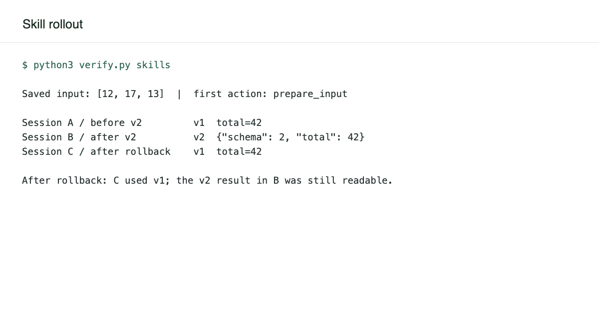
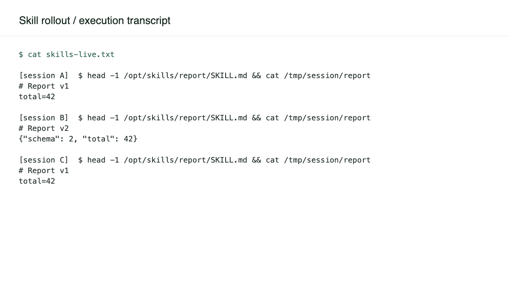

# 给 Agent 升级 Skill，正在写的报告会变格式吗？

报表 Skill 把输出从一行文本换成 JSON，金额始终加得对，已有任务却可能交出下游读不了的文件。我们用 12、17、13 这三个数跑完了一次发布和回滚。给同类平台的部署顺序是：先让消费端能读新旧两种报告，再让新会话使用新 Skill，写到一半的会话继续用它打开时的版本。



*三个会话均读取相同输入。B 在回滚后仍能读回其先前生成的 v2 报告。*

## 把发布规则放在哪一层

每个版本在单独的沙箱里安装同一路径的 `SKILL.md` 和 `render.py`，再做 `fs-only` 快照。编排器保存“新会话使用哪个快照”的指针，打开会话时解析一次。会话 A 的沙箱仍在运行，切换指针时没有替换它的磁盘或进程。

模型实际读取各自安装的 Skill，并按用户请求在 `prepare_input` 和 `render_report` 两个动作间选择。输入暂存在会话内，由相应版本的 Python 格式化程序生成最终报告。这里验证版本与工具执行的关系，未评测模型编写报告的文采。

## 为什么同一条“完成报告”能产生两种格式？

模型在这一层只决定调用哪个动作。收到“完成报告”时，A 和 B 都选择 `render_report`；决定文件格式的是沙箱里实际运行的 `render.py`。再往上一层，编排器只在开会话时解析默认快照。三者连起来就是：发布指针选沙箱版本，会话把后续请求路由回这个沙箱，格式化器按已安装的代码生成文件。即使模型每次都选对工具，路由回错沙箱也会生成错误格式。

这里使用文件系统快照有一个直接理由：要跨会话分发的是 Skill 说明和代码，每份输入与草稿都应该从空白开始。v0.8.0 的 `fs-only` 保留文件并启动新进程；实验先抓取只含工具的快照，再把输入写入各自会话。若先填写某个用户的草稿，再对整个工作目录取快照，文件同样可能随模板进入下一会话。依赖、说明、格式化器可以进入版本包；用户输入、凭据和报告应有自己的保存位置。[SDK 快照契约](https://github.com/TencentCloud/CubeSandbox/blob/v0.8.0/sdk/python/cubesandbox/sandbox.py#L853-L877)

## 三次开会话的结果

| 会话 | 何时创建 | 观察结果 |
| --- | --- | --- |
| A | 发布 v2 前 | v1 暂存草稿；发布后完成，输出 total=42 |
| B | 发布 v2 后 | 输出含 schema=2 和 total=42 的 JSON |
| C | 回滚后 | 输出 total=42；B 的旧报告仍可读 |



*同一流程的独立复验。在每个会话执行相同的两条读取命令，可以直接核对版本与文件内容。*

[查看原始输出摘录](../../assets/data/cubesandbox-five-labs/skills-live.txt)

## 回滚能挽回什么

回滚指针只决定后续会话。已经发出去的 v2 报告不会被转换，下游要能识别 schema；已运行会话如需升级，还要决定如何迁移草稿。这里的指针在单个测试进程内，生产服务应持久化版本映射，并处理多个服务副本同时发布。实验借鉴了 WeKnora 的 Skill 使用场景，未验证它的管理界面或原生发布策略。

### 发布时先升级读报告的一方

把实测产物分别交给两种严格的读取器：旧读取器要求整行匹配 `total=(-?[0-9]+)`，新读取器要求 JSON 对象中 `schema` 为 2，且 `total` 为整数。这是对归档报告的本地兼容性检查。它揭示了一个容易被“模型回答正确”掩盖的问题。

| 产物 | 只认旧文本的读取器 | 只认 v2 JSON 的读取器 |
| --- | --- | --- |
| A、C 的文本报告 | 读到 42 | 解析失败 |
| B 的 JSON 报告 | 解析失败 | 读到 42 |

若要让两个版本的会话共存，先在消费端上线能读两种格式的适配器，遇到未知格式要报错，随后才把少量新会话指向 v2。回滚默认快照后仍可能有人打开旧的 v2 产物，所以读取兼容层要保留到这批报告超过保留期，或数据迁移结束。实验中回滚后对 B 的验证是**读回已有报告**；没有再次调用模型来生成一份新报告。

### 多副本服务如何保住一个未完成的会话

演示中一个进程拿着沙箱对象就能找到 A。实际操作台若有多个副本，建议在首个请求时持久化会话 ID、解析到的快照 ID 和实际沙箱 ID；后续消息先查这条绑定。否则同一个人刷新页面或请求落到另一副本，就可能按新的默认版本打开空工作区。对于要求能从故障中继续的报告，还要持久化输入与阶段。只记录快照 ID 可以重建 v1 的工具，无法重建某个用户后来输入的 12、17、13。

上线前可演练三个事件：A 写一半时切版本，确认下一步仍按 v1 输出；B 已交付报告后回滚，确认下游还能读取；在两个应用副本之间切换同一个会话，确认仍读到同一份草稿。前两项已有本轮证据，第三项是多副本接入时要补的验收。

下载[原始数据](../../assets/data/cubesandbox-five-labs/skills.json)和[校验脚本](../../assets/data/cubesandbox-five-labs/verify.py)，放入同一目录后运行以下命令。

```sh
python3 verify.py skills
```

[下载实验脚本](../../assets/data/cubesandbox-five-labs/lab-sources.zip)。解压后按 README 设置测试端点和模板，入口为 `skill.py`。

[社区案例 WeKnora](https://github.com/TencentCloud/CubeSandbox/blob/6843e3f97e67/docs/guide/usecases/weknora.md)
