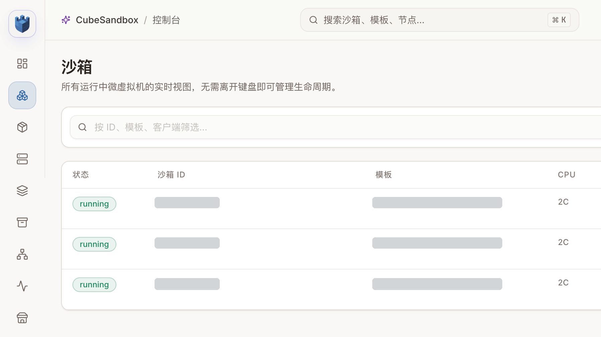
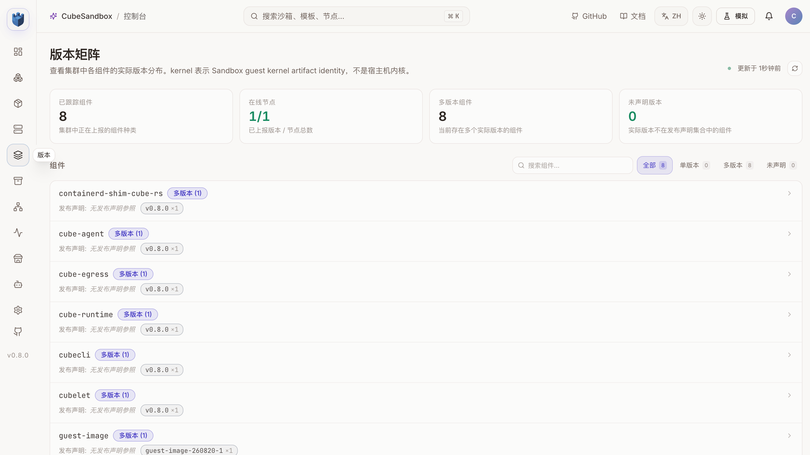
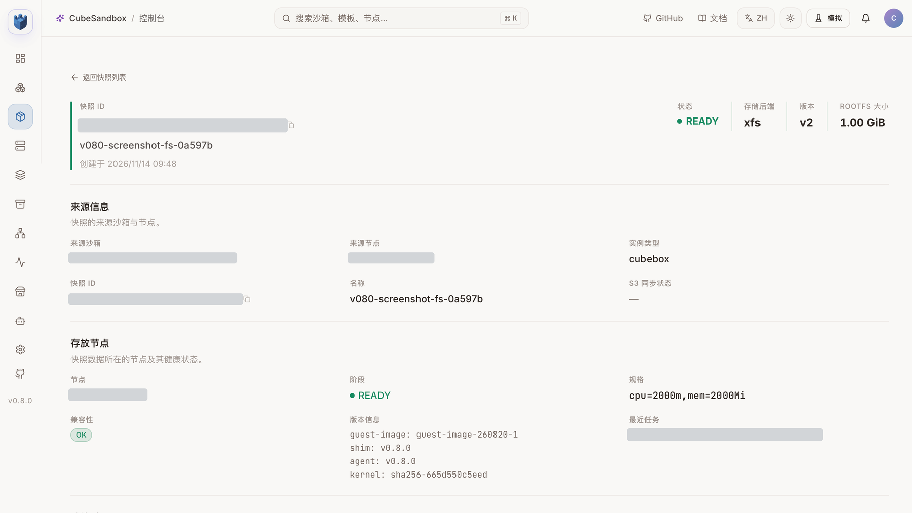

# CubeSandbox v0.8.0 升级实战：新版本装上后，旧模板还能用吗？

CubeSandbox [v0.8.0](https://github.com/TencentCloud/CubeSandbox/releases/tag/v0.8.0) 增加了文件系统快照、JuiceFS CoW、可扩展调度、沙箱重启策略、沙箱指标与日志采集，并扩展了 E2B SDK 的兼容范围。本文记录一次 Kubernetes 测试集群从 v0.7.3 升级到 v0.8.0 的过程，以及升级后用真实沙箱验证的结果。

最值得注意的发现是：**控制面和节点组件升级后，旧模板里固化的运行时不会自动变新。** 测试中的旧模板仍携带 v0.7.1 shim，创建沙箱和完整快照可以使用，但文件系统快照返回 `snapshot_filesystem_only_unsupported_node`。基于已有 rootfs 重新构建模板后，同样的文件系统快照测试通过。

| 项目 | 结果 |
| --- | --- |
| Chart 与 CubeSandbox 组件 | v0.7.3 → v0.8.0；原有模板、快照和持久卷保留 |
| 官方 Helm tests | 8 项通过 |
| 源码测试 | Python SDK 357 项非 E2E 测试通过；调度器 Go 单元测试通过 |
| 旧版与新版生命周期回归 | 各 2 轮创建、执行、删除；暂停恢复、完整快照回滚与克隆通过 |
| 文件系统快照 | 新模板通过：文件保留、后续写入隔离，原进程不在新沙箱中继续 |
| JuiceFS CoW | 单节点模板构建、两轮创建、暂停恢复、快照回滚和克隆通过；fs-only 快照与 fork 通过 |
| `fork` | 一次派生 2 个沙箱，文件隔离通过 |
| E2B Python SDK | 2.64.0 创建、执行、连接和再次执行通过 |
| 沙箱资源指标 | 两个运行中的沙箱都出现在 Cubelet 的 host 指标中 |
| 同节点端口映射 | 在本次 Pod 网络环境中连接被拒绝，原因仍待确认 |
| 自动重启 | 探针失败触发重启；未显式 sync 的测试文件缺失，先执行 sync 的文件重启后可读 |
| S3 外挂卷与 Volume v2 | 外挂卷读写、共享和快照引用通过；v2 空参数创建与超长值拒绝通过 |

这些测试使用一台计算节点。跨节点调度、跨节点恢复和不同 CNI 下的表现需要分别验证。

为了展示升级后的实际运行状态，又使用新模板创建了三个测试沙箱。每个沙箱都执行命令，在 `/workspace/v080-demo/status.txt` 中写入并读回 `checkpoint-ready`。其中一个沙箱还创建了文件系统快照；测试标识分别对应数据清洗、训练和快照场景，并未在这一步运行完整的数据清洗或训练任务。



*三个测试沙箱均处于 running 状态，每个配置 2 核 CPU。截图中的资源标识已遮盖；截图完成后，这三个沙箱和新建快照已删除。*

## 1. 环境与升级前检查

测试环境是 Kubernetes v1.30、Cilium、x86_64 KVM，一台 Cube 计算节点。控制面和测试数据在持久卷中；数据面使用 `cubeNode.hostNetwork: false`。升级前确认活跃沙箱数量为 0，保存当前 Helm values 和数据库逻辑备份，记录已有模板与快照。

v0.8.0 Chart 默认改为宿主机网络。对于已有部署，不能仅升级 Chart 而让这一默认值悄悄改变网络模式。本次显式保留：

```yaml
cubeNode:
  hostNetwork: false
  pvmGuestKernel:
    enabled: false
```

Pod 网络下，`cube-node` 重建会销毁其网络命名空间，破坏该节点现有沙箱的网络。官方要求先隔离节点、等待至少 60 秒并排空沙箱；本次也遵循这个顺序。[官方升级指南](https://github.com/TencentCloud/CubeSandbox/blob/v0.8.0/docs/guide/kubernetes/upgrade.md)

v0.8.0 的 CubeMaster 和 CubeOps 会在启动时执行数据库迁移。升级前要留存与自己环境匹配的备份和恢复方案，不能把 Helm rollback 当成数据库回滚。

## 2. 镜像和组件升级

受限网络的节点不能直接访问官方仓库，因此先将 v0.8.0 组件镜像同步至集群可访问的镜像仓库，选定 `linux/amd64`，逐个核对源和目标的 config、layer digest。同步在中转机执行，不经过操作电脑拉取镜像层。

旧配置中单独固定了 `images.ops.tag: v0.7.3`。如果只替换 Chart 而保留该覆盖项，CubeOps 就会停留在旧版。本次显式更新该项，先更新 CubeOps 并确认就绪，再更新其他组件和计算节点。最终 CubeAPI、CubeMaster、CubeOps、CubeProxy、WebUI、Cubelet、Shim/Guest/Kernel 安装器和 Ops Agent 均使用 v0.8.0 镜像。MySQL、Redis 和 MinIO 使用原有镜像与持久卷。



*版本矩阵显示一个在线节点上报的组件版本。页面将没有发布声明参照、实际只上报了一个版本的组件标为“多版本 (1)”；图中的“多版本组件 8”不能解读为已发现八种不同版本。*

下面是升级顺序的简化示意，镜像地址、节点选择和凭据按实际环境配置：

```bash
helm get values cube -n cube-system -o yaml > values-before.yaml
kubectl -n cube-system exec deploy/cube-cubemastercli -- \
  cubeopscli -a cube-ops node isolate <node-id>
# Wait at least 60 seconds and verify that the node has no sandboxes.
helm upgrade cube ./deploy/kubernetes/chart -n cube-system \
  -f values-before.yaml -f values-v080.yaml --reset-values --wait
kubectl -n cube-system exec deploy/cube-cubemastercli -- \
  cubeopscli -a cube-ops node unisolate <node-id>
helm test cube -n cube-system --timeout 10m
```

测试前应先核对渲染结果、镜像可拉取性和配置中固定的旧 tag。`values-before.yaml` 可能含凭据，不应直接提交仓库。

## 3. 文件系统快照：只保存文件，不保存进程

v0.8.0 的 `mode="fs-only"` 只捕获沙箱根文件系统。用它创建的新沙箱冷启动：快照时已有的文件可见，Guest 内存和进程不延续；原沙箱继续运行。完整快照则保存内存和文件系统，并支持回滚。文件系统快照不记录外部挂载，创建新沙箱时需要重新声明卷。[官方说明](https://github.com/TencentCloud/CubeSandbox/blob/v0.8.0/docs/guide/snapshot-rollback-clone.md)

```python
from cubesandbox import Sandbox

source = Sandbox.create(template="<new-template>", timeout=600)
source.files.write("/tmp/proof", "before")
snapshot = source.create_snapshot(mode="fs-only")
source.files.write("/tmp/proof", "after")
child = Sandbox.create(template=snapshot.snapshot_id, timeout=600)
assert child.files.read("/tmp/proof") == "before"
assert source.files.read("/tmp/proof") == "after"
child.kill()
source.kill()
Sandbox.delete_snapshot(snapshot.snapshot_id)
```

实际测试另启动了一个后台进程并记录 PID。源沙箱中的进程仍存在；从 fs-only 快照冷启动的新沙箱有快照时的文件，但没有该进程。上述示例省略进程检查，完整验证结果见[测试数据](../../assets/data/cubesandbox-v080-upgrade/features-v080.json)。



*为截图通过 SDK 新建的 fs-only 快照，控制台显示 READY、XFS 存储后端和 v0.8.0 运行时；快照模式由创建请求确认，资源标识及节点地址已遮盖。*

旧模板先返回 `snapshot_filesystem_only_unsupported_node`，错误指出其 shim 是 v0.7.1；基于原 rootfs 创建独立新模板后才通过。升级计划应把**节点镜像版本、模板构建时的运行时版本和新功能测试**一起纳入验收。不要因模板状态为 READY，就假设它支持所有新能力。

### JuiceFS 单节点验证

JuiceFS 后端默认关闭。测试前排空并隔离计算节点，按 Chart 的一次性确认机制启用后端；它增加独立元数据 Redis、格式化 Job 和节点 FUSE 挂载，测试环境使用已有 MinIO 作为对象存储。JuiceFS 容器和 Cubelet 容器均观察到 `fuse.juicefs` 挂载。

使用 JFS 后端新建测试模板后，完成两轮沙箱创建、执行、删除，以及暂停恢复、完整快照回滚、从快照创建和克隆，均通过。该后端仍是官方标记的 Preview；一台节点的结果不能证明跨节点恢复。具体结果见 [JuiceFS 测试数据](../../assets/data/cubesandbox-v080-upgrade/juicefs-v080.json)。

这次受限网络还有一个部署细节：JuiceFS 专用 Redis 的默认镜像地址不会被现有全局仓库覆盖，首次启动出现 `ErrImagePull`。将 `cubeJuiceFS.metadata.redis.image.repository` 显式指向可访问的内部仓库后恢复，并将该设置写回 Helm values。测试期间为专用 Redis 新增了 1 GiB PVC；验收后测试集群保留该 JuiceFS 组件与挂载，供后续单节点实验使用。启用或关闭 JuiceFS 都会影响节点挂载，应先排空沙箱并遵循[官方说明](https://github.com/TencentCloud/CubeSandbox/blob/v0.8.0/docs/guide/cross-node-snapshot/juicefs.md)。

另用独立快照验证按名称过滤、按名称删除与删除不存在的名称；销毁沙箱后 `is_running()` 返回 `false`。

## 4. fork 与 E2B 兼容性

在新模板创建的沙箱中调用 `fork(count=2)`，两个子沙箱均读到 fork 前的文件；修改其中一个后，源沙箱和另一个子沙箱的数据保持不变。测试完成后逐个销毁沙箱。

使用官方 E2B Python SDK 2.64.0，通过 CubeAPI 的 v2 创建与连接接口，完成创建沙箱、执行命令、重新连接、再次执行命令和销毁。这里验证的是这一组调用，并不代表 E2B 的所有 API 已经兼容。CubeSandbox 专属的快照接口仍以 CubeSandbox SDK 为准。[官方兼容性说明](https://github.com/TencentCloud/CubeSandbox/blob/v0.8.0/docs/guide/e2b-compatibility.md)

## 5. 指标、网络与重启

Cubelet 暴露 `/v1/metrics/resource`。两个测试沙箱运行时，接口中均出现对应的 `cubesandbox_host_sandbox_*` 指标；这与 Guest 内业务容器的统计口径不同。该接口没有内置认证与 TLS，不应直接暴露到不可信网络。[资源指标说明](https://github.com/TencentCloud/CubeSandbox/blob/v0.8.0/docs/guide/resource-metrics.md)

本次尝试让一个沙箱访问另一个沙箱暴露端口对应的映射地址。API 能返回地址，但连接返回 `Connection refused`。当时 Cubelet 使用 Pod 网络，返回地址为节点组件的 Pod 地址；目前还不能断定失败由哪一层造成。不要把该结果写成网络特性已通过，也不要将其外推为所有环境都会失败。

重启测试为沙箱配置 `OnFailure` 和故意失败的 TCP liveness probe。状态依次出现 `Running`、`BackOff`、`Restarting`、`GaveUp`，`restartCount` 达到 2，退出原因为 `LivenessProbeFailed`。另一次将测试文件写入 `/workspace`：重启前 SDK 和沙箱内命令均读到 17 字节的预期内容；探针触发重启后，SDK 报文件不存在，沙箱内命令也确认文件缺失。再跑一轮，在探针失败前执行 `sync`，重启后沙箱内命令读回同样的 17 字节内容。两轮观察表明应用写入与落盘时机需要单独考虑；未执行 `sync` 的文件缺失原因尚未定位，不能据此断定所有未落盘数据或其他存储后端都会有相同表现。

现有调度配置显式配置了旧式 filter；升级后观察到 `scheduler_attempts_total{profile="default"}` 成功请求。新版在没有任何调度配置时会注入默认 Profiles，节点选择行为可能改变；本次单节点不能验证不同节点间的评分效果。[调度升级行为](https://github.com/TencentCloud/CubeSandbox/blob/v0.8.0/docs/guide/scheduler-plugin.md)

### Release note 的其他项目

S3 外挂卷测试中，源沙箱与克隆共享同一个卷；回滚后根文件恢复到快照状态，外部卷仍保留后续写入的数据。重新发送卷挂载创建沙箱后，也能读取卷中的当前数据。Volume v2 接口使用空 `private_data` 创建并清理测试卷成功，1025 字节的输入返回 400；带凭据引用的动态桶、插件接收和透传尚未做端到端测试。`private_data` 会以明文形式进入数据库，并可能出现在节点插件参数，应传凭据引用，不要直接传密钥。

调度器的 CEL 表达式和外部 gRPC 插件、模板 QoS 限速、Guest 工作负载指标、日志采集面板、Redis Cluster、PVM、ARM、跨节点迁移及 S3lvol 崩溃恢复，本轮尚未实测。Release note 中的性能数字和各项缺陷修复也没有逐条独立复现；不能用基础生命周期通过来代替这些验证。

## 6. 升级提醒与结论

1. **先排空计算节点。** Pod 网络模式下，重建 `cube-node` 会让现有沙箱失去网络。隔离节点至少 60 秒，确认沙箱清空后再更新；不要仅依赖 Helm 滚动更新保护数据面。
2. **显式固定原网络模式。** 新 Chart 默认 `hostNetwork: true`。升级前检查当前 DaemonSet 和 values，决定是否维持原模式；切换模式还需要官方要求的一次性确认与端口、CNI 安全评估。
3. **数据库先备份。** CubeOps / CubeMaster 启动时可能迁移 schema；Helm 回滚不回退数据库或宿主机产物。核对组件升级顺序和恢复方案。
4. **完整渲染镜像。** 旧 values 可能固定单个组件 tag；可选组件也可能有独立镜像设置。基础数据库镜像与模板镜像是另一组依赖，要分别检查拉取和信任链。
5. **重测旧模板。** READY 只表示模板就绪。测试中旧模板携带 v0.7.1 shim，需重建模板才能使用 fs-only；生产环境应对常用模板分别验收。
6. **把 JuiceFS 当作单独的存储变更。** 启用会新增元数据 Redis、持久卷和 FUSE 挂载。先确认容量、对象存储、凭据与清理方式；修改或关闭之前同样需要排空。
7. **核对节点地址与网络链路。** 本次 Pod 网络重建后 Pod IP 改变，一份临时测试模板和一条失败快照记录仍指向旧地址，删除时连接超时；同节点端口映射也未通过，需在目标环境继续排查。

本次升级后的基础生命周期、E2B、XFS/JuiceFS 快照和 S3 外挂卷验证通过，适合继续在测试环境体验。未显式落盘时的重启文件保留与 Pod 网络下的端口映射尚未通过；跨节点恢复和其他未覆盖能力仍需独立验收，现有结果不足以直接证明生产环境具备相同表现。

## 7. 测试数据与边界

- [v0.7.3 升级前基线](../../assets/data/cubesandbox-v080-upgrade/baseline-v073.json)、[v0.8.0 生命周期回归](../../assets/data/cubesandbox-v080-upgrade/lifecycle-v080.json)
- [快照名称与运行状态](../../assets/data/cubesandbox-v080-upgrade/snapshot-api-v080.json)、[文件系统快照与 fork](../../assets/data/cubesandbox-v080-upgrade/features-v080.json)、[E2B SDK](../../assets/data/cubesandbox-v080-upgrade/e2b-v264.json)
- [JuiceFS fs-only 快照与 fork](../../assets/data/cubesandbox-v080-upgrade/features-jfs-v080.json)、[S3 外挂卷](../../assets/data/cubesandbox-v080-upgrade/s3-volume-v080.json)、[Volume v2](../../assets/data/cubesandbox-v080-upgrade/volume-v2-v080.json)
- [资源指标与端口映射](../../assets/data/cubesandbox-v080-upgrade/network-metrics-v080.json)、[重启策略](../../assets/data/cubesandbox-v080-upgrade/restart-v080.json)、[未显式 sync 的重启前后文件复核](../../assets/data/cubesandbox-v080-upgrade/restart-workspace-v080.json)、[sync 后的重启复核](../../assets/data/cubesandbox-v080-upgrade/restart-workspace-sync-v080.json)

以上创建耗时是少量请求经本地端口转发得到的客户端观测值，不适合拿来与官方吞吐量或并发基准直接比较。测试结束后，临时沙箱和测试快照按各自结果文件中的清理状态核对；一份临时 XFS 模板和首次失败测试产生的一条 FAILED 快照记录，因旧 Pod IP 导致删除超时而保留。本文地址、仓库和资源标识使用占位符；生产升级还应针对自己的模板、备份、网络与存储做独立验证。
