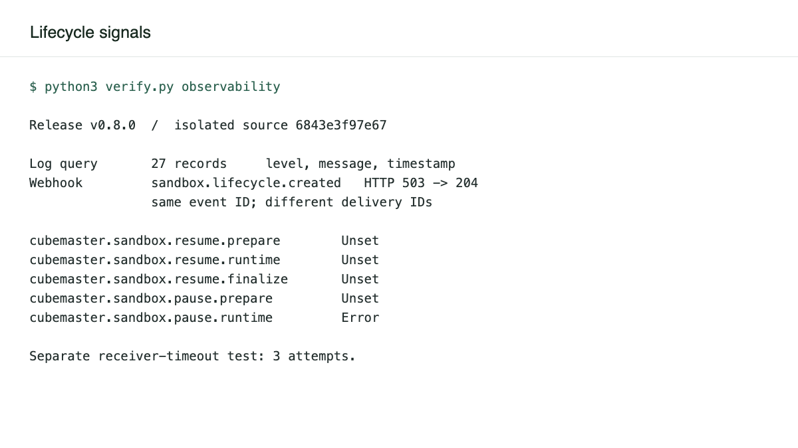
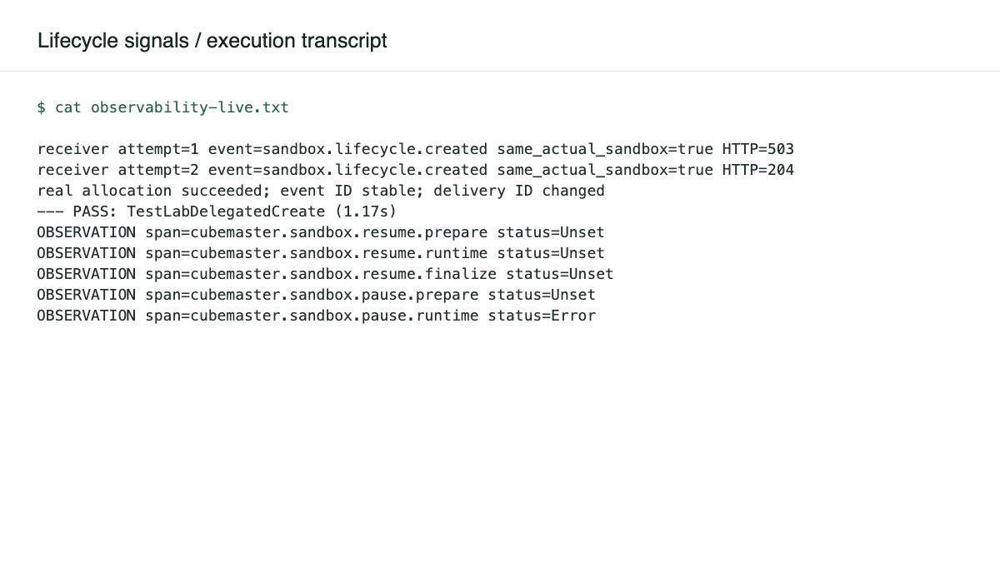

# 沙箱创建成功，通知为何还会失败？CubeSandbox 日志、Webhook 与 Trace 实测

沙箱创建 API 已经返回成功，业务系统却没有登记实例，这时候再发一次创建请求可能会多占一份资源。我们故意让接收端先返回 503、再返回 204，用同一沙箱 ID 去查日志。结果是一个实例、一个创建事件、两次 HTTP 投递。接入方既要能识别重复通知，也要有办法找回漏登记的实例。



*上半屏的日志与通知对应同一个真实实例；下半屏的阶段数据来自独立执行的 CubeMaster worker 测试。*

## 先说明两个版本如何配合

已有集群运行 v0.8.0，控制台已有事件读取适配。另在独立 Kubernetes 命名空间中运行社区提交 `6843e3f97e67` 编译出的 Linux 测试程序，包含 Webhook 和 OpenTelemetry 的后续改动。测试 Pod 没有挂载 ServiceAccount 令牌；它调用已有 CubeAPI 创建短寿命基础沙箱，结束后回收测试命名空间。

我们复用了上游 CubeMaster 创建处理器和真实异步发布器，在测试夹具里把资源分配函数委托给集群 API，再把实际返回的 ID 交回处理器。接收端是测试 Pod 内的 HTTP 服务。这个组合允许验证通知确实对应一个真实实例，同时避免升级正在服务的控制面。它没有把五个组件全部替换成开发版本，也没有做跨五个组件的端到端追踪。

## 创建成功以后，谁还在工作？

在本次固定的社区提交中，创建处理器先取得业务结果，再把生命周期事件提交给发布器。后台按订阅匹配目标并尝试 HTTP 投递。业务 API 成功和接收端写入成功有各自的完成条件：接收端故障时，调用者可能已经拿到一个可以工作的沙箱。若调用方仅因没收到通知就再次创建，会把集成故障扩大成重复分配。更合适的第一步是用已知沙箱 ID 查询状态，再单独排查投递。[社区事件触发时机与投递语义](https://github.com/TencentCloud/CubeSandbox/blob/6843e3f97e67/docs/guide/webhooks.md)

重试最棘手的一种情形是：接收端已经提交了业务事务，但成功响应在网络中丢失。发送方看到的是超时，第二次带着相同的事件重新请求。若按 `e2b-delivery-id` 去重，两次投递都会被当成新工作；若按沙箱 ID 去重，又会误吞同一沙箱后来真正发生的暂停或恢复。载荷中的 `id` 标识一次事件，适合做消费端的唯一键；若同一系统有多个独立消费者，各自需要执行一次，可将消费者名称一并纳入唯一键。

## 一次创建，三类证据

| 信号 | 本轮观测 | 适合回答的问题 |
| --- | --- | --- |
| 日志 | 对同一实例读到 27 条，字段为 timestamp、level、message | 实例留下了什么记录？ |
| Webhook | 同一创建事件收到 503、204 两次响应，事件 ID 一致，两次投递 ID 不同 | 业务系统收到通知了吗？是否需要去重？ |
| OTel | 分别执行恢复成功与暂停失败的 worker 测试，失败定位到 pause.runtime | 哪一个生命周期阶段报告了错误？ |

接收端可以用事件 ID 建唯一键，用投递 ID 记录每一次尝试。先把业务变更和去重结果持久化，再回复成功。另一次测试让接收端不响应，配置每次 300 ms、最多 3 次；三次超时后进入失败终态。生产接收端若要在长时间离线后补齐状态，还需要业务侧对账。



*摘录实际测试进程的输出。上方是同一真实分配的两次投递，下方来自另外两项 worker 测试。*

[查看原始输出摘录](../../assets/data/cubesandbox-five-labs/observability-live.txt)

## 看到阶段记录之后怎么读

恢复成功的 worker 记录了 `prepare`、`runtime`、`finalize` 三个同父阶段，成功路径的状态值为 `Unset`。单独注入暂停运行阶段失败时，`cubemaster.sandbox.pause.runtime` 标为 `Error`。使用真实 SDK 记录 span，底层 Cubelet RPC 与部分依赖使用测试替身。它能验证埋点和错误归属，无法据此计算线上 P95，或声称在 Jaeger 看到了同一笔调用的完整链路。

### 接收端应该在什么时候返回 2xx？

以“沙箱创建后登记一个待处理任务”为例，一张待办表就能同时充当收件记录和持久队列。设唯一键为消费者与事件 ID 的组合，事务内插入一条待办，提交后回复成功；重复事件命中同一行时也可以确认。下面是可用 SQLite 运行的最小数据结构与写入语句，两个问号分别绑定消费者和载荷事件 ID。配套校验脚本用合成 ID 重放两次，最终只留下 1 条待办。

```sql
CREATE TABLE work_inbox (
    consumer TEXT NOT NULL,
    event_id TEXT NOT NULL,
    state TEXT NOT NULL DEFAULT 'pending',
    PRIMARY KEY (consumer, event_id)
);

INSERT INTO work_inbox (consumer, event_id) VALUES (?, ?)
ON CONFLICT (consumer, event_id) DO NOTHING;
```

实际待办还应保存完成业务所需的载荷。收件事务失败就让发送方重试；事务成功而工作进程重启，仍可从待办表继续。如果工作内容是调用另一个服务，应把稳定的业务幂等键一路传下去，否则“调用成功但尚未标记完成”仍可能执行两次。这套做法处理重复送达。即使事件都收到了，先创建后终止的沙箱也可能先送到终止通知。若目标是维护当前资源清单，可以让通知触发按 ID 回查，避免一条迟到的创建通知把已终止实例重新标成运行中。

对于根本未送达的事件，当前实现的队列和投递状态保存在各个 Master 的进程内，重启、容量已满或耗尽重试预算都有丢失窗口。资源清单可定期与平台当前状态对账；对账能修复现状，无法重建对账之间发生过的每一次状态转换。需要完整审计历史时，应另设持久化事件源。[上游对容量、丢失和重放的说明](https://github.com/TencentCloud/CubeSandbox/blob/6843e3f97e67/docs/guide/webhooks.md#capacity-loss-and-shutdown)

### 该看告警、日志，还是 Trace？

已经拿到沙箱 ID、业务侧却一直没有记录时，先看所有 Master 上 `cubemaster_webhook_operations_total` 在故障窗口的增量。若 `ingress/full` 或 `put/capacity` 增长，事件可能在发 HTTP 前就丢了，查接收端访问日志找不到它很正常；若 `send/timeout`、`terminal/failed` 增长，转查接收端时延、响应与重试预算。能在接收端找到同一个事件 ID 时，再查待办是否提交、是否被工作进程消费。反过来，若用户卡在沙箱恢复请求本身，带请求上下文查看恢复阶段的 span，沿报错阶段回查日志。这个顺序可以避免为一个通知故障反复重启运行正常的沙箱。[上游指标口径](https://github.com/TencentCloud/CubeSandbox/blob/6843e3f97e67/docs/guide/webhooks.md#diagnose-and-verify)

下载[原始数据](../../assets/data/cubesandbox-five-labs/observability.json)和[校验脚本](../../assets/data/cubesandbox-five-labs/verify.py)，放入同一目录后运行以下命令。

```sh
python3 verify.py observability
```

[下载实验脚本](../../assets/data/cubesandbox-five-labs/lab-sources.zip)。解压后按 README 设置测试端点和模板，入口为 `lab_observation_test.go`。

[社区 Webhook 配置与投递语义](https://github.com/TencentCloud/CubeSandbox/blob/6843e3f97e67/docs/guide/webhooks.md)

[社区生命周期追踪与导出配置](https://github.com/TencentCloud/CubeSandbox/blob/6843e3f97e67/docs/guide/tracing.md)
