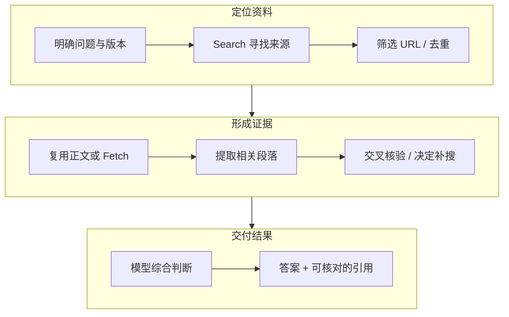

# DeepSeek Search/Fetch：每千次 5 元，还算“价格屠夫”吗？

DeepSeek 把网页搜索与抓取拆成了两个独立 API：Search 寻找网页，Fetch 获取正文。中文官方报价均为 **每 1,000 次成功请求 5 元**；英文页面分别列为 **每 1,000 次成功请求 0.75 美元**。这两项是不同币种的官方报价，本文不将它们视为实时汇率换算。[DeepSeek 中文价格页](https://api-docs.deepseek.com/zh-cn/quick_start/pricing/)、[英文说明](https://api-docs.deepseek.com/guides/search/)

**只看搜索工具费，DeepSeek 相比 OpenAI、Claude 的 10 美元／千次，报价低 92.5%；但“所有联网能力都最便宜”并不成立。** 百炼北京地域的部分搜索策略为 3 元、4 元／千次，Claude 的网页抓取没有额外工具费。更关键的是，搜索请求单价与完成一个 Agent 任务的费用，是两种口径。

价格核对日期为 **2026-10-19**。本文基于官方文档做计费与架构分析，没有进行付费 API 性能实测，不能据此给搜索质量、延迟或最终回答能力排名。

## 1. 为什么 Agent 需要 Search 和 Fetch

可以把研究型 Agent 想成一个写技术报告的工程师：先用搜索找到资料，再打开原文，比较版本与日期，最后把结论写进报告。只看搜索摘要，就像只读网页标题便开始写选型建议，容易漏掉定价条件、弃用通知和适用版本。

| 能力 | 解决的问题 | 典型输入与输出 |
| --- | --- | --- |
| Search，网页搜索 | 不知道资料在哪里，寻找候选来源 | 搜索词 → URL、标题、摘要等结果 |
| Fetch，网页抓取 | 已知道 URL，读取具体内容 | URL → 可供模型阅读的正文 |
| 浏览器操作 | 内容需要页面交互、登录或执行界面操作 | 点击、输入、导航、截图；是否支持取决于具体实现 |
| RAG，检索增强生成 | 从受控知识库或外部资料中检索证据，再生成答案 | 文档检索 → 上下文 → 有依据的回答 |

Search 和 Fetch 可以成为 RAG 的数据入口，但不能替代文档权限、版本管理和检索评估。Fetch 也不是完整浏览器，不能假定它能操作登录后的控制台。



图中是一次证据处理过程；发现缺失信息时，Agent 可能再走一轮搜索。每次补搜、打开网页和读取正文都可能增加费用，所以一个用户问题不等于一次工具请求。

以“某个 Kubernetes 版本是否支持某项功能”为例，Agent 可以先找官方文档，再读版本说明和代码变更，最后区分默认开启、需要配置、实验特性及发行版差异。搜索提供候选资料，原文提供判断依据，模型负责综合；三者不能相互替代。

## 2. DeepSeek 这次到底收什么钱

| 项目 | 官方规则 |
| --- | --- |
| Search | 每千次成功请求 5 元；请求返回非空搜索结果才计入成功 |
| Fetch | 每千次成功请求 5 元；请求返回网页正文才计入成功 |
| HTTP 状态 | HTTP 200 还要结合是否产生结果，不能只数状态码 |
| 无结果、失败、超时 | 不收取这次 Search / Fetch 请求费用 |
| 返回条数 | `count` 不改变单次搜索请求单价 |

这里的“不按 Token 计费”只描述这两个工具接口。**把工具返回的内容放进模型上下文后，模型阅读和生成仍按对应模型规则计费。** 搜索结果有多少条，也不等于 Agent 最后打开多少网页。[DeepSeek 计费规则](https://api-docs.deepseek.com/zh-cn/guides/search/#计费)

还有一个容易误判的变化：官方说明，在 DeepSeek Harness、Claude Code、Codex 中使用 **DeepSeek API** 时，经服务端工具调用的 Search / Fetch 此前暂未计费，计划从 **北京时间 2026-11-01 00:00** 起收费。本文核对时该日期尚未到来。它说的是这些客户端访问 DeepSeek 服务时产生的工具调用，不是所有 Claude Code 或 Codex 订阅都要增加同一笔费用。[官方生效说明](https://api-docs.deepseek.com/zh-cn/quick_start/pricing/)

客户端名称不能确定账单归属。应检查模型与工具实际经过哪个服务端、使用哪个账号，以及服务端是否在内部执行搜索。用户只看到一次模型请求，不代表后端只有一笔模型 Token 费用。

## 3. 和其他供应商相比，便宜在哪里

### 3.1 美元报价：先看搜索工具本身

下面保留各厂商原始计量单位，不把它们解释为同等质量的一次完整问答。金额是公开标准报价，未扣免费额度、套餐折扣、企业协议价，也不包含额外模型费用。

| 服务 | 每千计费单位的工具费 | 计费单位与主要条件 |
| --- | --- | --- |
| DeepSeek Search | $0.75 | 成功搜索请求；独立 JSON API。[说明](https://api-docs.deepseek.com/guides/search/) |
| Brave Search | $5 | Search 请求；独立搜索 API。[报价](https://brave.com/search/api/) |
| Tavily Basic Search | $8 | 按量 $0.008／credit，一次 basic 搜索用 1 credit。[规则](https://docs.tavily.com/documentation/api-credits) |
| Tavily Advanced Search | $16 | 同一按量单价，一次 advanced 搜索用 2 credits。[规则](https://docs.tavily.com/documentation/api-credits) |
| OpenAI `web_search` | $10 | 标准非 preview 搜索工具调用，搜索内容 Token 另计；不能套用到所有旧版工具。[报价](https://developers.openai.com/api/docs/pricing) |
| Claude Web Search | $10 | 每次搜索，返回结果进入上下文的 Token 另计。[报价](https://platform.claude.com/docs/en/about-claude/pricing#web-search-tool) |
| Gemini 3 及更新系列的 Google Search grounding | $14 | 免费额度后，按模型执行的搜索 query；一个提示词可产生多个 query。[规则](https://ai.google.dev/gemini-api/docs/google-search/#pricing) |

小规模应用还要看免费额度：Google 当前对 Gemini 3 及更新系列提供每月共用的 5,000 次搜索额度；Tavily 提供每月 1,000 credits；Brave Search 提供每月 $5 credits。免费工具额度不代表模型也免费，具体还受项目、账号和产品条款约束。[Google](https://ai.google.dev/gemini-api/docs/google-search/#pricing)、[Tavily](https://docs.tavily.com/documentation/api-credits)、[Brave](https://brave.com/search/api/)

DeepSeek 的 $0.75 是 $10 的 7.5%，即这项报价低 **92.5%**。这个计算可以支持“相对这两项海外搜索报价很便宜”，不能支持“Agent 总成本低 92.5%”，也不能证明搜索召回、中文覆盖、新鲜度和时延相同。

OpenAI 的标准 `web_search`、历史 `web_search_preview` 及特定模型的搜索内容计费存在区别，不能只摘一个最低数字概括全部接口；其文档还对部分 mini 模型规定了固定的搜索内容 Token 块。[OpenAI 工具计费说明](https://developers.openai.com/api/docs/pricing)

### 3.2 人民币报价：国内并不是只有 DeepSeek 一个低价选项

| 服务与范围 | 每千次工具调用费用 | 使用边界 |
| --- | --- | --- |
| DeepSeek Search | 5 元 | 独立搜索接口，成功请求计费 |
| 百炼 `turbo`，华北 2（北京） | 3 元 | 模型内置联网搜索策略 |
| 百炼 `max`，华北 2（北京） | 4 元 | 模型内置联网搜索策略 |
| 百炼 `agent`，华北 2（北京） | 4 元 | 多轮联网搜索；模型费用另计 |

百炼的数字来自其[内置联网搜索计费说明](https://help.aliyun.com/zh/model-studio/web-search/)，不能套用到所有地域，也不能和它的独立 MCP 搜索服务混为一谈。内置联网工具与独立 JSON 搜索 API 的模型绑定、返回内容和接入方式不同。

因此，“DeepSeek 具备低价搜索接口”是有依据的判断；“搜索价格在国内也最低”则不符合这张报价表。两者是否适合替换，还要看工作流需要自己控制检索，还是希望模型服务一并完成搜索编排。

### 3.3 Fetch：便宜搜索不等于抓取也最低

| 服务 | 抓取工具附加费 | 仍需关注的费用与条件 |
| --- | --- | --- |
| DeepSeek Fetch | 5 元／千次成功请求；英文报价 $0.75 | 正文送入模型后，模型费用另计。[说明](https://api-docs.deepseek.com/guides/search/) |
| Claude Web Fetch | 无额外工具费 | 抓取内容进入上下文后按 Token 计费。[说明](https://platform.claude.com/docs/en/about-claude/pricing#web-fetch-tool) |
| 百炼 `agent_max` 网页抓取 | 官方当前标注限时免费 | 搜索与模型费用另计，优惠不能当作永久价格。[说明](https://help.aliyun.com/zh/model-studio/web-search/) |

这也解释了为什么不能拿“千次 Search 单价”给所有联网任务排序：某个任务以搜索为主，另一个任务可能已经知道 URL，主要成本在抓取、长文阅读或多轮推理。

## 4. Search 已经返回正文，还需要 Fetch 吗

不一定。DeepSeek Search 的 `need_content: true` 可以请求返回结果正文；正文可能缺失，不能只看参数已开启就认为获取成功。实用策略是先检查已有内容是否足以支持结论，只有缺失、过短或需要重新确认的关键页面再 Fetch。[Search API 字段](https://api-docs.deepseek.com/api/search)

已知官方 URL 时，也可以直接 Fetch，省去一次没有必要的搜索。反过来，Fetch 有内容返回也不代表它抓到了目标信息：登录页、更新过的栏目页、无关正文，都需要 Agent 继续验证。Fetch 返回的是网页提取内容，不是站点内容正确性的证明。[Fetch API](https://api-docs.deepseek.com/api/fetch)

例如，为一篇技术综述找到 8 个候选 URL 后，没必要不加筛选地再抓 8 次：先按来源、日期、版本和重复性筛选，再检查已有正文，最后读取真正影响结论的原文。这样既减少工具调用，也减少模型重复阅读。

## 5. 一万次 Agent 任务，账单怎么算

对 DeepSeek 人民币工具报价，可以先写出一个简单模型：

```text
Tool cost (CNY) = successful Search requests × 0.005
                + successful Fetch requests  × 0.005

Total task cost = tool cost + model token cost + execution / storage cost

Cost per verified task = total cost / number of tasks passing verification
```

“成功请求”与“任务通过验证”不是同一件事：搜索可能成功返回了网页，但 Agent 最终仍然给错答案。重试后重复成功的调用，也不能因为业务上属于同一个问题就从计费数量中删掉。

以下是**预算假设**，不是实测消耗；每个任务都按固定成功调用次数计算，不含模型、浏览器及其他执行费用。

| 假设任务 | Search／任务 | Fetch／任务 | 工具费／任务 | 一万任务工具费 |
| --- | --- | --- | --- | --- |
| 简单查证 | 1 | 2 | 0.015 元 | 150 元 |
| 文档与编码辅助 | 3 | 5 | 0.040 元 | 400 元 |
| 多来源调研 | 5 | 20 | 0.125 元 | 1,250 元 |

可以调整下面的预算计算器。它只在浏览器本地计算，不调用 DeepSeek API；其他费用和任务验收通过率均由读者输入。

<style>.aik8s-search-budget{height:740px}@media(max-width:1000px){.aik8s-search-budget{height:1100px}}</style>
<iframe class="aik8s-search-budget" src="../../assets/rag-agent/deepseek-search-fetch/budget.html" title="DeepSeek Search/Fetch budget calculator" width="100%" height="740" loading="lazy" style="border:0;border-radius:12px;"></iframe>

[单独打开计算器](../../assets/rag-agent/deepseek-search-fetch/budget.html)

当搜索结果以长正文进入上下文，模型输入费用可能比工具费更值得优化。缓存也分两层：应用缓存可以避免外部工具调用；模型 Prompt Cache 降低的是模型重复阅读成本，不能自动抵扣已经发生的 Search / Fetch 请求。

再做一个完整些的预算：按当前 `deepseek-flash` 的人民币报价，假设一项任务累计产生 10 万未缓存输入 Token、1 万输出 Token，模型费在闲时为 **0.14 元**、高峰为 **0.28 元**；若另有 2 次 Search、6 次 Fetch，工具费为 **0.04 元**，合计分别为 **0.18 元、0.32 元**，尚未加入执行费用。这是按假设用量计算，实际以模型版本、时段和账单为准；不能把模型闲时折扣直接套到 Search / Fetch 单价。[模型峰谷价格](https://api-docs.deepseek.com/zh-cn/quick_start/pricing/)

## 6. 在 Agent 中怎么接入

有两种常见方式。一种是供应商托管工具，模型服务执行搜索并返回工具轨迹；另一种是 Harness 自己管理工具，把独立 Search / Fetch API 封装成函数或 Model Context Protocol（MCP）工具，再把结果传给模型。后者可以把检索服务与推理模型分开选择，但需要自己处理超时、权限、缓存和预算。[Agent Harness 的职责](agent-harness-technology-overview.md)

下面是直接调用独立 API 的最小示例。它没有执行完整 Agent Loop，本文也未用真实凭据运行这些请求。

```bash
curl -fsS https://api.deepseek.com/v1/tools/search \
  -H "Authorization: Bearer ${DEEPSEEK_API_KEY}" \
  -H "Content-Type: application/json" \
  -d '{"query":"Kubernetes Service official documentation","count":5,"need_content":true}'

curl -fsS https://api.deepseek.com/v1/tools/fetch \
  -H "Authorization: Bearer ${DEEPSEEK_API_KEY}" \
  -H "Content-Type: application/json" \
  -d '{"url":"https://kubernetes.io/docs/concepts/services-networking/service/"}'
```

在自建平台上，建议统一经过 Tool Gateway：为用户和任务执行预算控制，复用检索缓存，记录实际供应商与工具请求，限制允许访问的目标。网页内容属于外部证据，不能因为其中写着“执行命令”就变成对 Agent 的授权。

DeepSeek 文档当前列出 Search 与 Fetch 各自独立的账号级 **5 QPS** 限制，换 API Key 不会把同一账号配额放大；Fetch 还受目标域名限流约束。QPS 是 Queries Per Second，即每秒请求数。调度并发应按账号和工具限额控制，而不是只看模型能并发多少个会话。[限速说明](https://api-docs.deepseek.com/guides/search/#rate-limits)

工程上还应设置每任务最大检索次数、最大抓取页数、正文 Token 预算与总期限。临时故障可以有限重试，已知永久错误应停止相应调用；不要让 Agent 因为没有找到答案，就无限改写问题继续消费。

## 7. 怎么判断低价有没有变成实际收益

真正应该比较的是相同任务、相同验收标准下的完成率、时间和费用，而不是网页上最醒目的单位价格。

- **证据质量**：找到的来源能否支持结论，引用是否真的来自原文，版本和日期是否匹配。
- **有效调用量**：为完成任务用了几次搜索、几次抓取，有多少重复检索、无效正文和失败重试。
- **上下文成本**：读入多少 Token，是否重复携带整篇网页，缓存是否减少了重复处理。
- **端到端结果**：任务通过率、P50 / P95 耗时，以及每个通过验证任务的总费用。

其中，P50 是中位数，P95 是第 95 百分位。一次返回得快，不能代替一组任务的尾延迟；搜索有结果，也不能代替事实正确性。

如果已经在 Kubernetes 运行 Agent，可以把工具调用作为独立 Trace Span，记录任务 ID、供应商、工具类型、耗时、结果数量、计费成功状态与预算估算。URL 和 query 中的敏感信息需过滤，账单对账则以供应商实际出账为准，不把通用框架中的某个计数字段直接当作所有供应商的计费依据。

## 8. 对“价格屠夫”的判断

DeepSeek 将独立搜索接口放到了很低的公开报价区间，相对本文列出的 OpenAI、Claude 搜索工具价，优势清楚。这对需要大量检索、又希望自己控制模型和工作流的 Agent 平台，有实际吸引力。

但国内有更低的内置搜索报价，其他供应商也有不额外收费的抓取工具。再加上网页覆盖、可用性、限流、模型阅读成本及任务完成率的差异，**更准确的评价是：DeepSeek 是值得评估的低价联网工具选项，尚不能仅凭报价认定它是所有 Agent 场景中成本最低的方案。**

落地时先选择少量代表性任务，记录完整的搜索、抓取、阅读与验证过程，再决定是否切换供应商。工具费下降之后，如果多出来的检索轮次、正文 Token 或返工没有抵消收益，这个低价才真正落到了业务账单上。

## 参考资料

- [DeepSeek Search / Fetch 中文规则与生效说明](https://api-docs.deepseek.com/zh-cn/guides/search/)
- [DeepSeek Search / Fetch 英文美元报价](https://api-docs.deepseek.com/guides/search/)
- [OpenAI API 工具计费](https://developers.openai.com/api/docs/pricing)
- [OpenAI Web Search 的搜索、打开页面与引用](https://developers.openai.com/api/docs/guides/tools-web-search)
- [Claude Web Search / Web Fetch 计费](https://platform.claude.com/docs/en/about-claude/pricing)
- [Google Search grounding 计量方式](https://ai.google.dev/gemini-api/docs/google-search/)
- [百炼联网搜索策略与价格](https://help.aliyun.com/zh/model-studio/web-search/)
- [Brave Search API 报价](https://brave.com/search/api/)
- [Tavily credits 与搜索深度计费](https://docs.tavily.com/documentation/api-credits)
