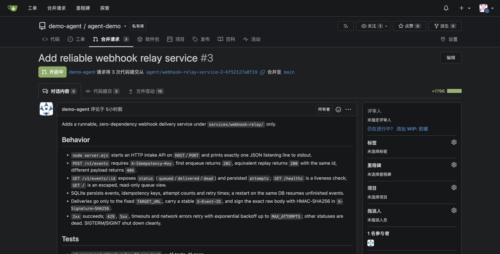
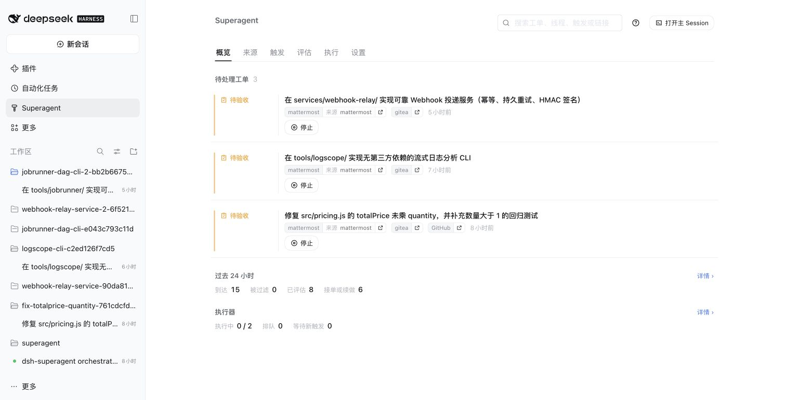

# 把 DeepSeek Super-agent 部署到 Kubernetes，从聊天任务到代码 PR

前一篇[源码解析](deepseek-superagent-prototype-analysis.md)讨论了 Super-agent 如何把消息、授权、任务和执行会话分开。这次把它放进一个隔离的 Kubernetes 测试环境：在 Mattermost 提需求，由 Agent 修改 Gitea 中的演示仓库、运行测试、创建拉取请求（Pull Request，PR），再把结果发回原来的聊天线程。

先从一个计价函数修复确认链路，再提交三个独立的多文件项目，观察两个执行器并发和第三个任务排队。验证除了看 Agent 的报告，还包含独立的 HTTP、命令行、输入规模和进程恢复检查。

**这里的 Gitea 和 Mattermost 是本次增加的适配，不是上游原型原生支持的产品组合。** 上游围绕一个 GitHub 仓库，内置 GitHub 和可选飞书来源，并明确声明这是研究原型。本文使用的源码基线为 `6337fc823ce20251c8de8085948165c81aaa701e`。[官方 README](https://github.com/deepseek-ai/dsh-superagent-prototype/blob/6337fc823ce20251c8de8085948165c81aaa701e/README.md)

## 1. 先把系统做小

这套 Demo 只有四个长期运行的 Pod。控制与工具执行部分没有申请 GPU，使用已经存在的模型 API。

| 组件 | 本次版本 | 职责与持久化 |
| --- | --- | --- |
| DeepSeek Harness（DSH） | `0.2.2-alpha.2`，镜像 `0.2.2-alpha.2-r1` | 加载 Super-agent Bundle，保存会话、编排 SQLite 和工作目录 |
| Gitea | `28.2.0` | 演示仓库、分支、PR；使用 SQLite |
| Mattermost Team Edition | `12.0.1` | 演示团队、私有频道和任务线程 |
| PostgreSQL | `17.11` | Mattermost 数据库 |

没有引入 Redis、消息队列或对象存储。DSH 镜像复用 [deepseek-harness-docker](https://github.com/runzhliu/deepseek-harness-docker)，新建独立的数据卷与 Profile，没有把个人会话目录挂进去。基础镜像提供运行环境，Super-agent 和协作来源仍要另行安装、配置和验证。[镜像项目说明](https://github.com/runzhliu/deepseek-harness-docker/blob/b6ed820a0611f5d81d0be0ed1970bdb7f009d514/README.md)


*图中是本次改造后的部署关系。模型推理服务是下游依赖；两个执行器是 DSH 会话，不是两个独立沙箱 Pod。*

每个任务使用独立的会话、目录与 `agent/<ticket-name>` 分支。三个任务的修改分别限制在 `services/webhook-relay/`、`tools/logscope/` 和 `tools/jobrunner/`，减少并发任务修改同一文件的冲突。所有结果停在待人工审核的 PR，没有自动合并。

存储使用保留策略的本地持久卷。这样可以验证同一测试节点上的 Pod 重建，但节点或本地磁盘失效后的恢复需要另外设计，不能把这次实验当作跨节点高可用验收。

### 1.1 部署与试用顺序

本次先部署 PostgreSQL、Mattermost 和 Gitea，确认数据库、持久卷与页面可用，再建立专用机器人、私有频道和演示仓库。随后给独立 DSH 安装编译后的 Super-agent Bundle，配置来源适配、固定仓库、允许发起任务的账号及两个执行名额，最后才放入真实任务。

模型 API 密钥保留在办公机上的专用桥接进程；Pod 只持有演示桥接的访问凭据。桥接只接受固定模型与指定接口，不能由请求方传入任意上游 URL。这是本环境的访问路径选择，集群本身能访问模型 API 时不必增加这一层。

部署完成后，分别验证页面健康、带鉴权的模型请求、工具调用和测试命令。只做一次“你好”的文本请求还不够：复杂编码任务可能在工具调用前耗尽输出预算，也可能被传输超时截断。本文的 Gitea/Mattermost 适配是定制实验代码；不能把上游镜像加几个环境变量就视为可直接复现本文组合。

## 2. Gitea 和 Mattermost 接到哪里

仅替换 GitHub 域名不够。来源（Source）还要负责账号检查、事件身份、线程上下文、读取游标与回复通道（Channel），PR 的身份和生命周期也要跟着适配。[上游扩展说明](https://github.com/deepseek-ai/dsh-superagent-prototype/blob/6337fc823ce20251c8de8085948165c81aaa701e/docs/008-cookbook.md)

| 入口 | 转换成的记录 | 本次限制 |
| --- | --- | --- |
| Mattermost 消息 | Trigger；根消息和回复归入同一个 Thread | 固定私有频道、允许发起工作的用户 ID；过滤机器人的自身消息 |
| Gitea 工单和评论 | Trigger 与仓库内的讨论线程 | 固定演示仓库和专用机器人账号 |
| Gitea PR | 绑定原 Ticket 的交付物 | 校验作者、仓库和分支，不把任意 PR 关联到任务 |
| Agent 回复 | 经 Outbox 持久化后写回原线程 | 写入回执标记，重试前检查是否已发出 |

### 2.1 先准备两个专用身份

Gitea 使用专用账号 `demo-agent`，由它持有私有演示仓库 `demo-agent/agent-demo`。本次令牌范围为 `write:repository`、`write:issue`、`read:user`，分别供仓库操作、工单评论和身份读取使用。它不是 Gitea 系统管理员，但它拥有这个演示仓库，不能把这套配置描述成服务端只授予了某个子目录的权限。

代码写入 `agent/<ticket-name>` 分支。仓库的 `main` 配置为禁止推送、禁止强制推送，合并要求一人批准，并将合并白名单限定为人工演示账号 `demo-admin`。这些仓库规则与任务里的“不合并”要求共同控制交付，不能只靠提示词约束主分支。


图中选中了“禁用推送”。其他合并约束在同一条分支规则中配置；本次没有修改或合并主分支。

Mattermost 创建机器人 `@demo-agent`，显示名称为 **DSH Super-agent**，角色是普通 `Member`。将它加入演示团队和私有的 Coding Demo 频道，不启用 `post:all` 或 `post:channels` 这两项额外的全局发帖权限。机器人使用自己的 API 令牌读取消息和回复，不借用管理员令牌。


这张图是实际机器人配置：Member 角色，两项额外权限均未勾选。本文使用的都是演示身份，截图不包含令牌。

### 2.2 API 凭据怎样进入 DSH

本次增加了一个名为 `demo-bridge` 的专用命令行适配器，负责调用 Gitea、Mattermost 的 REST API。它与前面访问模型的桥接进程是两个不同组件。

协作系统配置通过 Kubernetes Secret `agent-integrations` 只读挂载为 `/run/demo/integrations.json`。适配器默认读这个文件，也可以通过 `DSH_DEMO_CONFIG_FILE` 指定路径。关键字段如下，名称来自本次定制代码：

| 字段 | 本次用途 |
| --- | --- |
| `giteaURL`、`giteaToken` | Gitea 内网 API 地址和机器人令牌；本例服务地址为 `http://gitea:3000` |
| `repository` | 固定仓库 `demo-agent/agent-demo` |
| `mattermostURL`、`mattermostToken` | Mattermost 内网 API 地址和机器人令牌；本例服务地址为 `http://mattermost:8065` |
| `channelId`、`botId` | 固定频道 ID、机器人用户 ID，用于读取消息、过滤自身消息和原线程回复 |

这是关键字段说明，不是上游官方配置格式，也不是完整可直接运行的配置文件。真实令牌没有放进文章、聊天提示词或截图。只读挂载约束的是文件写入；同一容器内具备文件读取能力的工具仍可能读到凭据，因此它也不构成恶意代码的隔离边界。

编译后的自定义插件向 Super-agent 注册 `gitea`、`mattermost` 两种 Source。Source 通过适配器读取事件、补齐线程上下文和发送回复。Git 凭据助手另行检查主机名和完整仓库路径，PR 创建工具也固定到该演示仓库；这些是本次集成的实现，不能省略后只填写一个机器人名字。

### 2.3 页面里启用来源，再配置谁可以提任务

安装适配后的 Bundle，进入 **Superagent → 设置 → 来源**，启用 Gitea 和 Mattermost。本次分别每 10 秒、5 秒轮询一次，使用的是 API 轮询，没有为这条链路配置 Mattermost 出站 Webhook。


这里的页面管理启用状态和轮询频率；URL、令牌由前面的 Secret 和适配器读取，页面里没有让用户粘贴这两类凭据的输入框。

然后进入 **设置 → 评估 → 在各来源上**，配置允许发起任务的人。Gitea 按登录名允许 `demo-admin`；Mattermost 按该演示用户的 ID 允许。这个白名单标识的是发需求的人，与机器人自己的 `botId` 是不同身份。


图中只允许一个演示用户。接单模式保持 `observe`（仅观察），合法的明确请求仍然可以接单；不能把它理解成所有任务都停用。执行名额设为两个。

最后用同一条小需求核对整条链路：频道消息被读取，出现对应工单和执行会话，Gitea 出现新分支及 PR，机器人把结果发回原消息线程。来源显示正常只能证明轮询在工作，完成这些检查才证明身份、工具调用和交付都已连通。

### 2.4 去重和回复不能丢

一次真正遇到的问题是 Mattermost 的 `update_at`。线程回复等元数据变化也会更新它，直接用 `post.id + update_at` 当作事件身份，会把原需求当成新消息再处理。修正后用消息 ID 和正文编辑版本 `edit_at` 构造稳定身份；原文被编辑才产生新事件。

```javascript
// Use the body-edit version, not a thread-metadata update.
const version = post.edit_at || 0;
const eventIdentity = `${post.id}:${version}`;
const threadIdentity = post.root_id || post.id;
```

发送端同样需要幂等：Mattermost 的机器人回复带回执属性，Gitea 评论带隐藏标记，重试时先查已存在的标记。这能控制本次适配的重复发送，不能概括成所有远端写入都具备严格 exactly-once 语义。

## 3. 用户怎样提交和追踪任务

用户在演示频道里 `@demo-agent`，写清修改范围和验收条件。继续修改时在同一个线程回复，沿用原来的任务与 PR。在 DSH 左侧进入 **Superagent → 执行**，能看到执行中、排队、等待新触发和待验收的任务。


*这是实际控制台。图中的“执行中 2 / 2，排队 1”是运行时状态，不是按任务数量推测出的并发。*

例如，小任务可以直接写：“修复 `src/pricing.js` 没有乘 `quantity` 的错误，补数量大于 1 的测试，运行 `npm test`，创建 PR，等待人工审核，不要合并。”复杂任务则还要给出接口、持久化方式、失败处理和明确的目录范围。把需求放在聊天消息中，与把整台集群的管理权限交给 Agent，是不同的授权范围。

这里有两个容易混淆的状态：Agent 回合结束不代表任务已经交付；代码生成结束也不代表测试通过。最终还需要核对测试输出、远端分支和 PR，再确认结果确实回到了原始线程。

全局暂停用于停止新的评估、派工和回复，不会立即中止已经运行的回合。停止具体任务应使用任务停止操作。需要紧急撤销访问时，还要在服务端撤销相应凭据，不能把界面的暂停按钮当作安全总开关。

### 3.1 打开 DSH，看看任务具体做了什么

任务列表展示的是编排状态。要检查实际工作，在 **Superagent → 执行** 中打开对应执行会话，切到 **轨迹**，再搜索文件名、工具名或测试输出。左侧是调用记录，点开后可以分别查看参数、结果和计时；主 Session 负责接单与派工，真正的文件修改和测试要到该任务的执行 Session 中查看。

以日志分析工具为例，在轨迹中搜索 `component_exit=0`，可以定位最后一次测试的 `bash` 调用。工具结果保留了命令输出，而不是只有一段“测试已通过”的自然语言报告。


图中组件命令退出码为 0，31 项测试通过；仓库命令退出码也为 0，33 项测试通过。后者包含 31 项组件测试和原有的 2 项测试，不能相加写成 64 项。这里是 Agent 执行的自测，后面的 6 组独立验收另行记录。

这也给排查提供了具体入口：收到需求但没有执行会话，查接单和派工；会话一直生成文字却没有文件工具调用，查有效输出预算；已经调用测试但返回非零，查命令和失败输出；代码及测试完成但没有 PR 或线程回复，再查外部写入与回执。测试退出码为 0 只覆盖被执行的用例，仍需要检查断言和独立验收，不能直接等同于产品正确。

截图保留实际工具调用与输出，没有把模型的内部推理当作交付证据。下文的未完成 DAG 任务也保留在结果中，不因为其他任务成功而省去。

## 4. 从小修复走到三个多文件项目

最初的烟雾测试是修复 `totalPrice` 没有乘商品数量的问题。Agent 修改实现、增加回归测试，创建 PR #1。随后在原线程追加数量为 0 的要求，执行期间重建 DSH Pod，恢复后仍使用原会话、目录、分支和 PR，最终实际运行了 7 个测试，全部通过。


*界面中的中文保留原始证据。第一次结果为 5 个测试，追加要求后为 7 个；PR 保持开放，等待人工审核。*

为了避免只凭一个小函数判断整个系统，接着提交三个独立项目。

### 4.1 可靠 Webhook 投递服务

使用 Node.js 内置模块和 SQLite，实现入队 API、幂等键、有限重试、固定投递目标、HMAC-SHA256 签名以及运维首页。验收要覆盖“先失败两次再成功”、永久 HTTP 400、非法 JSON、真实签名校验和服务重启后继续投递。

关键约束是区分本地队列幂等与网络投递语义。即使队列中只有一条事件，发送后在记录成功前中断，接收端仍可能见到重复请求。因此要求携带稳定的事件 ID，并在 README 说明接收端去重责任。



*PR #3 包含 15 个文件、三次提交，最终为 `8ba2da4`。这是单进程演示服务；没有 API 鉴权、TLS、多实例协调和死信重放接口，不能直接作为生产 Webhook 平台上线。*

### 4.2 流式日志分析工具

逐行读取 JSON Lines，支持时间边界、服务名筛选、坏行处理、延迟汇总和可直接打开的 HTML 报告。独立验收使用全部合成的数据，包含非法时间、负延迟、`__proto__` 服务名和需要转义的 HTML 文本；还在 64 MiB 的 Node 堆限制下处理 100,000 条有限基数记录。

这项检查只说明给定数据分布下的行为。统计表仍会随服务、时间桶和错误签名的基数增长，不能将“逐行处理”表述成对任意输入都恒定内存。


*实际 Gitea PR #2，包含 19 个文件和两次提交，最新提交为 `66fc963`。PR 文本中的自测报告与本文的独立验收分别记录。*


*这不是为文章制作的界面模型：页面由交付的 CLI 实际生成。100,000 条合成记录包含 5,000 条 error，延迟均值为 144.50 ms。可[打开完整 HTML 报告](../../assets/rag-agent/deepseek-superagent-practice/logscope-report.html)。这些数字是测试输入及其统计，不能解释成生产系统的负载。*

### 4.3 可持久恢复的 DAG 任务执行器

有向无环图（Directed Acyclic Graph，DAG）用于表达任务依赖。执行器需要校验环和未知依赖，限制并发，对失败或超时进行有限重试，把状态保存到 SQLite，并能在真实进程终止后恢复。

预先编写的验收计划通过子进程记录开始和结束时间，检查独立任务是否重叠、依赖是否等待，以及失败分支是否阻断后继而不影响其他分支。恢复检查还要求确认成功任务没有重跑，配置改变时不能误用旧状态。由于本次 DAG 没有交付实现，这部分验收没有运行。这是应用任务执行器的恢复，与 Super-agent 自身的会话恢复是两层不同的问题。

### 4.4 最终交付，不只看“完成”标签

| 任务 | 最终代码与 PR | 实际组件自测 | 独立验收 |
| --- | --- | --- | --- |
| Webhook 投递服务 | PR #3，`8ba2da4`，15 个文件 | 11 / 11 通过 | 5 / 5 组通过 |
| 日志分析 CLI | PR #2，`66fc963`，19 个文件 | 31 / 31 通过 | 6 / 6 组通过 |
| DAG 任务执行器 | 截止时没有实现与 PR，已停止 | 未执行 | 预先定义的 5 组未执行 |

独立验收是在 Agent 交付代码之外编写的黑盒检查，实际启动 HTTP 接收端、服务或 CLI，而不是再问 Agent“测试通过了吗”。最终 Webhook 验收在最终提交上重新运行，日志验收对应的工作目录提交与远端 PR 一致。两个 PR 均保持开放；演示仓库主分支没有合并这些修改。

日志验收首轮为 5 / 6：验收器把浮点均值与 `49.5` 严格比较，而实际结果是 `49.500000000000036`。保留首轮失败后，只将验收器改为 `1e-9` 数值容差，产品代码没有变化，第二轮为 6 / 6。这属于验收器修正，不能写成产品缺陷被修复，也不能省去失败记录。[脱敏验收摘要与代码标识](../../assets/rag-agent/deepseek-superagent-practice/acceptance.json)

原始 Webhook 和 DAG 执行窗口超时停止后，原聊天线程中的继续请求创建了新的 Ticket 和工作目录。它们与前面的计价函数恢复不是同一种情况：聊天线程相同，不代表停止后仍复用了同一个工单。DAG 新尝试仍多次达到输出上限，20 分钟重试窗口结束后由看护程序停止，没有伪造交付或无限续跑。



*三项待验收包括最初的小函数修复和两个复杂项目。DAG 工单已经停止，不在开放工单列表里；截图不表示三个复杂项目都成功。*

## 5. 复杂任务暴露了短任务没触发的传输问题

首轮两条长请求都在 300 秒时结束，DSH 记录 `Stream ended without finish_reason` 并重试。任务已获授权，执行器也已创建，但实现文件仍没有落盘；只看“有两个执行器运行中”会误判成正常工作。

问题出在本次演示的办公机桥接：它用固定的 5 分钟总时限，同时逐个小块同步回传服务端事件流（Server-Sent Events，SSE）。在需要经过端口转发的链路上，每块回传都要等待网络往返，给生成过程引入了额外延迟。

修正分成三件事：

1. 按约 50 ms 或 64 KiB 聚合返回字节，保持原始流内容，不解析或改写模型消息。
2. 把有进展的流与真正空闲的流分开：本次配置 180 秒空闲时限、15 分钟总时限，整个实验另外设总期限。
3. 超时后中断不完整的 HTTP 流，让调用方明确看到失败；不能把缺少结束标记的流伪装成正常完成。

修复保留了前后配置和失败记录，并新增了 4 项隧道测试与 3 项分块缓冲测试。这个问题属于演示桥接实现，不能归因于上游 Super-agent 或模型能力，也不能把修复后的端到端时间直接当作模型性能提升。

另有两项任务在单次输出达到 8,192 token 后，以 `max-tokens` 结束，仍没有发出代码工具调用。保留这个未完成状态后，本次向实际 API 发送显式 `thinking: {type: "disabled"}` 和 32,768 token 预算，最小探测确实返回了工具调用，并把这组覆盖配置加入桥接。但后续 DAG 的完整 DSH 会话仍记录到 8,192 输出 token 和 `max-tokens`，不能据最小探测就宣称整条链路已切成新模式。接下来需要核对 DSH、桥接和上游实际生效的请求参数及限制，而不是继续重复“请继续”。这也不足以得出模型不会写 DAG 的结论。[DeepSeek 思考模式参数](https://api-docs.deepseek.com/guides/thinking_mode/)

重启恢复还暴露了交互边界：记录和工作目录能够找回，但恢复后主会话调用了状态查询操作，执行器按“只报告状态”的请求结束回合，没有完成实现。上游确实把状态查询定义为不恢复实施。本次在原线程明确追加“继续原任务”后再执行。这说明恢复既要检查存储，也要验证后续派工与对话语义。[状态查询的明确边界](https://github.com/deepseek-ai/dsh-superagent-prototype/blob/6337fc823ce20251c8de8085948165c81aaa701e/src/core/tickets.ts)

## 6. 页面为什么会突然打不开

本次界面通过办公机上的 `kubectl port-forward` 访问。曾出现办公网到 Kubernetes API 超时，导致 Gitea 和 Mattermost 转发断开，而集群中的 Pod 没有重启。看护进程检测到退出后重新建立转发，随后健康检查恢复。

因此要分别检查浏览器、转发进程、Kubernetes API、Pod 和模型访问路径。端口在监听不等于页面正常；页面正常也不等于模型通道正常。DSH 未带登录凭据时返回 401 是鉴权仍在工作的信号，不能单凭这个状态判断服务故障。

`127.0.0.1` 入口只属于运行转发的那台电脑，办公机休眠或断网仍会影响访问。多人长期使用应配置经过认证的稳定入口，并让集群具备合适的模型访问路径。本次没有为绕过网络问题改动现有集群的 CNI、路由或 DNS。

## 7. 这次验证了什么，还欠什么

| 检查层次 | 已得到的证据 | 边界 |
| --- | --- | --- |
| 接入与编排 | 原有 1,197 项回归测试、5 项 CLI 适配测试通过；实际观察两个任务运行、一个排队 | 自定义适配，不是上游对该 IM/代码平台的产品承诺 |
| 小任务恢复 | 重建 DSH Pod 后沿用原计价任务与 PR；7 项测试通过 | 同一测试节点与保留的数据卷 |
| 复杂代码交付 | 两个多文件项目、42 项组件自测、11 组独立验收通过 | 合成数据；第三个项目未交付，5 组验收未执行 |
| 传输修复 | 4 项隧道测试、5 项办公机 Worker 测试通过 | 含 3 项缓冲及 2 项参数覆盖单测；不代表所有模型选项都在完整链路生效 |
| 外部变更 | PR #1、#2、#3 均未合并，主分支未被修改 | 尚未验证真实团队的合并、发布与回滚流程 |

这些计数来自不同层次，不相加计算“总成功率”。下一步优先解决完整会话的有效参数观测，再在明确预算下重跑 DAG；增加并发执行器之前，先消除“空转但显示在运行”的情况。

这套 Demo 让人能够在聊天入口分配工作，在控制台追踪任务，在 Gitea 查看代码和测试证据，再回到原线程追加要求。它验证的是给定版本、合成任务与授权边界下的工程链路。

它仍是单实例编排：没有验证数据库或磁盘丢失、节点断电、跨机恢复、多实例并行写入，也没有构建针对恶意代码的任务级强隔离。多个 DSH Session 与目录隔离不能替代容器或虚拟机沙箱。将它接入真实团队前，还需要明确身份、仓库权限、执行隔离、审计、备份以及故障后的外部状态核对。

## 参考资料

- [DeepSeek Super-agent 原型及研究声明](https://github.com/deepseek-ai/dsh-superagent-prototype)
- [Source 与 Channel 扩展说明](https://github.com/deepseek-ai/dsh-superagent-prototype/blob/6337fc823ce20251c8de8085948165c81aaa701e/docs/008-cookbook.md)
- [执行、暂停与恢复](https://github.com/deepseek-ai/dsh-superagent-prototype/blob/6337fc823ce20251c8de8085948165c81aaa701e/docs/003-execution.md)
- [DeepSeek Harness Docker 镜像及 Kubernetes Chart](https://github.com/runzhliu/deepseek-harness-docker)
- [前文：DeepSeek Super-agent 源码解析](deepseek-superagent-prototype-analysis.md)
