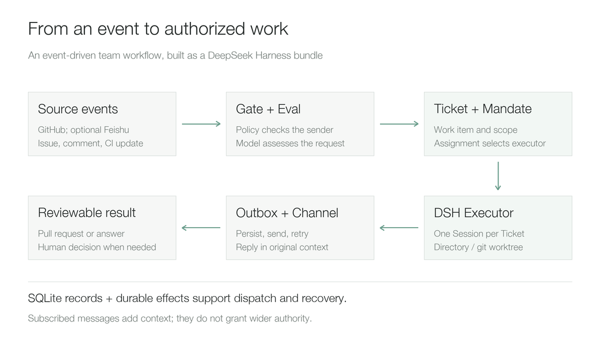
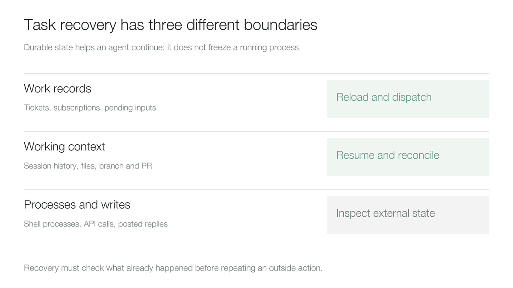

# DeepSeek Super-agent 解析：从聊天会话到团队任务系统

DeepSeek 新公开的 [dsh-superagent-prototype](https://github.com/deepseek-ai/dsh-superagent-prototype) 把一个值得讨论的问题摆到了模型能力之外：当 Agent 开始同时处理团队里的多个任务，怎样减少人盯会话、搬上下文、追进度和收拾失败的时间？GitHub 记录显示，仓库创建于 2026 年 10 月 31 日，本文采用的首个提交也在当天；这两个日期不是正式产品发布日期。[来源：仓库记录](https://api.github.com/repos/deepseek-ai/dsh-superagent-prototype)

这个项目的价值在于把编程 Agent 接入持续发生的团队工作：读取 GitHub 和可选的飞书事件，判断哪些请求有权启动工作，创建可追踪的任务，交给独立会话执行，再把结果送回原来的讨论。它没有提供新的模型权重，也不负责加速模型推理。

官方 README 将其定位为研究原型，明确说明公开代码与内部实现及设计文章并不完全相同，部分设想尚未实现。因此，应把它看成一套可以阅读、验证和改造的系统设计，而非已经成熟的企业数字员工产品。项目采用 MIT 许可证；本文分析基于截至 2026 年 11 月 1 日的提交 [`6337fc823ce20251c8de8085948165c81aaa701e`](https://github.com/deepseek-ai/dsh-superagent-prototype/commit/6337fc823ce20251c8de8085948165c81aaa701e)。[来源：官方 README](https://github.com/deepseek-ai/dsh-superagent-prototype/blob/6337fc823ce20251c8de8085948165c81aaa701e/README.md)

## 1. 它与 DeepSeek Harness 是什么关系

DeepSeek Harness，命令行为 `dsh`，提供 Agent 会话、模型接入、工具、权限、持久化和 Web 交互等基础能力。Super-agent 在其上增加团队任务的生命周期，通过 Bundle，即一组插件及配置，装配到独立的 Harness Profile（运行配置）中。

| 层次 | 负责什么 | Super-agent 的位置 |
| --- | --- | --- |
| 模型与推理服务 | 生成内容、调用工具所需的推理 | 使用已经配置好的模型服务 |
| DeepSeek Harness | 会话、工具执行、上下文与运行时 | 为主会话和任务执行会话提供基础能力 |
| Super-agent | 事件、准入、授权、任务、派工、回复 | 本项目的核心 |
| 代码与协作系统 | GitHub Issue、拉取请求和飞书讨论 | 接收工作、提供上下文、交付结果 |
| 操作系统与沙箱 | 进程、文件、凭据和资源隔离 | 需要部署者另外设计，工作目录不等于隔离环境 |

当前原型围绕**一个 GitHub 仓库**运行，飞书是可选入口。它不是开箱即用的任意业务工作流平台，也不是横跨大量仓库的通用企业任务调度器。基础 Harness 可参考[已有仓库解析](deepseek-harness-repository-analysis.md)。[来源：项目说明与部署文档](https://github.com/deepseek-ai/dsh-superagent-prototype/blob/6337fc823ce20251c8de8085948165c81aaa701e/docs/006-deployment.md)

## 2. 最重要的变化是任务有了独立身份

普通单会话的工作方式，往往把需求、执行过程、追问和失败都塞进同一个上下文。Super-agent 把“有人发了一条消息”“这条消息授权做什么”“当前由谁执行”分成不同记录。



*图 1：依据官方领域模型整理的简化流程。图中英文术语对应下表；这是架构示意，不是部署截图。订阅消息可补充上下文，不会因此扩大授权。*

| 概念 | 含义 | 避免的问题 |
| --- | --- | --- |
| Source / Trigger | 事件来源／一条不可变事件 | 把重复拉取误认为新的工作 |
| Thread | 一段持续讨论，内部按顺序评估 | 同一讨论的上下文与判断相互打架 |
| Eval / Policy | 请求评估／版本化准入规则 | 看到任何文字就开始执行 |
| Mandate | 本次接受工作时确定的授权范围与依据 | 新出现的上下文悄悄扩大原始任务 |
| Ticket | 有独立生命周期的工作项 | 把任务状态等同于某次模型调用状态 |
| Assignment / Executor | 一次派工／实际执行器 | 执行器重启后丢失任务归属 |
| Subscription | 任务与讨论之间的订阅关系 | 人工不断转发后续讨论与持续集成结果 |
| Channel / Outbox | 回复渠道／持久化待发消息 | 做完了却没把结果可靠送回原处 |

例如，在 Issue 中请求“修复解析错误并补回归测试”，可以形成一个 Ticket，授权范围对应这次修复。执行器在自己的目录中修改代码并创建拉取请求（Pull Request，PR）。持续集成（Continuous Integration，CI）失败和评审意见继续进入这个任务；若后续要求改造另一套系统，应重新路由和判断范围，不能因为出现在同一讨论里就直接接受。

一个 Thread 可以有多个 Ticket；同一 Ticket 也可以先后拥有多个 Assignment。它不是简单的“一条消息创建一个子 Agent”。[来源：领域模型](https://github.com/deepseek-ai/dsh-superagent-prototype/blob/6337fc823ce20251c8de8085948165c81aaa701e/docs/001-domain.md)

## 3. 主动性如何受到约束

准入先检查来源、发送者身份及是否明确请求 Agent，再由模型研判工作内容。订阅的讨论消息是另一条路径：它们可以直接成为已有任务的上下文，但不会因此获得新的权限。

对于从规则推断出来的主动工作，系统提供三种接单模式：

| 模式 | 对推断任务的行为 | 适合的阶段 |
| --- | --- | --- |
| `off` | 不产生推断候选 | 只处理明确请求 |
| `observe` | 评估并记录“本来会接受”，但不实际接单 | 校验规则是否误触发；这是默认模式 |
| `auto` | 规则匹配且评估通过后接单 | 在限定范围内启用主动处理 |

**这三个模式不等于整个 Agent 的总开关。** 合法的明确请求在三种模式下都能工作。把 `auto` 改为 `off`，不能当作已经停止所有执行。

还有三个运行细节影响实际管理：

- 策略版本变化会使进行中的评估失效并重新排队，但不会立即撤销所有正在执行的任务；相关任务会收到策略变化通知。
- 暂停处理会停止新的评估、派工、输入投递和回复，来源仍记录事件，正在执行的轮次不会被直接打断。
- 人工在面板停止某个任务，与模型从讨论中识别“停止”请求，是不同的控制路径。

我的判断是，`observe` 比“直接放开主动工作”更适合初次接入：先观察错误接单率和噪声，再扩大范围。紧急收回权限时还应使用确定的停止操作和底层凭据控制，不能只期待模型及时理解一条新规则。[来源：授权与控制语义](https://github.com/deepseek-ai/dsh-superagent-prototype/blob/6337fc823ce20251c8de8085948165c81aaa701e/docs/002-authorization.md)

## 4. 并行执行解决什么，不解决什么

主会话负责研判、路由与协调；每个 Ticket 使用独立的执行会话和目录。准备命令可以通过 `git worktree` 创建代码检出，因此多个独立任务能够并行推进，而不是共享一个被反复切换分支的工作区。

执行层的几个实现值得借鉴：

1. 启动和唤醒之前先预占并发槽位，避免多个异步启动同时抢到最后一个名额。
2. 人的后续消息可以使用超出 `maxWorkers` 的一个额外槽位，并优先于新任务，减少“机器忙着接新活，人却无法纠偏”的情况。
3. 轮次结束时若还有后台 Shell 任务或子 Agent，任务仍占用槽位；交给人评审或回答问题时则按规则释放槽位。
4. 前台命令默认在 5 秒后转入后台，执行器可以继续接收输入，而不必等整个长命令结束。

这些设计改善的是任务响应和调度，不会让单次模型推理自动变快。多个任务改同一个公共接口时，独立 worktree 也不能消除逻辑冲突，仍需集成测试与代码评审。

此外，`maxWorkers` 不是模型 API 的全局并发上限：主会话、评估、执行会话及其子任务都可能消耗模型资源。因此，部署时还应在模型网关设置并发、速率和预算限制。这里是依据执行结构提出的容量建议，不是该原型已经提供的完整计费治理功能。[来源：执行文档](https://github.com/deepseek-ai/dsh-superagent-prototype/blob/6337fc823ce20251c8de8085948165c81aaa701e/docs/003-execution.md)、[WorkerSlots 源码](https://github.com/deepseek-ai/dsh-superagent-prototype/blob/6337fc823ce20251c8de8085948165c81aaa701e/src/executor/dsh.ts#L166)

## 5. 中断续跑依靠什么

原型使用 SQLite 保存工作记录，并通过持久化 Effects 队列执行派工、输入投递和回复等后续动作。先记录意图，再执行外部动作，可以避免仅靠内存队列时重启丢活。



*图 2：恢复边界的概念图。工作记录可以重新派发；会话与检出目录可提供继续工作的依据；进程和外部写入需要分别确认。这不是本地故障注入实验结果。*

| 层次 | 原型的恢复办法 | 仍需确认的边界 |
| --- | --- | --- |
| 工作与待办记录 | 保存 Ticket、订阅、输入和待执行动作 | 状态目录丢失不属于正常进程重启恢复 |
| 执行上下文 | 沿用会话、目录、分支与 PR，添加恢复说明 | 恢复后仍要检查当前文件和远端状态 |
| 会话输入 | 使用稳定消息标识，检查历史和待收件箱，避免重复投递 | 不能把输入去重推广成所有工具副作用恰好执行一次 |
| 外发回复 | Outbox 保存回执、控制顺序、失败退避重试 | 远端已成功、本地尚未记录时仍存在不确定窗口 |
| Shell 和后台程序 | 重试或重启后重新安排工作 | 进程重启会结束原有进程，不是恢复内存快照 |

源码中，`AgentDelivery` 在投递后刷新会话持久化记录；`Outbox` 先保存回执并排入 Effects，再发送消息。后者仍然有“远端写入完成、回执还没落地”的时间窗口。因此，我不会把它称作对任意 API 操作的端到端恰好一次保证。

官方恢复说明也要求执行器先检查目录、Git 历史和 GitHub，再决定是否重复外部操作。这种恢复更接近“带持久状态的继续工作”，而不是让一个被杀掉的命令从原 CPU 指令位置继续运行。[来源：恢复说明](https://github.com/deepseek-ai/dsh-superagent-prototype/blob/6337fc823ce20251c8de8085948165c81aaa701e/docs/003-execution.md)、[持久化结构](https://github.com/deepseek-ai/dsh-superagent-prototype/blob/6337fc823ce20251c8de8085948165c81aaa701e/docs/007-architecture.md)、[输入投递](https://github.com/deepseek-ai/dsh-superagent-prototype/blob/6337fc823ce20251c8de8085948165c81aaa701e/src/app/delivery.ts)、[Outbox 源码](https://github.com/deepseek-ai/dsh-superagent-prototype/blob/6337fc823ce20251c8de8085948165c81aaa701e/src/app/outbox.ts)

## 6. 面板与权限边界要分开看

原型有 Web 面板，集成在 DeepSeek Harness 的侧栏中，包含 Overview、Source、Trigger、Eval、Execution 和 Settings。它优先展示需要人工处理的任务，其次是系统问题与历史，适合回答“现在是否需要我做决定”“哪个任务卡在哪里”。[来源：面板设计](https://github.com/deepseek-ai/dsh-superagent-prototype/blob/6337fc823ce20251c8de8085948165c81aaa701e/docs/005-panel.md)

但面板中的任务范围和操作系统隔离是两回事。部署文档明确指出：主会话与执行器使用 `danger-full-access`，以部署者的操作系统用户运行。命令包装器负责默认选用 Agent 的账号，独立目录负责组织文件；执行器仍可能通过绝对路径运行程序，或读取该用户的主目录。

因此：

- `Mandate` 解决系统如何记录和判断工作授权，不会自动替代文件权限或沙箱。
- `blockedCommands` 一类命令包装不能代替底层访问控制。
- 仅在提示词里要求“先审批再合并”，不能代替仓库的分支保护与评审规则。
- 对外暴露面板需要另外设计认证、访问边界和审计；不能因为已有 Web UI 就假定具备完整企业多租户能力。

我更倾向先使用专用操作系统账号或隔离虚拟机，只放测试仓库凭据，再逐步增加权限。把它直接放在带生产集群管理员凭据的办公环境中，与原型自身的隔离能力不匹配。[来源：部署隔离说明](https://github.com/deepseek-ai/dsh-superagent-prototype/blob/6337fc823ce20251c8de8085948165c81aaa701e/docs/006-deployment.md)

## 7. 如何开始验证，哪些企业环境需要改造

### 7.1 当前安装条件

| 项目 | 官方原型的条件 |
| --- | --- |
| 运行工具 | Node.js 22.19+ 或 24+、pnpm、Git 2.32+、Python 3.8+、tmux |
| Harness | 部署文档给出 `@deepseek-ai/dsh@0.2.1-rc.3`；源码声明兼容范围 |
| GitHub | `github.com` 仓库、Agent 专用用户账号、GitHub CLI（命令行工具，CLI）2.48+ |
| GitHub Enterprise Server | 当前不支持；不能只替换域名就视作完成适配 |
| GitHub App | 当前不能直接作为 Agent 身份，因为实现依赖账号通知 |
| 飞书 | 可选；独立机器人及其命令行配置 |
| 模型 | Harness 已配置的模型提供方；评估和执行可以分别选模型 |

仓库本身版本为 `0.1.0`，包标记 `private: true`，官方路径是从源码构建并装载 Bundle。不能把下面的步骤当成我们已完成的实战：它们是上游安装流程的整理。[来源：package.json](https://github.com/deepseek-ai/dsh-superagent-prototype/blob/6337fc823ce20251c8de8085948165c81aaa701e/package.json)、[安装文档](https://github.com/deepseek-ai/dsh-superagent-prototype/blob/6337fc823ce20251c8de8085948165c81aaa701e/docs/006-deployment.md)

```sh
npm install -g @deepseek-ai/dsh@0.2.1-rc.3
git clone https://github.com/deepseek-ai/dsh-superagent-prototype.git
cd dsh-superagent-prototype
git checkout 6337fc823ce20251c8de8085948165c81aaa701e
pnpm install
pnpm build
```

随后应按官方文档创建**新的、独立的** Profile，安装本地 Bundle，配置专用账号、状态目录和测试仓库，再启动服务。上游用于创建 Profile 的命令会替换同名既有配置，因此不能用于已有 Profile 的升级。已有个人 Harness 环境也不宜直接混用：该插件会修改进程级 `PATH` 和 Git 配置。

### 7.2 放到 Kubernetes 的建议

这是一种根据源码约束推导的部署方案，未在本文执行：

1. **一个仓库一个独立实例，先单副本运行。** Runtime 会锁住状态目录并打开 SQLite；同一状态目录不是可供多个副本同时写入的高可用控制面。
2. **同时保护工作状态与执行上下文。** 持久卷声明（PersistentVolumeClaim，PVC）需要覆盖规划中的状态目录、Harness 会话和工作树；只保存数据库不足以恢复全部上下文。
3. **采用避免重叠写入的更新方式。** 不要直接把副本数改成 2 来实现高可用；先验证旧实例退出、卷重新挂载、锁与恢复语义。单副本重调度是恢复方案，不等于无中断高可用。
4. **模型服务单独部署。** Super-agent 控制与工具运行部分不要求绑定 GPU；使用远程模型 API 时，GPU 容量属于下游推理服务的规划。
5. **补上企业入口和执行隔离。** 配置访问认证、专用凭据、网络出口、资源上限与备份；若要让每个任务进入独立沙箱，需要适配 Executor／执行环境，不能把每个 Session 当作已经隔离的 Pod。

对于使用 GitLab、私有 GitHub 服务或其他协作入口的团队，重点工作是实现 Source、身份检查、事件游标、上下文读取和 Channel 写回。其领域抽象可以借鉴，但原型内置的 `gh` 协议与账号通知逻辑不会自动迁移。[来源：Runtime 状态目录锁](https://github.com/deepseek-ai/dsh-superagent-prototype/blob/6337fc823ce20251c8de8085948165c81aaa701e/src/app/runtime.ts#L89)、[来源扩展说明](https://github.com/deepseek-ai/dsh-superagent-prototype/blob/6337fc823ce20251c8de8085948165c81aaa701e/docs/008-cookbook.md)

## 8. 如何判断它是否真的有帮助

我建议选一个无生产写权限的演示仓库，先固定模型、输入任务、测试条件和预算。比较普通单会话工作方式与 Super-agent，逐步增加任务并发。不要用“同时开了多少会话”替代交付效果。

| 观察项 | 一个可操作的口径 |
| --- | --- |
| 交付质量 | 满足预先确定验收条件的任务数／全部提交任务数，保留失败分母 |
| 人工注意力 | 每个完成任务需要的澄清、纠偏、评审和收尾时间 |
| 完成延迟 | 从请求进入系统到第一个可评审结果，分别观察排队与执行耗时 |
| 主动性噪声 | `observe` 中本来会接的任务有多少不该接；每个任务产生多少无用通知 |
| 续跑正确性 | 控制进程重启后，能否找回任务，并避免重复创建分支、PR 或回复 |
| 成本 | 每个成功任务的模型调用、输入／输出与缓存 Token、工具及运行资源成本 |
| 约束执行 | 越权请求、无关讨论、恶意引用和停用操作是否符合预期 |

最值得做的五个验收是：重复投递同一事件、关闭回复通道后恢复、执行中重启控制进程、修改授权规则、在满负载时发送人工纠偏。每次都应核对数据库记录、会话历史、工作树和远端仓库的实际状态。

就当前公开原型而言，我认为最有价值的部分是：**把 Agent 的输入、授权、任务状态、执行和交付组织成一个有明确恢复与管理语义的系统**。这套结构值得用于团队研发助手的试验；距离企业生产落地，仍需补齐真实入口适配、硬隔离、权限治理和故障验收。它的效果最终应由交付质量和节省的人工时间证明。

## 参考资料

- [用户提供的设计文章入口](https://mp.weixin.qq.com/s/zoS7GlReWPhfCjENGxXCdg)
- [官方开源仓库及研究原型声明](https://github.com/deepseek-ai/dsh-superagent-prototype)
- [设计原则](https://github.com/deepseek-ai/dsh-superagent-prototype/blob/6337fc823ce20251c8de8085948165c81aaa701e/docs/000-philosophy.md)
- [领域模型](https://github.com/deepseek-ai/dsh-superagent-prototype/blob/6337fc823ce20251c8de8085948165c81aaa701e/docs/001-domain.md)
- [授权](https://github.com/deepseek-ai/dsh-superagent-prototype/blob/6337fc823ce20251c8de8085948165c81aaa701e/docs/002-authorization.md)
- [执行、恢复和暂停](https://github.com/deepseek-ai/dsh-superagent-prototype/blob/6337fc823ce20251c8de8085948165c81aaa701e/docs/003-execution.md)
- [Web 面板](https://github.com/deepseek-ai/dsh-superagent-prototype/blob/6337fc823ce20251c8de8085948165c81aaa701e/docs/005-panel.md)
- [安装与隔离边界](https://github.com/deepseek-ai/dsh-superagent-prototype/blob/6337fc823ce20251c8de8085948165c81aaa701e/docs/006-deployment.md)
- [内部架构与存储](https://github.com/deepseek-ai/dsh-superagent-prototype/blob/6337fc823ce20251c8de8085948165c81aaa701e/docs/007-architecture.md)
