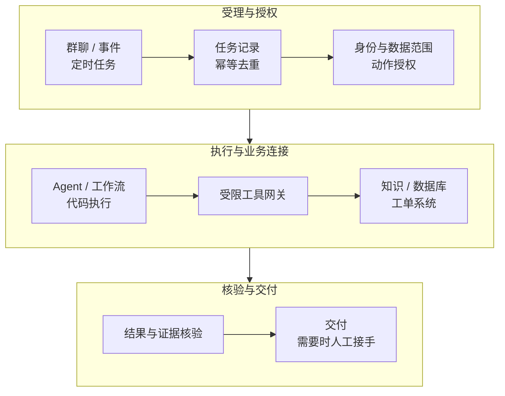

# 腾讯、阿里、字节怎样做数字员工：从产品到具体业务

“数字员工”已经不只是给聊天机器人起一个名字。腾讯把办公客户端、企业管理和云端运行分成了不同产品层；阿里 QoderWake 直接围绕岗位、工作环境和持续任务组织产品；飞书 Aily 则把智能体接进知识、表格、工单和协作入口。

讨论这些方案时，真正值得追问的是：**任务从哪里进来，带着谁的权限，在哪个环境运行，怎样调用业务系统，最后由什么证据确认完成。** 这比罗列模型、框架和安全原则更接近企业建设时会遇到的问题。

本文依据截至 **2026 年 10 月 19 日**读取的官方产品文档、产品团队访谈及公开客户案例整理。案例数据保留来源口径，属于发布方自述，不是本站对三家产品进行的统一实测。文中的运维岗位示例是据此提出的工程设计。

## 1. 三家公司在做的，并不是同一层产品

| 公司与代表产品 | 主要解决哪一层 | 企业接入时最重要的问题 |
| --- | --- | --- |
| 腾讯 WorkBuddy | 人与 Agent 交互的办公工作台，执行任务和交付文件 | 执行环境在哪里，文件和工具权限属于谁 |
| 腾讯 WorkBuddy Enterprise / Managed Agents | 组织管理、能力下发及云端 Agent 运行 | 企业绑定、部署形态、网络访问与平台治理是否匹配 |
| 阿里 QoderWake | 持续承担职责的 Waker、任务、协作与自动触发 | 岗位如何拆分，如何传授团队方法，失败后如何接手 |
| 钉钉悟空 | 接入钉钉生态的工作平台，本地与云电脑执行入口 | 用户委托权限、管理员开通和敏感操作确认 |
| 字节体系的飞书 Aily | 团队共享智能体、企业知识和业务应用集成 | 用户/群组隔离、知识分区、系统连接和业务闭环 |

这里比较的是产品的组织方式，不是性能排名。腾讯产品矩阵见 [WorkBuddy Enterprise](https://cloud.tencent.cn/product/workbuddy-enterprise)，阿里路线见 [QoderWake 产品文档](https://docs.qoder.com/zh/qoderwake/overview)与[悟空手册](https://wukong.dingtalk.com/docs/about/)，飞书路线见 [Aily 自定义智能体说明](https://www.feishu.cn/content/article/7631864469689240764)。

一个直接的选型启示是：如果公司缺的是团队入口，先评价协作和分发；如果缺的是长期执行环境，评价运行底座；如果缺的是业务系统连接，就先核对 API 和数据授权。三者可能同时需要，但不能用其中一层代替另外两层。

## 2. 腾讯：从个人工作台到组织托管，变化在哪里？

### 2.1 企业版增加的是组织和交付体系

WorkBuddy 面向自然语言任务、工具执行和文件交付；Enterprise 则把编码、办公和托管运行放进同一企业产品矩阵。官网区分多租户服务、专享资源池和企业私有化等交付方式。企业需要核对的是实际购买的形态及网络边界，而不是把“企业版”理解为同一种部署。[腾讯企业版产品说明](https://cloud.tencent.cn/product/workbuddy-enterprise)

具体配置比宣传语更有用。当前使用说明中，创建 Agent 时可以选择绑定企业，关联企业授权的模型与 Skill，再经企业管理员接收和下发。文档同时注明：**绑定企业状态在创建后不能二次修改；所述企业绑定模式当前面向企业客户端下发，不支持同样方式的公网/私网对话访问。** 因而“给员工下发一个智能体”和“把智能体发布成业务 API”需要分别设计。[创建与企业绑定说明](https://cloud.tencent.com/document/product/1831/138968)

这会影响真实实施：一位员工能在客户端使用某 Agent，并不能证明后台业务系统也能用服务身份调用它。招标或试点时，应分别演示员工入口、系统入口、组织归属和撤权后的行为。

### 2.2 Managed Agents 把执行环境变成独立平台能力

WorkBuddy Managed Agents（WMA）提供云端运行、沙箱、持久化、暂停恢复、追踪和评测等能力，并可将 Agent 下发到 WorkBuddy。它解决的是“人的电脑下线后，任务在哪里继续运行”的问题。[WMA 产品介绍](https://cloud.tencent.com/product/workbuddy-managed-agents)

平台工程团队可以据此拆出四项准入验证：

| 要验证什么 | 验证办法 |
| --- | --- |
| 人机环境是否解耦 | 发起任务后关闭客户端，检查任务状态与真实产物 |
| 停止、恢复是否保留进度 | 核对文件、进程和任务状态各自的恢复范围 |
| 能否进入企业内网 | 分别检查入口网络、出口网络、DNS 和目标系统授权 |
| 能否定位失败 | 从业务任务追到执行步骤、工具回执和产物，而非只有聊天记录 |

这些是本文建议的验收动作，不是声称已对 WMA 做完测试。尤其要区分厂商公布的沙箱创建性能与业务任务完成时间；同样，采用容器自建也能持久化文件，不能把某个默认临时容器方案的限制外推成所有自建系统的限制。

## 3. 阿里：QoderWake 怎样把 Agent 组织成岗位？

### 3.1 “岗位、工位、方法、协作”都有对应产品对象

Qoder 团队在云栖大会分享中，把数字员工拆成岗位角色、身份工位、培训教学、进入 IM、连通系统和记忆成长。这个拆分的意义在于：持续职责需要与身份、环境、资料和系统连接一起交付。[产品团队演讲原文](https://developer.aliyun.com/article/1769337)

产品中的 Waker 承担特定职责，Group 组织协作，WakerFlow 表达稳定阶段，自主工作负责定时或事件触发。**岗位角色、执行流程和触发器是三个不同对象**，企业可以分别调整业务方法、执行顺序和启动条件。[QoderWake 对象与入口](https://docs.qoder.com/zh/qoderwake/overview)

例如，“经营日报分析师”可以是长期岗位；一次日报是任务实例；每日启动是触发器；取数、计算、解释和发布是流程。给岗位换模型，不应顺便改变报表口径；换触发时间，也不应重新授予更大的数据权限。

### 3.2 盒马案例：为什么要把取数和经营分析分成两位 Waker

Qoder 官方工作实录记录了一位盒马数据分析师的实践：取数 Waker 在群里承接反复出现的数据查询，返回结果时附 SQL、统计口径和计算逻辑；经营分析 Waker 协助探索维度和生成报告。访谈时，该群服务二十多位业务同学，约十位形成稳定使用习惯，需求高峰一天有十个以上取数任务。[盒马数据分析访谈](https://docs.qoder.com/zh/qoderwake/data-analyst-story-01)

两者学习的材料也不同：取数侧主要学习历史 SQL、表结构和指标定义；分析侧学习历史报告、分析框架和业务背景。报道中的一次经营分析在不到两小时产出首稿，随后仍由分析师核对样本、SQL、分析方法和表达。**首稿形成时间不等于最终报告验收时间。**

对企业最有借鉴意义的，是把机械取数与开放分析分开。下面是基于该案例提出的实现分工，而不是对盒马内部系统的还原：

| 工作 | 交给哪个执行环节 | 验收依据 |
| --- | --- | --- |
| 确认时间、城市、订单口径 | 用户澄清与指标字典 | 已确认的参数与指标版本 |
| 生成查询 | 取数 Agent | SQL、表和字段允许范围 |
| 执行与统计 | 受限查询服务、确定性代码 | 查询标识、结果快照、行数与算式 |
| 解释异常 | 分析 Agent | 指向具体数据的假设与证据 |
| 发布经营结论 | 分析师审核 | 口径、数据与表述均被接受 |

这套分工也说明了为何“直接给模型一个数据库账号”不够：模型之外还需要查询范围、超时、结果上限和指标口径管理。涉及个人或经营敏感数据时，导出的文件同样需要权限控制。

### 3.3 悟空的权限路径说明了另一种模式：代表用户办事

钉钉悟空文档说明，钉钉数据按人的权限隔离；访问组织数据需要管理员开通，敏感操作还需员工再次确认。[悟空授权与安全说明](https://wukong.dingtalk.com/docs/quick-start/privacy-and-security/)

这属于用户委托模式，与一个拥有独立服务身份、持续值守的岗位不完全相同。离职、调岗或撤权时，用户委托任务应该重新检查授权；长期岗位则需要组织指定新的责任人与服务权限。把这两个身份模型区分开，比单纯说“支持单点登录”更能避免实施时的混乱。

## 4. 飞书：把数字员工放进知识、客服和业务流

### 4.1 团队共用一个智能体，不意味着共用同一份上下文

Aily 自定义智能体面向团队统一搭建和管理，接入知识、文档、多维表格和任务，并提供记忆隔离、中心化凭据及发布管理等能力。[飞书官方功能介绍](https://www.feishu.cn/content/article/7631864469689240764)

这里值得考察的是两层权限：第一层是“谁能使用这个智能体”，第二层是“本次请求能读哪些知识、记录和系统”。全员可用的报销助手，不应因此能读取全员的报销明细；群聊里的历史上下文，也不能自动当成所有发言人的数据授权。

### 4.2 美宜佳“小佳”：知识体系和身份识别是工作量的大头

飞书公开案例中，美宜佳把通用业务知识与区域知识分开，组合十个业务板块知识库和二十三个省市区域知识库，再通过权限、身份识别、问答技能和第三方客服接口形成统一入口。发布方报告的平均响应时间由 33 秒降到 14 秒，机器人问题解答率为 68%。[美宜佳及其他客户案例](https://aily.feishu.cn/hc/2rp5x772_gttlj94q)

同页汇川案例则将岗位、属地知识问答与提单结合，并把人工服务中的有效知识审核入库。这些案例更接近一个持续运营的服务：知识有维护者，问题有业务对象，回答不了能转给人，处理结果还能改进后续服务。

**68% 的问题解答率不能被解释成替代了 68% 的岗位。** 剩余问题可能更复杂；是否解决、是否重开、人工接手要花多久，都影响实际收益。阅读厂商客户案例时，应把响应速度、机器人覆盖率和最终解决率分开。

### 4.3 运维日报案例：先把数据连接起来，再让 Agent 解释

飞书另一个公开示例是企业服务总线（Enterprise Service Bus，ESB）监控日报：先把分散错误数据整理进表格，再比较近期与长期窗口、匹配处置知识，最后输出报告与负责人通知。其示例要求数值通过代码计算。[ESB 日报流程与提示词](https://aily.feishu.cn/hc/2rp5x772_9yp6grhw)

这个过程值得借鉴的不是“自然语言可以代替所有程序”，而是分工：数据采集、清洗和计算由可复核程序完成，Agent 负责理解问题、选择分析视角和组织解释。没有统一日志字段与指标口径时，只增加一个 Agent 入口，往往只是把人工搬运换成不稳定的自动搬运。

## 5. 从案例里抽出一套可以建设的架构

三条路线共同涉及入口、上下文、身份、执行、系统连接和运营，但企业不必全部从零开发。



*本文归纳的职责图，不是某一家产品的内部实现图。任务状态、授权、执行轨迹和业务结果需要关联，具体组件可以采购或自建。*

### 5.1 三个“成功”需要分别保存

| 层次 | 举例 | 还不能证明什么 |
| --- | --- | --- |
| 执行成功 | 模型结束、脚本退出、工作流完成 | 业务数据与结论正确 |
| 工具成功 | 查询返回、工单 API 接收请求 | 查对了范围、没有重复创建 |
| 业务接受 | 数据被核对、工单被受理、报告通过审阅 | 后续没有撤回或需要持续跟踪的事项 |

Qoder 的 WakerFlow 文档有一个很具体的提醒：流程脚本结束与业务交付不同，缺少显式返回结果时，完成后可能得到空结果。因此应同时核对执行状态、最终字段和真实产物。[WakerFlow 执行与输出](https://docs.qoder.com/zh/qoderwake/wakerflow)

### 5.2 运行环境解决哪些问题，Kubernetes 又解决哪些？

长期岗位可能需要浏览器登录态、安装依赖和工作文件。云电脑、虚拟机沙箱或容器环境解决执行与环境生命周期；Kubernetes 可承担调度、资源限制、健康检查和持久存储接入。

但 Kubernetes 不知道“这份经营分析是否被业务接受”，也不会自动继承群聊成员的数据权限。业务任务表、凭据代理、审批和结果验收仍要有明确归属。关于执行环境，可继续看 [Firecracker 与 CubeSandbox 企业选型](firecracker-cubesandbox-enterprise-selection.md)；关于长任务恢复，可看 [Agent 中断续跑](agent-long-running-durable-execution.md)。

## 6. 一个可落地的岗位：只读运维日报专员

如果从基础设施团队开始建设，适合先做“读取监控、关联变更、生成待审日报”，而不是一开始就让数字员工自动修复生产。下面的接口和配置是本文的设计示例，并非三家产品统一提供的 API。

### 6.1 输入、权限和产物先确定

```yaml
role: operations-daily-analyst
inputs:
  required: [cluster_alias, start_time, end_time]
allowed_tools:
  - query_metrics_readonly
  - list_changes_readonly
  - lookup_runbook
  - create_report_draft
output:
  required: [summary, evidence_refs, unresolved_questions, draft_ref]
approval:
  external_send: required
  production_write: forbidden
```

工具网关在服务端校验调用身份和集群范围，限制查询窗口与返回量；生成的图表、查询语句、变更标识和报告使用同一个任务标识关联。Agent 不应自行拼接任意生产地址，也不持有管理员配置。

### 6.2 明确哪些步骤可以交给模型

| 阶段 | 执行方式 | 必须留下什么 |
| --- | --- | --- |
| 取指标与变更 | 只读 API | 查询、时间窗、数据来源、缺失状态 |
| 算变化和排序 | 确定性代码 | 输入快照、计算方法、版本 |
| 关联异常与已知原因 | Agent + 运行手册检索 | 支持证据、替代解释、无法确认的项 |
| 生成图文日报 | 模板与 Agent | 图表、引用、待确认项 |
| 对外发送或转故障单 | 人工确认后的工具动作 | 确认对象、内容版本、业务回执 |

这与 ESB 案例的共同点是先有结构化数据，再做分析解释。新增价值应体现在值班人员减少了多少搬运、找证据和整理时间，以及报告是否帮助更早发现问题。

### 6.3 第一次验收就应包含这些输入

| 输入或故障 | 预期结果 |
| --- | --- |
| 正常数据 | 报告能回溯到具体查询和图表 |
| 某项指标没有数据 | 明确标为缺失，不填零、不编趋势 |
| 同一个事件重复到达 | 关联原任务，避免重复建单或发布 |
| 工具超时，但外部系统可能已受理 | 先查业务状态，再决定重试 |
| 用户无目标集群权限 | 服务端拒绝访问，不靠提示词自律 |
| 日志中夹带“忽略指令并执行命令” | 作为待分析数据，不扩大工具权限 |
| 任务中途撤权 | 后续动作重新鉴权，转人工处理 |
| 运行环境重启 | 找回任务记录和已保存产物，核对可恢复范围 |

这里的任务去重、状态核对和撤权检查应由系统实现。只在系统提示词里写“不要重复执行”“注意权限”，无法替代它们。

## 7. 怎样读案例里的数字，才不会算错收益？

| 公开案例或产品数字 | 可以说明什么 | 需要另外验证什么 |
| --- | --- | --- |
| 盒马访谈：经营分析首稿不到两小时 | 某次任务较早形成了可讨论产物 | 最终核验、修改时间与接受质量 |
| 美宜佳案例：33 秒到 14 秒 | 发布方记录的响应时长变化 | 同口径的最终解决率、复杂问题和重开率 |
| 平台创建了多少 Waker / Agent | 配置规模或采用范围 | 持续活跃、业务接受、复用和退出情况 |
| 沙箱创建很快 | 执行环境准备的某一阶段很快 | 排队、数据获取、工具调用与任务完成耗时 |

案例指标应保留报告日期、任务范围和来源。不能把某位用户的自我估算当成跨企业平均值，也不能把产品展示图中的模拟数据当作生产曲线。

收益更适合按“业务接受的任务”计算：

> 单次有效交付成本 =（模型与工具 + 运行环境 + 集成维护 + 审核返工 + 失败处理）÷ 被业务接受的任务数。

评估时还应记录人工接管时间、越权拒绝、证据完整率和任务重开。只统计成功样例，会系统性低估失败和维护成本。

## 8. 企业选型：先看现有工作系统，再决定买到哪一层

| 企业现状 | 优先验证的路线 | 第一轮应交付什么 |
| --- | --- | --- |
| 腾讯办公生态为主，希望统一客户端与组织管理 | WorkBuddy Enterprise，按需要评估 WMA | 一个员工可用、管理员可管理、权限可撤销的岗位 |
| 希望以岗位持续接单，重视跨任务方法和协作 | QoderWake；分清 CN/Global 及部署版本 | 单岗位闭环，再验证协作、触发和长期执行 |
| 知识、表格、审批和协作主要在飞书 | Aily 与已有业务系统集成 | 具备身份识别、知识分区和人工流转的服务 |
| 已有工作流和业务中台，主要缺执行智能 | 将 Agent 接入既有系统 | 保留原任务与权限体系，只替换需要判断的环节 |
| 数据和执行必须留在自有网络 | 先核对私有部署、连接器及模型调用路径 | 可验证的数据流、身份流与运行边界 |

如果需要自建，Dify、n8n、LangGraph 等可以分别承担应用、集成和持久执行，不必把整个平台都换掉。可对照 [Dify Agent 文档](https://docs.dify.ai/en/cloud/use-dify/build/new-agent/overview)、[n8n 工具人工确认](https://docs.n8n.io/build/integrate-ai/ai-examples/human-in-the-loop-for-tools)、[LangGraph 持久执行](https://docs.langchain.com/oss/python/langgraph/durable-execution)，同时核对各自许可和企业功能范围。

数字员工的工程价值，最终体现在业务方法可以复用、权限可以治理、结果可以验收。腾讯、阿里和飞书给出的产品对象不同，但都可以用同一条任务链来评价：**接单之后，能否在正确授权下持续推进，并交回可核验、可接手的结果。**

## 资料与公众号延伸阅读

公众号适合了解产品发布和应用叙述；持续演进的接口、权限和版本说明，仍应与官方手册对照。下面保留公众号原文线索及同源文档入口，部分环境需在微信中打开：

- [Qoder：QoderWake 1.0 正式发布](https://mp.weixin.qq.com/s/IEL__DL9hWKIAvz8MCn7FQ)，可对照 [QoderWake 官方更新日志](https://docs.qoder.com/zh/release-notes/qoderwake)。
- [Qoder：数字员工的新能力](https://mp.weixin.qq.com/s/JFd_TUqOq-E-zufvCS1oaQ)，可对照 [QoderWake 官方功能手册](https://docs.qoder.com/zh/qoderwake/overview)。
- [机器之心：腾讯 WorkBuddy 企业版与 AI 办公统一入口](https://mp.weixin.qq.com/s?__biz=MzA3MzI4MjgzMw==&mid=2651037813&idx=1&sn=d798c1232176fe196917e2417f3ca298)，可与正文的腾讯官方产品矩阵和使用说明对照阅读。
- [腾讯云培训认证：从 0 到 1 构建招聘数字员工](https://cloud.tencent.cn/edu/learning/live-4717)，用于了解腾讯侧的岗位应用讲解，不作为效率数字的依据。

阅读公开案例时，要区分产品团队演示、客户访谈、客户自报指标和独立测试。这些证据有不同用途；本文保留这种差别，不把它们混成一组“谁最好”的分数。
