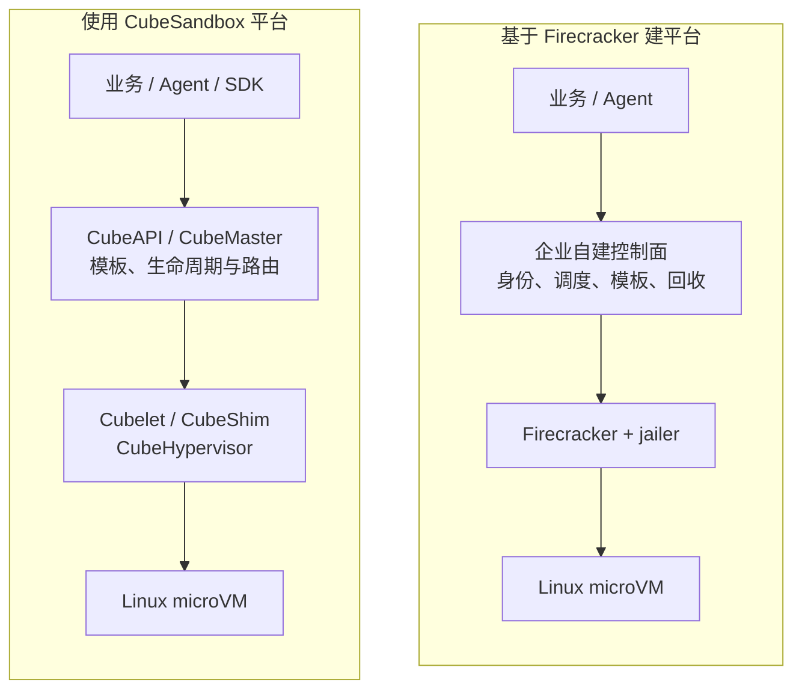
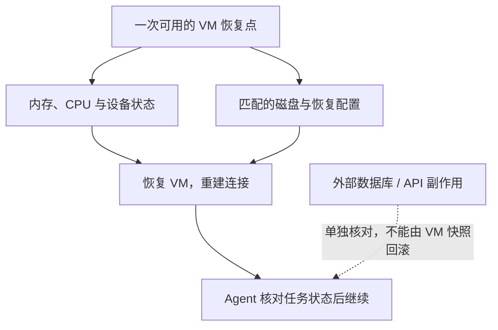

# Firecracker 与 CubeSandbox：企业该怎样选择 Agent 沙箱？

企业把 Agent 接入代码执行、浏览器和内部系统后，很快会遇到同一个问题：模型生成的代码应该在哪里运行？既希望环境创建得快、依赖能保留，又不能让一段不可信脚本直接接触宿主机和生产凭据。

Firecracker 和 CubeSandbox 都与轻量虚拟机有关，但它们解决的问题处于不同层次。**Firecracker 是虚拟机监控器（Virtual Machine Monitor，VMM）；CubeSandbox 是围绕 Agent 执行环境构建的沙箱平台，其底层使用自己的 CubeHypervisor，并不是 Firecracker 的服务化包装。** 企业选型真正要比较的是：哪些能力由项目提供，哪些工作仍要由自己的平台团队承担。

本文按 2026 年 10 月 18 日可查的 Firecracker v1.17.0、CubeSandbox v0.7.3 文档和源码梳理。已有实验结果单独注明版本和口径，不把不同环境的数字放在一起排速度名次。[Firecracker 版本](https://github.com/firecracker-microvm/firecracker/releases/tag/v1.17.0)、[CubeSandbox 版本](https://github.com/TencentCloud/CubeSandbox/releases/tag/v0.7.3)

## 1. 先确定要买的是哪一层能力

如果目标是尽快向业务提供“创建沙箱、执行命令、读写文件、暂停和恢复”的接口，CubeSandbox 更接近这个需求。如果已经有成熟的租户系统、调度、镜像分发和任务控制面，只缺一个可控制、可裁剪的虚拟化执行底座，Firecracker 更值得评估。

如果需求其实是“让现有 Kubernetes Pod 多一层虚拟机隔离”，可以先研究 Kata Containers 与 RuntimeClass；如果需要完整虚拟机、复杂硬件或成熟的设备直通，则应同时评估 KubeVirt 等虚拟机管理方案。它们的资源模型和用户接口不同，不能只按是否使用 microVM 归成同一种产品。

*职责示意，聚焦原生 KVM 路径。两条路径都还需要企业身份接入、安全策略和运维体系；图中的“企业自建控制面”表示待自行建设的系统，不是 Firecracker 自带组件。*

Firecracker 利用 Linux 的内核虚拟机能力（Kernel-based Virtual Machine，KVM）运行 Guest，通过 API 配置 CPU、内存、块设备和网络设备。宿主机上的 TAP 虚拟网卡、磁盘文件、Guest 内核以及上层访问方式，需要集成方组织起来。[Firecracker 设计](https://github.com/firecracker-microvm/firecracker/blob/v1.17.0/docs/design.md)

CubeSandbox 把这层能力向上组合成平台：CubeAPI 提供外部接口，CubeMaster 负责调度与生命周期，节点上的 Cubelet、CubeShim 和 CubeHypervisor 执行 VM 操作；还包含存储、网络、入口代理和管理界面。CubeHypervisor 沿用了 Cloud Hypervisor 的实现基础，不能通过更换一个运行时名称就视为 Firecracker 后端。[架构说明](https://github.com/TencentCloud/CubeSandbox/blob/v0.7.3/docs/architecture/overview.md)、[Hypervisor 源码说明](https://github.com/TencentCloud/CubeSandbox/blob/v0.7.3/hypervisor/README.md)

## 2. 把能力和责任放进同一张表

| 比较维度 | Firecracker | CubeSandbox | 企业要补齐的部分 |
| --- | --- | --- | --- |
| 对外交付 | VMM 进程及机器控制 API | 沙箱 API、SDK、模板、生命周期与管理界面 | 业务接口、服务等级与责任人 |
| 隔离边界 | 每台 microVM 有独立 Guest 内核 | 每个 VM 沙箱有独立 Guest 内核 | 宿主机加固、补丁、租户分区 |
| 环境准备 | 集成方准备 Guest 内核、磁盘与初始化流程 | 提供模板构建、预初始化与恢复路径 | 模板供应链、依赖更新和分发容量 |
| 命令与文件操作 | 需要 Guest 服务、vsock 或其他集成 | 提供面向 Agent 的上层接口 | 鉴权、路径权限、输出限额和审计 |
| 调度与回收 | 由外部平台完成 | CubeMaster 与节点组件管理沙箱 | 租户配额、排队、公平性与孤儿回收核验 |
| 快照 | 保存、装载 VM 状态的底层能力 | 将快照暴露为平台资源与恢复接口 | 存储耐久性、权限、一致性与业务恢复策略 |
| 网络 | 虚拟设备与限速原语，网络集成由外部承担 | CubeVS、CubeProxy、CubeEgress 等组件 | 内网边界、协议覆盖与现有网络兼容性 |
| Kubernetes 接入 | 可自行集成，或通过 Kata 等运行时栈 | 提供 Helm 部署路径，当前仍标为 Preview | 节点准入、资源核算、驱逐与升级验证 |
| 身份治理 | 没有完整租户平台 | 有接口鉴权与回调机制 | 企业单点登录、角色权限、资源所有权 |
| 运维工作 | VMM 之外的控制面与平台链路主要自建 | 维护平台组件、数据服务和节点运行时 | 备份恢复、版本矩阵、告警与值班 |

这个区别也影响团队分工。采用 Firecracker，通常需要有人持续负责 Guest 镜像、VMM 集成和平台控制面；采用 CubeSandbox，可以少写一批平台代码，但要掌握它的控制面、节点组件和状态存储。**代码量减少，不等于生产责任消失。**

CubeSandbox 提供 E2B 兼容接口，也应按具体 SDK 版本、命令流、文件操作、错误码和长连接行为验证。接口兼容声明不能替代业务应用的兼容性验收。

## 3. 安全：独立内核只是第一道边界

### 3.1 VMM 隔离和平台权限是两件事

独立 Guest 内核减少了与宿主机共享内核所带来的攻击面，但宿主机、VMM 和高权限节点组件仍位于信任边界内。它不能防止拥有宿主机管理权限的人读取沙箱数据，也不能阻止一个拥有合法凭据的脚本调用被允许的内部接口。

Firecracker 的生产建议包含 jailer、系统调用过滤、资源限制和宿主机加固。jailer 负责建立受限运行环境，不能因为 VMM 使用 Rust 就省略这部分；宿主机内核、Guest 内核及 CPU 微码也要维护。其自身不负责过滤 Guest 的出站流量，网络限制需要宿主机或上层平台执行。[生产宿主机配置](https://github.com/firecracker-microvm/firecracker/blob/v1.17.0/docs/prod-host-setup.md)

CubeSandbox 引入的平台组件更多，意味着需要审查更完整的权限链：谁能创建沙箱、谁能访问其他人的文件、谁能指定模板和出口策略、谁能恢复快照。尤其不能让沙箱里的不可信代码反过来修改自己的网络策略或租户身份。

### 3.2 凭据不进入 Guest，仍然需要限制操作范围

CubeEgress 可以在出站代理侧注入请求头凭据，结合域名、路径和方法策略审计访问。对 HTTPS 的检查涉及传输层安全协议（Transport Layer Security，TLS）代理与受信任 CA，模板需要配套信任链。[安全代理说明](https://github.com/TencentCloud/CubeSandbox/blob/v0.7.3/docs/guide/security-proxy.md)

例如，Agent 获准向工单系统创建工单，代理代为加入凭据，这能降低原始密钥直接被读取的风险。但是，如果允许调用删除工单的接口，Agent 仍可能执行删除。企业要控制的是“可以做哪些操作”，不能只控制“能否看到密钥”。

还要核实代理覆盖的协议、端口和绕过路径：直接访问 IP、IPv6、非 HTTP 协议、重定向、云元数据地址与内部数据库，都应进入边界检查。使用证书固定或双向 TLS 的客户端，需要明确兼容方式，不能靠关闭证书校验解决。

## 4. Kubernetes：能装上，不等于适合直接铺满集群

### 4.1 两种平台有不同的调度单位

Firecracker 本身不依赖 Kubernetes。通过 Kata 接入后，可以使用 Pod 和 RuntimeClass 这套资源模型，但具体内核、存储后端及运行时版本要一起验证。本站的 [Kata + Firecracker 实验](firecracker-kubernetes-lab/kata-firecracker-runtimeclass.md)记录过这些集成条件。

CubeSandbox 也支持不使用 Kubernetes 的部署。采用 Helm 路径时，Kubernetes 先调度平台组件及节点工作负载，CubeSandbox 再调度内部 microVM。**一个沙箱并不自动等于一个普通 Pod。** 如果只看外层 Pod 的申请量，很容易漏算 Guest 内存、VMM 开销、文件缓存和快照写入压力。

因此，容量规划要同时回答两件事：外层为节点组件预留多少资源，内层还能承诺多少沙箱资源。不能让两套调度器分别把同一份空闲内存全部分配出去，也不能只根据业务进程的容器指标判断 VM 的总成本。

### 4.2 v0.7.3 的部署条件需要认真看

CubeSandbox v0.7.3 的 Kubernetes 文档仍标为 Preview，并列出资源压力下驱逐和计算节点升级方面的已知问题。当前默认使用主机网络；Pod 网络模式下，计算 Pod 重建会影响已有沙箱网络。默认主机网络能保留对应网络命名空间，也不代表所有升级都没有业务影响。[Kubernetes 部署说明](https://github.com/TencentCloud/CubeSandbox/blob/v0.7.3/docs/guide/kubernetes/index.md)

节点部署还涉及特权权限、主机进程命名空间、宿主机目录及网络与存储初始化。Chart 卸载不等于回滚宿主机的所有变更，内核、文件系统和节点配置必须另有恢复办法。企业宜先使用专用节点池，验证与现有容器网络接口（Container Network Interface，CNI）、安全准入和驱逐策略的关系，再考虑扩大范围。[Chart 架构与节点职责](https://github.com/TencentCloud/CubeSandbox/blob/v0.7.3/docs/guide/kubernetes/architecture.md)

项目还提供 PVM 部署路径，其宿主机内核、模块和 Guest 兼容条件需要单独审查。不能把它理解为“没有虚拟化条件，也不用调整操作系统就能部署”。本文的主要比较聚焦原生 KVM。[PVM 部署说明](https://github.com/TencentCloud/CubeSandbox/blob/v0.7.3/docs/guide/pvm-deploy.md)

## 5. 启动速度应该从哪里计时？

对业务而言，“创建接口返回成功”和“第一条工具命令有效完成”不是同一个时刻。

| 时间段 | 主要受什么影响 | 只测 VM 启动容易漏掉什么 |
| --- | --- | --- |
| 鉴权与排队 | 身份系统、限流、并发和节点容量 | 高峰期等待时间 |
| 模板准备 | 镜像分发、rootfs、预初始化状态与本地缓存 | 新节点第一次使用模板的成本 |
| VM 启动或恢复 | VMM、Guest、CPU 和快照布局 | 恢复后缺页与存储读取 |
| Guest 服务就绪 | 命令服务、浏览器、解释器及连接建立 | Guest 已运行但应用还不可用 |
| 首条有效任务 | 依赖加载、网络与真实输入 | 用户实际感知的尾延迟 |

预先完成环境初始化，再从模板快照恢复，适合频繁创建相似环境；它把一部分成本放到了模板生产和存储里。比较时应分别观察模板已在节点、节点首次获取模板、容量不足需要排队三种状态，再报告端到端 P50、P95 和失败率。

Firecracker 的快照装载会用到按需映射，API 返回很快不意味着应用工作集已经全部进入内存。CubeSandbox 的写时复制（Copy-on-Write，CoW）可以减少初始复制，但沙箱持续写入后仍会产生私有数据。需要同时统计常驻内存、共享页面、脏页、磁盘实际占用和节点缓存；不能用模板的逻辑大小代表每个实例的实际成本，也不能只用 VMM 进程的数字代表完整平台成本。[Firecracker 快照机制](https://github.com/firecracker-microvm/firecracker/blob/v1.17.0/docs/snapshotting/snapshot-support.md)

## 6. 快照恢复，不等于整项业务回到过去

### 6.1 恢复需要一组配套状态

Firecracker 提供 VM 状态保存与恢复，但磁盘文件的管理、一致性协调、快照分发和访问控制由集成方处理。CubeSandbox 把这些操作向上封装成快照资源，但企业仍然要确认恢复所需的对象都存在。

*恢复边界示意。外部系统已经提交的操作，需要业务幂等或补偿机制；VM 快照只恢复其覆盖的状态。*

一个典型例子：拍快照时任务执行到第 50 步，随后向外部系统提交付款，到第 55 步发生故障。恢复到第 50 步后，外部付款记录不会跟着撤销。如果 Agent 再提交一次，可能出现重复副作用。正确做法是保留外部持久化的操作记录和幂等键，恢复后先核对状态，再决定继续还是补偿。

同样，VM 的快照不会自动保存 VM 外部的 Agent 对话、工作流进度或审批状态。长任务需要把“Agent 状态持久化”“沙箱恢复点”“外部操作记录”关联起来。[Agent 长任务中断续跑](agent-long-running-durable-execution.md)

### 6.2 本地恢复、跨节点恢复和自动接管要分别判断

CubeSandbox 默认的本地 XFS 存储不能直接当成跨节点持久化。v0.7.3 的跨节点快照依赖配置 S3/CubeS3lvol 路径，默认没有启用；启用后还要核对内存与存储资源成本。[跨节点快照说明](https://github.com/TencentCloud/CubeSandbox/blob/v0.7.3/docs/guide/cross-node-snapshot.md)

即使快照能在另一台机器恢复，也不等于已经具备节点宕机后的自动接管。还需要可靠保存恢复点、发现故障、避免重复执行、找到兼容目标节点，并重新建立网络和业务连接。源节点在最新快照持久化前宕机，之后的内存进度仍可能丢失。

企业应明确恢复点目标（Recovery Point Objective，RPO）允许丢失多少进度，恢复时间目标（Recovery Time Objective，RTO）允许中断多久。跨节点兼容性还涉及 CPU 特性、内核、模板和运行时版本；快照既包含业务数据，也可能含凭据，必须按敏感数据管理。克隆恢复后还要检查身份、随机数及连接语义，不能让多个实例误用同一份外部身份。

## 7. 已有实测能说明什么？

本站已经分别做过 Firecracker 和 CubeSandbox 实验，但它们验证的对象不同。这些记录可以帮助判断能力边界，不能构成受控的产品性能排名。

| 已公开实验 | 实际观察 | 能支持的结论 | 仍不能推出什么 |
| --- | --- | --- | --- |
| Firecracker v1.16.1 原生快照 | 单次装载 API 16.86 ms，恢复后 ICMP 就绪 26.15 ms | VM 恢复原语可以很快，API 与网络就绪是不同计时点 | 不能代表企业端到端 P95，也不能直接与 CubeSandbox 创建延迟比较 |
| Kata 4.1.0 + Firecracker | 同一批 10 个 Pod，10/10 Ready，P50 6 s、观测 P95 8 s | Kubernetes、运行时、存储和 Guest 就绪会增加链路时间 | 一批样本不足以代表长期尾延迟或大规模容量 |
| CubeSandbox v0.7.3 + SDK 0.7.3 | 两套环境各三轮，6/6 恢复内存计数、身份、Guest PID 和摘要；删除原沙箱后也能恢复 | 快照恢复了进程执行现场，能够继续运行 | 没有验证外部卷回滚、节点宕机或自动故障接管 |

对应证据见 [Firecracker 脱敏测试报告](firecracker-kubernetes-lab/test-report.md)与 [CubeSandbox 进程内存快照实测](cubesandbox-process-snapshot-recovery.md)。本文没有新增一轮相同硬件、相同模板和相同负载的直接对比压测。

这组结果最有价值的地方，是提醒选型时同时验证“恢复够不够快”和“恢复的是不是需要的状态”。只看到 API 返回成功，无法回答后一件事。

## 8. 哪些企业场景更适合哪条路线？

| 企业场景 | 倾向的起点 | 判断理由与准入条件 |
| --- | --- | --- |
| 尽快交付代码、浏览器或开发环境沙箱 API | CubeSandbox | 已组合模板、执行、生命周期与路由；先验证身份、网络、升级和节点权限 |
| 已有多租户执行平台，需要高度定制底层 | Firecracker | 可以控制 Guest、设备与控制协议；团队须承担调度、模板和治理开发 |
| 现有 Pod 需要 VM 隔离，尽量保留 Kubernetes 用法 | Kata 等 CRI 运行时路线 | 先验证 RuntimeClass、存储、内核与运维兼容，不必先自建沙箱 API |
| 长期开发环境，要求可暂停、恢复与复制 | CubeSandbox 可作为候选 | 必须区分根盘、外部卷、Agent 会话和外部副作用，验证备份与版本升级 |
| 强限制集群，不允许节点特权、宿主机网络或内核变更 | 先审查基础设施边界 | 不能因为有 Helm Chart 就默认满足约束；可能需要独立计算节点或服务边界 |
| 需要 CUDA、复杂设备或完整 VM 能力 | 另行验证设备虚拟化方案 | 不应把普通 CPU 沙箱测试外推到 GPU；必要时选择更匹配的 VM 平台 |

关于 GPU，尤其要避免两个误解。其一，Firecracker 已有 PCI 支持，不能再笼统说它“没有 PCI”；但这不等于当前版本已经提供可直接采用的生产 GPU 直通方案。其二，CubeSandbox 的 GPU 沙箱仍需结合对应发布能力核对，不能把路线图当成验收结果。[Firecracker PCI 跟踪](https://github.com/firecracker-microvm/firecracker/issues/5133)、[CubeSandbox 路线图](https://github.com/TencentCloud/CubeSandbox/blob/v0.7.3/docs/guide/roadmap.md)

## 9. 企业准入时，应该要求哪些证据？

比起做一个缺乏依据的综合评分，更有用的是让每项关键要求对应可检查的结果。

| 准入问题 | 需要看到的证据 |
| --- | --- |
| 租户能否访问别人的沙箱和快照？ | 按所有权验证创建、查询、执行、代理访问和恢复权限，企业身份与角色映射可追溯 |
| 容量不足、请求超时或取消后会怎样？ | 排队和失败语义明确，重试不会重复创建，迟到结果可回收 |
| 快照恢复是否保留真正需要的状态？ | 内存状态、磁盘标记、外部卷范围与业务进度分别核对，恢复后完成真实任务 |
| 节点维护与升级是否会中断业务？ | 排空、暂停、重建和恢复的观测结果，以及运行时与模板兼容矩阵 |
| 状态服务或对象存储不可用怎么办？ | 数据库、Redis、存储故障时的行为边界，备份还原结果与可接受的数据损失 |
| 网络限制是否能绕过？ | DNS、直接 IP、IPv6、重定向、非 HTTP 协议与内部敏感地址的检查结果 |
| 删除以后真的释放了吗？ | VM 进程、TAP、地址、磁盘、快照和租约的核对记录，孤儿资源可发现 |
| 能否定位一次慢创建或恢复失败？ | 贯穿 API、调度、节点、VMM 和存储的请求标识，阶段耗时及错误原因 |

监控也应沿着这条链路组织：除了 CPU 和内存，还要看排队时间、模板命中、首条有效命令延迟、恢复成功率、脏页与磁盘增长、代理拒绝率、孤儿资源数量，以及每个租户的实际占用。服务等级目标（Service Level Objective，SLO）应落在业务可感知的成功率和延迟上。

采购和维护条件同样需要明确：审查项目及依赖的开源许可证，保留组件清单，建立模板和镜像的来源校验与漏洞修复流程。还要约定谁负责跟踪上游安全更新、验证旧快照能否在新运行时恢复，以及升级失败时如何回退。平台团队是否具备这些能力，往往比某一项功能是否存在更能决定长期可用性。

成本方面，建议用总拥有成本（Total Cost of Ownership，TCO）核算：

> 每次有效任务成本 =（计算与备用容量 + 模板/快照存储 + 代理与控制面 + 研发、升级和值班投入）÷ 有效完成的业务任务数。

这里“有效”需要业务验收。沙箱创建成功但任务失败、删除后残留资源、恢复后重复提交业务操作，都不应该被算成廉价的成功请求。

选择 Firecracker，核心是在换取底层控制权的同时承担平台建设；选择 CubeSandbox，核心是复用已经组合的平台能力，同时接受并验证它的节点集成和运维边界。对多数首次建设 Agent 执行平台的团队，先用完整平台验证业务闭环更容易估算收益；对已经有成熟平台且需要深度定制的团队，直接控制 VMM 才更可能体现价值。

## 参考资料

- [Firecracker v1.17.0 设计与生产部署文档](https://github.com/firecracker-microvm/firecracker/tree/v1.17.0/docs)
- [CubeSandbox v0.7.3 文档与实现](https://github.com/TencentCloud/CubeSandbox/tree/v0.7.3)
- [Agent Sandbox 选型与分析](agent-sandbox-selection.md)
- [Firecracker Kubernetes 实验总览](firecracker-kubernetes-lab/index.md)
- [CubeSandbox Kubernetes 部署评估](cubesandbox-kubernetes.md)
