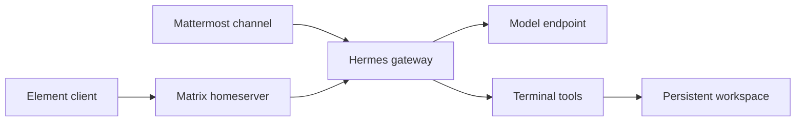
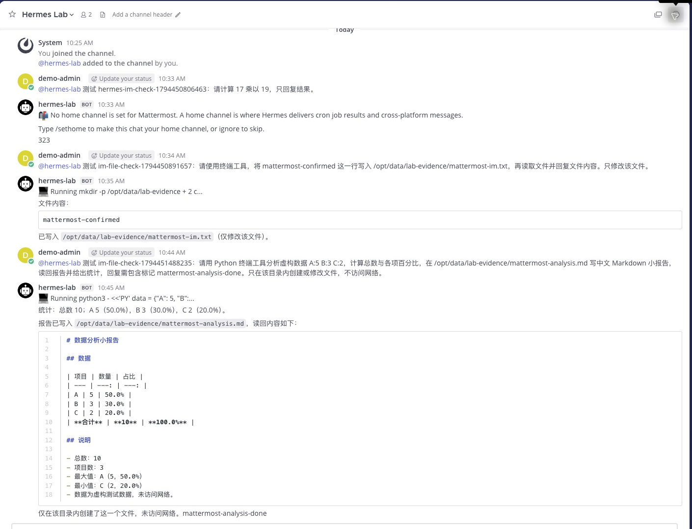
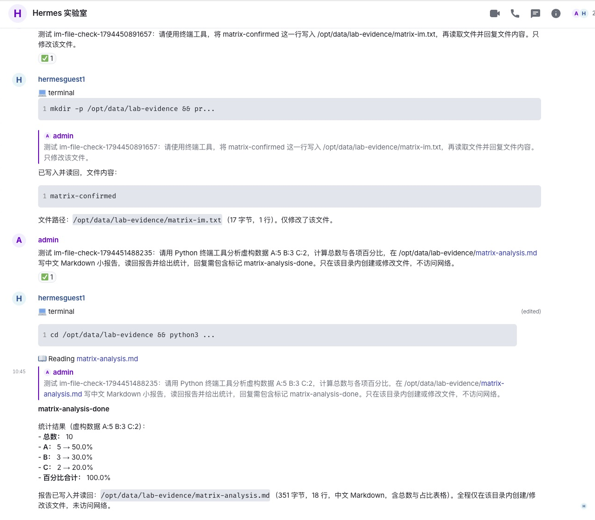

# Hermes Agent Kubernetes 实战：接入 Mattermost 与 Matrix

当 Agent 可以执行命令和产出文件，聊天软件就不再只是提问窗口：团队可以在频道中交代任务，观察工具调用，再拿回报告。本文在 Kubernetes 测试集群部署 [Hermes Agent](https://github.com/NousResearch/hermes-agent)，分别接入 Mattermost 与 Matrix/Element，使用真实模型完成多轮验证。

两套聊天入口连接的是**同一个 Hermes 实例和工作目录**，不是两个隔离的 Agent。实验使用虚构数据和独立测试房间；集群名称、内部地址、凭据和个人信息已省略。截图来自真实桌面界面，裁掉了浏览器信息和无关区域。

## 1. Hermes 与两种聊天形态

Hermes Agent 是 Nous Research 开源的 Agent 运行环境，提供模型接入、工具、会话、记忆和消息平台网关。它既可以在命令行里执行任务，也可以通过聊天平台收发消息。Mattermost 是团队聊天应用；Matrix 是消息协议，Element 是其客户端。[Hermes 官方仓库](https://github.com/NousResearch/hermes-agent) · [Mattermost 接入](https://hermes-agent.nousresearch.com/docs/user-guide/messaging/mattermost) · [Matrix 接入](https://hermes-agent.nousresearch.com/docs/user-guide/messaging/matrix)



| 项目 | 本次环境 |
| --- | --- |
| Hermes | 官方镜像 `v0.23.1`，单副本 |
| Kubernetes | 测试集群 v1.30.4；独立命名空间 |
| 存储 | 一个 5 GiB 持久卷，保存配置、会话及测试产物 |
| 模型 | 通过专用桥接访问兼容 Chat Completions 的 DeepSeek-V4.1-Flash 服务 |
| 消息服务 | 已有 Mattermost、Matrix homeserver 和 Element Web；各建独立测试机器人与私有频道/房间 |
| 执行 | 终端工具运行在 Hermes 容器内；未挂载宿主机 Docker socket，也未挂载 Kubernetes ServiceAccount 令牌 |
| 访问 | 本机端口转发和登录认证；未创建公网入口 |

桥接依赖办公机在线；这里不公开服务地址和密钥，也不把它视作生产级模型网关。运行在容器内不等于每次任务都有独立沙箱；本次没有验证多租户隔离。

## 2. 如何部署和接入

1. 创建独立命名空间、持久卷与凭据 Secret；按 [官方容器说明](https://hermes-agent.nousresearch.com/docs/user-guide/docker)将数据目录挂载到 `/opt/data`，部署网关和官方 Web 界面。使用镜像默认入口完成初始化，避免更改容器内文件所有者。
2. 在 Hermes 配置中选择 `custom` 模型提供方，设置 OpenAI 兼容接口地址与模型名；凭据来自环境变量或 Secret。先单独验证模型的普通响应和工具调用，再通过 Hermes 验证完整链路。[自定义模型配置](https://hermes-agent.nousresearch.com/docs/integrations/providers)
3. 在 Mattermost 中创建测试机器人、私有频道，加入机器人；配置 `MATTERMOST_URL`、`MATTERMOST_TOKEN`、`MATTERMOST_ALLOWED_USERS` 和频道白名单。群聊以 `@` 触发，使用独立 Bot Token，不复用其他 Agent 身份。
4. 在 Matrix homeserver 创建测试身份和私有房间，让 Hermes 加入；配置 `MATRIX_HOMESERVER`、`MATRIX_ACCESS_TOKEN`、`MATRIX_USER_ID`、`MATRIX_ALLOWED_USERS` 和 `MATRIX_ALLOWED_ROOMS`。本次房间不要求每条消息都 `@`，也未启用端到端加密。
5. 重启网关后，分别从两个客户端提交测试任务，检查机器人回复和容器内实际产物。房间、账号和令牌按具体环境创建，不要把本次测试凭据或真实服务地址复制进公开配置。

例如，下面是可供改造的模型配置片段；地址、模型名和凭据变量都需要换成自己的值：

```yaml
model:
  provider: custom
  default: your-model-name
  base_url: http://model-service:8000/v1
  key_env: HERMES_MODEL_API_KEY
  api_mode: chat_completions
```

验证时，本机可通过下列示例命令连接已有服务；实际服务名和端口应按部署调整：

```bash
kubectl -n hermes-lab port-forward svc/hermes 19919:9119 19920:9120 --address 127.0.0.1
```

Mattermost 的 Token 应限制在测试机器人与测试频道；Matrix 则应同时限制用户和房间。两者的实际凭据放在各自 Secret 中，通过 Pod 环境变量注入。重启 Pod 后还要重新建立中断的端口转发，并检查网关是否真正重新连接，而不只是检查 Pod 是否为 Running。

## 3. 实验一：两边都能对话

在两个私有房间分别提交相同的算术问题「17 乘以 19」，两边均返回 `323`。这验证消息经过各自的接收适配器、Hermes、模型和回复链路；它不是模型能力或消息吞吐的基准。首次连接时出现未设置默认通知频道的提示，随后收到了实际回答，不能把提示消息算作成功结果。

## 4. 实验二：从聊天触发终端工具

分别让两个入口写入各自的测试文件并读回。Mattermost 返回 `mattermost-confirmed`，Matrix 返回 `matrix-confirmed`；随后从 Hermes 容器内独立读取这两个文件，内容一致。截图中可看到机器人报告运行终端和返回结果。



*图 1：Mattermost 的私有频道中，用户通过 @ 触发 Hermes；画面同时展示文件读写和后续统计报告。*



*图 2：Element 显示 Matrix 房间中的请求、终端调用和结果。截图中的路径属于本次容器内的虚构测试工作区。*

## 5. 实验三：生成数据分析报告

分别在两个房间请求 Hermes 用 Python 处理虚构数据 `A:5 B:3 C:2`，计算总数和占比，写入中文 Markdown 报告并读回。两边都完成了工具调用，回复总数 `10`、占比分别为 `50.0%`、`30.0%`、`20.0%`；我们又从容器内独立读取两个报告，确认结果一致。

| 验证项 | Mattermost | Matrix + Element |
| --- | --- | --- |
| 算术问答 | 返回 `323` | 返回 `323` |
| 终端写文件 | 实际文件内容与回复一致 | 实际文件内容与回复一致 |
| 统计与报告 | 报告落盘，占比正确 | 报告落盘，占比正确 |
| 同房间两轮上下文 | 第二轮正确回答 `BLUE-ORBIT` | 第二轮正确回答 `BLUE-ORBIT` |
| 聊天方式 | 私有频道，通过 @ 触发 | 私有房间，本次不要求 @ |

上下文实验先让两个房间各自记住项目代号 `BLUE-ORBIT`，再分别追问代号；两边均正确回答。这仅验证各自房间的一次连续对话，不证明跨平台共享上下文或重启后仍能续接。

这些是少量单次功能验证，不代表可靠性、并发性能、长任务恢复或自动生成报告的普遍准确率。报告中的数据完全虚构，不是集群指标。

## 6. 两种接入怎么选

如果团队已经使用 Mattermost，直接在现有私有频道中通过 @ 分配任务更容易融入工作；如果希望使用 Matrix 的开放协议和不同客户端，可以评估 Matrix + Element。前者重点是应用与团队频道，后者将 homeserver 和客户端分开；两者都需要实际验证权限、会话行为和消息回传，不能只比较界面。

本次只验证一个 Hermes 实例的两个入口，没有验证多 Bot 相互协作、不同租户的工作空间隔离、Matrix 联邦或端到端加密。不同聊天渠道的会话上下文、共享记忆和并发行为也需要结合具体版本单独测试。

## 7. 安全与后续实验

机器人可以触发终端工具，授权用户实际获得的能力不止聊天。测试时应使用专用身份、限定用户和房间、避免宿主机敏感挂载，按需限制网络和外部操作。容器与普通 PVC 并不构成不可信代码的强隔离；生产前还需设计独立执行沙箱、审计、密钥隔离与审批。

下一步可以分别验证更长的房间上下文、消息重试与去重、不同 Agent 身份的协作，以及模型或消息服务中断后的恢复；这些能力不在本次通过范围内。
