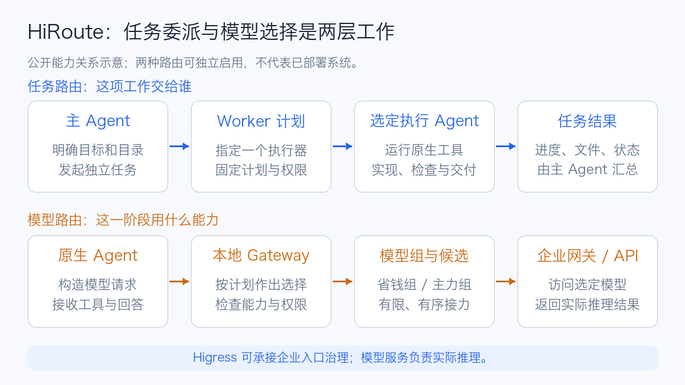
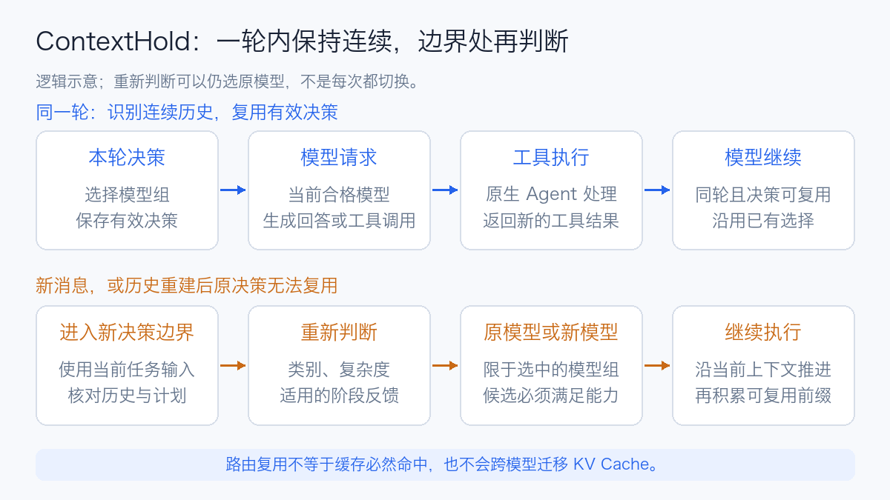
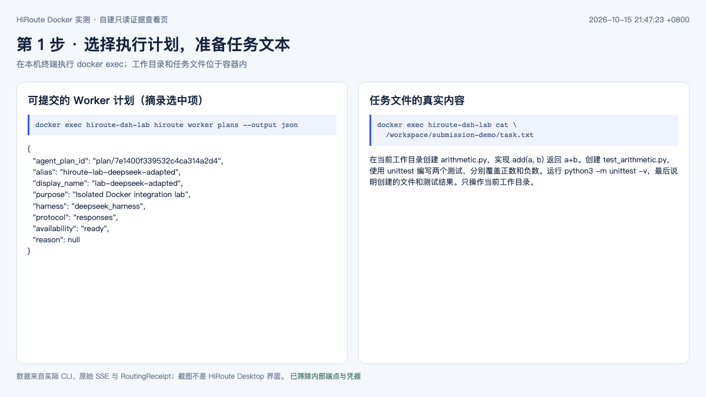
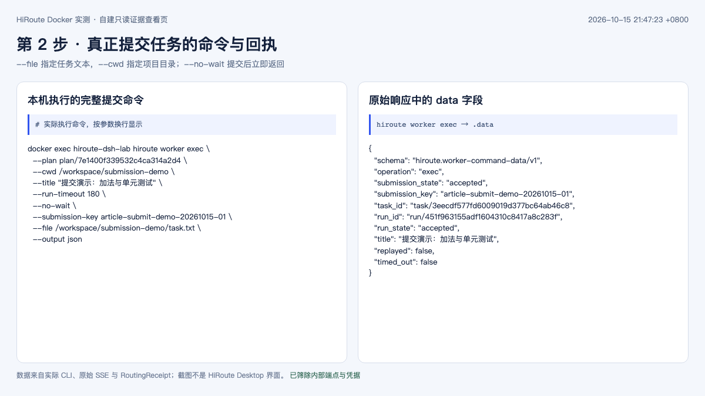
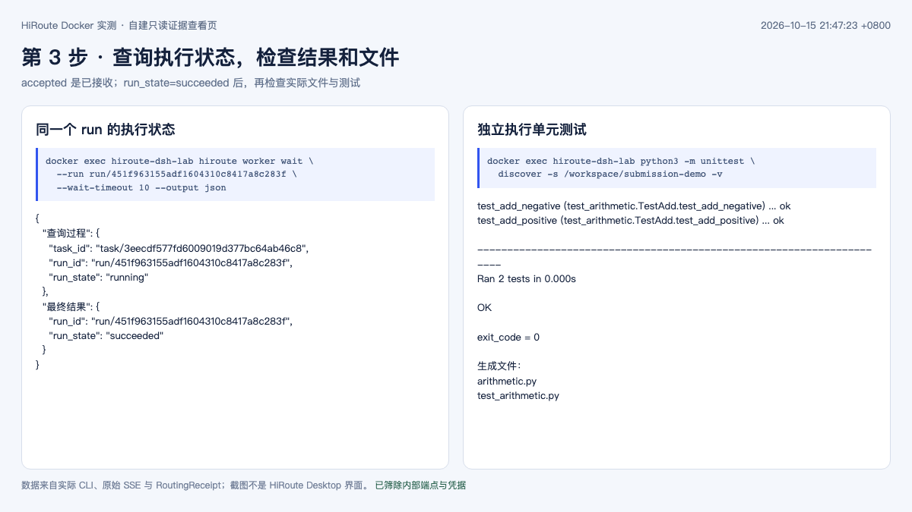
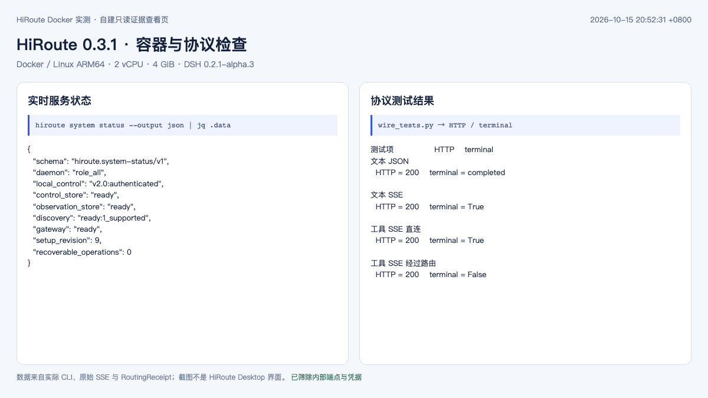
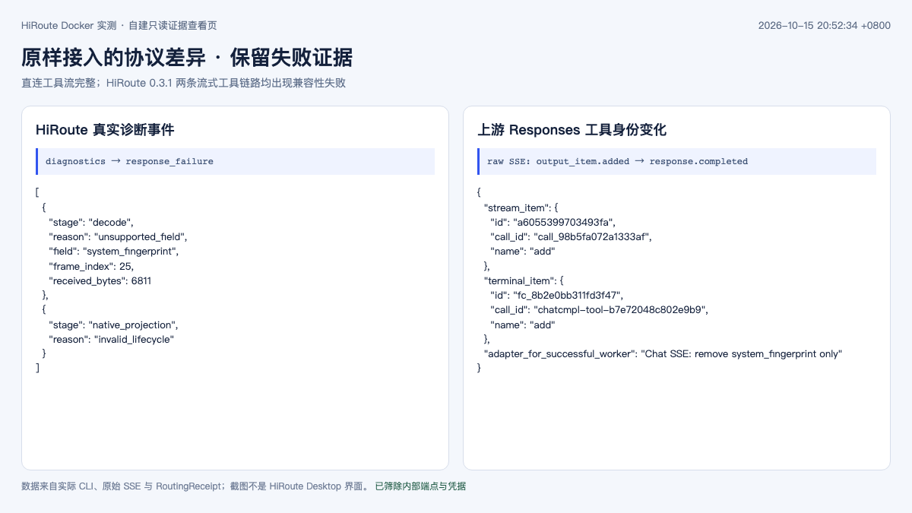
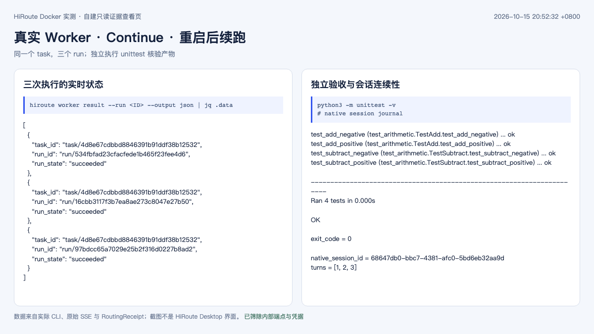
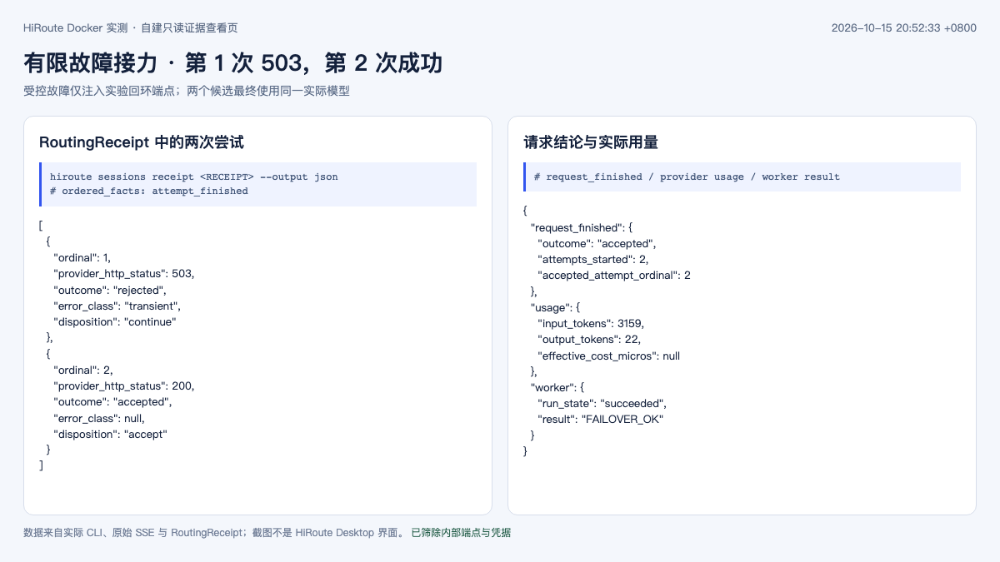

# HiRoute 技术综述：Higress 团队的 Agent 路由与模型协作引擎

一次编程任务可能先查资料、读代码，再修改实现、运行测试，最后处理一个难以定位的并发问题。每一步需要的模型能力不同：始终使用最强模型，常规工作也会消耗昂贵的额度；始终使用便宜模型，又可能把大量时间花在反复试错上。

Higress 团队推出的 **HiRoute** 尝试管理这类选择。它在本机提供 Agent 任务委派、模型接入、路由计划和执行记录，让用户继续使用已有 Agent，同时为不同工作选择合适的模型。项目采用 Apache-2.0 许可证，提供桌面应用及无界面的命令行版本。[项目介绍](https://github.com/higress-group/HiRoute)、[开源说明](https://github.com/higress-group/HiRoute/blob/main/news/hiroute-open-source.zh-CN.md)

本文核查时间为 **2026 年 10 月 15 日**。发行情况以正式 Release 为准；机制同时对照 `v0.3.1` 与主分支快照 [`b4c1a927`](https://github.com/higress-group/HiRoute/commit/b4c1a92765bc94d0cfba273316275ba4e4231c78)。第 7 节整理上游实验；第 8.3 节是本文实际完成的 Docker 与 DSH 接入测试。企业接入图为分析建议。

## 1. 它和 Higress 是什么关系

HiRoute 的设计复用了 Higress 团队的网关工程经验，但采用独立的 Rust 实现和本地产品形态。理解两者时，先看各自处理的问题：[HiRoute 架构说明](https://github.com/higress-group/HiRoute/blob/main/news/hiroute-open-source.zh-CN.md)、[Higress 官方介绍](https://higress.ai/en/docs/latest/overview/what-is-higress/)

| 组件 | 主要管理什么 | 典型位置 |
| --- | --- | --- |
| HiRoute | 本地 Agent 连接、执行计划、阶段选模、Worker 任务和执行记录 | 开发电脑、远程工作站或单用户服务环境 |
| Higress | 企业 API 入口、认证、流量策略、插件和模型服务接入 | 企业网关层 |
| Agent Harness | 工具调用循环、上下文、文件操作、测试与会话 | Codex、Claude Code、Pi、DeepSeek Harness 等运行时 |
| 模型推理服务 | 接收推理请求、处理上下文并生成结果 | 云端模型 API，或自建 vLLM、SGLang 服务 |

例如，开发者可以让 HiRoute 选择一个逻辑模型，再通过企业 Higress 访问自建服务。前者依据任务和阶段作选择，后者落实企业入口策略；模型最终在哪张 GPU 上运行，仍由推理平台负责。

这种组合是接入思路。官方将集中授权、共享路由计划和企业 AI Gateway 对接列为演进方向，不能据此推断已经具备完整的企业多租户控制面。

## 2. 发布时间与当前产品形态

从正式发行记录看，HiRoute 已经有可下载的软件包，仍处于较早的版本阶段：

| 版本 | 发布时间（北京时间） | 阅读重点 |
| --- | --- | --- |
| `v0.1.0` | 2026-09-22 | 首个正式版本，包含 macOS ARM64 与 Linux x86_64 包 |
| `v0.2.0` | 2026-10-08 | 发行包扩展到 macOS、Linux 的两种 CPU 架构 |
| `v0.3.0` | 2026-10-11 | 继续迭代桌面端与无界面版本 |
| `v0.3.1` | 2026-10-12 | 修复订阅配置、原生会话关联、升级恢复和模型目录等问题 |

来源：[v0.1.0](https://github.com/higress-group/HiRoute/releases/tag/v0.1.0)、[v0.2.0](https://github.com/higress-group/HiRoute/releases/tag/v0.2.0)、[v0.3.0](https://github.com/higress-group/HiRoute/releases/tag/v0.3.0)、[v0.3.1](https://github.com/higress-group/HiRoute/releases/tag/v0.3.1)。

截至核查，最新稳定版为 **0.3.1**，提供 macOS Desktop 和 Linux CLI 的 x86_64、ARM64 包。发行说明明确 Windows 不在该版本的支持范围；不同架构的验证深度也不同，不能把“打包成功”当成相同程度的实际使用验证。

有图形界面时，可以从 Desktop 管理连接、计划、任务和会话；Linux 则通过 CLI 与后台守护进程 `hirouted` 使用这些能力。路由本身不要求配置 GPU，只有选择在本地运行执行模型或决策模型时，才需要另外评估其推理资源。

## 3. 两种路由：工作交给谁，这一阶段用什么模型



任务路由和模型路由可以独立启用。一项工作可以始终由同一个 Agent 执行，同时在阶段边界重新选择模型；也可以先委派给另一个 Agent，再由它使用模型路由。

### 3.1 任务路由管理执行 Agent

用户为一份计划选择执行 Agent，主 Agent 发现允许委派的计划，再提交相对独立的任务、目录和交付要求。当前任务路由指南列出 Codex CLI、Claude Code、Qoder CLI、Pi 和 DeepSeek Harness，实际可用性还取决于本机依赖与适配能力。[任务路由指南](https://github.com/higress-group/HiRoute/blob/v0.3.1/apps/website/content/guides/task-routing.zh.md)

每份计划选择一个执行 Agent，执行失败不会自动改用另一种 Agent；执行 Agent 也不能递归委派。这样的范围适合“把解析器修复交给某个 Worker”，不宜理解成任意 Agent 自动组队并无限分解工作。

### 3.2 模型路由管理实际推理来源

模型来源可以是 API、自建兼容服务或受支持的订阅接入。HiRoute 提供四种路由模式：[模型路由指南](https://github.com/higress-group/HiRoute/blob/v0.3.1/apps/website/content/guides/model-routing.zh.md)

| 模式 | 主要选择方式 | 适用情况 |
| --- | --- | --- |
| 固定模型 | 按已配置的候选顺序执行和接力 | 先建立稳定、可解释的调用路径 |
| 智能省钱 | 在省钱组与主力组之间判断 | 工作难度变化明显，希望保留强模型处理难题 |
| 自定义分支 | 先分任务类别，再选择该类别内的模型组 | 写稿、审稿，或研究、实现等职责需要不同模型 |
| 免费优先 | 优先尝试免费候选，按配置决定是否进入主力兜底 | 接受免费服务能力及额度约束的任务 |

“经济”与“主力”是用户在计划中的配置，不是 HiRoute 给模型作出的通用排名。同一个模型也可能在不同计划中承担不同角色。

订阅接入使用 CLIProxyAPI（**CPA**）适配。生产选择仍应核对上游授权方式、服务条款和组织策略；接入成功不能用来推断额度无限或允许多人共享账号。[订阅适配边界](https://github.com/higress-group/HiRoute/blob/v0.3.1/vendor/cpa/README.md)

## 4. 决策模型怎样参与选模

执行模型负责回答、调用工具和完成任务；决策模型返回类别、复杂度概率及可选的阶段评分。HiRoute 再按已发布的规则选择模型组，并检查具体候选能否满足请求。[决策模型机制](https://github.com/higress-group/HiRoute/blob/v0.3.1/decision-extensions/README.zh-CN.md)

这与此前讨论的 [Jev](jev-system-one-model-overview.md) 可以直接联系起来。当前内置接入包括百炼、OpenRouter Jev、TypeSafe 和兼容端点；使用内置连接无需另外部署 Jev 服务。希望掌控判定逻辑时，也可以实现 HTTP 决策扩展。[扩展接口](https://github.com/higress-group/HiRoute/blob/v0.3.1/decision-extensions/api/README.zh-CN.md)

### 4.1 把类别、复杂度和胜任度分开

| 判断 | 回答的问题 | 示例 |
| --- | --- | --- |
| 任务类别 | 当前在做什么 | 起草文章，还是核查现有文章 |
| 复杂度 | 当前工作需要多强的能力 | 修改一句措辞，还是验证跨系统的一致性保证 |
| 阶段胜任度 | 上一实际阶段做得如何 | 是否完成要求、证据是否充分、是否陷入无效尝试 |

把三者混成一个“智能分数”，会让策略难以解释。某个模型适合起草，不代表它适合核查事实；上一段写稿表现不好，也不能直接升级一个不同的审稿分支。

### 4.2 默认策略可以从源码复核

双模型组的默认简单概率阈值为 **0.8**，阶段胜任度下限为 **0.5**。只有当前简单概率达标，且没有适用的完整低分时，才选省钱组。这里的 0.9 表示“更倾向于简单类别”，不代表执行任务有 90% 的成功率。[判断配置](https://github.com/higress-group/HiRoute/blob/v0.3.1/docs/smart-saving-model-classification.zh-CN.md)

源码中的低分保护还检查评分是否属于上一实际阶段、是否与本轮类别和已发布计划版本一致，以及评分标准是否匹配。没有评分、证据不完整或跨类别的评分不会被当成零分；历史低分也不会无限延续成永久升级状态。[组选择实现](https://github.com/higress-group/HiRoute/blob/v0.3.1/crates/gateway/src/core_runtime/classification/group_policy.rs)

判断服务本身也可能超时或返回无效结果。当前规则为智能省钱提供启发式回退，自定义分支则回到预先配置的默认类别；类别内需要两组模型而复杂度不可用时，选择主力。应同时观察正常路径和回退路径，否则计划写的是“审稿”，实际执行可能已回到默认分支。[决策操作与执行边界](https://github.com/higress-group/HiRoute/blob/v0.3.1/crates/gateway/README.md)

## 5. ContextHold：为什么不在每次工具调用后换模型



Agent 收到一条用户指令后，可能连续读文件、搜索、运行命令，再把结果送回模型。这些工具往返仍属于同一轮工作。**ContextHold（上下文保持）**在识别出同轮、历史连续且冻结决策可复用时，沿用已有选择，并尽量保持所选组内合格的当前模型。

新用户消息会重新触发判断；上下文压缩或历史重建使原决策无法复用时，也会重新判断。重新判断可以仍然选择原模型，压缩也不是无条件切换的指令。[上下文与决策边界](https://github.com/higress-group/HiRoute/blob/main/news/2026-10-14-routing-cache-cost.zh-CN.md)

这项设计的收益有两部分：减少重复的决策请求，并给上游复用 KV Cache（键值缓存）创造连续的上下文前缀。它保持的是路由与上下文连续性，**不会把一个模型的 KV Cache 搬到另一个模型中**；缓存是否命中仍由上游实现、前缀、生命周期及实际请求决定。

可以用维护代码的工作过程理解：读取十个文件并运行五次测试时，模型持续看到同一段历史；如果每次工具返回都重新抽选模型，各次缓存可能无法延续。等到新的要求或真正的历史重建边界，再评估是否值得换能力，更容易核算切换的代价。

因此，降本评估应同时记录缓存读取、未命中输入、输出与决策费用。只看经济模型的调用比例，无法判断一项长任务最终是否划算。缓存原理可参见 [KV Cache 综述](../inference/kv-cache-overview.md)。

## 6. 故障接力、质量保护与任务恢复

这三种行为分别处理不同问题：

| 情况 | 需要的处理 | HiRoute 当前边界 |
| --- | --- | --- |
| 供应商限流、候选暂不可用 | 在允许的候选中接力 | 按候选顺序有限尝试，耗尽后明确失败 |
| 上一阶段完成得不好 | 在下一次有效决策时提高能力 | 适用的阶段低分可以保护性选择主力组 |
| Worker 提交响应丢失、进程中断 | 查明原任务状态，再恢复或继续 | 保留提交标识和原生会话，按具体执行器能力处理 |

省钱组可以接力到同类别的主力组；直接选中的主力组不会为了请求成功又降回省钱组，也不会跨到其他任务类别。请求还必须满足图片、工具和上下文等能力要求，不能只因为接口格式相似就随意替换。[候选与决策执行](https://github.com/higress-group/HiRoute/blob/v0.3.1/crates/gateway/README.md)

流式回答已经开始向客户端交付后，也不能悄悄接入另一个模型拼完同一条回答。这时客户端可能已经消费了一部分内容，需要保留真实的失败状态。[流式交付规则](https://github.com/higress-group/HiRoute/blob/v0.3.1/apps/website/content/guides/model-routing.zh.md)

任务层面，Worker admission 保存提交意图，Continue 绑定原任务和原生会话；无法找到可用历史时，不应另起一个会话冒充续跑。这不等于任意 Shell 命令都具有事务性：已写入的文件、已发送的消息或外部变更，仍需要单独核对。[Worker 生命周期](https://github.com/higress-group/HiRoute/blob/v0.3.1/docs/code-map/worker-context.md)

## 7. 官方实验能说明多少

HiRoute 公开了研究交付、HTTPX 编码以及后续写作实验。阅读时需要保留原任务、质量门槛和失败样本，下面只摘取与路由价值直接相关的结果。

### 7.1 研究交付：特定任务的成本优势

任务包含六种消息系统、每种 60 张核验卡，以及一份 Kafka/SQL 一致性备忘录。混合模式让 Qwen 处理大量资料工作，由 Astra 完成关键判断。三次配对运行中，第 2、3 对双方达到原定整单门槛；第 1 对混合交付未达标，不能作为成功降本样本。

| 双方均达标的配对 | 混合模式成本上界 | 全 Astra 成本下界 | 官方保守降幅 |
| --- | ---: | ---: | ---: |
| 第 2 对 | $0.146806 | $1.838882 | 92.01% |
| 第 3 对 | $0.177957 | $2.067170 | 91.39% |

来源：[研究任务、质量门槛与完整成本](https://github.com/higress-group/HiRoute/blob/main/experiments/cases/research-cost-quality/README.md)。这是冻结价格折算的 **API 等价成本**，不是订阅账单降幅；原记录计入受试尝试、结构性重试和已报告的决策成本。它支持这个预先设计任务中的收益，不构成所有任务质量相同或都能降本九成的证明。

### 7.2 HTTPX：一个长任务中的阶段接力

官方记录的一次 HTTPX 流式 JSON 编码任务用时约 **31 分 36 秒**，有 40 次业务模型请求。第二次原生上下文压缩后，阶段评分为 **0.485**，低于 0.5 下限，随后由 Astra 继续工具执行；独立验收的 **343 项断言全部通过**。这是一例历史执行，没有全 Astra 成本对照，不能再据此推导节省比例。[任务与独立验收记录](https://github.com/higress-group/HiRoute/blob/main/experiments/cases/unattended-engineering/README.md)

这里更值得借鉴的是证据链：既记录切换，也区分“只生成了摘要”和“真正开始修改代码”。模型换了，不等于已经改善任务结果。

### 7.3 后续写作实验并非全面胜出

另一组公开记录中，全 GLM 的四篇终稿达到编辑门槛，Qwen 写稿、GLM 审稿的混合组没有显示质量增益；部分审稿阶段还因决策超时回到了默认写稿分支。记录同时保留了中断、观测缺口和评分局限。[决策路由实验结果](https://github.com/higress-group/HiRoute/blob/main/experiments/results/decision-routing-20261006/README.md)

这些结果提醒我们：多模型组合本身不会自动提升质量。分工定义、判断可靠性、实际执行归属和独立验收都需要检查；阶段胜任度也不能直接当作经过校准的质量分。

## 8. 怎样开始使用

初次接入可以先建立一条固定模型路径，确认原生工具调用、流式结束和用量记录，再引入决策模型与两个模型组。这样出现问题时，容易区分协议接入、路由判断和执行模型本身。

### 8.1 Desktop 与 Linux

桌面版从 [官方 Release](https://github.com/higress-group/HiRoute/releases) 选择平台对应的软件包。Linux 官方安装器运行于当前用户，不需要 sudo；如需先查看脚本，可以分步执行：

```sh
curl -fsSLo hiroute-install.sh https://hiroute.ai/install.sh
less hiroute-install.sh
sh hiroute-install.sh

hiroute service start --output json
hiroute system status --output json
```

以上安装器选择当时的最新稳定版。固定版本评估应另外保留对应 Release 包、校验信息与版本号。安装不会自动启动服务；缺少 systemd 用户服务的环境可以使用 `hiroute service run` 前台运行。[Linux 安装指南](https://github.com/higress-group/HiRoute/blob/v0.3.1/apps/website/content/guides/install-linux.zh.md)

配置顺序是连接模型来源、创建并发布计划、接入 Agent，再检查实际请求。编辑草稿不会立即替换已发布计划。CLI 自动化应先查看本机 `schema` 与帮助，避免把主分支新增字段直接发送给旧版程序：[CLI 参考](https://github.com/higress-group/HiRoute/blob/v0.3.1/docs/standalone-cli.zh-CN.md)

```sh
hiroute schema list --output json
hiroute compute list --output json
hiroute routing list --output json
hiroute agents list --output json
hiroute sessions status --output json
```

### 8.2 从任务提交到取回结果：按一次真实操作走完整流程

**本次 Docker 环境通过 CLI 提交任务。** 本地浏览器里的只读证据页用于查看记录，不能在页面中填写任务后点击运行。这里先演示手动使用 Worker；主 Agent 通过工具自动委派，是建立好同一套计划与依赖之后的另一种入口。

本节从已就绪的 `hiroute-dsh-lab` 容器开始。操作前需要已有模型来源、选好的 Worker 执行器，以及一份开启任务委派并已发布的计划。本次使用 DSH 和通过工具调用验证的 `lab-deepseek-adapted` 计划；自己部署时，应从查询结果复制本实例的 plan ID，不能照抄另一实例产生的 ID。单独请求模型 API 只会运行模型推理，不会创建 Worker 任务。

#### 第一步：进入容器，找到可以提交的计划

在**本机终端**执行：

```sh
docker exec -it hiroute-dsh-lab sh
```

进入后，下面的 `hiroute` 命令都在**容器内**执行：

```sh
hiroute worker plans --output json
```

返回的 `data.plans[]` 中，主要看这些字段：

| 字段 | 本次选中的值 | 用来做什么 |
| --- | --- | --- |
| `display_name` | `lab-deepseek-adapted` | 识别已配置的计划 |
| `agent_plan_id` | `plan/7e1400f339532c4ca314a2d4` | 传给提交命令的 `--plan` |
| `harness` | `deepseek_harness` | 该计划由 DSH 执行 |
| `protocol` | `responses` | DSH 访问本地 HiRoute 的协议 |
| `availability` | `ready` | 当前具备 Worker 提交条件 |

`--plan` 接收的是 **plan ID**；表里的显示名和模型别名有各自用途，不能随意互换。`ready` 也不代表所有上游工具协议都已验证，本次选用的是后面实测通过的适配计划。[任务路由与依赖要求](https://github.com/higress-group/HiRoute/blob/v0.3.1/apps/website/content/guides/task-routing.zh.md)

#### 第二步：准备项目目录与提示词

继续在容器内执行：

```sh
PLAN_ID='plan/7e1400f339532c4ca314a2d4'
WORK_DIR='/workspace/submission-demo'
SUBMISSION_KEY='article-submit-demo-20261015-01'

mkdir -p "$WORK_DIR"
cat > "$WORK_DIR/task.txt" <<'TASK'
在当前工作目录创建 arithmetic.py，实现 add(a, b) 返回 a+b。
创建 test_arithmetic.py，使用 unittest 编写两个测试，分别覆盖正数和负数。
运行 python3 -m unittest -v，最后说明创建的文件和测试结果。
只操作当前工作目录。
TASK
```

`WORK_DIR` 是 **Worker 看见的容器目录**，并不是本机同名路径。`task.txt` 保存任务要求；生成的代码与测试文件也放在这个目录。下面使用本次真实演示的标识；在现成演示容器中发起新任务时，应更换 `SUBMISSION_KEY`，同一次提交的查询或重试则保留原值。



#### 第三步：执行提交命令

```sh
hiroute worker exec \
  --plan "$PLAN_ID" \
  --cwd "$WORK_DIR" \
  --title "提交演示：加法与单元测试" \
  --run-timeout 180 \
  --no-wait \
  --submission-key "$SUBMISSION_KEY" \
  --file "$WORK_DIR/task.txt" \
  --output json
```

| 参数 | 含义 |
| --- | --- |
| `--plan` | 使用哪份已发布计划，由它确定执行 Agent 与模型路由 |
| `--cwd` | 在哪个项目目录执行任务 |
| `--file` | 从哪个 UTF-8 文件读取任务正文 |
| `--title` | 给任务列表使用的名称；具体工作要求仍在正文里 |
| `--no-wait` | 提交后立即返回任务位置，执行在后台继续 |
| `--run-timeout 180` | 本次执行最多运行 180 秒 |
| `--submission-key` | 本次提交的幂等标识，响应丢失时用于定位原任务 |

短任务也可以把正文直接放在 `--` 后面；`--file` 和这种写法二选一：

```sh
hiroute worker exec \
  --plan "$PLAN_ID" --cwd "$WORK_DIR" \
  --run-timeout 60 --no-wait \
  --submission-key 'inspect-add-demo-001' \
  --output json \
  -- '读取 arithmetic.py，解释 add 的实现，不修改文件。'
```

本次提交的 `data` 回执包含：

```json
{
  "submission_state": "accepted",
  "submission_key": "article-submit-demo-20261015-01",
  "task_id": "task/3eecdf577fd6009019d377bc64ab46c8",
  "run_id": "run/451f963155adf1604310c8417a8c283f",
  "run_state": "accepted",
  "replayed": false
}
```

**`accepted` 表示已经接收，任务此时还没执行完。** `task_id` 标识整项任务，`run_id` 标识这一轮执行；后续 Continue 会保留 task，但创建新的 run。



#### 第四步：查看进度、等待结束、读取结果

先按提交标识查询，尤其适合提交时终端断连、没有看到回执的情况：

```sh
hiroute worker status \
  --submission "$SUBMISSION_KEY" --operation start --output json
```

把自己回执里的 ID 保存下来。下面两个值是本次截图中的真实值：

```sh
TASK_ID='task/3eecdf577fd6009019d377bc64ab46c8'
RUN_ID='run/451f963155adf1604310c8417a8c283f'

hiroute worker status --run "$RUN_ID" --output json
hiroute worker read --run "$RUN_ID" --output json
hiroute worker wait --run "$RUN_ID" --wait-timeout 10 --output json
hiroute worker result --run "$RUN_ID" --output json
```

这四条命令分别用于看状态、读已保存进展、有界等待和取结果。`wait` 返回仍在运行，或 `timed_out=true`，只说明这次等待结束，不代表任务失败或被取消；任务运行上限由提交时的 `--run-timeout` 控制。很早查询进展时也可能暂时没有可读内容，继续按同一个 run 查询即可。

本次记录依次经过 `accepted → preparing → running → succeeded`。最后再独立检查文件和测试，而不是只看 Agent 自己说“完成”：

```sh
ls -l "$WORK_DIR/arithmetic.py" "$WORK_DIR/test_arithmetic.py"
python3 -m unittest discover -s "$WORK_DIR" -v
```

真实验收为 **2 项测试通过，退出码 0**。对应的完整提交与查询记录另存为[脱敏操作记录](../../assets/rag-agent/hiroute/submission-evidence.json)。



#### 第五步：继续原任务，或取消当前执行

需要在原有会话上继续修改时，使用 `continue`，并明确指定该 task **当前最新的 run**：

```sh
hiroute worker continue \
  --task "$TASK_ID" --expected-latest-run "$RUN_ID" \
  --cwd "$WORK_DIR" --run-timeout 180 --no-wait \
  --submission-key 'add-demo-continue-001' --output json \
  -- '增加 subtract(a,b)，把测试扩展到四项并重新运行。'
```

新的回执仍属于原 task，但会返回新的 `run_id`。后续查询以及下一次 Continue 要使用这个新值；不要一直拿第一轮的 run 当作 latest run。后面的实测章节展示了实际完成的 Continue 与重启后继续执行。

如果要停止某一轮，使用精确的 run ID：

```sh
hiroute worker cancel --run "$RUN_ID" --output json
hiroute worker status --run "$RUN_ID" --output json
```

取消会停止该轮执行，但已生成的文件仍需自己核对。需要把产物取回本机时，先 `exit` 离开容器，再在本机终端执行：

```sh
docker cp hiroute-dsh-lab:/workspace/submission-demo ./submission-demo-result
```

这就完成了从准备输入、提交、查询到取回交付物的基本流程。[0.3.1 CLI 合同](https://github.com/higress-group/HiRoute/blob/v0.3.1/docs/standalone-cli.zh-CN.md)

### 8.3 Docker 实测：接上 DSH 之后，哪些能力真正跑通了

这次在独立 Docker 容器中安装 **HiRoute 0.3.1**，接入一个已有的 OpenAI 兼容模型 API，再由 DeepSeek Harness 执行文件操作与测试。容器限制为 **2 vCPU、4 GiB 内存**，使用 Linux ARM64；DSH 为 **0.2.1-alpha.3**，Node.js 为 **24.22.0**。这里验证的是路由与 Agent 集成，不涉及本地模型加载或 GPU 吞吐测试。

安装包固定为官方 `v0.3.1` 的 ARM64 standalone 包，先校验发行清单中的文件名、大小和 SHA-256，再运行官方安装器。容器使用独立 HOME、工作区与证据卷，不挂载宿主机的 Agent 配置。服务以前台 `hiroute service run` 启动，不依赖容器中存在 systemd 用户服务。

| 检查项目 | 本次结果 | 验收依据 |
| --- | --- | --- |
| 服务与本地网关 | 通过 | `control_store`、`observation_store`、`gateway` 均为 `ready` |
| 文本 JSON 与 SSE 流 | 通过 | 返回指定字符串；Responses 流包含 `response.completed` |
| 原样 Chat → Responses 流式工具调用 | 失败 | 解码器拒绝 `system_fingerprint`，流已开始后中断 |
| 原样 Responses → Responses 流式工具调用 | 失败 | 原生投影报告 `invalid_lifecycle`，未交付完整终止事件 |
| Chat 元数据适配后的 DSH Worker | 通过 | 实际创建两个文件，独立复跑 2 项测试通过 |
| Continue 扩展原任务 | 通过 | 增加 `subtract`，独立复跑 4 项测试通过 |
| 相同提交重放 | 通过 | `replayed=true`，返回原 task 与原 run |
| 容器重启后 Continue | 通过 | 原生会话 ID 保持一致，第 3 轮执行后 4 项测试仍通过 |
| 首选端点 503 后接力 | 通过 | RoutingReceipt 记录两次尝试：503 → 200 |
| 运行中取消 | 通过 | 状态进入 `cancelled`、`cleanup=complete`，等待进程退出 |

下面四张图截自本地的**只读 CLI 证据查看页**：服务状态和 Worker 结果实时读取实际容器，协议差异与接力记录读取原始实验文件。Linux standalone 没有本次可用的官方 Web Console，因此这些截图不代表 HiRoute Desktop 的界面；内部端点与凭据未导出。[截图对应的脱敏字段快照](../../assets/rag-agent/hiroute/lab-evidence.json)可用于核对显示值。



#### 先验证完整协议，再让 Agent 干活

第一次接入时，连接检查和普通文本都能成功，但 Worker 没有写出目标文件。顺着 DSH 会话日志查到的错误是：

```text
OpenAI Responses stream ended before a terminal response event
```

继续对照原始 SSE 和 HiRoute 诊断事件，问题分成两条路径。

**跨协议路径**中，上游 Chat 流携带 `system_fingerprint`。HiRoute 0.3.1 的诊断记录明确给出 `stage=decode`、`reason=unsupported_field`、`field=system_fingerprint`。部分工具参数已经交付，但结束事件没有送达，DSH 因而拒绝把这一步当作完整工具调用。

**同协议路径**中，上游 Responses 工具流的 `output_item.added` 与最终 `response.completed` 使用了不同的工具 `id` 和 `call_id`。HiRoute 报告 `stage=native_projection`、`reason=invalid_lifecycle`。源码要求同一工具的身份保持连续；这次抓到的身份变化与该检查相符，但不能把所有兼容端点的失败都归到同一个原因。[原生工具身份校验](https://github.com/higress-group/HiRoute/blob/v0.3.1/crates/gateway/src/adapters/response/native_passthrough.rs)



为继续验证独立能力，这次在容器内增加了一个**仅监听回环地址的适配层**：Chat SSE 仅删除顶层 `system_fingerprint`，不改模型内容、工具参数、用量、完成原因或 `[DONE]`。原始上游流另外保留。适配后走 Chat → Responses 路径，Worker 才完成后续任务。

因此，表中的 Worker 成功属于**使用这一适配层的结果**，不能写成 0.3.1 对原始 API 的无修改兼容。原样接入的两次失败也仍然计入记录。适配层同时转发已有的内部 HTTP API；它没有把这段上游连接升级成 TLS。正式接入仍应优先提供证书可信的 HTTPS 端点。

#### 文件、测试和原生会话一起验收

首轮交给 DSH 的任务是：

> 在工作区创建 `arithmetic.py`，实现 `add(a, b)`；用 unittest 创建两个测试，包含负数；运行 `python3 -m unittest -v`。

Worker 返回成功后，另外执行一次 unittest，确认真实文件存在且两项测试通过。第二轮通过 `worker continue` 指向**原 task 和明确的 latest run**，新增 `subtract(a, b)`，把测试扩展到四项。第三轮先重启整个实验容器，重新启动回环适配进程，再 Continue 读取已有文件并复跑测试。

三轮的 run 不同，task 相同，原生 DSH 会话 ID 一致；会话日志依次出现第 1、2、3 轮。最终独立验收输出如下：

```text
test_add_negative ... ok
test_add_positive ... ok
test_subtract_negative ... ok
test_subtract_positive ... ok
Ran 4 tests
OK
```



这个实验验证了**完成一轮之后，服务重启仍能沿原会话继续**。它没有证明正在执行的任意 Shell 命令能在崩溃点继续，也没有验证外部写操作只执行一次。相同提交重放返回原 run，证明的是任务准入去重，不能扩大成业务副作用的全局 Exactly Once。

#### 用受控 503 验证有限接力

另一份固定顺序计划配置两个候选，把 `maximum_attempts` 设为 **2**。先让两个测试端点通过连接检查，再只给实验回环层的首选端点注入 503；共享模型服务本身不作故障操作。

| 尝试 | 上游 HTTP | Receipt 结论 | 后续行为 |
| --- | ---: | --- | --- |
| 1 | 503 | `rejected`、`transient` | `disposition=continue` |
| 2 | 200 | `accepted` | 完整流结束，Worker 返回 `FAILOVER_OK` |

最终请求记录为 `attempts_started=2`、`accepted_attempt_ordinal=2`。第二次请求上游报告输入 **3,159 Token**、输出 **22 Token**，`effective_cost_micros` 为 `null`。未配置可信价格时，这个空值表示金额未知，不能据此认定免费。



这两条候选最终连接同一个实际模型服务，因此这里只验证**候选接力机制**。起初探测多个逻辑模型名称时，响应的 `model` 字段都报告同一个模型，尚不能确认后端发生跨厂商切换。Jev 决策、智能省钱、阶段评分和多模型质量成本对照没有形成实测结论。

这次接入最实用的验收顺序是：文本正确 → 流完整 → 工具参数与身份连续 → 真正执行工具 → 独立验收产物 → 续跑与故障接力。只看到 HTTP 200 或 Worker 提交成功，距离整项任务完成还有几步。

## 9. 企业和 Kubernetes 中怎样定位

### 9.1 从单用户执行环境开始

Linux headless 当前以单用户环境为基础；它不是开箱即用的集群级多租户控制器。放进 Kubernetes 可以作为集成探索，但 Pod、权限、网络、存储和任务回收仍需企业自行设计。[单用户运行边界](https://github.com/higress-group/HiRoute/blob/v0.3.1/docs/standalone-cli.zh-CN.md)

一种可评估的组合如下，这不是已经部署的系统：

```text
用户的 Agent / 隔离开发环境
         │
    HiRoute 本地路由
         │
    企业 Higress 入口
         │
    模型池 / 外部 API
```

| 位置 | 建议承担的责任 |
| --- | --- |
| 用户执行环境 | 独立工作目录、Agent 依赖、HiRoute 状态和会话 |
| 企业网关 | 身份、租户额度、上游凭据、允许访问的模型及出口策略 |
| 推理平台 | 模型副本、GPU 调度、批处理、缓存与端点负载 |
| 企业执行平台 | 任务期限、取消、资源回收与外部操作审计 |

落到 Pod 时，宜先按用户或隔离工作区部署，明确持久卷与目录所有权。精简容器通常没有 systemd 用户服务，应由容器进程管理方式维护前台服务；不能因为 Linux 支持无界面运行，就假设复制主机安装步骤便完成了 Kubernetes 集成。

### 9.2 本地优先与数据出口要分别看

HiRoute 将控制和执行记录放在本地，但云端执行模型仍会收到对应推理请求，云端决策服务也会取得做判断所需的输入。模型路由指南明确，决策输入包括当前完整用户输入和保留的部分执行历史，因此“本地优先”不能推导为数据始终不出本机。[决策数据范围](https://github.com/higress-group/HiRoute/blob/v0.3.1/apps/website/content/guides/model-routing.zh.md)

如果企业要求代码或业务材料留在内网，必须同时约束执行模型和决策模型的目的地址；只把业务模型切到自建服务还不够。

Worker 的默认 `approve-all` 策略允许较广泛的文件、命令和网络操作，它不提供操作系统级沙箱。多任务共用一个目录也可能相互覆盖。容器隔离、独立 Git 工作区及最小权限仍有各自作用，取消任务不能撤销已经产生的副作用。[Worker 权限边界](https://github.com/higress-group/HiRoute/blob/v0.3.1/apps/website/content/guides/task-routing.zh.md)

### 9.3 观测应贯穿整项任务

HiRoute 的本地会话记录可以解释“为何选择”和“实际执行”；企业网关及推理服务则能提供流量、时延和 GPU 负载。对接看板时，需要把这些来源关联到同一项任务，而不是只看其中一层成功率。

| 观察对象 | 建议记录 |
| --- | --- |
| 路由判断 | 判断耗时、超时比例、默认分支回退、实际组与计划组差异 |
| 模型执行 | 请求错误、首 Token 时延、每输出 Token 时间、缓存读取和完整用量 |
| 整项任务 | 独立验收、完成时长、重复提交、取消及人工介入 |
| 阶段评价 | 已评分与未评分数量、部分证据占比、评分与独立验收的一致程度 |
| 成本 | 含缓存和失败尝试的模型计费、决策费、执行环境及人工验收费 |

这是观测设计建议，本文没有验证 HiRoute 自带 Prometheus 抓取接口或现成 Grafana 看板。已有企业监控仍需确认指标来源及标签口径，避免把本地观测模块直接等同于一个可抓取的 exporter。

## 10. 我的判断

HiRoute 最有价值的地方，是把阶段选模做成可以配置、追踪和复核的执行策略：既保留同轮上下文，又允许在适当边界重新选择能力，并把选择理由与实际执行分开记录。

它适合模型能力需求变化明显、已经使用多个 Agent 或模型来源，而且有明确验收方法的工作。若只有一个稳定模型，或任务本来很短，增加决策服务可能带来更多等待和配置成本；若只是需要企业统一鉴权和限流，网关层通常已能处理。

真正需要验证的不是“是否成功调用了便宜模型”，而是**达到同一交付门槛时，整项任务是否更省成本、更少返工，并且失败过程仍然可解释**。官方正反两类实验，都值得作为设计评估方法的参考。

相关内容：[Higress AI Gateway](../inference/higress-ai-gateway.md)、[AI Gateway 与智能路由](../inference/gateway-routing.md)、[Agent Harness](agent-harness-technology-overview.md)、[Agent 评估方法](agent-evaluation-overview.md)、[Agent 长任务中断续跑](agent-long-running-durable-execution.md)。

## 参考资料

- [HiRoute 官方仓库](https://github.com/higress-group/HiRoute)
- [0.3.1 发行说明](https://github.com/higress-group/HiRoute/releases/tag/v0.3.1)
- [模型路由指南](https://github.com/higress-group/HiRoute/blob/v0.3.1/apps/website/content/guides/model-routing.zh.md)
- [任务路由指南](https://github.com/higress-group/HiRoute/blob/v0.3.1/apps/website/content/guides/task-routing.zh.md)
- [决策模型与路由机制](https://github.com/higress-group/HiRoute/blob/v0.3.1/decision-extensions/README.zh-CN.md)
- [决策扩展 API](https://github.com/higress-group/HiRoute/blob/v0.3.1/decision-extensions/api/README.zh-CN.md)
- [Linux 安装指南](https://github.com/higress-group/HiRoute/blob/v0.3.1/apps/website/content/guides/install-linux.zh.md)
- [研究交付实验](https://github.com/higress-group/HiRoute/blob/main/experiments/cases/research-cost-quality/README.md)
- [HTTPX 长任务接力实验](https://github.com/higress-group/HiRoute/blob/main/experiments/cases/unattended-engineering/README.md)
- [后续决策路由实验](https://github.com/higress-group/HiRoute/blob/main/experiments/results/decision-routing-20261006/README.md)
- [模型切换与缓存成本分析](https://github.com/higress-group/HiRoute/blob/main/news/2026-10-14-routing-cache-cost.zh-CN.md)
