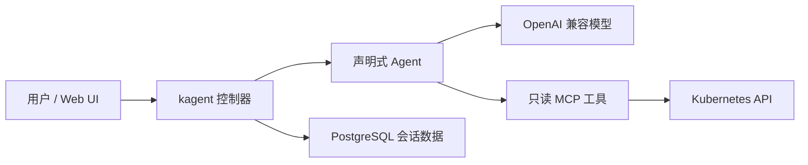
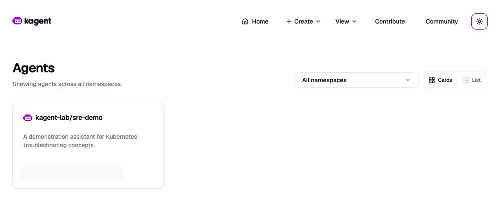
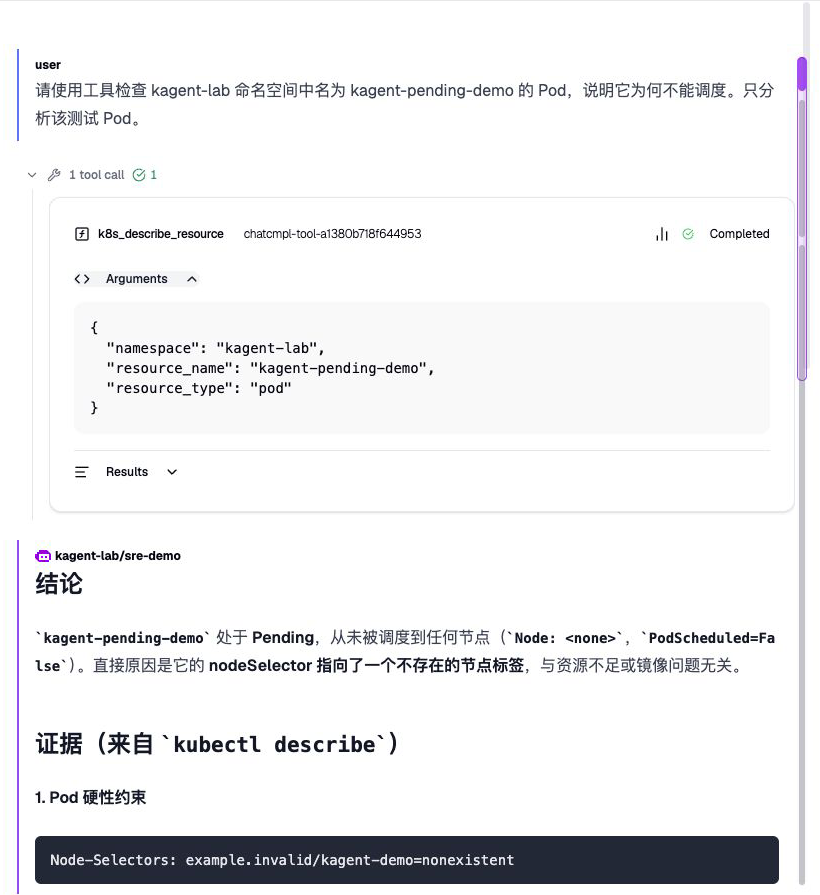

# kagent Kubernetes 实战：让 Agent 通过只读工具定位 Pending Pod

一个运维 Agent 要有价值，不能只根据经验解释 Pending：它还需要读取实际事件，并说明证据来自哪里。这次在 Kubernetes 测试集群部署开源项目 [kagent](https://github.com/kagent-dev/kagent)，接入已有模型服务和只读 Kubernetes 工具，构造一个无法调度的 Pod，观察 Agent 是否能定位原因。

**结果：Agent 通过 MCP 调用了 `k8s_describe_resource`，根据调度事件识别出节点选择器不匹配；它只提出修复建议，没有执行修改。**实验使用 kagent 0.10.4、Kubernetes 1.30.4。模型、网络和集群标识已脱敏；这次成功不等于该 Kubernetes 版本已经得到上游官方兼容认证。

## 1. kagent 是什么

kagent 通过 Kubernetes 自定义资源管理 Agent、模型配置和工具。控制器协调 Agent 运行，Agent 调用大模型和 Model Context Protocol（MCP）工具，Web UI 提供会话与配置入口。模型可以由外部 OpenAI 兼容服务提供，控制面本身不需要 GPU。[官方介绍](https://kagent.dev/docs/kagent/0.x/introduction/what-is-kagent/)



这与单纯的故障规则扫描不同：模型会根据问题选择工具、读取输出并组织结论。它是否能执行变更取决于工具和实际 Kubernetes 权限，不能只靠提示词保证安全。

## 2. 实验环境和边界

| 项目 | 本次配置 |
| --- | --- |
| Kubernetes | 1.30.4，独立测试命名空间 |
| kagent / 工具服务 | 0.10.4 / 0.3.0 |
| Agent 运行时 | Go，调用 OpenAI 兼容模型接口 |
| 数据库 | Helm 自带 PostgreSQL，单实例，本地持久卷，仅供演示 |
| 访问界面 | 本机 `kubectl port-forward`，未创建公网入口 |
| 工具权限 | 仅测试命名空间，读取 Pod 等资源和日志，不读取 Secret，不允许删除 Pod |

官方 [0.x 安装文档](https://kagent.dev/docs/kagent/0.x/introduction/installation/)提供 Helm 安装；本次未找到 0.10.4 对 1.30.4 的明确兼容承诺。官方 [1.x 预览安装文档](https://kagent.dev/docs/kagent/1.x/setup/installation/)要求 Kubernetes 1.37 或以上，并引入 Agent Substrate；不能把本次 0.x 结果套用到 1.x，也不能假设原地升级可行。

测试环境不能直接访问模型网关，因此额外使用办公机专用桥接。Agent、桥接和网关共同完成请求；桥接依赖办公机在线，也不代表生产架构。模型密钥不写入文章。

## 3. 安装时先收紧范围

本次先安装独立的 CRD Helm release，再安装控制器、UI 和测试数据库。关闭内置 Agent，控制器的监听范围限制在演示命名空间；确认基础组件可用后，再启用只读工具服务。以下是说明关键设置的示例，不包含本次内部仓库地址与密钥：

```yaml
rbac:
  namespaces: [kagent-lab]
kmcp:
  enabled: false
substrate:
  enabled: false
kagent-tools:
  enabled: true
  rbac:
    namespaces: [kagent-lab]
    readOnly: true
    allowSecrets: false
  tools:
    enabledTools: [k8s]
    args: ["--read-only"]
```

启用前先渲染 Chart 检查资源：工具服务默认配置会生成拥有通配权限的 ClusterRole 和 ClusterRoleBinding；本实验显式改为命名空间 Role 和只读规则。工具层的 `--read-only` 和 Kubernetes RBAC 是两层控制，仍应逐项审查可读的数据，例如 Pod 日志可能包含敏感内容。

```bash
kubectl -n kagent-lab auth can-i list pods --as system:serviceaccount:kagent-lab:kagent-tools
kubectl -n kagent-lab auth can-i get secrets --as system:serviceaccount:kagent-lab:kagent-tools
kubectl -n kagent-lab auth can-i delete pods --as system:serviceaccount:kagent-lab:kagent-tools
```

三项实际结果依次为 `yes`、`no`、`no`。这证明测试身份的上述权限检查结果，不代表已经完成所有权限与隔离安全审计。

## 4. 镜像与模型接入

首次安装时节点直接拉取 GHCR 镜像失败，事件显示连接被重置。我们将固定版本的控制器、UI、Go Agent 运行时和工具服务镜像同步到集群可访问的镜像仓库，PostgreSQL 镜像也使用可访问的副本，然后修改该实验 Helm release 的镜像配置。实际 Pod 随后从镜像仓库拉取成功，控制器、UI、数据库和工具服务均达到 Ready。



*实测截图：kagent 控制台显示测试 Agent；模型标识已遮挡。*

Agent 的 `ModelConfig` 指向 OpenAI 兼容接口，API 密钥使用 Secret 引用。实际调用需验证普通对话、流式输出和工具调用，不能只凭健康检查断定模型可用。[官方模型配置说明](https://kagent.dev/docs/kagent/0.x/supported-providers/byo-openai/)

先问一个通用问题：Pod Pending 通常有哪些原因？Agent 返回了资源、调度约束和存储等排查方向，并注明没有查询集群。这证明对话链路工作，但还没有证明实际诊断能力。

## 5. 构造一个真实的 Pending Pod

测试 Pod 使用不存在的节点标签作为硬性选择条件，不会被调度到任何节点，也不需要拉取镜像：

```yaml
apiVersion: v1
kind: Pod
metadata:
  name: kagent-pending-demo
  namespace: kagent-lab
spec:
  nodeSelector:
    example.invalid/kagent-demo: nonexistent
  containers:
    - name: demo
      image: registry.k8s.io/pause:3.10
```

我们先独立执行 `kubectl describe pod` 核对：Pod 为 `Pending`，`PodScheduled=False`，事件显示节点选择条件无法满足。随后让 Agent 只检查这个测试 Pod。

Agent 的执行日志记录了 `k8s_describe_resource` 调用及完成；回答指出 `nodeSelector` 不匹配，并解释抢占不能修复标签约束。它建议检查选择器或重建测试 Pod，**没有实际执行任何修改**。Agent 同时讨论了其他可能条件，但模型对“不存在资源不足”等判断仍应交给人结合完整调度事件核实，不能将它的推断直接当成排除结论。



*实测截图：工具调用参数限定到测试命名空间中的指定 Pod，状态为 Completed；下方是模型依据返回内容生成的诊断。截图中关于排除资源不足的表述需要人工核实。*

首次请求还遇到 Agent Pod 未通过就绪探针，控制器访问 Service 失败；同一 Agent 后来通过就绪探针并完成调用。由于没有完整定位网络与探针的根因，这次只记录现象，不把它归因于某个 CNI 或 kube-proxy 实现。

## 6. 生产使用前还需要什么

本次重点验证一条只读诊断路径，没有测试大规模并发、多租户隔离、数据库故障恢复、工具执行审批或高可用。默认演示 UI 也不适合直接暴露给多人访问。

面向企业落地，应优先确定身份认证、命名空间与数据权限、模型请求的数据边界、审计和成本；把可执行变更的工具放在明确的审批流程后面。数据库、持久存储和模型网关也需要独立的备份与可用性设计。最后，对模型生成的命令和结论做人工复核：**Agent 输出是排查线索，Kubernetes 实际状态和事件才是判断依据。**
