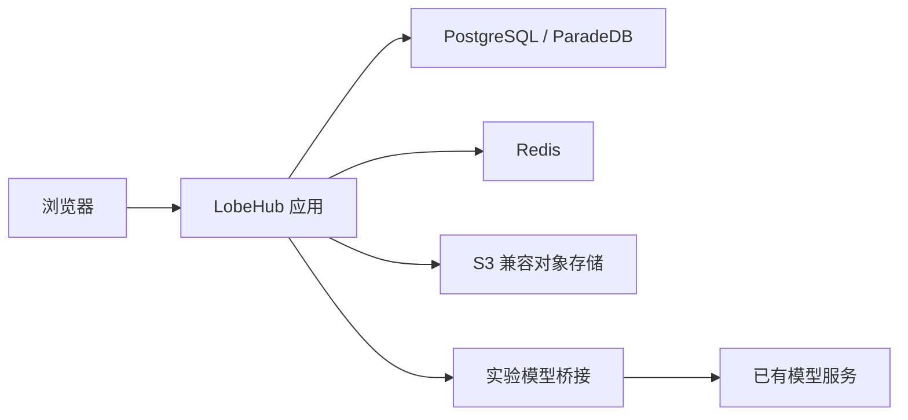
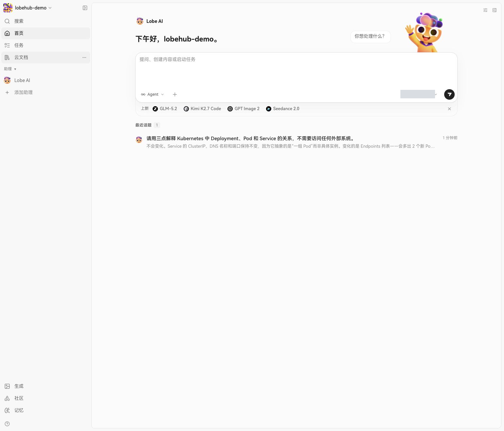
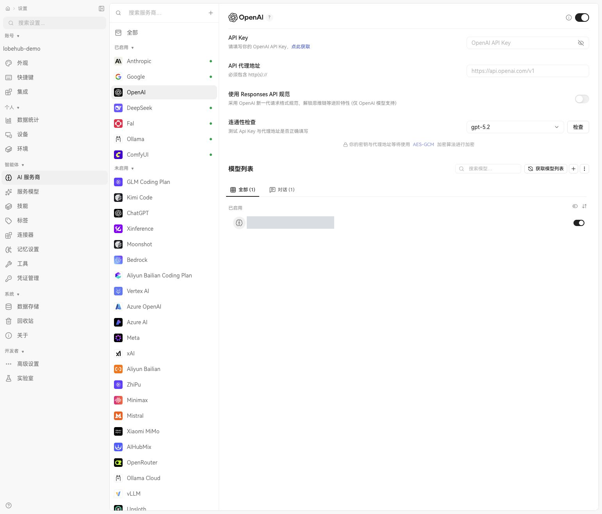
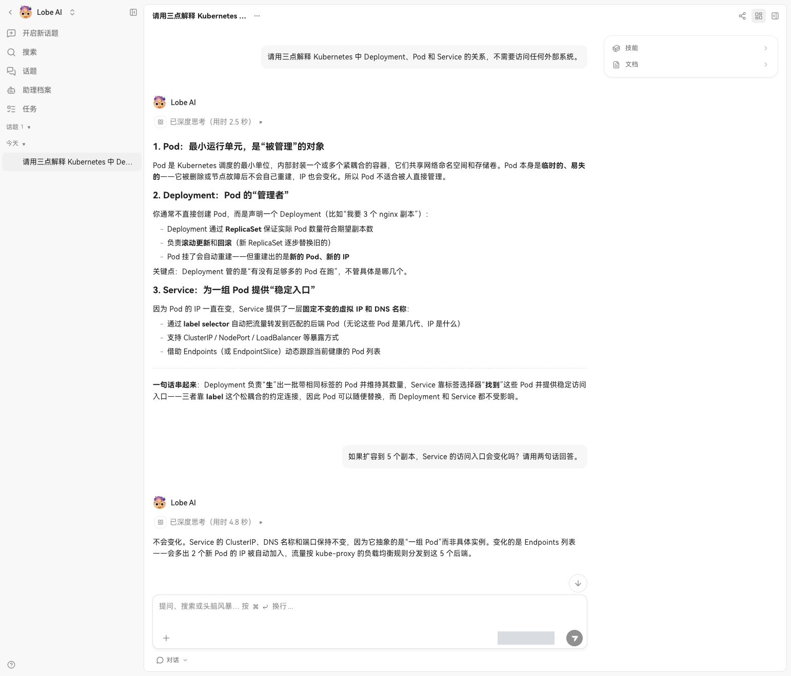
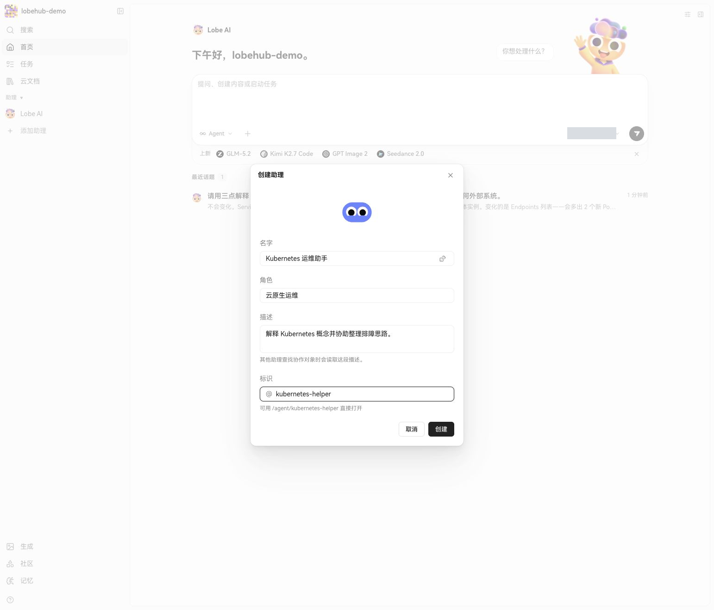
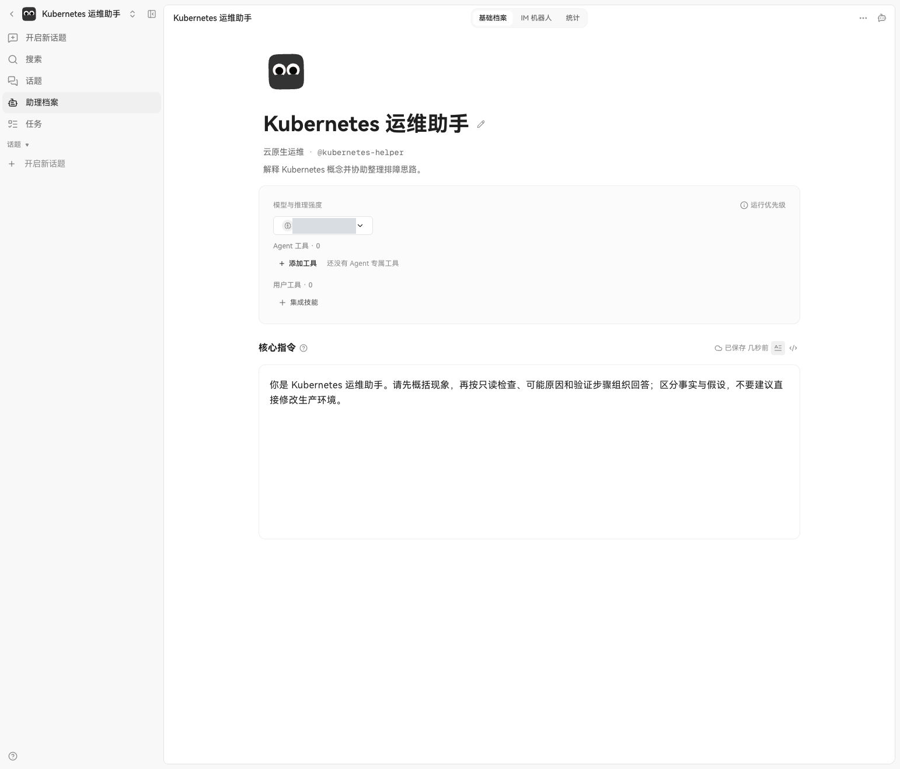
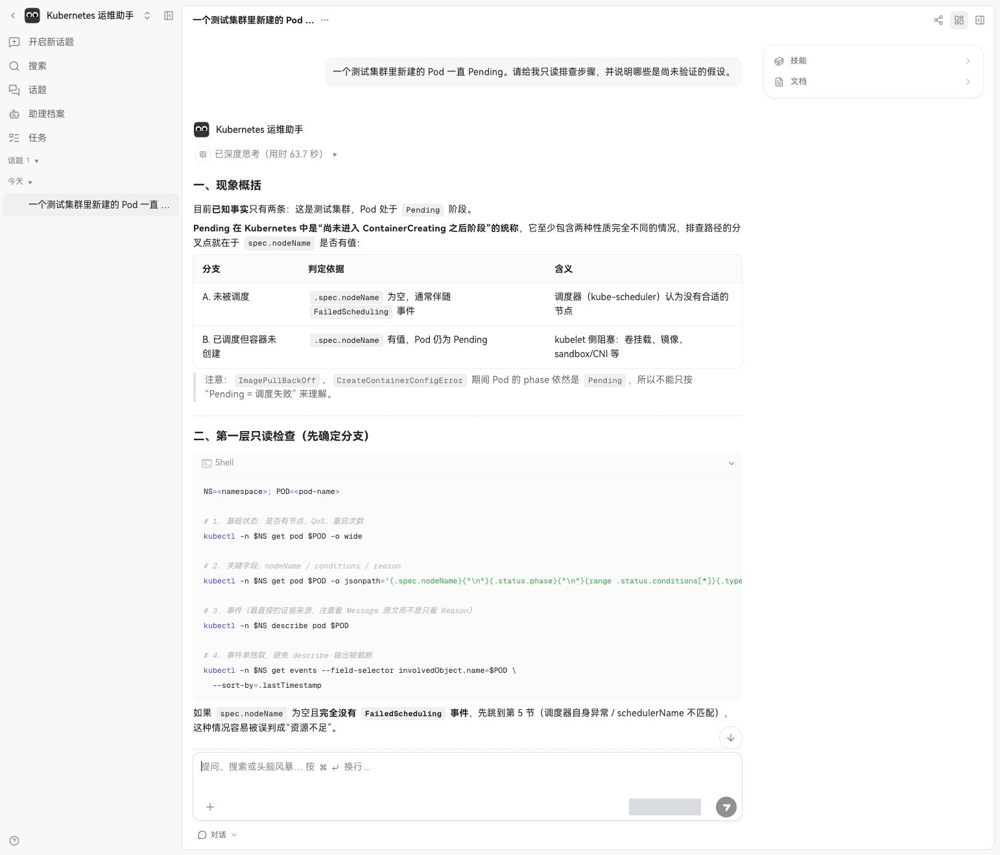
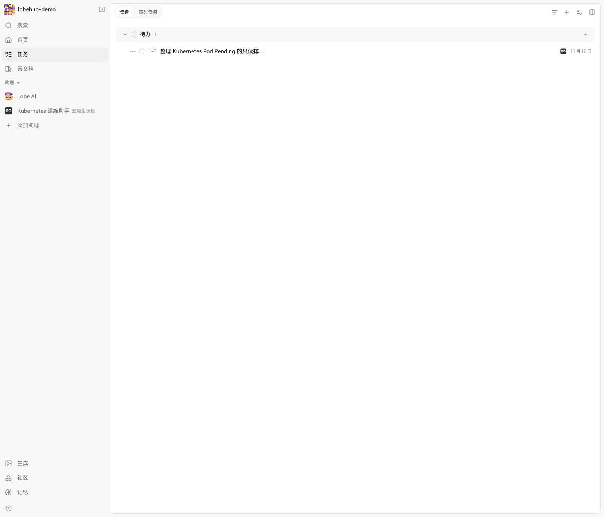
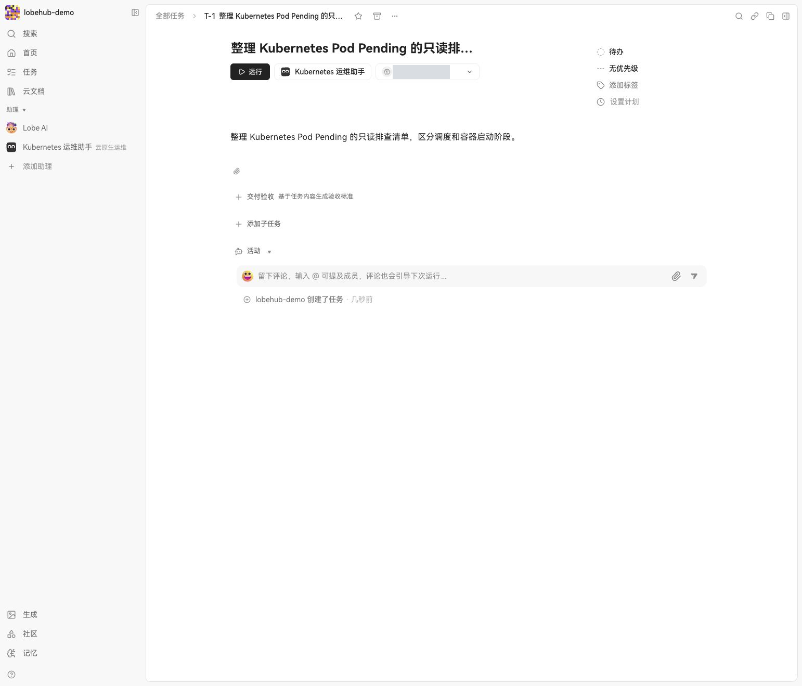
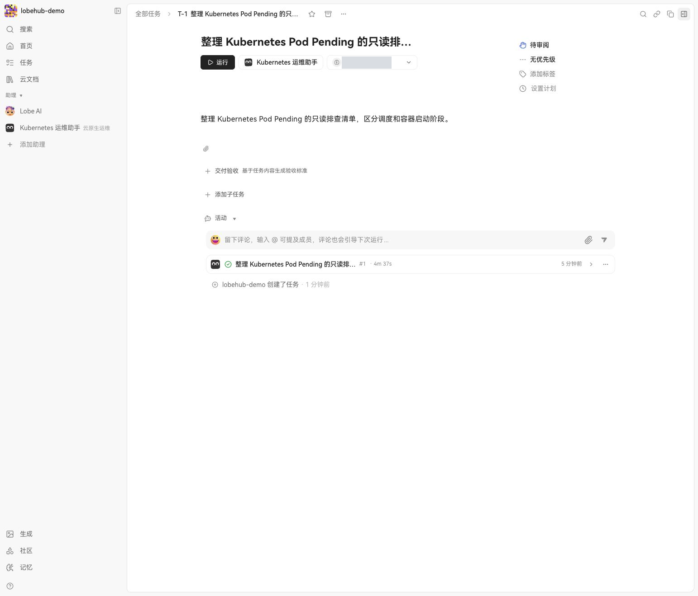

# LobeHub Kubernetes 实战：从模型对话到自定义助理与任务

LobeHub 提供一个面向大模型和智能体的工作界面：用户可以接入模型、创建助理、组织对话和任务。这次在 Kubernetes 测试集群中实际部署它，接入一条已有的 OpenAI 兼容模型链路，依次试了多轮对话、定制 Kubernetes 运维助理和任务管理。

**实测结果：**Web 页面、账号注册、模型流式对话、追问、助理创建和任务创建均可用；页面刷新后对话仍在。任务运行约 4 分 37 秒后变为“待审阅”，但运行详情未显示助理正文，交付内容未确认。向量化接口返回 404，技能市场和推荐模板请求受网络影响，不能据此声称记忆、联网内容与完整的服务器端工具执行已经跑通。

本文截图均来自测试环境的桌面浅色界面，已遮挡内部模型标识；地址、凭据和环境信息也已脱敏。模型回答是实验输出，并非经过验证的运维结论。

## 1. 它在系统中扮演什么角色

LobeHub 更像面向用户的 AI 工作台：浏览器负责交互，服务端保存账号、对话和配置，模型推理由接入的模型服务完成。是否能够联网、使用工具、执行代码或检索知识，还取决于额外服务、接口和权限配置。官方 [v2.3.2 发布记录](https://github.com/lobehub/lobehub/releases/tag/v2.3.2) 和 [固定版本部署示例](https://github.com/lobehub/lobehub/blob/v2.3.2/docker-compose/deploy/docker-compose.yml) 可用于核对版本与依赖。



图中是**本次实测链路**，不是官方生产拓扑。桥接依赖一台保持在线的办公机；它适合在测试集群网络受限时验证界面，不能作为生产可用性的依据。本次没有部署官方 Compose 文件中的独立 Agent Gateway，也没有验证服务器端沙箱、浏览器工具或外网搜索。



*图 1：登录后的桌面工作台，显示对话入口与最近话题；模型标识已遮挡。*

## 2. 实验环境与部署

| 项目 | 本次选择 | 验证范围 |
| --- | --- | --- |
| Kubernetes | 独立测试命名空间 | 不修改其他命名空间的业务工作负载 |
| LobeHub | `lobehub/lobehub:2.3.2`，单副本 | 页面与聊天、助理和任务界面 |
| 数据库 | `paradedb/paradedb:latest-pg17`，单副本 | 数据库迁移；`pg_search` 和 `vector` 扩展加载 |
| 缓存 | Redis 7，单副本 | 应用启动与基本使用 |
| 对象存储 | MinIO，S3 兼容接口 | 服务与初始化 Job 就绪；未验证文件检索效果 |
| 存储 | 数据库 10 GiB、对象存储 5 GiB 持久卷 | 页面刷新保留会话；未进行故障恢复测试 |
| 访问 | 本机 `kubectl port-forward` | 未创建公网入口 |

官方 Compose 示例使用 ParadeDB、Redis 和 RustFS；这里用 MinIO 替代 RustFS 验证 S3 兼容的基础部署。数据库镜像的 `latest-pg17` 是本次实际使用的浮动标签；正式环境应选经过验证的固定版本或 digest，并检查升级兼容性。

部署时先准备独立命名空间、两块持久卷和数据库、缓存、对象存储，初始化对象桶后再启动 LobeHub。数据库挂载目录中有文件系统自动生成的 `lost+found`，首次初始化因此失败；将 `PGDATA` 指向挂载目录下的 `pgdata` 子目录后完成初始化。应用的数据库迁移完成，四个长期运行的组件达到 Ready。

示例中应使用 Secret 提供认证信息，避免把实际密钥写入 YAML 或仓库：

```yaml
- name: OPENAI_API_KEY
  valueFrom:
    secretKeyRef:
      name: model-credentials
      key: api-key
- name: OPENAI_PROXY_URL
  value: http://model-endpoint.example:8080/v1
- name: OPENAI_MODEL_LIST
  value: "-all,+example-model"
```

模型地址仅为示例。数据库密码、`AUTH_SECRET`、`KEY_VAULTS_SECRET` 和对象存储凭据同样需要通过 Secret 或现有密钥管理系统提供。固定 `APP_URL`、检查存储类及访问策略，并以应用实际启动日志为准。

```bash
kubectl -n lobehub-lab get pods,pvc
kubectl -n lobehub-lab logs deploy/lobehub -c lobehub --tail=100
kubectl -n lobehub-lab port-forward --address 127.0.0.1 svc/lobehub 19010:3210
```

命名空间和端口是可替换的示例。这个入口只在运行转发命令的机器上可访问；命令退出后入口失效。测试集群中普通 Service 地址曾出现连接异常，使用 headless Service 后依赖连接恢复；这是该环境的观察，不代表 LobeHub 必须使用 headless Service。

## 3. 配置模型：OpenAI 兼容不等于所有接口都兼容

模型桥接最初的健康检查通过，但页面对话失败。排查请求路径发现，工作台发出了 `/v1/responses`，而已有桥接只提供 `/v1/chat/completions`；另一个 `/v1/embeddings` 请求也返回 404。将服务商设置中的 Responses API 开关先开启再关闭，明确选择 Chat Completions 后，对话请求返回 HTTP 200，并在页面输出完整回复。



*图 2：模型服务商设置。Responses API 开关关闭；模型标识已遮挡。页面中的密钥与地址字段未展示服务端实际配置。*

这里要分别检查：模型列表可见、连接检查、流式文本、工具调用和向量化各是不同能力。**本实验只验证了流式文本对话**；桥接没有向量接口，记忆检索仍报错；也没有验证工具调用。页面能选到某个模型，不意味着这个模型或服务商的全部功能已配置完成。

## 4. 实验一：普通对话和多轮追问

第一轮要求助理解释 Deployment、Pod 和 Service 的关系；随后追问扩容到 5 个副本时 Service 入口是否变化。页面返回了两轮内容，第二轮回答提到了 ClusterIP、DNS 和后端 Pod 变化。刷新后再次打开话题，聊天内容仍然存在。随后应用 Pod 滚动重启，历史话题仍可读取，新一轮对话也返回了回复。



*图 3：实际对话与追问。截图保留原始模型输出，回答应结合具体网络实现核对。*

这验证了从浏览器到模型再返回文本的链路，以及刷新后会话仍可读取；它不是性能压测，也不是数据库节点重启、备份恢复或跨节点迁移验证。

## 5. 实验二：创建 Kubernetes 运维助理

在首页选择“添加助理”，填写名称、角色和描述，再进入档案选择已接入的模型。核心指令要求它先概括现象，按只读检查、可能原因、验证步骤组织回答，并区分事实和假设。



*图 4：通过界面创建运维助理。*



*图 5：助理档案中的角色与核心指令；模型标识已遮挡。*

向它提出“测试集群里的 Pod 一直 Pending，给出只读排查步骤并区分未验证假设”。模型给出了按 `spec.nodeName` 分支、查看 Pod 事件和节点状态的检查建议。它**没有连接 Kubernetes API，也没有实际执行命令**；本次只是根据自然语言问题生成建议。



*图 6：运维助理的实际回答。截图保留原样，不表示其中每个命令和判断都正确。*

人工复核发现几个值得注意的错误：回答建议的 `kubectl get resourcequota -o describe` 不是有效的输出格式，应使用 `kubectl describe resourcequota`；它还称没有 `FailedScheduling` 事件就基本可排除多类原因，这过于武断，事件可能过期或缺失。回答关于 Pending 与 `ContainerCreating` 的描述也不严谨，前者是 Pod phase，后者通常是容器等待原因。**因此截图是产品行为证据，不是可直接执行的故障处置手册。**[Kubernetes Pod 生命周期](https://kubernetes.io/docs/concepts/workloads/pods/pod-lifecycle/)对 phase 有明确定义。

## 6. 实验三：任务与助理关联

在“任务”页创建一条整理 Pending 排查清单的待办，并将其分配给刚创建的运维助理。列表和详情能显示任务、负责人以及运行入口。



*图 7：任务已经创建并关联运维助理；“待办”不表示任务已执行。*



*图 8：任务详情。运行前可看到任务说明、助理、模型与状态；模型标识已遮挡。*

点击“运行”后页面出现运行记录，任务先进入“进行中”，约 4 分 37 秒后状态变为“待审阅”。但是打开执行详情时只看到任务指令和助理头像，没有看到助理正文或可检查的交付物，因此**状态已流转，产物未确认**；需要继续排查，不能视为任务完整交付。本实验没有接入 Kubernetes 工具，也没有证明任何集群资源被读取或修改。



*图 9：运行记录显示约 4 分 37 秒，状态为待审阅；这不证明正文或产物已经成功保存。*

## 7. 限制与上线前检查

- **基础服务不是高可用。**应用、数据库、缓存和对象存储均为单实例；没有测试备份恢复、Pod 故障转移或多副本并发。
- **模型链路依赖外部桥接。**办公机或端口转发中断后请求会失败，正式环境应提供稳定的网络路径、权限边界、超时与监控。
- **记忆、市场及工具执行不等于已验证。**本次 embeddings 返回 404，市场请求遇到连接失败，独立 Agent Gateway 未部署。
- **提示词不是安全边界。**如果后续接入 Kubernetes 或其他工具，需要通过独立身份、最小权限、操作审批和审计约束真实能力。
- **界面展示不代表模型正确。**示例中已发现命令错误和过度推断，运维人员仍应核对原始证据与执行语法。

LobeHub 适合作为统一的对话、助理配置和任务入口进行探索。要评估团队生产使用，还需要补齐身份认证、数据备份、模型网关、向量服务、工具执行隔离和可观测性，并针对所选版本做完整验证。
