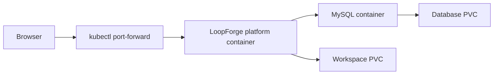
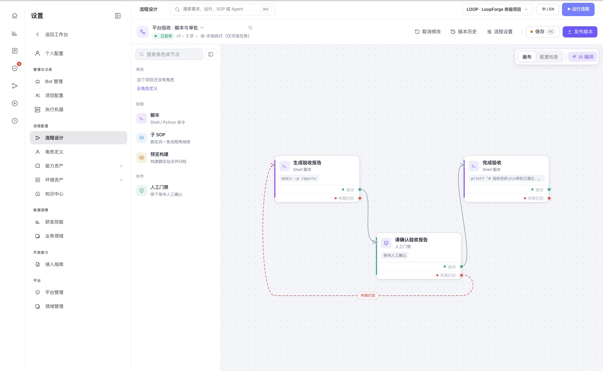
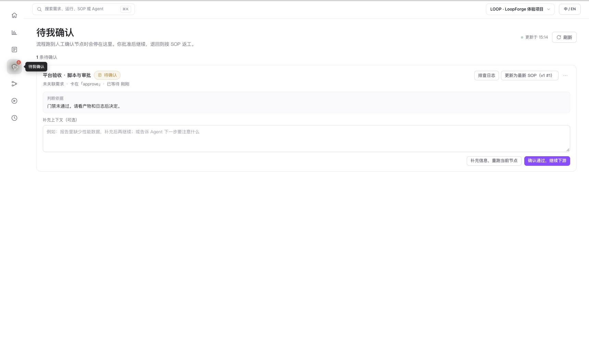
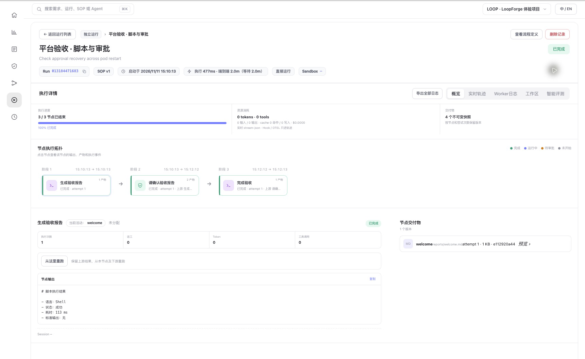
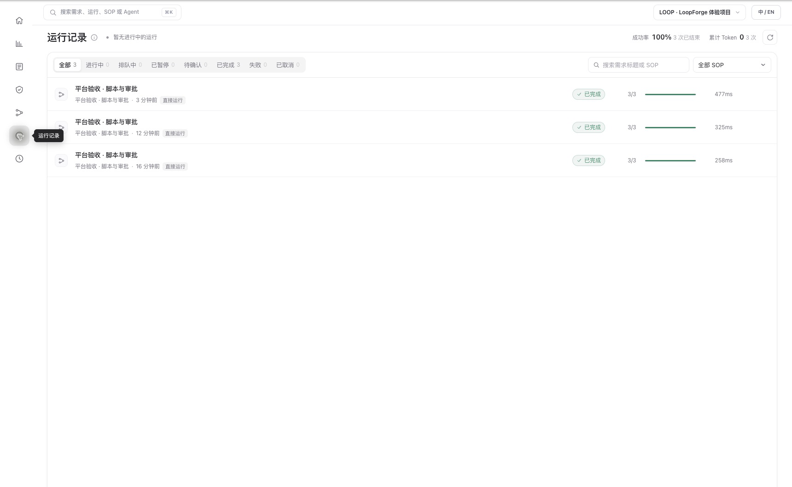
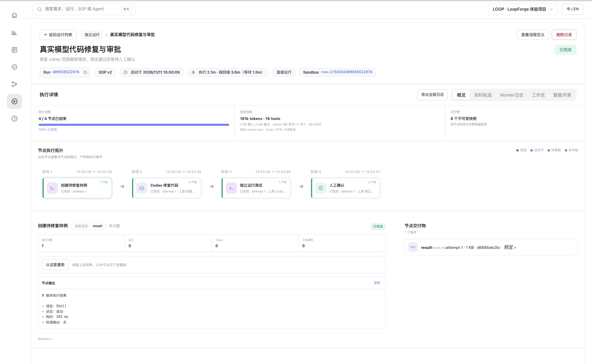
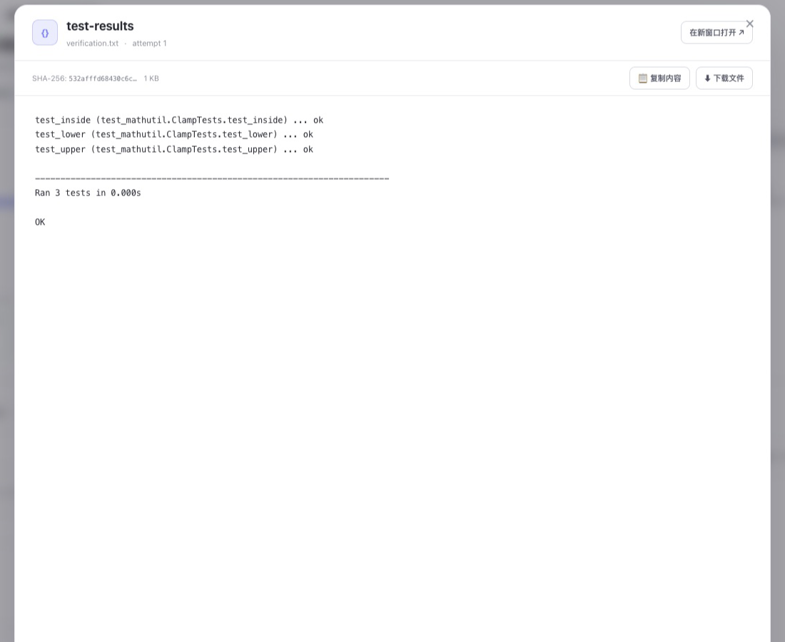
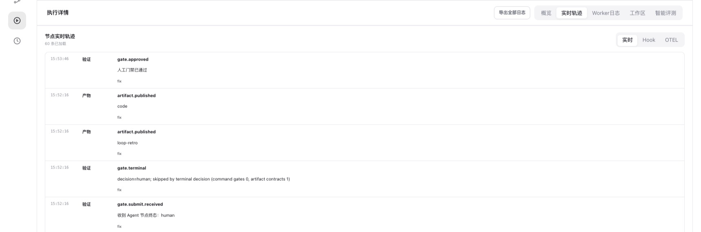

# 腾讯 LoopForge Kubernetes 实战：脚本、审批、返工与重启恢复

编程 Agent 能修改代码，却不一定每次都会按团队要求测试、评审和等待验收。腾讯轻量云团队开源的 [LoopForge](https://github.com/Tencent/LoopForge) 尝试把角色、脚本、人工审批和运行记录组合成可重复执行的标准工作流程（Standard Operating Procedure，SOP）。[项目介绍](https://developer.cloud.tencent.com/article/2779233)

本文在隔离的 Kubernetes 测试环境部署 LoopForge，实际运行内置的脚本和审批流程，验证审批打回及等待审批期间的 Pod 重启恢复。**追加实验运行了真实模型 Agent 和合成代码修复；尚未验证真实仓库修改、PR 或 Docker 沙箱。** 文中真实截图为浅色桌面界面，已裁掉浏览器信息，保留了原始界面中的中文。

## 1. 环境与架构

| 项目 | 本次配置 |
| --- | --- |
| LoopForge | 官方 `v0.3.4` 镜像，对应源码标签 commit `ffaed1574eb4a232581d0ee1cbba46cc01fb2675` |
| Kubernetes | 测试集群 v1.30.4，单副本 Deployment |
| 数据库 | MySQL 8.0.46；官方 Compose 示例使用 MySQL 8.4，本次为 8.0 的单次验证 |
| 存储 | 数据库与工作区各一个 5 GiB 持久卷（PersistentVolumeClaim，PVC） |
| 网络 | 本机 `kubectl port-forward`；不创建公网入口 |
| 执行方式 | 平台容器内本地执行可信脚本，不挂载宿主机 Docker socket |
| 模型与仓库 | 首轮无模型；追加实验接入 DeepSeek-V4.1-Flash，未连接真实代码仓库 |



示意图中 MySQL 与平台位于同一个 Pod，MySQL 仅监听 Pod 内回环地址；这是方便验证的单实例方案，不是高可用部署。集群名称、内部地址和镜像仓库地址均已省略。

官方 Compose 默认使用宿主机 Docker socket 创建任务沙箱。项目文档指出 socket 可控制宿主机 Docker；我们没有挂载它，按官方无 socket 方式运行脚本体验。**脚本直接在平台容器内执行，不是独立沙箱，仅适合受信任的测试任务。** 真正的 Agent 沙箱需要另配隔离执行环境。[官方部署说明](https://github.com/Tencent/LoopForge/blob/v0.3.4/docs/deployment.md)

## 2. 部署与访问

1. 创建独立命名空间、两个 PVC 和独立 Secret；将数据库密码与会话密钥保存在 Secret 中。
2. 运行 MySQL 与 LoopForge 容器，数据库仅监听 `127.0.0.1`。平台设置认证、工作目录及数据库连接，关闭自助注册；没有挂载节点 Docker socket，也没有挂载 Kubernetes 服务账号令牌。
3. 首次启动成功后，按照同版本源码中的 `migrations/001_run_obs_generated_columns.sql` 和 `migrations/seed/` 初始化观测列与体验项目。迁移与镜像版本要匹配；既有数据库应先检查迁移前置条件。
4. 使用本机端口转发访问工作台；首次创建管理员后确认未授权注册已关闭。以下命令使用示例命名空间和端口：

```bash
kubectl -n loopforge-lab rollout status deployment/loopforge
kubectl -n loopforge-lab port-forward deployment/loopforge 19846:8080 --address 127.0.0.1
```

随后打开 `http://127.0.0.1:19846/`。本次集群无法直接拉取官方镜像，先经镜像中转并比较源与目标的镜像配置及层，再由集群实际拉取。不要把内部镜像仓库、真实 Secret 或生产配置写进公开部署样例。

## 3. 先看流程：脚本、人工审批、完成

在体验项目进入「流程模板」，选择「平台验收 · 脚本与审批」。流程设计器中有三个节点：生成报告、等待人工确认、完成验收；审批也可以打回报告生成节点。



*图 1：本次环境的真实流程设计器。实线表示正常推进，红色虚线表示打回路径。*

### 实验一：完成一次审批

运行流程后，报告脚本先完成并生成 `welcome` 产物，随后运行状态进入 `waiting`、审批节点进入 `waiting_approval`；核对报告内容后批准，最后一个脚本完成并生成 `completed` 产物。



*图 2：另一次运行真实停在审批页；截图后通过页面上的按钮批准。*

这次验证说明人工门禁能阻止后续节点提前执行，也验证了报告可以读取；它并没有调用模型，不能证明代码生成或 AI 评审有效。

### 实验二：打回并重跑

再次运行同一个 SOP，等审批节点就绪后，将其打回报告生成节点。报告节点再次执行，记录显示 `attempt=2`、`reworkCount=1`；审批节点再次等待确认，批准后整个流程成功。

关键不是只看最终绿色状态，而是检查节点尝试次数、返工次数与产物是否对应。此处验证的是内置示例的一条打回路径，并未覆盖任意复杂依赖图或并发冲突。

### 实验三：等待审批时重启 Pod

先把一条运行停在人工审批，随后重启包含平台与数据库容器的整个 Deployment Pod；等 Pod 就绪、重新建立端口转发后查询同一次运行，它仍处于等待审批。批准后，完成节点执行成功，四个产物快照可见。 重启过程中平台容器因数据库尚未就绪出现 2 次连接失败并重启，随后恢复；这是启动顺序问题，生产部署应配置就绪等待与有限重试。



*图 3：重启后批准的真实运行详情，3 个节点完成；Token 和工具调用为 0，说明这次没有模型调用。图中的执行耗时是界面单次记录，不作为性能基准。*

这证明本次**等待审批阶段**的记录可以跨 Pod 重启保留并继续，依赖持久卷和数据库状态。不代表运行中的 Agent 进程、流式回复或外部副作用可以原地恢复，也没有验证节点故障、PVC 故障和多副本高可用。



*图 4：三次验证运行的桌面记录；截图拍摄后又额外通过页面完成了一次审批演示。成功率只描述这几次示例，不是稳定性指标。*

### 实验四：接入真实模型修复代码

在前述脚本实验之后，新增一个可信的本地执行 SOP：生成带缺陷的 `clamp` 函数和 3 条测试，由 Codex CLI 调用 DeepSeek-V4.1-Flash 读取并修改示例文件，再用独立脚本运行单元测试，最后人工审批。模型服务通过实验专用的办公机桥接访问，桥接透传 Responses 流式接口；真实服务地址与凭据不进入公开资料。



*图 5：真实模型任务的运行拓扑，包括样例准备、Codex 修复、独立测试与人工确认；画面中的 Sandbox 标签是平台运行标识，不代表本次使用了独立 Docker 沙箱。*

修复前，3 条测试有 2 条失败；模型生成的代码把数值限制在上下界之间，独立测试的 3 条均通过。实际运行中，Agent 修复后先主动请求一次人工确认；确认后测试节点执行，通过后流程又停在原本设计的人工审批节点，最终完成。平台记录该 Agent 节点总 Token 为 181,197（包括 77,568 缓存读取 Token）；这是单次运行的界面统计，不代表一般任务开销或实际费用。



*图 6：独立测试节点保存的结果：范围内、下界和上界三个测试均通过。截图展示的是测试产物，并非模型自行声称的结果。*



*图 7：同一次运行的轨迹记录了代码产物发布、Agent 请求人工确认和门禁通过，可用于回看执行过程。*

我们还在独立 Kubernetes 测试 Pod 中先验证了模型工具调用和相同代码修复。LoopForge SOP 本身仍使用 `local` 执行模式：代码运行在平台容器内，**没有验证独立的 Docker 沙箱，也不适合执行不可信代码**。实验使用临时生成的示例文件，没有操作真实仓库或创建 PR。

## 4. 我们学到了什么

| 问题 | 本次观察 | 不能推断 |
| --- | --- | --- |
| 真实模型能否参与修复？ | 单次示例由模型修改代码，独立测试 3/3 通过并完成审批 | 已经验证真实仓库、PR 或复杂项目效果 |
| 交付流程能否约束顺序？ | 报告完成后停在人工审批，通过后才进入完成节点 | 模型输出一定正确 |
| 发现问题后能否返工？ | 内置流程打回后报告节点执行第 2 次 | 所有复杂工作流都能自动修复 |
| 平台重启会丢审批吗？ | 等待审批的单次运行在 Pod 重启后可继续 | 执行中的 Agent 或进程可以无损恢复 |
| 沙箱是否验证？ | 没有挂载 Docker socket；脚本在平台容器执行 | 完成了 Docker 隔离或不可信代码安全测试 |

LoopForge 的主要价值在于把过程显式化：每个节点做什么、是否需要人确认、失败退回哪里、产物和记录在哪里。对企业来说，是否有价值要看它能否和实际代码仓库、模型服务、测试环境及既有审批流程接起来，而不是只看示例流程能否跑通。

## 5. 和 CNB 怎么选

云原生构建（Cloud Native Build，CNB）是腾讯云的 Git 与研发协作平台，覆盖代码仓库、持续集成与持续交付（Continuous Integration / Continuous Delivery，CI/CD）和云开发环境。它的 NPC（Non-Player Character，自动化角色）也可以调用 AI 处理研发任务：在 Issue 或 PR 中 `@CodeBuddy`，开启工作模式后，可以修改代码、建分支和提交 PR。[CNB 产品介绍](https://cloud.tencent.com/document/product/1785/116261) · [NPC 文档](https://docs.cnb.cool/zh/build/npc.html)

两者在「让 Agent 处理代码并交付」上有交集，侧重点不同。下表中 LoopForge 以本文实测的 v0.3.4 为准；CNB 根据官方文档分析，**本文没有实测 CNB**。

| 比较维度 | LoopForge | CNB（云原生构建） |
| --- | --- | --- |
| 核心入口 | 围绕需求、角色和标准工作流程（SOP）组织 Agent、脚本与人工节点 | 围绕代码仓库、Issue / PR 和事件驱动流水线组织协作 |
| Agent 执行 | 为不同角色配置执行器和模型，按流程推进；本次用 Codex 调用真实模型修复样例 | 在 Issue / PR 中 `@` 系统或自定义 NPC，可回复、审查，也可在工作模式下修改代码并提交 PR |
| 流程与人工介入 | 可视化定义 Agent、脚本、人工门禁和返工路径；本次实测了批准、打回和重启后继续审批 | 用仓库中的 `.cnb.yml` 声明构建任务，支持推送、PR、API、定时和 NPC 等事件；代码交付仍可通过 PR 评审 |
| 测试与交付 | 可在流程中安排脚本测试和产物审阅；真实仓库和 PR 在本次没有验证 | 仓库事件可触发测试、构建镜像和交付流水线，制品和开发环境与平台配合使用 |
| 部署方式 | 开源软件，可自行部署并管理数据库、执行环境、凭据和升级 | 官方说明的社区版是 SaaS；企业版部署到指定腾讯云虚拟私有云（Virtual Private Cloud，VPC），具体开通和网络条件需与腾讯云确认 |
| 本次证据 | 有真实执行和截图：合成代码修复、3 条独立测试、审批及重启恢复 | 仅整理公开资料；未在同一任务、模型或环境下做效果和成本对比 |

CNB 的 NPC 也能处理 Issue、编写代码和提交 PR，不能简单说成「只有流水线」；LoopForge 的价值则更集中在把多个角色、确定性脚本、人工确认和返工组织成可复用流程。[CNB 触发规则](https://docs.cnb.cool/zh/build/trigger-rule.html) · [CNB 构建介绍](https://docs.cnb.cool/zh/build/intro.html) · [LoopForge v0.3.4](https://github.com/Tencent/LoopForge/tree/v0.3.4)

例如，同样修复一个函数并补充测试：如果仓库已在 CNB，团队希望从 Issue 发起、由 NPC 提交 PR 并自动跑已有流水线，先用 CNB 的原生链路试点会更直接；如果团队更重视将「实现、独立测试、人工确认、打回重做」设计成可观察的多角色流程，可以评估 LoopForge。需要同时保留已有代码平台和自建编排时，也可以探索让 LoopForge 负责流程、代码平台负责 PR 与 CI；**这只是架构设想，不代表本文已验证 LoopForge 与 CNB 的仓库、权限、事件或回调集成**。实施前应先做专用仓库试点，核对凭据权限、事件幂等、测试结果回传、审批责任和代码出网边界。

## 6. 下一步和生产边界

本次已打通模型与 Agent 执行器，但 LoopForge 工作流没有在独立执行环境里运行代码修改。下一步应使用专用测试仓库和隔离 Worker，验证真实代码修改、测试失败后重试、人工审核和 PR 交付，再做执行中断与恢复实验。不要把 Docker socket 直接挂到共享集群节点来代替隔离设计。

生产评估还应覆盖身份与项目权限、密钥保管、出网和数据边界、运行时隔离、可审计性、数据库备份及恢复、队列和并发限制。当前单 Pod、单数据库、单次恢复实验不构成高可用或安全性认证。

## 参考资料

- [Tencent/LoopForge 官方仓库](https://github.com/Tencent/LoopForge)
- [v0.3.4 部署文档](https://github.com/Tencent/LoopForge/blob/v0.3.4/docs/deployment.md)
- [腾讯云开发者社区项目介绍](https://developer.cloud.tencent.com/article/2779233)
