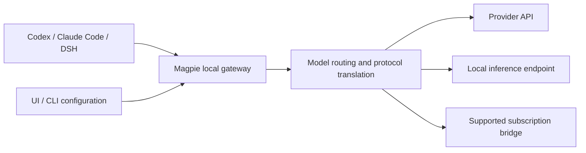

# Magpie 解析：为多个编程 Agent 管理模型与本地网关

> 本文分析 [yetone/magpie](https://github.com/yetone/magpie)，不是生成微调数据的同名 Magpie。本文基于公开资料和上游文档，**尚未安装、接入账号或实测**；功能和使用条件以实际版本及服务商条款为准。

## 它解决什么问题

一个开发者可能同时使用 Codex、Claude Code 和 DeepSeek Harness，也可能有不同的模型 API、本地模型与订阅。每个工具的配置位置、协议和认证方式不同。Magpie 将供应商和模型集中管理，在本机运行模型网关，并把选定模型写入各 Agent 的配置。官方列出的运行形态包括桌面应用、终端界面、CLI、Web UI 和 Docker，支持 macOS、Windows 和 Linux。参见[项目说明](https://github.com/yetone/magpie)和[入门文档](https://github.com/yetone/magpie/blob/main/site/public/docs/start.html)。

它的价值是降低多工具、多模型的切换成本。它不是训练框架，也不负责执行代码或提供沙箱；代码执行和文件权限仍由 Agent 及其运行环境决定。

## 架构和请求路径

图中是概念示意，不代表一次已执行的请求。网关默认地址是 `127.0.0.1:3425`。按照项目文档，它接收 OpenAI Chat、Responses、Anthropic Messages 和 Gemini 格式，处理流式输出、工具调用等协议转换，再路由到配置的上游。模型通常以 `provider/model` 标识。不同模型的工具调用、推理内容、图片和上下文机制并不完全一致；能连接不意味着所有语义都等价。[来源](https://github.com/yetone/magpie#how-it-fits-together)

选择模型时，Magpie 修改对应客户端配置。例如官方说明会为 Codex 更新 `~/.codex/config.toml` 的模型和 provider 配置，为 Claude Code 更新 `~/.claude/settings.json` 中相关环境变量。通常需启动新会话，Codex 模型列表变化还需要重启应用或 CLI。配置被改写可能与现有代理、环境变量或团队配置冲突，尝试前应备份并记录原值。[来源](https://github.com/yetone/magpie/blob/main/site/public/docs/start.html)

## 能做什么

| 能力 | 官方提供的方向 | 使用时要核对什么 |
| --- | --- | --- |
| 供应商管理 | API Key、自定义兼容端点和部分订阅账号 | 上游是否允许该接入方式；模型名、限额和费用 |
| Agent 模型选择 | 为不同工具选择模型，支持配置组合 | 本地配置变更、会话是否需要重启 |
| 路由组 | 顺序、轮转、用量等策略与备选模型 | 故障切换是否改变模型质量、价格和数据目的地 |
| 协议转换 | 支持多种主流模型 API 格式 | 流式、工具调用、多模态、推理参数的真实兼容性 |
| 隐私遮罩 | 可选的规则和本地模型识别 | 默认关闭，可能漏检或误报，不能代替数据分级 |
| 使用记录 | 查看用量和路由等信息 | 日志内容、保留时间、敏感信息与访问权限 |

项目文档也描述自动识别本机某些 Agent 的登录信息。按其说明，可在隐私设置中关闭订阅账号发现，或使用 `MAGPIE_NO_ACCOUNTS=1` 限制单次运行。首次使用前，应明确哪些账号和本地凭据会被读取；不要把客户端密钥当成上游供应商密钥。[来源](https://github.com/yetone/magpie)

## 故障切换不是免费算力

多个账号或模型加入路由组后，Magpie 文档描述了轮转、顺序、用量等策略。单账号且没有备选组时，上游错误仍会返回客户端。切换到其他模型可能改变工具调用格式、提示缓存、响应质量、费用和数据所在位置。流式请求中断时能否安全重试，也取决于已输出内容和工具是否已产生副作用。应区分切换前后请求，并让有副作用的工具具备幂等或人工确认机制。

订阅服务并不自动等同于通用 API。即使某个桥接功能技术上可用，也不能据此认定账号共享、自动切换或第三方客户端访问得到供应商授权；采购及使用前需核对对应订阅条款、账号限制和企业政策。

## 与其他工具怎么选

| 工具类别 | 主要管理对象 | 比较 |
| --- | --- | --- |
| Magpie | 本机 Agent 的模型配置与模型请求 | 适合个人多工具、多供应商切换 |
| [LiteLLM Proxy](https://docs.litellm.ai/docs/proxy/quick_start) | 多应用共享的模型 API | 更适合构建集中式网关；仍需自行治理和运维 |
| [HarnessRouter](harnessrouter-overview.md) | Agent Harness 任务和生命周期 | 关注任务、事件和执行环境；可与模型网关分层配合 |
| Agent 原生配置 | 单个工具的模型及认证 | 环境简单时依赖更少，但跨工具需各自维护 |

这些类别有交集，不代表协议和功能完全对应。Magpie 可以成为 Agent 到模型之间的一层，但不会自动提供 Kubernetes 调度、任务持久化、代码沙箱或企业级租户隔离。

## 安全与企业使用边界

1. **默认本地不等于数据不出网。** 模型请求最终会发送到选定上游；源代码、日志、工具输出也可能进入请求。
2. **遮罩默认关闭。** 项目提供遮罩功能，但规则可能漏掉业务数据，启用后仍需要以脱敏样本验证；不要据此保证隐私或合规。
3. **订阅与凭据要单独治理。** 阅读代码和依赖、核验发布包来源，梳理账号发现、存储及权限；不要在命令行明文输入真实 Key，避免进入 shell 历史。
4. **不要直接暴露本机网关。** 默认回环地址用于本机访问。官方文档描述网络共享时要求启用 gateway key；若用于远程访问，还应单独评估 TLS、访问控制、审计和隔离，不能把简单转发等同于企业网关。[来源](https://github.com/yetone/magpie/blob/main/docs/reference.md)
5. **供应链和回滚。** 在测试机器或独立系统账号上安装，记录原配置，验证卸载和恢复。不要先在生产工作站上执行未经审阅的远程安装脚本。

## 低风险试用建议

先选择一个测试 Agent 和一个有权限的测试 API，备份配置，在隔离环境中安装并阅读项目文档。用不含敏感信息的提示词检查普通文本、流式输出和带只读工具的调用，再测试无效 Key、限流和备选路由。记录模型、接口版本、费用、错误和实际路由。最后恢复 Agent 配置并验证恢复结果。上述是建议的试用方案，本文尚未执行。

如果只是偶尔切换一个客户端，原生配置通常已经够用；如果需要长期统一企业身份、预算、审计和多人隔离，应评估集中式网关。Magpie 更值得在个人工作站的多 Agent 场景先做小范围验证，再决定是否引入更复杂的架构。

## 参考资料

- [Magpie 项目与 README](https://github.com/yetone/magpie)
- [Magpie 入门文档](https://github.com/yetone/magpie/blob/main/site/public/docs/start.html)
- [Magpie 完整参考](https://github.com/yetone/magpie/blob/main/docs/reference.md)
- [LiteLLM Proxy 快速开始](https://docs.litellm.ai/docs/proxy/quick_start)
