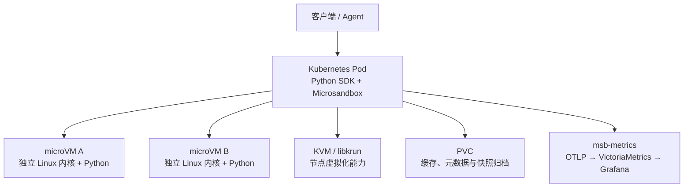
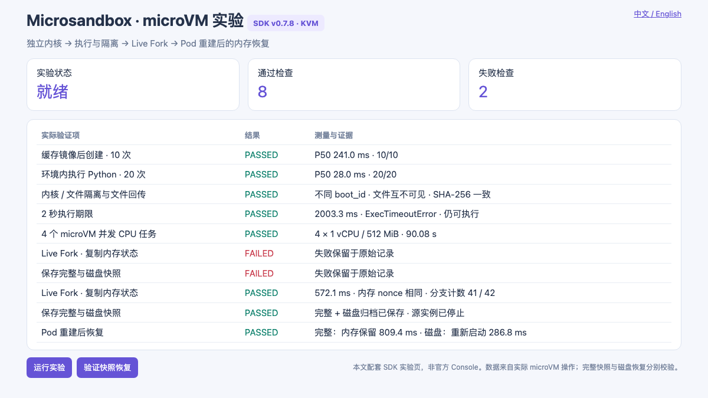
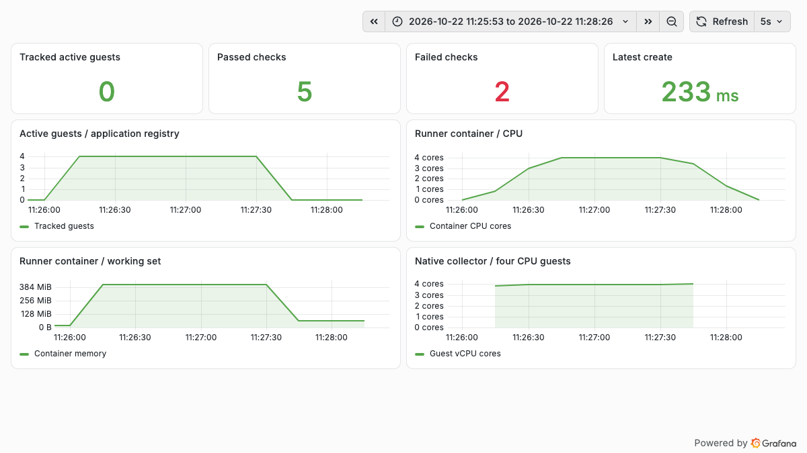
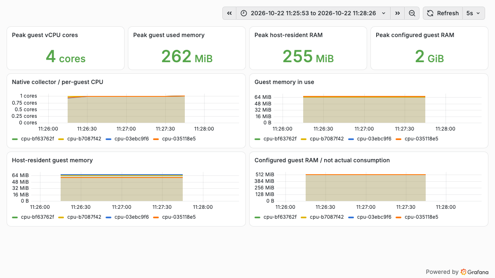

# Microsandbox Kubernetes 实战：代码执行、Live Fork 与内存快照恢复

一个 Agent 在执行生成的代码前，可以先创建独立环境，用完再销毁。更进一步，如果环境里已经装好了依赖、运行了一段程序，能不能复制当前状态供多个任务分支使用？承载应用的 Pod 重建以后，程序能否继续留在中断前的位置？

这次在一个已有 Kubernetes 测试集群里运行 **Microsandbox 0.7.8**，实测了代码执行、文件隔离、四个 microVM 并发、Live Fork，以及完整快照和磁盘快照的区别。最有价值的结果是：**重建承载 Pod 后，完整快照恢复出的服务保留了原来的内存随机值、计数器、进程 PID 和 guest boot ID。**

缓存 guest 镜像后的创建耗时中位数为 **241.0 ms**，已启动环境执行短 Python 的中位数为 **28.0 ms**。这些是单节点、固定配置的小样本结果；后文给出测量口径、失败记录和实际资源曲线。

文中的节点、仓库与环境标识已经脱敏。[配套代码、原始测量与监控时间序列](https://github.com/runzhliu/aik8s/tree/main/examples/microsandbox-kubernetes)可用于复现。

## 1. Microsandbox 是哪一层技术

Microsandbox 是面向代码执行的沙箱运行时。本文采用本地 Python SDK：应用通过 SDK 创建微型虚拟机（microVM），使用 OCI 镜像中的用户空间，在独立 guest 内核里执行命令。Linux 上通过 KVM（Kernel-based Virtual Machine，基于内核的虚拟机）提供硬件虚拟化，运行栈使用 libkrun。[固定版本源码](https://github.com/superradcompany/microsandbox/tree/v0.7.8)

它与普通容器的关键差别是内核边界。容器通常共享宿主内核；这里的 guest 使用自己的 Linux 内核。本轮宿主是 5.10 系列，guest 实际返回 `6.12.111`。这说明运行环境已经进入独立 guest，但几次功能检查并不等于完成了完整的安全评估。



Kubernetes 负责承载应用、选择节点、分配外层资源和挂载存储；SDK 负责创建 guest、执行命令、Fork、快照与销毁。一个 Pod 内可以启动多个 microVM，**它们不会自动成为多个 Kubernetes Pod，也不会逐个交给 kube-scheduler 调度**。

本次没有部署 Microsandbox 云端服务。下面展示的工作台是文章配套的 SDK 实验页，不是官方 Console；截至本次核对，官方托管云有自己的 Dashboard，不能把它的截图当作本地部署成功的证据。[官方 Cloud 文档](https://github.com/superradcompany/microsandbox/blob/v0.7.8/docs/cloud/overview.mdx)

## 2. 实际部署条件：普通 Pod 也能使用 KVM

| 项目 | 本轮配置 |
| --- | --- |
| Kubernetes / 容器运行时 | 1.30.4 / containerd 1.7.14 |
| 架构 / 宿主内核 | x86_64 / Linux 5.10 系列 |
| Microsandbox SDK、运行时、指标导出器 | 均固定为 0.7.8 |
| 单个 guest | 1 vCPU / 512 MiB |
| 承载容器 requests / limits | 1 CPU、2 GiB / 4 CPU、8 GiB |
| 数据盘 | 8 GiB PVC，实验使用节点本地存储 |
| 设备 | 通过已有设备插件分配 `/dev/kvm` |
| 容器权限 | `privileged: false`、`allowPrivilegeEscalation: false`、`RuntimeDefault` seccomp |
| 网络与宿主配置 | 普通 Pod 网络；未修改宿主网络、CNI 或 KVM 模块 |

官方 Docker 示例要求的是可用的 `/dev/kvm`，并不要求一律使用特权容器。本轮复用集群已有的 KubeVirt 设备插件，在 Pod 中申请 `devices.kubevirt.io/kvm: "1"`，同时获得设备访问与相应的设备控制组许可。[官方容器运行说明](https://docs.microsandbox.dev/how-to/docker/docker)

```yaml
securityContext:
  privileged: false
  allowPrivilegeEscalation: false
  seccompProfile:
    type: RuntimeDefault
resources:
  requests:
    cpu: "1"
    memory: 2Gi
    devices.kubevirt.io/kvm: "1"
  limits:
    cpu: "4"
    memory: 8Gi
    devices.kubevirt.io/kvm: "1"
```

`devices.kubevirt.io/kvm` 是设备插件提供的访问配额，不代表独占一块物理设备，也不代表 Pod 内可以无上限创建 guest。四个 guest 各配置 1 vCPU，仍然共同受外层容器 4 CPU 的限制。这里没有创建 KubeVirt 的虚拟机资源，已有虚拟机也没有参与快照实验。

先在最终 Pod 里运行 `msb doctor`，确认版本、KVM 设备和读写权限，再做实际启动。仅仅节点 CPU 支持虚拟化，还不足以证明容器能使用它。

## 3. 两层镜像缓存，以及这次遇到的拉取问题

承载 Pod 的镜像由 containerd 拉取，guest 镜像则由 Microsandbox 拉取或导入。**节点已经缓存了 Python 容器镜像，不代表 Microsandbox 的本地镜像库已经存在它。**

本轮承载镜像包含 Python 3.12、固定版本的 SDK、所需动态库，以及从相同 release 下载并校验 SHA-256 的 `msb-metrics`。官方 SDK wheel 自带匹配的 `msb` 与 libkrunfw，避免运行时版本混搭。

第一次直接拉内部仓库中的 guest 镜像失败。加入仓库证书后，Python HTTPS 请求能够访问仓库接口，但 SDK 的拉取仍报连接错误。仓库返回的认证挑战还包含一个 HTTP token 地址；目前没有足够证据把 SDK 失败单独归因于这个地址，不能直接称为运行时缺陷。

为继续验证执行能力，本轮改用官方支持的离线导入路径，保留失败记录：

```bash
docker pull --platform linux/amd64 python:3.12-slim
docker save -o guest.tar python:3.12-slim
sha256sum guest.tar

# Run inside the Microsandbox container, not another machine's image store.
msb load --input /data/guest.tar --tag python-lab:local
```

guest 使用既有 Python 3.12 slim 镜像的内网镜像副本；实际 OCI manifest digest 为 `sha256:2b4f19dae3a777dfc3b76730bda1e82e1f66ab2a2686fa93ca78edbfb4f04ffe`，归档哈希记录在配套数据中。复现时应记录自己所用镜像的 digest，因为浮动标签可能变化。后面的创建使用 `PullPolicy.NEVER`，因此启动计时不包含镜像下载。[官方本地镜像导入](https://github.com/superradcompany/microsandbox/blob/v0.7.8/docs/examples/docker/local-images.mdx)

## 4. 第一组验证：创建、执行、隔离与超时



*真实运行页面。两条失败来自首轮 managed job 与完整捕获的限制；后续修正单独记录，未覆盖失败结果。页面不是官方 Console。*

| 检查 | 请求与验收方式 | 实测结果 |
| --- | --- | --- |
| 缓存镜像后的创建 | 10 个新 guest，1 vCPU / 512 MiB，逐个执行 Python 校验 | 10/10；P50 241.0 ms，最小 227.0 ms，最大 340.8 ms |
| 已启动环境执行 | 在同一个 guest 内执行 20 次 `sum(range(101))` | 20/20 返回 5050；P50 28.0 ms，最小 27.4 ms，最大 52.0 ms |
| 内核与文件隔离 | 两个 guest 比较 boot ID；仅在 A 写文件，再从 B 检查 | boot ID 不同；B 不可见 A 的文件 |
| 文件回传 | 宿主 → guest → 宿主，比较 SHA-256 | 内容与哈希一致 |
| 执行期限 | 对 20 秒 sleep 设置 2 秒期限，再发探针命令 | 2.003 秒抛出 `ExecTimeoutError`；guest 仍可执行 |
| 并发任务 | 四个 guest，各运行 90 秒 SHA-256 循环 | 四个任务均完成，整体执行段 90.080 秒 |

创建耗时是客户端调用 `Sandbox.create()` 到返回的墙钟时间，包含本地初始化与 guest 就绪，不包括下一次 Python 执行。执行耗时从发出命令到读取退出结果。它们都不能直接拿来对比官网中采用另一计时口径的 boot 指标。

最小调用如下，完整实验脚本另外处理了时限、结果断言、失败记录和清理：

```python
import microsandbox as msb

sandbox = await msb.Sandbox.create(
    "example",
    image="python-lab:local",
    cpus=1,
    memory=512,
    pull_policy=msb.PullPolicy.NEVER,
    max_duration=180,
)
try:
    out = await sandbox.exec("python", ["-c", "print(sum(range(101)))"], timeout=10)
    assert out.exit_code == 0 and out.stdout_text.strip() == "5050"
finally:
    await sandbox.stop(timeout=15)
    await msb.Sandbox.remove("example")
```

## 5. Live Fork：复制正在运行的内存，再让两个分支分开走

为了区别于“重新执行脚本”，guest 内启动一个小 HTTP 服务：启动时生成随机 `nonce`，计数器初始化为 41；这些值仅存在 guest 服务的进程内存中，guest 源码和磁盘文件均不写入这个 nonce。客户端通过 guest loopback 读取状态，另存预期值用于断言，再执行 Fork。

```python
child = await source.fork("branch")
```

本次 Fork 用时 **572.1 ms**，完成了以下断言：

1. 源与子分支的 nonce、计数器、PID、boot ID 最初完全一致。
2. 只递增子分支后，源仍是 41，子分支变为 42。
3. 子分支创建的文件，在源实例中不可见，验证写时复制后的磁盘隔离。

这里的 PID 和 boot ID 相同是复制执行状态的预期结果，并不说明两个分支仍共享同一个持续变化的 Python 变量。第二条断言正是用来证明它们已经分开执行。

这种能力适合把依赖已加载的执行环境复制给多个搜索、修复或测试分支。复制本身不会让数据库写入、邮件发送和外部 API 调用自动获得分支隔离；副作用仍需要幂等键、事务或任务级补偿。

### 5.1 首轮为什么失败：活动 managed job 不能完整捕获

第一次通过 `exec_detached()` 运行服务，Fork 和完整快照都返回：

```text
full capture and fork are unavailable while managed jobs are active;
wait for or terminate those jobs first
```

核对 v0.7.8 的运行时控制路径后，可以看到这是明确的保护条件，并非 Kubernetes 或 KVM 不支持 Fork。[对应源码](https://github.com/superradcompany/microsandbox/blob/v0.7.8/crates/runtime/lib/runner/control/executor.rs)

修正后的实验通过一个短命令启动 guest 内的后台服务，命令完成后再捕获；后台 Python 服务继续留在 guest 中。这个变化解决了本轮实验的调用冲突，**不代表 v0.7.8 已支持任意活动 managed job 的透明续跑**。如果 Agent 本身依赖 managed job、终端会话或流式输出，应按实际任务模型再验证；不要仅凭本例就承诺所有长任务都能直接快照。

## 6. Pod 重建以后：恢复磁盘与恢复内存不是一回事

这次为同一个准备好的服务生成两份 `.msb` 归档：完整快照和仅磁盘快照。源 guest 随后停止并删除；再重建外层 Deployment Pod，核对新旧 Pod UID 确实不同，最后从 PVC 中的归档恢复。

```python
await msb.Snapshot.create_archive(
    "ready-full", "/data/ready-full.msb",
    from_sandbox="source", full=True,
)

restored = await msb.Sandbox.restore(
    "/data/ready-full.msb", name="restored", max_duration=300,
)
```

| 检查 | 完整快照 | 仅磁盘快照 |
| --- | --- | --- |
| 捕获耗时 | 2.196 秒 | 79.2 ms |
| 本轮归档大小 | 25,320,130 bytes | 861,184 bytes |
| 新 Pod 中的恢复耗时 | 809.4 ms | 286.8 ms |
| 测试文件 | 保留 | 保留 |
| 原 HTTP 服务 | 恢复后直接可访问 | 不在运行，需重新启动 |
| 仅存在 RAM 中的 nonce | 与原值一致 | 重新启动服务后变为新值 |
| guest boot ID | 与原值一致 | 已改变 |
| 进程 PID 与计数器 | 原 PID、原计数器 41 | 新服务初始化计数器 41；不能据此认为内存保留 |

两种恢复耗时仅指 `Sandbox.restore()` 调用，不包括 Kubernetes 重建 Pod 的时间；内存与文件断言在调用返回后完成。完整快照归档很小，与本轮 guest 实际使用内存较少、归档压缩有关，**不能据此估计一个装满 512 MiB 数据的任务仍只需要 25 MB**。

这轮结果证明，在相同节点、相同运行时、原 PVC 和原镜像缓存仍可用时，完整快照可以跨承载进程恢复 guest 执行状态。[官方快照语义](https://github.com/superradcompany/microsandbox/blob/v0.7.8/docs/sandboxes/snapshots.mdx)

它没有覆盖跨节点、CPU 型号变化、节点损坏或整套存储丢失的灾备。实验使用节点本地 PVC，也不会自动迁移到另一台节点。本文的“续跑”仅针对受控 guest 服务；远程连接、凭据有效期、外部服务状态和 Agent 调度记录仍需要上层恢复逻辑。

## 7. 四个 microVM 并发时，资源花在哪里



*真实监控。上层应用记录活跃 guest 数；外层容器指标来自该容器自己的 cgroup，包含 Python 应用与 VMM 进程。失败计数保留首轮的两条拒绝记录。*

四个 1 vCPU guest 在 90 秒 SHA-256 计算期间，承载容器 CPU 峰值为 **4.009 核**，工作集峰值约 **412.3 MiB**。CPU 使用来自 30 秒窗口的 `rate()`，工作集按容器内存用量减去非活跃文件缓存计算。4 CPU 外层限额与四个 CPU 密集任务的结果相符；这不是四份独立的 Kubernetes 资源配额。



*四个 `cpu-*` guest 的原生指标。每个 guest 的 CPU 接近 1 核；配置内存与真实消耗分开展示。*

官方 `msb-metrics` 读取与运行时相同用户、相同 `MSB_HOME` 下的共享内存注册表，再通过 OpenTelemetry Protocol（OTLP）HTTP 导出。本次直接接入已有 VictoriaMetrics 的 `/opentelemetry/v1/metrics`，另外只新增实验服务自身的抓取对象与 dashboard，没有改动现有采集配置。[官方指标说明](https://github.com/superradcompany/microsandbox/blob/v0.7.8/docs/observability/msb-metrics.mdx)、[VictoriaMetrics OTLP 接入](https://docs.victoriametrics.com/victoriametrics/integrations/opentelemetry/)

| 指标口径 | 四 guest 测试窗口内的聚合峰值 | 应如何解释 |
| --- | --- | --- |
| `microsandbox.cpu.utilization` | 4.000 | 单位是核当量；单个满负载 1 vCPU guest 约为 1，不是 1% |
| `microsandbox.memory.usage` | 261.6 MiB | guest 内实际使用内存，来自运行时报告 |
| `microsandbox.memory.host_resident` | 255.4 MiB | 宿主侧为 guest 驻留的内存，与 guest used 口径不同 |
| `microsandbox.memory.limit` | 2 GiB | 四个 guest 各 512 MiB 的配置总量，不是实际驻留量 |
| 承载容器工作集 | 412.3 MiB | 还包含应用和运行时等开销，不能等同于 guest 内存 |

原生指标名和标签保留了点号，查询时使用完整选择器，例如：

```promql
sum({__name__="microsandbox.cpu.utilization","sandbox.name"=~"cpu-.*"})
```

短命 guest 可能在下一次采样前已经退出；原生采集器默认还允许最近样本保留一段时间，查询端也有回看窗口。因此，图中的指标尾部不宜拿来精确判断实例销毁时刻，原生序列数量也不能直接当作正在运行的 guest 数。实例清理以 SDK 生命周期、最终清单和设备描述符检查为准。

## 8. 如何自己复现和查看

[配套目录](https://github.com/runzhliu/aik8s/tree/main/examples/microsandbox-kubernetes)包含 Dockerfile、Kubernetes 清单生成器、实验页、实验脚本、指标采集和 dashboard。镜像仓库、节点与存储类均通过参数提供，不包含内网端点或凭据。

```bash
python3 examples/microsandbox-kubernetes/render.py \
  --test-node kvm-worker \
  --image registry.example.org/lab/microsandbox:0.7.8 \
  --storage-class local-test \
  --otel-endpoint http://metrics-receiver:8428/opentelemetry/v1/metrics \
  --output .local/microsandbox-install

kubectl apply --dry-run=server -f .local/microsandbox-install/install.json
kubectl apply -f .local/microsandbox-install/install.json
kubectl -n microsandbox-lab port-forward svc/microsandbox-lab 18950:9118
```

用实际的 guest 镜像归档完成 `msb load` 后，浏览器访问 `http://127.0.0.1:18950/`，点击“运行实验”，或调用：

```bash
curl -X POST http://127.0.0.1:18950/api/suite
curl http://127.0.0.1:18950/api/state
```

`POST` 返回 202 只代表开始受理；要以 `/api/state` 内每项检查的结果为准。完整与磁盘快照准备完成后，再重建实验 Pod、重新建立 port-forward，调用 `/api/restore`。执行这一步前应确认快照准备成功，并且原 PVC 仍会挂载。

当前脚本按本轮 cgroup v1 环境采集外层容器资源；其他 cgroup 布局需要调整采样器，官方 guest 指标走独立的 OTLP 路径。工作台只用于受控实验，未经认证的任务触发入口不宜直接发布到公共网络。

## 9. 对 Agent 平台选型有什么帮助

Microsandbox 的本地 SDK 路径，适合需要由应用直接创建执行环境、希望验证进程内存复制与快照的团队。它可以成为工具执行层，但任务队列、多节点放置、租户配额、快照目录、权限与外部副作用管理，仍需要平台设计。

与 [BoxLite 实战](boxlite-kubernetes-practice.md) 放在一起看，两者都能以嵌入式 SDK 在单个 Kubernetes Pod 中使用 KVM。本文重点验证了 Microsandbox 的完整快照和 Live Fork；BoxLite 前文重点验证的是磁盘恢复，不能把两轮覆盖范围不同的测试当作某一方“不支持”另一项能力，也不能直接用不同版本、内核与权限配置下的耗时得出性能排名。

与 [OpenKruise Agents 实战](openkruise-agents-kubernetes-practice.md) 相比，后者在 Kubernetes 控制器、预热池和生命周期资源上提供了更直接的管理模型；如果需要把每个执行环境纳入集群原生治理，平台侧工作量也是选型的一部分。

本轮结束时，实验 guest 均已停止并移除，KVM 设备描述符归零；保留实验应用、镜像缓存、快照归档与证据，方便继续查看。本文验证的是可用的执行与恢复链路；多租户生产运行仍需补充资源密度、并发创建、存储增长、失败恢复和权限边界测试。
