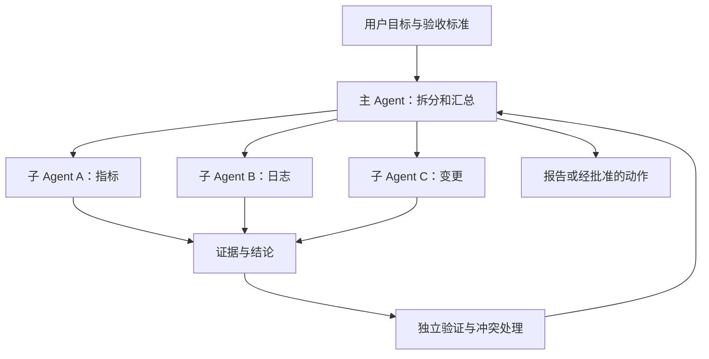
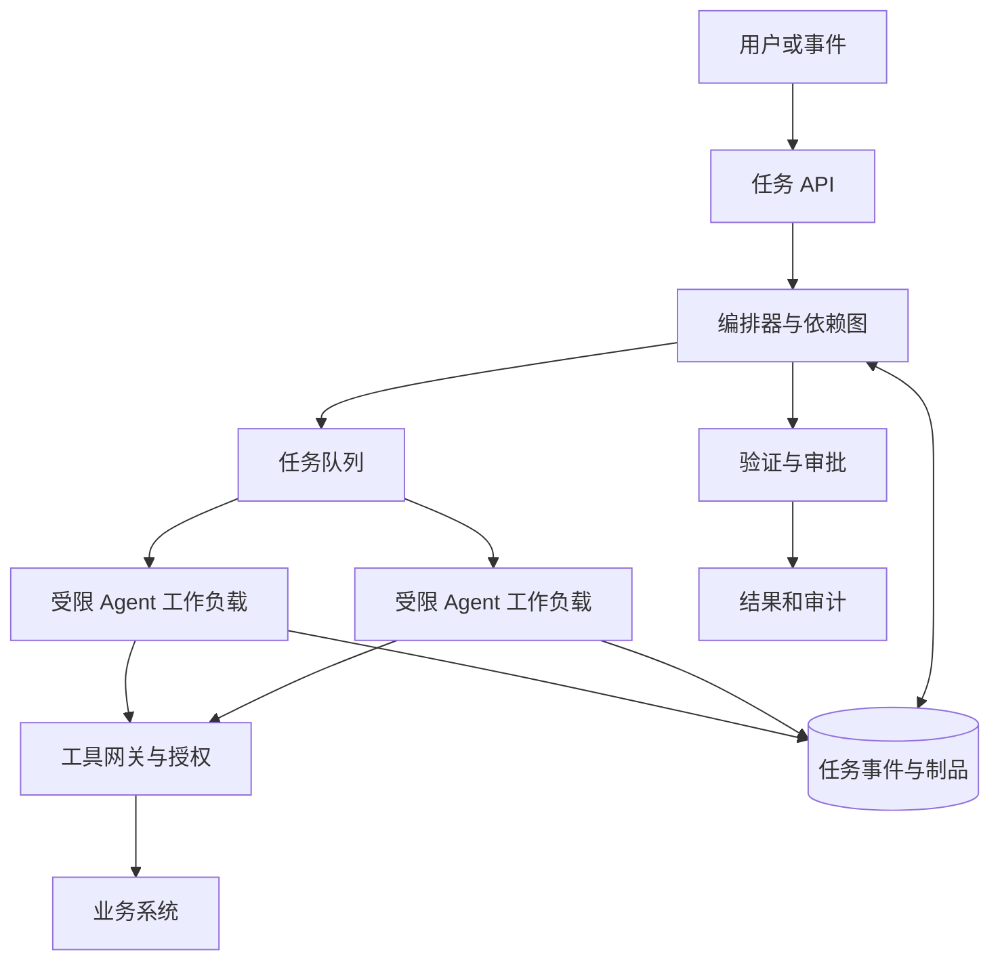

# 多 Agent 与子 Agent 协作综述：从并行分工到可治理的团队系统

让一个 Agent 完成复杂任务，往往需要搜索文档、阅读代码、查询指标、设计方案和验证结果。一个自然的想法是：让它像团队负责人一样，把这些工作交给多个子 Agent 并行处理。

这类能力已经进入编程助手、Agent SDK 和企业平台。但“多几个 Agent”不自动等于更快、更准确：它引入了任务分解、上下文传递、文件冲突、结果汇总、预算和恢复等新的系统问题。本文截至 **2026 年 11 月 4 日**，基于公开资料梳理原理、近期发展与落地方法；产品描述来自官方文档，研究结果来自具体实验，**本文没有对这些产品和论文做独立复现实测**。

## 一页结论

1. **子 Agent 是一段有独立任务和上下文的执行过程**，常由主 Agent 创建并汇报结果；它不一定是不同模型，也不一定有独立沙箱或独立机器。
2. **最适合并行的是边界清晰、依赖少的工作**：例如分别调查指标、日志和近期变更；同一文件的并行写入、严格顺序的事务则需要谨慎。
3. **协作方式比角色数量重要**：主从委派、控制权交接、固定工作流与平级通信各有适用范围；先明确谁做决策、谁能写入、结果如何验收。
4. **上下文隔离不是安全隔离**：独立对话不代表独立文件系统、凭据和网络权限。必须以运行时、身份和策略验证真实边界。
5. **最近研究支持有条件地使用多 Agent**：不同任务和团队结构可能改善结果，也可能以几倍成本换取提升，甚至因冲突让最终结果变差。
6. **生产环境应让代码管理状态、权限与副作用**，让模型负责理解和规划；以可恢复任务账本、预算、独立验证与人工审批形成闭环。

## 1. 什么是子 Agent

Agent 通常由模型、指令、工具、上下文和驱动循环组成。主 Agent 在处理用户任务时，可以创建一个有明确目标的子 Agent：它读取与任务相关的上下文，使用被允许的工具，形成结果，再返回给主 Agent。

这里的“主”和“子”是任务关系，不必对应组织架构或模型强弱。同一个模型创建多个独立会话也可以是多 Agent；一个 Agent 在循环中连续调用多个工具，则不一定构成多 Agent。不同产品对 Agent、Worker、Teammate 和 Subagent 的命名并不统一，应查看其上下文、工具、工作空间和生命周期。

| 经常混淆的概念 | 主要作用 | 不应默认推断 |
| --- | --- | --- |
| Skill | 按需提供说明、知识和操作流程 | 加载 Skill 必然新建 Agent |
| Tool / MCP | 让 Agent 访问外部能力、数据或操作 | 每次工具调用都是一个自主 Agent |
| 子 Agent | 给独立执行循环一个子任务并回传结果 | 它拥有独立操作系统或更低权限 |
| 多模型路由 | 为请求选择不同模型 | 每个模型都是持续协作的 Agent |
| 多会话并行 | 同时运行多个任务 | 它们必然知道彼此或能安全合并结果 |

## 2. 从产品和研究看近期发展

| 时间 | 公开进展 | 意义与边界 |
| --- | --- | --- |
| 2026 年 1 月 | Google Research 分析 180 种 Agent 配置 | 可并行任务与顺序任务对协作结构的需求不同，不能只比较 Agent 数量。[研究](https://research.google/blog/towards-a-science-of-scaling-agent-systems-when-and-why-agent-systems-work/) |
| 2026 年 4 月 | OpenAI 更新 Agents SDK，强调记忆、沙箱和编排 | 多 Agent 开始与工作区、上下文和恢复能力一起被产品化。[发布说明](https://developers.openai.com/api/docs/changelog) |
| 2026 年 8 月 | A2A 项目宣布加入 Agentic AI Foundation，并提到稳定版 1.0 | 跨框架、跨组织的 Agent 通信开始形成公共协议；协议不自动完成身份治理。[A2A 公告](https://a2a-protocol.org/latest/blog/2026/08/27/a-new-chapter-for-a2a-joining-the-agentic-ai-foundation/) |
| 2026 年 9 月 | OpenAI 发布 Agents API，提供托管会话和子 Agent 编排 | 应用可以使用托管运行时，同时仍须治理自己的工具和数据。[发布说明](https://developers.openai.com/api/docs/changelog) |
| 2026 年 10 月 | 两项编程 Agent 预印本分别研究团队成本与共享仓库协作冲突 | 多 Agent 的效果、成本与任务结构密切相关，研究数据不应外推为通用性能承诺。[成本研究](https://arxiv.org/abs/2610.17471) · [共享仓库研究](https://arxiv.org/abs/2611.00314) |

当前的发展不只是“Agent 可以互相聊天”，而是把委派、上下文压缩、任务状态、沙箱、权限与人工介入接入同一个运行环境。与此同时，跨厂商协议和可复现评测仍在演进。

## 3. 四种常见协作模式

| 模式 | 控制与数据流 | 适合 | 主要风险 |
| --- | --- | --- | --- |
| 主 Agent 委派 | 主 Agent 调用子任务并接收结果，最终负责汇总 | 并行研究、多个假设排查、代码审查 | 汇总遗漏、主 Agent 成为瓶颈 |
| 控制权交接（Handoff） | 当前 Agent 将后续对话或任务交给另一 Agent | 客服分诊、不同业务专家接管 | 丢失用户目标、权限与上下文 |
| 固定工作流 / 图 | 代码定义节点、依赖、并发、重试和汇合 | 审批、报表、受控发布 | 工作流设计成本，动态任务适应性有限 |
| 平级协作 / 团队 | 多个 Agent 可互相通信或认领任务 | 并行开发、复杂调查 | 消息噪声、重复劳动、冲突与失控成本 |

主 Agent 把专家当工具调用时，通常仍保留整体控制；交接则可能改变后续由谁响应用户。混合模式很常见：用确定性图控制关键步骤，在节点内让 Agent 自主探索。不能只看框架是否声称“支持多 Agent”，还要看它如何实现状态、汇合、超时和权限。[OpenAI 编排与交接](https://developers.openai.com/api/docs/guides/agents/orchestration) · [LangChain 多 Agent](https://docs.langchain.com/oss/python/langchain/multi-agent)

## 4. 主流产品与框架

| 产品或项目 | 定位与可用能力 | 选型时要问 |
| --- | --- | --- |
| Codex | 编程 Agent 可委派独立子任务并汇总；具体是否启用和并发受环境与配置约束 | 是否共享工作区？并发修改如何隔离？[官方文档](https://learn.chatgpt.com/docs/agent-configuration/subagents) |
| OpenAI Agents API | 托管会话与子 Agent 编排，提供创建、通信、等待和中断等能力 | 会话环境和工具凭据如何继承？事件能看到什么？[官方文档](https://developers.openai.com/api/docs/guides/agents-api/multi-agent) |
| Claude Code | 子 Agent 可配置工具和指令；Agent Teams 支持团队会话、任务与消息 | 实际版本是否支持团队模式？后台任务和权限如何配置？[子 Agent](https://code.claude.com/docs/en/sub-agents) · [团队](https://code.claude.com/docs/en/agent-teams) |
| OpenClaw | 多 Agent 路由为不同 Agent 配置工作区、身份及会话；也支持委派 | 工作区是否真的启用沙箱？跨会话与工具访问如何授权？[官方文档](https://github.com/openclaw/docs/blob/main/docs/concepts/multi-agent.md) |
| LangChain / LangGraph / Deep Agents | 提供子 Agent、交接、图工作流和上下文管理等不同构件 | 要选择自托管还是托管？状态持久化和运行时隔离由谁负责？[官方文档](https://docs.langchain.com/oss/python/langchain/multi-agent) |
| Microsoft Agent Framework | 提供顺序、并发、交接、群聊和管理者编排等模式 | 审批、状态持久化和执行环境由哪些组件提供？[官方文档](https://learn.microsoft.com/en-us/agent-framework/workflows/orchestrations/) |
| CrewAI | 使用 Crew 组织角色、任务及顺序或分层流程 | 如何定义任务、管理者权限与检查点？[官方文档](https://docs.crewai.com/en/concepts/crews) |
| Google ADK | 提供组合 Agent 与工作流等开发构件 | 需要固定编排还是动态交接？外部 Agent 如何认证？[官方文档](https://google.github.io/adk-docs/agents/multi-agents/) |
| A2A | 独立 Agent 间发现、任务与消息互操作协议 | 是否确实需要跨服务或跨组织？如何认证和限制对方能力？[规范](https://a2a-protocol.org/latest/) |

**SDK、用户产品、运行时和协议不是同一层的竞品。** 例如 Codex 是交互式编程产品；Agents API 是应用集成入口；LangGraph 是可编排运行图的框架；A2A 是 Agent 间协议。选型先确定交付形态，再比较这些层面的组合。

OpenAI 的 Agents API 文档举例说明：同一会话的主 Agent 和子 Agent 可以共享执行环境文件系统，子 Agent 还可能继承配置的 MCP 工具及凭据。因此不能因为对话上下文分开，就认为子任务已被隔离。[Agents API 多 Agent](https://developers.openai.com/api/docs/guides/agents-api/multi-agent)

Claude Code 的子 Agent 与 Agent Teams 是相关但不同的概念：前者适合把具体子任务交出去，后者面向多个会话之间更直接的协作。能力、可用性和具体限制随版本变化，以实际运行环境和官方文档为准。

## 5. 为什么更多 Agent 不一定更快

可把延迟近似理解为：

**总耗时** ≈ 拆分与调度 + 各并行子任务的最长耗时 + 等待依赖 + 汇总与验证。

**总成本** ≈ 各 Agent 的模型调用 + 工具调用 + 执行环境 + 重试与协调。

这是便于讨论的模型，不是精确计费公式。加并发可以缩短独立任务的关键路径，却无法消除最慢任务、共享限流或数据库瓶颈；上下文重复、消息传递、合并与重试还会增加成本。

2026 年 10 月的 [Scaling Inference-Time Compute with Teams of Coding Agents](https://arxiv.org/abs/2610.17471) 预印本在 ProgramBench 上发现，其多 Agent 团队优于单 Agent，但成本为后者约 **3–7 倍**；在该实验中，仅在规划阶段委派的配置可达到与全程委派相当的得分，而成本约减半。这是特定基准、模型与配置下的结果，不是所有任务的收益或成本倍数。

另一项 [ParallACT](https://arxiv.org/abs/2611.00314) 预印本研究共享代码仓库中的独立任务：即使每个任务单独看合理，接口不一致或需求冲突也可能让合并结果失败。论文在其特定冲突任务和模型设置下报告从 **62% 降至 16%** 的示例；它不代表所有 Agent 团队都会出现同样降幅。

实践上应先比较：单 Agent、单 Agent 并行工具调用、主 Agent 加少量只读子 Agent、分支隔离的并行写入。用同样的任务、验收标准和时间预算测量完成率、耗时、成本与回滚，而不是先定团队人数。

## 6. 上下文、工作区和通信

每个子任务至少需要：用户目标、当前问题、已知事实与来源、可用工具、允许操作范围、预期交付物、期限和停止条件。上下文过少会误解目标；完整复制所有历史则增加成本，还可能暴露不必要的信息。推荐传递**任务摘要 + 必要证据引用 + 约束**，让子 Agent 能按需读取原始材料。

结果不能只有“已完成”。建议包含结论、证据链接或文件、执行过的检查、未验证的假设、风险，以及下一步；主 Agent 对关键结论抽查原始证据，而不是把所有摘要直接拼接。

共享文件系统适合只读调查，但并行写入要提前设计：

1. 按目录或模块划分写入所有权；共享接口由主 Agent 或指定负责人管理。
2. 高冲突代码使用独立 Git 分支或 worktree，再按依赖顺序合并。
3. 合并后运行跨模块集成测试；分别通过单元测试不等于组合通过。
4. 外部系统写入使用幂等键、版本检查和审批；Git worktree 无法隔离共享数据库或线上 API。

对于跨服务的 Agent，MCP 主要连接工具和资源，A2A 主要提供 Agent 之间的任务和消息互操作；二者可组合使用，也不要求每个本地子 Agent 都使用 A2A。Agent Card 或服务发现解决的是如何找到对方，不等于已经验证其可信度和业务授权。[A2A 与 MCP](https://a2a-protocol.org/dev/topics/a2a-and-mcp/)

## 7. 面向 Kubernetes 管理者的示例

下面是一个**设计示例，不是生产实测**：用户要求分析某集群 API Server 错误率升高。主 Agent 建立统一观察窗口和集群身份后，委派三个只读任务。

| 角色 | 只读输入 | 期望输出 | 不能做的事 |
| --- | --- | --- | --- |
| 指标 Agent | API Server、etcd、节点指标 | 时间序列、异常窗口、查询口径和链接 | 修改监控配置 |
| 日志 Agent | API Server 与审计日志 | 错误类型、样本和时间分布 | 导出无关敏感日志 |
| 变更 Agent | 发布、配置和事件记录 | 同期变更列表与证据 | 回滚生产变更 |

主 Agent 将证据按时间关联，明确支持与反驳，生成待验证假设。确定修复后，独立验证器检查影响范围，变更平台执行身份与审批；人批准后，由已有运维系统执行。**模型能够提出修复，不等于它有权限直接执行修复。**

相关的执行环境、安全隔离与长期恢复可继续阅读 [Agent Harness](agent-harness-technology-overview.md)、[Agent 长任务中断续跑](agent-long-running-durable-execution.md)和 [Agent Sandbox 选型](agent-sandbox-selection.md)。

## 8. 生产架构：任务账本、预算和恢复

落地时至少明确以下责任：

- **任务账本**：保存任务 ID、父子关系、输入版本、依赖、状态、尝试次数、产物和完成条件；区分失败、超时、取消与未知结果。
- **可靠交付**：超时不代表外部动作没有执行。重试前查询目标系统回执，使用幂等键；状态恢复不能只依赖对话摘要。
- **权限**：为每个任务授予最小权限，区分只读、草稿与写操作；密钥由服务端注入且不写进提示词或结果。
- **资源**：设置总并发、子任务数、最大深度、Token / 金额预算、工具调用次数、期限和取消传播；为每个租户做配额和公平调度。
- **可观测性**：用 Trace 串联父子任务、模型与工具；记录排队、执行、汇合耗时和成本；审计记录敏感操作但避免保存不必要的明文。
- **验收与降级**：验证器独立检查制品和业务状态；部分失败时声明哪些已完成、哪些未执行，必要时降级为单 Agent 或人工处理。

Kubernetes 可以提供调度、网络策略、服务账号和运行时隔离，但 Pod 数量不等于 Agent 数量，也不能自动实现任务恢复、幂等或权限正确；实际安全边界仍取决于运行时、凭据、网络、共享存储与外部系统的设计。

## 9. 如何评估与分阶段引入

先做具有真实价值但低风险的只读任务，再引入受控写操作。准备固定任务集，至少包含可并行任务、顺序依赖任务、相互冲突的写入、工具失败、超时与恢复；各方案使用相同输入、验收器和预算。

| 指标 | 需要回答的问题 |
| --- | --- |
| 端到端成功率 | 最终交付是否满足业务验收，而不只是子任务都结束？ |
| 总耗时与关键路径 | 是否真的比单 Agent 更快？排队和汇总花了多久？ |
| 总成本 | 模型、工具、执行环境和失败重试各花多少？ |
| 依赖与冲突 | 接口是否匹配，合并后测试是否通过，有多少返工？ |
| 恢复与安全 | 重试是否重复执行副作用？是否出现越权或泄漏？ |
| 人工介入 | 审核、追问和修复占用了多少时间？ |

[AsynCodeBench](https://arxiv.org/abs/2609.32662) 等研究开始把跨 Agent 依赖是否得到满足也作为评价对象。它提示我们：任务最终成功率是必要指标，但还应观察协作过程中的依赖与等待，才能找到瓶颈。

建议引入顺序：**单 Agent 基线 → 两到三个并行只读子任务 → 受控写入与独立验证 → 需要时再考虑跨团队 A2A**。每一步都保留回退路径；确实能证明质量、时间或人工成本收益，再扩大使用范围。

## 参考资料

- [OpenAI：Codex 子 Agent](https://learn.chatgpt.com/docs/agent-configuration/subagents)；[Agents API 多 Agent](https://developers.openai.com/api/docs/guides/agents-api/multi-agent)
- [Claude Code：子 Agent](https://code.claude.com/docs/en/sub-agents)；[Agent Teams](https://code.claude.com/docs/en/agent-teams)
- [OpenClaw 多 Agent 路由](https://github.com/openclaw/docs/blob/main/docs/concepts/multi-agent.md)；[LangChain 多 Agent](https://docs.langchain.com/oss/python/langchain/multi-agent)；[Google ADK 多 Agent](https://google.github.io/adk-docs/agents/multi-agents/)
- [A2A 协议](https://a2a-protocol.org/latest/)；[Google Research：Agent 系统扩展](https://research.google/blog/towards-a-science-of-scaling-agent-systems-when-and-why-agent-systems-work/)
- [Scaling Inference-Time Compute with Teams of Coding Agents](https://arxiv.org/abs/2610.17471)；[ParallACT](https://arxiv.org/abs/2611.00314)；[AsynCodeBench](https://arxiv.org/abs/2609.32662)
