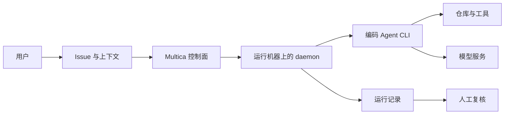
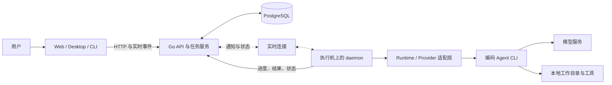
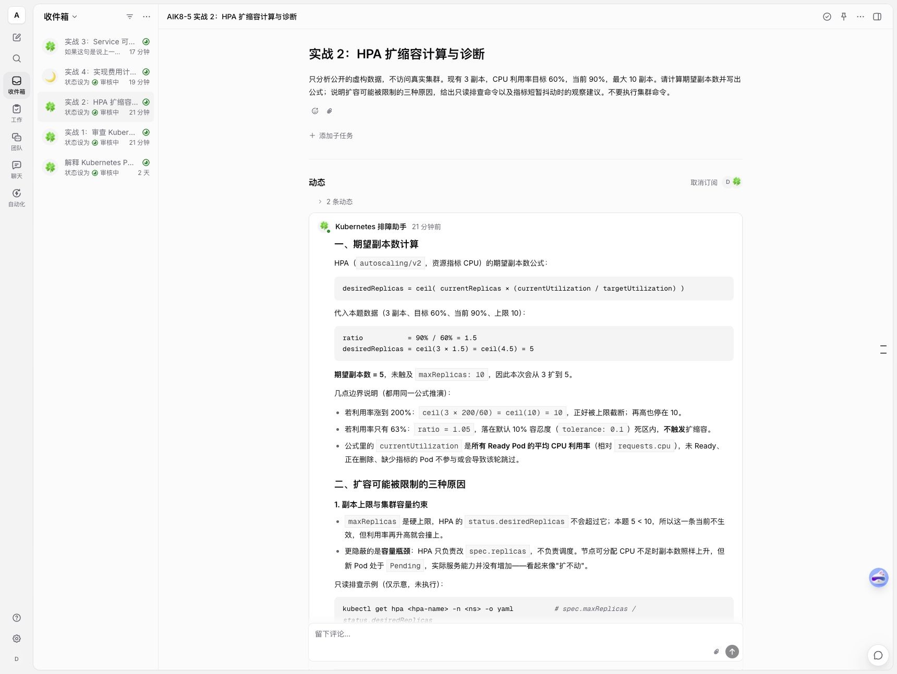
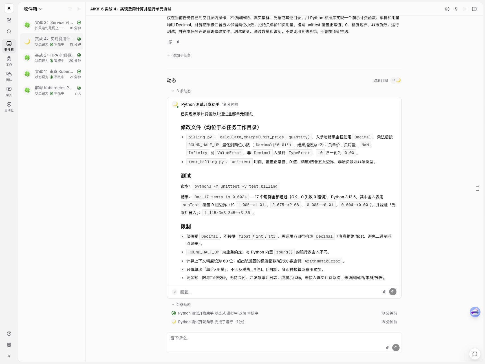
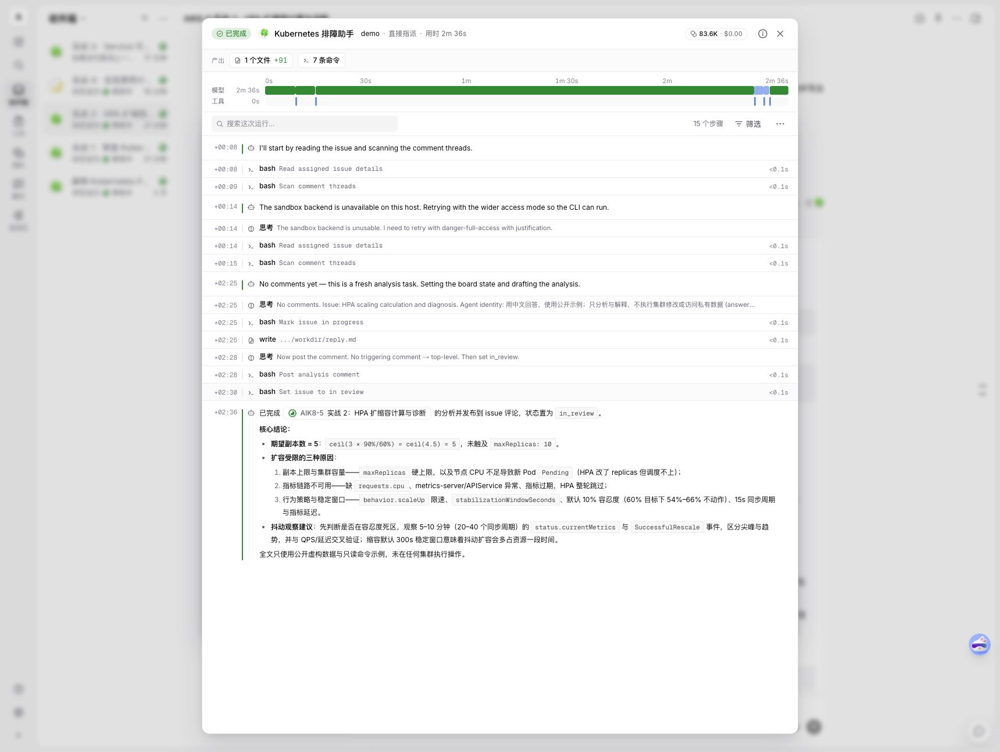

# Multica 调研：把编码 Agent 接入团队任务系统

当团队同时使用 Codex、Claude Code 和其他编码工具时，问题不只是模型能不能写代码：谁接了任务、使用了什么环境、执行到哪里、结果由谁审核，也需要被管理。Multica 尝试把这些环节接入一个共享工作空间，让人和 Agent 围绕 Issue 协作。

<strong>Multica 的核心是任务与执行管理，而非新的大模型或替代所有编码工具的运行时。</strong>它连接用户自己部署并认证的 Agent CLI，把任务派给对应机器上的 daemon，再将进度和结果关联到工作空间。本篇结合公开资料与一次 Kubernetes 测试集群实操；测试为功能验证，不是性能或高可用评测。[项目仓库](https://github.com/multica-ai/multica) · [项目网站](https://multica.ai/)

本文核对的是仓库 `main` 在 2026-11-06 的快照 [`994d6977aa03`](https://github.com/multica-ai/multica/tree/994d6977aa03ef69a4c4307819d692d53d71986c)。项目变化较快，功能、版本和许可应以实际部署版本为准。

## 1. 一次任务是如何流转的

以一个修复 Bug 的任务为例：

1. 用户在工作空间创建 Issue，填写问题、验收条件和仓库上下文，并指派给 Agent。
2. Multica 为这次触发创建运行记录；关联的在线 runtime 接收任务。
3. runtime 上的 daemon 启动已安装并认证的编码 CLI。CLI 使用模型、工具和本地工作环境执行任务。
4. 执行过程和结果回到任务上下文，人查看记录、差异与测试结果，再决定是否接受。



这张图是根据项目文档整理的逻辑示意，不代表每一步都在独立进程或网络调用中完成。Agent 定义了身份、指令、能力和配置；runtime 决定在哪台机器及使用什么工具执行；run 记录一次执行。Agent 并非必须始终运行，runtime 离线时身份和历史可保留，但新任务需要等待可用执行环境。[Agent 概念](https://github.com/multica-ai/multica/blob/main/apps/docs/content/docs/agents.mdx)

### 1.1 架构分层：控制任务与执行任务

以下架构以本次部署的 v0.8.0 源码快照 `9b1ab4f9` 为依据。下图按该版本梳理，箭头表示逻辑连接，不代表所有数据都只沿一个方向流动。Web、桌面端和 CLI 是入口；后端负责协作数据、授权和任务管理；daemon 则部署在真正执行工作的机器上。本次实操将 daemon 放在测试集群的独立 Pod 中，它也可以运行在开发机或其他服务器上。[项目架构源码](https://github.com/multica-ai/multica/blob/9b1ab4f9eed9153a94719596eb8a728d2770f065/apps/docs/content/docs/developers/architecture.mdx)



| 层次 | 主要职责 | 要注意什么 |
| --- | --- | --- |
| 客户端 | 展示 Issue、Agent、运行状态与日志，接收用户操作 | 实时页面是状态视图，不能代替服务端持久化结果 |
| Go 后端 | 认证和工作空间授权、维护任务与协作数据、通知运行时 | 内部实现中的 `task` 对应产品界面的 Run；一个 Issue 可产生多个 Run |
| PostgreSQL | 保存协作与任务等业务数据 | 是业务状态的事实来源；实时消息丢失后需要重新查询状态 |
| daemon 与 runtime | daemon 注册可用环境、领取任务、准备目录、启动工具并回传结果；runtime 描述工作空间中的具体执行环境 | 一个 daemon 可对应多个 runtime；runtime 与 Agent、Run 不是同一个概念 |
| Provider 与模型 | 适配不同编码 CLI 的启动、输出、取消与用量；CLI 再调用其模型与工具 | Multica 并非模型本身，实际协议和恢复能力随适配器而变化 |

源码中的后端请求一般经过 `router → middleware → handler → service → sqlc query → PostgreSQL`；`internal/realtime/` 面向用户界面推送变化，`internal/daemonws/` 面向 daemon 唤醒及远程调用。两条 WebSocket 路径用途不同，WebSocket 是降低延迟的通知通道，不应当作唯一可靠的任务数据库。Redis 在该架构中可选，用于跨实例实时事件、缓存或临时协调；多副本部署仍需逐项验证一致性与故障恢复。[架构文档](https://github.com/multica-ai/multica/blob/9b1ab4f9eed9153a94719596eb8a728d2770f065/apps/docs/content/docs/developers/architecture.mdx)

### 1.2 一次 Run 在内部怎样执行

1. 用户指派 Issue、在评论中提及 Agent、发送聊天消息或由自动化触发；Issue 保存长期目标和讨论，一次触发创建一条 Run 记录。
2. 后端的 `TaskService` 创建排队任务并通知目标 runtime。daemon 通过接口领取；实时唤醒之外还有周期性轮询，作为通知遗漏或连接中断时的补救路径。
3. 服务端签发与任务及 Agent 绑定的临时凭据；daemon 准备工作目录，通过 provider 适配层启动已安装的编码 CLI。CLI 使用其配置调用模型和工具。
4. daemon 回传运行状态、消息和工具事件；服务端更新任务和 Issue，界面收到实时事件后刷新。执行结束后，用户仍需检查日志、文件和测试，而不是只看 `completed`。

这解释了图中三个边界：<strong>队列与状态由服务端管理，命令由执行环境运行，模型推理由所选模型服务完成。</strong> 任务目录隔开文件布局，不自动等于安全沙箱。本次截图中出现沙箱后端不可用、随后采用更宽权限重试，正是需要单独核验运行时权限的例子。[Run 生命周期](https://github.com/multica-ai/multica/blob/9b1ab4f9eed9153a94719596eb8a728d2770f065/apps/docs/content/docs/tasks.mdx)

### 1.3 排队、并发和故障恢复

一条 Run 可能经历 `queued`、`dispatched`、`running`，最终进入 `completed`、`failed` 或 `cancelled`；目标本地目录被占用时还可能处于 `waiting_local_directory`。状态是一次执行的结果，Issue 的状态是工作流状态，二者不能混为一谈。修改 Issue 的负责人或状态也不会自动停止已经启动的 Run，需要在执行记录中主动停止。[Run 生命周期](https://github.com/multica-ai/multica/blob/9b1ab4f9eed9153a94719596eb8a728d2770f065/apps/docs/content/docs/tasks.mdx)

在该快照的官方说明中，daemon 默认每 15 秒心跳一次，服务端结合心跳和连接状态判断在线情况。离线时，已经排队的任务等待指定 runtime 恢复，不会因此自动换到另一台机器；超出重连宽限期等条件后才可能失败，符合条件的故障可触发重试。恢复或重试意味着新的执行尝试，<strong>不保证外部写入恰好一次，也不等于从任意一行代码无损续跑</strong>。应让发布、写数据库等副作用具备幂等性，并在测试环境验证取消与恢复。

同一快照说明 daemon 默认最多并发 20 个 Run，每个 Agent 默认最多 6 个；实际受两者较小值及配置、资源、目录锁等限制。这是产品默认配置，不是性能指标；本次只观察到少量任务时间重叠，尚未做容量、故障注入或高可用测试。[daemon 与 runtime](https://github.com/multica-ai/multica/blob/9b1ab4f9eed9153a94719596eb8a728d2770f065/apps/docs/content/docs/daemon-runtimes.mdx)

### 1.4 数据和权限在哪里

按官方说明，CLI 的本地登录凭据和代码目录保留在执行机，服务端不会自动上传整个工作目录；但任务上下文、日志、评论及 Agent 写回的结果可能包含代码片段，因此仍需考虑脱敏与保留期。Agent 自定义环境变量和 MCP 配置会保存在服务端，不能把“本地执行”理解成所有秘密都只在本机。[daemon 与 runtime](https://github.com/multica-ai/multica/blob/9b1ab4f9eed9153a94719596eb8a728d2770f065/apps/docs/content/docs/daemon-runtimes.mdx)

任务凭据可通过进程环境提供给 CLI，子进程默认可能继承；权限评估要覆盖执行用户、文件、网络、模型凭据和子进程，而不仅是 Multica 工作空间权限。生产方案应使用专用身份和隔离执行环境、控制网络和密钥、制定日志留存，并对有外部副作用的操作设置审核。


## 2. 它提供了哪些能力

| 能力 | 作用 | 应如何理解 |
| --- | --- | --- |
| Issue 与项目 | 将任务、上下文和责任人放在同一处 | 是协作入口，验收条件仍需人编写 |
| Agent 与 Skills | 保存身份、指令和可复用方法 | 配置可复用，不等于模型自动获得正确知识 |
| Runtime 与 daemon | 将任务交给指定机器上的编码 CLI | 真正的执行权限和网络访问发生在运行机器上 |
| Runs 与执行日志 | 查看工具调用、命令、错误和结果 | 需要检查日志是否包含敏感内容以及保留期限 |
| 多 Agent 团队 | 通过团队与分工组织协作 | 并行效果、冲突处理和成本需要实测 |
| 定时任务与消息 | 通过定时触发或工作空间消息发起工作 | 定时执行也需要权限边界和结果审核 |

项目列举了 Codex、Claude Code、OpenCode、Kimi 等 CLI；实际可用能力、认证、模型和版本取决于对应 CLI。README 还描述了运行中的消息引导，但并非每个 provider 都支持，不能把不同适配器的能力视为一致。[项目 README](https://github.com/multica-ai/multica/blob/main/README.md)

## 3. DeepSeek Harness 怎么接入

Multica 组织维护了独立的 [DSH runtime 接入项目](https://github.com/multica-ai/dsh-multica-runtime)。其 README 描述了基于标准输入输出的 JSONL 协议、工具事件、取消和会话恢复等能力；它需要单独安装匹配版本的 DSH 和 runtime profile。

这意味着 Multica 不直接“内置一个 DeepSeek 模型”：它通过适配层启动 DeepSeek Harness，再由 Harness 使用配置好的模型凭据。README 所列兼容范围与预发布版本会变化；<strong>支持会话恢复也不等于所有工具副作用都能自动回滚或精确续跑</strong>，断点和重复执行需要针对实际任务验证。

## 4. 自托管与 Kubernetes

官方自托管方案包含 Web、后端和 PostgreSQL；执行 Agent 的机器还需要运行 CLI 与 daemon，二者可以是同一台机器，也可以分开。仓库提供 Docker Compose、镜像和 Helm Chart，故可以评估在 Kubernetes 部署控制面；这不意味着每次任务天然是一个独立 Pod。[自托管指南](https://github.com/multica-ai/multica/blob/main/SELF_HOSTING.md) · [Helm Chart](https://github.com/multica-ai/multica/tree/main/deploy/helm/multica)

一个小规模验证可以按以下顺序准备：

1. 在测试环境部署 Web、API 和 PostgreSQL，固定版本并配置持久化、备份和健康检查。
2. 准备独立、低权限的执行环境，安装 Multica CLI、daemon 及一种已认证的编码 CLI。
3. 用测试仓库创建 Issue，要求 Agent 修改一个小问题并运行测试，人审核结果。
4. 验证 runtime 离线、任务失败重试、并发冲突、执行日志和凭据隔离，再考虑团队使用。

官方 Compose 示例默认绑定本机，跨机器访问需要规划 HTTPS 和反向代理；身份认证、入口、WebSocket、数据库备份及升级回滚都需要根据环境验证。[Compose 配置](https://github.com/multica-ai/multica/blob/main/docker-compose.selfhost.yml) · [自托管快速开始](https://github.com/multica-ai/multica/blob/main/apps/docs/content/docs/self-host-quickstart.mdx)

### 4.1 测试集群实操：从部署到完成一次任务

这次在独立测试命名空间部署了官方 <strong>v0.8.0</strong> Helm Chart（Chart 与应用来自该版本发布），由前端、后端与 PostgreSQL 组成；数据库和上传目录分别使用 5 GiB 持久卷。前端通过本机端口转发访问，没有创建对外 Ingress。公开文档中的工作空间、账户和任务均为测试数据，未展示内部地址与凭据。

| 项目 | 本次配置或观察 |
| --- | --- |
| Kubernetes | 测试集群 v1.30.4；各组件运行在独立命名空间 |
| 应用与存储 | Multica v0.8.0；Web、后端与 PostgreSQL 均就绪；持久卷已绑定 |
| Agent 运行时 | 独立 Pod 中运行 Multica CLI 0.8.0 和 DeepSeek Harness 0.2.2-alpha.2；不自动挂载 Kubernetes ServiceAccount Token |
| DSH 接入 | 在运行时 Pod 构建并安装独立 DSH runtime 插件 0.2.0-private.1；协议探测返回版本 1 |
| 模型 | 通过单独的办公机桥接调用已有模型服务；办公机和桥接进程必须在线 |
| 测试任务 | 解释 Pod Pending 的三个常见调度原因并给出只读排查命令，不访问或修改真实集群 |

操作顺序是：用 Helm 安装控制面并等待 Pod 和持久卷就绪；启动独立运行时 Pod，安装 CLI、DSH 和桥接插件；用测试账户认证并连接 runtime；在网页创建智能体，提交任务并查看运行记录。以下结果来自这次真实操作。

在官方 v0.8.0 源码的根目录准备符合环境要求的 `values.yaml` 后，可参考下面的控制面安装和本机访问命令。密钥、镜像仓库及存储参数应按环境配置，完整参数见[官方 Chart](https://github.com/multica-ai/multica/tree/v0.8.0/deploy/helm/multica)。

```bash
helm upgrade --install multica ./deploy/helm/multica \
  --namespace multica-lab --create-namespace --values values.yaml
kubectl -n multica-lab get pods,pvc
kubectl -n multica-lab port-forward svc/multica-frontend 19888:3000
```

运行时需在单独 Pod 内安装受支持的 CLI、构建 DSH 插件并配置模型，使用 `multica login --token=` 交互式认证后启动 daemon；不要将真实 Token 写入命令行、镜像或公开 values。应用识别到一个在线运行时。首次任务的执行记录显示完成、约 1 分 35 秒及命令与模型调用步骤；这是单次功能演示，不是性能基准。页面显示的费用未与实际账单核对，不作为费用结论。

这次任务确实走通了“页面指派 → 集群内 daemon 领取 → DSH 调用模型和工具 → 回复任务”的链路，执行记录显示完成并有 15 个步骤。但<strong>模型的首段回答不准确</strong>：`Pending` 既可能在调度前，也可能发生在已绑定节点后、容器尚未准备好时，例如镜像拉取阶段；不能仅凭 `Pending` 认定 Pod 尚未绑定节点。[Kubernetes Pod 生命周期](https://kubernetes.io/docs/concepts/workloads/pods/pod-lifecycle/#pod-phase) 建议结合 `PodScheduled`、节点字段、容器状态和事件判断。这个结果同时证明：有完整任务轨迹并不代表答案正确，仍需要人工审核。

<strong>本次边界：</strong>没有验证真实代码仓库变更、Agent 协同、失败恢复、高可用或负载性能。实验运行时以临时 Pod 和容器内临时文件方式搭建；Pod 重建后需重新配置，不能当作可恢复的生产部署。虽未自动挂载集群令牌且未授予额外 Kubernetes 角色，测试并未验证网络隔离或构成完整安全沙箱；DSH 的本地命令工具仍可执行。正式部署需要专用身份、密钥管理、持久化、网络限制、资源配额和运行时恢复机制。示例模型桥接依赖办公机在线，不代表生产推荐架构。

### 4.2 四个补充实战：从分析到执行测试

2026-11-09，在同一测试环境中使用了两个 Agent：Kubernetes 排障助手和 Python 测试开发助手，分别处理虚构的运维问题和本地代码任务。任务通过 Multica 指派给运行时；下面的运行时间是单次记录，仅用于说明任务过程，不代表产品或模型性能。三项分析任务没有连接真实集群，代码任务在运行时的任务目录中执行。

| 案例 | 输入与验收目标 | 实际结果 | 单次运行 |
| --- | --- | --- | --- |
| 应用配置审查 | 审查缺少探针与资源配置、使用 `latest`、Service 标签不匹配的虚构配置 | 给出问题优先级、Deployment/Service 修改示例和验证建议；示例未部署 | 4 分 15 秒 |
| Service 故障诊断 | Pod Ready、DNS 可解析，但 Service selector 为 `app=api`、Pod 标签为 `app=web` | 识别选择器不匹配，建议检查 EndpointSlice；其他网络原因仍需实际验证 | 4 分 32 秒 |
| HPA 扩容计算 | 当前 3 副本、CPU 利用率 90%、目标 60%、上限 10 | 计算 `ceil(3 × 90 / 60) = 5`；同时列出指标、容量和行为策略等检查项 | 2 分 36 秒 |
| Python 代码与测试 | 新建费用计算函数，使用 `Decimal`，覆盖舍入、零值和非法输入 | 实际生成代码与测试；Agent 报告 17 项通过，随后在同一任务目录独立复跑，17 项通过 | 3 分 19 秒 |



*图：桌面界面中，左侧是实战任务列表，右侧展示 HPA 虚构输入和 Agent 的计算。截图保留原始模型回答；实际伸缩仍需考虑指标和策略等条件。*



*图：Python Agent 回报生成的文件、测试命令与 17 项通过结果。我们另在任务目录复跑测试；这不是对真实计费系统的验证。*



*图：HPA 任务的实际执行轨迹展示模型与工具步骤。记录中显示沙箱后端不可用后采用更宽权限重试，说明本次环境不具备完整的执行沙箱；页面费用未与账单核对。*

<strong>操作方式：</strong>先创建 Agent 并指定在线运行时；创建 Issue 时写清任务输入、验收标准和不应访问的资源，再指派给 Agent。执行结束后，在任务的“动态”和“执行日志”中查看结果与工具调用；代码任务还应查看实际文件并独立运行测试。这四个任务均进入“审核中”，不代表答案已经通过人工验收。

Service 案例有一个值得复核的细节：模型正确指出 selector 与标签不匹配，但对 NetworkPolicy 作用位置、超时与拒绝连接的对应关系说得过于绝对。不同 CNI、代理模式、规则和客户端路径可能产生不同表现，不能仅凭该示例排除策略或认定另一问题的概率。配置审查中对问题的 P0/P1 分级也是模型建议，需结合业务影响、变更风险和实际环境复核。

HPA 示例是理想化计算：假设指标有效、所有相关 Pod 的指标完整，且暂不考虑容忍区间、伸缩策略及其他指标；真实结果以控制器实际状态为准。代码案例创建的是新文件，未修改已有仓库或提交 PR，17 项通过也不代表覆盖所有业务边界。Kubernetes 问题均为静态推演，未实际制造故障或应用修复。

从运行记录看，HPA 和 Service 两项任务都在 01:46:16 UTC 开始，且运行区间重叠；Python 任务由另一 Agent 接收。这只能说明本次出现了重叠执行，<strong>不能证明 Agent 之间发生了协作</strong>，也不能推断系统的并发上限或可靠性。


## 5. 安全边界和许可

最重要的边界在 <strong>daemon 所在的机器和操作系统用户</strong>。官方安全模型说明，默认运行可以访问该用户可访问的文件、凭据和网络；不要假定 Multica 已经为每次运行提供文件系统沙箱。运行未知任务前应使用专用身份、隔离环境、最小凭据和可控的出站网络。工作区权限与提示词不应代替操作系统隔离。[官方安全模型](https://github.com/multica-ai/multica/blob/main/apps/docs/content/docs/security-model.mdx)

自托管后端的部署级匿名遥测默认启用；官方说明可通过 `DO_NOT_TRACK=1` 关闭。企业评估应核对目标版本的具体数据、网络策略和其他遥测设置，而不是假设自托管天然没有出站流量。[自托管指南](https://github.com/multica-ai/multica/blob/main/SELF_HOSTING.md)

仓库使用 <strong>Multica License</strong>，包含 Apache License 2.0 文本及针对托管服务、商业嵌入和品牌的附加条件；不能将其直接标为纯 Apache 2.0。内部自用、对外提供服务或集成到商业产品的适用条件，应阅读对应版本的 [LICENSE](https://github.com/multica-ai/multica/blob/main/LICENSE) 并由负责许可的人员确认。

## 6. 与此前 Super-agent Demo 的关系

此前的 [DeepSeek Super-agent Kubernetes Demo](deepseek-superagent-kubernetes-practice.md) 用聊天、Git 服务和 Agent 适配器串起任务、代码与人工审核，是为了理解团队协作链路而搭建的演示。Multica 则是独立项目，提供工作空间、Issue、Agent、运行时及执行记录等产品组件。

| 比较项 | Multica | 此前的 Super-agent Demo |
| --- | --- | --- |
| 目标 | 管理人和多个编码 Agent 的团队工作流 | 验证聊天发任务、改代码、测试和交付 |
| 任务入口 | 工作空间 Issue、消息及其他触发方式 | 演示中的聊天入口和任务桥接 |
| 执行 | daemon 启动不同 Agent CLI | 演示适配器调用所配置的 Agent |
| Git 集成 | 以目标版本支持的集成为准 | 演示中为所选 Git 服务实现适配 |
| 结论 | 提供可供评估的现成工作空间 | 证明特定演示链路，不代表完整产品 |

两者都需要核验身份、仓库权限、执行隔离和人工审核。这里没有进行同条件性能对比，也不能推断哪个平台更可靠。

## 7. 适合什么场景，如何评估

适合先从明确边界的开发任务试起，例如依赖升级、测试补充、文档修正和可复现的缺陷修复；多 Agent 协作则需要增加分支冲突、资源竞争和交接质量测试。对于生产变更，建议将 Agent 结果作为待审核的候选，合并和发布交给既有审批与持续集成流程。

建议记录五类验收结果：任务完成率与人工返工、执行时间与模型成本、任务与日志可追溯性、离线或重启后的恢复表现、权限与数据隔离。<strong>先验证一条任务从指派到审核的完整链路，再逐步扩大自动化范围。</strong>
