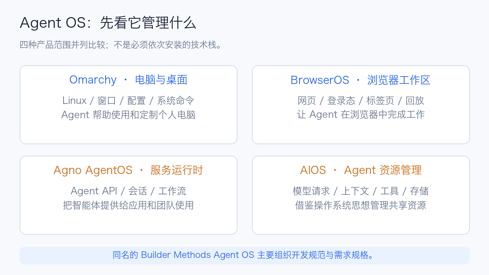
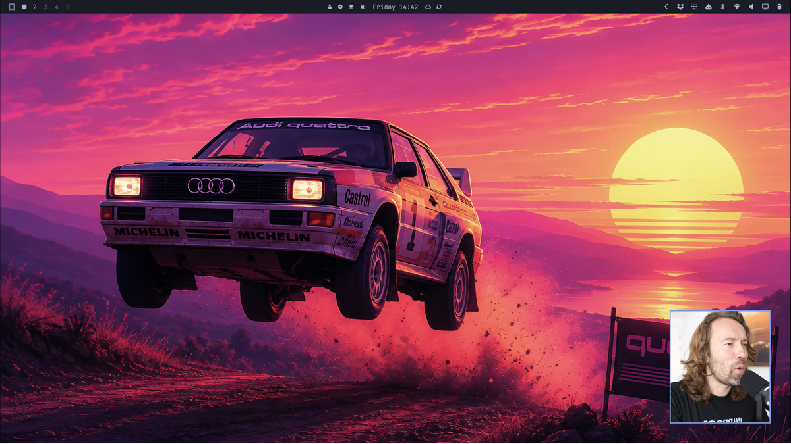
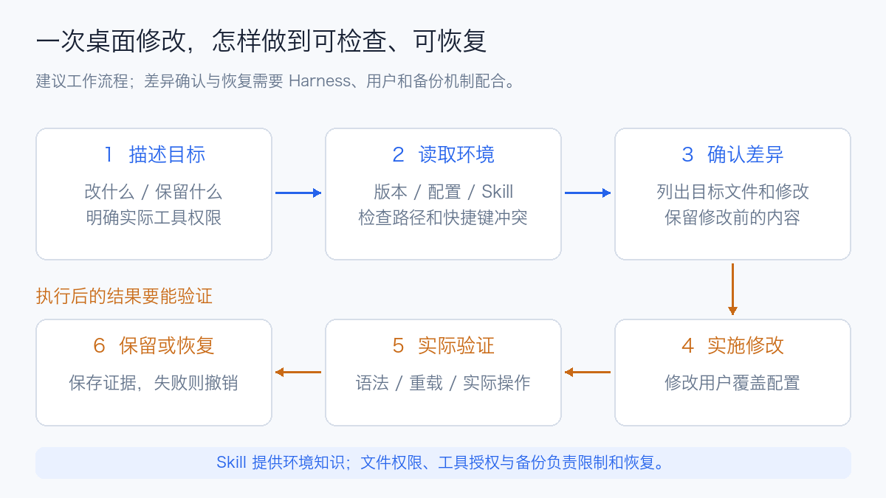
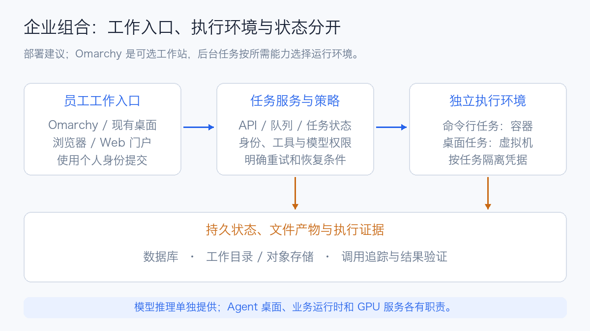

# Omarchy Linux 与 Agent OS 综述：桌面系统、智能体运行时与企业落地

过去调整 Linux 桌面，通常要先找配置文件、查语法、修改参数，再重载窗口管理器。现在可以直接描述：“把这个快捷键改成打开我的笔记，保留其他绑定”，由 Agent 查找配置、生成修改并检查结果。应用崩溃后，也可以把日志和调用栈交给 Agent 辅助分析。

**Omarchy 把这种工作方式接进了 Linux 桌面。** 它由 David Heinemeier Hansson（DHH）发起，以 Arch Linux 为基础，把桌面、开发工具、系统命令和 Agent 的使用习惯整合起来。当前官网明确强调系统可以由 Agent 帮助理解、排障和定制。[Omarchy 官网](https://omarchy.org/)、[官方仓库](https://github.com/omacom/omarchy)

不过，“Agent OS”还被用来描述智能体服务框架、浏览器和开发规范系统。选择这类产品，首先要看它接管的是哪部分工作。

本文核查于 **2026 年 10 月 16 日**。Omarchy 发行信息以 **4.0.4** 为准，命令与配置机制同时对照官方 `quattro` 分支的固定快照 [`51bfd1db`](https://github.com/omacom/omarchy/commit/51bfd1dbaa1b5f790e19623faf2745945d40c796)。滚动手册可能领先发行镜像，文中的命令应结合实际安装版本使用。本文为公开资料与源码综述，桌面图片引自官方发行说明。

## 1. “Agent OS”目前包含哪些路线

操作系统（Operating System，OS）通常负责进程、内存、设备、文件和权限管理。在 Agent 领域，这个名称还被借用来表示“为一批智能体提供共同基础设施”。不同项目管理的对象相差很大。

| 项目或路线 | 实际提供什么 | 主要管理对象 | 是否为可安装的桌面 Linux |
| --- | --- | --- | --- |
| **Omarchy** | Arch Linux 桌面、开发环境和 Agent 集成 | 人的电脑、桌面配置、系统操作入口 | 是 |
| **Agno AgentOS** | 基于 FastAPI 的智能体服务运行时与管理界面接入 | Agent、团队、工作流、会话和执行记录 | 否 |
| **AIOS** | 面向大语言模型的资源管理抽象与 SDK | 模型请求、上下文、存储、工具和访问控制 | 否 |
| **BrowserOS / BrowserOS neo** | 内置 Agent 的浏览器，或供已有 Agent 使用的浏览器环境 | 网页、登录会话、标签页和操作回放 | 否 |
| **Builder Methods Agent OS** | 开发规范、需求规格与上下文组织方法 | 代码约定、规格和 Agent 的开发流程 | 否 |
| **Agent Harness** | 模型与工具之间的执行循环 | 单项任务的推理、工具调用、状态和验证 | 通常不是 |

前五项分别依据 [Omarchy](https://github.com/omacom/omarchy)、[Agno](https://docs.agno.com/features/runtime)、[AIOS](https://github.com/agiresearch/AIOS)、[BrowserOS](https://github.com/browseros-ai/BrowserOS)、[Builder Methods](https://github.com/buildermethods/agent-os) 的官方说明整理。Harness 的机制可结合本站的 [Agent Harness 技术综述](agent-harness-technology-overview.md) 阅读。

例如，Omarchy 上可以运行一个编程 Harness；这个 Harness 可以调用 BrowserOS 的浏览器工具，也可以访问 Agno 发布的远程 Agent。几者能够组合使用，但没有必要把它们装成一套才能开始工作。

## 2. Omarchy 是怎样的一套 Linux

### 2.1 从预先搭配好的开发桌面开始

Arch Linux 提供发行版基础；Hyprland 负责 Wayland 桌面中的窗口布局与合成；Omarchy 再把主题、菜单、快捷键、终端和开发工具组织成一套可直接使用的环境。对熟悉平铺窗口和终端工作流的开发者而言，它减少了从零挑选组件、逐一调试的时间。[官方系统架构说明](https://github.com/omacom/omarchy/blob/51bfd1dbaa1b5f790e19623faf2745945d40c796/default/agents/skills/omarchy/SKILL.md)

Omarchy 4，代号 **Quattro**，于 **2026 年 8 月 14 日 UTC** 发布。这个版本用基于 Quickshell 的统一桌面 Shell 接管状态栏、启动器、菜单、通知、锁屏等功能，并把 Hyprland 配置迁移到 Lua。旧教程中围绕 Waybar、Walker、Mako 修改桌面的步骤，不能直接套到 4.x。[4.0.0 发行说明](https://github.com/omacom/omarchy/releases/tag/v4.0.0)

*图源：Omarchy 4.0.0 官方发行说明，按比例缩小展示。该图片展示上游桌面，不代表本文进行了安装实测。*

还有一个容易混淆的细节：4.0.4 已引入项目维护的 **`linux-omarchy` 定制 Linux 内核**，官方强调桌面响应、内存压力、硬件兼容及电源管理方面的调整。因此，今天再把它概括成“Arch 的一包主题和配置”已经不够完整。不过，定制 Linux 内核与后文 AIOS 所说的“LLM Kernel”属于不同层次。[4.0.4 发行说明](https://github.com/omacom/omarchy/releases/tag/v4.0.4)

### 2.2 Agent 如何知道该修改哪里

Agent 修改系统的难点，经常在于环境知识：哪个文件是用户覆盖配置，哪个属于软件包；改完以后要重载什么；哪些旧教程已经不适用。

Omarchy 用系统命令和 Skills 补充这些知识。Skill 是一组供 Agent 读取的任务说明及参考资料，例如主题定制、窗口配置、插件开发与截图方法。它降低模型凭印象猜路径的概率，实际修改仍由 Harness 调用命令和文件工具完成。

当前配置约定里，有两类目录需要分清：[Dotfiles 手册](https://omarchy.org/manual/dotfiles/)、[Omarchy Skill 源码](https://github.com/omacom/omarchy/blob/51bfd1dbaa1b5f790e19623faf2745945d40c796/default/agents/skills/omarchy/SKILL.md)

| 位置 | 所有者与用途 | 定制时怎么处理 |
| --- | --- | --- |
| `/usr/share/omarchy/` | Omarchy 软件包维护的命令、模板和默认值 | 读取作为参考；直接修改可能被升级覆盖 |
| `~/.config/` | 当前用户的配置与覆盖项 | 将个人修改放在对应配置中，并单独备份 |
| `~/.config/hypr/bindings.lua` | 当前手册中的用户快捷键配置 | 先检查已有绑定，再修改目标项 |
| `~/.config/omarchy/shell.json` | 当前手册中的桌面 Shell 配置 | 调整状态栏、部件等；先核对安装版本 |

这套做法的价值在于把系统经验变成可读取、可更新的资料。**Skill 中写着“不要改某个目录”，属于行为约束；操作系统权限、沙箱和工具授权才是执行限制。** 二者需要同时考虑。

### 2.3 集成 Agent，不等于捆绑模型权重

Omarchy 为多种编程 Agent 提供启动入口，使用 mise 管理相应工具，很多入口首次运行时才下载实际程序。用户选择默认 Agent 后，可以从菜单、快捷键或命令启动任务。模型账号、订阅或 API 凭据仍要按所选工具配置；本地模型则另有 LM Studio、Ollama 等接入选择。[AI 手册](https://omarchy.org/manual/ai/)

安装 Omarchy 本身并不要求配一张用于大模型推理的 GPU。使用远程模型 API 时，电脑主要承担桌面和工具执行；选择本地模型后，才需要根据模型大小、精度和上下文评估内存、显存与速度。

## 3. 一个任务怎样从桌面进入 Agent

### 3.1 统一启动入口

当前命令体系提供 `omarchy default agent <name>` 来选择默认 Agent，再通过 `omarchy agent prompt "…"` 提交任务。后一个命令把提示词交给统一启动脚本，脚本选择实际 Harness 并打开终端。[提示词入口源码](https://github.com/omacom/omarchy/blob/51bfd1dbaa1b5f790e19623faf2745945d40c796/bin/omarchy-agent-prompt)、[启动脚本](https://github.com/omacom/omarchy/blob/v4.0.4/bin/omarchy-agent)

对使用者而言，这意味着可以保留同一个桌面入口，再更换背后的 Agent。不同 Harness 的模型能力、工具实现、恢复方式和授权语义仍各自独立，统一入口不会抹平这些差异。

### 3.2 快捷入口的自动批准行为

启动脚本明确以减少交互停顿为目标。例如，4.0.4 对 OpenCode 使用 `--auto`，对 Copilot 使用 `--allow-all`，对交互式 Hermes 使用 `--yolo`，Claude 则采用 `--permission-mode auto`。这些是各工具自己的模式，保护范围与判断机制不能简单视为完全相同。[4.0.4 启动脚本](https://github.com/omacom/omarchy/blob/v4.0.4/bin/omarchy-agent)

这种选择适合用户希望 Agent 连续完成个人电脑配置的场景。企业使用时，应先检查实际启动参数和工具策略：能否读取整个用户目录，能否联网，是否可以调用提权程序，是否接触生产凭据。提示词里要求“先给方案”，有助于沟通，但不能替代执行层的授权设置。

这里也可以理解 Omarchy 与普通 Linux 安装一个 Agent 的区别：两者都能运行工具；Omarchy 把默认选择、调用入口、系统知识和桌面反馈预先接好了。便利来自这层集成，权限仍取决于实际执行环境。

### 3.3 崩溃通知如何变成诊断任务

Omarchy 监听 `systemd-coredump` 记录的进程崩溃，用户点击通知后，可以交给默认 Agent 分析。其 `diagnose-crash` Skill 要求结合调用栈、日志时间线、资源不足与近期更新判断原因；证据不足时应明确保留不确定性。[崩溃诊断 Skill](https://github.com/omacom/omarchy/blob/51bfd1dbaa1b5f790e19623faf2745945d40c796/default/agents/skills/diagnose-crash/SKILL.md)

值得注意的是，Skill 本身把诊断范围限定为读取与分析，修复需要另行处理。因此，“崩溃交给 Agent”不应理解为发现故障后自动改配置，更不能据此承诺所有问题都能自愈。

Core dump 是进程内存的副本，可能包含密码、令牌或文档内容。上游 Skill 也专门提醒这一点。涉及企业应用时，应先确认允许读取和提交哪些材料，再决定是否使用远程模型分析。

## 4. 用一个配置例子理解它的实际价值

假设想让快捷键打开个人笔记目录，可以这样描述需求：

> 检查当前 Omarchy 版本和用户快捷键配置。找一个没有冲突的组合，用默认编辑器打开 `~/Notes`。先列出拟修改文件与差异，保留原有绑定，并说明怎样验证和撤销。

这是一段使用示例，实际授权还要在所选 Harness 中设置。一个可检查的处理过程如下：

1. 读取当前配置与 Omarchy 参考资料，确认正在使用的语法。
2. 检查快捷键冲突、目录是否存在、编辑器入口是否可用。
3. 只修改对应用户配置，并保留修改前的文件。
4. 检查语法、重载相关组件，再实际触发快捷键。
5. 若验证失败，恢复原文件，并确认其他快捷键仍可使用。

*图中“确认差异、保留备份、验收与恢复”是本文建议的使用流程，需要用户和 Harness 配合落实。*

这个例子的收益比较具体：用户不必先学完整个桌面配置体系，就能完成一项小改动；系统提供的路径、命令和 Skill 帮助 Agent 缩小搜索范围。对于防火墙、启动项和磁盘布局一类改动，影响范围会扩大，仍需要相应的备份、恢复入口和变更判断。

## 5. 其他 Agent OS 各自解决什么问题

### 5.1 Agno AgentOS：把 Agent 做成服务

Agno SDK 用于构建 Agent、团队和工作流，AgentOS 基于 FastAPI 把它们发布为服务。它提供 API、流式输出、会话持久化、工具接入，以及可选的授权和追踪配置。流式输出常使用服务器发送事件（Server-Sent Events，SSE）；工具互通可以使用模型上下文协议（Model Context Protocol，MCP）。[Agno Runtime](https://docs.agno.com/features/runtime)

它更适合这样的需求：一个团队维护多个业务 Agent，希望通过统一 API 提交任务，查看会话、工具调用、评估和审批。Control Plane 提供浏览器界面，具体执行与权限检查由选中的 AgentOS 端点负责；显示哪些数据，取决于运行时和数据库启用了哪些能力。[Control Plane](https://docs.agno.com/features/control-plane)

服务重启后能否继续执行，还要单独看任务队列。当前文档区分普通后台执行与持久队列：配置持久队列和匹配的 Worker，才能让已接受的可排队任务在崩溃、部署后恢复处理。即便如此，外部写入仍需考虑重复执行与幂等。[后台执行与持久队列](https://docs.agno.com/agent-os/background-execution/overview)

如果目标是企业服务化，Agno 这一类运行时比桌面发行版更接近问题本身；如果目标是改变个人电脑的交互方式，Omarchy 提供的桌面集成更直接。

### 5.2 AIOS：借鉴操作系统思想管理 Agent 资源

AIOS 的研究起点是多个 Agent 同时使用模型和工具时产生的资源争用。论文于 **2024 年 3 月 25 日** 首次提交，后发表于 COLM 2025，提出把调度、上下文、记忆、存储和访问控制抽成共同服务。[AIOS 论文](https://arxiv.org/abs/2403.16971)

项目将核心称为 **AIOS Kernel**，通过 Cerebrum SDK 与 Agent 交互。官方架构说明把这一层放在已有操作系统内核之上：它管理 Agent 所需的模型与工具资源，宿主仍负责进程、设备和底层内存管理。[AIOS 官方架构](https://github.com/agiresearch/AIOS#-architecture-of-aios)

可以类比为多人共用一间实验室：宿主操作系统管理房间、电源和设备；AIOS 尝试管理每个人什么时候使用模型、保留哪些上下文、如何访问工具。它值得关注的方向，是把各 Agent 重复实现的资源管理工作集中起来。

这里的“调度”与 Kubernetes 为 Pod 选择节点，以及 Linux 为线程分配 CPU 时间，管理对象不同。采用 AIOS 后，GPU 容量、模型推理排队与容器隔离仍需由相应基础设施承担。

### 5.3 BrowserOS：让已有 Agent 获得浏览器工作环境

当前 BrowserOS 仓库同时维护两种产品：BrowserOS 是带内置 Agent 的 Chromium 浏览器；**BrowserOS neo** 则定位为供已有 Agent 使用的第二个浏览器，可以导入登录状态，连接支持 MCP 的工具，展示并回放任务会话。[BrowserOS 官方说明](https://github.com/browseros-ai/BrowserOS)

对于“从已登录的业务系统整理一份报告”，持久登录、可见的标签页和回放比更换整个桌面系统更贴近需求。它也可以与 Omarchy、普通 Linux、macOS 或 Windows 搭配。

浏览器保留了登录态，也就保留了账号能力。多个任务拥有独立标签页，并不意味着已经实现不同员工、租户之间的安全隔离。还要区分浏览器数据存放本地与模型推理位置：Agent 选择远程模型时，相关上下文的数据流需要另行核对。

### 5.4 Builder Methods Agent OS：组织开发上下文

这个同名项目用于提取代码规范、按任务提供相关规范、形成需求规格，并组织这些资料。它与已有编程 Agent 配合，解决“项目约定怎样持续进入上下文”的问题。[Builder Methods Agent OS](https://github.com/buildermethods/agent-os)

例如，团队约定接口错误结构、数据库迁移方式和测试目录布局，可以把它们整理成规范，再按当前任务提供给 Agent。它适合改善代码一致性；进程托管、桌面、模型服务和租户隔离则由其他系统负责。

## 6. Agent 获得电脑权限后，哪些边界最重要

### 6.1 系统安全与 Agent 授权要分别看

Omarchy 官方说明默认安装使用 LUKS（Linux Unified Key Setup）磁盘加密，并启用入站防火墙。前者主要保护设备丢失后的离线数据，后者限制网络入站访问。[Security 手册](https://omarchy.org/manual/security/)

Agent 已经以用户身份运行后，能够读取哪些文件、调用哪些程序、向哪个模型发送内容，取决于运行时授权和系统权限。加密磁盘解锁后，不会阻止当前用户的 Agent 读取其有权访问的文件；入站防火墙也不等于模型请求的出站数据策略。

因此，企业落地至少要明确三件事：给它什么身份，允许它使用哪些工具，任务数据可以发到哪里。桌面体验做得越顺畅，越应让这些边界容易理解和检查。

### 6.2 切换模型账号不等于隔离员工数据

Omarchy 的账号管理方便同一位用户切换所支持的提供方账号。当前手册说明，历史、设置、Skills 等内容会共享，已有会话仍沿用启动时的账号。这种功能适用于个人工作流，不能直接充当企业多租户的数据边界。[Agent 账号说明](https://omarchy.org/manual/ai/)

如果多位员工共享一台机器，应另外设计操作系统账号、用户目录、凭据和执行环境隔离。一个桌面内切换模型登录，与不同员工拥有独立工作空间，是两种不同需求。

### 6.3 系统快照、个人文件与任务续跑是三件事

Omarchy 支持更新时创建系统快照，也提供手动创建与恢复入口；相关启动恢复能力依赖 Limine。官方特别说明：**恢复覆盖根文件系统，不恢复 `/home`，所以用户的 `~/.config` 也会保留当前状态。**[系统快照手册](https://omarchy.org/manual/system-snapshots/)

| 发生什么故障 | 主要恢复对象 | 应准备什么 |
| --- | --- | --- |
| 系统升级后不能正常使用 | 系统包、库与根文件系统 | 可启动快照与系统恢复入口 |
| Agent 改坏个人桌面配置 | 用户目录中的配置文件 | 配置备份或版本管理 |
| 项目文件被错误修改 | 源代码、文档和生成结果 | Git 提交、差异检查与文件备份 |
| Agent 做了一小时任务后进程退出 | 执行状态、工具结果与未完成步骤 | 持久状态、检查点和恢复逻辑 |
| 已经在外部系统创建工单或修改数据 | 外部副作用 | 操作回执、幂等标识与补偿流程 |

假设 Agent 改坏了 `~/.config`，只恢复系统快照，原来的错误配置可能依然存在；假设它已经发出一次外部请求，回滚本地磁盘也不会撤销远端结果。任务恢复需要在应用层设计，详见 [Agent 长任务中断续跑](agent-long-running-durable-execution.md)。

## 7. 企业使用时，怎样与 Kubernetes 分工

桌面系统适合人和 Agent 共同使用一台电脑。面向多人、长期运行的服务，则需要把身份、执行环境、状态和证据分别安排好。下面是一种组合建议，代表工程设计思路。

### 7.1 桌面是入口，任务执行可以独立部署

开发者可以从 Omarchy、已有桌面或 Web 门户提交任务。后台以 API 接收任务，经过权限检查和排队，再交给执行环境。纯命令行任务适合容器；依赖完整桌面、浏览器登录与交互状态的任务，可以评估独立虚拟机。

这里的取舍取决于任务：容器通常更容易形成可重复的运行环境，虚拟机更接近一台持久电脑。两者都需要独立的凭据和持久化策略，相关边界见 [Agent Sandbox 选型](agent-sandbox-selection.md)。

Omarchy 可以作为个人工作站，也可以是特定交互式虚拟机的系统选择。无图形界面的 Agent Worker 通常可以沿用团队已经维护的基础镜像，不必为了运行 Harness 增加完整桌面。

### 7.2 状态和产物放在哪里

任务记录应保存输入、执行版本、步骤状态、工具结果和最终产物。进程退出以后，下一次执行才能判断完成到哪一步，哪些操作允许重试。模型记忆和聊天历史有助于提供上下文，但不能独自承担任务状态机的职责。

例如，容器工作目录可以使用持久卷保存，结构化任务状态放在数据库，大文件与报告放在对象存储。恢复时先读取状态和回执，再继续尚未完成的步骤。这个设计同时适用于 Agno 一类运行时和自行封装的 Harness，具体实现要对照所选框架。

### 7.3 应观察什么效果

CPU、内存和 Pod 存活能说明基础设施状态，评价 Agent 工作效果还应记录：任务完成比例、验证通过情况、人工介入次数、模型与工具调用耗时，以及失败后是否重复执行。

一次任务最好有稳定的任务标识，关联模型调用、工具执行、重试、文件变更和最终检查。浏览器回放适合查看页面操作；执行追踪适合定位某一步为何变慢；产物验证用来判断目标是否达成。几类证据结合起来，才能解释“运行结束了”和“工作做对了”之间的差异。[Agent 评估方法](agent-evaluation-overview.md)

## 8. 如何判断自己是否需要这一类产品

| 当前需求 | 更值得先尝试的路线 | 首先确认什么 |
| --- | --- | --- |
| 想用自然语言定制 Linux、减少桌面配置负担 | Omarchy | 硬件兼容、桌面习惯、升级与用户配置恢复 |
| 已有电脑，只需要让 Agent 操作已登录网页 | BrowserOS neo 等浏览器环境 | 登录态权限、页面可见性、操作回放和数据流 |
| 把几个业务 Agent 发布成稳定服务 | Agno AgentOS 或同类运行时 | 身份、持久状态、队列、重试和服务观测 |
| 研究多个 Agent 的模型资源共享与调度 | AIOS | 接口适配、排队策略、上下文成本与实际收益 |
| 编程 Agent 经常不遵守项目约定 | 规范与规格管理工具 | 规范质量、是否按任务加载、是否被验证 |
| 已有 OpenClaw、Pi、Hermes 或 DSH 工作流 | 先完善已有 Harness 和执行环境 | 实际缺的是桌面入口、浏览器、恢复，还是治理 |

体验 Omarchy 时，可以先参考官方提供的 [Try Omarchy](https://github.com/omacom/try-omarchy) 虚拟机方式，或在独立环境使用发行镜像。先选几项可验证的小任务：调整一处快捷键、生成主题、分析一次有证据的崩溃、恢复一项错误配置。关注它能否解释修改、正确验收，以及撤销后能否恢复原状。

同样的任务，也可以在现有 Linux 加上同一个 Harness 执行一次。这样更容易看出 Omarchy 的收益来自哪里：预先配置的工具、系统知识、统一交互，还是模型本身的能力。成本也应包含迁移配置、维护升级和人工检查的时间，而不能只计算模型调用费。

## 9. 这条路线值得关注的变化

Omarchy 展示了桌面软件的一种变化：配置文件、系统命令、日志与开发工具逐步成为 Agent 可利用的接口，用户通过描述目标参与系统定制。项目提供的默认搭配和环境知识，决定了这种交互有多顺畅。

Agno、AIOS 与 BrowserOS 分别补充了服务托管、资源管理和浏览器执行能力。“Agent OS”目前更像一组正在汇合的工程方向，尚不宜用一个名称推断它已经包含全部能力。对个人，先看能否减少日常操作负担；对企业，继续追问任务由谁执行、状态在哪里、如何限制权限，以及结果怎样验证。

## 参考资料

- [Omarchy 官网与手册](https://omarchy.org/)
- [Omarchy 4.0.0：Quattro 发行说明](https://github.com/omacom/omarchy/releases/tag/v4.0.0)
- [Omarchy 4.0.4：定制 Linux 内核](https://github.com/omacom/omarchy/releases/tag/v4.0.4)
- [Omarchy AI、默认 Agent 与账号管理](https://omarchy.org/manual/ai/)
- [Omarchy Dotfiles](https://omarchy.org/manual/dotfiles/)、[系统快照](https://omarchy.org/manual/system-snapshots/)、[安全](https://omarchy.org/manual/security/)
- [Agno Runtime](https://docs.agno.com/features/runtime)、[Control Plane](https://docs.agno.com/features/control-plane)、[后台执行](https://docs.agno.com/agent-os/background-execution/overview)
- [AIOS 项目](https://github.com/agiresearch/AIOS)、[AIOS 论文](https://arxiv.org/abs/2403.16971)
- [BrowserOS 与 BrowserOS neo](https://github.com/browseros-ai/BrowserOS)
- [Builder Methods Agent OS](https://github.com/buildermethods/agent-os)
