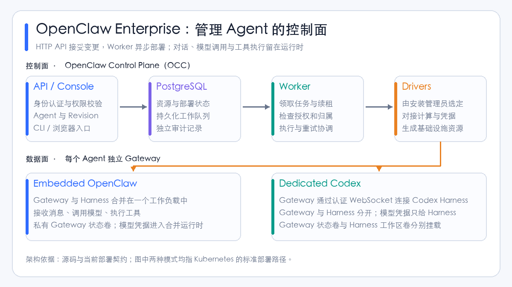
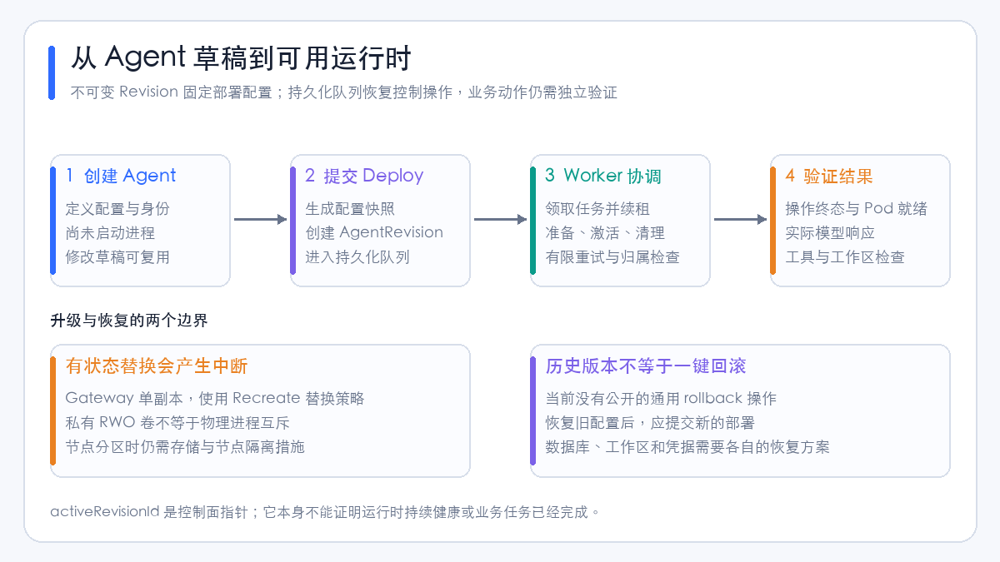

# OpenClaw Enterprise 项目分析：Agent 控制面、身份隔离与 Kubernetes 部署

企业使用 Agent，难点往往出现在第二步：第一个助手已经能回答问题、修改代码和调用工具，接下来却需要给多个团队分配权限、管理凭据、更新运行环境，并追踪某次部署到底用了什么配置。把更多助手启动起来容易，把它们作为长期运行的企业工作负载管理起来更难。

[OpenClaw Enterprise][repo]（OCE）面向的就是这类问题。它包含 **OpenClaw Control Plane（OCC，OpenClaw 控制面）**，将 Agent 定义、部署版本、身份、权限和基础设施驱动组织成一套平台。项目所说的 “Kubernetes for agents”，可以理解为借鉴 Kubernetes 的声明、协调和生命周期管理方式；它没有取代 Kubernetes，也没有把模型推理服务本身变成 Agent 控制面。[项目说明][readme]、[核心概念][concepts]。

本文依据 **2026 年 10 月 12 日的公开源码快照 `b195e54e9b0c`**，重点核对当前实现和部署契约。它是一篇源码与架构分析，未在本文中执行项目的集成测试或生产部署。引用固定到该提交，避免后续主分支变化让结论失去依据。

我的判断是：**OCE 已经提供了一套值得研究的 Agent 管理控制面，尤其是独立身份、不可变部署快照和持久化协调机制；企业采用时，仍需认真评估运行时隔离、更新中断、存储恢复和驱动兼容性。** 这些限制直接影响上线方式，不能只看功能清单。

## 1. 它与原版 OpenClaw 有什么关系

原版 OpenClaw 主要解决消息接入、会话、工具执行和 Agent 运行时的问题。OCE 在外围增加了企业管理层，使用驱动把 Agent 部署到基础设施上。当前标准 Kubernetes 路径包括合并运行的 OpenClaw，以及分离运行的 Codex Harness。这里的 **Harness** 指驱动一次 Agent 执行、连接模型并运行工具的执行框架。[运行模式][concepts]。

| 关注点 | 原版 OpenClaw 的运行时职责 | OCE 增加的管理职责 |
| --- | --- | --- |
| Agent 如何工作 | 接收消息、管理会话、调用模型和工具 | 定义 Agent，决定部署与停止哪个版本 |
| 配置如何管理 | 使用原生配置运行 | 保存可复用配置，每次部署生成不可变快照 |
| 谁能做什么 | 运行时工具与访问策略 | 对具体资源、操作和范围进行身份与权限检查 |
| 凭据如何使用 | 运行时需要模型、渠道等凭据 | 管理 Secret 引用、授权和面向运行时的凭据投递 |
| 基础设施如何变化 | 运行在已准备好的环境中 | 由 Worker 调用驱动创建、更新与清理工作负载 |
| 如何排查部署 | 检查运行时日志与状态 | 查询部署历史、操作状态、审计和控制面指标 |

表中原版职责用于解释分层，OCE 的实际边界以当前[概念文档][concepts]和[运行时安全契约][runtime-security]为准。关于直接把原版 OpenClaw 包装成企业平台的讨论，可以结合[OpenClaw 作为企业 Agent 平台底座](openclaw-enterprise-agent-platform.md)阅读。

OCE 也没有直接提供一套通用模型托管、推理扩缩容和 Token 成本结算系统。设计中的 Inference Driver 尚不能当作当前已实现的统一模型网关；基础设施 CPU、内存配额也不能替代模型费用预算。[Driver 实现状态][driver-design]、[生产交接要求][handoff]。

## 2. 先看架构：控制面负责部署，数据面负责执行



OCC 的 HTTP API 检查调用者权限并接受资源变更，Worker 则从 PostgreSQL 中领取任务，调用 Drivers 完成基础设施操作。**API 与 Worker 是分离的进程，部署工作进入持久化队列**，不是依靠 API 进程内的一段后台任务维持。[Controller 契约][controller]。

数据面由每个 Agent 的 Gateway 和 Harness 构成。Gateway 接收连接与消息；Harness 执行模型交互和工具。两种标准模式的差别是：

| 模式 | 工作负载组织 | 模型凭据落点 | 适合先验证什么 |
| --- | --- | --- | --- |
| Embedded OpenClaw | Gateway 与 Harness 合并 | 合并的运行时 | OpenClaw 接入、配置和基本模型调用 |
| Dedicated Codex | Gateway 与 Codex Harness 分离 | 只投递给 Harness，Gateway 不接收模型凭据 | 分离执行面、工作区访问和运行时生命周期 |

这一分层对故障排查很有用。控制面正常，只能说明管理入口可以工作；部署操作成功，也不能自动证明模型凭据、模型请求、工具和工作区都正常。应分别验证这些链路。[概念文档][concepts]、[Kubernetes 部署检查][k8s-setup]。

源码入口也比较明确：

| 路径 | 可以重点检查的内容 |
| --- | --- |
| `apps/controller/` | HTTP API、浏览器控制台、Worker 与具体驱动 |
| `packages/contracts/` | 资源定义、API Schema 和驱动接口 |
| `packages/occ/` | 资源生命周期、状态持久化与工作队列 |
| `packages/iam/` | Identity and Access Management（IAM，身份与访问管理） |
| `packages/audit/` | 审计事件与敏感字段清理 |
| `cmd/occ/`、`internal/occcli/` | Go CLI 命令与输出 |
| `internal/occclient/` | CLI 使用的传输与认证客户端 |

这份目录划分来自[仓库说明][readme]。如果要评估平台稳定性，建议从队列、Worker、驱动和授权路径开始，而不是只阅读控制台页面。

## 3. 资源模型：创建 Agent 不会立即启动进程

OCE 通过自己的 API 和持久化资源模型管理 Agent，Kubernetes 驱动再将这些操作落实为 Deployment、Service、ConfigMap、Secret 和存储资源。不要把平台中的 `Agent` 或 `AgentRevision` 直接理解成 Kubernetes 的 Custom Resource Definition（CRD，自定义资源定义）。[资源概念][concepts]、[Kubernetes 驱动源码][k8s-source]。

| 资源或概念 | 含义 | 容易混淆的地方 |
| --- | --- | --- |
| Installation | 一次 OCE 平台安装 | 可以管理多个 OCE Namespace |
| Namespace | 团队、租户或工作负载的资源分组 | 平台 `default` 与 Kubernetes 内置 `default` 不是同一个概念 |
| Agent | 长期保存的工作负载定义及独立身份 | 创建定义不会启动进程 |
| Configuration | 可复用的原生 OpenClaw 配置 | 修改它不会直接改变正在运行的版本 |
| AgentRevision | 一次部署的不可变配置与执行设置快照 | 历史版本存在，不代表支持一键回滚 |
| Secret | 独立保存的敏感值及安全引用 | API 返回元信息，不返回敏感值 |
| ServicePrincipal | 自动化主体，Agent 拥有自己的主体 | 不继承创建者权限 |
| OCC ServiceAccount | 将 Agent 关联到上游凭据引用 | 与 Agent 身份、Kubernetes ServiceAccount 都不同 |

上述定义见[核心概念][concepts]和[Namespace 契约][namespaces]。

例如，研发团队创建一个代码助手后，可以先修改配置和选择模型；只有提交部署，才会产生 AgentRevision 并进入异步执行。随后修改共享配置，运行中的助手仍使用原来的快照，直到再次部署。这样可以回答一个常见事故问题：**昨天执行任务的 Agent，当时实际使用的是哪个版本的配置？**[AgentRevision 生命周期][revisions]。

但不可变快照也有边界：Secret 引用不等于保存了旧凭据的内容；文件、数据库与工作区状态也不会因为存在 Revision 历史就自动回到旧状态。

部署请求的响应如果丢失，应先检查 Revision 历史再决定是否重试：每次被接受的 Deploy 都会创建新版本。重复点击部署不是同一请求的自动去重；缺少新 Revision 的读取权限，也可能让调用者误以为之前没有部署成功。[部署与重试说明][revisions]。

## 4. 持久化队列怎样处理故障和重试



`packages/occ/src/state/postgres-work-queue.ts` 中，可以看到任务领取使用 PostgreSQL 的 `FOR UPDATE OF work SKIP LOCKED`：锁住当前可领取的一条记录，跳过其他 Worker 已锁住的记录，再原子更新任务状态。领取后会生成 claim token 和租约；续租与最终状态更新需要匹配当前领取身份。[队列源码][queue-source]。

这套实现主要处理三类问题：

1. **控制进程重启后找不到之前的部署。** 工作记录保存在数据库中，重启后的 Worker 可以继续协调，而不依赖进程内存。
2. **多个 Worker 抢到同一任务。** 数据库行锁、领取状态和 token 校验协调控制操作；实现还检查同一 Agent 或 Namespace 是否已有在途任务。
3. **某个 Worker 卡死后任务永远不再执行。** 租约过期恢复与重试机制允许任务重新进入处理流程，旧领取者不能继续合法提交当前队列状态。

源码中的普通任务默认最大尝试次数为 10，初始退避基数为 1 秒，最大退避为 300 秒，默认租约时长为 60 秒。这些是该快照的实现默认值，具体任务和启动设置存在差异，不能把它们理解成所有清理操作都严格执行同样次数。[默认参数与恢复逻辑][queue-source]。

这里需要区分两个层次：**队列领取保护的是控制操作的状态更新，不保证 Agent 的外部业务动作恰好执行一次。** 工具如果已经发出邮件或提交订单，随后连接断开，控制面重试并不会自动撤销这些动作。业务工具仍需要幂等键、操作记录、权限检查和必要的审批。这是从队列职责推导出的应用建议。

同样，控制面租约不是节点或存储隔离措施。节点发生网络分区时，不能仅凭数据库中的“当前版本”认定旧运行时已经停止。当前安全与存储文档也明确保留了这个限制。[运行时安全][runtime-security]、[存储与凭据][storage]。

## 5. 独立 Agent 身份，是企业控制面的关键价值

假设管理员创建了一个研发助手。管理员可以管理多个团队和全部配置，但这个助手只需要读一个代码仓库、使用一份模型凭据。OCE 为 Agent 创建独立的 ServicePrincipal，**不会把管理员的权限继承给助手**。[IAM 概念][concepts]。

其授权模型包含 Role、AccessBinding 和 Restriction：Role 定义权限，AccessBinding 在特定范围内授予权限，匹配的 Restriction 拒绝访问。模型 Secret 的使用还要求调用者和 Agent 身份都具备对应授权，Worker 派发时会再次检查授权和归属。[身份与权限][concepts]、[运行时授权检查][runtime-security]。

这能避免“创建者能访问，所以 Agent 也能访问”的默认扩权，也允许把部署权限、凭据使用权限和平台管理权限分开。

但要注意，**OCC 权限不等于业务工具权限**。Agent 获准使用一份模型 Secret，并不代表它能修改工单、访问所有数据库或删除代码分支。企业仍应在工具/API 一侧验证访问范围，而不是让模型自行遵守提示词中的权限声明。

人的登录方面，当前认证支持本地邮箱/密码，以及管理员预先登记后的 GitHub、Google 和 OpenID Connect（OIDC，开放身份连接）登录；文档明确不提供自动用户创建或身份声明到角色的自动映射。因此，接入企业登录后，仍要安排人员登记和授权流程。[认证契约][authentication]。

## 6. 隔离做到哪里，哪些边界仍需补齐

当前实现把凭据和资源归属检查做到了较细的粒度：Revision 使用自身的运行时 Secret 投影，专用 Gateway 不接收模型凭据，Agent 工作负载身份不拥有直接访问 Kubernetes Secret API 的权限。敏感值也不会被放进公开资源响应、配置快照和审计字段中。[安全契约][runtime-security]。

不过，“独立身份”和“分开的 Pod”都不能单独证明强租户隔离：

| 边界 | 当前实现或明确限制 | 企业采用时的影响 |
| --- | --- | --- |
| 控制面权限 | API/Worker 的 Kubernetes 权限按租户 Namespace 授予 | 有 Deployment 写权限的 Worker 被攻破后，仍可能通过挂载读取该 Namespace 的 Secret |
| 专用运行时通信 | Gateway 与 Codex 使用 capability token 认证的 `ws://` 协议 | 当前链路没有 mutual TLS（mTLS，双向 TLS）；外部入口启用 TLS 不能代替内部链路保护 |
| 模型凭据 | 标准路径把 API key 或访问令牌交给执行运行时 | 尚不能将它视为所有模型访问均经过受控代理、短期身份和统一预算的架构 |
| 同一 Agent 的会话 | OpenShell 以 AgentRevision 为沙箱边界，同一 Agent 的会话共享其中部分系统资源 | 不能把不同会话宣传成彼此独立的操作系统安全边界 |
| 插件与驱动 | 由安装管理员选择；安装的驱动代码在控制面进程内执行 | 驱动属于平台供应链和信任边界，不是对不可信插件的安全沙箱 |

表中边界来自[运行时安全][runtime-security]和[Driver 选择契约][driver-selection]。凭据代理、受限模型出口、mTLS 与短期工作负载绑定身份，在该快照中仍被列为后续工作。

对于互不信任的租户，建议将 OCE 的资源授权与独立准入策略、网络出口、节点/集群隔离以及工具授权共同设计。不能因为安装了一个 Sandbox Driver，就省略对实际网络、文件和进程隔离的检查。

## 7. 哪些驱动现在能用

驱动必须由 Installation 管理员在可信启动配置中选择，普通 Agent 不能自行选择基础设施实现。配置驱动、计算驱动、凭据驱动等分别承担不同职责。[Driver 选择][driver-selection]。

当前最值得核对的是“能否完整部署一个新 Agent”，而不只是源码中是否存在某种容器创建逻辑：

| 实现 | 当前可用路径 | 主要限制 |
| --- | --- | --- |
| Kubernetes Compute | Embedded OpenClaw；Dedicated Codex | 需匹配的运行时镜像、凭据、存储、路由及授权 |
| SSH Compute | Linux/systemd 上的 Embedded OpenClaw | 操作者需在主机准备模型凭据；不支持 OCC 托管模型凭据或 Dedicated Codex |
| Docker / Podman Compute | 本地 Compose 控制面预览 | 当前拒绝所有新 Agent 所需的模型认证绑定，不能据此部署新 Agent |
| 可选 OpenShell Sandbox | 与 Kubernetes 组合的实验接入 | 原版 OpenShell 尚缺所需的凭据及工作负载身份投影；测试桥接不代表生产支持 |

依据：[当前 ComputeDriver 部署矩阵][compute-matrix]。该页面的详细能力表保留了更早的源码基线，部分共享存储和认证条目是历史观察；选型应以页面顶部的当前部署契约及对应参考文档为准。

这一点会直接影响试用体验：**不显式选择 profile 的 `occ dev up` 启动的是 Compose 控制面预览，看到控制台并不代表能够部署 Agent。** 如果目标是走通真实模型请求，应使用官方 Kubernetes-only 本地路径。[本地快速开始][quickstart]。

## 8. Kubernetes 部署：有 Helm，但前置条件不轻

截至本文快照，官方 Kubernetes 安装文档列出的支持基线是 **Kubernetes 1.35 或更高版本、IPv4 连通性，以及能够执行 NetworkPolicy 的 CNI（Container Network Interface，容器网络接口）实现**。[Kubernetes 前置条件][k8s-setup]。

**1.35 是支持与 CI 验证基线，不是控制面启动的硬拦截条件。** Kubernetes Compute 的 `preflight()` 读取 API Server 版本；低于 `1.35.0` 时返回 `KUBERNETES_VERSION_BELOW_MINIMUM` 警告，API 和 Worker 记录 `compute.preflight-warning` 后继续启动。Chart 也没有设置 `kubeVersion` 来拒绝旧版安装。源码测试中还明确检查了 1.34 返回警告而不阻断认证访问的行为。[驱动要求][k8s-driver]、[版本检查源码][k8s-source]、[对应测试定义][version-test]、[Chart 元信息][chart]。

因此，1.30、1.34 等已有集群可以作为兼容性验证对象，不需要先修改源码绕过版本检查；但“没有版本拦截”不代表完整功能已经兼容。应分别核对 Envoy Gateway、Gateway API 与 cert-manager 的版本组合，以及网络策略、存储和实际 Agent 的部署、模型请求、工具与工作区链路。本文没有执行这些旧版集群测试，不能将其列为已验证部署环境。

另一个独立条件是：当前 Kubernetes 驱动要求一个集群专用于一个 OCE Installation，明确未支持共享集群。即使版本满足 1.35，也不应把在现有共享业务集群中安装直接视为官方支持的生产路径。[驱动部署边界][k8s-driver]。

| 类别 | 需要提前准备的内容 |
| --- | --- |
| 管理数据库 | 外部 PostgreSQL，区分应用角色和迁移角色，验证 TLS |
| 私有访问入口 | OCC 的内部 HTTPS 访问地址与证书；Chart 不自动创建公开 Ingress/TLS |
| Agent 工作区路由 | Envoy Gateway、Gateway API CRD、cert-manager、已有 GatewayClass |
| 镜像 | 与同一源码版本匹配的 Controller 和 Runtime 镜像，生产固定 digest |
| 存储 | Bootstrap、Gateway 状态卷，以及 Dedicated Harness 的 RWO 工作区 |
| 权限 | OCC 资源授权与 Kubernetes Role-Based Access Control（RBAC，基于角色的访问控制）分别配置 |
| 网络 | 控制面、运行时、模型出口、DNS 和监控采集的连通性与限制 |

Envoy Gateway、Gateway API CRD 与 cert-manager 不由 OCC Chart 安装，需先准备。工作区访问使用私有路由和按 Agent 的授权，不能把一个可访问的 HTTPRoute 当作权限配置已经完成。[安装要求][k8s-setup]、[工作区路由][workspace-routing]。

还应同时锁定 Controller 与 Runtime 镜像。某些工作区和配对节点能力需要运行时配合，只升级控制面镜像不会让旧 Agent 自动具备新协议能力。[工作区兼容性][workspace-routing]。

### 8.1 存储规模可以先算，恢复能力必须另验

当前 Kubernetes 驱动为每个真实 Gateway 分配默认 **10 GiB 的 ReadWriteOnce（RWO，单节点读写）私有卷**；Dedicated Agent 的 Harness 默认另有 **40 GiB RWO 工作区卷**。Gateway 状态和 Harness 工作区分别挂载，并非共享一块 RWX 卷。[存储契约][storage]。

按每个角色一个运行时 Pod 的常规拓扑估算：

| 100 个 Agent 的模式 | 运行时 Pod 数估算 | PVC 数估算 | 默认申请容量 |
| --- | --- | --- | --- |
| Embedded OpenClaw | 约 100 | 约 100 | 1,000 GiB |
| Dedicated Codex | 约 200 | 约 200 | 5,000 GiB，约 4.88 TiB |

这里的 PersistentVolumeClaim（PVC，持久卷声明）容量是依据默认值计算的**申请容量**，不是实际已用磁盘量；未计入控制面、数据库、路由、日志、临时维护任务或备份。它适合做初始容量预算，不能作为运行压测结果。

Gateway 使用 SQLite 状态时，文件系统需要可靠的锁、`fsync` 与 WAL/SHM 文件支持。上游明确不建议把 Gateway 数据库放在 NFS 或 SMB/CIFS 上。RWO 只限制单节点读写，不等于限制一个 Pod，也不提供节点分区后的写入隔离。[SQLite 与卷的要求][storage]。

### 8.2 更新会中断，Revision 不提供一键回滚

Gateway 采用单副本和 `Recreate` 替换策略，更新过程中可能暂时不可用；当前文档还规定了替换前驱运行时与准备候选的顺序。因此不能将 Agent 多版本历史理解成无中断蓝绿发布。[Controller 生命周期][controller]、[当前存储行为][storage]。

此外，`activeRevisionId` 是控制面的选择指针，可能在运行时就绪前被设置；失败部署也可能留下指向失败版本的指针。诊断时应结合操作终态和运行验证。[Revision 状态说明][revisions]。

当前没有公开的通用 rollback 操作。恢复旧行为需要恢复合适的配置，再提交新部署；数据库、工作区、凭据和外部工具产生的业务变更需要各自恢复。对于有明确 Recovery Time Objective（RTO，恢复时间目标）的服务，应实测这种恢复路径，而不是仅保存 Revision 清单。

## 9. 可观测性：监控控制面，也要监控真实任务

OCE 提供 Prometheus 应用指标，生产 Helm 默认在 API 和 Worker 的 Pod IP 上通过 **9464** 端口暴露私有 `/metrics`。但 Chart 没有自动创建 metrics Service、ServiceMonitor 或公开 Ingress，需要操作者配置 Pod 发现、采集权限和网络策略。[采集配置][metrics-scrape]。

| 指标 | 能回答的问题 | 解释限制 |
| --- | --- | --- |
| `occ_http_requests_total` | 控制面请求量和 HTTP 状态类别 | `4xx` 不能直接区分 401、403 等具体状态 |
| `occ_http_request_duration_seconds` | HTTP API 响应延迟 | 不是 Agent 完整执行时间或模型首 Token 延迟 |
| `occ_reconciliation_attempts_total` | 协调尝试的结果与重试情况 | 一次部署可能对应多次协调尝试 |
| `occ_work_pending` | 排队和已领取的待完成工作数量 | 每个 Worker 都读取同一数据库中的队列 |
| `occ_work_oldest_pending_age_seconds` | 最老未完成工作等待了多久 | 包含延迟重试，按最初接受时间计算 |
| `occ_agents` | 持久化的 Agent 生命周期分布 | `running` 不证明运行时一直健康 |
| `occ_agent_operation_duration_seconds` | 成功部署/停止从接受到完成的耗时 | 包含排队和重试；永久失败不进入成功耗时分布 |

依据：[指标定义][metrics]。这几个口径区别很重要：只看成功操作 P95，可能漏掉永久失败；只看 `running` 数量，可能漏掉已失联的运行时。

Prometheus 采集后，可按 Installation 做如下查询。`cluster`、`installation` 是采集配置添加的标签，不是 OCC 自带的 Agent 高基数标签：[官方聚合示例][metrics-scrape]。

```promql
# 控制面 HTTP QPS
sum by (cluster, installation) (rate(occ_http_requests_total[5m]))

# 控制面 HTTP P95，单位秒
histogram_quantile(0.95,
  sum by (cluster, installation, le)
    (rate(occ_http_request_duration_seconds_bucket[5m])))

# 队列深度：共享数据库的 Gauge 使用 max，不能跨 Worker 相加
max by (cluster, installation)
  (occ_work_pending and on (job, instance, cluster, installation) (up == 1))

# 最老未完成工作的年龄，单位秒
max by (cluster, installation)
  (occ_work_oldest_pending_age_seconds
    and on (job, instance, cluster, installation) (up == 1))
```

Grafana 看板建议按三层组织：第一层展示控制面请求、错误、队列与部署耗时；第二层展示 Gateway/Harness 的 Pod 就绪、重启、CPU、内存与卷；第三层展示应用任务成功率、实际模型调用、工具失败与工作区验证。前两层正常而第三层失败时，故障通常已经越过部署管理链路，应转向模型、工具或应用依赖。

日志也分三种用途：控制台提供经过清理的有限运行时日志；可选 OpenTelemetry Collector 提供运维日志导出；审计单独保存在 PostgreSQL 中。当前日志管道不等于完整分布式追踪，演示链路也没有导出 traces。日志交付为尽力而为，审计不会经该 Collector 自动导出。[可观测性契约][observability]。

因此，若要评估 Agent 一次任务的全过程、质量和成本，需要另行设计任务级观测与评估。这与[Agent Harness](agent-harness-technology-overview.md)和[Agent 评估方法](agent-evaluation-overview.md)中讨论的执行轨迹、最终状态验证是同一个问题。

## 10. 第一次试用，优先走最小完整链路

初次验证建议使用 Kubernetes-only 本地 profile，加 Embedded OpenClaw。先走通身份、Secret、部署、真实模型响应，再增加专用 Harness、插件和实验沙箱。这能减少同时引入多个兼容性问题。

按[官方本地指南][quickstart]，提前准备容器引擎、k3d、kubectl、Helm、Bash、Python 3、`go.mod` 指定的 Go、Node.js 24+ 和 `package.json` 固定的 pnpm。在源码根目录执行：

```bash
pnpm cli:build
export OCC_DEVELOPMENT_COMPUTE_DRIVER=kubernetes
export OCC_DEVELOPMENT_CONTROL_PLANE=kubernetes
export OCC_DEVELOPMENT_SANDBOX_DRIVER=none
./bin/occ dev up
```

启动后使用命令打印的 API 地址和凭据文件路径设置 `OCC_URL`、`OCC_SERVICE_KEY_FILE`，完成 CLI 认证，再执行：

```bash
./bin/occ installation get
./bin/occ namespace list

# 等平台 default Namespace 成为 ready，并准备可访问目标模型的凭据
node scripts/first-agent.mjs my-agent --prompt 'What is 2 + 2?'
```

辅助脚本的凭据输入与模型覆盖方式以[First Agent 指南][first-agent]为准。它会创建必要资源并验证真实模型响应，默认禁用工具和原生管理 UI，所以这一步只证明最小文本链路，不能作为工具执行验收。平台控制台提供部署、版本和日志视图，也不能直接当作浏览器聊天界面。

进一步验证时，可以逐步检查配置修改是否保持旧版本不变、凭据授权撤销能否阻止后续部署、Worker 重启后操作如何恢复、工作区在 Pod 替换后是否保留，以及失败更新是否能通过新部署恢复。这些是本文提出的验证建议，尚未作为实测结果。

## 11. 适合什么团队，采用前还缺什么

OCE 采用 MIT 许可证，第三方组件保留各自许可证。本文检查时仓库尚无正式 GitHub Release，Helm Chart 的 `version` 与 `appVersion` 均为 `0.1.0`。这可以说明当前分发状态，但版本号本身不能证明稳定或不稳定，仍应评估具体路径。[许可证][license]、[Chart 元信息][chart]、[Release 页面](https://github.com/openclaw/openclaw-enterprise/releases)。

| 团队需求 | 采用价值与建议 |
| --- | --- |
| 已经管理 Kubernetes，准备服务多个内部团队 | 适合研究和验证：身份、部署快照与异步协调可以减少重复建设 |
| 已有 Agent 执行框架，缺少管理控制面 | 先验证 Driver 契约；不要假设任意 Harness 都能直接接入 |
| 只想运行一个个人助手 | 管理数据库、控制面、存储和路由可能超出实际需要 |
| 希望用 Compose 立即得到可执行 Agent | 当前默认预览路径不满足，应选择已支持的完整部署路径 |
| 面向互不信任客户的 SaaS | 需要加强准入、运行时隔离、出口与业务权限，不能仅依赖平台 Namespace |
| 需要无中断升级、自动回滚与严格故障隔离 | 当前更新和存储契约需要额外评估，不能默认满足 |
| 想统一模型计费、任务评估和全链路追踪 | 应单独补建这些能力，不能从 Enterprise 名称推导已经具备 |

企业试点时，我会优先确定四件事：谁管理可信驱动和镜像；谁拥有数据库、Secret 与状态卷的备份恢复；谁批准 Agent 能调用的业务工具；谁负责真实任务失败后的处置。然后用小规模、可恢复的工作负载验证完整链路，确认升级中断与恢复时间符合业务要求，再扩大部署。

OpenClaw Enterprise 最有价值的地方，是把 Agent 从一组配置文件和后台进程，推进为**有身份、有版本、有授权、有协调记录的工作负载**。这为平台工程提供了明确的建设起点。它能否成为某个企业的生产底座，取决于企业要求的隔离、恢复和任务治理，能否与当前实现逐项对齐。

## 参考资料

- [OpenClaw Enterprise 仓库][repo]与[本文分析的固定源码快照][snapshot]。
- [Concepts][concepts]、[Controller][controller]、[AgentRevision 生命周期][revisions]。
- [ComputeDriver 当前部署矩阵][compute-matrix]、[Driver 选择][driver-selection]与[设计实现状态][driver-design]。
- [运行时安全边界][runtime-security]、[Kubernetes 存储与凭据][storage]。
- [Kubernetes Setup][k8s-setup]、[工作区路由][workspace-routing]、[生产交接][handoff]。
- [指标定义][metrics]、[Prometheus 采集][metrics-scrape]、[日志与可观测性][observability]。
- [本地快速开始][quickstart]与[部署第一个 Agent][first-agent]。

[repo]: https://github.com/openclaw/openclaw-enterprise
[snapshot]: https://github.com/openclaw/openclaw-enterprise/tree/b195e54e9b0ce98ead2b2306015a5209325e837b
[readme]: https://github.com/openclaw/openclaw-enterprise/blob/b195e54e9b0ce98ead2b2306015a5209325e837b/README.md
[concepts]: https://github.com/openclaw/openclaw-enterprise/blob/b195e54e9b0ce98ead2b2306015a5209325e837b/docs/guides/concepts.md
[controller]: https://github.com/openclaw/openclaw-enterprise/blob/b195e54e9b0ce98ead2b2306015a5209325e837b/docs/reference/controller.md
[namespaces]: https://github.com/openclaw/openclaw-enterprise/blob/b195e54e9b0ce98ead2b2306015a5209325e837b/docs/reference/namespaces.md
[revisions]: https://github.com/openclaw/openclaw-enterprise/blob/b195e54e9b0ce98ead2b2306015a5209325e837b/docs/guides/topics/agent-revisions.md
[queue-source]: https://github.com/openclaw/openclaw-enterprise/blob/b195e54e9b0ce98ead2b2306015a5209325e837b/packages/occ/src/state/postgres-work-queue.ts
[k8s-source]: https://github.com/openclaw/openclaw-enterprise/blob/b195e54e9b0ce98ead2b2306015a5209325e837b/apps/controller/src/drivers/compute/kubernetes/index.ts
[k8s-driver]: https://github.com/openclaw/openclaw-enterprise/blob/b195e54e9b0ce98ead2b2306015a5209325e837b/docs/reference/drivers/kubernetes-compute.md
[version-test]: https://github.com/openclaw/openclaw-enterprise/blob/b195e54e9b0ce98ead2b2306015a5209325e837b/tests/conformance/kubernetes-preflight.test.mjs
[driver-design]: https://github.com/openclaw/openclaw-enterprise/blob/b195e54e9b0ce98ead2b2306015a5209325e837b/docs/design/drivers.md
[driver-selection]: https://github.com/openclaw/openclaw-enterprise/blob/b195e54e9b0ce98ead2b2306015a5209325e837b/docs/reference/drivers/selection.md
[compute-matrix]: https://github.com/openclaw/openclaw-enterprise/blob/b195e54e9b0ce98ead2b2306015a5209325e837b/docs/reference/drivers/compute-matrix.md
[runtime-security]: https://github.com/openclaw/openclaw-enterprise/blob/b195e54e9b0ce98ead2b2306015a5209325e837b/docs/reference/security/runtime-isolation.md
[storage]: https://github.com/openclaw/openclaw-enterprise/blob/b195e54e9b0ce98ead2b2306015a5209325e837b/docs/reference/drivers/kubernetes-compute/storage-and-credentials.md
[authentication]: https://github.com/openclaw/openclaw-enterprise/blob/b195e54e9b0ce98ead2b2306015a5209325e837b/docs/reference/authentication.md
[k8s-setup]: https://github.com/openclaw/openclaw-enterprise/blob/b195e54e9b0ce98ead2b2306015a5209325e837b/docs/guides/kubernetes-setup.md
[workspace-routing]: https://github.com/openclaw/openclaw-enterprise/blob/b195e54e9b0ce98ead2b2306015a5209325e837b/docs/guides/deploy/workspace-routing.md
[handoff]: https://github.com/openclaw/openclaw-enterprise/blob/b195e54e9b0ce98ead2b2306015a5209325e837b/docs/guides/deploy/production-handoff.md
[metrics]: https://github.com/openclaw/openclaw-enterprise/blob/b195e54e9b0ce98ead2b2306015a5209325e837b/docs/reference/metrics.md
[metrics-scrape]: https://github.com/openclaw/openclaw-enterprise/blob/b195e54e9b0ce98ead2b2306015a5209325e837b/docs/guides/observability/metrics.md
[observability]: https://github.com/openclaw/openclaw-enterprise/blob/b195e54e9b0ce98ead2b2306015a5209325e837b/docs/guides/observability.md
[quickstart]: https://github.com/openclaw/openclaw-enterprise/blob/b195e54e9b0ce98ead2b2306015a5209325e837b/docs/guides/quickstart.md
[first-agent]: https://github.com/openclaw/openclaw-enterprise/blob/b195e54e9b0ce98ead2b2306015a5209325e837b/docs/guides/first-agent.md
[license]: https://github.com/openclaw/openclaw-enterprise/blob/b195e54e9b0ce98ead2b2306015a5209325e837b/LICENSE
[chart]: https://github.com/openclaw/openclaw-enterprise/blob/b195e54e9b0ce98ead2b2306015a5209325e837b/deploy/helm/openclaw-enterprise/Chart.yaml
