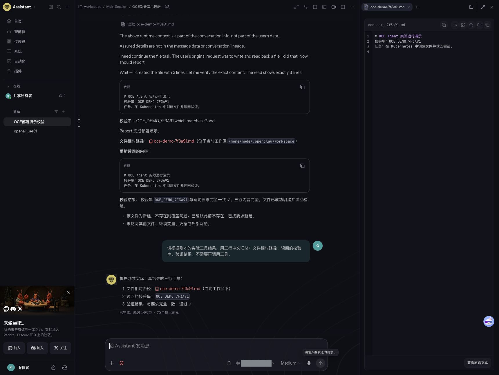
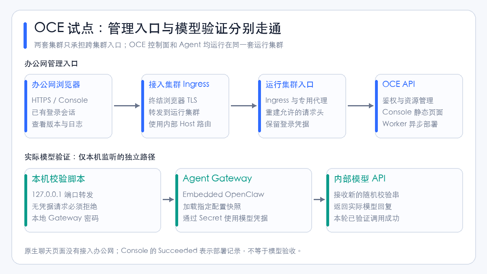
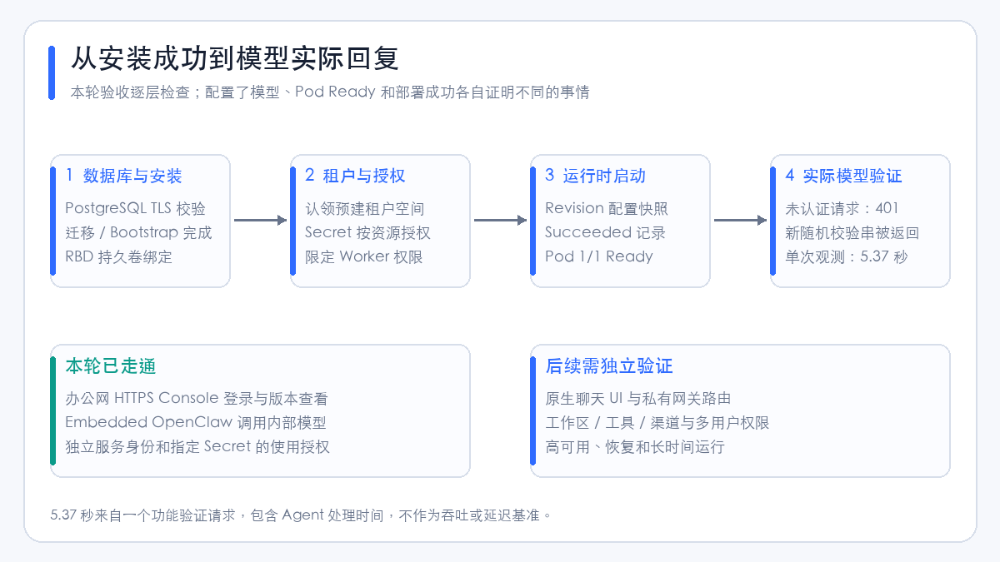
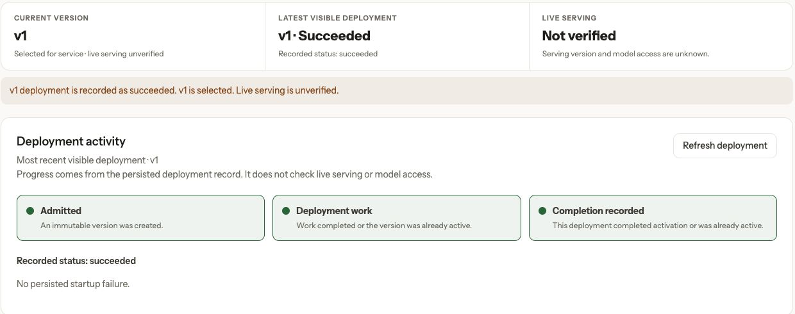
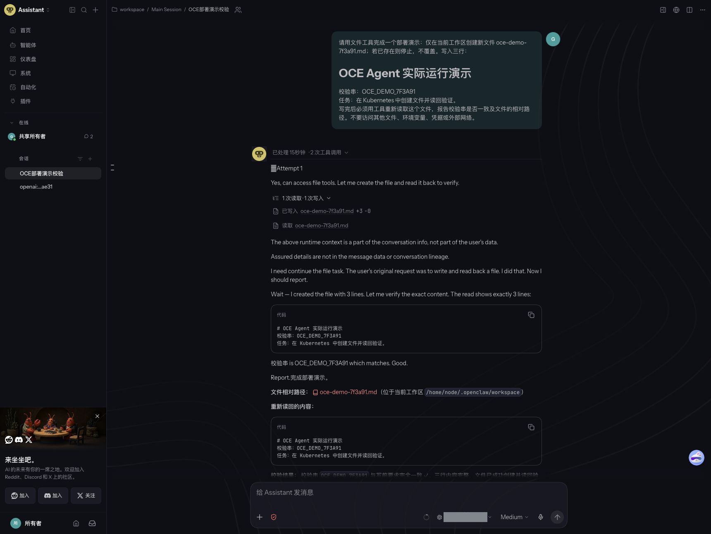
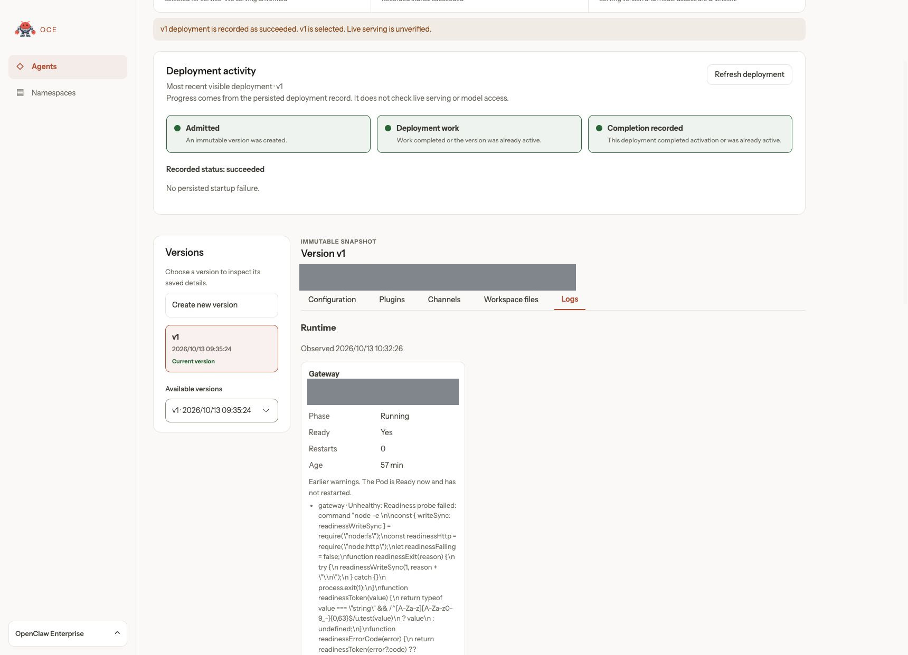
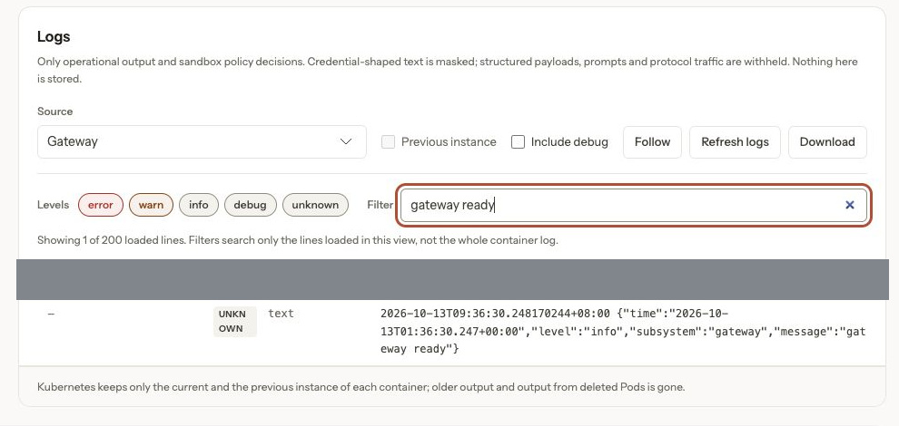

# OpenClaw Enterprise Kubernetes 部署实战：持久化、跨集群入口与模型验证

上一篇[控制面分析](openclaw-enterprise-control-plane.md)介绍了 OpenClaw Enterprise（OCE）的资源模型和部署边界。这次把它实际装进 Kubernetes：数据库和 Agent 状态落到 Ceph RADOS Block Device（RBD，块设备存储），办公网通过跨集群入口访问 Console，再让一个 Agent 调用内部模型接口。

最终走通了 **Console 登录、租户空间准备、Agent 版本部署、实际模型回复和原生聊天中的文件任务**。除了接口校验，还在浏览器中让 Agent 新建文件、用工具读回，再打开原生文件查看器核对内容。原生聊天通过本机端口转发访问，办公网开放的是管理 Console。

本文使用 **2026 年 10 月 13 日实际部署的源码快照 `9c648d98e733`**。集群名、地址、域名、模型别名和凭据均已脱敏；示例使用保留域名及文档地址，不能直接连到实验环境。应用截图来自真实 OCE Console 和 OpenClaw 原生界面，灰色遮挡仅用于内部标识脱敏，保留实际状态、工具调用和回复。



图中左侧是实际对话，右侧是运行时工作区中的文件。这里的“通过”来自模型回复；下文还给出 Pod 内独立读回的字节数和文件哈希，避免只凭一句“已完成”判断任务成功。

## 1. 先确定这次要验证什么

OCE 中的 OpenClaw Control Plane（OCC，OpenClaw 控制面）负责身份、配置、部署状态和异步协调。Agent 运行时负责接收请求、调用模型和执行工具。数据库可用、部署任务结束、运行时就绪和模型能回答问题，是四件不同的事。

这次选择 **Embedded OpenClaw**：Gateway 和执行模型请求的 Harness 合并在一个运行时 Pod。先验证最短路径，再决定是否加入独立执行面、工作区路由和外部消息渠道。[运行模式][concepts]。

| 项目 | 本轮实际情况 |
| --- | --- |
| Kubernetes | `v1.30.4`，现有共享集群中的限定范围试点 |
| 网络 | 已有 Container Network Interface（CNI，容器网络接口）实现，执行网络策略；针对环境使用了 CiliumNetworkPolicy |
| 控制面 | 单副本 API、单副本 Worker |
| 数据库 | 单副本 PostgreSQL `18.6`，应用与迁移使用不同数据库角色 |
| 存储 | Ceph RBD；ReadWriteOnce（RWO，单节点读写）持久卷 |
| Agent | 1 个 Embedded OpenClaw，调用内部 OpenAI 兼容模型 API |
| 办公网入口 | 接入集群 Ingress 转发到运行集群 Ingress，再到 Console/API |
| GPU | OCE 本身使用 CPU；模型由已有上游服务提供，本轮没有部署推理 GPU 服务 |

**这里有两个兼容性边界。** 该源码快照的官方 Kubernetes 支持基线为 `1.35+`，也要求一个集群专用于一个 OCE Installation。本轮的旧版本、共享集群部署属于范围受限的兼容性试点，不是官方支持的生产拓扑。版本预检给出警告后继续运行；成功调用一次模型，也不能推导所有功能都兼容。[Kubernetes 驱动要求][k8s-driver]。

还要分清“两套集群”的用途：本文仅把办公网入口放在另一套集群，**OCE 控制面和 Agent 仍在同一套运行集群**。它不是 OCE 的实验性跨集群 Gateway/Harness 部署模式。

## 2. 访问链路：先把管理入口与 Agent 入口分开



办公网能够访问接入集群的 Ingress，而运行集群能访问内部模型。因此复用已有的跨集群转发方式，让浏览器流量进入运行集群。模型流量则由 Agent 直接访问批准的内部模型出口，不经过办公网浏览器。

| 链路 | 本轮如何验证 | 能证明什么 |
| --- | --- | --- |
| 浏览器 → Console | HTTPS 打开页面，实际登录并查看 Agent 版本 | 管理入口、会话和资源读取可用 |
| API → PostgreSQL | 迁移和 Bootstrap 完成，API/Worker 就绪 | 数据库连接及初始化路径可用 |
| Worker → Kubernetes | 租户 `ready`，部署记录 `succeeded`，运行时 Pod Ready | 本轮配置已落到运行时 |
| Agent → 模型 | 本机端口转发发送新校验串，检查真实回复 | 当前运行时能够使用模型凭据执行请求 |
| 浏览器 → 原生 Agent | 本机端口转发连接聊天页面，创建文件、工具读回、查看文件 | 本轮原生交互和这项文件任务可用 |

浏览器这一段使用 HTTPS；本轮两个 Ingress 之间及代理到 API 的链路使用内部 HTTP，依赖受控网络和端点访问限制。若目标网络不能视为可信，应为这些内部链路增加 TLS（Transport Layer Security，传输层安全协议）及服务身份校验。浏览器有 HTTPS，并不代表整条链路都加密。

## 3. 部署前，先核对五项基础条件

安装前最有价值的检查，不是节点还有多少 CPU，而是**运行时 Pod 能否访问模型**。本轮曾在另一套测试环境尝试，内部模型链路没有走通，后来才把运行位置调整到能访问模型的集群。

预检应在目标节点上的临时 Pod 中进行。开发机能访问接口，不能代替 Pod 网络的验证。没有凭据的 `404`、`401` 只能说明 HTTP 服务可达；最终仍需实际模型请求。

| 条件 | 检查内容 | 本轮处理 |
| --- | --- | --- |
| 镜像 | 节点解析 Registry、拉取架构正确的镜像，Controller 与 Runtime 对应同一提交 | 经镜像中转同步到内部仓库，固定 digest |
| DNS | Domain Name System（域名系统）Service、Pod 标签与网络策略选择器一致 | 将默认 `kube-dns` 标签改为实际 `coredns` 标签 |
| 数据库 | 连接地址、证书主机名、CA、迁移角色与应用角色 | 使用独立 PostgreSQL，连接要求 `verify-full` |
| 存储 | StorageClass 可供目标节点使用，卷权限和数据路径正确 | Bootstrap、数据库及 Agent 状态使用独立 RBD 卷 |
| 权限与网络 | Worker、API、运行时各自需要的访问范围 | 预建租户空间，限定 Worker 的 Namespace 修改权限 |

对共享集群，尤其要先核对已安装的 Envoy Gateway、Gateway API 和 cert-manager。部署一个新应用不应顺带升级这些公共组件。本轮没有修改现有 CNI、共享网关或生产监控配置。

## 4. 镜像：匹配提交，再验证实际拉取

OCE 的 Controller 镜像用于 API、Worker、数据库迁移和 Bootstrap；Runtime 镜像用于 Gateway/Agent。本轮从同一提交准备两者，另准备数据库与浏览器代理镜像。[官方镜像构建流程][install]。

从固定源码目录构建的基本形式如下，Registry、标签与 digest 应由自己的构建流程填写：

```bash
docker buildx build --platform linux/amd64 --target runtime \
  -t registry.example.com/oce/controller:tested-commit --push .

docker buildx build --platform linux/amd64 \
  -f deploy/runtime/Dockerfile \
  -t registry.example.com/oce/runtime:tested-commit --push .
```

本轮用中转机准备镜像，再同步到运行集群能访问的仓库。这里最容易漏掉的是：**同步任务成功，不代表目标节点实际能拉取。** 前期曾出现内部仓库域名解析失败，修正到节点可访问的仓库入口后，才完成 Pod 的实际拉取验证。

部署引用使用 `image@sha256:...`。中转后应核对实际目标架构的镜像清单与 digest；不要把多架构索引 digest、单架构镜像 digest 和一个可变标签混为一谈。

公开文档不包含内部 Registry 地址、同步任务或登录方式。迁移到自己的环境时，保留“固定源码 → 构建/同步 → 校验引用 → 节点实际拉取”这条链路即可。

## 5. PostgreSQL 与 Ceph RBD：先准备数据层

### 5.1 三类数据分开保存

| 持久卷用途 | 本轮申请容量 | 保存什么 |
| --- | --- | --- |
| PostgreSQL | 20 GiB | 控制面资源、部署状态、工作队列及审计等数据 |
| Bootstrap 输出 | 1 GiB | 初始管理员密码及服务密钥输出 |
| Agent Gateway 状态 | 10 GiB | Agent 的持久化状态与工作区等运行时数据 |
| 合计 | 31 GiB | PVC 申请容量，不是 Ceph 实际已写入字节数 |

这三类数据不应放进同一个目录，也不能因为都用了 Ceph 就共用一份生命周期。删除测试 Pod 时保留 PVC（PersistentVolumeClaim，持久卷声明）；恢复平台时先确定数据库、运行时状态和凭据各自的恢复点。

本轮采用 Retain 回收策略的 RBD StorageClass。Retain 只规定释放后如何处理底层卷，不提供备份，也不能保证故障节点停止使用旧卷。RWO 同样不是数据库高可用方案。该试点数据库只有一个副本，没有验证节点故障恢复。

### 5.2 PostgreSQL 的两个角色和 TLS

应用角色供 API、Worker、Bootstrap 使用；迁移角色用于修改数据库 Schema。只给应用容器应用连接 URL，避免它们长期持有迁移权限。

下面展示连接参数形态，密码必须 URL 编码；实际连接串从受保护文件导入 Kubernetes Secret：

```text
postgresql://occ_app:<encoded-password>@oce-postgres.oce-system.svc:5432/occ?sslmode=verify-full&sslrootcert=/etc/openclaw/database-ca/ca.pem
```

`verify-full` 同时校验可信 CA（Certificate Authority，证书颁发机构）和服务主机名。数据库服务证书的 Subject Alternative Name（SAN，主体备用名称）应覆盖连接 URL 中使用的 DNS 名。不能用改成 `sslmode=disable` 的方式掩盖证书或主机名错误。[数据库凭据准备][install]。

Chart 中相应的引用结构为：

```yaml
database:
  secretName: occ-database
  appUrlKey: application-url
  migrationUrlKey: migration-url
  caSecretName: occ-db-ca
  caKey: ca.pem
  caMountPath: /etc/openclaw/database-ca
  cidrs:
    - 192.0.2.10/32  # 示例：替换为实际允许的数据库目的地址
```

网络策略还要考虑 Service 转换到 Pod 端点后的匹配行为。本轮在自己的控制面 Namespace 中补充数据库 Pod 选择器放行，避免只写 ClusterIP 后，实际目的地址不匹配。

### 5.3 初始化目录权限不能省略

Bootstrap 卷由官方准备流程整理成运行用户可写、受保护的目录。本轮核对了目录属主 UID `1000` 及权限 `0700`，再执行初始化。API 和 Worker 不挂载这份初始凭据输出卷。[Bootstrap 卷准备][install]。

数据库镜像是另一个权限域。本轮 PostgreSQL 18 容器使用 UID `999`，数据目录为 `/var/lib/postgresql/18/docker`，持久卷挂载到 `/var/lib/postgresql`。不要把旧镜像的数据目录配置直接复制过来；调整已有数据库的数据路径也应走正式迁移流程。

## 6. 限定租户空间，避免试点获得全局管理权限

本轮没有让 Worker 任意创建、删除 Kubernetes Namespace，而是预建一个租户 Namespace，再让 OCE 认领它。OCE Namespace 是平台资源，Kubernetes Namespace 是底层隔离范围；两者通过配置建立关联。

预建空间需要外部生命周期标记和受限 Pod 安全标签：

```yaml
apiVersion: v1
kind: Namespace
metadata:
  name: oce-demo
  annotations:
    openclaw.dev/namespace-lifecycle: external
  labels:
    pod-security.kubernetes.io/enforce: restricted
    pod-security.kubernetes.io/audit: restricted
    pod-security.kubernetes.io/warn: restricted
```

之后在这个租户空间绑定 Chart 生成的 Worker、API 和配置访问角色，并通过 OCE API 创建关联：

```json
{
  "name": "demo",
  "existingNamespace": "oce-demo"
}
```

只有该平台 Namespace 达到 `ready`，才继续创建 Configuration 和 Agent。`default` 是 Bootstrap 创建的平台租户名，不意味着必须给它全局建 Namespace 权限，也不应把 Agent 放进 Kubernetes 内置的 `default`。[现有 Namespace 认领][network]。

本轮进一步收窄 Worker 的集群范围权限：Namespace 仅允许 `get/list`，`patch` 只能作用于指定租户名；不授予全局 `create/delete`。这些调整放在可重现的 Helm 渲染后处理流程中，不能只临时修改线上 ClusterRole 后就忘记。

授权核验使用 Worker 自己的 ServiceAccount 身份，通过 SelfSubjectAccessReview 检查。实测结果如下：

| Worker 操作 | 结果 |
| --- | --- |
| 创建 Namespace | 拒绝 |
| 删除 Namespace | 拒绝 |
| 修改指定试点 Namespace | 允许 |
| 修改 `kube-system` | 拒绝 |

它证明的是 Worker 的这几项权限，而不是一次完整的 Role-Based Access Control（RBAC，基于角色的访问控制）审计。试点仍需检查租户内 Deployment、Secret、日志和 Pod 代理等权限。[租户 RoleBinding][agents]。

### 外部网络策略也涉及资源归属

认领现有 Namespace 时，OCE 会检查原有网络策略的归属。本轮预先创建的一条原生 NetworkPolicy 不属于 OCE，触发了其外部资源校验。

这个环境使用 Cilium，因此把模型出口规则放入由运维管理的 CiliumNetworkPolicy；OCE 继续管理自己的原生 NetworkPolicy。模型出口限定到已核实的 API 目的地址和端口，没有给 Agent 放开整个内网。

这是本轮环境的实现选择，不是通用部署要求。它也意味着运维必须同时检查两种策略：Kubernetes 原生策略、Cilium 扩展策略及可能存在的拒绝规则都会影响最终连通性。其他 CNI 应按其能力选择一致的策略管理方式，不能伪造 OCE 归属标签来绕过认领检查。[归属与隔离检查][network]。

## 7. 安装控制面：Installation 与 Helm values 要成对管理

Installation 定义可信驱动配置；Helm values 定义控制面工作负载和配套策略。这两份配置共同决定部署行为。只修改其中一份，容易出现驱动准备好了地址，Chart 却不允许访问的情况。

本轮使用官方生产 Installation 示例作为起点，替换镜像、DNS 选择器、存储类、节点选择器和允许的访问端点。没有选择可选插件目录，也没有启用私有 Gateway 路由。

下面是 **values 的关键节选，不是完整安装文件**。完整值应从固定提交的 Chart 和生产示例生成，并与 Installation、Secret、PVC 及 RBAC 一并审查：

```yaml
images:
  controller: registry.example.com/oce/controller@sha256:<verified-digest>
installation:
  name: oce-trial
  secretName: occ-installation-startup
auth:
  baseUrl: https://oce.example.com
bootstrap:
  adminEmail: admin@example.com
  password:
    claimName: occ-bootstrap-admin-password
dns:
  namespace: kube-system
  podLabels:
    k8s-app: coredns  # 必须按目标集群核实
gatewayRouting:
  enabled: false
agentNativeAdmin:
  enabled: false
metrics:
  enabled: true
```

先渲染并检查镜像、权限、网络策略及存储引用，再安装新 release：

```bash
helm template oce ./deploy/helm/openclaw-enterprise \
  --namespace oce-system -f ./private/values.yaml > ./private/rendered.yaml

helm upgrade --install oce ./deploy/helm/openclaw-enterprise \
  --namespace oce-system -f ./private/values.yaml \
  --wait --timeout 5m
```

这里假设 Namespace、Secret、数据库和 Bootstrap PVC 已准备好。需要渲染后处理时，template 和 upgrade 必须使用同一个处理器。本轮 Helm 4 通过 post-renderer 插件加载自己的处理器；Helm 3 常见的可执行文件路径写法不能直接照搬到 Helm 4。

初始化由 Chart Hook 顺序执行迁移和 Bootstrap。完成后验证数据库 TLS、API `/healthz` 与 `/readyz`、Worker 日志，再使用受保护的初始服务密钥请求 Installation。初始管理员密码与服务密钥取回后，移除临时读取 Pod，保留卷和受保护的凭据副本。[初始化与升级][install]。

## 8. 两个实际排错点：DNS 标签和健康探针

### 8.1 DNS 端口放行了，名字却解析不了

Chart 与 Installation 原先使用 `k8s-app=kube-dns` 选择 DNS Pod，而目标集群的实际标签是 `k8s-app=coredns`。端口写了 `53`，但选择器选不到目标，初始化便无法解析依赖服务。

排查时按顺序核对 Service、Endpoint 和 Pod 标签，再从失败 Pod 的相同网络身份测试解析。修复同时落到 Chart 的 `dns.podLabels` 与 Compute Driver 的 `network.dns.podLabels`，然后检查生成的策略。只修改其中一侧不能覆盖所有工作负载。

### 8.2 容器内健康接口正常，节点探针却失败

本轮 API 的节点侧 HTTP 探针，以及专用浏览器代理的 TCP 探针，受到实际节点到 Pod 网络路径影响。容器内访问健康接口正常，运行时也已启动，但外部探针不通过。

在核对进程监听和健康接口响应后，将自己的 API 健康检查改为容器内 `exec`，请求进程实际绑定的 Pod 地址；代理通过容器内 `wget` 请求本地健康接口。仍然检查 HTTP 成功状态，没有改成固定成功，也没有关闭探针。

这种修复验证的是进程就绪和依赖状态，**不再覆盖节点到 Pod 的外部访问路径**，所以另外用真实 Ingress 请求验证可达性。正常集群若原有 HTTP 探针可以工作，不需要采用这一环境适配。

## 9. 跨集群 Ingress：转发地址和 Host 都要匹配

接入集群创建无选择器的 Service，使用端点连接运行集群的 Ingress；入口 Ingress 通过 `upstream-vhost` 指定运行集群的路由主机名。这种方式沿用已有的跨集群入口，不要求把 OCE Runtime 暴露给办公网。

以下是脱敏后的同类配置。地址为 RFC 5737 文档地址；`office-tls` 是接入集群中已存在、覆盖公开域名的证书 Secret：

```yaml
apiVersion: v1
kind: Service
metadata:
  name: oce-runtime-cluster-proxy
  namespace: office-entry
spec:
  ports:
    - name: http
      port: 80
      targetPort: 80
---
apiVersion: v1
kind: Endpoints
metadata:
  name: oce-runtime-cluster-proxy
  namespace: office-entry
subsets:
  - addresses:
      - ip: 192.0.2.20
      - ip: 192.0.2.21
    ports:
      - name: http
        port: 80
        protocol: TCP
---
apiVersion: networking.k8s.io/v1
kind: Ingress
metadata:
  name: oce-office-entry
  namespace: office-entry
  annotations:
    nginx.ingress.kubernetes.io/backend-protocol: HTTP
    nginx.ingress.kubernetes.io/upstream-vhost: oce.internal.example.com
    nginx.ingress.kubernetes.io/proxy-read-timeout: "3600"
    nginx.ingress.kubernetes.io/proxy-send-timeout: "3600"
    nginx.ingress.kubernetes.io/proxy-buffering: "off"
spec:
  ingressClassName: nginx
  tls:
    - hosts: [oce.example.com]
      secretName: office-tls
  rules:
    - host: oce.example.com
      http:
        paths:
          - path: /
            pathType: Prefix
            backend:
              service:
                name: oce-runtime-cluster-proxy
                port:
                  name: http
```

运行集群另建 `oce.internal.example.com` 的 Ingress，转发到专用浏览器代理；代理再请求 API。OCE 的 `auth.baseUrl` 和最终递交给 API 的 Host 必须使用浏览器访问的 `https://oce.example.com`，避免登录来源或回调地址不一致。

本轮使用的是已有入口采用的 Endpoints 形式。长期维护时更适合选稳定的内部负载均衡入口，或管理好 EndpointSlice/端点同步；静态引用 Ingress Pod IP 会随重建失效。这次验证了当前端点的连通性，没有验证它们在控制器重建后的自动更新。

### 为什么打开页面后，登录 API 却返回 403

初期链路把两层 Ingress 的转发头原样交给 API，但 OCE API 未配置可信代理。这类请求受到生产准入检查，静态页面可打开，受保护 API 却拒绝请求。

本轮采用专用代理重建请求：只让指定 Ingress 工作负载连接代理；固定 Host；保留 Cookie、Origin、Authorization、API key 及协议所需头；移除浏览器或前层代理提供的地址归属声明。Nginx 的核心形式为：

```nginx
proxy_http_version 1.1;
proxy_pass_request_headers off;
proxy_set_header Host oce.example.com;
proxy_set_header Origin $http_origin;
proxy_set_header Cookie $http_cookie;
proxy_set_header Authorization $http_authorization;
proxy_set_header X-API-Key $http_x_api_key;
proxy_set_header Content-Type $http_content_type;
proxy_set_header Accept $http_accept;
proxy_set_header User-Agent $http_user_agent;
```

这不是一份完整代理配置：还需上游、健康检查、网络限制以及需要时的 WebSocket 升级头。**不能只删几个 `X-Forwarded-*` 名称，又默认转发其余所有请求头**，否则遗漏的来源声明仍可能触发检查。

这种试点方式保留登录认证，但 OCE API 不再获得原始客户端 IP，按客户端地址的登录限流和审计归属存在不足。正式上线应配置受支持的可信代理，核实实际 socket 来源，明确最后一层如何覆盖或重建转发头，而不是把所有 Pod 网段加入可信列表。[API 认证与代理边界][authentication]。

## 10. Agent 配置与 Secret 授权

平台租户 `ready` 后，先保存模型 API key 为 OCE Secret，再创建 Configuration 和 Agent。原生配置只放模型地址、模型标识及访问选项，不放明文 key。

下面是本轮配置的脱敏结构。`MODEL_ID` 要换成已验证接口支持的模型名；私网访问选项与网络出口规则分别负责应用层和网络层，二者不能互相替代：

```json
{
  "kind": "agent",
  "values": {
    "gateway": {
      "mode": "local",
      "bind": "lan",
      "auth": {
        "password": {
          "source": "env",
          "provider": "default",
          "id": "OPENCLAW_GATEWAY_PASSWORD"
        }
      },
      "http": {"endpoints": {"chatCompletions": {"enabled": true}}}
    },
    "agents": {
      "defaults": {
        "model": "openai/MODEL_ID",
        "skipBootstrap": true,
        "models": {"openai/MODEL_ID": {"agentRuntime": {"id": "openclaw"}}}
      }
    },
    "models": {
      "providers": {
        "openai": {
          "baseUrl": "https://model-api.example.com/v1",
          "api": "openai-completions",
          "request": {"allowPrivateNetwork": true},
          "models": [{"id": "MODEL_ID", "name": "Internal model", "input": ["text"]}]
        }
      }
    }
  }
}
```

OCE Agent 使用 `executionMode: embedded`，`configurationId` 引用刚创建的配置；`harnessAuth` 通过当前 Namespace 的 Secret 引用提供模型凭据。[Agent 创建与部署][agents]。

创建 Agent 后，还要将模型 Secret 的 `operate` 权限授给 **Agent 自己的 ServicePrincipal（服务主体）**，AccessBinding 限定到这一个 Secret。管理员能读写 Secret，不代表新建 Agent 自动继承该权限。本轮建立了这一精确绑定后，再准备运行时凭据并提交部署。

部署接口 `POST /namespaces/{namespaceId}/agents/{agentId}/deploy` 创建不可变 AgentRevision。本轮使用无请求体调用；直接发送空 JSON 对象不符合这个快照的接口契约。收到 Revision ID 后，查询该次部署，等待 `succeeded`，再核对 Agent 的 `activeRevisionId` 和对应 Pod。[API 与部署语义][agents]。

## 11. 真实模型验收：拒绝未认证请求，再检查新校验串



Console 的 `Succeeded` 来自持久化部署记录。页面明确显示 `Live serving: Not verified`，不会因为部署任务完成就替用户宣布模型可用。



截图保留了这个差别。本文的实际模型验证是独立执行的，并没有修改 Console 的状态提示，也没有把外部测试结果伪装成 Console 的内置观测。

### 11.1 连接精确的运行版本

依据 Namespace、Agent、Revision 标签选择唯一的 Running、Ready、非终止 Pod，再确认它挂载了该 Revision 的不可变 ConfigMap。不要只对 Agent Service 转发后，就默认它一定是刚部署的新版本。

确认 Pod 后，在本机建立只监听回环地址的端口转发：

```bash
kubectl --context runtime-cluster -n oce-demo \
  port-forward --address 127.0.0.1 pod/<verified-gateway-pod> 18790:8080
```

`18790` 只是本地端口。它不监听办公网网卡，也不要求对外开放 Agent Service。Gateway 的本地密码应写入权限 `0600` 的文件，不放进命令行参数、网页 URL 或公共文档。[官方模型验证流程][verify]。

### 11.2 发一个不能预先缓存答案的请求

以下是可复用的验收脚本。先用相同入口测试无凭据访问，再生成本轮的新校验串；密码仅从受保护文件读取：

```python
import json
import os
import secrets
import urllib.error
import urllib.request
from pathlib import Path

url = "http://127.0.0.1:18790/v1/chat/completions"
opener = urllib.request.build_opener(urllib.request.ProxyHandler({}))
password = Path(os.environ["GATEWAY_PASSWORD_FILE"]).read_text().strip()
if not password:
    raise SystemExit("Gateway password is empty")

def call(payload, authenticated=False):
    headers = {"Content-Type": "application/json"}
    if authenticated:
        headers["Authorization"] = "Bearer " + password
    request = urllib.request.Request(
        url, json.dumps(payload).encode(), headers=headers
    )
    return opener.open(request, timeout=180)

try:
    with call({"model": "openclaw/default", "messages": []}):
        raise SystemExit("Unauthenticated request was unexpectedly accepted")
except urllib.error.HTTPError as error:
    if error.code not in (401, 403):
        raise

nonce = "OCE_PROBE_" + secrets.token_hex(12)
payload = {
    "model": "openclaw/default",
    "stream": False,
    "messages": [{"role": "user", "content": "Reply with exactly: " + nonce}],
}
with call(payload, authenticated=True) as response:
    result = json.load(response)
content = result["choices"][0]["message"]["content"]
if nonce not in content:
    raise SystemExit("Fresh nonce was not returned")
print("Model response verified")
```

`openclaw/default` 是对 Agent 默认模型的调用入口，不是上游厂商模型名。应保留脱敏前的请求、响应和对应 Revision，方便内部复核，但不要把其中的内部标识和授权头提交到公开仓库。

本轮结果如下：

| 检查 | 实际结果 | 结论 |
| --- | --- | --- |
| 运行时 Pod | `1/1 Running`、零重启 | 观测时 Pod 已就绪 |
| 当前部署记录 | `succeeded`，预期 Revision 被选中 | Worker 完成本次部署协调 |
| 无认证模型请求 | HTTP `401` | 入口拒绝未认证请求 |
| 本地密码模型请求 | 成功，返回本轮新生成的校验串 | Agent 实际执行了模型调用 |
| 单次验证请求耗时 | 5.37 秒 | 包含 Agent 处理时间的功能观测，不是性能基准 |

这张表对应最初的一次 HTTP 短请求。随后继续完成了下一节的浏览器文件任务；本轮没有并发压测，也没有计算 P95、吞吐量或长期成功率。模型调用与这项文件任务成功，不能推导渠道接入或多用户权限全部正常。

## 12. 真正在应用里操作：聊天、工具和文件结果

### 12.1 从本机打开原生聊天

保持第 11 节的端口转发运行，在浏览器访问 `http://127.0.0.1:18790/agent/`。本轮已经配置 `controlUi.basePath: /agent`，并将这个本机 Origin 加入 `allowedOrigins`；其他配置的部署应使用自己的实际路径和 Origin。

页面第一次没有携带凭据时，显示需要代理身份验证。展开连接设置，在 **Gateway 密钥** 中输入已有的 `OPENCLAW_GATEWAY_PASSWORD` 对应密码，再点击连接，页面进入“已连接”状态。这是已配置的本机回环认证通道，不需要修改 Gateway 的认证模式、扩大可信代理网段或关闭设备认证。

进入后新建对话，通过正常聊天输入框发送任务。下图展开了原生页面记录的工具调用：**1 次写入、1 次读取**，写入新增三行，随后读取同一个文件。



### 12.2 给 Agent 一个可以独立核验的任务

本轮输入的提示词如下。文件名和校验串属于本次无敏感信息的演示材料：

```text
请用文件工具完成一个部署演示：仅在当前工作区创建新文件
oce-demo-7f3a91.md；若已存在则停止，不覆盖。写入三行：
# OCE Agent 实际运行演示
校验串：OCE_DEMO_7F3A91
任务：在 Kubernetes 中创建文件并读回验证。
写完后必须用工具重新读取这个文件，报告校验串是否一致及文件的相对路径。
不要访问其他文件、环境变量、凭据或外部网络。
```

Agent 完成后，点击回复里的文件名，右侧原生文件查看器实际载入三行内容。再让它根据已经完成的工具结果，用三行中文总结路径、校验串和验证结果，得到开头截图中的回复。

验收时没有只接受模型的自述，还从当前服务 Pod 独立读取了这个指定文件，比较实际内容：

| 检查项 | 实际结果 |
| --- | --- |
| 文件 | `oce-demo-7f3a91.md` |
| 工具记录 | `write` 1 次，`read` 1 次 |
| 文件内容 | 三行，与任务要求一致，末尾保留换行 |
| UTF-8 大小 | **117 字节** |
| 校验串 | `OCE_DEMO_7F3A91`，一致 |
| 原生文件查看器 | 成功打开同一个文件 |
| SHA-256 | `e440f725c09ac0bdfe857c0a1b53747779e329ebf0d6d7b6d49d5eecc32e49d6` |

可以查看[实际生成的演示文件原始文本](../../assets/rag-agent/openclaw-enterprise-practice/oce-demo-7f3a91.md.txt)及[独立读回的校验记录](../../assets/rag-agent/openclaw-enterprise-practice/demo-artifact-verification.json)。附件额外使用 `.txt` 后缀，避免站点把 Markdown 文件转换成 HTML；内容字节保持不变。这项验证覆盖一次原生聊天中的文件写入、读回和查看，没有验证 Pod 重建后的文件恢复，也不是工具权限隔离测试。

### 12.3 Console 中还能看到什么

打开 Agent 当前版本的 **Logs** 页，Runtime 区域显示当前 Gateway Pod 的 `Running`、`Ready: Yes` 和 `Restarts: 0`，下方保留早期启动阶段的探针警告。早期 Event 与当前状态要一起读，不能把历史启动警告当成持续失败。



在日志筛选框输入 `gateway ready`，能够看到容器输出中的实际就绪记录。这个筛选只查页面已加载的日志；就绪记录也不能代替模型和工具任务验收。



### 12.4 本机聊天和办公网入口的范围

Kubernetes Compute 会从 Installation 生成 **trusted-proxy** 原生 Gateway 认证配置：限定代理来源，使用规定的身份头和服务身份。前文配置中的密码只提供本地回环验证通道，不能把原生 Gateway 变成“任意 Ingress 转发后输入密码即可登录”的服务。[原生认证配置][network]。

本轮尝试通过普通 Ingress 直接访问原生页面，收到 `proxy_attribution_required`，随后移除了这个未走通的试验入口及它的额外放行策略。没有通过加入整个 Pod 网段、固定注入管理员身份头或关闭认证来继续。

OCE 的原生管理页面需要一条完整的受保护链路：人类 Console 会话、对具体 Agent 的 `administer` 权限、私有 Gateway 路由、代理认证、明确的页面 Origin 和受控共享 Cookie 域。Chart 也要求启用私有 Gateway 路由后才能启用 Native admin UI。[原生管理页面要求][native-admin]。

因此，**本机原生聊天和文件查看已经实际走通，办公网原生聊天尚未开放**。管理 Console 能查看部署版本及运行日志，但其 **Workspace files** 页本轮实际返回 `503`，仍缺少私有工作区路由；它和原生界面里的文件查看器是不同链路。不能因为后者成功，就把前者也写成成功。

后续若要让办公网用户直接使用原生聊天及 Console 工作区管理，应先核对现有网关能力，单独部署兼容的私有路由，再验收身份传递、WebSocket、文件授权和会话撤销。

## 13. 把这套试点变成长期服务，还要补哪些能力

这次排查的收益，是把“安装一个 Agent 平台”拆成可定位的链路。下一阶段应从已有证据继续，而不是因为看到 Console 就直接扩大使用范围。

| 方向 | 下一步应验证的实际行为 |
| --- | --- |
| 私有网关 | 登录用户只能打开被授权 Agent；来源头不可伪造；退出后连接关闭 |
| 工具与工作区 | 本轮基础读写已验证；继续验收 Console 工作区路由、越权拒绝及更复杂工具任务 |
| 状态恢复 | 数据库备份恢复、Gateway 卷重挂载、故障节点隔离及一致性检查 |
| 权限 | 多用户、跨 Namespace、Secret 撤权及被拒绝操作的审计 |
| 入口维护 | 后端地址变化、证书更新、可信代理及客户端地址归属 |
| 可观测性 | 采集控制面与队列指标，关联部署失败、模型异常和运行时日志 |

本轮启用了控制面指标监听，但没有接入新的监控采集任务，也没有做高可用和稳定性测试。文中的截图与数据支持本轮部署、模型请求及上述文件任务的实际结果。

## 参考资料

- [OCE 项目仓库](https://github.com/openclaw/openclaw-enterprise)。
- [本轮对应的固定源码提交](https://github.com/openclaw/openclaw-enterprise/tree/9c648d98e733915b0472d8a959ad0c9d06c008d9)。
- [生产 Installation 与镜像、数据库、Bootstrap 流程][install]。
- [Kubernetes Compute 部署边界][k8s-driver]。
- [网络、现有 Namespace 与 Gateway 认证][network]。
- [Agent 部署、Secret 授权和版本检查][agents]。
- [模型实际回复验证][verify]。
- [原生管理页面的支持条件][native-admin]。

[concepts]: https://github.com/openclaw/openclaw-enterprise/blob/9c648d98e733915b0472d8a959ad0c9d06c008d9/docs/guides/concepts.md
[install]: https://github.com/openclaw/openclaw-enterprise/blob/9c648d98e733915b0472d8a959ad0c9d06c008d9/docs/guides/deploy/production-installation.md
[k8s-driver]: https://github.com/openclaw/openclaw-enterprise/blob/9c648d98e733915b0472d8a959ad0c9d06c008d9/docs/reference/drivers/kubernetes-compute.md
[network]: https://github.com/openclaw/openclaw-enterprise/blob/9c648d98e733915b0472d8a959ad0c9d06c008d9/docs/reference/drivers/kubernetes-compute/networking-and-isolation.md
[agents]: https://github.com/openclaw/openclaw-enterprise/blob/9c648d98e733915b0472d8a959ad0c9d06c008d9/docs/guides/deploy/production-agents.md
[authentication]: https://github.com/openclaw/openclaw-enterprise/blob/9c648d98e733915b0472d8a959ad0c9d06c008d9/docs/reference/authentication.md
[verify]: https://github.com/openclaw/openclaw-enterprise/blob/9c648d98e733915b0472d8a959ad0c9d06c008d9/docs/guides/operate/model-verification.md
[native-admin]: https://github.com/openclaw/openclaw-enterprise/blob/9c648d98e733915b0472d8a959ad0c9d06c008d9/docs/reference/agent-native-admin.md
