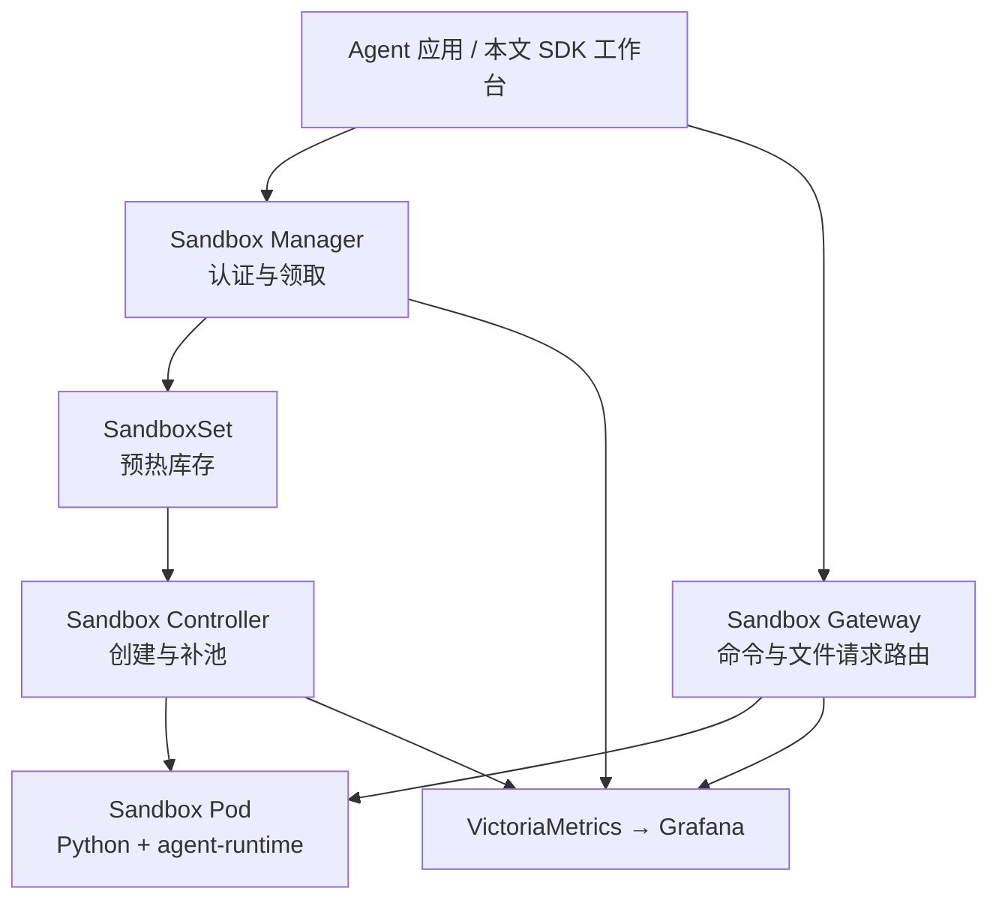
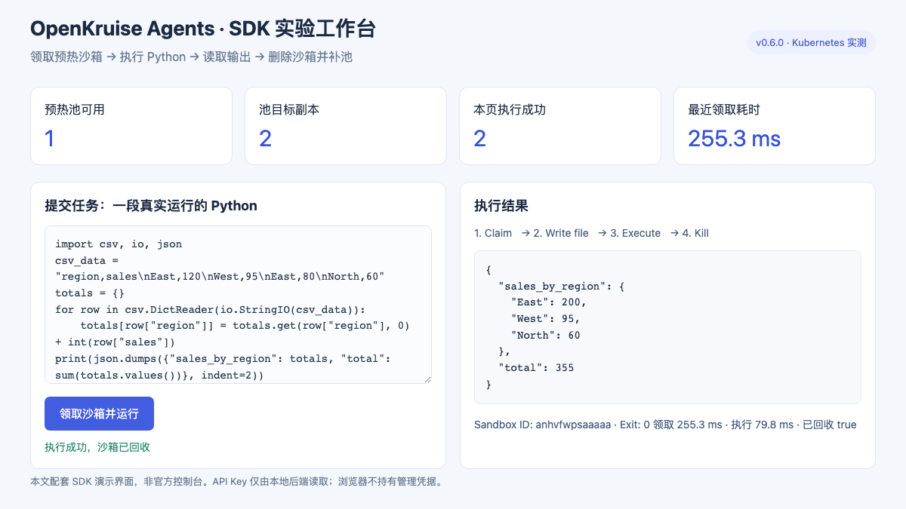
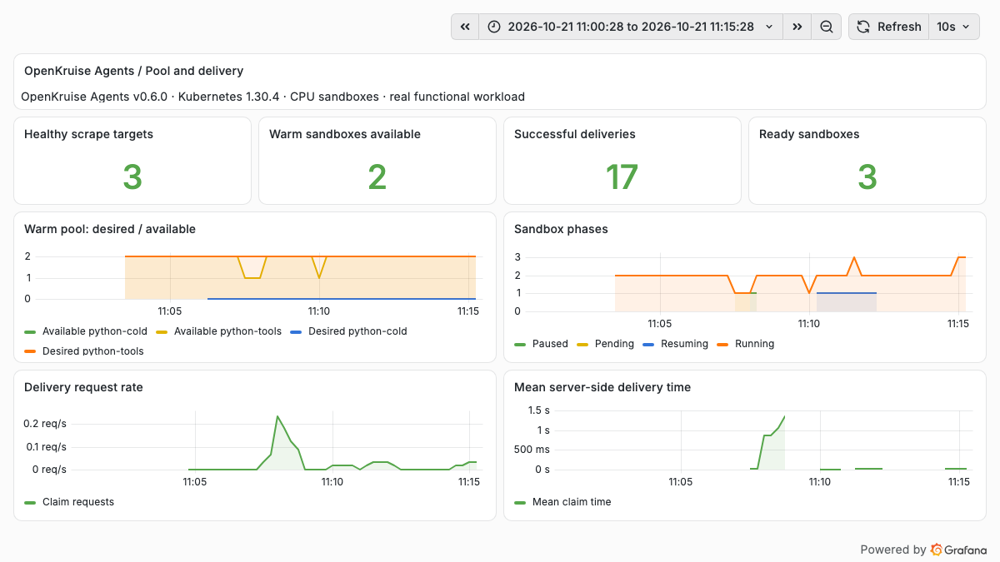
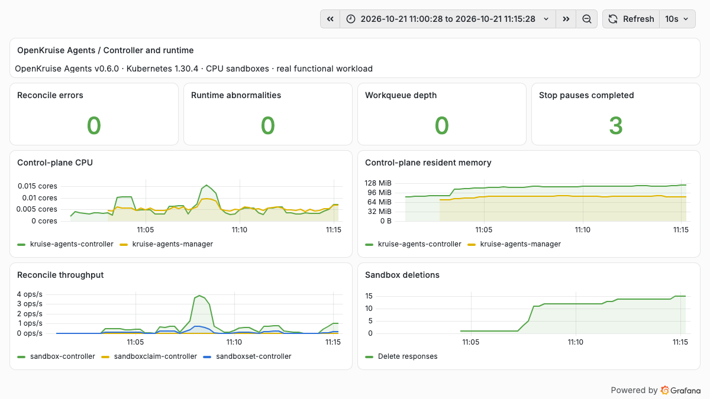

# OpenKruise Agents 实战：预热池、沙箱任务与暂停恢复

Agent 要执行一段 Python、分析一个文件或者启动一个临时 Web 服务，背后都需要一个可以领取、使用和回收的执行环境。当任务量增加，平台还要解决环境准备慢、空闲资源占用、用户会话与资源生命周期脱节等问题。

OpenKruise Agents 把这些事情放进 Kubernetes 的资源模型：用预热池准备环境，用领取接口交付沙箱，再由控制器维护状态、超时和回收。本文在一个 Kubernetes 测试集群中部署 v0.6.0，跑通实际任务，并记录一次暂停后恢复失败的定位过程。集群、节点、仓库与访问地址已脱敏，截图只展示实验对象。

## 1. 它负责 Agent 的哪一部分

OpenKruise Agents 是 OpenKruise 面向智能体执行环境的子项目。它提供沙箱管理控制器和 E2B 兼容接口，供上层 Agent、Notebook 或开发工作台调用。模型推理、任务规划和工具选择仍由应用负责。[项目仓库](https://github.com/openkruise/agents)

这次使用的三个控制组件各有明确职责：

| 组件 | 本次实际承担的工作 |
| --- | --- |
| Sandbox Controller | 调谐自定义资源、创建 Pod、维持预热池、处理生命周期 |
| Sandbox Manager | 接收 E2B API 请求，认证调用者，领取、删除或恢复沙箱 |
| Sandbox Gateway | 将数据面请求转发到对应沙箱，不为每个沙箱创建一个 Service |
| agent-runtime | 注入沙箱的运行组件，配合业务容器中的 envd 提供命令和文件操作 |

CRD 是 Custom Resource Definition，即 Kubernetes 自定义资源定义。本次 Controller Chart 安装 **8 个 CRD**：Sandbox、SandboxSet、SandboxClaim、SandboxTemplate、SandboxUpdateOps、Checkpoint、Commit、PoolAutoscaler。Manager Chart 另带 **4 个流量与安全策略 CRD**，合计 **12 个**。安装了这些定义，不等于已经启用了所有能力。[安装说明](https://openkruise.io/kruiseagents/installation)



理解预热池时，最重要的是区分“库存”和“已交付”。`SandboxSet.spec.replicas=2` 表示维持两个尚未领取的环境；用户领走一个后，控制器会补一个。它不是整个应用最多只能运行两个沙箱的并发上限。生产容量需要同时计算预热库存、活跃会话和正在退出的 Pod。[预热池管理](https://openkruise.io/kruiseagents/user-manuals/warmpool-management)

## 2. 实验环境与安装方式

| 项目 | 实验配置 |
| --- | --- |
| Kubernetes / 运行时 | 1.30.4 / containerd 1.7.14，Linux amd64 |
| OpenKruise Agents | v0.6.0；源码提交 `a1e0811323b71fd9a54efe26b0f4baf19106c84e` |
| Helm Chart | Controller、Manager 均为 0.6.0 |
| 控制组件 | Controller、Manager、Gateway 各 1 副本，固定在一个测试节点 |
| 沙箱镜像 | Python 3.12 slim；agent-runtime v0.3.0；不分配 GPU |
| 预热配置 | `python-tools` 保留 2 个空闲沙箱；`python-cold` 保留 0 个 |
| Python 客户端 | e2b 2.24.0、e2b-code-interpreter 2.4.1，使用上游 customized E2B 补丁 |
| 访问方式 | 现有 NGINX Ingress，经 localhost port-forward 访问 |
| 监控 | 现有 VictoriaMetrics 与 Grafana，新增采集对象及两个实验看板 |

这个规模用来验证资源交付和生命周期，不代表高可用或容量上限。实验没有安装节点 DaemonSet，没有调整宿主机运行时、CNI 或原有监控 Helm 配置，也没有启用 Agentio 出口治理、Checkpoint 和镜像 Commit。

节点不能直接访问外部镜像源，因此先在中转环境同步镜像，核对 amd64 平台的镜像层和配置，再部署到测试节点。公开的[镜像来源记录](https://github.com/runzhliu/aik8s/blob/main/examples/openkruise-agents/images.source-lock.json)保留官方引用与摘要，不包含内部镜像仓库。

安装使用官方 Chart 渲染清单，再通过 kubectl 应用，**没有创建 Helm release**。配套[示例目录](https://github.com/runzhliu/aik8s/tree/main/examples/openkruise-agents)提供渲染器、验证脚本、SDK 工作台和监控配置。渲染器显式写入资源命名空间，限制实验 Webhook 的命名空间选择器，并降低 Chart 中默认偏大的 API 客户端 QPS 和工作线程数。

```bash
helm pull agents-sandbox-controller --repo https://openkruise.github.io/charts \
  --version 0.6.0 --untar --untardir .local/kruise-charts
helm pull agents-sandbox-manager --repo https://openkruise.github.io/charts \
  --version 0.6.0 --untar --untardir .local/kruise-charts

python examples/openkruise-agents/render-lab.py \
  --charts .local/kruise-charts \
  --output .local/kruise-agents-lab \
  --test-node worker-lab
```

只有 CRD 使用服务端应用；Webhook 等安装资源使用普通的客户端应用。原因是 Controller 会维护 Webhook 的 `template` 注解，不能让部署工具与运行中的控制器争用同一字段。渲染文件中还会生成实验管理密钥，应保留在本地，不提交仓库。具体应用顺序见示例目录。

本次沿用官方默认的业务运行链路明文配置，并保留 API Key 认证；浏览器入口仅在本地转发。Webhook 仍通过自己的 HTTPS 服务工作。生产环境需要另外验证入口 TLS、组件间认证和网络策略，不能将 localhost 实验接线直接当作多租户入口设计。

## 3. 从页面提交一段真实任务

截至 2026-10-21，本次锁定的 v0.6.0 Release、官方安装说明与两份 Chart 都没有提供 Agents Web Console。官方组织下另有 `kruise-dashboard`，但核对其后端资源列表后，支持的是 CloneSet、StatefulSet、DaemonSet 等工作负载，没有 `agents.kruise.io` 的 Sandbox、SandboxSet 管理接口；它不能直接充当 Agents 控制台。[安装组件清单](https://openkruise.io/kruiseagents/installation)、[Dashboard 资源类型实现](https://github.com/openkruise/kruise-dashboard/blob/5e0bf54df37049e1d356a00a61e1f7a0cda34890/openkruise-backend/handlers/workload.go)

为了在页面中提交和观察实际任务，本文提供了一个配套 **SDK 实验工作台**：按钮调用真实 E2B SDK，后端连接本次部署的沙箱服务。它是本文的演示应用，不是上游控制台。



页面提交一段 CSV 统计代码，后端依次领取沙箱、写入 `task.py`、执行 Python、读取标准输出，最后删除沙箱。实际返回 East 200、West 95、North 60，总计 **355**。API Key 只由本地后端读取，不发送到浏览器。

核心调用很短：

```python
from kruise_agents.patch_e2b import patch_e2b
from e2b import Sandbox

patch_e2b(https=False)
with Sandbox.create(template="python-tools", timeout=180) as sandbox:
    sandbox.files.write("/home/user/task.py", "print(sum(range(1, 101)))")
    result = sandbox.commands.run("python /home/user/task.py", timeout=20)
    print(result.exit_code, result.stdout)
```

这里使用的是 `commands.run`，不是代码解释器的 `run_code`。普通 Python 镜像配合 agent-runtime 即可验证前者；后者还需要相应的代码解释器服务。不能因为沙箱能运行 Python，就认为所有 E2B 接口都已兼容。[领取与 SDK 能力说明](https://openkruise.io/kruiseagents/user-manuals/sandbox-claim)

## 4. 预热到底省下多少等待

同一测试节点、同一业务与运行组件镜像，顺序执行 5 轮预热领取和 3 轮无库存创建。每轮都运行 Python、完成文件读写并删除沙箱；预热轮次开始前等待库存恢复。计时从客户端调用 `Sandbox.create` 开始，到 SDK 返回对象为止。

| 创建方式 | 完整任务轮数 | 创建中位数 | 最小值 | 最大值 |
| --- | --- | --- | --- | --- |
| 预热池领取 | 5/5 | 52.8 ms | 28.9 ms | 768.1 ms |
| 零预热库存，按需创建 | 3/3 | 2.865 s | 2.820 s | 3.907 s |

预热把 Pod 创建和容器准备提前做掉，用户请求主要支付领取、初始化和路由同步的时间。零库存路径则需要现建环境。这里的“按需创建”**仍命中了节点镜像缓存**，不含外网下载镜像；请求只有 8 轮，也没有并发扫点，因此不据此估计大规模交付 QPS 或尾延迟。

预热不是免费提速。库存一直占用资源；用户领走后，补池还会创建新 Pod。如果只看池大小，没有统计活跃沙箱和退出中的 Pod，资源预算会偏小。

## 5. 隔离、回收与一次恢复故障

| 验证项 | 实际结果 |
| --- | --- |
| 命令执行与文件读写 | 8 轮创建任务全部通过，计算输出为 5050，文件往返内容一致 |
| 文件系统分离 | A 写入标记文件，B 看不到；两个沙箱 ID 不同 |
| 自动补池 | 领取和删除之后，空闲库存恢复为 2 |
| 认证 | 不带 API Key 创建沙箱，返回 HTTP 401 |
| 超时边界 | 20 秒请求返回 HTTP 400；本次配置允许 30～3600 秒 |
| TTL 自动回收 | 30 秒超时沙箱到期后查询返回 HTTP 404，两次观测约 29.8～30.3 秒 |
| Stop 暂停与恢复 | 修正运行组件的镜像引用后通过；ID 保持，Pod UID 改变，根文件系统标记消失 |

TTL 是 Time to Live，即生存时间。表中的回收时间从创建接口返回后开始观察，服务端起算更早，因此不能把 29.8 秒解释为提前回收。文件系统分离也只证明本轮两个容器环境的文件没有串用，不能替代内核隔离、网络隔离或对抗测试。

### 5.1 Pod 已经 Running，为什么沙箱还在 Resuming

第一次完整的 Stop 恢复验证没有通过：暂停成功，新 Pod 也已启动，但 Sandbox 一直停在 `Resuming`，最终 NGINX 返回 504。

控制器日志给出了比入口超时更具体的线索：

```text
init container image mismatch between spec and status, waiting
container: agent-runtime
specImage: registry.example.com/lab/agent-runtime:v0.3.0@sha256:<manifest-digest>
statusImage: sha256:<image-config-digest>
```

在本次 containerd 1.7.14 环境中，使用带摘要的镜像引用时，状态返回了镜像标识。v0.6.0 的 `isContainersConsistent` 会检查 init container 的镜像；它调用的 `imageRefsEqual` 只做镜像名称标准化，无法把完整引用与配置摘要关联起来，因此始终等待“一致”。这个判断位于恢复状态推进路径；只看 Pod Ready 或调谐错误计数，容易漏掉它。[锁定版本源码](https://github.com/openkruise/agents/blob/a1e0811323b71fd9a54efe26b0f4baf19106c84e/pkg/controller/sandbox/core/common_control.go#L317)

实验处理是为**同一份运行组件镜像**建立专用标签，核对内容后仅调整 agent-runtime 的引用，没有修改控制器判断，也没有改宿主机。随后复测，暂停约 **8.64 秒**，恢复约 **3.14 秒**，执行接口再次可用。前面的 504 记录与后续复测结果均保留在[原始结果目录](https://github.com/runzhliu/aik8s/blob/main/examples/openkruise-agents/results/README.json)。

这是一种已验证的环境规避方式，不是建议生产环境普遍放弃摘要固定。长期应让镜像一致性判断正确区分镜像名称、Manifest Digest 与 Image ID，并验证真实运行内容；也不能简单让比较函数永远返回 true。

### 5.2 Stop 恢复不等于内存快照恢复

本次显式设置 `pauseStrategy.type: Stop`。源码定义很明确：Stop 删除 Pod，内存和根文件系统内容不保留，只有单独持久化的数据才可能存续。[策略类型定义](https://github.com/openkruise/agents/blob/a1e0811323b71fd9a54efe26b0f4baf19106c84e/api/v1alpha1/sandbox_types.go#L178)

实验也验证了这一点：恢复前后 Sandbox ID 相同，Pod UID 不同，写在 `/home/user` 的标记文件不见了。固定逻辑身份方便应用继续定位环境，但不意味着 Python 变量、安装进可写层的软件包或进程状态会自动恢复。

Hibernate、内存或 GPU 状态保存需要另外的实现与依赖。本次没有配置或验证这些路径，不能将这组 Stop 数据当作 Checkpoint 性能。

## 6. 看板要同时看交付与控制器

新增三个 `VMServiceScrape`，分别采集 Controller、Manager 和 Gateway。Controller 指标是带认证的 HTTPS 端点，需要为采集器 ServiceAccount 绑定 `/metrics` 读取权限。实验使用自签证书并跳过该端点的服务端证书验证；正式环境应提供受信 CA。Manager 的交付指标和 Gateway 的数据面指标另行采集。



库存与交付看板关注 `sandboxset_available_replicas`、`sandboxset_desired_replicas`、`sandbox_status_phase`、`sandbox_claim_total` 和交付耗时直方图。图中的服务端平均耗时与前面的 SDK 客户端计时口径不同；混合预热和按需请求后的曲线，也不能直接当作预热领取的平均值。



运行看板进一步观察调谐错误、工作队列、运行组件异常、CPU 和常驻内存。特别值得保留“沙箱阶段”这一维度：这次恢复故障期间，容器可以正常运行，调谐也未必抛出错误，但 `Resuming` 已经无法按预期结束。生产告警应覆盖阶段停留时间和端到端探测，不能只告警 Controller 是否存活。

两份看板及采集清单在示例目录中，可导入已有监控环境。本次没有重装监控栈或覆盖原有采集配置。

## 7. 落地时先把资源和状态边界定清楚

对已经使用 Kubernetes、需要给 Agent 高频交付执行环境的团队，OpenKruise Agents 的价值在于把库存、领取、状态、升级和回收纳入同一套资源管理流程。已有 Agent 应用可以把执行工具接到 SDK，先取得沙箱，再把代码或文件任务交进去，不需要更换模型接口。

真正上线前，还要把几个问题回答具体：库存不足时允许等待多久、最多额外创建多少沙箱、每个用户怎样限制配额、会话到期是否删除数据，以及哪些状态需要跨 Pod 保留。普通容器、Kata 或其他运行后端的隔离条件也应分别验证，不能由项目名称推断安全等级。

如果正在比较其他方案，可以结合此前的 [OpenSandbox 实战](opensandbox-kubernetes-practice.md)与 [Firecracker、CubeSandbox 选型](firecracker-cubesandbox-enterprise-selection.md)，用相同任务检查 SDK、交付延迟、持久化、隔离和运维成本。本文完成的是单节点、小规模 CPU 沙箱验证；没有覆盖多租户压力、控制组件高可用、故障迁移和内存快照。

## 参考资料

- [OpenKruise Agents v0.6.0 Release](https://github.com/openkruise/agents/releases/tag/v0.6.0)
- [官方架构](https://openkruise.io/kruiseagents/architecture)
- [预热池管理](https://openkruise.io/kruiseagents/user-manuals/warmpool-management)
- [暂停与恢复](https://openkruise.io/kruiseagents/user-manuals/pause-resume)
- [本次使用的 customized E2B SDK 补丁](https://github.com/openkruise/agents/tree/a1e0811323b71fd9a54efe26b0f4baf19106c84e/sdk/customized_e2b)
