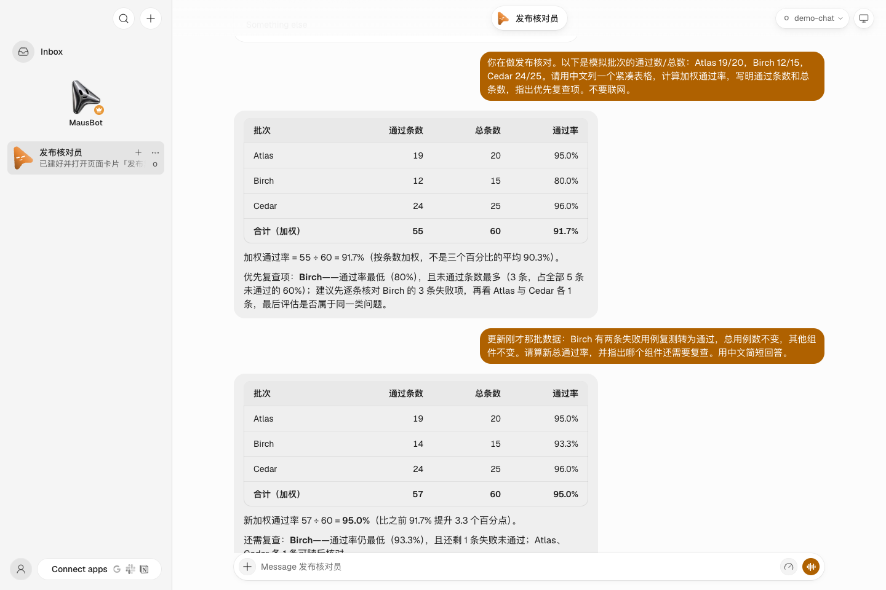
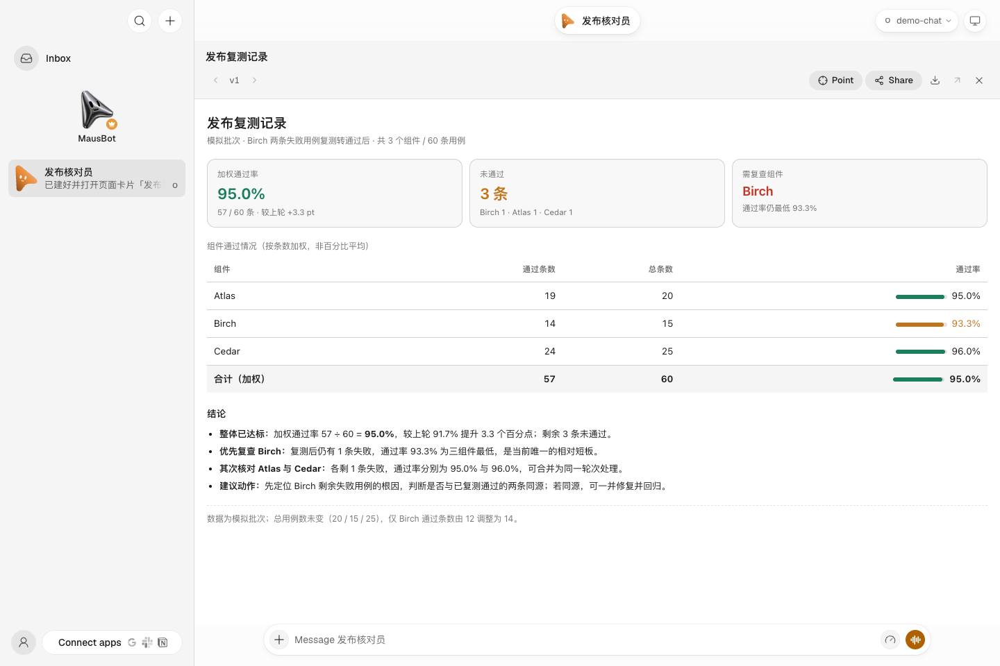
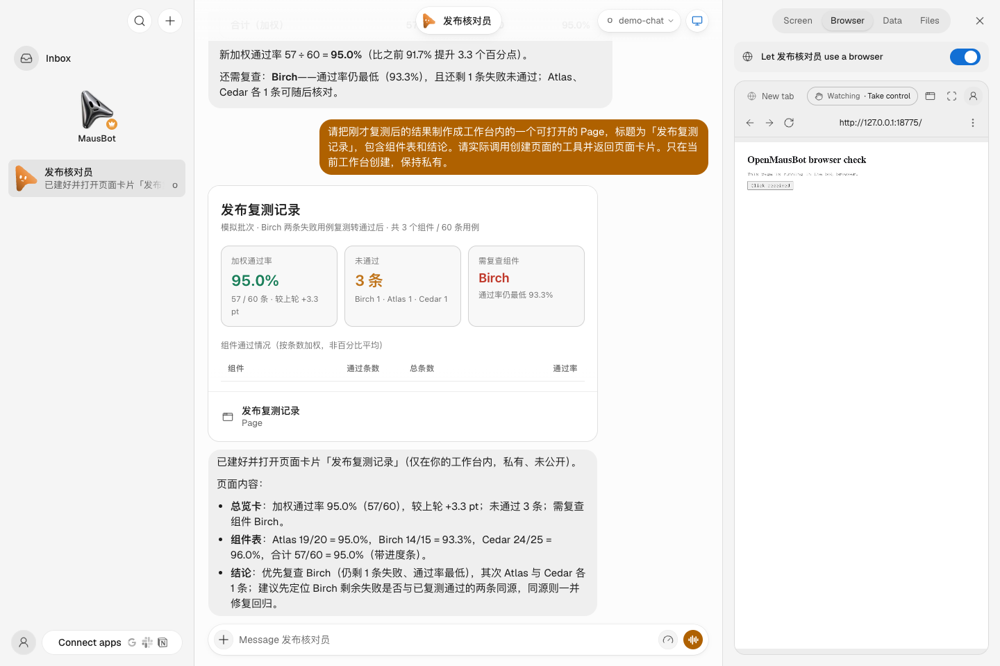

# OpenMausBot Kubernetes 实战：从一条复测消息到一份可下载的报告

OpenMausBot 可以让用户在聊天窗口里给不同的 Bot 分派任务。我们给「发布核对员」一份模拟测试结果，让它找出最值得先复查的组件。第二轮只补充一句“Birch 有两条复测通过”，再请它做一份报告。它把总通过率从 91.7% 更新到 95.0%，生成了可打开的页面卡片。通过工作台下载的 HTML 也包含复测后的三行数据。

## 1. 集群里跑了什么

OpenMausBot 的服务端称为 harness。浏览器把消息交给它，它保存会话、按 Bot 的配置调用引擎，并把工具执行和产物写回对应线程。这次选择内置的 OpenAI 兼容聊天引擎，模型在集群外执行。生成报告使用的是工作台自己的页面工具，整个案例无需给 Bot 准备桌面虚拟机。[官方项目](https://github.com/milind-soni/OpenMausBot) · [引擎与模型接入](https://github.com/milind-soni/OpenMausBot/blob/v0.1.169/apps/docs/content/docs/providers/model-providers.mdx)

| 项目 | 实测配置 |
| --- | --- |
| 版本 | 官方 v0.1.169 的 Linux 服务端发行包，Node.js 24，单副本 |
| 资源 | 应用容器上限 2 CPU、2 GiB 内存，另有模型中继容器。整个实验未申请 GPU |
| 状态 | 2 GiB 的 RWO 持久卷保存应用包和实验数据，工作区在 `/data/.openmausbot` |
| 访问 | 服务端监听回环地址，浏览器通过本机端口转发访问。新浏览器需要一次性设备配对 |
| 模型 | Pod 内的中继接受兼容 Chat Completions 的请求，由办公机上的工作进程转给模型端点。办公机须在线 |

节点直拉官方 GHCR 镜像时连接被重置，Pod 报 `ImagePullBackOff`。我们改用同一版本发布页的 `openmausbot-0.1.169.tgz`，为 Linux x64 准备依赖，在已有的 Node.js 24 容器里启动。此路径验证了官方服务端发行包和 Web UI。聊天和页面工具可直接运行。第 6 节记录了怎样补齐浏览器并看到实时画面。第三方应用连接器和云桌面需要另外配置。[版本与制品](https://github.com/milind-soni/OpenMausBot/releases/tag/v0.1.169) · [官方自托管说明](https://github.com/milind-soni/OpenMausBot/blob/v0.1.169/apps/docs/content/docs/self-hosting/index.mdx)

## 2. 打开工作台并完成设备配对

本次 Deployment 名为 `openmausbot`。用有集群访问权限的终端执行下列命令，再在同一台电脑上打开 `http://127.0.0.1:18791/`。

```sh
kubectl -n openmausbot-lab port-forward --address 127.0.0.1 deployment/openmausbot 18791:8799
```

首次访问会看到配对码输入框。在另一个终端运行下面的命令，将新码粘贴到页面，填好设备名并点「连接」。默认配对码可以使用一次，十分钟有效。下面的路径对应本次 npm 发行包部署，官方镜像中可直接运行 `openmausbot pair`。

```sh
kubectl -n openmausbot-lab exec deployment/openmausbot -c mausbot -- \
  node /data/runtime/node_modules/openmausbot/dist-server/openmausbot.js pair --label "My browser"
```

模型端点通过 `OPENAI_COMPAT_URL` 配置，`OPENAI_COMPAT_MODEL` 指定服务里的模型名，`OPENAI_COMPAT_API_KEY` 由 Secret 注入。本次给应用的是实验中继的凭据，上游模型密钥留在办公机。首页返回 200 时只证明 Web 服务可达，我们用下面的真实任务验收模型链路。

## 3. 只告诉 Bot 哪两条变了

第一轮在同一份模拟发布中提供三个组件的通过数和总数。第二轮仅说明 Birch 的两条失败用例复测转为通过。验收时按用例数加权，分母始终是 60。

| 组件 | 首轮 | 复测后 |
| --- | --- | --- |
| Atlas | 19/20 | 19/20 |
| Birch | 12/15 | 14/15 |
| Cedar | 24/25 | 24/25 |
| 合计 | 55/60，91.7% | 57/60，95.0% |



图 1。第一轮 Birch 占五条失败中的三条。复测后三个组件各剩一条失败，Birch 仍然是通过率最低的组件。两次回复与独立计算一致。

## 4. 从一段回复到一份能下载的页面

第三轮要求 Bot 把复测结果做成工作台内的「发布复测记录」。执行记录中有两次 `agents_find_tool` 和一次 `agents_show_html`，线程随后新增了一条类型为 `app` 的消息。点击卡片打开页面后，我们又走界面的下载接口取回 5,652 字节 HTML，逐项查到三个组件、57 条通过和 95.0%。这一步给出了一件可以脱离聊天记录检查的交付物。



图 2。实际打开的 Page。Birch 的 93.3% 和整体的 95.0% 分开呈现，读者可以从同一张表重新计算两者。

## 5. 重启后还能找回什么

为了让正在使用的浏览器保持在线，我们在同一个 Pod 里启动了一个单独的 harness 进程，用独立端口和卷上的另一个数据目录。让测试 Bot 回答 37 + 46，记录线程 ID、消息 ID 和回复正文，然后向这个测试进程发出 SIGTERM。进程以 0 正常退出后，使用同一目录启动新进程。按原线程 ID 读取，原消息 ID 仍然对应同一条回复 `83`。这次验证的是已完成对话的进程级恢复。Pod 驱逐、节点丢失以及生成中途断电后的续跑需要各自设计实验。[官方数据与备份说明](https://github.com/milind-soni/OpenMausBot/blob/v0.1.169/apps/docs/content/docs/self-hosting/data-and-backups.mdx)

## 6. 在右侧面板里打开 Bot 自己的浏览器

登录工作台的 Chrome 和 Bot 打开网页用的 Chrome 运行在两台不同的机器上。前者在访问者的电脑上，后者在本次实验的 Pod 里。因此，配对成功、聊天有回复时，右侧「浏览器」仍可能显示「尚未安装浏览器」。

这次点「安装浏览器」后出现 `fetch failed`。检查 Pod 发现，npm 服务端能启动，但缺少 `agent-browser` 和 Chrome。测试命名空间限制出站，安装器也取不到所需文件。我们从同版本的官方 Linux 镜像离线提取 `agent-browser 0.37.0`、`Chrome for Testing 158.0.8127.36` 和运行库，放进工作台的持久卷。工具开始回传画面后，工作台仍显示上一次安装的错误。保留持久卷并重启工作台后，浏览器面板才恢复。[浏览器打包与容器运行说明](https://github.com/milind-soni/OpenMausBot/blob/v0.1.169/docs/browser-packaging.md)

验证时，我们在 Pod 内启动一个只监听回环地址的测试页，在 Bot 的浏览器里打开 `http://127.0.0.1:18775/`。工作台右侧显示了网页标题和测试按钮，实时预览也返回了 1280×720 的图像帧。这个地址指向 Bot 所在的 Pod。该实验验证了受控页面的加载和画面回传，访问公网还取决于出站策略。



图 3。右侧地址栏属于 Bot 的浏览器。点击 “Take control” 可在工作台内接管这个标签页。

「屏幕」面板显示分配给 Bot 的整台电脑。当前 Bot 没有绑定桌面后端，配对办公浏览器也不会授予办公电脑的桌面权限。若要在 Kubernetes 环境继续测试桌面应用，可以单独准备一台运行 Docker 的 Linux 虚拟机，按自托管 VPS 流程通过 SSH 接入，再分配给测试 Bot。这部分尚未实测。[官方电脑类型说明](https://github.com/milind-soni/OpenMausBot/blob/v0.1.169/apps/docs/content/docs/computers/index.mdx) · [自托管 VPS 接入](https://github.com/milind-soni/OpenMausBot/blob/v0.1.169/apps/docs/content/docs/computers/byo-vps.mdx)

如果关心 Bot 能否把持续变化的任务整理成可带走的产物，这个案例可以直接复现。如果关心 Bot 在虚拟桌面上操作文件、如何从工作容器独立核对内容，上一篇 Rakazo 实战验证的是那条路径。[Rakazo Kubernetes 实战](rakazo-kubernetes-practice.md)
