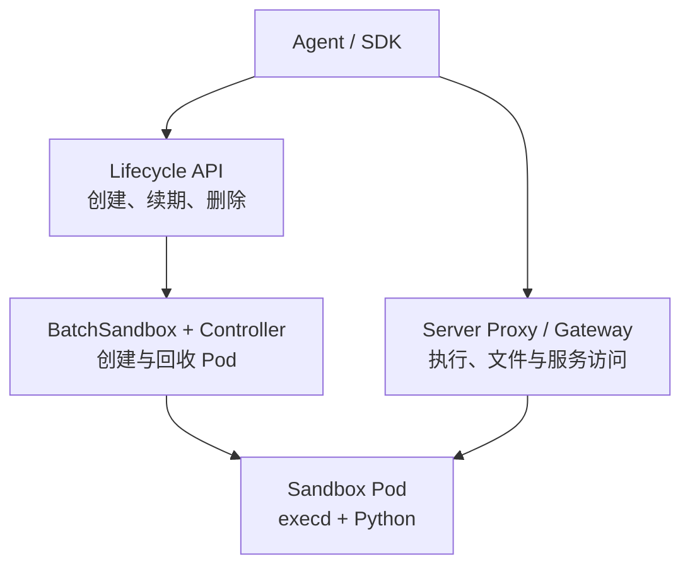
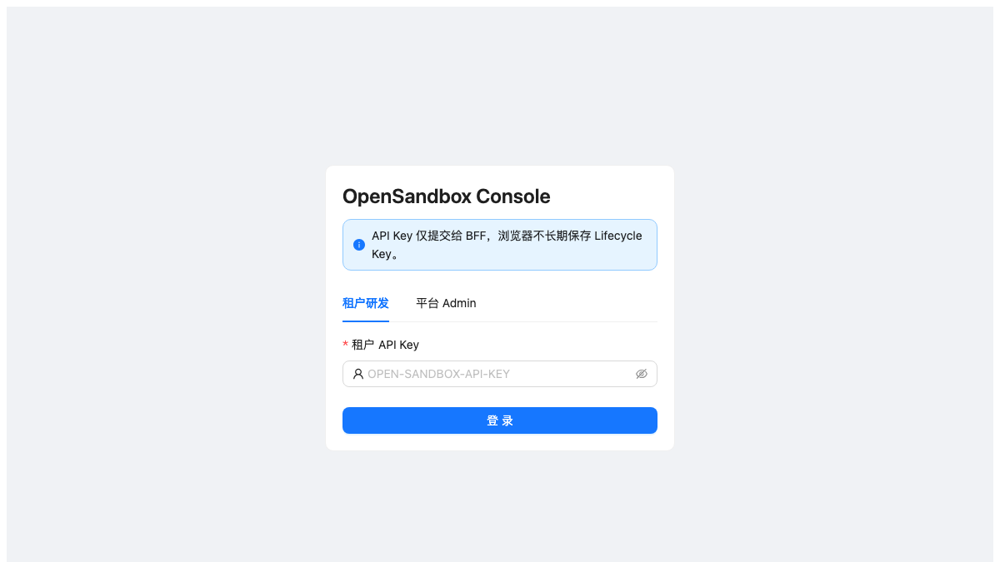
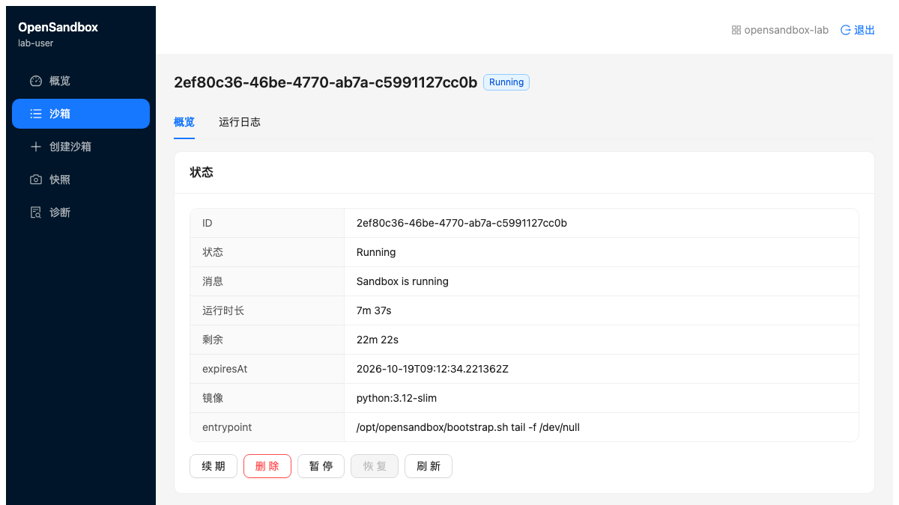
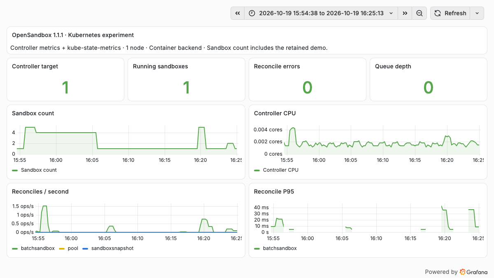

# OpenSandbox Kubernetes 实战：官方 Console、任务执行与自动回收

Agent 修改代码、安装依赖或者执行 Python 分析时，需要一个可以申请、操作和回收的工作环境。把执行器直接放在开发电脑上很方便；当多个任务同时运行，环境归属、文件隔离、访问凭据和资源回收就需要统一管理。

这次在已有 Kubernetes **1.30.4** 测试集群中部署了 **OpenSandbox 1.1.1**，完成真实命令执行、文件上传与下载、HTTP 服务访问、并发任务和生命周期验证，并接上官方 Developer Console。实验使用容器后端和一个工作节点，不需要 GPU。

## 1. 项目归属与本次版本

OpenSandbox 由阿里巴巴发起，原 `alibaba/OpenSandbox` 地址目前跳转到 `opensandbox-group/OpenSandbox`，官方 SDK 发布信息仍列出 Alibaba Group。项目采用 Apache 2.0 协议，可以运行在自有基础设施上。[官方仓库](https://github.com/opensandbox-group/OpenSandbox)、[SDK 发布信息](https://central.sonatype.com/artifact/com.alibaba.opensandbox/sandbox)

服务端、控制器、网关和 SDK 固定为 **1.1.1**。该版本修复了 1.1.0 服务端 Python 包缺少生成代码的问题，本文没有使用浮动的 `latest` 镜像。[1.1.1 发行说明](https://github.com/opensandbox-group/OpenSandbox/releases/tag/release-1.1.1)

| 部分 | 实际版本或来源 | 运行位置 |
| --- | --- | --- |
| API 服务、Controller、Ingress Gateway、execd | `release-1.1.1` | Kubernetes |
| 部署模板 | `531700ca18a7fa5fab6a2f25d6dc68a76eddab12` | 由对应版本 Helm Chart 渲染 |
| Python SDK | `opensandbox==1.1.1` | 本地验证程序 |
| 任务镜像 | Python 3.12 slim，linux/amd64 | 沙箱 Pod |
| 官方 Developer Console | 主分支快照 `834c839dcf587784c16449aed56c21a5cf71b6d1` | 本机 Web 与 BFF，通过端口转发连接集群 |

**Console 不在 1.1.1 正式版目录中。**因此，这是“正式版后端 + 固定主分支 Console”的组合验证；页面出现某个按钮，并不代表该版本组合下的全部功能都已验证。

## 2. 它在 Kubernetes 中做什么

API 服务管理环境生命周期；Controller 把 `BatchSandbox` 等自定义资源转成 Pod；沙箱内的 `execd` 提供命令、文件和执行结果接口。Ingress Gateway 则为沙箱服务提供访问入口。[对应版本架构](https://github.com/opensandbox-group/OpenSandbox/blob/release-1.1.1/docs/architecture/index.md)



创建环境和执行命令是两条不同的路径。API 创建成功后，还要确认执行端点能够访问、命令真正退出、结果文件正确。本文把这些阶段分别验收。

## 3. 部署范围与资源

使用独立命名空间，只部署一个 API 服务、一个控制器和一个网关。控制面 Pod 及测试任务都固定在同一个可用工作节点，没有安装节点级 DaemonSet，也没有改集群网络配置。

| 组件 | CPU Request / Limit | 内存 Request / Limit |
| --- | --- | --- |
| API 服务 | 100m / 1 CPU | 128 MiB / 512 MiB |
| Controller | 100m / 500m | 128 MiB / 256 MiB |
| Ingress Gateway | 100m / 500m | 128 MiB / 256 MiB |
| 每个 SDK 测试沙箱 | 100m / 500m | 128 MiB / 512 MiB |

命名空间另设 ResourceQuota 和 LimitRange，约束总资源及未声明资源的 Init Container。任务 Pod 关闭 ServiceAccount Token 自动挂载，移除 Linux capabilities，并使用 `RuntimeDefault` seccomp 配置。这里验证的是普通容器执行，不能据此声称已经获得虚拟机级隔离。

RBAC（Role-Based Access Control，基于角色的访问控制）也作了区分：控制器保留上游需要的集群级只读缓存，写权限限制在实验命名空间；服务端写权限同样限制在该空间。控制器仍有集群级读取权限，包括 Secret 读取，这套实验配置不能直接当作严格的生产多租户权限方案。

## 4. 安装时实际遇到的两个依赖

第一，不能只安装三个容器后端 CRD（Custom Resource Definition，自定义资源定义）。1.1.1 的服务工厂会组合容器后端与 Fast Sandbox 服务；缺少相关 API 定义时，后台读取会出现 404。补齐对应版本 base 组件里的 **7 个 CRD** 后，这类读取错误消失。安装 API 定义不会自动安装 Firecracker 运行时。[服务工厂源码](https://github.com/opensandbox-group/OpenSandbox/blob/release-1.1.1/server/opensandbox_server/services/factory.py)、[base 组件](https://github.com/opensandbox-group/OpenSandbox/tree/release-1.1.1/manifests/charts/base)

第二，网关即使设置了数据面命名空间，当前版本仍需要集群级只读监听权限。开始只给命名空间 Role 时，日志提示无法在集群范围列出 `BatchSandbox`，网关未就绪；补齐上游所需的只读权限后正常启动。没有因此扩大写权限。

镜像也先做实际拉取：一个公网仓库路径连接被重置，另一个官方仓库路径可用。最终通过镜像中转准备内网副本，按 linux/amd64 核对镜像 config 和层内容；实验没有修改上游程序代码。

### 可复现配置

[配套目录](https://github.com/runzhliu/aik8s/tree/main/examples/opensandbox-kubernetes)提供脱敏的渲染程序和 CSV 验证脚本。渲染程序固定源码版本，使用官方公网镜像，在输出目录生成随机 API Key 和路由签名密钥。

```bash
git clone --depth 1 --branch release-1.1.1 \
  https://github.com/opensandbox-group/OpenSandbox.git /tmp/OpenSandbox
export OPENSANDBOX_SOURCE=/tmp/OpenSandbox
export OPENSANDBOX_OUTPUT=/tmp/opensandbox-lab
python examples/opensandbox-kubernetes/render-lab.py

kubectl create namespace opensandbox-lab
kubectl apply --server-side --field-manager=opensandbox-lab \
  -f /tmp/opensandbox-lab/crds.yaml
kubectl apply --dry-run=server -f /tmp/opensandbox-lab/install.yaml -o name
kubectl apply -f /tmp/opensandbox-lab/install.yaml
```

已有同名资源时先核对归属，示例不会替你处理其他安装的冲突。内网环境需要自行准备镜像映射；生成的密钥、配置和集群访问文件不要提交到公开仓库。

## 5. 官方 Web UI：从登录到创建环境

官方 Developer Console 采用 React 单页应用和 FastAPI BFF（Backend for Frontend，面向前端的后端）。浏览器提交登录凭据后，BFF 维护会话并访问 Lifecycle API；Console 不是直接把长期 API Key 放在浏览器存储中。[固定快照的 Console 说明](https://github.com/opensandbox-group/OpenSandbox/blob/834c839dcf587784c16449aed56c21a5cf71b6d1/console/README.md)



本次使用“租户研发”入口登录。随后在左侧选择“创建沙箱”，填写 `python:3.12-slim`，保留 `tail -f /dev/null` 入口，配置 CPU、内存和超时，点击“提交”。页面返回新环境详情，刷新后状态为 `Running`。



这张图来自官方界面，页面里的 Python 环境是通过表单实际创建的。Console 的 Web 和 BFF 运行在本机，执行环境运行在 Kubernetes；本次没有把整个 Console 作为集群内应用部署。

本机使用以下两个独立转发，分别连接生命周期服务和执行网关：

```bash
kubectl -n opensandbox-lab port-forward svc/opensandbox-server 38080:80
kubectl -n opensandbox-lab port-forward svc/opensandbox-ingress-gateway 38089:80
```

BFF 的 `LIFECYCLE_API_BASE` 指向 `http://127.0.0.1:38080/v1`，前端按官方 Vite 配置代理到本机 BFF。租户配置中的 Key 必须与后端实际接受的 Key 对应。这里验证了登录、创建、概览和详情；没有把实验账号映射当成生产多租户隔离验证。

## 6. 怎样提交真正的任务

Console 的“创建沙箱”提供了工作环境。随后由 SDK 或 Agent 执行器发送文件和命令。本文选择一个容易独立验收的任务：上传 6 行销售记录，在沙箱里按区域汇总，再下载 JSON 结果并核对输入文件哈希。

关键调用如下，完整程序见配套目录的 `verify.py`：

```python
connection = ConnectionConfig(
    domain="127.0.0.1:38080",
    api_key=os.environ["OPENSANDBOX_API_KEY"],
    use_server_proxy=True,
)
sandbox = await Sandbox.create(
    "python:3.12-slim",
    connection_config=connection,
    timeout=timedelta(minutes=10),
    resource={"cpu": "500m", "memory": "512Mi"},
    secure_access=True,
)
try:
    await sandbox.files.write_files(entries)
    execution = await sandbox.commands.run("python /tmp/analyze.py")
    result = await sandbox.files.read_file("/tmp/result.json")
finally:
    await sandbox.kill()
    await sandbox.close()
```

`use_server_proxy=True` 让本机 SDK 通过服务端访问执行端点，适合客户端不能直达 Pod IP 的场景。`entries` 是程序构造的输入 CSV 和 Python 脚本，`result` 必须继续解析并校验，不能仅以命令请求返回成功为准。

实际结果为：

| 验收项 | 结果 |
| --- | --- |
| 输入记录 | 6 行 |
| 总金额 | 400 |
| East / West / North | 150 / 100 / 150 |
| 输入文件回读 | 内容和 SHA-256 一致 |
| Python 执行 | 退出码 0，JSON 内容符合预期 |
| 故意失败的命令 | 正确返回退出码 7，并保留 stderr |

同一环境还启动了 Python HTTP 服务，通过执行代理读回 **1,426 字节**的 HTML 报告，响应为 200。由此验证环境不仅能执行短命令，也能提供一个实际可访问的服务。

## 7. 两层访问鉴权要分别验证

生命周期 API 的 Key 和执行端点的访问令牌承担不同职责。实验结果如下：

| 请求 | 结果 |
| --- | --- |
| 生命周期 API 不带 Key | HTTP 401 |
| 生命周期 API 带正确 Key | HTTP 200 |
| 网关保留路由头、移除 Secure Access 头 | HTTP 401 |
| 网关携带完整端点头 | HTTP 200 |

执行代理同样需要端点返回的安全头。手写 HTTP 请求只附上 API Key 时，最初得到 401；按 SDK 的端点信息补齐头之后成功。这也是集成 Agent 时应保留完整 endpoint 信息的原因。

验证网关时还需保留路由头：如果把所有头一起删掉，返回的可能是“缺少路由”的 400，不能把它记作鉴权通过。

## 8. 启动时间与四并发结果

时间从 SDK 发起创建开始，到 SDK 执行端点健康检查成功结束，包含 API、调度、容器启动和访问路径。它不是 Firecracker 启动时间，也不是纯 Kubernetes 调度耗时。

| 场景 | 样本与结果 | 创建到可执行 |
| --- | --- | --- |
| 首个环境 | 1 / 1 | 6.187 秒 |
| 串行创建、执行与删除 | 3 / 3 | 4.133、3.656、4.601 秒 |
| 首轮四并发 | 3 / 4 就绪，1 个超时 | 成功项为 4.656、4.660、68.574 秒；失败项 90 秒未就绪 |
| 四并发独立复核 | 4 / 4 就绪 | 3.978、5.279、5.255、6.126 秒 |

复核中，四个环境分别写入相同路径的身份文件，执行 45 秒受控 CPU 任务，再读回各自内容；4 个任务全部返回正确结果，也没有读到保留演示环境中的结果文件。完成后逐个删除，4 次后续查询均返回 404，集群 Pod 清单也确认这些环境已清理。

首轮的就绪长尾仍然需要关注。日志显示慢请求停留在执行端点的 `/ping` 访问阶段；本次没有形成足以归因于网络、代理或应用本身的证据。复核成功说明这一轮可以完成，不能抹去首轮失败，更不足以给出生产容量或稳定性结论。

## 9. 续期和到期回收

TTL（Time to Live，存活期限）到期后应回收环境，而不只是让客户端停止等待。先验证续期后的 `expiresAt` 确实晚于原值，再独立创建短期环境观察清理。

1.1.1 创建接口要求 `timeout >= 60` 秒。最初的 30 秒请求返回 422，按版本约束改为 60 秒后完成验证：

| 观察项 | 实测 |
| --- | --- |
| 配置 TTL | 60 秒 |
| 创建到可执行 | 3.685 秒 |
| 可执行后到查询 404 | 57.111 秒 |
| 从发起创建到查询 404 | 60.802 秒 |
| Kubernetes 资源检查 | 对应 BatchSandbox 与 Pod 已删除 |

TTL 从服务端创建时计算，因此后面的 57.111 秒不应被误读为“配置 60 秒却提前回收”。

## 10. 运行期间能观察到什么

在已有 VictoriaMetrics 采集体系中新增一个控制器指标端点和一项 VMServiceScrape，再通过 ConfigMap 加入看板。原有 **77 个目标全部保留，总数增加到 78**，新目标为 UP；没有覆盖现有 Helm values 或重启监控服务。



沙箱数量来自 kube-state-metrics；控制器指标来自其原生 `/metrics`。数量峰值 **5** 包括一个保留演示环境和四个并发环境，不等于五个并发测试任务。截图中的 CPU 是**控制器进程 CPU**，不是全部任务用量。

| 指标 | 本窗口观察 | 怎样理解 |
| --- | --- | --- |
| Controller target | UP = 1 | 采集端点可达 |
| Running sandbox | 峰值 5 | 演示环境与并发环境之和 |
| Reconcile errors | 0 | 控制器未记录协调错误，不代表客户端请求全部成功 |
| Queue depth | 采样最大值 0 | 15 秒采样未看到排队，不能证明瞬时从不排队 |
| Controller CPU | 最大约 0.00433 核 | 这一小规模实验中控制器开销较小 |
| Reconcile P95 | 窗口最大约 42.2 ms | 原生直方图的滚动估算，不能替代端到端启动时间 |

控制器协调完成之后，执行代理的网络请求仍可能失败。因此，首轮 SDK 就绪超时与控制器错误数为零可以同时出现。观察整个链路，比只看控制器是否健康更有用。

## 11. 与腾讯 CubeSandbox 怎样比较

OpenSandbox 和腾讯云开源的 CubeSandbox 都属于 Agent 执行环境平台：上层通过 API 申请环境、执行工具和管理生命周期。选型时需要继续看它们怎样运行沙箱、状态保存到哪里，以及运维团队需要接管哪些组件。下面以 **OpenSandbox 1.1.1** 和 **CubeSandbox v0.7.3** 为范围；OpenSandbox 的实测是本文的容器后端，CubeSandbox 的实测来自本站此前的独立实验，没有进行同条件性能对跑。

### 11.1 执行接口相似，运行时与调度路径不同

本文使用的 OpenSandbox 路径是 `Lifecycle API → BatchSandbox → Pod → execd`，每个测试环境由 Kubernetes 创建 Pod。CubeSandbox 则通过 `CubeAPI → CubeMaster → Cubelet → CubeShim / CubeHypervisor` 管理 microVM（微型虚拟机）；CubeMaster 选择计算节点，节点运行时再创建和恢复 VM。[CubeSandbox 架构](https://github.com/TencentCloud/CubeSandbox/blob/v0.7.3/docs/architecture/overview.md)

CubeSandbox 的 VMM（Virtual Machine Monitor，虚拟机监视器）沿用了 **Cloud Hypervisor** 的实现，不能把它当作 Firecracker 的封装。[仓库内的 VMM 说明](https://github.com/TencentCloud/CubeSandbox/blob/v0.7.3/hypervisor/README.md)

OpenSandbox 也不限于普通容器：1.1.1 已提供对外部 **Fast Sandbox** 平台的适配，通过预热的 Fastlet 承载模板环境，包括 Firecracker microVM。Fast Sandbox 有独立的控制面、运行时和节点依赖；本文安装相关 CRD，并没有安装或验证这套运行时。因此，“OpenSandbox 是容器、CubeSandbox 是虚拟机”只能描述本文两组实验的配置，不能作为两个项目的完整定义。[Fast Sandbox 集成](https://github.com/opensandbox-group/OpenSandbox/blob/release-1.1.1/docs/architecture/fast-sandbox/index.md)

| 维度 | OpenSandbox | 腾讯 CubeSandbox |
| --- | --- | --- |
| 面向应用的接口 | 自有 SDK 与生命周期、命令、文件和端点接口 | CubeAPI 提供 E2B 兼容接口；接入时仍要核对 SDK 版本和实际方法 |
| 本文关注的隔离路径 | 普通容器共享宿主机内核；也可另选 Fast Sandbox 等运行路径 | microVM 使用独立 Guest 内核，由节点上的 VMM 管理 |
| Kubernetes 调度单位 | 本文的 BatchSandbox 路径按沙箱创建 Pod；Fast Sandbox 使用预热池，路径不同 | Kubernetes 托管控制面和节点组件，CubeMaster 在其上调度内部 VM；一个沙箱不等于一个普通 Pod |
| 环境准备 | 本文直接指定容器镜像；Fast Sandbox 则使用预先构建的模板 | 将镜像及初始化环境制成 VM 模板，再通过克隆与恢复创建实例 |
| 暂停与快照 | 语义取决于后端；Fast Sandbox 的 Firecracker 检查点可保存内存、VM 状态和根文件系统 | 支持 VM 快照、回滚和从快照创建新沙箱，本站已单独验证进程内存恢复 |
| 状态与存储 | 本文服务端为 SQLite 加临时目录；Fast Sandbox 另有 CRD 与快照制品存储 | Helm 架构包含 MySQL、Redis 及模板/快照存储；本地 XFS 与共享 S3 路径需要分别设计 |
| 网络和凭据治理 | 本文验证了 API Key、执行端点安全头及网关；出站策略和 Credential Vault 未测 | CubeProxy 管入站，CubeVS 与 CubeEgress 承接网络策略、出站代理和凭据注入；实际覆盖范围仍需验收 |
| 官方界面 | 本文已验证 Developer Console 的登录、创建和详情，采用固定主分支前端快照 | 提供 WebUI 与 CubeOps，可管理沙箱、模板和节点；不能据此推断两者权限模型相同 |
| 节点运维边界 | 本文容器路径没有安装节点 DaemonSet；切换 microVM 路径需要重新核对宿主机条件 | 节点组件涉及运行时、网络、存储和主机权限；v0.7.3 的 Kubernetes 部署文档仍标为 Preview |

表中的接口、组件和存储职责依据各项目固定版本文档整理，不能只按组件数量判断成熟度。CubeSandbox 的 Helm 部署和卸载还涉及宿主机残留配置，详见[节点组件与 Chart 职责](https://github.com/TencentCloud/CubeSandbox/blob/v0.7.3/docs/guide/kubernetes/architecture.md)及[该版本部署限制](https://github.com/TencentCloud/CubeSandbox/blob/v0.7.3/docs/guide/kubernetes/index.md)。

### 11.2 长任务恢复，不能只比较有没有“暂停”按钮

例如，一个 Python 程序已经计算了半小时，中间变量只留在内存里。保存工作目录可以保住输入和输出文件，却不能自动找回解释器中的对象；重新创建 Pod 也不会还原原来的进程堆和栈。要延续这类执行现场，需要应用主动写检查点，或者使用覆盖进程运行状态的快照。

| 已有实验 | 实际验证 | 结论边界 |
| --- | --- | --- |
| 本文 OpenSandbox 容器后端 | 命令、文件、HTTP 服务、鉴权、并发及到期回收 | 没有做进程内存快照，不能宣称支持或不支持内存续跑 |
| 此前 CubeSandbox v0.7.3 | 两套环境各 3 轮，共 6 / 6 通过；杀掉进程后回滚，以及删除原沙箱后从快照新建，内存计数、随机身份和状态摘要均恢复 | 验证了各环境内的快照恢复；没有验证跨节点迁移、节点宕机自动接管或外部挂载卷回滚 |

CubeSandbox 的具体请求、状态记录和验收方法见[进程内存快照与恢复实测](cubesandbox-process-snapshot-recovery.md)。OpenSandbox 的 Fast Sandbox 文档同样描述了由根文件系统、Guest 内存、vCPU 和设备状态构成的检查点；这是另一条需要部署验证的路径，不能用本文容器实验的空白项否定它。[OpenSandbox 检查点机制](https://github.com/opensandbox-group/OpenSandbox/blob/release-1.1.1/docs/architecture/fast-sandbox/checkpoints.md)

存储位置也会改变恢复能力。CubeSandbox 默认本地 XFS 路径不能自动承担源节点丢失后的恢复；跨节点快照需要另配共享 S3/CubeS3lvol 路径，并满足目标节点兼容和快照就绪条件。**同节点恢复、跨节点恢复、故障后自动续跑，应当分别验收。**[跨节点快照条件](https://github.com/TencentCloud/CubeSandbox/blob/v0.7.3/docs/guide/cross-node-snapshot.md)

两套平台的 VM 快照都不能撤销已经写入外部数据库的操作，也不会自动保存办公电脑上 Agent 的对话和审批状态。长任务仍需把任务记录、沙箱恢复点与外部操作的幂等键关联起来。

### 11.3 企业选型，可以从工作负载出发

下面是基于上述架构和实测的选型建议，并非官方产品能力评分。

| 需求 | 建议从哪里开始 | 关键验收 |
| --- | --- | --- |
| 已有 Kubernetes，先把受控 Python、Shell、文件处理接成远程工具 | 参考本文 OpenSandbox 容器路径，先完成一条真实任务链路 | 租户权限、资源限额、命令取消、长尾和回收；不可信代码还需单独评估隔离后端 |
| 需要独立 Guest 内核，并保留有状态程序的执行现场 | 将 CubeSandbox 与 OpenSandbox Fast Sandbox 的 microVM 路径一起列为候选 | 同一任务的内存恢复、存储持久性、网络重连和目标节点兼容性 |
| 已有 E2B 客户端，希望自建执行底座 | 优先验证 CubeAPI 的接口兼容范围 | 实际用到的文件、命令、超时、暂停和恢复方法，不能只检查创建接口 |
| 希望用一套应用接口选择不同执行后端 | 评估 OpenSandbox 的后端适配方式 | 同一 API 在不同后端的快照语义、限制和错误行为，避免把接口一致误当能力完全一致 |

对运维团队而言，本文的 OpenSandbox 容器实验改动较少，可以作为低成本入口；若要求独立内核隔离和 VM 内存恢复，就必须把节点运行时、模板生产、快照存储和升级恢复一起纳入建设范围。CubeSandbox 已把这些环节组织成平台，但它的 v0.7.3 Kubernetes Preview 限制也应进入评估。两者都需要接好企业身份、配额、审计和出站权限，本文部署成功并不替代这些生产验收。

### 11.4 启动速度与成本，下一轮怎样公平比较

不能拿本文 SDK 的数秒“创建到可执行”，直接对比 CubeSandbox 宣传中的毫秒级 VM 启动。两者可能分别包含或省略了鉴权、模板准备、调度、代理和应用就绪，且隔离方式不同。

有意义的对跑应使用相同硬件、依赖环境、CPU/内存规格和网络路径；若比较 microVM，就为双方都选 microVM 后端。分别记录模板未缓存、模板已缓存、预热容量可用和容量不足时的表现。统一从客户端发起请求计时，到首条命令返回正确结果结束，报告 P50、P95、超时和原始成功分母。

成本还要加上控制面、Guest 内核与 VMM、预热空闲资源、节点缓存、模板及快照存储，并测量暂停后的真实资源释放。现有记录可以用于选择下一轮验证重点，还不足以判断哪套平台更快或总体成本更低。更完整的底层职责讨论见 [Firecracker 与 CubeSandbox 企业选型](firecracker-cubesandbox-enterprise-selection.md)。

## 12. 这次实战说明了什么

OpenSandbox 已经把申请环境、执行命令、文件交换、服务访问和回收串成了一套可用接口，官方 Console 也能让使用者直接看到环境的创建与状态。这些能力适合承接 Agent 的工具执行层。

本次没有接入模型完成自主任务，CSV 程序是确定性的工具链验收。它验证执行基础设施，不评价 Agent 的规划或回答质量。普通容器后端也没有验证 Firecracker、gVisor/Kata、内存快照、出站策略或 Credential Vault。

服务端使用单副本和放在 `emptyDir` 中的 SQLite，便于低成本验证；没有验证服务端重建后的历史恢复。若用于长期任务，需要另外验证持久化、快照、会话续跑和外部操作幂等性。界面存在“暂停”“恢复”按钮，不能替代这些验收。

下一步接入实际 Agent 时，应先把一项可独立验收的任务改成远程执行，再验证取消、超时和重试后的资源归属。首轮四并发留下的长尾，也应在扩大使用之前继续定位。

## 参考与证据

- [OpenSandbox 1.1.1](https://github.com/opensandbox-group/OpenSandbox/releases/tag/release-1.1.1)
- [对应版本部署说明](https://github.com/opensandbox-group/OpenSandbox/blob/release-1.1.1/docs/deployment/index.md)
- [官方 Console 固定快照](https://github.com/opensandbox-group/OpenSandbox/tree/834c839dcf587784c16449aed56c21a5cf71b6d1/console)
- [CubeSandbox v0.7.3 架构](https://github.com/TencentCloud/CubeSandbox/blob/v0.7.3/docs/architecture/overview.md)、[进程内存恢复实测](cubesandbox-process-snapshot-recovery.md)
- [脱敏复现程序](https://github.com/runzhliu/aik8s/tree/main/examples/opensandbox-kubernetes)
- [实测数据和指标样本](../../assets/rag-agent/opensandbox-kubernetes/evidence.json)
- [Agent Sandbox 选型](agent-sandbox-selection.md)、[Agent 长任务恢复](agent-long-running-durable-execution.md)
