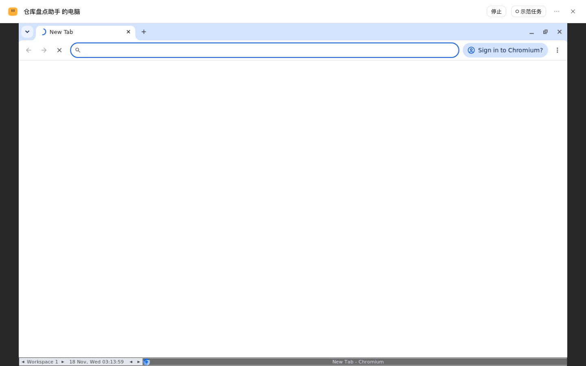
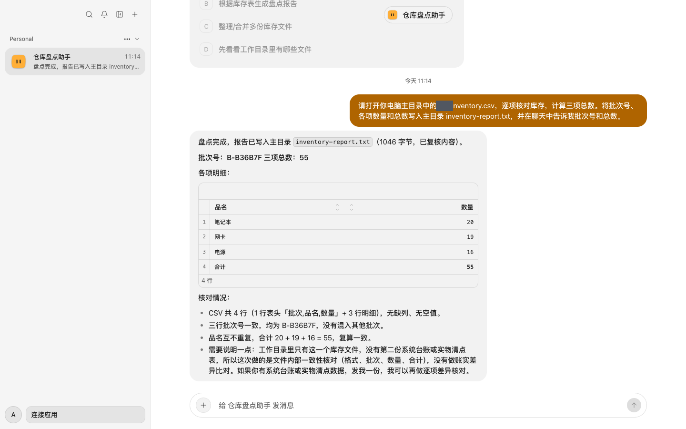
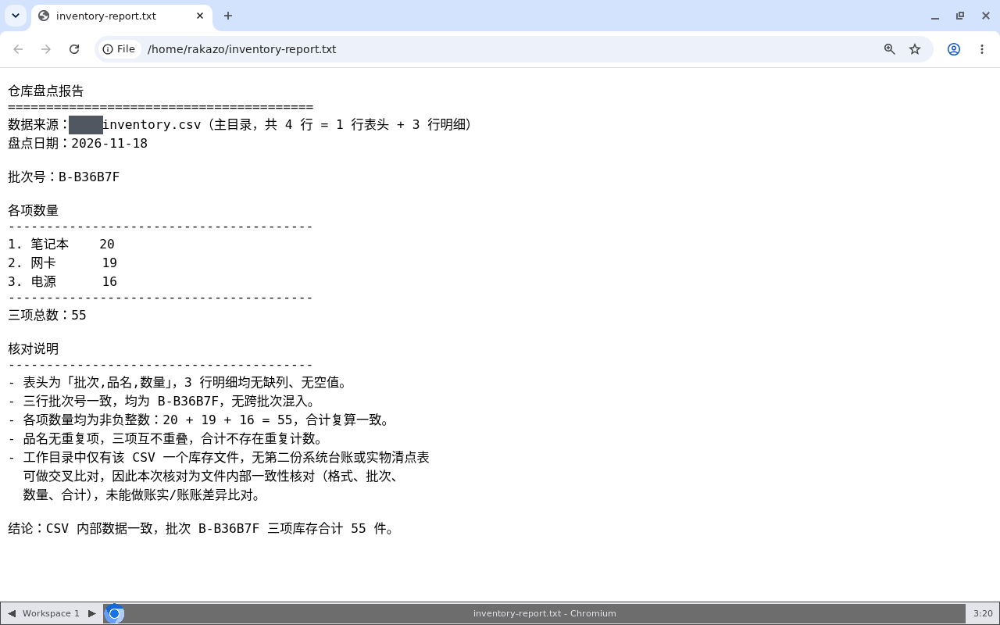

# 在 Kubernetes 上实测 Rakazo：让 Bot 读库存表、写报告，再和 Grok Bot 对比

把一份三行的库存表交给 Bot，只告诉它文件名，请它盘点并留下报告。任务结束后，除了聊天里报出的总数，还能核对什么？在这次实验里，有聊天里的批次和总数、有桌面上能打开的报告，也能从 Kubernetes Pod 取出同一个文件，和应用交付的版本逐字节比较。三项数量分别是 20、19、16，合计 55 件，两份报告完全一致。

Rakazo 是一套可自托管的开源 Agent 工作台。Bot 有聊天入口，也可以使用带浏览器、终端和文件系统的电脑。Grok Bot 提供相似的工作方式，但两者对“这台电脑归谁、谁能读里面的文件、出问题谁来查”有不同的回答。本文用一次真实的 Rakazo 部署展开，Grok Bot 一侧依据官方文档。[Rakazo 项目](https://github.com/elie222/rakazo) · [Grok Bot 云电脑](https://docs.x.ai/grok-bot/computer-and-apps)

## 1. 一次请求会经过哪些组件

用户在 Web 页面提交任务，API 处理会话和电脑访问，Worker 推进后台任务，PostgreSQL 保存应用状态和任务队列。选用 Kubernetes 后，API 和 Worker 通过 Kubernetes API 管理另一个命名空间里的电脑 Pod。浏览器和报告文件都在电脑里，模型则通过兼容 OpenAI 的接口接入。这也是排障时值得分开检查的三条路径：应用到模型、应用到 Kubernetes API、应用到电脑桌面。[Kubernetes 部署说明](https://github.com/elie222/rakazo/blob/7e851b0e58f4aa55b1f108035028969ca711c861/docs/self-host-kubernetes.md)

| 项目 | 这次怎么测 |
| --- | --- |
| 版本 | Kubernetes v1.30.4，应用和电脑镜像对应源码 `235018325032825a5e12f856c4ac0481c168aa5d` |
| 控制面 | Web、API、Worker 和 PostgreSQL 18.6，单副本；应用和数据库使用持久卷 |
| 执行环境 | 一个 Bot 独享一台电脑，电脑 Pod 上限为 2 CPU、4 GiB 内存 |
| 模型和访问 | DeepSeek-V4.1-Flash 经专用中继接入，集群内无需 GPU。浏览器通过本机端口转发访问，公开注册关闭 |

控制器的权限限定在沙箱命名空间，可以创建、读取、删除 Pod，并对 Pod 发起 exec。电脑 Pod 自身关闭 ServiceAccount 令牌自动挂载，丢弃 Linux capabilities，使用 RuntimeDefault seccomp。维护者可以通过 Kubernetes 检查电脑中的文件，Bot 自身无需持有这份集群权限。[上游资源清单](https://github.com/elie222/rakazo/tree/7e851b0e58f4aa55b1f108035028969ca711c861/docs/examples/kubernetes)

## 2. 从部署到打开 Bot 的电脑

这次参考的 Kubernetes 清单版本为 `7e851b0e58f4aa55b1f108035028969ca711c861`。上游示例面向 K3s 1.35 及以上版本。本次在 v1.30.4 调整了网络策略、电脑的节点放置和就绪探针，具体原因见第 4 节。复现时先按同一版本的指南准备存储类、命名空间和准入策略，生成应用配置及独立的数据库、登录和加密 Secret。使用端口转发时，登录、Web 与 API 的 origin 要指向浏览器实际打开的地址。[部署准备](https://github.com/elie222/rakazo/blob/7e851b0e58f4aa55b1f108035028969ca711c861/docs/self-host-kubernetes.md) · [示例目录](https://github.com/elie222/rakazo/tree/7e851b0e58f4aa55b1f108035028969ca711c861/docs/examples/kubernetes)

下面列出与实验直接相关的配置。把模型占位值改为服务端实际公布的同一个模型 ID。API 和 Worker 都需要能访问该端点，并通过 Secret 获得 `RAKAZO_LOCAL_MODELS_API_KEY`。本次连接经过一台中继机，因此该机器的在线状态也会影响模型调用。[自托管模型配置](https://github.com/elie222/rakazo/blob/235018325032825a5e12f856c4ac0481c168aa5d/docs/self-host-models.md)

```dotenv
SANDBOX_PROVIDER=kubernetes
KUBERNETES_SANDBOX_NAMESPACE=rakazo-sandboxes
KUBERNETES_SANDBOX_CPU_LIMIT=2
KUBERNETES_SANDBOX_MEMORY_LIMIT=4Gi
PI_DEFAULT_PROVIDER=local
PI_DEFAULT_CREDENTIALS=host
PI_DEFAULT_MODEL=your-served-model
RAKAZO_LOCAL_MODELS=your-served-model
RAKAZO_LOCAL_MODELS_URL=https://llm.example.org/v1
```

在已配置好的示例目录中分阶段启动。以下使用上游默认命名空间，端口转发在前台运行。数据库就绪后执行迁移，迁移完成后才启动应用并创建首个账号。

```bash
kubectl apply -k . -l rakazo.example/phase=foundation
kubectl -n rakazo rollout status deployment/rakazo-postgres --timeout=300s
kubectl apply -k . -l rakazo.example/phase=migrate
kubectl -n rakazo wait --for=condition=complete job/rakazo-migrate --timeout=300s
kubectl apply -k . -l rakazo.example/phase=app
for component in api worker web; do
  kubectl -n rakazo rollout status "deployment/rakazo-$component" --timeout=300s
done
kubectl apply -k . -l rakazo.example/phase=bootstrap
kubectl -n rakazo wait --for=condition=complete job/rakazo-bootstrap --timeout=300s
kubectl -n rakazo port-forward --address 127.0.0.1 svc/rakazo-web 5173:5173
```

登录后创建 Bot，将电脑设为独享，打开聊天顶部的电脑入口。这里可以看到实际桌面，也可以临时接管它完成上传，再将控制权交还给 Bot。[Rakazo 电脑操作](https://rakazo.com/docs/computer/)



图 1。登录后的 Bot 电脑。顶部是 Rakazo 的控制栏，下面是沙箱中的 Chromium。能打开这张桌面，说明访问已经走过 Web 和 API，抵达电脑 Pod。

## 3. 用一份没有公布答案的 CSV 验收

我们为测试生成一个批次号和三行模拟库存，通过电脑的文件上传入口放入主目录，然后释放控制权。聊天里只给文件名和任务要求：逐行核对、计算总数、把批次和各项数量写进 `inventory-report.txt`，并在聊天中返回批次与总数。批次号和数量只在 CSV 里。截图保留真实桌面，遮住了源文件名中的环境前缀。



图 2。回复读出了批次 **B-B36B7F**，列出笔记本 20 件、网卡 19 件、电源 16 件，合计 55 件。Bot 还说明它只收到一份表，能检查重复项和加总；要核对账实差异，还需要另一份系统台账或实物盘点记录。

任务记录依次出现 `List files → Read file → Shell → Write file → Shell`。为核实写文件这一步，我们在电脑桌面的 Chromium 里打开了 `/home/rakazo/inventory-report.txt`。报告里能看到来源、批次、明细和核对范围。



图 3。地址栏显示沙箱本地文件路径。聊天里的 55 件可以与文件的三行明细、上传前保存的原始 CSV 分别核对。

最后经 Rakazo 的 `computer/downloadFile` 下载报告，再从仍在运行的电脑 Pod 取一份独立副本。下面的命令适用于本次只有一个电脑 Pod 的环境，先将应用下载的文件放在当前目录。

```bash
pod=$(kubectl -n rakazo-sandboxes get pods \
  -l app.kubernetes.io/name=rakazo-computer \
  -o jsonpath='{.items[0].metadata.name}')
kubectl -n rakazo-sandboxes exec "$pod" -- cat /home/rakazo/inventory-report.txt > report-from-pod.txt &&
  cmp inventory-report.txt report-from-pod.txt &&
  wc -c inventory-report.txt
```

`cmp` 退出码为 0，文件大小为 1,046 字节。这样分别验证了内容正确、文件确实写入、应用交付的文件和沙箱中的版本一致。电脑 Pod 被替换后的文件恢复、并发任务和长时间无人值守仍需要独立实验。

## 4. 三个容易混淆的故障现象

| 看到的现象 | 定位依据 | 本次处理 |
| --- | --- | --- |
| 可以登录，启动电脑时却没有可用桌面 | Hubble 记录显示控制器到 Kubernetes API 的流量被拒绝，目的身份是 `kube-apiserver` | 为 API、Worker 增加到该身份实际 API 端口的出站规则，本次是 TCP 6443。电脑 Pod 无需这条管理通路 |
| 电脑 Pod 已运行，但一直没有就绪 | 从电脑容器内请求 `http://127.0.0.1:6080/` 返回 200，kubelet 对 Pod 地址的 TCP 探针却超时 | 本次修改控制器生成的电脑模板，改为容器内 HTTP 检查，并把电脑放到与应用相同的节点。随后另行验证 API 到桌面返回 200，再验证真实页面。跨节点路径仍待验证 |
| 登录页能打开，提交后显示 Too many requests | 测试和截图脚本重复登录，触发了 15 分钟内 10 次的限流 | 脚本改为复用已登录会话；人工访问遇到 429 时，停止重试，等限流窗口过去再登录 |

容器内探针成功只说明桌面进程在监听。若要扩到多个节点，应从 API 所在位置验证到每个电脑 Pod 的桌面请求，再从浏览器验证交互。这样可以区分桌面进程故障、集群网络故障和用户会话问题。

## 5. 和 Grok Bot 比，同一张表在哪里处理

下表的 Rakazo 运行结果来自上述实验，Team 和 Private 的共享规则来自项目文档。Grok Bot 一栏依据 xAI 对个人云电脑和文件交付的说明，本次没有在 Grok Bot 重跑这份库存表。[Rakazo 电脑与共享](https://rakazo.com/docs/computer/) · [Grok Bot 电脑与应用](https://docs.x.ai/grok-bot/computer-and-apps) · [Grok Bot 文件交付](https://docs.x.ai/grok-bot/files-and-results)

| 选型时要问的问题 | Rakazo | Grok Bot |
| --- | --- | --- |
| 表传到哪里，报告从哪里取？ | 本次传入专属电脑 Pod 的主目录。用户通过应用取报告，集群维护者还可以独立核对 Pod 内文件 | 在账户的持久云电脑中处理。用户可在聊天中获取交付文件，也可回到云电脑继续处理 |
| 再创建一个 Bot，能看到这张表吗？ | 默认 Team 模式下，同一空间的 Bot 共享文件和已安装工具。选 Private 可让这个 Bot 拥有独立电脑，本次使用这一模式 | 同一用户的 Bot 共享文件、浏览器登录状态和命令行凭据。各自有独立屏幕，多个屏幕仍然访问同一份文件 |
| 关掉笔记本，盘点还能继续吗？ | 服务端 Worker 和电脑 Pod 都在集群里。本次模型请求还依赖中继机，一旦中继离线，需要模型的后续步骤会受影响 | 通常云端任务可在笔记本关闭后继续；任务若选择使用本机资源，则取决于本机连接 |
| 桌面打不开，谁查哪一层？ | 平台团队可以查控制器、Pod、探针和网络策略，也承担这些组件、存储和模型端点的运维 | 服务商维护云电脑。用户可以查看屏幕、接管桌面，并从应用侧检查连接和交付物 |

本次自托管让团队能指定库存文件落在哪个集群、选择推理端点，并独立取回交付文件。模型调用还可能携带读到的文件内容，评估数据驻留时要把推理端点也算进去。如果目的是让业务同事尽快把资料交给 Bot、关掉电脑、稍后取回文件，Grok Bot 的托管云电脑减少了平台团队需要维护的组件。选型前值得用自己的数据回答两个问题：第二个 Bot 应不应该看到第一份表，以及桌面被回收后，谁能找回并核对最终报告。[站内延伸阅读：Grok Bot 持久化云电脑与企业治理](grok-bot-overview.md)
