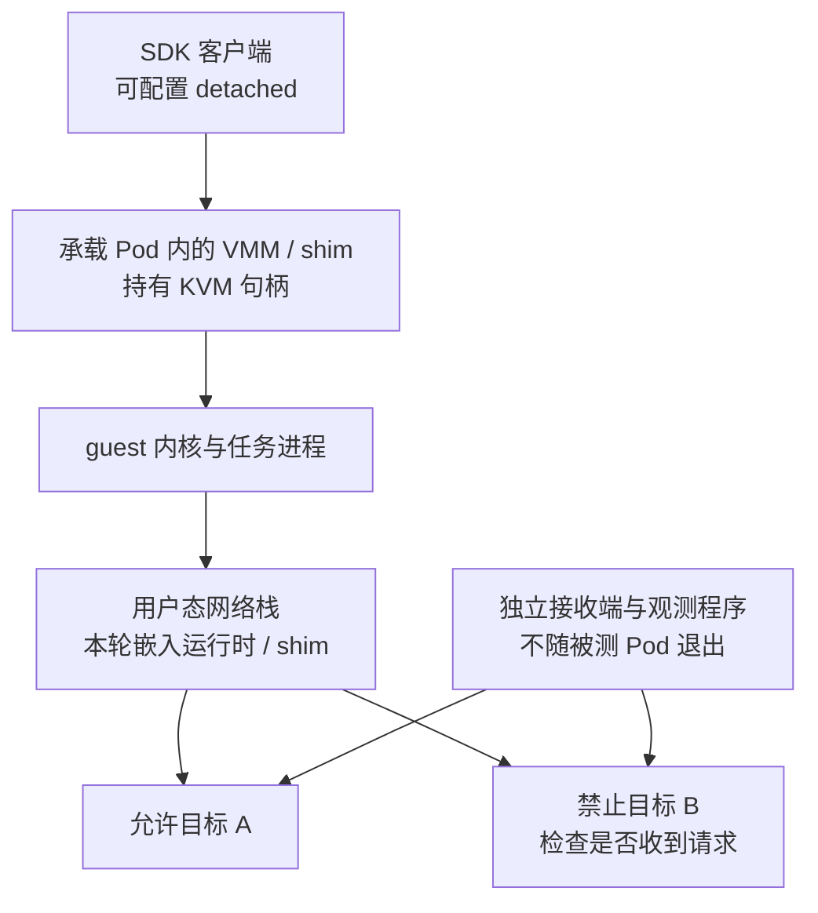
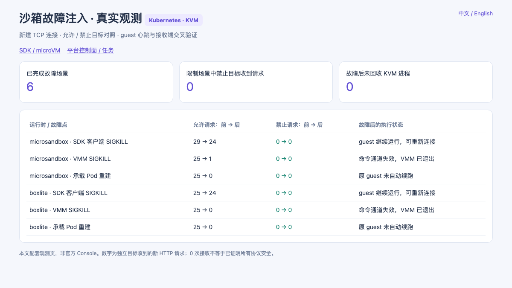
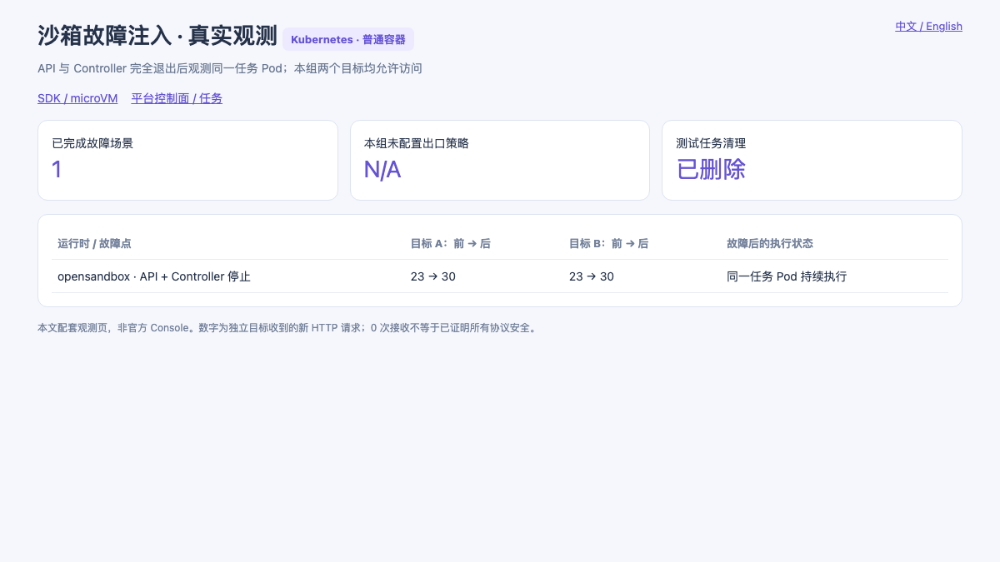
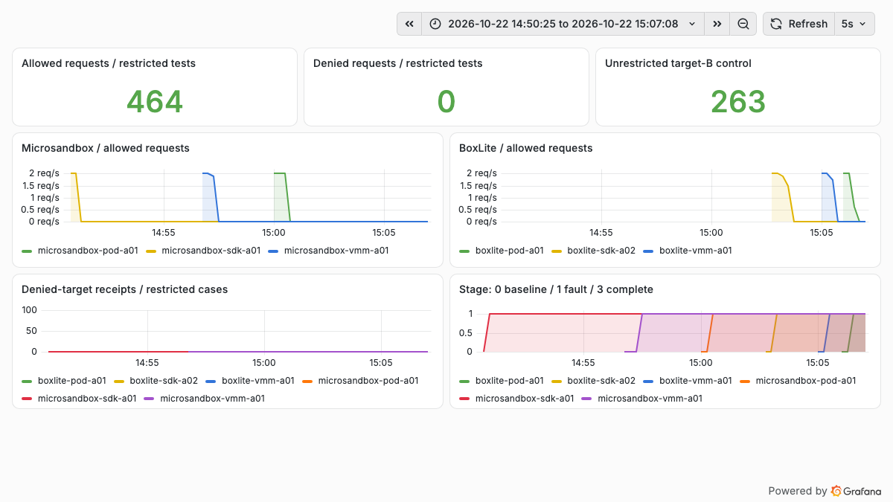

# 沙箱 Pod 挂了以后：microVM、网络策略与控制面的故障实测

把 microVM 跑进 Kubernetes Pod 以后，一个容易被忽略的问题是：调用 SDK 的进程、真正运行虚拟机的进程，以及执行网络策略的组件，是否属于同一个故障范围？如果其中一个挂了，虚拟机会停机、断网，还是失去限制后继续联网？

本轮在隔离的测试环境里实际完成了 **6 个 microVM 故障场景和 1 个控制面停止场景**。结果很明确：detached 模式下，SDK 客户端被强杀后，Microsandbox 和 BoxLite 的 guest 都继续运行，既有白名单继续生效；VMM 被强杀或承载 Pod 重建后，原 guest 停止对外发请求。另一个对照中，OpenSandbox 的 API 与 Controller 全部退出后，原任务 Pod 仍然执行。

这几个结果不能合并成一句“Pod 挂了也没事”。故障发生在哪个进程、guest 是否还活着、流量经过哪里，必须分开看。[复现代码与完整测量数据](https://github.com/runzhliu/aik8s/tree/main/examples/sandbox-fault-injection)已公开，地址、节点、仓库与环境标识均已脱敏。

## 1. 先画清楚进程边界

VMM 是 Virtual Machine Monitor，即虚拟机监控器。KVM 是 Kernel-based Virtual Machine，提供内核虚拟化接口；应用通过 VMM 创建 vCPU、映射内存并处理虚拟设备。KVM 创建出的 VM 资源与文件描述符引用关联，并不是创建完成后就脱离所有用户态进程自主运行。[KVM API 文档](https://docs.kernel.org/virt/kvm/api.html)



在本轮两个嵌入式运行时里，SDK 客户端是通过 `kubectl exec` 启动的附加进程，**不是容器 PID 1**。杀掉它，并不等于杀掉承载容器。两者都明确使用 detached 模式，不能把结果推广到默认生命周期设置。

| 故障动作 | 实际终止的范围 | 本轮如何确认 |
| --- | --- | --- |
| SDK `SIGKILL` | 创建并管理 guest 的 Python 客户端 | 精确匹配本轮 worker，再从新客户端重新连接 |
| VMM `SIGKILL` | 持有 KVM VM / vCPU 句柄的进程 | 检查 `/proc` 文件描述符，要求唯一目标 |
| 承载 Pod 重建 | 独立实验 Pod 内的运行时与 guest | 核对新旧 Pod UID 不同、接收端流量停止 |
| OpenSandbox 控制面停止 | API 与 Controller Deployment | 等待相关 Pod 完全删除，再观察任务 |

脚本只在专用 fault Pod 的进程命名空间中操作，并校验 PID 1 为本实验的空闲进程；不会根据进程名在整台宿主机上执行批量 kill。

## 2. 测试条件与两个受控目标

| 项目 | 配置 |
| --- | --- |
| Kubernetes / 节点 | 1.30.4 / 单个具备 KVM 能力的 x86_64 节点 |
| Microsandbox | SDK 与运行时 0.7.8，本地嵌入式模式 |
| BoxLite | SDK 与运行时 0.10.7，本地嵌入式模式 |
| 每个 microVM | 1 vCPU / 512 MiB，Python 3.12 slim 用户空间 |
| 故障承载容器 | 2 CPU / 2 GiB 上限；运行目录与原实验分开 |
| 权限 | Microsandbox 非特权、设备插件分配 KVM；BoxLite 沿用既有特权实验配置 |
| OpenSandbox | 服务与 SDK 1.1.1，普通容器后端，任务与控制面分离 |
| 网络目标 | 两个独立测试 Pod 的 IPv4 地址，均提供 HTTP 8080 |
| 网络探针 | 每轮依次访问 A、B，间隔 500 ms，单请求超时 1 秒，新建 TCP 连接 |

目标 A 和 B 都由同一个小型 HTTP 接收器实现。接收器记录请求时间、场景标识和计数，独立于被测运行时；guest 另外记录每次访问是否成功。HTTP 请求关闭连接复用，并禁用环境变量代理，避免请求走向另一个出口。

先做无策略对照，确认两个目标从 guest 都能访问。随后 Microsandbox 配置默认拒绝、仅允许 A 的 IP 与 TCP 8080；BoxLite 的 `allow_net` 只列出 A 的 IP。两者限制粒度不同，本轮只比较相同目标能否连接，不把规则表达能力视作完全相同。

故障前至少观察 12 秒，故障动作完成后再观察 12 秒。不同场景还包含调用和检查耗时，前后请求数不必相等。原始数据保留完整后窗口；另外计算排除最初 2 秒后的稳定窗口，不覆盖原分母。

## 3. SDK 死了，guest 和白名单仍在



*真实观测页，来自 guest 记录和独立接收端，并非产品官方 Console。表中“前 → 后”为故障前、故障动作完成后窗口的实际 HTTP 接收数。*

Microsandbox 的 SDK 被强杀后，允许目标接收数从前窗口的 **29** 次变为后窗口的 **24** 次，禁止目标始终为 **0**。从一个新客户端重新连接后，guest boot ID 与故障前相同，原探针仍在执行。

BoxLite 的对应结果为允许目标 **25 → 24**、禁止目标 **0 → 0**，新客户端也能重新连接到同一 guest boot ID。

这证明本轮配置下，SDK 进程不是 guest 和网络规则唯一的持有者。使用 detached 模式后，运行时进程仍然存活，网络限制也继续执行。它不代表 guest 已经脱离容器：如果容器 PID 1 退出或整个容器被清理，不能指望 detached 让子进程免受容器生命周期影响。[Microsandbox detached 生命周期](https://github.com/superradcompany/microsandbox/blob/v0.7.8/docs/sandboxes/lifecycle.mdx)、[BoxLite 跨进程管理示例](https://github.com/boxlite-ai/boxlite/blob/v0.10.7/examples/python/03_lifecycle/share_across_processes.py)

## 4. VMM 死了，不能只盯着 Pod Ready

Microsandbox 中实际被终止的进程是 `msb`；BoxLite 中是 `boxlite-shim`。注入前，两个进程都持有 `anon_inode:kvm-vm` 与 vCPU 句柄，避免把普通管理进程误认成 VMM。

| 检查 | Microsandbox | BoxLite |
| --- | --- | --- |
| 故障前允许 / 禁止目标接收数 | 25 / 0 | 25 / 0 |
| 故障后完整窗口接收数 | 1 / 0 | 0 / 0 |
| 排除最初 2 秒后的接收数 | 0 / 0 | 0 / 0 |
| guest 命令通道 | 失效 | 失效 |
| 最终 KVM 进程检查 | 0 | 0 |

Microsandbox 的一条尾部请求发生在 kill 命令返回后约 **105 ms**。本轮没有抓包，不能断定它具体来自在途数据还是接收端调度；因此保留这条记录，而不是把结果改写成“瞬间清零”。后续窗口中未再收到允许请求，禁止目标也未收到请求。

这类故障还说明，外层 Pod 的 Ready 状态并不足以代表每个 microVM 的健康。SDK 容器主进程仍可能存活，而某个 VMM 已经退出。生产监控需要同时关注执行探针、运行时状态、KVM 进程和业务端点。

## 5. Pod 重建以后，PVC 没丢也不会自动续跑

两个运行时的独立承载 Pod 都做了重建。新 Pod 就绪后，没有主动调用 guest 的 `start()` 或 `restore()`；原 guest 不再发送请求，故障后接收数均为 **0 / 0**，新容器中没有原 VMM 的 KVM 句柄。

PVC 保存的是运行目录、缓存或已经写入的状态，不是让原进程保持运行的保证。这与前一篇 [Microsandbox 内存快照实验](microsandbox-kubernetes-practice.md)并不矛盾：前文先显式生成完整快照，再由新 Pod 主动恢复；本轮没有预先创建快照，也没有恢复动作。

因此，需要分别设计三个恢复层次：

1. **文件恢复**：持久卷保留依赖、工作目录和文件，guest 可以重新启动。
2. **执行状态恢复**：从已完成的完整快照恢复 guest 内存与进程，受运行时和硬件兼容性约束。
3. **Agent 任务恢复**：恢复任务步骤、幂等键和外部副作用状态；不能只依赖 guest 内存。

## 6. 网络代理能不能单独 kill：本轮有两项不适用

“网络栈”是功能边界，不一定是进程边界。

Microsandbox 的本地流量经过宿主侧用户态协议栈，由运行时检查策略。本轮没有一个独立网络代理 PID 可供单独终止。[对应版本网络模型](https://github.com/superradcompany/microsandbox/blob/v0.7.8/docs/security/network.mdx)

BoxLite 虽然采用 gvproxy，但 0.10.7 通过库与 FFI（Foreign Function Interface，外部函数接口）集成，在 shim 中创建网络实例。实际进程清单只有 worker、隔离包装进程和持有 KVM 句柄的 shim，没有独立 gvproxy 进程。[GvproxyInstance 实现](https://github.com/boxlite-ai/boxlite/blob/v0.10.7/src/boxlite/src/net/gvproxy/instance.rs)

所以，两个本地版本的“独立网络代理进程强杀”都记为**不适用**，没有把 VMM 强杀包装成另一项代理测试。独立出口代理或 sidecar 的故障，需要用实际采用该架构的部署另测。

## 7. OpenSandbox：API 和 Controller 全部退出，任务仍执行



*本组没有配置出口策略，A、B 都允许访问，因此不使用“禁止目标接收为零”作为验收条件。页面明确标注 N/A。*

本轮在原先没有任务的 OpenSandbox 实验安装中，创建一个独立任务，启动探针，然后将 API 和 Controller 的副本数设为 0。脚本等待相应 Pod 全部删除，再观察 15 秒，最后恢复原副本数。

结果为：

- 故障前，A、B 各收到 **23** 次请求；控制面全部退出后的窗口，A、B 各收到 **30** 次请求。
- 控制面恢复后，核对任务 Pod UID 未改变，任务没有被重建。
- 验证结束后删除任务，API 和 Controller 均恢复为原来的 1 个就绪副本。

这证明本轮普通容器后端的执行进程不依赖 API 或 Controller 持续存活。它没有证明管理功能仍然正常，也没有验证 OpenSandbox egress sidecar 故障或 KVM 后端；本组不承担网络策略安全结论。[对应版本架构](https://github.com/opensandbox-group/OpenSandbox/blob/release-1.1.1/docs/architecture/index.md)

普通容器可能与同节点其他容器报告相同的 boot ID，因此这里用任务 Pod UID 作为身份检查，不能把“boot ID 没变”当成 microVM 级隔离证据。

## 8. CubeSandbox 为什么必须另看节点网络范围

本轮没有对 CubeSandbox 注入故障，下面属于固定版本文档核对。

CubeSandbox v0.7.0 的 Kubernetes 部署，将 Cubelet、网络运行时及可选出口组件放进计算侧 Big Pod。文档明确提醒：该版本的 Pod 网络模式下，重建 Big Pod 会更换网络命名空间，已有沙箱网络会中断。TAP 设备和 CubeVS 网络钩子的位置，比 CubeAPI 是否还活着更关键。[v0.7.0 架构](https://github.com/TencentCloud/CubeSandbox/blob/v0.7.0/docs/guide/kubernetes/architecture.md)、[升级与中断说明](https://github.com/TencentCloud/CubeSandbox/blob/v0.7.0/docs/guide/kubernetes/upgrade.md)

这也不能直接推导成“策略丢了，网络全面放通”。网络接口或转发链路消失，可能先表现为断网；部分宿主状态仍保留时，还需要进一步检查程序、Map、路由和代理是否一致。`hostNetwork` 可以改变网络命名空间的生命周期，但不自动解决所有 VMM、规则恢复和代理可用性问题。

所以，CubeSandbox 需要分别测试 API、Cubelet、VMM、Big Pod 与 CubeEgress，而不能照抄本轮两个嵌入式 SDK 的结论。

## 9. 网络策略“还在”到底是什么意思



*真实监控，限制场景仅展示六个正式测量 case；无策略对照另外展示。流量曲线采用 8 秒 rate 窗口，尖峰和回落不能当作精确的进程退出时刻。看板计数覆盖完整运行期，包含前置校验与清理，不等于正文前后窗口计数之和。*

要把下面三个状态分开：

| 层次 | 保存或执行什么 | 故障时要核对什么 |
| --- | --- | --- |
| 持久化策略 | Kubernetes NetworkPolicy 对象、运行时配置、平台元数据 | 规则是否仍在、版本是否正确 |
| 内核数据面 | eBPF 程序与 Map、iptables/nftables、接口与网络命名空间 | 是否仍挂载、接口是否更换、有没有遗留或遗漏规则 |
| 用户态数据面 | 本地网络栈、出口代理、域名检查与凭据注入 | 进程是否存活，失败时阻断还是退回直连 |

Kubernetes NetworkPolicy 对象不会随一个业务 Pod 自动消失，但其执行依赖支持该能力的网络插件；`hostNetwork` 等路径还存在实现相关的限制。本轮没有停止 CNI 或策略 Agent，也没有验证标准 Kubernetes NetworkPolicy 的故障行为。[Kubernetes 文档](https://kubernetes.io/docs/concepts/services-networking/network-policies/)

本轮能够确认的是：**在这些版本、规则和短时 IPv4 HTTP 新连接下，没有观察到 SDK 退出后禁止目标被放通。** VMM 与 Pod 故障主要表现为执行和通信停止。这不等于证明所有异常路径都满足 fail-closed，即故障时保持阻断。

生产验收还应覆盖：规则加载前是否允许联网、重启后是否回放同一版本策略、已有长连接是否继续放行、DNS 与 IPv6 是否能绕过限制，以及出口代理不可用时有没有直连回退。恢复流程应先建立限制、再释放业务流量；不宜让恢复出来的 guest 在默认宽松网络下先运行一段时间。

## 10. 如何复现，以及哪些结果没有测

[配套目录](https://github.com/runzhliu/aik8s/tree/main/examples/sandbox-fault-injection)包含受控接收器、guest 探针、SDK worker、精确 PID 检查、单场景控制程序、清单生成器和看板。它复用前两篇实验的 PVC，但使用独立 runtime home，不覆盖原工作台。

```bash
python3 examples/sandbox-fault-injection/run_case.py \
  microsandbox sdk \
  --context lab-cluster \
  --attempt a01 \
  --evidence-dir .local/sandbox-fault-evidence
```

运行前需要按目录说明准备专用 Pod、导入 guest 镜像、建立两个接收端的 localhost 转发。每次更换唯一 attempt，先通过无策略对照，再执行限制场景。脚本记录故障前后结果，在 `finally` 中清理自己的 guest；整个实验结束后再删除故障 Deployment。

其他 attempt 也保留在公开结果中：BoxLite 首轮对照因探针文件复制路径问题没有真正发出请求，不能算作策略测试通过；改为从普通文件复制后重测。一个被中断的 SDK 场景未纳入正式结果；OpenSandbox 以严格等待控制面 Pod 完全退出的后续 attempt 为正式结果。

未执行项包括 CubeSandbox 故障注入、CNI/NetworkPolicy Agent 故障、IPv6/DNS、长连接、OOM 选择、节点断电和跨节点恢复。实验结束时所有故障 guest 均已回收，两个故障运行时 Deployment 已删除，OpenSandbox 控制面恢复，原有五台虚拟机继续运行；接收端和只读观测页面保留用于查看证据。
