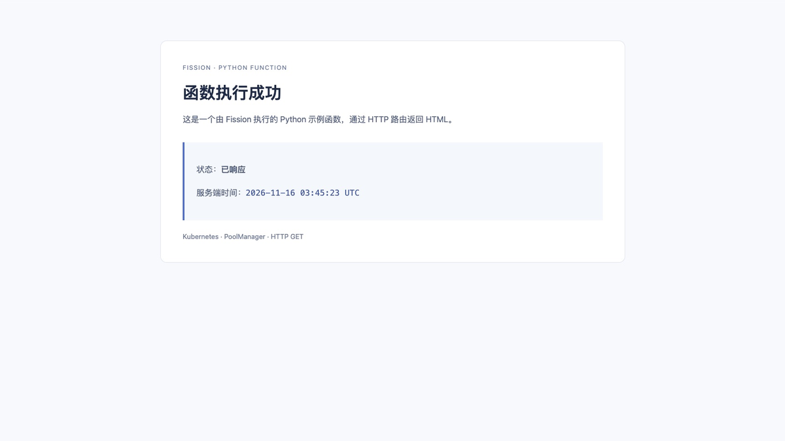
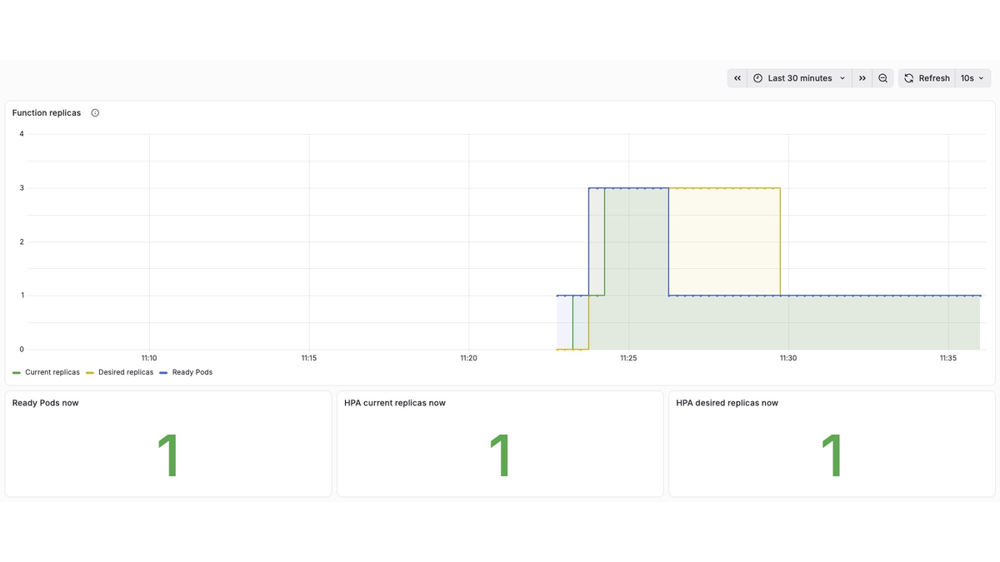

# Fission Kubernetes 实战：函数、定时触发与弹性伸缩

一段 Python 代码，怎样在 Kubernetes 上变成一个可通过 HTTP 调用、按定时器执行、还能随负载扩容的函数？我们在隔离的测试命名空间部署了 Fission，实际跑通这条链路，再与 Knative 对比两者的设计和适用场景。

这是一轮功能验证，不是生产环境可用性证明，也没有对 Knative 做同条件压测。集群名称、地址和内部镜像仓库已脱敏；截图来自真实实验，页面中的示例内容由测试函数生成。

## 实验结论

- Python 函数经 HTTP Trigger 返回成功；更新代码后，原路由返回新内容。定时触发器也两次得到 HTTP 200，完成验证后已删除。
- PoolManager 的慢函数以 3 个并发请求触发专用函数 Pod 从 1 增加到 3。预热池仍占资源，这次没有验证缩零。
- NewDeploy 使用 Kubernetes HPA：3 个客户端合计 120 次请求全部返回 HTTP 200，用时 43.925 秒；观察到副本从 1 扩至 3，负载结束后回到 1。这是一次小规模功能演示，不是吞吐上限或延迟基准。
- Fission 更直接地把代码、运行时和触发器组织为函数；Knative Serving 以容器服务和 Revision 为核心，配合 Functions 也能从源码构建函数。实际选择要看交付方式、请求弹性、事件模型和团队运维能力。



*图：桌面浏览器访问本次自编写的 Python 函数；页面展示函数响应和服务端时间。它不是 Fission 官方控制台。*

## 环境与版本边界

| 项目 | 本次配置 |
| --- | --- |
| Kubernetes | v1.30.4，x86_64 测试集群 |
| Fission | v1.24.0，Helm chart 与 CLI 同版本 |
| Python 环境镜像 | `ghcr.io/fission/python-env:1.34.2` |
| 集群部署 | 独立命名空间，组件使用 ClusterIP；本地端口转发访问 |
| 包存储 | 关闭持久化，仅用于实验；Pod 或存储重建后不保证保留 |
| 范围 | HTTP、代码更新、定时器、PoolManager、NewDeploy/HPA |

选择版本时需要特别留意：本次安装的 v1.24.0 是 GitHub 标记的预发布版本，chart 声明支持 Kubernetes 1.28 及以上。较新的 chart 对 Kubernetes 版本要求更高；v1.23 及以前受到官方披露的安全问题影响，修复版本为 v1.24.0。不要因为本文的实验成功就把该组合直接用于生产，应结合当前稳定版本、集群版本、镜像与安全公告重新评估。[v1.24.0 Chart](https://github.com/fission/fission/blob/v1.24.0/charts/fission-all/Chart.yaml) · [安全公告](https://github.com/fission/fission/security/advisories/GHSA-m63v-2g9w-2w6v)

独立命名空间不意味着完全隔离：安装包含集群级 CRD、RBAC 和准入配置。准入规则覆盖 Fission 资源，不是所有普通 Pod；仍须事先检查集群已有安装、权限和共享组件。实验使用的内部镜像是从官方镜像中转，以下命令使用上游地址；不能访问上游时需先准备自己的可信镜像仓库。

## 1. 请求是怎样运行起来的

```text
HTTP request → Router → Executor → Ready function Pod → Python main() → response
                            ↑
                     PoolManager warm pool
```

PoolManager 提前维持通用运行时 Pod，请求到来时将其特化为函数实例，并补充预热池。这样可以减少部分启动等待，但运行时池和控制面需要持续资源；镜像拉取、调度、特化和队列等待仍会影响首次请求。[Fission Executor](https://fission.io/docs/architecture/executor/)

NewDeploy 的路径不同：函数由专属 Deployment 运行，可使用 HPA 根据 CPU 进行扩缩容。本文观察到的是 Kubernetes HPA，不是 Knative 的请求驱动 KPA。

## 2. 安装 Fission

以下是一套可复现的实验配置，需要 Helm、kubectl、集群管理员权限、metrics-server 和匹配版本的 Fission CLI。先核对是否已有 Fission 的 CRD 与 release；已有安装不要直接覆盖。`persistence.enabled=false` 会使包存储不具备持久性，只适合实验。

```bash
kubectl create namespace fission-lab
kubectl kustomize 'https://github.com/fission/fission/crds/v1?ref=v1.24.0' \
  | kubectl apply --server-side --field-manager=fission-lab -f -
helm repo add fission-charts https://fission.github.io/fission-charts/
helm repo update fission-charts
helm install fission fission-charts/fission-all --version 1.24.0 \
  -n fission-lab --set defaultNamespace=fission-lab \
  --set serviceType=ClusterIP --set routerServiceType=ClusterIP \
  --set analytics=false --set persistence.enabled=false \
  --set preUpgradeChecks.enabled=false --set mqt_keda.enabled=false \
  --wait --timeout 8m
kubectl -n fission-lab get pods
```

本次使用 server-side apply：普通客户端 apply 为部分大型 CRD 写入注解时超过 Kubernetes 注解大小限制。实验额外将控制组件和后续环境调度到健康节点，并配置内部镜像源；这些是测试环境适配，不应照搬其他集群。`preUpgradeChecks.enabled=false` 是首次实验安装的选择，不应作为升级时跳过检查的通用建议。

## 3. 创建并调用 Python 函数

```bash
cat > hello.py <<'PY'
def main():
    return "Hello, world!\n"
PY

fission -n fission-lab env create --name python-lab \
  --image ghcr.io/fission/python-env:1.34.2 --poolsize 1 \
  --mincpu 50 --maxcpu 1000 --minmemory 128 --maxmemory 512 --version 3
fission -n fission-lab fn create --name hello-lab --env python-lab \
  --code hello.py --executortype poolmgr --concurrency 3 --fntimeout 30
fission -n fission-lab httptrigger create --name hello-route \
  --function hello-lab --url /hello-lab --method GET
kubectl -n fission-lab port-forward svc/router 19884:80
```

另开终端执行：

```bash
curl -i http://127.0.0.1:19884/hello-lab
```

本次首次调用返回 200、约 0.132 秒，下一次约 0.058 秒；样本很少，不能据此宣称冷启动性能。将 `hello.py` 改成返回 `Hello from Fission v2!` 后运行 `fission -n fission-lab fn update --name hello-lab --code hello.py`，再次访问同一路由，获得新内容。

一个实际问题是，当前组合下 `fission fn test --name hello-lab` 返回 404，而 HTTP Trigger 路由可用。阅读 v1.24 源码发现 CLI 测试和内部路由使用了不同入口；该现象的完整原因没有定位，本次通过明确创建 HTTP Trigger 验证，不通过关闭内部认证来绕过。

## 4. 定时触发与 PoolManager 并发

```bash
fission -n fission-lab timer create --name periodic-lab \
  --function hello-lab --cron '@every 20s' --method GET
kubectl -n fission-lab logs deploy/timer --tail=30
fission -n fission-lab timer delete --name periodic-lab
```

计时器日志中观察到两次成功调用及 HTTP 200，随后删除计时器，避免长期重复执行。确认日志时应根据本地安装的实际 Deployment 名称调整。

对于每次执行约 1 秒的慢函数，本次将 `--requestsperpod 1`、`--concurrency 3`，并发发起 3 次请求，均成功，分别约 8.533、1.171 和 4.725 秒；采样期间专用函数 Pod 从 1 增到 3。单次请求耗时还包括排队和实例准备；这 3 个数字不能当成稳定延迟分位数。

实验中一个新补充的预热 Pod 在另一节点出现 fetcher 探针超时及重启，后续一次调用也超时。我们只对这个实验 Environment 添加节点选择，放到已验证健康的节点后池恢复，调用重新成功；尚未证明问题根因，更不能据此断定 Fission 普遍有该问题。排查应继续检查节点资源、网络和探针日志。

## 5. 用 NewDeploy 观察 HPA

```bash
cat > cpu.py <<'PY'
import time

def main():
    stop = time.monotonic() + 0.5
    while time.monotonic() < stop:
        pass
    return 'CPU test complete\n'
PY
fission -n fission-lab fn create --name cpu-lab --env python-lab \
  --code cpu.py --executortype newdeploy --mincpu 100 --maxcpu 1000 \
  --minmemory 128 --maxmemory 512 --minscale 1 --maxscale 3 --targetcpu 50
fission -n fission-lab httptrigger create --name cpu-route \
  --function cpu-lab --url /cpu-lab --method GET
kubectl -n fission-lab get hpa,pods -w
```

在已开启端口转发的前提下，可用以下客户端复现请求条件：

```bash
python3 - <<'PYLOAD'
import concurrent.futures
import time
import urllib.request

url = 'http://127.0.0.1:19884/cpu-lab'

def call(_):
    try:
        with urllib.request.urlopen(url, timeout=60) as response:
            return response.status == 200
    except Exception as exc:
        print(type(exc).__name__, str(exc))
        return False

start = time.monotonic()
with concurrent.futures.ThreadPoolExecutor(max_workers=3) as pool:
    results = list(pool.map(call, range(120)))
print(f'HTTP 200: {sum(results)}/120; elapsed: {time.monotonic() - start:.3f}s')
PYLOAD
```

我们用 3 个并发客户端，共调用 120 次 `/cpu-lab`，全部 HTTP 200，总历时 43.925 秒。每次函数在 CPU 上忙循环约 0.5 秒。HPA 观察到的 CPU 利用率一度约为 601%，副本从 1 增至 3，后又缩回 1；该百分比相对 Pod 的 CPU 请求计算，本例含 sidecar，Pod 请求合计约 110m。不同环境与采样时点会影响数值，不代表实际利用率超过节点容量。



*图：实验期间临时搭建的 Grafana 浅色面板，读取现有监控中的 Kubernetes HPA 和就绪副本指标；绿色为当前副本、黄色为期望副本、蓝色为就绪副本。采集与控制循环不同时，曲线不会完全重合。这不是 Fission 官方 UI，也不代表已采集 Fission 专属指标。*

## 6. Fission 和 Knative 有什么不同

下表的 Fission 实测针对 v1.24.0；Knative 是基于官方文档的能力分析，本次没有安装或对比压测 Knative。两个项目都在演进，具体功能及依赖请以选定版本为准。

| 维度 | Fission | Knative |
| --- | --- | --- |
| 主要抽象 | Environment、Package、Function 和 Trigger | Serving 的 Service、Revision、Route；Eventing 的 Source、Broker、Trigger |
| 交付方式 | 提交函数代码或包，由环境镜像提供运行时 | Serving 运行容器镜像；Functions 可从源码构建并部署函数 |
| 执行与预热 | PoolManager 使用预热池特化实例；NewDeploy 使用专属 Deployment | Serving 管理 Revision 的容器实例，请求路径含自动扩缩容组件 |
| 弹性 | 本次 PoolManager 验证按请求增加专用实例，NewDeploy 验证 CPU HPA | KPA 可按并发或请求速率扩缩容；在相应配置下支持缩零及请求唤醒 |
| 版本与流量 | 本次验证代码更新；HTTP Trigger 也支持按权重路由多个函数 | Revision 是版本抽象，可配置不同 Revision 的流量比例 |
| 事件 | 支持 HTTP、定时、Kubernetes 事件和消息队列等触发方式，具体依赖组件 | Eventing 提供 Sources、Brokers、Triggers 与 CloudEvents 等事件模型 |
| 本文证据 | 实际验证 HTTP、timer、预热池及 HPA；未测消息队列 | 基于文档介绍，没有跑 Knative 或进行横向性能对比 |

参考：[Fission 架构](https://fission.io/docs/architecture/executor/) · [Knative Functions](https://knative.dev/docs/functions/) · [KPA](https://knative.dev/docs/serving/autoscaling/kpa-specific/) · [缩零](https://knative.dev/docs/serving/autoscaling/scale-to-zero/) · [流量管理](https://knative.dev/docs/serving/traffic-management/) · [Eventing](https://knative.dev/docs/eventing/)。

如果团队希望交付短小的代码片段，围绕多种触发器管理函数，可以从 Fission 入手；如果已经以容器镜像交付 HTTP 服务，重视 Revision、按请求弹性和流量切分，Knative Serving 更值得优先评估。复杂事件路由要结合具体事件系统比较。预热池与缩零是不同权衡：前者保留资源降低部分等待，后者节省空闲实例但要承担唤醒时间；本次没有证明哪种方案更快或更省钱。

## 7. 后续验证与清理

上生产前应补充镜像与依赖治理、持久化存储、高可用、函数身份与 RBAC、网络策略、资源配额、事件重试/幂等、故障恢复及冷启动和长期负载测试。Fission 运行用户代码，权限隔离需要单独设计，不能把普通容器视作强安全边界。

实验完成后先删除测试函数、触发器与 Helm release，再清理独立命名空间；CRD、ClusterRole 等可能是集群级共享资源，确认没有其他安装和自定义资源依赖后才评估删除。删除 CRD 会删除对应自定义资源，不能直接在共享集群执行盲目清理。
