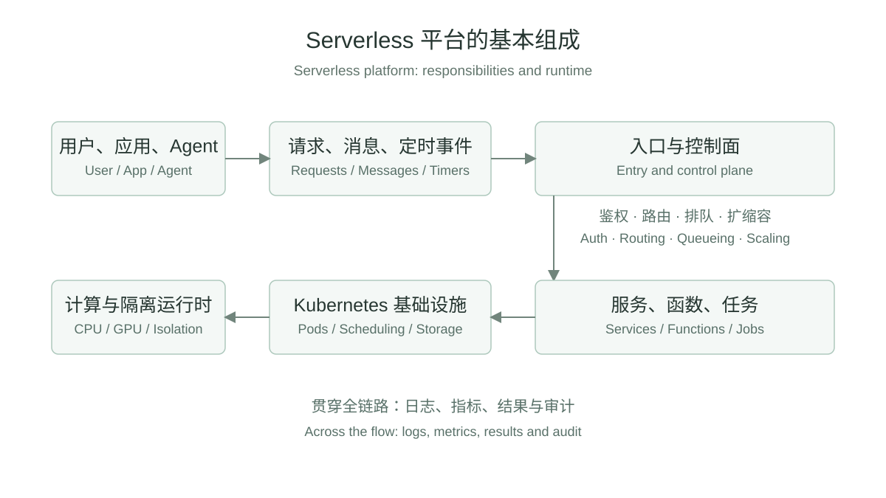
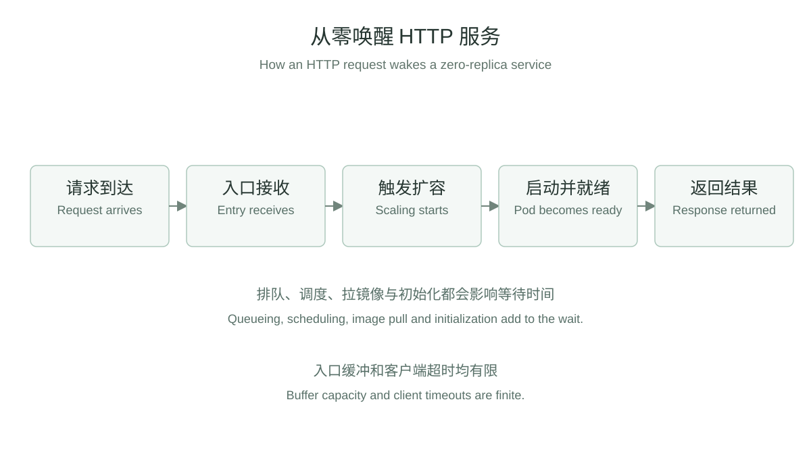

# Kubernetes Serverless 技术综述：从弹性伸缩到按需运行

一个内部接口一天只被调用几次，一个数据清洗任务每小时收到一批消息，一个 Agent 需要临时运行不可信代码。这些工作负载的持续时间和资源需求不同，却有共同诉求：**需要时能够启动，完成后释放资源，使用者不必手工管理实例。**

Serverless 是一种应用交付和资源使用方式。服务器、Kubernetes 节点和存储依然存在，但平台向使用者提供服务、函数或任务入口，并负责实例生命周期、弹性、路由和治理。本文梳理 Kubernetes 上的主要实现路径，为后续专题实测提供选型和观察框架；本文中的架构与案例是方案分析，不代表已经在某个集群完成部署或测试。

## 一页结论

1. **Serverless 不等于函数，也不等于把 Pod 数量设为 0。** 按请求运行的容器服务、事件触发的任务和函数平台都可以采用 Serverless 方式；完整平台还需要入口、可靠性、安全、可观测性和资源治理。
2. **Knative Serving 适合请求驱动的服务。** 它围绕 HTTP 请求、版本和路由组织服务，支持按需扩缩容；零副本时需要入口接收请求并触发唤醒。
3. **KEDA 适合将已有工作负载接入事件驱动扩缩容。** `ScaledObject` 用于扩缩支持的工作负载，`ScaledJob` 按事件指标创建 Job；队列与业务自身仍负责消息和处理语义。
4. **缩零有收益也有代价。** 首次请求需要等待调度、镜像、应用初始化等；预热可以降低延迟，但会持续占用一部分资源。
5. **Pod 缩零不等于节点或账单自动归零。** 固定物理集群通常先获得资源复用收益；只有基础设施和计费方式允许节点回收时，才可能直接减少节点费用。
6. **Agent 沙箱和 Serverless 的职责不同。** 沙箱提供隔离执行环境，平台负责请求、队列、身份、配额和生命周期；两者组合可以形成按需执行体验。
7. **GPU 是否缩零要看工作负载。** 模型权重加载、显存初始化和资源排队可能很慢，对延迟敏感或持续高负载的服务常需保留热实例。

## 1. Serverless 与 Kubernetes 的关系

Kubernetes 提供 Pod、Deployment、Job、Service、调度器和 HPA 等基础能力，但业务方通常仍需管理镜像、实例配置、访问入口和扩缩容策略。Serverless 平台把这些能力组织成更高层的使用方式：开发者交付函数、镜像或任务定义，平台按请求、事件或策略创建并管理执行实例。

图中的控制面表示平台需要组合的职责，并不表示某一个开源项目自动实现全部能力。无论是否暴露底层 Pod，身份、数据存储、容量和故障处理仍然需要设计。

### 1.1 CaaS、FaaS 和 Serverless 容器

| 形式 | 用户主要交付 | 平台主要管理 | 常见例子 |
| --- | --- | --- | --- |
| CaaS / 普通容器平台 | 镜像和工作负载配置 | 容器调度、网络和基础运行 | Deployment、Job |
| Serverless 容器 | 可处理请求的容器镜像 | 请求入口、版本、实例与弹性 | Knative Serving |
| FaaS | 函数代码或函数包 | 函数运行时、触发和执行环境 | Fission、OpenFaaS |
| 事件驱动任务 | 任务镜像、事件源和处理逻辑 | 基于事件的扩缩容或任务创建 | KEDA、Kubernetes Job |

这些类别存在交叉：函数最终也可能运行在容器或 Pod 中；平台的具体交付方式和隔离边界取决于实现。

### 1.2 缩容到零解决什么问题

工作负载空闲时停止其副本，可以释放 CPU、内存和 GPU 等可调度资源。共享集群可以把释放出的容量让给其他任务；如果运行环境还支持节点自动伸缩并按节点计费，节点回收后才可能进一步降低基础设施费用。[Kubernetes 节点自动伸缩](https://kubernetes.io/docs/concepts/cluster-administration/node-autoscaling/)

控制面、消息队列、存储、监控和预热实例通常仍需持续运行。评估收益时，应把这些常驻开销、请求等待和运维成本一起计入。

## 2. 从零到一：请求如何唤醒服务

普通 Service 将请求转发给就绪的后端；当后端为零时，它本身不会可靠地保存请求并自动创建实例。一个按 HTTP 请求唤醒的系统需要有持续可用的入口观察请求、触发扩容，并在有限时间和容量内等待后端就绪。

等待不是无限的：客户端、Ingress 和平台入口都可能有超时，突发请求也可能超过缓冲容量。Knative 的 Activator 在零副本和部分流量场景中承担请求接收和缓冲等职责；实际路径受配置和负载影响。[Knative 请求路径](https://knative.dev/v1.21-docs/serving/request-flow/)

**冷启动时间**至少应分解为：触发与排队、调度与资源等待、镜像拉取、容器启动、应用初始化、就绪探测，以及涉及模型时的权重加载。比较方案时，要说明镜像是否已缓存、节点是否已经存在、并发数和计时起止点，不能把不同条件下的数据直接比较。

## 3. 主要开源方案

| 方案 | 重点能力 | 合适的起点 | 需要另外考虑 |
| --- | --- | --- | --- |
| Knative Serving | 请求驱动的容器服务、版本与路由、弹性 | 低频 HTTP API、Webhook、内部工具 | 网关和网络层选型、超时、冷启动 |
| Knative Eventing | 事件入口、过滤、路由到订阅者 | 多生产者与多消费者的事件流 | Broker 实现、持久化、重试和投递语义 |
| KEDA | 基于外部指标扩缩工作负载或创建 Job | 队列消费者、批处理、已有 Deployment | 事件源可靠性、处理逻辑和指标设计 |
| Fission | Kubernetes 上的函数开发、触发与运行 | 希望以函数为交付单位 | 预热池资源、运行时、隔离和维护 |
| OpenFaaS | 函数入口、打包及运行平台 | 希望采用函数平台和其工具链 | 核对各版本许可与功能，特别是缩零 |
| KServe | 模型部署与推理服务 | 模型生命周期和推理接口 | 模型缓存、GPU 冷启动和部署模式 |
| CubeSandbox 与控制面组合 | 隔离执行环境及其生命周期 | Agent 代码执行、受控测试 | 入口、队列、配额和任务可靠性需组合设计 |

选型时先确定交付对象是“已有容器服务”“队列消费者”“函数代码”还是“隔离执行任务”。这些项目的职责不完全相同，也可以组合使用。

### 3.1 Knative Serving 与 Eventing

Knative Serving 将服务版本、路由与按请求扩缩容结合起来，适合需要访问入口和版本管理的容器化服务。[Knative Serving](https://knative.dev/docs/serving/)

Knative Eventing 用 Broker、Trigger 等对象组织事件接收与分发，消费者可以是 Knative 服务，也可以是其他可接收事件的服务。消息是否持久化、如何重试，取决于具体 Broker 和配置，不能仅凭使用 Eventing 就断言事件不会丢失。官方明确提醒默认的 InMemoryChannel 不应直接用于生产。[Knative Eventing](https://knative.dev/docs/eventing/)；[Broker 配置](https://knative.dev/docs/eventing/brokers/create-broker/)

### 3.2 KEDA：事件驱动扩缩容

KEDA 从队列、数据库或其他支持的事件源读取指标。对 `ScaledObject`，KEDA 负责零与一之间的扩缩容，并与 HPA 配合处理更高副本数；对 `ScaledJob`，它根据事件指标创建 Kubernetes Job，适合独立处理并结束的任务。[KEDA 架构](https://keda.sh/docs/2.21/concepts/)；[ScaledJob](https://keda.sh/docs/2.21/concepts/scaling-jobs/)

KEDA 不是消息队列，也不会替应用自动实现恰好一次处理。任务是否可以重试、何时确认消息、失败进入哪里，需要结合队列和消费者设计。HTTP 场景可评估独立的 [KEDA HTTP Add-on](https://keda.sh/http-add-on/0.16/)，注意其版本对应的 API 和迁移说明。

### 3.3 Fission 与 OpenFaaS

Fission 把函数作为部署单位，并提供不同执行方式：例如 PoolManager 维护预热的通用 Pod，再为函数专用化；也可以使用独立 Deployment 或已有容器。预热能缩短部分启动路径，但预留容量并非免费。[Fission 执行器](https://fission.io/docs/architecture/executor/)

OpenFaaS 同样面向函数和触发器，但不同发行版及许可覆盖的能力不同。以官方当前功能对比为准，评估时应单独核对 Kubernetes 部署、商业使用、缩零、队列和支持服务，避免把商业版能力默认当作社区版能力。[OpenFaaS 版本对比](https://docs.openfaas.com/openfaas-pro/comparison/)

### 3.4 Kubernetes 原生 HPA

HPA 根据指标调整副本。CPU 和内存指标来自运行中的 Pod，当副本为零时不能单靠这些指标判断何时唤醒。

Kubernetes 1.37 将基于 Object 或 External 指标的 HPA 缩零支持推进到 Beta 并默认启用；实际使用还需要可用的外部或对象指标，以及匹配的控制面版本和配置。HTTP 请求缓冲仍需要额外入口。旧集群的版本和 feature gate 行为不同，上线前应逐项检查。[Kubernetes 1.37 HPA 缩零说明](https://kubernetes.io/blog/2026/09/02/kubernetes-v1-37-hpa-scale-to-zero-beta/)

## 4. 三种典型工作流

### 4.1 低频 HTTP 服务

将内部查询接口或 Webhook 打包为容器，通过 Knative 提供入口。无请求时尝试缩零，首次访问唤醒，流量增加时扩容。它适合调用频率低、能够接受首请求等待的服务；有严格首包延迟要求时可设置最小副本或预热。

验收时同时观察首次请求成功率、冷启动和热请求延迟、扩容速度、超时与并发上限。控制面和入口故障也应单独测试。

### 4.2 消息驱动的数据清洗

生产者将数据位置和任务 ID 写入持久队列；KEDA 根据队列指标扩缩 Worker 或创建 Job；Worker 读取数据并将结果写入持久存储，再按业务协议确认消息。

实际设计需要明确重复投递下的幂等键、处理失败的重试上限、死信、任务中断后的恢复、执行超时和结果提交顺序。队列长度降为零并不必然意味着正在运行的任务都已完成，缩容规则必须兼顾进行中的工作。

### 4.3 Agent 按需执行沙箱

DSH、OpenClaw 或其他 Agent 可以通过 Adapter 请求受策略约束的执行环境，运行代码后读取结果并释放沙箱。CubeSandbox 负责具体沙箱环境，Adapter 承担身份和策略等接入职责；队列、资源配额和产品化计量仍需按方案配置或补充。[CubeSandbox Agent Adapter 实践](../rag-agent/cubesandbox-agent-adapter-v07.md)

沙箱生命周期与 Agent 会话、作业及持久结果的生命周期并不一定相同。需要分别定义超时、取消、租约续期、异常回收和结果保存；对长任务，先确认具体运行时的恢复与快照能力，再设计续跑策略。

## 5. GPU 和模型推理为什么更难

GPU 资源不仅需要 Pod 就绪，还可能经历节点资源等待、驱动和设备可用性检查、模型权重下载、加载到显存及推理预热。模型越大，冷启动与缓存管理越可能成为主要成本。

| 场景 | 优先考虑 | 需要验证 |
| --- | --- | --- |
| 非实时 GPU 批处理 | 队列、配额和任务结束后释放资源 | 排队时长、断点恢复、重复执行 |
| 低频小模型推理 | 缩零或少量预热实例 | 首请求延迟、权重缓存、容量上限 |
| 高频或低延迟大模型推理 | 常驻热实例与按负载扩容 | 显存、吞吐、延迟和扩缩容稳定性 |

KServe 可结合不同部署模式管理推理服务。其官方文档将 Knative Serverless 模式主要推荐给预测类推理；生成式推理需要结合 GPU、长请求和运行时特征评估标准 Kubernetes 部署。[KServe Serverless 模式](https://kserve.github.io/website/docs/admin-guide/serverless)

## 6. 生产落地时要补齐什么

- **可靠性**：明确请求超时、重试、幂等、消息持久化、死信、取消和优雅退出；处理副本在执行过程中被终止的情况。
- **安全**：接入身份认证与授权，区分租户，限制服务账号、镜像、网络出口和挂载；对不可信代码选择适当隔离边界。
- **资源治理**：定义每个租户的并发、CPU、内存、GPU、队列深度和运行时间上限，避免突发任务挤占关键业务。
- **可观测性**：关联请求 ID、任务 ID 和执行实例，记录队列等待、冷启动阶段、执行耗时、失败原因、资源消耗和清理状态。
- **数据与成本**：把状态、结果和审计保存在合适的持久存储中；比较常驻与按需两种模式时，将控制面、预热、排队和资源碎片一起计入。

对于私有网络集群，还需提前检查镜像仓库、入口、DNS、证书、对象存储和消息队列的可达性，以及所选版本与现有 Kubernetes 的兼容性。

## 7. 建议的实测路线

1. **Knative HTTP 服务**：记录从零唤醒、空闲缩容、突发请求和版本路由；区分镜像已缓存与未缓存。
2. **KEDA 队列与 Job**：记录消息积压、扩容、处理完成和失败重试；验证重复投递与处理中断。
3. **Adapter 与 CubeSandbox**：验证自然语言触发、隔离执行、结果返回和租约清理，再测试超时和失败路径。
4. **GPU 任务与推理**：在资源允许时比较热实例、缩零和预热方案，统计排队、权重加载、首请求和资源占用。

每轮记录组件版本、集群资源、镜像缓存状态、并发、样本数量、成功与失败次数、P50/P95/P99 延迟及各阶段耗时。先在测试集群做基线，得出数据后再讨论生产选型。

## 延伸阅读

- [AI 工作负载弹性伸缩](autoscaling.md)
- [Agent Sandbox 选型与架构分析](../rag-agent/agent-sandbox-selection.md)
- [CubeSandbox Agent Adapter v0.7 实践](../rag-agent/cubesandbox-agent-adapter-v07.md)
- [模型制品、分发与缓存](../data/model-artifacts.md)
