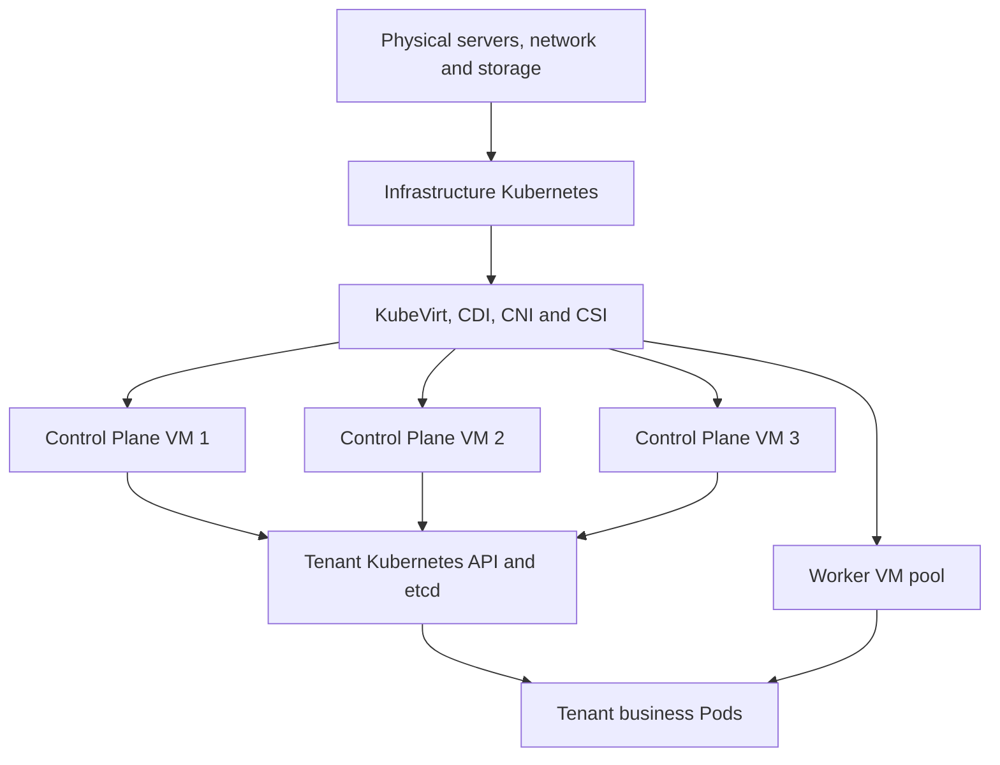
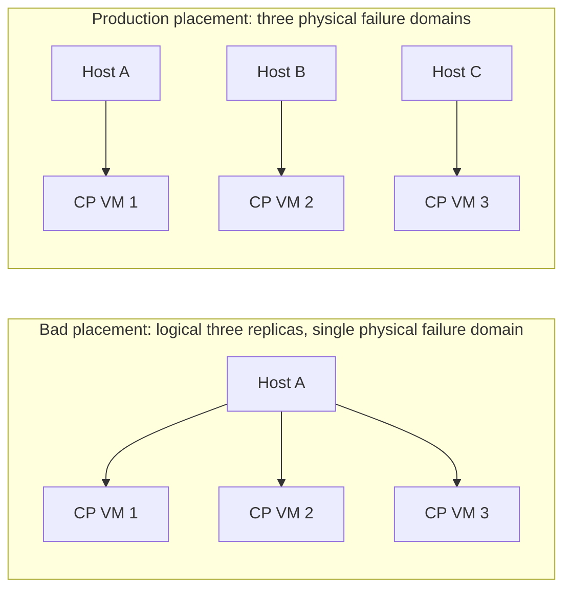
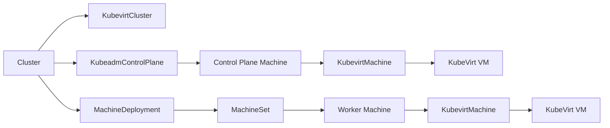

# Running Kubernetes on KubeVirt: Architectural Boundaries, Production Design, and AI Scenario Trade-offs

First build a Kubernetes cluster, install KubeVirt in it, then use virtual machines as the control plane and workers of another set of Kubernetes clusters. This architecture is viable. It turns the underlying Kubernetes into a Kubernetes-native IaaS: physical resources, virtual machines, and tenant clusters are all managed through declarative APIs, while each tenant gets an independent Kubernetes API, version, node operating system, and cluster administrator privileges.

This is not nesting another container orchestration inside containers. The Guest Kubernetes nodes are full virtual machines running on KVM/QEMU; the underlying Kubernetes is responsible for scheduling the `virt-launcher` Pods that host the virtual machines, and the Guest Kubernetes then schedules business Pods. Hardware virtualization still exists only at one layer, but the control plane, scheduler, networking, and storage now appear at two layers.

KubeVirt's responsibility is to integrate virtual machines into the Kubernetes API; scheduling, networking, and storage continue to be delegated to the underlying Kubernetes. When batch-creating and upgrading Guest clusters, the Cluster API Provider KubeVirt (CAPK) can be used to manage virtual machine node lifecycles. [KubeVirt Architecture](https://kubevirt.io/user-guide/architecture/), [Cluster API Provider KubeVirt](https://github.com/kubernetes-sigs/cluster-api-provider-kubevirt)

This article discusses production architecture and acceptance methods, and does not include virtualization performance measurements. CPU, network, and storage overhead should be measured on target hardware, CNI, CSI, and real business workloads; they cannot be derived directly from generic ratios.

## 1. First Clarify What Problems This Architecture Solves



There are two distinct management boundaries here:

| Layer | Managed Objects | Primary Controllers | Typical Failures |
| --- | --- | --- | --- |
| Infrastructure layer | Physical nodes, VMIs, PVCs, VM networks | kube-scheduler, KubeVirt Controller, CSI/CNI controllers | Host failure, VMI Pending, PVC topology not satisfied, migration failure |
| Tenant cluster layer | Nodes, Pods, Services, tenant PVCs | Guest kube-scheduler, Controller Manager, tenant CNI/CSI | Node NotReady, Pod Pending, Service unreachable, tenant volume mount failure |

It is suitable for delivering truly independent Kubernetes clusters:

- Different teams need independent Kubernetes versions, CNIs, CSIs, kernels, or container runtimes;
- Tenants need `cluster-admin` without gaining infrastructure cluster privileges;
- Development clusters, test clusters, or CI clusters need to be created and destroyed quickly;
- Migrating VM workloads such as VMware or OpenStack to a Kubernetes management plane;
- Wanting to use Cluster API to uniformly manage the lifecycle of physical machines, cloud hosts, and KubeVirt VM clusters.

If only business resource and permission isolation is needed, shared-cluster Namespace, RBAC, ResourceQuota, and NetworkPolicy are more resource-efficient. When an independent API is needed but the host kernel can be shared, virtual clusters can be considered. Low-latency GPU, RDMA, DPDK, and high-IOPS databases are usually better suited to physical machine clusters.

| Option | Kubernetes API | Kernel and OS | CNI/CSI Autonomy | Unit Resource Cost | Typical Use |
| --- | --- | --- | --- | --- | --- |
| Namespace isolation | Shared | Shared | Shared | Lowest | Ordinary team isolation within the same platform |
| Virtual Cluster | Independent or logically independent | Usually shared | Constrained by host cluster | Lower | Development and testing, API isolation |
| KubeVirt Guest cluster | Fully independent | VM-independent | Independently selectable | Medium | Cluster-as-a-tenant, version and kernel isolation |
| Physical machine Kubernetes | Fully independent | Physically independent nodes | Fully independent | Higher | GPU, RDMA, low latency, and strong failure isolation |

## 2. Two-Layer Scheduling Changes the Failure Domain

The three control plane nodes in a Guest cluster may be completely independent within `kubectl get nodes`, but the underlying kube-scheduler may still place the corresponding three VMIs on the same physical machine. In that case, a single host failure can lose all three etcd members at once.



Guest Pod anti-affinity rules cannot see the physical nodes behind the VMs. The dispersion of control plane VMs must be done at the infrastructure layer, using tenant cluster ID and node role as labels. Below is a teaching-oriented VMI affinity rule skeleton:

```yaml
apiVersion: kubevirt.io/v1
kind: VirtualMachine
metadata:
  name: tenant-a-control-plane-1
spec:
  runStrategy: Always
  template:
    metadata:
      labels:
        platform.example.com/guest-cluster: tenant-a
        platform.example.com/guest-role: control-plane
    spec:
      affinity:
        podAntiAffinity:
          requiredDuringSchedulingIgnoredDuringExecution:
            - labelSelector:
                matchLabels:
                  platform.example.com/guest-cluster: tenant-a
                  platform.example.com/guest-role: control-plane
              topologyKey: kubernetes.io/hostname
      domain:
        resources:
          requests:
            cpu: "4"
            memory: 16Gi
```

Production platforms should also enforce the following constraints:

1. Disperse the three control plane VMs across three physical nodes, and when conditions allow, continue dispersing across racks or availability zones;
2. Use topology spread for Worker VMs, limiting the number of nodes a single tenant can have on one host;
3. Reserve N+1 host capacity so that critical VMs can still be placed after one physical machine undergoes maintenance or fails;
4. Admission policies reject templates that lack tenant cluster labels, control plane anti-affinity, and resource guarantees;
5. The monitoring system correlates Guest Nodes, VMIs, `virt-launcher` Pods, and physical nodes.

KubeVirt supports node placement methods such as NodeSelector, Affinity, and Taint/Toleration; the final rules still need to be designed in conjunction with the underlying StorageClass topology and availability zone labels. [Node Assignment](https://kubevirt.io/user-guide/compute/node_assignment/)

## 3. Management Cluster Failure Does Not Necessarily Stop Business Immediately, but It Stops Management Capability

When the underlying API Server is temporarily unavailable, already-running VMIs and Guest clusters may continue to provide service, because QEMU, the Guest OS, and the Guest control plane are still running on the hosts. However, VM creation, migration, failure reconstruction, controller reconciliation, and scaling are all affected. If the underlying nodes or storage fail at the same time, the lack of a management plane recovery capability amplifies the impact.

Therefore, two SLOs need to be defined separately:

| SLO | Question It Answers |
| --- | --- |
| Guest service availability | When the underlying management plane is abnormal, how long can existing Guest APIs and business continue to serve |
| Platform management availability | Whether VMs can be created, replaced, migrated, and scaled, and how quickly reconciliation recovers after a failure |

The reliability ceiling of this architecture depends on the entire chain: physical machines, the underlying Kubernetes, KubeVirt, CNI, CSI, the Guest control plane, and Guest workloads. Three Guest replicas do not automatically compensate for a single point of failure in underlying storage or a single point of failure in the network.

## 4. Live Migration Is a Maintenance Tool; Guest High Availability Still Relies on Replicas and Quorum

KubeVirt can live-migrate VMIs, but not all network, storage, and device combinations are migratable. Regular compute migration with a PVC backend typically requires shared RWX access; VMIs using bridge Pod network binding cannot be live-migrated; the migration network, ports, and source/target node primary network interface names must also satisfy the conditions. [KubeVirt Live Migration](https://kubevirt.io/user-guide/compute/live_migration/)

Production strategy should follow this order:

- The Guest control plane first relies on three etcd members to maintain quorum;
- During host maintenance, migrate or restart one control plane VM at a time;
- Check the VMI's `LiveMigratable` condition before migration;
- Separately limit the number of concurrent migrations and bandwidth to prevent migration traffic from impacting business and storage;
- Verify Guest Node Ready, API latency, and etcd leader changes during migration;
- For VMs that cannot be migrated, use controlled shutdown, rescheduling, and Guest replica takeover.

KubeVirt's MigrationPolicy can control bandwidth, timeout, pre-copy, post-copy, parallel migration, and other behaviors, but the API maturity and fields in the documentation may vary by version and should be confirmed against the deployed version. [Migration Policies](https://kubevirt.io/user-guide/cluster_admin/migration_policies/)

## 5. The Network Path Requires Designing Two CNI Layers Simultaneously

A Guest Pod request may traverse:

```text
Guest Pod
  → Guest CNI
  → VM virtio 网卡
  → tap / NAT / bridge
  → virt-launcher Pod 网络命名空间
  → 基础设施 CNI
  → 物理网络
```

Network design is most prone to four types of problems.

### 5.1 Double Encapsulation and MTU

When the underlying VXLAN is stacked with Guest VXLAN, packets are encapsulated twice. The Guest CNI's MTU should be calculated by deducting the underlying encapsulation, VM network binding, and Guest encapsulation overhead from the physical MTU:

```text
Guest Pod MTU ≤ 物理网络 MTU - 底层封装 - VM 网络开销 - Guest CNI 封装
```

Verification should use large packets, Path MTU Discovery, cross-host Services, and long-lived connections, rather than only testing `ping` small packets.

### 5.2 Stable Entry Point for the Guest API

Control plane VM addresses are affected by network binding, VMI recreation, and IPAM policies. CAPK or a self-built platform needs to provide a stable LoadBalancer address for the Guest API, and clearly define health checks, certificate SANs, and the control plane node replacement process.

The official Cluster API quick start also emphasizes in the KubeVirt scenario that the Workload Cluster's API Server runs inside a VM and must be exposed through a LoadBalancer Service or an equivalent external load balancer. [Cluster API Quick Start](https://github.com/kubernetes-sigs/cluster-api/blob/main/docs/book/src/user/quick-start.md)

### 5.3 Network Policies Have Two Enforcement Boundaries

The underlying NetworkPolicy controls the network namespace where VMI Pods reside; the Guest NetworkPolicy controls business Pods. The platform needs to manage the two layers of rules separately, and clarify east-west, north-south, DNS, image registry, and control plane ports. The fact that the underlying VMIs are isolated cannot be interpreted as micro-segmentation already being achieved between Guest business workloads.

### 5.4 Migration Network and Tenant Traffic

At larger scales, a dedicated physical network and Multus NetworkAttachmentDefinition should be configured for live migration, to prevent memory copying from preempting API, storage, and tenant business traffic. KubeVirt supports Pod networks and Multus secondary networks; the specific binding method affects addresses, performance, and migratability. [Interfaces and Networks](https://kubevirt.io/user-guide/network/interfaces_and_networks/)

## 6. Storage: Do Not Stuff All State into VM Disks

Guest clusters easily form a nested storage path:

```text
业务 Pod PVC
  → Guest CSI 或节点文件系统
  → VM 虚拟磁盘
  → 底层 PVC
  → 底层分布式存储
```

This path can work, but database I/O, capacity expansion, snapshot consistency, and failure diagnosis become more complex. It is recommended to first decide who owns the state:

| Data Type | Recommended Approach |
| --- | --- |
| Guest OS root disk | Underlying PVC generated by CDI/DataVolume or managed templates |
| etcd data | Separate fast disk, with native etcd snapshots performed |
| Ordinary temporary data | VM ephemeral disk or Guest ephemeral storage |
| Critical databases | Prefer Guest CSI accessing a separate storage service, or use a separate virtual disk with clearly defined performance boundaries |
| Backups | Guest application backups, etcd backups, and VM/PVC backups performed in layers |

VM snapshots cannot replace etcd snapshots. Even if a live VM snapshot achieves file system consistency, it does not necessarily yield an application-consistent etcd state; Guest control plane recovery must be rehearsed separately. KubeVirt snapshot capabilities and their CSI prerequisites can be found in [Snapshot Restore API](https://kubevirt.io/user-guide/storage/snapshot_restore_api/); etcd backup and recovery can be found in [Operating etcd clusters for Kubernetes](https://kubernetes.io/docs/tasks/administer-cluster/configure-upgrade-etcd/).

Shared RWX storage is beneficial for live migration, but may increase latency and introduce a shared failure domain; local or topology-bound RWO storage has more direct performance but restricts scheduling and maintenance. When choosing, compare Guest workload performance, host maintenance methods, and recovery time simultaneously.

## 7. Two-Layer Resource Accounting Amplifies Oversubscription Risk

The infrastructure scheduler sees the VM's CPU and memory requests; the Guest scheduler sees the Allocatable that the node reports to the Guest. If both layers simultaneously assume "business will not use everything," the same physical resources can be oversubscribed repeatedly.

For control plane and etcd VMs, it is recommended to:

- Align CPU and memory requests/limits to maintain Guaranteed QoS;
- Avoid memory oversubscription, reserving capacity for QEMU, virt-launcher, the kernel, and system daemons;
- Enable dedicated CPU for latency-sensitive control planes, and verify NUMA alignment on large-spec VMs;
- Include VM specs, Guest kubelet reserved, and Guest Allocatable in the same capacity model;
- Monitor host CPU steal, memory reclamation, Guest PSI, and etcd disk latency.

KubeVirt can rely on the Kubernetes CPU Manager to pin Guest vCPUs to host pCPUs; Dedicated CPU requires prerequisites such as Guaranteed resources and integer CPUs. [Dedicated CPU Resources](https://kubevirt.io/user-guide/compute/dedicated_cpu_resources/)

Ordinary Worker VMs can have moderate CPU oversubscription after real utilization data supports it; memory oversubscription should be more cautious. The host must retain capacity for failure takeover and migration; not all physical resources should be sold to VMs in their normal state.

## 8. Use CAPK to Manage Cluster Lifecycle Instead of Long-Term Manual VM Maintenance

Cluster API manages cluster and Machine lifecycles with Kubernetes-style APIs, and CAPK materializes Machines as KubeVirt VMs. The typical object relationships are as follows:



API Groups and fields may vary across versions; deployments should follow the CAPK release template for the corresponding version. The platform should standardize around ClusterClass or equivalent templates:

- Guest Kubernetes version and upgrade path;
- OS images, cloud-init/Ignition configuration, and image digests;
- VM specifications for control plane and Worker nodes;
- CNI, CSI, kube-proxy, or alternative implementations;
- API LoadBalancer, DNS, and certificate SANs;
- Failure domain labels, anti-affinity, and StorageClass;
- Cluster Autoscaler or platform scaling policies;
- Monitoring, logging, auditing, and backup agents.

Node upgrades should prefer immutable replacement: create a new VM, join it to the Guest cluster, migrate workloads, then delete the old VM. Long-term in-place software modification inside VMs will cause the declarative template and the real nodes to gradually drift apart.

The upgrade order should also be fixed: infrastructure Kubernetes, KubeVirt, underlying CNI/CSI, Guest OS, Guest Kubernetes, Guest CNI/CSI. Each layer upgrade should first be validated through a Canary Guest cluster, then rolled out in batches.

## 9. The security boundary is stronger than a Namespace, but platform administrators remain highly privileged

VMs provide independent kernel and device boundaries, reducing the risk posed by shared kernels between tenants. However, infrastructure cluster administrators, KubeVirt administrators, and storage administrators can typically still operate VM Console, disks, snapshots, or boot configurations.

Production environments need at least the following:

- Infrastructure cluster credentials fully separated from Guest kubeconfig;
- Restricted permissions for Console/VNC, disk attachment, snapshots, export, and cloud-init modification;
- Avoid storing static passwords and Tokens in cloud-init over the long term;
- Guest clusters obtain image registry, artifact, and cloud API permissions through short-lived identities;
- NetworkPolicy, image admission, and auditing enforced separately at the underlying and Guest layers;
- The platform support path clearly records who can enter the Guest OS, read disks, or reset credentials;
- Maintain vulnerability remediation cadence for underlying nodes, KubeVirt, Guest OS, and Guest Kubernetes simultaneously.

A tenant obtaining Guest `cluster-admin` does not mean they obtain KubeVirt Namespace or infrastructure cluster permissions. The platform API should only expose constrained ClusterClass, VM specifications, and lifecycle actions.

## 10. Observability must trace from business Pods all the way to physical machines

Monitoring only the Guest Kubernetes will surface underlying failures as ordinary Node NotReady; monitoring only the underlying KubeVirt cannot determine whether the Guest API, etcd, and business workloads are affected. It is recommended to establish a unified correlation key:

```text
tenant_id
  ↔ guest_cluster_id
  ↔ Cluster API Machine
  ↔ KubevirtMachine / VirtualMachine / VMI
  ↔ virt-launcher Pod
  ↔ physical_node
```

| Layer | Minimum observability content |
| --- | --- |
| Physical layer | Node Ready, CPU/memory/disk/NIC, KVM, hardware faults, capacity levels |
| Infrastructure Kubernetes | API, etcd, scheduler, CNI, CSI, Pod Pending and eviction |
| KubeVirt | VM/VMI Phase, startup latency, migration status, Guest Agent, vCPU, memory, disk, and network |
| Guest Kubernetes | API, etcd, Node Ready, Pod scheduling, CNI, CSI, and certificates |
| Business layer | SLI, request latency, error rate, task progress, and data correctness |

Alert events should automatically supplement context from upper and lower layers. For example, a Guest Node NotReady alert should also surface the corresponding VMI Phase, physical node status, PVC, recent migrations, and underlying CNI events. The monitoring platform itself should not run only inside one of the Guest clusters it monitors.

KubeVirt exposes component and VMI metrics; the specific metric names should follow the `/metrics` and monitoring documentation of the target version. [KubeVirt Component Monitoring](https://kubevirt.io/user-guide/user_workloads/component_monitoring/)

## 11. AI and GPU clusters require separate trade-offs

For development and testing, ordinary CPU services, independent control planes, and compatibility validation, the isolation benefits of KubeVirt Guest clusters usually outweigh their overhead. GPU and high-speed networking scenarios add another layer of device and topology mapping:

```text
底层设备发现与分配
  → KubeVirt Host Device / GPU passthrough / vGPU
  → Guest OS 驱动
  → Guest Device Plugin
  → Guest Pod 申请 GPU
```

This places GPU model, IOMMU Group, PCIe/NUMA, drivers, vGPU Profile, RDMA NICs, and scheduling constraints into both control planes simultaneously. Device passthrough also often restricts live migration.

| AI workload | Recommendation |
| --- | --- |
| Notebooks, ordinary development machines, CPU inference | KubeVirt can be prioritized for evaluation |
| Independent Kubernetes version compatibility testing | Well suited for KubeVirt Guest clusters |
| Small-scale, single-GPU experiments without RDMA | Use after validating passthrough and recovery |
| Multi-GPU training, TP/EP distributed inference | Prefer physical machine Kubernetes |
| Cross-machine RDMA workloads such as H20, A800 | Prefer preserving direct topology of GPU, NIC, and NUMA |
| GPU tenants requiring full cluster administrator permissions | Independent physical GPU cluster, or first prove virtualization overhead and recovery capability with a PoC |

A more robust enterprise architecture is: KubeVirt handles batch delivery of CPU-type tenant clusters, management tools, and compatibility environments; GPU/RDMA production clusters continue to run on physical machines, integrated through a unified portal, identity, GitOps, and multi-cluster management. This way, not all workloads bear the complexity of GPU passthrough and dual-layer scheduling.

## 12. A deployable production reference architecture

The infrastructure layer should include:

- An independent highly available Kubernetes control plane;
- At least three physical failure domains, with virtualized Workers retaining N+1 capacity;
- KubeVirt, CDI, and underlying CNI/CSI using validated version combinations;
- Control plane VMs using low-latency storage, with migration traffic on a dedicated network;
- LoadBalancer, DNS, NTP, image registry, and backup not depending on a single Guest;
- CAPK, GitOps, and policy engines handling templates and admission;
- Monitoring, logging, and auditing platforms independent of the Guest.

A single production Guest cluster should start from the following baseline:

- Three control plane VMs, each placed on a different physical node;
- Three or more Worker VMs, with topology spread according to business needs;
- Control plane VMs using Guaranteed CPU/memory and dedicated disks;
- Guest API using a stable LoadBalancer address;
- Independent etcd snapshots and Guest workload backups;
- Node images, Kubernetes versions, and CNI/CSI all entering declarative templates;
- Scaling up, scaling down, upgrading, and deleting all completed through Cluster API workflows.

## 13. Failure experiments that must pass before production

| Experiment | Operation | Acceptance focus |
| --- | --- | --- |
| Physical node power loss | Power off the host running one Guest control plane | Guest etcd maintains quorum, API and business impact meet SLO |
| Host maintenance | drain a node hosting multi-tenant VMs | Migration/restart is concurrency-limited, no simultaneous loss of quorum for the same Guest |
| Underlying API failure | Pause infrastructure API or controllers | Existing business behavior, management capability degradation, and recovery time meet definitions |
| Storage jitter | Inject latency, rate limiting, or path failures | etcd fsync, Guest Node, database, and migration impact are observable |
| Network MTU | Send large packets and long-lived connections near the limit across nodes | No silent packet loss, retransmission storms, or Service anomalies |
| Live migration | Migrate control plane VMs under API and etcd load | VMI conditions, API P99, leader changes, and interruption time are recorded |
| Guest upgrade | Replace control plane and Worker VMs | Version skew, PDB, workload migration, and rollback paths pass |
| Backup recovery | Restore Guest etcd, VM disks, and business data | Can rebuild on another set of host resources, not just restore PVC objects |
| Noisy neighbor | Apply CPU, memory, and I/O pressure to VMs on the same host | Critical Guest latency still meets SLO, capacity protection can trigger |
| Security boundary | Tenant attempts to access underlying API, Console, and other disks | Permissions denied and audit records generated |

If testing only covers "VM can boot and kubeadm succeeds," it only proves the functional path works. Whether it can safely host production clusters depends on whether physical failure domains, quorum, maintenance, backup, and dual-layer resource contention truly pass validation.

## 14. Final selection judgment

Four questions can determine whether to adopt this architecture:

1. Do tenants genuinely need independent kernels, OS, Kubernetes versions, or `cluster-admin`?
2. Is the team willing to operate the underlying Kubernetes, KubeVirt, and Guest Kubernetes simultaneously?
3. Can networking, storage, and monitoring span the three layers of physical nodes, VMI, and Guest identity?
4. Can the target workloads accept the costs of VM networking, I/O, and device mapping?

If the first three questions are answered clearly, and the target is primarily independent CPU clusters, development and testing, or private cloud delivery, KubeVirt + CAPK is a reasonable Kubernetes-native solution. When the target is primarily GPU/RDMA performance, extremely low I/O latency, or minimal fault coupling, physical machine clusters are usually more direct.

What determines success is not whether Kubernetes can be installed inside a VM, but whether Guest high availability can map to real physical failure domains, and whether the platform can continuously operate the two layers of networking, storage, resources, and lifecycle as a single system.

## References

- [KubeVirt Architecture](https://kubevirt.io/user-guide/architecture/)
- [KubeVirt Virtual Machines](https://kubevirt.io/user-guide/user_workloads/virtual_machines/)
- [Cluster API Provider KubeVirt](https://github.com/kubernetes-sigs/cluster-api-provider-kubevirt)
- [Cluster API Quick Start](https://github.com/kubernetes-sigs/cluster-api/blob/main/docs/book/src/user/quick-start.md)
- [KubeVirt Live Migration](https://kubevirt.io/user-guide/compute/live_migration/)
- [KubeVirt Interfaces and Networks](https://kubevirt.io/user-guide/network/interfaces_and_networks/)
- [KubeVirt Dedicated CPU Resources](https://kubevirt.io/user-guide/compute/dedicated_cpu_resources/)
- [KubeVirt Snapshot Restore API](https://kubevirt.io/user-guide/storage/snapshot_restore_api/)
- [Operating etcd clusters for Kubernetes](https://kubernetes.io/docs/tasks/administer-cluster/configure-upgrade-etcd/)
