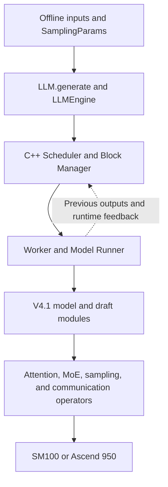
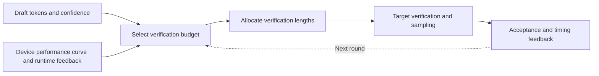

# DeepInfer in Depth — DeepSeek's Inference Architecture, Benchmark Semantics, and Production Boundaries

DeepInfer exposes a particularly interesting part of DeepSeek's inference system: draft generation, verification length, batching, expert placement, cache layout, and low-level operators optimized together for its own models. Its value lies in showing how these mechanisms cooperate along a single execution path, beyond providing another way to load model weights.

Enterprise adoption requires distinguishing two scopes: **the inference framework behind DeepSeek's production services and the offline inference capabilities delivered in this repository.** They share an engine foundation, but the public repository does not include every system needed for a complete online service.

This review was checked on **2026-10-20** and is pinned to the initial public commit, [`d585e6542c05`](https://github.com/deepseek-ai/DeepInfer/tree/d585e6542c0571176272d703f03c4807ae901284). Its timestamp is 2026-10-20 12:09 China Standard Time; a commit timestamp does not establish the exact time of public availability. The analysis draws on source inspection, official documentation, and upstream performance figures. **It does not present a local deployment or independent benchmark.**

## 1. What has actually been released

The most direct entry point is `deepinfer.entrypoints.llm.LLM`: construct the model and execution environment, submit inputs to `generate()`, and let the engine batch them and return generated results. The model registry currently contains only `DeepseekV41ForCausalLM`; the default example loads `DeepSeek-V4.1-Flash-1017`. This is a path optimized for a specific model architecture. A parameter named `model` does not imply support for arbitrary Hugging Face models.

| Layer | Current code and delivery | Implication for users |
| --- | --- | --- |
| Calling interface | Offline `LLM.generate()`, examples, and evaluation scripts | Suitable for batch processing, correctness regression, and engine research |
| Execution engine | C++ scheduling and block management, Python workers, and device operators | A concrete execution path to study and extend |
| Model implementation | V4.1 vision, attention, MoE, Engram, and draft modules | Optimizations are closely coupled to model structure |
| Complete serving system | The officially listed KV cache system, VE/P/D disaggregation system, and DP-replica load balancing are not fully delivered | Online adoption still requires systems engineering |
| Protocol and platform | The public entry points do not provide a ready-made general OpenAI serving deployment | The offline command is not a direct substitute for an online API service |

Source locations: [offline API](https://github.com/deepseek-ai/DeepInfer/blob/d585e6542c0571176272d703f03c4807ae901284/deepinfer/entrypoints/llm.py), [model registry](https://github.com/deepseek-ai/DeepInfer/blob/d585e6542c0571176272d703f03c4807ae901284/deepinfer/model_executor/models/__init__.py), and [shared example configuration](https://github.com/deepseek-ai/DeepInfer/blob/d585e6542c0571176272d703f03c4807ae901284/examples/_config.py). The missing serving components are listed in the [official README](https://github.com/deepseek-ai/DeepInfer/blob/d585e6542c0571176272d703f03c4807ae901284/README.md).

## 2. Reading the architecture from request to device



There are two feedback paths. One carries generation state: how many draft tokens were actually accepted, whether a request finished, and how cache and rollback positions changed. The other carries performance state: forward latency at different graph sizes, sampling latency, and expert load. The engine uses these signals to adjust subsequent execution.

The directories have distinct responsibilities:

| Reading entry point | Key question |
| --- | --- |
| `deepinfer/entrypoints/llm.py` | How inputs enter the engine and results return |
| `deepinfer/engine/llm_engine.py` | How scheduling, execution, post-processing, and cache extension points connect |
| `csrc/engine/scheduler.hpp`, `block_manager.hpp` | How requests, batches, cache blocks, and preemption are managed |
| `deepinfer/worker/worker.py` | How CPU and device execution form a pipeline |
| `csrc/engine/mtp_varlen.hpp` | How the verification budget is selected |
| `deepinfer/model_executor/models/v4_modules/` | How model structure shapes the runtime |
| `deepinfer/model_executor/eplb/` | How experts are replicated, placed, and moved |
| `examples/benchmark.py`, `examples/sweep/plot_pareto.py` | How performance numbers are produced |

The low-level dependencies also have separate roles: FlashMLA handles attention, DeepGEMM matrix computation, DeepEP expert communication, and DeepSelect plus custom TileLang operators selection and data processing. DeepInfer's engineering contribution is assembling them into an executable model path. A faster individual kernel does not guarantee an equal reduction in request latency. Dependencies and backend build paths can be cross-checked in [`.gitmodules`](https://github.com/deepseek-ai/DeepInfer/blob/d585e6542c0571176272d703f03c4807ae901284/.gitmodules) and [`build_vendor.sh`](https://github.com/deepseek-ai/DeepInfer/blob/d585e6542c0571176272d703f03c4807ae901284/scripts/build_vendor.sh).

## 3. DSpark: avoiding low-value draft verification

### 3.1 Why longer drafts are not always faster

Speculative decoding proposes a draft block and asks the target model to verify it. Accepting more draft tokens amortizes target-model execution. If most of a block's suffix is rejected, however, verifying it still consumes compute, memory traffic, and batch capacity.

Consider an editorial workflow: an assistant writes five paragraphs for an editor to review. More text does not automatically save time. If the first two paragraphs are reliable but the final three need rewriting, reviewing the suffix may delay other articles.

The DSpark paper combines semi-autoregressive drafting with confidence-scheduled verification. The particularly useful implementation detail in DeepInfer is the latter: **how many tokens to verify for each request is decided jointly by expected benefit and execution cost.** The paper's online gains have a particular baseline and workload; they are not a speedup promise for arbitrary deployments. [DSpark paper](https://arxiv.org/html/2607.05147v1)

### 3.2 The decision process in the source

`MTPVarlen::schedule()` does more than apply a fixed threshold. It aggregates and sorts candidate draft confidence values, enumerates verification sizes, and uses the device forward-performance curve and sampling-time estimates to choose a better expected-output-to-time ratio.

The following summarizes the objective; it is not a separate API in the code:

```text
expected_yield ≈
  (base_output + sum(expected_accepted_draft_contributions))
  / (forward_time + runtime_correction + sampler_time)
```

The numerator combines each request's base output with the expected acceptance contribution of selected drafts. The denominator combines forward time for the corresponding graph size, a runtime correction, and sampling time.



Several implementation details are easy to miss:

- `ForwardRuntimeEstimator` adjusts the startup performance curve using recent observations, compensating for factors such as context length rather than relying only on a static table.
- `SamplerRuntimeEstimator` uses sliding-window medians, preferring historical estimates for the same request count and falling back to a global estimate when samples are insufficient.
- Total verification budgeting and per-request length allocation use confidence information from different rounds. The source explicitly requires that confidence at later positions must not affect whether an earlier draft position is verified. An asynchronous pipeline must also account for feedback arriving one round late.
- `schedule_cnt` and `process_cnt` track the pairing of scheduling and post-processing, preventing in-flight work from being treated as completed feedback.

DSpark's benefit therefore comes partly from **pricing verification work**, beyond guessing more tokens. At low load, more verification capacity may improve interactivity; at high load, low-value drafts must not crowd out the batch. Whether this improves performance depends on draft quality, verification cost, and workload. Acceptance rate alone is insufficient.

Source locations: [`mtp_varlen.hpp`](https://github.com/deepseek-ai/DeepInfer/blob/d585e6542c0571176272d703f03c4807ae901284/csrc/engine/mtp_varlen.hpp) and [runtime timing feedback](https://github.com/deepseek-ai/DeepInfer/blob/d585e6542c0571176272d703f03c4807ae901284/deepinfer/engine/llm_engine.py#L984). The documented switch is `DEEPINFER_ENABLE_MTP_VARLEN=1`; `DEEPINFER_USE_NEXTN_DECODE` controls the maximum draft length and defaults to 5.

## 4. Asynchronous scheduling: fitting CPU work inside device execution

A synchronous execution loop can leave gaps: the device finishes, the CPU reads results, updates requests, and builds the next batch, and only then does the device resume. The CPU cost per step may appear small, but decode repeats many steps, reducing useful device execution time.

The order in `Worker.execute_model_step()` is explicit:

1. Submit the current step's main-model forward pass.
2. Post-process the previous step's output.
3. Sample the current step.
4. For asynchronous decode, defer current-step post-processing to the next round; for prefill or synchronous execution, complete it immediately.

Asynchronous CUDA submission creates an opportunity for CPU work to overlap device execution. Preparing the next round early also requires correcting sequence lengths, mapping requests between batches, and handling finished or preempted requests.

“Zero-overhead scheduler” should therefore be read as the design goal of moving scheduling overhead off the critical path. The code still performs event synchronization, metadata processing, and resource reclamation. It does not imply zero CPU cost or that every workload can hide all of that cost. [Worker execution path](https://github.com/deepseek-ai/DeepInfer/blob/d585e6542c0571176272d703f03c4807ae901284/deepinfer/worker/worker.py#L89), [in-flight state structures](https://github.com/deepseek-ai/DeepInfer/blob/d585e6542c0571176272d703f03c4807ae901284/deepinfer/worker/zos_status.py)

The operational lesson is to inspect device gaps, CPU scheduling time, synchronization waits, and sequence-metadata processing when investigating low throughput. GPU utilization alone is insufficient; increasing concurrency may amplify a CPU bottleneck.

## 5. Why DP, CP, and EP coexist

These terms apply to different parts of execution. They should not all be interpreted as replicating the complete model.

| Abbreviation | Full name | Problem addressed here |
| --- | --- | --- |
| DP | Data Parallelism | Attention-side replicas process different requests or token workloads |
| CP | Context Parallelism | Split context computation across devices while balancing causal-attention work |
| EP | Expert Parallelism | Place different mixture-of-experts model experts on different devices |
| EPLB | Expert Parallel Load Balancing | Adjust expert replicas and placement to reduce hot-expert stragglers |
| VE | Vision Encoder | Convert images into representations the model can consume |

The same devices can process different requests as Attention DP replicas, then exchange tokens through EP to reach experts on other devices. **EP64DP64 therefore does not mean 64×64, or 4096 GPUs.** The process groups must be examined to see which ranks they reuse.

The code confirms this: with CP=1, `ParallelConfig` can default DP to EP, and the process-group implementation creates DP, CP, and EP groups from the same rank set. CP metadata also contains a mirror layout. Its motivation is to avoid the imbalance of simple contiguous causal-attention partitioning, where later positions have more work. Actual gains still depend on context length and communication cost. [Parallel configuration](https://github.com/deepseek-ai/DeepInfer/blob/d585e6542c0571176272d703f03c4807ae901284/deepinfer/config.py#L150), [process groups](https://github.com/deepseek-ai/DeepInfer/blob/d585e6542c0571176272d703f03c4807ae901284/deepinfer/model_executor/parallel_utils/parallel_state.py), [CP metadata](https://github.com/deepseek-ai/DeepInfer/blob/d585e6542c0571176272d703f03c4807ae901284/csrc/engine/input_metadata/prepare_tensor_input_base.cpp#L142)

### EPLB: replicating hot experts to reduce straggler waits

Each token visits only some experts in an MoE, or Mixture of Experts, model. Request distributions do not guarantee equal load across experts. A hot expert on one GPU can leave other GPUs waiting, a pattern hidden by average utilization.

`rebalance_experts_global()` works in two stages: assign redundant replicas to hot logical experts based on historical token load, then greedily place physical expert replicas across ranks. The objective considers the busiest rank in each historical step, rather than merely equalizing long-term totals.

For example, replicating a frequently selected expert can distribute accesses. Those replicas consume memory, however, and rearrangement adds measurement, transfer, and synchronization costs. EPLB trades **memory and communication against load imbalance**; more redundancy is not automatically better. Replicas carry the same logical expert's weights rather than changing the model's defined expert count.

Source locations: [`policy.py`](https://github.com/deepseek-ai/DeepInfer/blob/d585e6542c0571176272d703f03c4807ae901284/deepinfer/model_executor/eplb/policy.py), [`shuffle.py`](https://github.com/deepseek-ai/DeepInfer/blob/d585e6542c0571176272d703f03c4807ae901284/deepinfer/model_executor/eplb/shuffle.py).

## 6. SWA bounded replay: 140 tokens does not mean discarding long context

SWA means Sliding Window Attention. Combined with V4.1's cross-layer reuse, some later layers can consume state constructed earlier, avoiding repeated full-history computation in every layer during prefill.

`yoco_enabled()` checks whether `n_prefill_layer` is smaller than the total layer count and identifies subsequent layers as consumers. `compact_yoco_boundary()` compacts the retained queries and associated data at the layer boundary. Required historical state and shared information still exist.

Thus `DEEPINFER_YOCO_PREFILL_KEEP_TOKENS=140` specifies bounded suffix replay on a particular decoder path. **It does not truncate the user's input to 140 tokens or mean that the entire model keeps only the latest 140 tokens.**

The source also enforces:

```text
keep_tokens >= window_size + max_backtracking_tokens
```

After speculative verification rolls back, enough sliding-window history must remain. Retaining only the window size without allowing for rollback can violate cache and attention boundaries.

The repository includes `mask` versus `compact` equivalence checks: one level compares metadata, and another compares logprobs and top-K along a fixed trajectory. They require a compatible V4.1 YoCo checkpoint. This constraint makes the architectural dependency explicit; the same environment variables cannot be applied indiscriminately to every Transformer.

Source locations: [`yoco.py`](https://github.com/deepseek-ai/DeepInfer/blob/d585e6542c0571176272d703f03c4807ae901284/deepinfer/model_executor/models/v4_modules/yoco.py), [length validation](https://github.com/deepseek-ai/DeepInfer/blob/d585e6542c0571176272d703f03c4807ae901284/csrc/engine/input_metadata/prepare_tensor_input_v4.cpp#L348), [equivalence checks](https://github.com/deepseek-ai/DeepInfer/blob/d585e6542c0571176272d703f03c4807ae901284/examples/yoco/README.md).

## 7. Batch invariance and deterministic sampling solve different problems

Changing a batch can change matrix-computation or reduction paths. Floating-point rounding differences may propagate and affect sampling. Batch-invariant inference concerns numerical consistency when the same input appears in different batch compositions. Deterministic sampling additionally requires control of randomness and execution conditions.

The documented deterministic configuration requires both:

```bash
export DEEPINFER_BATCH_INVARIANT=1
export DEEPINFER_ENABLE_MTP_VARLEN=0
```

It also requires a fixed `seq_seed` in `SamplingParams` and is currently documented for NVIDIA. This disables variable-length verification scheduling; it should not be misreported as requiring all drafting to be disabled.

The tests deserve careful reading. `test_batch_invariant.py` generates a batch, then supplies each generated trajectory as `golden_token_ids` for individual execution, comparing tokens, logprobs, and top-logprobs. Sampling correctness has separate statistical tests. **Checking numerical consistency along a fixed trajectory does not prove that arbitrary stochastic runs produce identical token sequences.**

These features can reduce infrastructure-induced noise in agent regression and reinforcement-learning sampling. Changing hardware backends, operator versions, or verification policies still requires renewed checks. See the [batch-invariance test](https://github.com/deepseek-ai/DeepInfer/blob/d585e6542c0571176272d703f03c4807ae901284/tests/models/test_batch_invariant.py) and [sampling tests](https://github.com/deepseek-ai/DeepInfer/blob/d585e6542c0571176272d703f03c4807ae901284/tests/models/test_sampler.py).

Structured output uses XGrammar to constrain token selection, supporting regex, JSON Schema, and EBNF. It controls format validity. Correct field values, safe tool arguments, and authorized calls remain application responsibilities. [Matcher implementation](https://github.com/deepseek-ai/DeepInfer/blob/d585e6542c0571176272d703f03c4807ae901284/deepinfer/structure_output/matcher.py)

## 8. How to read the official performance figures

The following figures are preserved directly from upstream, attributed to DeepSeek-AI / DeepInfer, whose repository is Apache-2.0 licensed. They are reproduced to explain the metrics. Values are upstream results, not independently reproduced measurements. The full license is available in the [upstream LICENSE](https://github.com/deepseek-ai/DeepInfer/blob/d585e6542c0571176272d703f03c4807ae901284/LICENSE), with a [license copy](../../assets/deepinfer/LICENSE.txt) preserved on this site.

### 8.1 Prefill: non-cached input and per-step latency


Figure conditions: 4 SM100 GPUs, EP4DP4, 384 logical experts plus 32 redundant experts, context 131,072, and decoder bounded replay of 140 tokens. The horizontal axis is **ms / prefill step**, the vertical axis is non-cached input **tokens/s/GPU**, and point labels give the token batch size per DP rank. Source: [official prefill figure](https://github.com/deepseek-ai/DeepInfer/blob/d585e6542c0571176272d703f03c4807ae901284/doc/images/prefill_pareto.png).

Larger batches increase throughput and per-step latency. From 32768 to 65536, throughput improves only modestly while step time grows substantially. This helps select engine batch sizes, but per-step latency is not request time to first token.

End-to-end TTFT, or Time To First Token, also includes queuing, input processing, multiple prefill chunks, potential image encoding, state transfer, and returning the first token. A four-GPU prefill configuration does not establish the minimum GPU count for a complete online service.

### 8.2 Decode: acceptance rate is a conversion condition


Figure conditions: 64 SM100 GPUs, EP64DP64, 384+64 experts, context 131,072, fixed `nextn=3`, and conversion using 75% per-token acceptance. The horizontal axis is per-user generation speed, and the vertical axis is output throughput per GPU. Labels from 8 to 256 are requests **per DP rank**, not the total requests across the group. Source: [official decode figure](https://github.com/deepseek-ai/DeepInfer/blob/d585e6542c0571176272d703f03c4807ae901284/doc/images/decode_pareto.png).

The plotting code computes:

```text
tau = 1 + nextn * a
per_user_tokens_per_s = avg_SPS * tau
tokens_per_s_per_gpu = avg_SPS * requests_per_DP_rank * tau / CP
```

`avg_SPS` is measured execution steps per second. With `a=0.75`, the figure uses `τ=3.25`. Here `a` is the coefficient used to convert average accepted draft-token counts; an “acceptance rate” defined differently in another project cannot simply be substituted. The plotter explicitly refuses this accounting for `MTP_VARLEN=1` data, preventing acceptance from being counted twice.

The curve therefore shows the throughput–interactivity tradeoff under fixed drafting settings. **It cannot, on its own, establish the benefit of variable-length DSpark under real user traffic.**

### 8.3 Four more conditions that affect comparisons

| Condition | Evidence in the code or figure | Comparison implication |
| --- | --- | --- |
| Routing distribution | `benchmark.py` sets `DEEPINFER_FORCE_LOAD_BALANCE=1`, which reaches the gate's `force_random` path | A controlled routing workload cannot be assumed to represent real application hotspots |
| Measurement window | Warmup is skipped; intervals overlapping MoE load-statistics flushes are excluded; sweep measurements exclude profiler participation | Useful for clean steady-state execution performance; long-term capacity must include periodic overhead |
| Cache and request construction | Requests fork from a shared prefix and process uncached suffixes; prefill and decode are measured separately | This is not a cold-cache HTTP benchmark with randomly arriving requests |
| Hardware and version identity | Each stage runs within one scale-up domain; figures say V4.1 Flash while examples now default to the 1017 checkpoint | Ordinary cross-node networking cannot inherit these numbers; exact figure checkpoint identity requires original run records |

These details come from [`benchmark.py`](https://github.com/deepseek-ai/DeepInfer/blob/d585e6542c0571176272d703f03c4807ae901284/examples/benchmark.py), [`plot_pareto.py`](https://github.com/deepseek-ai/DeepInfer/blob/d585e6542c0571176272d703f03c4807ae901284/examples/sweep/plot_pareto.py), the [gate call path](https://github.com/deepseek-ai/DeepInfer/blob/d585e6542c0571176272d703f03c4807ae901284/deepinfer/model_executor/models/v4_modules/mlp.py#L375), and the [benchmark documentation](https://github.com/deepseek-ai/DeepInfer/blob/d585e6542c0571176272d703f03c4807ae901284/examples/README.md).

There is no matched vLLM or SGLang control group here. Two single-engine curves cannot establish a universal speedup over other engines. The useful engineering comparison is **effective throughput and cost at a required latency target, with matched model quality, hardware resources, and request distribution**.

## 9. Quality evaluation: scores, sample counts, and coverage belong together

The repository includes offline evaluation for AIME 2026, GPQA Diamond, and HLE. Generation and scoring are separate; raw output is saved so it can be rescored without regeneration.

| Dataset | Official default scale | Upstream reference Pass@1 |
| --- | --- | --- |
| AIME 2026 | 30 tasks, 32 samples per task | 99.9% |
| GPQA Diamond | 198 tasks, 8 samples per task | 93.4% |
| HLE-Full | 2500 tasks, 1 sample per task | 42.6% |

These are **upstream reference values**. AIME's 32 samples estimate single-attempt success probability; treating any successful sample as success would not be Pass@1. `coverage_complete=true` is required to establish that all ranks and samples are present. Missing output must not simply be ignored.

Scoring uses an LLM judge by default. AIME and GPQA also support rule-based scoring; HLE's free-form answers cannot be replaced by simple exact matching. Comparing engine correctness requires fixed data, prompt encoding, sampling settings, judge, and coverage—not just matching the final percentage. [Official evaluation documentation](https://github.com/deepseek-ai/DeepInfer/blob/d585e6542c0571176272d703f03c4807ae901284/eval/README.md)

## 10. Can it run directly on H20, L20, or RTX PRO 5000?

The current official support scope is **NVIDIA SM100 and Huawei Ascend 950**, rather than every CUDA GPU or every Ascend device.

| Hardware | Current assessment | Reason |
| --- | --- | --- |
| B200 / GB200 SM100 devices | Within the stated architecture scope | Capacity, device count, interconnect, and dependencies still matter |
| H20 / H20-3e | Not an officially supported configuration in this release | The initial release does not promise this hardware path |
| L20 | Not an officially supported configuration in this release | CUDA availability alone does not establish custom-operator compatibility |
| RTX PRO 5000 Blackwell | The Blackwell name alone does not establish support | NVIDIA lists compute capability 12.0, distinct from SM100's 10.0 |
| Ascend 950 | An explicitly listed separate backend | Requires the matching CANN, torch-npu, and Ascend operators rather than CUDA build artifacts |

NVIDIA's [compute-capability table](https://developer.nvidia.com/cuda/gpus) lists B200 / GB200 under 10.0 and RTX PRO 5000 Blackwell under 12.0. A shared architecture brand does not imply identical low-level instructions or kernel build targets.

A sound decision order is **hardware/operator support → capacity for model and runtime state → communication topology → correctness → performance**. Enough aggregate memory for weights does not prove that the current operators execute on those cards. Conversely, a supported architecture does not mean any four cards can run a complete service.

### Build cost matters too

The official prerequisites are Linux, Python 3.12, and GCC≥13; NVIDIA requires CUDA 13, while Ascend requires CANN 9.2. The initial commit pins `torch==2.13.0+cu132`, and the build script installs NCCL 2.32.3. The Ascend path uses CPU PyTorch and `torch-npu==2.13.0rc1`.

Build it separately and pin the image, driver conditions, and vendor submodule versions. Installing it into an existing vLLM environment may alter PyTorch/NCCL dependencies and introduce extra variables into a comparison. [Build script](https://github.com/deepseek-ai/DeepInfer/blob/d585e6542c0571176272d703f03c4807ae901284/build.sh), [NVIDIA dependencies](https://github.com/deepseek-ai/DeepInfer/blob/d585e6542c0571176272d703f03c4807ae901284/requirements-nvidia.txt), [Ascend dependencies](https://github.com/deepseek-ai/DeepInfer/blob/d585e6542c0571176272d703f03c4807ae901284/requirements-ascend.txt)

## 11. Why is a KV cache system missing when CacheEngine exists?

This is one of the easiest project boundaries to misread.

`cache_engine.py` does manage in-engine KV and state, including compressed attention, index caches, SWA ring state, and cross-layer reuse. `block_manager.hpp` manages blocks. These are fundamental to model execution. The statement that a complete service needs a KV cache system does not mean the engine lacks attention caches.

A more useful boundary is that in-engine caches store and access the state needed for computation, while a cross-instance cache system also addresses state naming, location, transfer, sharing, lifecycle, and cooperation with routing. These are responsibilities an enterprise must address when completing disaggregated serving. Their implementation cannot be inferred merely from a cache class.

The code provides direct evidence: `LLMEngine` has extension points such as `init_pd_split()`, `do_save_kvcache()`, and `send_processed_prompts()`, but their base implementations are empty or retain default behavior. **Interfaces and state structures are a different delivery stage from a usable distributed cache service.** [CacheEngine](https://github.com/deepseek-ai/DeepInfer/blob/d585e6542c0571176272d703f03c4807ae901284/deepinfer/worker/cache_engine.py), [serving extension points](https://github.com/deepseek-ai/DeepInfer/blob/d585e6542c0571176272d703f03c4807ae901284/deepinfer/engine/llm_engine.py#L801)

## 12. Comparing and choosing between DeepInfer, vLLM, and SGLang

DeepInfer retains multiple source notices identifying code derived from vLLM. Its README also acknowledges that development started primarily from vLLM, with inspiration from SGLang and TensorRT-LLM. Describing it as independently reinventing every component would be inaccurate.

| Dimension | DeepInfer's current delivery | Adoption path for vLLM / SGLang |
| --- | --- | --- |
| Main objective | Expose a high-performance core execution path for DeepSeek models | General model serving and expanding model ecosystems |
| Entry point | Offline batches, evaluation, and source extensions | Existing online servers and OpenAI-compatible API documentation |
| Research value | Coordination of model structure, verification scheduling, expert load, and operators | Multi-model adaptation, serving engineering, and their own optimizations |
| Hardware assessment | Follow the explicit SM100 and Ascend 950 scope | Check the particular engine version, model, and backend matrix |
| Migration cost | Complete online protocols, disaggregated systems, and operational integration | Existing deployments can evolve through established serving interfaces |
| Performance conclusion | Official curves do not provide a cross-engine ranking | Comparable results require matched-workload measurements |

The [vLLM online-serving documentation](https://docs.vllm.ai/en/latest/serving/online_serving/) and [SGLang request tutorial](https://docs.sglang.io/docs/basic_usage/send_request) demonstrate their online entry points. This does not mean every version, model, and feature is equally mature.

For quickly launching a multi-model API, established engines generally offer a more direct integration path. A team serving DeepSeek over the long term, deploying extensively on matching hardware, and willing to maintain a specialized execution system should study DeepInfer closely. Even without migrating, its scheduling and state-management mechanisms help explain where other engines gain speed and where they slow down.

## 13. What a Kubernetes platform still needs

The following are **integration design recommendations** inferred from the engine boundaries. They are not an upstream Kubernetes product or deployment results from this article.

| Platform responsibility | Why it matters |
| --- | --- |
| Hardware and topology placement | EP/CP performance depends on interconnects; equal GPU counts do not imply equal communication conditions |
| Process-group lifecycle | Ranks, rendezvous, exit, and recovery need consistent group-level management rather than independent container restarts |
| Online request adaptation | Implement protocols, streaming, cancellation, timeouts, backpressure, and authentication while releasing request state correctly |
| Disaggregation and caching | VE/P/D stages need explicit state formats, ownership, transfer-failure handling, and version compatibility |
| Request routing | Account for input length, in-flight decode work, and cache location in addition to request count |
| Observability | Correlate device, engine, and request metrics within the same time window |

At minimum, separate these measurement dimensions:

- **User experience:** P50/P95/P99 TTFT, TPOT (Time Per Output Token), and end-to-end latency, plus cancellations and failures.
- **Actual output:** accepted and returned output tokens/s, with proposed, verified, and accepted draft counts measured separately.
- **Engine execution:** queueing, prefill/decode step duration, batch token count, graph size, CPU gaps, and synchronization waits.
- **Memory and experts:** KV/state occupancy, preemption and recomputation, per-rank expert load, replica count, and rearrangement duration.
- **Devices and communication:** memory use, power, interconnect throughput, collective waits, and hardware errors.

These are suggested measurement semantics, not names of Prometheus metrics already exported by DeepInfer. `StatsLogger` records some step-level statistics, but production integration still needs to establish export mechanisms and label costs. [Statistics implementation](https://github.com/deepseek-ai/DeepInfer/blob/d585e6542c0571176272d703f03c4807ae901284/deepinfer/engine/stats_logger.py)

## 14. Start by checking the official offline path

In an isolated environment meeting the official hardware and software requirements, build the pinned commit:

```bash
git clone https://github.com/deepseek-ai/DeepInfer.git
cd DeepInfer
git checkout d585e6542c0571176272d703f03c4807ae901284

python3.12 -m venv .venv
source .venv/bin/activate
export DEEPINFER_ACCELERATOR=nvidia
./build.sh

export DEEPINFER_HF_MODEL_DIR=/path/to/DeepSeek-V4.1-Flash-1017
python examples/offline_inference.py --ep 8 --check_structured_output
```

`--ep 8` comes from the official offline example, not a general minimum-GPU conclusion. The build script initializes vendor submodules and builds dependencies. These commands are a source-derived starting point; GPU inference was not executed for this article. Ascend requires a separate backend build rather than reuse of the NVIDIA environment.

Two apparently reassuring labels also need qualification: the default offline example sets `max_model_len` to 32768, and `--long_context` uses 16389 input tokens and 4096 output tokens. **An argument named long_context does not establish 1M-context validation.** The model's supported limit, the engine's configured limit, and a request's actual length should be recorded separately. [Offline example source](https://github.com/deepseek-ai/DeepInfer/blob/d585e6542c0571176272d703f03c4807ae901284/examples/offline_inference.py), [example and benchmark documentation](https://github.com/deepseek-ai/DeepInfer/blob/d585e6542c0571176272d703f03c4807ae901284/examples/README.md)

DeepInfer is a valuable implementation of a model-specialized inference system. Its most instructive aspect is how verification value, device cost, cache structure, and expert stragglers are addressed along one execution path. Enterprises can use that evidence to decide where adaptation is worthwhile. Production adoption should rest on matching hardware, correctness regression, and end-to-end serving validation rather than one throughput curve.

## Further reading

- [Pinned DeepInfer source](https://github.com/deepseek-ai/DeepInfer/tree/d585e6542c0571176272d703f03c4807ae901284)
- [DSpark paper](https://arxiv.org/abs/2607.05147)
- [DeepSeek-V4.1-Flash-1017 model card](https://huggingface.co/deepseek-ai/DeepSeek-V4.1-Flash-1017)
- [Inference engine selection](engines.md)
- [KV cache principles, applications, and Kubernetes](kv-cache-overview.md)
- [Distributed and P/D-disaggregated inference](distributed-serving.md)
