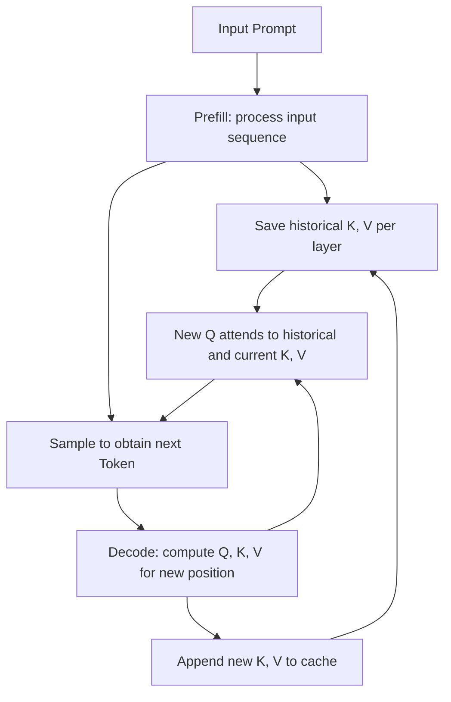
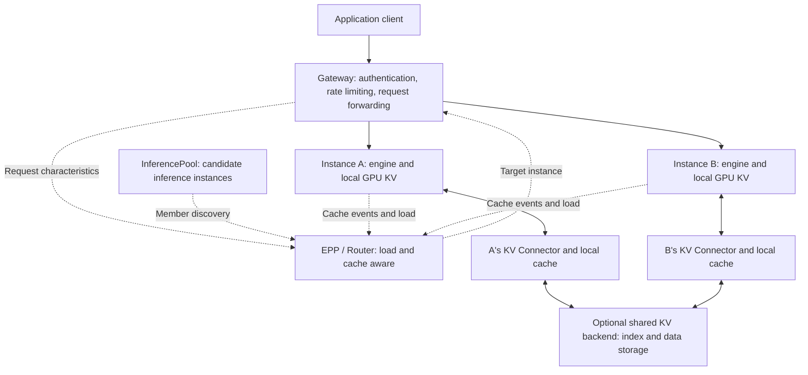

# KV Cache Overview: From Attention Principles to Kubernetes Inference Architecture

Every time a large model generates a new Token, it needs to use the preceding context. KV Cache stores the already-computed attention intermediate states of this context, allowing the model to continue generating without recomputing the entire sequence from scratch. It is the foundation of autoregressive inference and directly affects long-context capacity, concurrency count, and time to first token (TTFT).

When the service scales to multiple GPUs, multiple Pods, and multiple nodes, the problem further becomes: where should the cache be placed, where should requests go, whether moving the cache is more cost-effective than recomputing, and which states can be recovered after an instance exits. At this point, KV Cache extends from an in-engine GPU memory management problem to the architectural design of a Kubernetes inference platform.

This article first explains the principles and capacity, then discusses application approaches, and finally presents deployment trade-offs on Kubernetes. The capacity numbers and routing time examples are calculations under explicitly stated assumptions; already-measured results are separately attributed with sources. This article focuses on **causal, autoregressive Transformer inference**; mixed attention, MLA, and other architectures need to be adjusted according to their actual state structures.

## 1. What exactly does KV Cache store

### 1.1 Understanding attention from Q, K, V

In an attention layer, each Token's hidden representation is projected to obtain three sets of vectors:

| Vector | Name | Role in attention |
| --- | --- | --- |
| Q | Query | The current Token uses it to find the context it needs to attend to |
| K | Key | Historical Tokens use it to participate in relevance computation |
| V | Value | After relevance becomes weights, these content vectors are weighted-summed |

Omitting batch and head dimensions, the core computation of attention can be written as:

```text
Attention(Q, K, V) = softmax(Q × Kᵀ / √d + causal_mask) × V
```

The Key and Value here are tensors; KV Cache should not be understood as an ordinary key-value database that stores question-answer results. The causal mask in the formula ensures that a position can only attend to itself and positions before it. Related definitions can be found in the [original Transformer paper](https://arxiv.org/abs/1706.03762).

### 1.2 Why historical K, V can be reused

Assume the context is "Please introduce Kubernetes" and the model has already processed these Tokens. When processing the next new Token, the model parameters and previous inputs have not changed; under the usual causal attention and consistent position encoding configuration, the K, V of old positions will not change due to appended Tokens either.

Therefore, each layer can save the old K, V, only compute Q, K, V for the new position, and then let the new Q attend to the already-saved K, V. The old Q is used to compute the output of the old position; subsequent positions do not need to use it again, so Q is usually not cached. This process occurs at each attention layer, not just at the model entry. See [Hugging Face's cache principle explanation](https://huggingface.co/docs/transformers/en/cache_explanation).



Prefill processes the input sequence and produces the results needed to predict the first output Token; Decode then repeatedly processes new positions. Prefill is often more compute-intensive, while Decode under small batch sizes is often more memory-bandwidth-bound, but the actual bottleneck also depends on the model, batch size, context length, and parallel communication.

**Even with KV Cache, long contexts still have a cost.** For ordinary full attention, each new position still needs to read and attend to historical K, V. The cache saves repeated computation of historical positions but does not eliminate this access volume that grows with context length. [FlashAttention](https://arxiv.org/abs/2205.14135) mainly optimizes memory access for attention computation, while PagedAttention mainly improves KV allocation and management; neither can be directly equated with cross-request caching.

### 1.3 Four kinds of "cache" must be distinguished

| Cache type | Stored content | Typical hit effect |
| --- | --- | --- |
| Model file cache | Weights, Tokenizer, and other artifacts | Speeds up model download or startup loading |
| KV Cache | Intermediate states of a context at each model layer | Reduces repeated Prefill, supports subsequent Decode |
| Answer cache | Complete responses or existing answers | May directly return results without calling the model |
| Embedding cache | Vector representations of text or other inputs | Reduces repeated vectorization computation |

Warming model weights into NVMe can improve service cold start; this does not mean the user request's KV has been warmed. Saving conversation records to a database can restore application sessions; this also does not mean the inference instance retains the corresponding KV.

## 2. Why does KV Cache consume so much GPU memory

### 2.1 Capacity formula for common MHA/GQA models

For attention models with consistent layer shapes that fully store historical K/V, without considering sharing and paging overhead:

```text
KV 字节数 ≈ 2 × L × Hkv × D × S × ΣTi

L    = 注意力层数
Hkv  = 每层 KV Head 数量，不是 Query Head 数量
D    = 每个 Head 的维度（这里假设 K、V 相同）
S    = 每个元素的字节数，例如 BF16 为 2
Ti   = 第 i 条序列已经缓存的 Token 数
2    = K 和 V 两份状态
```

If B sequences each have length T, then `ΣTi = B × T`. T includes input and generated content already in the cache; the capacity budget must also reserve space for output not yet generated.

The following is a hypothetical GQA model calculation example, **not a measured configuration of a specific model**: 32 layers, 8 KV Heads, Head Dimension of 128, KV using BF16.

```text
每 Token KV = 2 × 32 × 8 × 128 × 2
            = 131,072 bytes
            = 128 KiB
```

| Cached length | Single sequence KV | 32 independent sequences KV |
| --- | ---: | ---: |
| 8,192 Tokens | 1 GiB | 32 GiB |
| 32,768 Tokens | 4 GiB | 128 GiB |
| 131,072 Tokens | 16 GiB | 512 GiB |

These values do not include weights, activations, communication buffers, CUDA Graph, paging tails, or allocator overhead. They also do not deduct physical blocks saved by shared prefixes. The service being able to load weights only means "the model fits"; it cannot be used to infer that long-context concurrency also fits.

### 2.2 Architecture changes the computation method

| Architecture or configuration | Impact on KV capacity |
| --- | --- |
| MHA | Query Heads typically each have corresponding K/V Heads |
| GQA | Multiple Query Heads share one set of K/V; `num_key_value_heads` should be used |
| MQA | All Query Heads share one set of K/V; replication may still exist in parallel deployment |
| MLA | Typically caches compressed latent representations and position-related states; the full K/V formula cannot be directly applied |
| Sliding window attention | Corresponding layers only retain history within the window; must be accumulated per layer |
| Full attention mixed with linear/recurrent layers | Multiple kinds of states coexist; must be calculated per cache group |

The sharing method of GQA can be found in the [GQA paper](https://arxiv.org/abs/2305.13245), and MLA's compression approach in the [DeepSeek-V2 paper](https://arxiv.org/abs/2405.04434). The model architecture, engine implementation, and cache layout in actual startup logs should be cross-checked against each other.

Tensor Parallel also does not mean that per-GPU KV necessarily equals the total divided by TP. This estimate only holds when the relevant dimensions can be correctly sharded; replication may occur when KV Heads are fewer than the parallelism degree, and MLA and hybrid models may use other layouts. GPU memory should ultimately be accounted per **rank**.

### 2.3 KV quantization and weight quantization are two different things

Weights using FP8 or INT4 does not mean KV also uses the same precision. Changing KV from BF16 to FP8 theoretically halves element storage, but in practice it also includes scaling factors, alignment, and metadata, and requires the attention Kernel and model to support it together.

KV quantization also introduces precision and calibration issues; it cannot be judged usable solely based on GPU memory reduction. Specific dtype, scale, and support conditions can be found in [vLLM Quantized KV Cache](https://docs.vllm.ai/en/latest/features/quantization/quantized_kvcache/).

## 3. From single-generation to cross-request prefix reuse

### 3.1 PagedAttention: making GPU memory block-based

If every request pre-allocates contiguous GPU memory for the maximum context, a large amount of space will be temporarily idle, and requests of varying lengths easily create fragmentation. PagedAttention maps logical sequences to physical KV Blocks, allocates on demand, and manages access through a block table.

Shared prefixes allow multiple sequences to reference the same set of physical blocks; when branch writes occur, the engine handles reference counting, writable status, and necessary copying. It improves allocation, sharing, and reclamation efficiency, **but does not automatically compress tensors to lower precision**. The principle can be found in the [PagedAttention paper](https://arxiv.org/abs/2309.06180).

### 3.2 Prefix Cache: reusing already-processed beginnings

KV reuse within a single request supports token-by-token generation. Prefix Cache, on the other hand, retains reusable prefix states after a request ends, allowing subsequent requests to skip part of Prefill. vLLM's Automatic Prefix Caching and SGLang's RadixAttention both target this kind of reuse, using block hashing and prefix trees respectively for management. See [vLLM APC](https://docs.vllm.ai/en/latest/features/automatic_prefix_caching/) and the [SGLang paper](https://arxiv.org/abs/2312.07104).

```text
请求 A：[固定系统指令][固定工具定义][同一份文档][问题 A]
请求 B：[固定系统指令][固定工具定义][同一份文档][问题 B]
        └──────────── 可复用的连续前缀 ────────────┘
```

What is typically reused is **a completely identical Token prefix under the same computation conditions**, not semantically similar text. If the same document appears after different preceding contexts, its K/V will usually also differ. Arbitrary segment reuse, Cache Blending, and other approaches require additional algorithms and support and cannot be treated as default capabilities of ordinary APC.

Block caching generally uses complete blocks as the reuse unit; tails shorter than one block or positions required for output prediction may still need computation. Therefore, repeating the entire Prompt does not necessarily mean all input Tokens are shown as skipped. vLLM's hashing also associates parent prefixes and additional information such as LoRA and multimodal content; see the [APC design document](https://docs.vllm.ai/en/latest/design/prefix_caching/).

### 3.3 Which latency does prefix hit mainly improve

```text
TTFT ≈ 网关与预处理 + 排队
     + 缓存查询/必要的回载 + 未命中部分的 Prefill
     + 首 Token 生成与传输
```

Prefix hit directly reduces repeated Prefill. It does not automatically reduce the number of Tokens the model still needs to output, nor does it make every subsequent Decode step faster proportionally to the hit rate. Under high load, reduced Prefill load may indirectly improve queuing and overall throughput; tasks with long outputs may see smaller benefits.

## 4. How applications can use KV Cache more effectively

### 4.1 Common scenarios and Prompt organization

| Application | Content easy to reuse | Practical limitations |
| --- | --- | --- |
| Multi-turn chat | Existing conversation history | Truncation, summarization rewrites, and template changes alter the prefix |
| Coding Agent | System instructions, tool Schemas, repeated repository context | Tool list order and file content changes reduce hits |
| Multiple Q&A on the same document | The same long document placed before questions | Document version, order, and permission scope must be consistent |
| RAG | Stable templates and retrieved content in the same order | Merely "from the same knowledge base" is not sufficient for prefix sharing |
| Batch tasks | Shared task instructions, Few-shot examples | Independent short inputs may have very little computable savings |

Without changing instruction meaning and permission boundaries, place stable, longer, frequently repeated content at the front, and put the current question and changing information at the back. For example:

```text
system:
  你是 Kubernetes 文档助手。仅依据给定资料回答；不足时说明未知。

user:
  <reference version="v1">
  ……同一份经过授权、内容和顺序固定的长文档……
  </reference>
  <question>
  ……本次需要回答的问题……
  </question>
```

Do not put random UUIDs or current timestamps before all content just to mark requests; this information can be placed in request metadata or log correlation fields. If the business genuinely requires time to participate in inference, the correct semantics should be preserved and the corresponding cache changes accepted.

Multi-turn APIs typically still require submitting the complete message history required by the service. Prefix Cache is an inference optimization, not an application session database, and cannot guarantee that all context can be recovered by session ID after eviction or restart.

### 4.2 Using it in the engine

For compatible models that already load correctly, vLLM can explicitly enable APC:

```bash
vllm serve /models/example-model \
  --served-model-name example-model \
  --enable-prefix-caching
```

The model path here is a placeholder example; parallelism, maximum context, and other loading parameters should follow the already-validated configuration for that model. Default switches may vary across versions; release configurations should record explicit parameters. This switch enables in-engine prefix reuse and does not create a cross-Pod cache service. Parameters can be found in [vLLM serve](https://docs.vllm.ai/en/latest/cli/serve/).

SGLang's Radix Cache handles local prefix management; when extending to host memory and storage, HiCache can be used. Its GPU layer and host memory layer are instance-local state; cross-instance sharing requires connecting to the corresponding storage backend. Expanding one instance's host cache does not automatically merge other nodes' memory. See the [SGLang HiCache design](https://docs.sglang.io/docs/advanced_features/hicache_design).

## 5. Cache on CPU, NVMe, or remote — when is it worthwhile

### 5.1 Purpose of tiered caching

GPU HBM capacity is limited. KV that is temporarily unused but expected to be reused can be placed in larger host memory, local disk, or a shared cache layer, and loaded back by a Connector when needed. This extends the retention time of reusable prefixes but incurs copying, lookup, and transfer costs.

| Tier | Value | Main cost |
| --- | --- | --- |
| GPU HBM | Directly serves attention computation | Limited capacity, competes with active requests |
| Host DRAM | Expands local cache capacity | GPU-CPU transfer, Pinned Memory, and NUMA overhead |
| Local NVMe | Expands capacity, retains colder prefixes | I/O latency, disk bandwidth, write amplification, and node affinity |
| Remote memory or storage | Allows other instances to access the cache | Network, indexing, concurrency consistency, and failure handling |

In common reload schemes, KV must return to a GPU-usable layout before participating in computation; attaching a disk to the model does not allow all Decode steps to read disk history without cost.

### 5.2 Judge by time, not just hit rate

The following simplified relationship can be used to evaluate one reload; actual implementations may overlap part of the time through pipelining:

```text
回载开销 ≈ 查询 + 数据量 / 有效带宽 + 格式处理 + 同步
缓存净收益 ≈ 避免的 Prefill 时间 - 回载开销 - 新增排队
```

Continuing with the earlier hypothetical model: 32K Token KV is 4 GiB. If the **measured effective path bandwidth** reaches 25 GiB/s, the ideal time for a single pure data transfer is approximately `4 / 25 = 0.16 秒`; at only 5 GiB/s, it is 0.8 seconds. Neither includes queuing, lookup, multi-hop, or format processing, and NIC nominal rates cannot be directly substituted.

If re-Prefilling the same prefix takes only 0.1 seconds, these two reload paths may not be worthwhile; if it takes several seconds, caching may bring significant benefits. This is a calculation example, not a hardware performance conclusion. Write costs and future reuse count should also be considered: a long Prompt used only once produces a large cache but may not bring value from another hit.

## 6. Differences between cross-request sharing, P/D separation, and KV transfer

| Mechanism | Purpose | Does it naturally provide reuse for subsequent requests |
| --- | --- | --- |
| Local Prefix Cache | Reuse prefixes within the same engine | Yes, but limited by local capacity and lifecycle |
| Cache-aware routing | Send requests to instances with existing prefixes | Depends on the target instance itself supporting reuse |
| KV Offload | Expand cache capacity | Depends on retention and retrieval mechanisms |
| P/D KV Transfer | Hand over this Prefill result to Decode Workers | Not necessarily; may only be handover for this request |
| Distributed shared KV | Let different instances discover and retrieve reusable state | Requires complete index, data plane, and compatible protocols |

The value of Prefill/Decode separation is to allow input processing and continuous generation to be configured and scaled independently, reducing interference between the two types of work; the cost is more complex request paths and KV transfer. With short requests, low concurrency, or insufficient network, the added cost may exceed the benefit, and P/D should not be treated as a prerequisite for using KV Cache. See the in-site [distributed and P/D separated inference](distributed-serving.md).

Shared caches must also establish a **compatibility boundary between compute identity and storage format**: model weight version, Tokenizer, Chat Template, positional encoding, Adapter, multimodal input, KV dtype, layout, and sharding rules all need to be taken into account. The same model name is not sufficient evidence of compatibility; whether different TP configurations can share depends on whether the backend supports shard conversion.

Even if vLLM and SGLang load the same weights, they cannot read each other's KV by default. The cache component needs to explicitly support the corresponding export and reload formats. The version of external Connectors is equally important; see [LMCache and vLLM compatibility notes](https://docs.lmcache.ai/getting_started/compatibility.html).

## 7. What Kubernetes Is Responsible For in This Architecture

### 7.1 Three Scheduling Layers Each Do Their Own Job

| Layer | What It Decides | What Information It Uses |
| --- | --- | --- |
| Kubernetes scheduling and node resource management | Which node a Pod lands on, which resources are allocated | GPU/CPU/memory, affinity, storage and device topology |
| Inference request Router / EPP | Which engine instance this request enters | Model, queue, prefix hit, cache location, SLO |
| Engine-internal Scheduler | Which sequences enter the next compute round | Token budget, KV Block, Prefill/Decode and preemption |

The native Kubernetes scheduler does not read Prompts to decide which Pod has the corresponding KV. An ordinary Service does not perform prefix analysis either; `sessionAffinity: ClientIP` only provides affinity based on source address, and in scenarios such as NAT or multi-user shared entry points, it cannot replace model request scheduling.

### 7.2 A Composable Request and Cache Architecture



Solid lines represent request or cache data paths; dashed lines represent selection, discovery, and state information. The EPP returns the target, and the Gateway forwards the request; KV tensors are moved through the engine and cache data plane and should not pass through the Kubernetes API Server or be placed in ConfigMap/etcd.

The Gateway API Inference Extension provides extension conventions for `InferencePool` and endpoint selection. **Creating an InferencePool itself does not enable prefix-aware policies**; it also requires a compatible Gateway, a production-grade EPP, corresponding plugins, and engine state signals. The project currently positions its bundled lightweight EPP as a consistency-validation reference and lists production implementations such as llm-d Router; see [official project notes](https://gateway-api-inference-extension.sigs.k8s.io/).

### 7.3 Don't Just Chase the "Pod with the Most Hits"

Suppose a request going to A could save 0.8 seconds of Prefill, but A already has a 3-second queue; B has no cache but only needs a 0.1-second queue. Choosing A purely by hit length would make the first token arrive later.

A sound choice should estimate simultaneously: queue time, miss compute volume, the tier where the cache resides, transfer cost, and Decode load. When cache information is stale or the index is temporarily unavailable, it should be possible to fall back to load-aware routing and allow the engine to recompute.

llm-d offers both approximate prefix routing and an exact index route based on cache events. The former estimates affinity from request history; the latter tracks where cache blocks are stored; their deployment cost and information accuracy differ. See [llm-d Prefix-Cache Aware Routing](https://llm-d.ai/docs/dev/architecture/advanced/kv-management/prefix-cache-aware-routing).

## 8. Key Details When Deploying on Kubernetes

### 8.1 Budget GPU, CPU, and Memory Together

A Pod's GPU count and host memory are different resources. Requesting `nvidia.com/gpu: 4` does not mean sufficient CPU DRAM is reserved, nor does it grant any arbitrary amount of GPU HBM. The GPU memory budget for model weights and KV is still determined by engine configuration and actual allocation.

The following is only a **Pod Template configuration fragment** of a Deployment; the values illustrate where resources and probes sit, not a recommended specification for any model, nor a complete ready-to-deploy manifest:

```yaml
spec:
  template:
    spec:
      containers:
        - name: inference
          resources:
            requests:
              cpu: "32"
              memory: 256Gi
              nvidia.com/gpu: "4"
            limits:
              cpu: "32"
              memory: 256Gi
              nvidia.com/gpu: "4"
          startupProbe:
            httpGet:
              path: /health
              port: 8000
            periodSeconds: 10
            failureThreshold: 180
          readinessProbe:
            httpGet:
              path: /health
              port: 8000
            periodSeconds: 5
```

The example startup probe budgets about 30 minutes and should be adjusted to the actual load time; the health path must also match the engine. Readiness should succeed only when the model can serve requests. If public prefix warm-up completion is also required, an additional readiness condition should be defined; an ordinary health endpoint will not automatically verify cache heat. Probe behavior is described in [Kubernetes probe configuration](https://kubernetes.io/docs/tasks/configure-pod-container/configure-liveness-readiness-startup-probes/).

If using host cache, its capacity, model loading peak, Pinned Memory, runtime, and Sidecar must all be included in the memory budget. Temporary directories or shared memory also consume real resources; one cannot only watch whether GPU memory is sufficient.

### 8.2 Four-GPU Pods Require Particular Attention to Topology

Four idle GPUs do not necessarily form a well-connected four-GPU group. They may span CPU NUMA domains, span PCIe Root Complexes, or sit at different distances from RDMA NICs. KV Offload and P/D further amplify the impact of the GPU—CPU—NIC path.

Before deployment, device relationships should be confirmed using `nvidia-smi topo -m`, NUMA information, and actual bandwidth. Kubernetes' CPU Manager `static` can provide exclusive CPUs for whole-core CPU requests of Guaranteed Pods when conditions are met; Topology Manager then coordinates topology hints for resources such as devices and CPUs. **Simply setting requests=limits in YAML does not automatically enable these node policies.**

`single-numa-node` is also not a universal answer for all GPU workloads: when the device combination cannot fit within a single NUMA domain, admission can fail; whether the GPU Device Plugin/DRA, CPU, and memory policies provide and adopt the corresponding information is equally critical. NUMA alignment also does not mean NVLink intra-group bandwidth has been optimized. See [CPU Manager](https://kubernetes.io/docs/tasks/administer-cluster/cpu-management-policies/) and [Topology Manager](https://kubernetes.io/docs/tasks/administer-cluster/topology-manager/), as well as the in-site [topology and fragmented GPUs for four-GPU tasks](../practices/gpu-topology-fragmentation-scheduling.md).

### 8.3 Storage Volumes Solve Lifecycle; Connectors Solve KV Read/Write

| Kubernetes storage method | What it can carry | Boundaries that need to be explicit |
| --- | --- | --- |
| `emptyDir` | Temporary files or local cache within the Pod lifecycle | Survives container restart, cleared after Pod deletion; actual medium depends on node configuration |
| `emptyDir.medium: Memory` | tmpfs shared directory | Consumes memory, is not NVMe, and does not automatically become the engine's host KV pool |
| `hostPath` | Local files in a designated node directory | Unavailable after node change; requires managing path, capacity, and permissions |
| Local PV / PVC | Local storage with node affinity constraints | Data stays on the original node; node failure does not automatically produce a remote replica |
| Shared filesystem PVC | Carries shared cache files when the backend supports it | Multi-node mountability does not mean cache indexing, concurrent writes, and format compatibility are solved |
| Dedicated cache service | Remote memory or storage pool | Requires service discovery, quotas, eviction, network, and failure policies |

Volume lifecycle is described in [Kubernetes Volumes](https://kubernetes.io/docs/concepts/storage/volumes/). The engine still needs explicit configuration through HiCache, KV Connector, etc., to write state to the corresponding backend; merely mounting a PVC to `/cache` will not trigger KV Offload.

Files remaining outside the Pod also do not guarantee a hit after engine restart: a recoverable index, valid version fingerprint, complete data, and a startup recovery flow are all required. A StatefulSet with fixed service identity likewise cannot automatically make KV in GPU memory persistent.

### 8.4 Scaling Must Consider Cache Warmth and Coldness

New replica startup includes model loading, distributed initialization, Kernel/CUDA Graph preparation, and possible cache warm-up. After it becomes Ready, it may still be a "cold cache instance." The Router can gradually allocate traffic; whether public prefixes are proactively warmed depends on actual reuse benefits and permission boundaries.

When scaling down, first stop allocating new requests, wait for existing streaming requests to finish or reach an explicit termination deadline, then release the instance. Reusable prefixes can be retained when the shared cache allows it, but that does not mean active Decode can migrate seamlessly automatically. After a Pod crash, recomputation from application-saved context is usually required; for Agents involving tool calls, retry and idempotency must also be handled at the application layer.

Scaling mechanisms such as HPA/KEDA should be wired to metrics that reflect bottlenecks, such as waiting token count, queue time, active streams, and TTFT, rather than only CPU or GPU utilization. When cache hit rates rise, the compute volume corresponding to the same request count also changes, and scaling rules need to account for this.

## 9. KV Cache Projects Worth Attention in the Current Community

The community's KV Cache ecosystem already covers engine-local reuse, standalone cache management, distributed storage, high-speed transfer, and Kubernetes request scheduling. When selecting, first determine which layer you are missing, then look for the corresponding component.

### 9.1 Project Map and Community Attention

Below are the main projects listed by responsibility. GitHub Stars are an **approximate snapshot queried from the official repository API on 2026-09-08**, used to help understand attention levels; they do not represent production install base, performance, or stability rankings. Values for SGLang, vLLM, Dynamo, etc., belong to the entire project and cannot be treated as standalone popularity of their KV features.

| Project and official repository | Primary layer | Attention snapshot | Priority concerns |
| --- | --- | ---: | --- |
| [vLLM](https://github.com/vllm-project/vllm) | Inference engine, local KV management | 91.2k | Paged KV, APC, engine and external Connector interfaces |
| [SGLang / HiCache](https://github.com/sgl-project/sglang) | Inference engine, hierarchical cache | 35.6k | Radix prefix reuse and GPU—host—storage tier management |
| [LMCache](https://github.com/LMCache/LMCache) | Standalone KV cache management layer | 11.7k | KV save, retrieval, reload, and multiple storage backends |
| [NVIDIA Dynamo / KVBM](https://github.com/ai-dynamo/dynamo) | Inference framework, hierarchical block management | 8.0k | Routing, P/D, and supported cache backend combinations |
| [Mooncake](https://github.com/kvcache-ai/Mooncake) | Distributed cache and transfer | 6.5k | Cross-node memory/storage pools and efficient KV movement |
| [AIBrix](https://github.com/vllm-project/aibrix) | Kubernetes inference infrastructure | 5.1k | Routing, scaling, runtime, and distributed KV integration |
| [llm-d](https://github.com/llm-d/llm-d) | Kubernetes distributed inference | 4.5k | EPP, cache event indexing, routing, and disaggregated inference |
| [NIXL](https://github.com/ai-dynamo/nixl) | Inference data transfer library | 1.2k | Data transfer abstraction between CPU/GPU/storage |
| [FlexKV](https://github.com/taco-project/FlexKV) | Multi-tier KV management and distributed storage | 339 | CPU/SSD tiering, GDS, and engine adaptation |
| [InfiniStore](https://github.com/bytedance/InfiniStore) | Distributed KV storage backend | 436 | RDMA cache pool, cross-node reuse, and P/D handoff |

The first eight items can serve as the main entry points for understanding the mainstream inference ecosystem. FlexKV and InfiniStore have smaller community footprints but clear KV storage and integration value, making them suitable supplementary candidates. At query time, none of the above repositories were archived; InfiniStore's repository last push time remains at November 2025, so current dependency compatibility especially needs re-verification before adoption. Maintenance status should be judged together with release records, issue responses, and upstream integration.

### 9.2 LMCache: Adding a Standalone Cache Management Layer to Inference Engines

LMCache focuses on KV save, retrieval, reload, and reuse, connecting to engines through Connectors and then to local or remote backends. For teams already running vLLM that want to extend long-prefix retention or have multiple instances access external KV, it is a standalone cache project worth prioritizing.

Its MP (multi-process) mode places cache management in a separate process, allowing the inference process and cache process to have different lifecycles. When deploying on Kubernetes, the memory budget, communication, and storage of both need to be considered together; if they remain in the same Pod, deleting the Pod may still terminate both. A separate process by itself does not equal cross-node persistence. Entry points: [LMCache project notes](https://github.com/LMCache/LMCache) and [Quickstart](https://docs.lmcache.ai/getting_started/quickstart.html).

The LMCache ecosystem also includes the CacheBlend direction: for retrieved fragments that do not fully match a prefix, partial recomputation is combined to handle context changes. It differs from ordinary APC's exact prefix reuse and must be validated separately by model, position, and quality requirements; "supports RAG" cannot be understood as meaning arbitrary fragments can be directly concatenated into KV. See [LMCache Blending](https://docs.lmcache.ai/kv_cache_optimizations/blending.html).

### 9.3 Mooncake: Distinguishing Transfer Engine from Store

Mooncake originated from Moonshot/Kimi's KV Cache centralized inference architecture. When understanding it, two capabilities must be kept separate:

| Sub-component | Primary responsibility | Boundary when enabled alone |
| --- | --- | --- |
| Transfer Engine | Efficiently moves data between devices or nodes, supporting paths such as RDMA | Completing one transfer does not mean data will be retained long-term or discoverable by the next request |
| Mooncake Store | Stores, looks up, and manages cache objects, organizing distributed resources | Also requires engine-side key mapping, layout adaptation, and reload logic |

Therefore, "P/D uses Mooncake for transfer" and "connecting to the Mooncake shared cache pool" are two different configuration goals. It can serve as SGLang's cache backend, and it can also be combined with LMCache; the two are not mutually exclusive. The official [Mooncake and LMCache integration notes](https://github.com/kvcache-ai/Mooncake/blob/main/docs/source/deployment/integrations/lmcache/index.md) exist, and the Store design is described in [Mooncake Store](https://github.com/kvcache-ai/Mooncake/blob/main/docs/source/design/store/mooncake-store.md).

On Kubernetes, adopting a shared pool should explicitly plan the relationships among the cache service, metadata, and inference Pods, as well as node memory, NICs, network reachability, and failure domains. Deployment cost depends on the chosen Store mode and transfer path, not just installing a Python package.

### 9.4 SGLang HiCache: Extending Tiers Along the Engine-Native Prefix Management

If you are already using SGLang, HiCache is the natural entry point for understanding hierarchical KV. Built on Radix prefix management, it organizes GPU, local host memory, and storage backends, and provides policies such as prefetch and write-back. Cross-instance sharing depends on the storage layer configuration; the local DRAM tier does not automatically merge into a cluster-wide memory pool. See [HiCache design and backend notes](https://docs.sglang.io/docs/advanced_features/hicache_design).

HiCache is an engine capability of SGLang, not a standalone cache service universally accessible to all inference engines. On the Kubernetes side, the main responsibility is to provide the required memory, volumes, and backend services, and then connect the data path through engine parameters.

### 9.5 Dynamo, KVBM, and NIXL: Framework, Block Management, and Transfer Each Have Their Own Responsibilities

These three names often appear together, but they correspond to different layers:

| Name | Role | Key points to verify during selection |
| --- | --- | --- |
| Dynamo | Distributed inference framework that combines routing, execution, and data paths | Engine, deployment mode, P/D, and platform operations approach |
| KVBM | KV Block management component in the Dynamo ecosystem | Supported engines, cache hierarchy, reload path, and model format |
| NIXL | Communication and data transfer library for inference | Backend, memory registration, network and storage plugins |

NIXL provides extensible transfer abstractions for CPU/GPU memory and file, block, and object storage. It can be used by upper-layer caching or inference systems. **Deploying NIXL alone does not automatically provide prefix indexing, tenant quotas, or cache-aware routing.** See the [official NIXL documentation](https://github.com/ai-dynamo/nixl).

The Dynamo KV Offloading documentation also lists integration routes such as LMCache, FlexKV, and HiCache. You should select one corresponding cache management path based on the engine support matrix, then configure its backend; these names should not all be treated as L1/L2/L3 layers to be stacked in sequence. In particular, you cannot infer from "Dynamo supports engine X" that "KVBM also supports engine X." See [Dynamo KV Offloading](https://docs.nvidia.com/dynamo/latest/kubernetes/kv-cache-offloading/overview) and the [official backend selection guide](https://github.com/ai-dynamo/dynamo/blob/main/docs/fern/pages/cli/kv-cache-offloading/overview.mdx).

### 9.6 llm-d and AIBrix: Integrating Cache Capabilities into the Kubernetes Service Chain

llm-d is better approached from the question of "where should multi-replica requests go." Its KV-related components cover prefix-aware routing, event indexing, offload integration, and P2P reuse under specific configurations. The EPP and index hold location and load information, while the actual tensor storage, transfer, and restoration are performed by the model service and Connector. It does not require all cached data to be centralized into a single central store first. See [llm-d KV Cache Management](https://llm-d.ai/docs/dev/architecture/advanced/kv-management).

AIBrix, by contrast, places KV Cache within a broader inference infrastructure, combining it with Gateway, LLM-specific autoscaling, runtime Sidecar, and distributed serving capabilities. Teams that already have an AIBrix control plane can prioritize evaluating how its cache integration collaborates with existing routing and metrics. The public capability list is available at [AIBrix](https://github.com/vllm-project/aibrix), and a cluster integration example is available in the in-site [AIBrix hands-on guide](../practices/aibrix-existing-cluster.md).

Both projects have concerns that go beyond standalone KV storage. Platform selection should consider the existing Gateway, controllers, and observability stack; the routing policy, cache directory, and scaling decisions on the same request path need to have clearly assigned ownership.

### 9.7 FlexKV and InfiniStore: Dedicated Projects Worth Additional Evaluation

**FlexKV** is jointly developed by the Tencent Cloud TACO team and the community, targeting multi-level KV management and distributed inference. The public implementation includes CPU/SSD tiers, GDS, and Mooncake Transfer Engine integration, and provides adaptation documentation for vLLM, TensorRT-LLM, and Dynamo. It suits teams focused on tiered capacity, SSD data paths, and existing TACO/Dynamo ecosystems. GDS, shared storage, and specific engine layouts all have environmental prerequisites and should be configured according to the actual adaptation documentation. See [FlexKV](https://github.com/taco-project/FlexKV).

**InfiniStore** is a KV storage project open-sourced by ByteDance, targeting inter-inference-node transfer, extended cache pools, and cross-node reuse. The vLLM route described in its README goes through LMCache integration, so it is better evaluated as a "cache backend candidate." Deployment requires checking the RDMA environment and current LMCache interfaces; engine integrations marked as in progress in the README must not be treated as completed support. See [InfiniStore](https://github.com/bytedance/InfiniStore).

### 9.8 How the Projects Combine

The following is a selection entry point organized according to official interface relationships, not a compatibility list verified across all models:

| Existing environment or requirement | Combinations worth exploring first | Additional work required |
| --- | --- | --- |
| Single vLLM instance, wants to reuse system prefixes | vLLM APC | Control context and capacity, observe hit benefits |
| vLLM needs external cache | vLLM + LMCache, or a supported native offload path | Connector version, host memory/storage, and reload correctness |
| SGLang needs a larger cache hierarchy | SGLang HiCache; connect Mooncake or other backends as needed when sharing | Write-back/prefetch policy, backend deployment, and shared domain |
| Already has LMCache, needs a distributed cache pool | LMCache + Mooncake Store; evaluate other backends within supported scope | Metadata, network, capacity, eviction, and availability |
| Kubernetes multi-replica cache hit rate is unstable | llm-d or existing AIBrix routing system + engine cache signals | Gateway/EPP integration, index freshness, and queue balancing |
| Wants unified planning of routing, P/D, and cache | Dynamo + a cache path matching the engine | Support matrix, network, control plane, and observability |
| Self-developed KV data plane, needs efficient transfer | NIXL or Mooncake Transfer Engine | Upper-layer indexing, lifecycle, isolation, and scheduling still need to be implemented |

When understanding these projects, the four most useful questions are: **who determines that prefixes are identical, who knows the cache location, who transfers the tensors, and who decides where requests go.** Being able to answer these four questions makes it easier to identify the real dependencies between components and avoids deploying systems with overlapping functionality redundantly.

## 10. How to Determine Whether an Optimization Is Truly Effective

### 10.1 Look at Latency, Capacity, and Actual Computed Savings Together

| Observation item | Question to answer |
| --- | --- |
| TTFT P50/P95/P99 | Is the first token faster, and has tail latency worsened? |
| TPOT/ITL, end-to-end latency | Does reload or large Prefill interfere with sustained generation? |
| Success rate and SLO-satisfying throughput | Has the computed savings translated into usable capacity for users? |
| Input tokens, hit tokens, actual Prefill tokens | How much computation was actually skipped? |
| GPU hits and external-tier hits | Does the benefit come from local hot cache, or did reload actually occur? |
| KV usage, reclaimable blocks, eviction and preemption | Is the cache squeezing out space for active requests? |
| Reload/write bytes, latency, and bandwidth | Has transfer become a new bottleneck? |
| Replica queues and request distribution | Is cache affinity creating hot spots? |

Request hit rate and token hit rate have different meanings. One hundred requests each hitting a very short system prefix can yield a high request hit rate without saving much Prefill. Metric names and denominators vary by engine and should be interpreted according to the version in use; hit counts from different tiers cannot be summed directly and treated as effective throughput.

Comparisons also need to keep model, input/output length, concurrency, and precision conditions consistent, and distinguish cold requests, local hot hits, and external reloads. Hot-cache results obtained by repeatedly requesting the same Prompt cannot represent real traffic with low repetition rates.

### 10.2 Existing Measured Findings: A Hit Does Not Equal Correct Reload

The in-site [DeepSeek V4 distributed KV Cache measured record](../practices/distributed-kv-cache-deepseek-v4.md) contains a concrete counterexample: a single node with 8 H20 GPUs, using `LMCacheMPConnector + Host DRAM`, with a fixed input of 5,142 tokens and expected output `CACHE_OK`.

Cold requests and GPU-local hot hits produced correct output; after clearing only the GPU-local prefix while retaining the external cache, the metrics showed **5,120 tokens of external hits**, yet the output after reload was corrupted. Neither the generic `fp8` nor the explicit `fp8_ds_mla` configuration passed this validation. The environment also revealed a CUDA and LMCache wheel mismatch, but these observations are insufficient to determine a single root cause.

This conclusion applies only to the version combination and model path recorded in that document and cannot be extrapolated to mean that all LMCache reloads will fail. It demonstrates that Store, Hit, and Transfer counters can prove that a data path was exercised, but **output or numerical correctness validation is still required to prove that these KVs can be used for inference**. Long-context, quantized, and mixed-state models deserve particular attention in this regard.

### 10.3 Caches Also Have Tenant and Data Lifecycles

KV is a model intermediate representation of input content; the fact that it is not plaintext does not mean it can be treated as insensitive data. Cache sharing domains should align with model versions, tenants, or explicit trust groups, and should have capacity quotas, eviction/expiration, and access control configured.

vLLM supports request-level `cache_salt` to isolate prefix reuse. The platform can have a trusted Gateway set and override this value based on authenticated tenants, preventing arbitrary clients from selecting other tenants' sharing domains on their own. It only addresses the corresponding prefix-key isolation and cannot replace backend permissions or transport protection. See the [vLLM security documentation](https://docs.vllm.ai/en/latest/usage/security/).

## 11. How to Choose Complexity at Deployment Time

The following are engineering recommendations based on the mechanisms discussed above; the final trade-off should be determined by the actual workload's latency, reuse rate, and resource costs.

| Primary symptom | Prioritize | Rationale for introducing a more complex solution |
| --- | --- | --- |
| Single instance, repeated system instructions or documents | Engine-local Prefix Cache, normalize Prompt prefixes | Local cache is insufficient and there is still clearly reusable data |
| Multiple replicas, the same prefix is repeatedly computed | Cache-aware routing that also accounts for queues | Cache affinity saves Prefill without creating hot spots |
| Long intervals between conversations, GPU hot cache cannot be retained | Host DRAM Offload, then evaluate NVMe | Reload cost is lower than recomputation, and host resources have headroom |
| Frequent cross-instance restoration of long contexts | Shared KV backend, versioned index, and quotas | Sufficiently high reuse benefits cover network and operational costs |
| Long inputs noticeably interfere with sustained generation | P/D separation with a matching data transfer path | SLO gains after separation exceed handoff overhead |
| Short prompts, low repetition, large amounts of long output | Optimize Decode, batching, and capacity first | External KV should not be the default investment direction |

For Kubernetes platforms, a typical order is to first optimize the capacity and local reuse of a single inference instance, then address where multi-replica requests go, and finally extend the cache hierarchy based on measured benefits. For Pods spanning four or more GPUs, treat GPU interconnect, CPU NUMA, NIC affinity, and host memory budget as a single deployment design; while configuring the cache path, also ensure that the hardware path it actually traverses has sufficient bandwidth.

Further reading: [LLM inference performance optimization](optimization.md), [AI Gateway and intelligent routing](gateway-routing.md), [Distributed and P/D-separated inference](distributed-serving.md), [AI data, storage, and caching](../data-storage.md).
