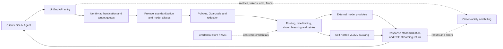

# Survey of LLM API Relays and LLM Gateways

> In this article, "relay" specifically refers to the API Relay, LLM Proxy, AI Gateway, and inference routing layer located between AI clients and model services. Ordinary network accelerators are not discussed.

## Abstract

An LLM API relay is essentially a reverse proxy that understands model protocols: the client connects to a single address, and the relay handles identity authentication, model alias resolution, protocol conversion, upstream credential injection, routing, retries, streaming forwarding, usage accounting, and auditing, then returns results to the client in a unified format.

"Forwarding one domain to another" is only the simplest form. A production-grade LLM Gateway must also understand tokens, context windows, SSE streams, tool calls, model capability differences, provider rate limits, and billing rules. Products on the market fall roughly into four categories:

1. **Managed aggregation platforms**: The platform manages provider onboarding and settlement on behalf of users, e.g., OpenRouter, Vercel AI Gateway.
2. **Self-hosted unified API and quota platforms**: Users hold their own upstream keys, e.g., LiteLLM Proxy, New API, One API.
3. **Enterprise AI/API Gateways**: Traditional API gateways extended with model protocol awareness, governance, and observability, e.g., Kong, Apache APISIX, Higress, Agent Router (formerly Envoy AI Gateway).
4. **Inference clusters and semantic routers**: Aimed at self-hosted vLLM/SGLang instances, GPU replicas, and model selection, e.g., AIBrix, vLLM Semantic Router.

No single product is best in every scenario. Personal rapid onboarding, team cost governance, enterprise compliance, and GPU cluster scheduling each require different types of relays.

## 1. First, Distinguish Several Concepts That Are Easily Confused

| Name | Understands model requests? | Primary responsibility | Typical examples |
| --- | --- | --- | --- |
| HTTP reverse proxy | Usually not | TLS, domains, basic load balancing | Nginx, HAProxy, Envoy |
| LLM Proxy / AI Gateway | Yes | Protocol conversion, authentication, routing, quotas, usage and security policies | LiteLLM, New API, Kong AI Gateway |
| Model aggregation platform | Yes, and participates in settlement | One balance to access multiple model providers | OpenRouter, Vercel AI Gateway |
| Inference router | Understands models and instance state | Schedules among self-hosted model replicas, optimizes load and KV cache hits | AIBrix Router |
| Semantic router | Understands request semantics | Selects models based on task difficulty, domain, or policy | vLLM Semantic Router, cloud vendor Model Router |
| Observability proxy | Partially | Logs, tokens, cost, tracing, and evaluation | Helicone |

An ordinary reverse proxy is suitable for "one entry point corresponding to one fixed upstream." As soon as multi-provider protocols, virtual keys, per-token limits, tool calls, or model-level failover appear, an LLM-aware Gateway should be used.

## 2. Basic Working Principles



A request typically goes through the following steps:

1. **Receive the request**: Expose an OpenAI-compatible, Anthropic Messages, Gemini, or other unified interface.
2. **Authenticate the caller**: Validate virtual keys, JWT, user, team, project, and allowed models.
3. **Model resolution**: Map stable aliases such as `qwen-review` to a specific provider, region, and version.
4. **Protocol adaptation**: Convert messages, images, tool definitions, structured outputs, token parameters, and error codes.
5. **Enforce policies**: Apply content safety, sensitive information redaction, budgets, RPM/TPM, context length, and regional rules.
6. **Select upstream**: Choose a node by priority, weight, price, latency, error rate, remaining quota, or cache affinity.
7. **Inject upstream credentials**: The client only holds keys issued by the gateway and never touches real provider keys.
8. **Forward and handle faults**: Manage connection pools, timeouts, 429/5xx retries, circuit breaking, and fallback.
9. **Stream responses**: SSE chunks must be flushed to the client immediately; do not buffer and forward only after the complete answer is generated.
10. **Meter and audit**: Record input/output tokens, TTFT, total latency, routing results, errors, and estimated cost.

### 2.1 Protocol Conversion Is Not Simply Changing a URL

Even if different providers all claim OpenAI compatibility, they may differ in the following ways:

- The meaning of `max_tokens`, `max_completion_tokens`, and `max_output_tokens`;
- How system messages, reasoning content, images, and audio are expressed;
- Tool calling, parallel tool calls, and JSON Schema support;
- The `/chat/completions`, `/responses`, `/messages`, embedding, and realtime interfaces;
- SSE end markers, usage chunks, error codes, and rate-limit response headers;
- Context windows, output limits, and stop parameters.

Therefore, a relay needs bidirectional Adapters: first convert the northbound request into an internal unified model, then generate the southbound provider request; perform the reverse process when the response returns. Simply renaming JSON fields is usually insufficient to guarantee correct Agent and tool-calling behavior.

### 2.2 Routing, Load Balancing, and Fallback

Common routing strategies include:

- Fixed priority with primary/backup;
- Weighted round-robin, least requests, random, or Power of Two Choices;
- Dynamic selection based on recent latency, TTFT, error rate, and circuit-breaker state;
- Selection by provider RPM/TPM, account balance, or per-token cost;
- Selection by tenant, region, data residency requirements, and model capabilities;
- Prefix/KV-cache-aware or session affinity for self-hosted inference services;
- A classifier selecting different models based on question difficulty and domain.

Two types of fallback need to be clearly distinguished:

- **Same model, different provider fallback**: Semantic change is relatively small; suitable for high availability.
- **Different model fallback**: Capabilities, tool protocols, context, and output style may all change; this is a business degradation strategy.

Once a streaming request has already sent tokens to the client, it should generally not silently switch to another upstream—doing so may produce duplicated content, double billing, and unrecoverable truncated responses. The safe practice is to retry only before the first response byte; after that, explicitly return an interruption error to the client.

### 2.3 Usage, Quotas, and Billing

A mature relay should support at minimum:

- Token accounting by key, user, team, project, and model;
- RPM, TPM, concurrency, daily quotas, and monetary budgets;
- Distinguishing input, output, cache read/write, reasoning tokens, image, and audio costs;
- Avoiding missed or duplicated accounting when streaming connections drop, upstream retries occur, or fallback happens;
- Preserving the ability to reconcile provider invoices against gateway estimates.

Token counts before a request are usually estimates only; final billing should prioritize the usage returned by the upstream. Estimated values may be acceptable for internal cost allocation, but external billing requires stricter accounting, refunds, tax, and compliance design.

### 2.4 Caching

There are three common types of caching:

1. **Exact full-response caching**: Hits only when the request body is identical; simple to implement but low hit rate for chat scenarios.
2. **Semantic caching**: Reuses answers for similar questions; high hit rate, but may return stale or semantically non-equivalent results.
3. **Provider Prompt/Prefix Cache**: The provider or self-hosted engine reuses prefix KV; does not directly reuse final answers.

The cache key must include tenant, model, system prompt, tool definitions, and all parameters that affect output. Sharing private answers across tenants is a serious data leak. Code agents, private document analysis, and high-randomness generation should by default not enable full-response caching; long-context agents should instead prioritize optimizing stable prefixes and upstream affinity.

## 3. Representative Products on the Market

The following are representative products as of 2026-09-13, not an exhaustive list. Features and pricing of commercial products change quickly; re-verify official terms before purchasing.

### 3.1 Managed Aggregation and Commercial Gateways

| Product | Form | Suitable scenarios | Key features and caveats |
| --- | --- | --- | --- |
| [OpenRouter](https://openrouter.ai/docs/guides/routing/provider-selection) | Managed aggregation | Fastest way to access multiple models and providers | Unified API, provider ranking, price/throughput routing, BYOK and fallback; data passes through an additional third party—clarify provider, logging, and data retention policies. |
| [Vercel AI Gateway](https://vercel.com/docs/ai-gateway) | Managed aggregation | Vercel, AI SDK, and frontend teams | Multi-provider, observability, BYOK, provider order/only and fallback; more tightly integrated with Vercel teams, quotas, and the AI SDK. |
| [Cloudflare AI Gateway](https://developers.cloudflare.com/ai-gateway/) | Managed or BYOK | Teams already using Cloudflare that need edge observability and security policies | Logging, analytics, rate limiting, caching, retries, fallback, DLP, and unified billing; exact caching only hits on identical requests. |
| [Portkey AI Gateway](https://portkey.ai/docs/product/ai-gateway) | Managed with an open-source Gateway | Teams needing rich routing policies and Guardrails | Unified API, retries, fallback, load balancing, circuit breaking, simple/semantic caching, budgets and rate limiting; strong policy composition. |
| [Helicone](https://docs.helicone.ai/getting-started/platform-overview) | Managed and open-source observability platform | Observability, debugging, and cost analysis first | Gateway, provider routing, caching, rate limiting, and full observability; closer to an "observability platform plus gateway"—evaluate the data boundary of managed logging. |

Platforms like OpenRouter are not merely proxies; they also participate in the model catalog, provider selection, and settlement. Their greatest value is speed of onboarding; their greatest risk is that the control plane, accounting, and data path depend on a third party.

### 3.2 Self-Hosted Unified API and Management Platforms

| Product | Form | Suitable scenarios | Key features and caveats |
| --- | --- | --- | --- |
| [LiteLLM Proxy](https://docs.litellm.ai/) | Self-hosted primarily, with enterprise services | Engineering teams unifying access to many cloud models and self-hosted models | Broad provider coverage; provides OpenAI-compatible interface, virtual keys, budgets, routing, retries, fallback, Guardrails, and a callback ecosystem; feature-rich—production deployment requires a database, cache, HA, and strict configuration management. |
| [New API](https://github.com/QuantumNous/new-api) | Open-source, self-hosted | Teams needing a Chinese admin UI, channels, tokens, quotas, and internal settlement | Evolved from One API; supports OpenAI/Claude/Gemini format conversion, multi-channel load balancing, and usage management; before operating externally, review the license, upstream authorization, and local regulatory requirements. |
| [One API](https://github.com/songquanpeng/one-api) | Open-source, self-hosted | Simple unified keys, channels, and model mapping | Straightforward deployment and mature ecosystem; one of the upstream foundations of New API; new projects should also compare New API's protocol coverage and maintenance cadence. |

Simple selection principle: for engineering-oriented configuration and multi-provider adaptation, look at LiteLLM first; for operations-oriented admin, users, tokens, and quota management, look at New API first. Neither should be mistaken for a compliance solution that allows "unconditionally public resale with one upstream account."

### 3.3 AI Extensions of Enterprise API Gateways

| Product | Form | Suitable scenarios | Key features and caveats |
| --- | --- | --- | --- |
| [Kong AI Gateway](https://docs.konghq.com/gateway/latest/ai-gateway/) | Commercial and self-hosted | Enterprises already using Kong | AI Proxy, protocol conversion, authentication, governance, and observability can reuse the Kong plugin system; advanced multi-target load balancing and fallback are primarily in Advanced capabilities. |
| [Apache APISIX AI Gateway](https://apisix.apache.org/ai-gateway/) | Open-source, self-hosted | Teams already using APISIX that need unified management of API and AI traffic | Multi-model proxy, load balancing, fallback, token rate limiting, security, and observability; specifically review request headers forwarded upstream to avoid leaking internal Cookies or Authorization. |
| [Higress AI Gateway](https://higress.ai/en/ai-gateway/) | Open-source, self-hosted, and enterprise edition | Domestic Kubernetes and Alibaba Cloud ecosystems | Multi-model proxy, model mapping, token rate limiting, and plugin-based governance; more natural for K8s/Ingress users. |
| [Agent Router (formerly Envoy AI Gateway)](https://theagentrouter.ai/docs/) | Open-source; deployable standalone or on Kubernetes | Platform teams needing unified management of models, MCP, and self-hosted inference | Renamed in 2026-09 and moved into the Agentic AI Foundation; the underlying technology remains Envoy/Envoy Gateway, and the original CRDs, API groups, and CLI remain unchanged; production use can manage protocol and upstream authentication via AIGatewayRoute, AIServiceBackend, and security policies. |

These products are suitable for incorporating AI traffic into an existing zero-trust, WAF, audit, Prometheus, GitOps, and Gateway API system—not for introducing an entire complex control plane just for personal calls.

### 3.4 Self-Hosted GPU Inference Routing

| Product | Positioning | Suitable scenarios | Description |
| --- | --- | --- | --- |
| [AIBrix Router](https://aibrix.readthedocs.io/latest/designs/aibrix-router.html) | Inference service entry and instance routing | vLLM/SGLang on Kubernetes, multiple replicas, and LoRA | Supports dynamic model discovery, streaming requests, rate limiting, and pluggable routing; the focus is scheduling requests to appropriate inference instances, not aggregating third-party model balances. |
| [vLLM Semantic Router](https://github.com/vllm-project/semantic-router) | Mixture-of-Models decision layer | Selecting different models based on semantics, difficulty, or policy | Official documentation states it does not replace a Gateway or model server; it should typically be deployed between a unified entry and multiple model backends. |
| [Amazon Bedrock Intelligent Prompt Routing](https://docs.aws.amazon.com/bedrock/latest/userguide/prompt-routing.html) | Cloud vendor model selector | Quality/cost optimization among same-series models within AWS Bedrock | Analyzes requests and predicts candidate model quality, then selects a model; constrained by Bedrock's supported scope and routing rules. |
| [Microsoft Foundry Model Router](https://learn.microsoft.com/en-us/azure/foundry/openai/how-to/model-router) | Cloud vendor model selector | Selecting models within Azure/Foundry by quality, cost, or balanced mode | Exposes routing capability as a single deployment; supports choosing a routing mode and a subset of candidate models. |

Inference routing and API relay/proxy are often deployed in layers: the upper layer handles tenants, protocols, and cost, while the lower layer handles GPU replicas, KV Cache, LoRA, and real-time load.

## 4. Why "Shared-Key Relay Stations" Carry the Highest Risk

There are also many anonymous top-up stations or shared-account relays on the internet. These services may offer low prices and fast activation, but they are not in the same risk class as legitimate Gateway products.

The main risks include:

- After TLS termination, the relay operator can theoretically read the full prompt, file contents, tool parameters, and model responses;
- There is no way to verify the actual upstream provider, model version, context length, or whether the request was silently downgraded to a different model;
- Upstream accounts may violate resale or sharing terms and can be banned at any time;
- Balance, invoices, refunds, SLA, and outage notifications lack guarantees;
- Log retention, training usage, cross-border data transfer, deletion mechanisms, and personnel permissions are opaque;
- If a relay Key leaks, there may be no fine-grained budget, IP restrictions, or audit capability;
- "Compatibility" with `/responses`, tool calling, and long contexts may simply mean silently dropping fields.

When company code, customer data, personal notes, production Agents, or long-running stable services are involved, you should prioritize using your own upstream accounts plus a self-hosted gateway, or choose a managed service that can provide contracts, DPAs, data retention statements, regional controls, and audit capabilities.

## 5. Selection Recommendations

### 5.1 Choose by Scenario

| Scenario | Preferred Solution | Reason |
| --- | --- | --- |
| Individuals quickly trying multiple public models | OpenRouter; or local LiteLLM | The former is fast to activate; the latter preserves upstream account and data control. |
| Small teams unifying Keys and cost | LiteLLM Proxy | Virtual Keys, budgets, provider adapters, and routing capabilities are well balanced. |
| Need a Chinese-language admin console, user and quota management | New API | The admin UI and channel/token model fit these needs more closely, but licensing and compliance must be handled separately. |
| Already on Cloudflare/Vercel platform | The corresponding platform's AI Gateway | Can reuse edge network, identity, logging, and billing systems. |
| Enterprise already has an API Gateway | AI capabilities of Kong, APISIX, or Higress | Reuses authentication, gateway operations, auditing, and the plugin ecosystem. |
| Kubernetes Gateway API tech stack | Agent Router (formerly Envoy AI Gateway) | Declarative backends, credentials, and routing policies fit more naturally. |
| Self-hosted multi-replica vLLM/SGLang | AIBrix; optionally add vLLM Semantic Router | Can be aware of model deployments, instance load, and semantic routing, rather than acting only as a provider proxy. |
| Strict compliance, sensitive data | Self-hosted Gateway + own upstream accounts + private network/dedicated line | Easiest to control credentials, data paths, logs, and retention policies. |

### 5.2 Recommendations for DSH

For Agents such as DSH and Claude Code that send long contexts, tool definitions, and file contents, the recommendations are:

1. Keep the client-native protocol on the northbound side; if DSH uses an OpenAI-compatible model, have the gateway fully preserve streaming, tool calling, reasoning, and usage fields.
2. Set stable aliases for models, e.g., `qwen38-note-review`, and do not let the client bind to a provider instance address.
3. By default, pin to the same provider or backend pool; on failure, prefer switching to a node with the "same model, same capability"; cross-model degradation should be explicitly configured.
4. Use sticky/prefix-aware routing for long sessions to avoid hitting different nodes on each turn and losing Prompt/KV Cache.
5. Do not cache full responses containing code, notes, and credentials; logs should be redacted by default, and only tokens, latency, and request hashes should be recorded when necessary.
6. Set separate maximum context, maximum output tokens, concurrency, TPM, and daily budget for the Agent to prevent a single runaway loop from exhausting quota.
7. Tool calling, very long contexts, and SSE disconnects must be included in pre-launch testing; testing only a single sentence like `hello` is not sufficient.

The recommended two-layer structure is:

```text
DSH / Coding Agent
        │
        ▼
LiteLLM 或 New API
  鉴权、模型别名、预算、协议与多供应商
        │
        ├────────► 官方云模型 API
        │
        ▼
AIBrix / Agent Router
  实例发现、负载与缓存亲和路由
        │
        ▼
vLLM / SGLang GPU 副本
```

If there is currently only one stable internal OpenAI-compatible Endpoint and no need for multi-tenancy, billing, or protocol conversion, then start with a minimal reverse proxy plus authentication. There is no need to introduce a large control plane just to "look complete." Upgrade to an LLM Gateway only when a second upstream, quota governance, or high-availability requirements appear.

## 6. Pre-Launch Test Checklist

### Protocol Compatibility

- Chat Completions, Responses, Anthropic Messages, and other interfaces actually used;
- SSE first token, sustained flushing, client disconnects, and upstream disconnects;
- Tool calling, parallel tools, JSON Schema, images, and files;
- Reasoning fields, usage, finish reason, and error formats;
- Long contexts such as 32K/128K and maximum output limits.

### Routing and Reliability

- Actively inject 429, 401, timeouts, connection resets, and 5xx;
- Verify that fallback only triggers on expected status codes;
- Verify that no silent replay occurs after partial tokens have already been output;
- Check circuit breaker recovery, retry backoff, and maximum attempt counts;
- Load-test p50/p95/p99 TTFT, total latency, throughput, and gateway CPU/memory.

### Billing and Security

- Compare gateway usage, upstream bills, and client statistics;
- Confirm cost attribution for retries, cancellations, and fallbacks;
- Keys exist only in Secret/KMS and never enter images, Git, logs, or traces;
- Request logs are redacted, with per-tenant retention periods and deletion processes;
- Upstream domains use an allowlist to prevent SSRF via custom endpoints;
- Remove cookies, internal Authorization headers, and custom headers that should not be forwarded;
- Check cross-tenant cache isolation, metric label isolation, and permission isolation for the management API.

## 7. A Practical Decision Summary

- **Just want to call multiple models quickly**: choose a managed aggregation platform.
- **Need to control Keys, logs, and cost**: choose self-hosted LiteLLM or New API.
- **Enterprise already has a mature gateway team**: extend AI capabilities on Kong, APISIX, Higress, or Envoy.
- **The main problem is GPU replica scheduling**: choose an inference router like AIBrix; do not substitute a generic API relay.
- **Need to automatically select models by problem difficulty**: add a semantic routing layer and prove quality with offline evaluation, rather than guessing based on model price alone.
- **Handling sensitive content**: avoid anonymous shared-Key relay stations; prioritize self-hosting and own upstream accounts.

The real value of a relay is not hiding a Base URL, but turning model access into governable, observable, replaceable, and auditable infrastructure. When choosing, first identify whether your primary pain point is "integration," "operations," "enterprise governance," or "GPU scheduling," and then decide which layer you need.

## References

- [LiteLLM Official Documentation](https://docs.litellm.ai/)
- [OpenRouter Provider Routing](https://openrouter.ai/docs/guides/routing/provider-selection)
- [New API Official Repository](https://github.com/QuantumNous/new-api)
- [One API Official Repository](https://github.com/songquanpeng/one-api)
- [Cloudflare AI Gateway](https://developers.cloudflare.com/ai-gateway/)
- [Vercel AI Gateway](https://vercel.com/docs/ai-gateway)
- [Portkey AI Gateway](https://portkey.ai/docs/product/ai-gateway)
- [Helicone Platform Overview](https://docs.helicone.ai/getting-started/platform-overview)
- [Kong AI Gateway](https://docs.konghq.com/gateway/latest/ai-gateway/)
- [Apache APISIX AI Gateway](https://apisix.apache.org/ai-gateway/)
- [Higress AI Gateway](https://higress.ai/en/ai-gateway/)
- [Agent Router (formerly Envoy AI Gateway)](https://theagentrouter.ai/docs/)
- [AIBrix Router](https://aibrix.readthedocs.io/latest/designs/aibrix-router.html)
- [vLLM Semantic Router](https://github.com/vllm-project/semantic-router)
- [Amazon Bedrock Intelligent Prompt Routing](https://docs.aws.amazon.com/bedrock/latest/userguide/prompt-routing.html)
- [Microsoft Foundry Model Router](https://learn.microsoft.com/en-us/azure/foundry/openai/how-to/model-router)
