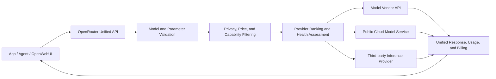
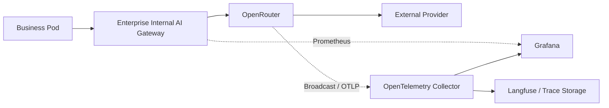

# OpenRouter Technical Overview: Unified Model API, Provider Routing, and Enterprise Access

OpenRouter provides a unified hosted API that lets applications access models from different vendors using the same credentials and request format. It maintains a model catalog, connects to multiple inference Providers, performs routing and failover, and aggregates usage into a single billing and observability interface.

It is best suited to solving two problems: first, applications need to quickly try out and switch between multiple models; second, the same model is available from multiple inference Providers, and the goal is to select an upstream based on availability, price, or performance. It does not manage GPU Pods in an enterprise Kubernetes cluster, nor can it replace AIBrix, KServe, or inference engines inside the cluster.

Think of it as a model service marketplace. The same model is like the same product, which may be delivered by different Providers; OpenRouter selects the deliverer based on inventory, price, speed, and rules. Cross-model Fallback is equivalent to switching to a different product when stock runs out—the request can still complete, but the capabilities and results may have changed.

The [OpenRouter official model catalog](https://openrouter.ai/docs/guides/overview/models) currently covers hundreds of models. Model metadata includes context length, input/output modalities, price, supported parameters, and Provider information. Clients primarily use OpenAI-compatible Chat Completions, and can also use Responses, Anthropic Messages, Embedding, image, audio, and video interfaces.

If you need to understand the entire product category first, you can read the [LLM API Relay and LLM Gateway Overview](llm-api-relay-gateway-overview.md) alongside this document; for in-cluster inference instance scheduling, see [AI Gateway, Inference Routing, and Traffic Governance](gateway-routing.md).

## 1. First Understand Model and Provider

OpenRouter separates "model" from "the endpoint that provides compute for this model" into two layers:

- **Model** represents model identity, e.g., `openai/gpt-5.2`. The model determines base capabilities, context window, and parameter semantics.
- **Provider** represents the vendor or cloud endpoint that actually hosts inference. The same model may be provided simultaneously by the model vendor, cloud platforms, and third-party inference platforms.
- **OpenRouter** selects one endpoint from available Providers based on request constraints, and completes protocol adaptation, authentication, forwarding, metering, and response standardization.



Model routing and Provider routing should also be understood separately:

| Routing Layer | Input | Result | Semantic Change |
| --- | --- | --- | --- |
| Provider Routing | One model, multiple available endpoints | Select the Provider hosting that model | Usually small, but quantization, region, and service tier may still differ |
| Model Fallback | Multiple models in order | Use the next model after the previous one fails | May significantly change quality, tool calling, context, and cost |
| Auto Router | Target or candidate range provided | Router automatically selects model and Provider | The model itself may change; business evaluation must be used to constrain it |

OpenRouter by default load-balances among quality Providers for the same model to improve availability. Applications can also pin a Provider, disable Fallback, or sort by price, throughput, and latency. The [Provider Routing documentation](https://openrouter.ai/docs/guides/routing/provider-selection) states that latency and throughput preferences use percentile statistics from a five-minute window; these data are suitable for dynamic filtering but cannot replace your own end-to-end SLO.

## 2. Minimal Integration Only Requires Changing the Base URL

The existing OpenAI Python SDK can be reused directly:

```python
import os
from openai import OpenAI

client = OpenAI(
    base_url="https://openrouter.ai/api/v1",
    api_key=os.environ["OPENROUTER_API_KEY"],
    default_headers={
        "HTTP-Referer": "https://example.com",
        "X-OpenRouter-Title": "Internal AI Assistant",
        "X-OpenRouter-Metadata": "enabled",
    },
)

response = client.chat.completions.create(
    model="openai/gpt-5.2",
    messages=[
        {"role": "user", "content": "解释 Kubernetes Pod 的生命周期。"}
    ],
    temperature=0,
    max_completion_tokens=512,
)

print(response.model)
print(response.choices[0].message.content)
print(response.usage)
```

`Authorization: Bearer ...` is the API authentication. `HTTP-Referer` and `X-OpenRouter-Title` are used for application attribution and statistics and can be set as needed. `X-OpenRouter-Metadata: enabled` requires the response to return routing metadata, making it easy to confirm the actual Provider and routing process used.

Production code should also save the response's model, Usage, routing metadata, and `X-Generation-Id`. After Model Fallback is configured, the final model may differ from the preferred model; recording only the model name from the client request will distort quality regression analysis and cost reconciliation.

## 3. How Provider Routing Is Controlled

The following request requires the Provider to fully support the request parameters, prioritizes throughput, excludes endpoints that collect data, and enables ZDR:

```json
{
  "model": "openai/gpt-5.2",
  "messages": [
    {"role": "user", "content": "Review this deployment manifest."}
  ],
  "tools": [],
  "provider": {
    "sort": "throughput",
    "allow_fallbacks": true,
    "require_parameters": true,
    "data_collection": "deny",
    "zdr": true
  }
}
```

Common control items are as follows:

| Field | Purpose | Production Considerations |
| --- | --- | --- |
| `order` | Try Providers in the specified order | Must be combined with `allow_fallbacks=false` to strictly limit to the list |
| `only` / `ignore` | Provider whitelist or exclusion list | An overly narrow whitelist reduces failover resilience |
| `sort` | Sort by `price`, `throughput`, or `latency` | Dynamic metrics change; actual routing results should be recorded |
| `allow_fallbacks` | Whether fallback Providers are allowed | Enabled by default; compliance scenarios require confirming that fallback endpoints also meet policy |
| `require_parameters` | Only select endpoints that support all request parameters | Recommended for Tool Call, JSON Schema, and multimodal requests |
| `max_price` | Limit the maximum acceptable price | Prevents Fallback from unexpectedly entering high-priced endpoints |
| `data_collection` | Whether Providers that may collect data are allowed | Sensitive requests should be restricted at both the account policy and individual request levels |
| `zdr` | Only use Zero Data Retention endpoints | The number of Providers decreases; error handling for no matching endpoint should be tested |
| `preferred_min_throughput` | Prefer endpoints that meet the throughput threshold | This is a preference condition; degradation behavior should still be confirmed against official current routing rules |
| `preferred_max_latency` | Prefer endpoints below the latency threshold | Does not guarantee application-side network and full E2E latency |

### Same-Model Fallback and Cross-Model Fallback

Same-model, different-Provider Fallback mainly addresses rate limiting, outages, and capacity fluctuations. Cross-model Fallback uses the `models` array to specify candidate order, for example:

```json
{
  "models": [
    "openai/gpt-5.2",
    "anthropic/claude-sonnet-4.5"
  ],
  "messages": [
    {"role": "user", "content": "生成一份变更风险清单。"}
  ]
}
```

The [Model Fallback documentation](https://openrouter.ai/docs/guides/routing/model-fallbacks) lists trigger conditions including rate limiting, service unavailability, context length errors, and content moderation rejections. Requests are billed based on the model actually used in the end, and the response `model` field gives the final model.

Cross-model switching is a business degradation. Even if two models both support Tool Call, tool names, parameter stability, reasoning fields, and safety boundaries may differ. Before going live, the same business Eval should be used to validate each candidate model, and cross-model Fallback should be disabled for requests that cannot tolerate degradation.

## 4. Prompt Cache and Session Affinity

Long System Prompts, RAG documents, and multi-turn Agents repeatedly send large prefixes. OpenRouter can forward Prompt Cache parameters from different Providers and use Provider Sticky Routing to improve Cache hit rates.

The [Prompt Caching documentation](https://openrouter.ai/docs/guides/best-practices/prompt-caching) states that after explicitly providing `session_id`, the same session will try to continue routing to the same model and Provider. When the Sticky endpoint is unavailable, it can still switch to a fallback endpoint.

```json
{
  "model": "anthropic/claude-sonnet-4.5",
  "session_id": "ticket-20260914-001",
  "cache_control": {"type": "ephemeral"},
  "messages": [
    {"role": "system", "content": "这里是需要重复使用的长背景资料……"},
    {"role": "user", "content": "先总结风险。"}
  ]
}
```

Prompt Cache is implemented by the final Provider; each vendor has different minimum cacheable lengths, write prices, read discounts, and TTLs. Applications should observe `cached_tokens`, actual cost, and Provider changes simultaneously. When manually setting `provider.order`, the explicit order overrides the automatic Sticky policy.

## 5. Costs and BYOK

OpenRouter supports two main usage modes:

1. **Purchase OpenRouter Credits**: OpenRouter settles inference costs from various Providers in a unified manner.
2. **BYOK**: Configure your own OpenAI, Anthropic, Bedrock, Vertex, and other Provider credentials in the Workspace, and OpenRouter continues to handle the unified interface and routing.

According to the [official pricing page as of 2026-09-14](https://openrouter.ai/pricing), the pay-as-you-go platform fee is 5.5% of the top-up amount; model inference prices are settled at Provider list prices. BYOK free quota is calculated based on "list-price inference amount"; Pay-as-you-go and Business currently receive USD 25,000 per month, and Enterprise currently receives USD 200,000 per month, with a 5% fee charged above that. These terms change quickly; budget and procurement materials should cite the pricing page on the day of reference, and avoid writing outdated per-request calculations from old FAQs into long-term configurations.

BYOK does not mean requests bypass OpenRouter. Requests still pass through the OpenRouter data plane; only the final Provider uses the enterprise's own credentials and quota. If traffic must only go through your own account, you also need to disable Shared Capacity Fallback in the BYOK settings and use policies such as `provider.only` to restrict endpoints.

Cost governance should at minimum record:

- Input, output, Reasoning, Cache read/write, and multimodal units;
- Final model, Provider, service tier, and per-request cost;
- Failed attempts before and after Fallback, and cost attribution;
- API Key, Workspace, user, environment, and business tags;
- Daily budget, abnormal growth rates, balance thresholds, and auto top-up status.

Free models are suitable for feature trials. Free quota has limited rate and daily request counts, and may fluctuate due to shared capacity; it should not be used as a production capacity baseline.

## 6. Where Data Actually Passes Through

The OpenRouter path involves at least three parties: the application, OpenRouter, and the final Provider. When choosing a hosted aggregation platform, privacy review should examine each hop, not just the model vendor's policy.

The [OpenRouter data collection statement](https://openrouter.ai/docs/guides/privacy/data-collection) states that Prompt and Response content are not retained by OpenRouter by default, with exceptions when Input & Output Logging is actively enabled or when the platform is permitted to use content; request metadata such as tokens, latency, model, and cost are saved for statistics. The [Provider Logging documentation](https://openrouter.ai/docs/guides/privacy/provider-logging) also emphasizes that different Providers have their own data retention and training policies.

Production environments should implement four layers of control simultaneously:

1. Disable data collection options that do not meet requirements at the organization or Workspace level;
2. Use Guardrails to restrict models, Providers, budgets, and ZDR;
3. For sensitive requests, in `provider`, declare `data_collection: deny` and `zdr: true` again;
4. Identify and redact keys, personal information, and regulated fields within the enterprise before sending requests.

ZDR means the Provider does not persistently save request content. It does not mean data does not leave the enterprise network, nor does it eliminate the need for cross-border data transfer, vendor contract, and access control reviews. Enterprise customers requiring regional residency can evaluate OpenRouter's US/EU in-region entry points, but must still confirm the selected models, Providers, and contract scope.

## 7. What Observability Should Look At

OpenRouter Activity and Logs can view requests by model, Provider, and API Key. Broadcast can also asynchronously send Traces to OpenTelemetry Collector, Grafana Cloud, Datadog, Langfuse, S3, and other destinations. The [Broadcast documentation](https://openrouter.ai/docs/guides/features/broadcast/overview) supports Privacy Mode, which sends only tokens, cost, time, and routing metadata, without Prompt and model output.

Enterprise dashboards should include at minimum:

| Dimension | Metrics |
| --- | --- |
| Availability | Success rate, 429/5xx, no available Provider, Fallback count |
| Performance | TTFT, E2E, output tok/s, streaming interruption rate |
| Cost | Cost per request, cost per task, input/output/Cache/Reasoning costs |
| Routing | Requested model, final model, Provider, region, service tier |
| Quota | RPM, TPM, concurrency, Key budget, Workspace budget, balance |
| Quality | Business Eval score, Tool Call success rate, structured output pass rate |



Internal gateway metrics and OpenRouter Traces need to be correlated using a unified `trace_id` or `session_id`. Otherwise, you only see two separate charts—"gateway slow" and "Provider slow"—and cannot determine which hop the latency occurred on.

## 8. How to Choose Between Direct API and Self-Built Gateway

| Approach | Integration speed | Multi-model and multi-provider | Data path control | In-cluster GPU scheduling | Operations responsibility |
| --- | --- | --- | --- | --- | --- |
| Direct model provider calls | Fast | Each provider integrated separately | Relatively direct | None | Application maintains multiple SDKs, keys, and billing |
| OpenRouter | Very fast | Strong, unified catalog, billing, and routing | Depends on the hosted platform and the final provider | None | Platform-hosted; application is responsible for policy and regression |
| Self-hosted LiteLLM/Higress and other gateways | Medium | Depends on adapters and configuration | Enterprise controls ingress, keys, and logs | Usually only service-level routing | Enterprise is responsible for HA, upgrades, databases, and observability |
| AIBrix/Inference Gateway | Medium | Primarily for self-hosted models | Enterprise-controllable | Strong, can be aware of instances, load, and cache | Enterprise is responsible for Kubernetes and GPU services |

For individual developers, model evaluation, and products that need to quickly cover multiple provider APIs, OpenRouter's integration efficiency is very high. Company code, customer data, or stable production workloads should focus on evaluating contracts, regions, provider allowlists, ZDR, SLAs, and exit plans.

Enterprises can also adopt a two-tier ingress: an internal AI Gateway handles employee identity, tenants, redaction, budgets, and audit, then routes some models to OpenRouter and self-hosted models to AIBrix or vLLM/SGLang. This way, applications only connect to the company ingress, and external platform keys, routing policies, and replacement processes do not scatter across every business repository.

## 9. Recommended Integration Approach in Kubernetes

OpenRouter itself is a hosted service; on the Kubernetes side, the main deployment is the caller or the enterprise's internal gateway:

```text
Ingress / Service Mesh
        │
        ▼
Internal AI Gateway
  ├─ SSO / JWT / ServiceAccount 身份
  ├─ 模型别名、预算、限流和审计
  ├─ Prompt 脱敏与出站策略
  └─ Trace / Prometheus
        │
        ├────────► OpenRouter ──► 外部 Provider
        │
        └────────► AIBrix ──────► vLLM / SGLang
```

When rolling out, note the following:

- Store the OpenRouter key in a Secret or external key management system, readable only by server-side Pods; browsers and public frontends must not hold long-lived keys.
- Use stable internal model aliases, mapped by the gateway to specific OpenRouter Model/Provider policies.
- Use NetworkPolicy, an Egress Gateway, or a firewall to restrict outbound domains, and record DNS, TLS, and proxy failures.
- Set separate connection timeout, first-token timeout, and overall timeout for OpenRouter requests; only one authoritative layer should exist between client retries and gateway retries.
- Propagate client cancellation on Pod termination to avoid the external model continuing to generate and bill after the user has disconnected.
- HPA should not look only at request count. Long-context agents have far higher connection time and cost than short chats; scale the internal gateway based on active streams, tokens, and latency.
- Reserve an emergency path to direct providers or self-hosted models, and periodically rehearse scenarios where OpenRouter is unavailable, the balance is insufficient, and all providers fail to match.

## 10. Pre-Launch Validation Checklist

### Protocol

- Regular chat, full SSE, cancellation, and timeout;
- Tool calls, parallel tools, JSON Schema, and Reasoning fields;
- Modalities actually used, such as images, audio, or files;
- Maximum context, maximum output, and parameter support across different providers;
- `response.model`, routing metadata, Usage, and Generation ID.

### Routing

- Inject 429, 5xx, timeout, and unavailability into the preferred provider;
- Verify `only`, `ignore`, ZDR, data policy, and price caps;
- Confirm the final fallback model and whether the business accepts output variation;
- Check that after `require_parameters=true`, tool calls and structured output do not land on incompatible endpoints;
- For long sessions, verify `session_id`, provider stickiness, and prompt cache hits.

### Security and Cost

- Key rotation, revocation, least privilege, and leak alerts;
- Daily/monthly budgets for workspaces and business keys;
- Data scope for prompt logs, Broadcast, and third-party observability platforms;
- Sample reconciliation of OpenRouter records, internal gateway usage, and billing;
- Data residency, DPA, provider terms, and data deletion processes after employee departure or project shutdown.

## 11. Suitable and Unsuitable Scenarios

OpenRouter is suitable for quickly trying multiple models, reducing SDK adaptation effort, unifying billing for small teams, and obtaining multi-provider capacity and failover for the same model. For model evaluation platforms and agent prototypes, it can significantly shorten integration time.

When the business requires all data to remain on a private network, needs direct control over vendor contracts and capacity, must schedule its own GPUs, or already has a mature enterprise gateway and multi-cloud model accounts, a self-hosted ingress is usually more appropriate. In that case, OpenRouter can still be used as a controlled supplementary upstream rather than having every application hold platform keys directly.

OpenRouter's core value is turning "integrating models" into a unified interface and turning "which inference endpoint to choose" into a configurable policy. Once truly in production, the enterprise still needs to define its own model admission, quality evaluation, data boundaries, cost budgets, and failure degradation.

## References

- [OpenRouter Quickstart](https://openrouter.ai/docs/quickstart)
- [Models API and model catalog](https://openrouter.ai/docs/guides/overview/models)
- [Provider Routing](https://openrouter.ai/docs/guides/routing/provider-selection)
- [Model Fallbacks](https://openrouter.ai/docs/guides/routing/model-fallbacks)
- [Prompt Caching](https://openrouter.ai/docs/guides/best-practices/prompt-caching)
- [BYOK](https://openrouter.ai/docs/guides/overview/auth/byok)
- [Pricing](https://openrouter.ai/pricing)
- [Data Collection](https://openrouter.ai/docs/guides/privacy/data-collection)
- [Provider Logging](https://openrouter.ai/docs/guides/privacy/provider-logging)
- [Zero Data Retention](https://openrouter.ai/docs/guides/features/zdr)
- [Broadcast Observability](https://openrouter.ai/docs/guides/features/broadcast/overview)
- [Chat Completions API](https://openrouter.ai/docs/api/api-reference/chat/send-chat-completion-request)
