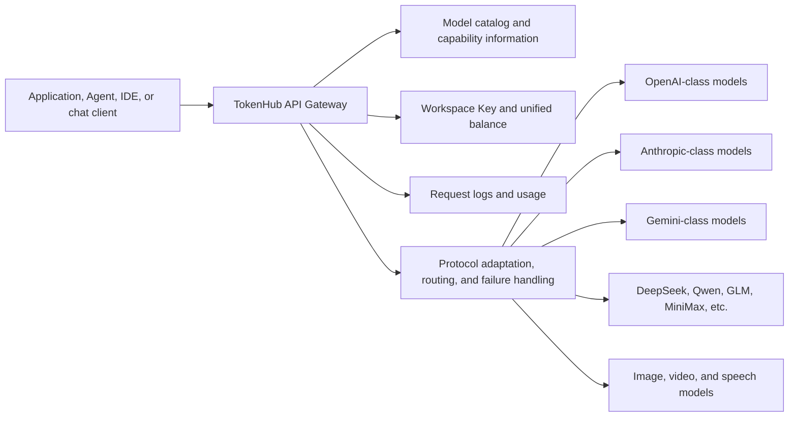
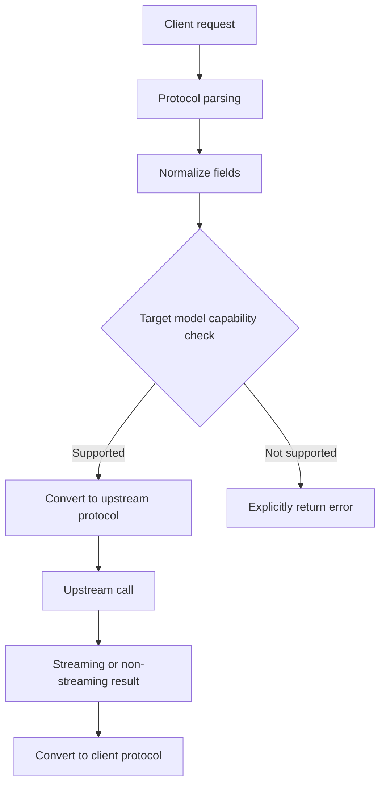
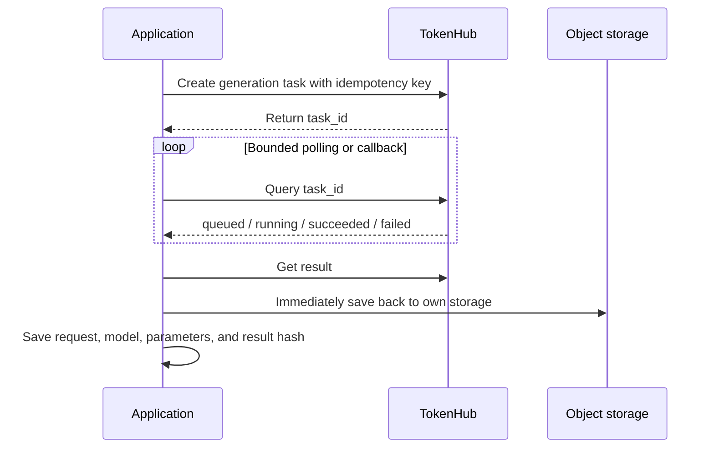
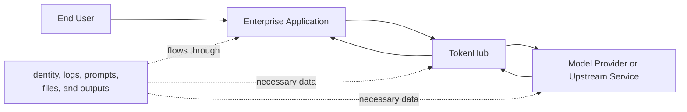
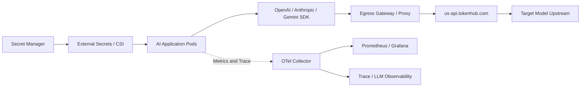
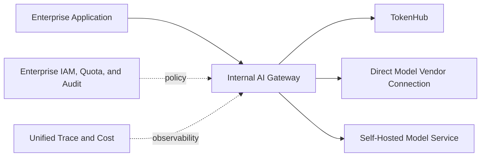

# TokenHub Technical Overview: Unified Model API, Aggregation Marketplace, and Enterprise Access

Once enterprises begin using OpenAI, Anthropic, Google, DeepSeek, Qwen, MiniMax, as well as image, video, and speech models simultaneously, the engineering problem quickly shifts from "how to call one API" to "how to manage a dozen protocols, keys, prices, capabilities, and failures." TokenHub.com offers an aggregation route: applications connect to a single gateway and shared billing account, selecting different upstreams through a unified model catalog.

Its product form is close to OpenRouter—a hosted multi-model API Gateway and Marketplace. It is not a large language model itself, nor is it an inference engine that needs to be deployed to Kubernetes. It can reduce vendor adaptation code, but it does not automatically eliminate model differences, data compliance issues, upstream failures, or migration validation.

**TokenHub** in this article specifically refers to the hosted service at [`tokenhub.com`](https://tokenhub.com/zh). There are multiple products with the same name on the market; the next section will first clarify the boundaries.

## One-Page Summary

1. **TokenHub.com is a hosted model aggregation and forwarding platform.** It brings a model catalog, API keys, unified balance, request logs, routing, and multiple upstream models into a single entry point.
2. **It simultaneously provides OpenAI, Anthropic Messages, and Gemini compatible entry points.** Existing SDKs, Agents, and desktop clients can usually be integrated at relatively low cost if they allow configuring Base URL, API Key, and Model ID.
3. **"Interface compatibility" does not mean "identical model behavior."** Tool Call, Reasoning, Streaming, multimodal, error codes, caching, and maximum context are still affected by the target model, upstream, and protocol translation.
4. **The model catalog is suitable for discovery and comparison, not a substitute for production validation.** Prices, context, endpoints, and availability change; production systems should lock down Model ID, protocol, capability matrix, and regression results at release time.
5. **Unified billing reduces financial and integration friction but also introduces platform dependency.** Anomalies in any layer—TokenHub, the network, or the upstream—can affect calls; critical business still needs timeouts, circuit breakers, idempotency, and fallback paths.
6. **The aggregation gateway sits in the data path.** Prompts, context, files, and model outputs must be forwarded through TokenHub to the selected upstream; enterprises must evaluate the data rules of both TokenHub and the final model provider.
7. **Agent integration must select endpoints based on the real Wire Protocol.** Claude Code typically uses Anthropic Messages, Codex often uses Responses, and ordinary OpenAI-compatible clients mostly use Chat Completions; a successful text chat does not prove full-featured Agent compatibility.
8. **Kubernetes does not require GPU deployment for TokenHub.** Application Pods call the hosted endpoint over HTTPS; the platform-side focus is on Secrets, egress control, tenant quotas, Trace, cost, and failure degradation.
9. **Standard NetworkPolicy cannot restrict egress directly by domain name.** If only TokenHub domains are allowed, you need an Egress Proxy, a CNI supporting FQDN Policy, or a cloud firewall—not hardcoded dynamic IPs.
10. **The key selection decision is the trade-off between hosted and self-built.** Aggregation sites are convenient when you want to quickly use multiple models; when you need your own upstream contracts, private-network data paths, fine-grained governance, and complete auditing, a self-built Gateway is more controllable.

## 1. First, Distinguish Several Products with the Same Name TokenHub

As of this article's update, at least three categories of products use the TokenHub name:

| Name | Form | Primary Capabilities | Deployment Location | Is This Article's Main Focus |
| --- | --- | --- | --- | --- |
| [TokenHub.com](https://tokenhub.com/zh) | Commercial hosted API aggregation site | Multi-model catalog, compatible APIs, shared billing, routing, and tool integration | Service provider cloud | Yes |
| [astaxie/TokenHub](https://github.com/astaxie/TokenHub) | Apache-2.0 open-source private gateway | Provider, project keys, routing, quotas, cost, audit, and private deployment | User's own host or cloud | Name disambiguation only |
| [Tencent Cloud LLM Platform TokenHub](https://cloud.tencent.com.cn/document/product/1823) | Cloud vendor hosted model platform | Model aggregation, OpenAI/Anthropic compatible APIs, regional endpoints | Tencent Cloud | Name disambiguation only |

These three are not the same codebase, account system, or service. When searching for information, troubleshooting, or writing procurement lists, you should specify the domain, vendor, and version together to avoid incorrectly migrating "TokenHub supports feature X" to another product.

All Base URLs `https://us-api.tokenhub.com` appearing later in this article belong to TokenHub.com.

## 2. What Problem Does TokenHub.com Solve

When integrating multiple models directly, teams need to handle separately:

- Different accounts, API keys, and billing;
- Chat Completions, Responses, Messages, and vendor-native protocols;
- Model names, context, prices, modalities, and regional differences;
- Tool Call, streaming events, Reasoning, and cache fields;
- Vendor rate limits, error codes, timeouts, and model deprecation;
- How each client supports custom providers;
- Usage attribution, budgets, top-ups, and financial reconciliation.

TokenHub.com centralizes part of this into a unified entry point:



The official description is "one API Key, one endpoint, one billing system," and lists capabilities such as model aggregation, cost control, automatic retry, Fallback, and multi-region support. [About TokenHub](https://tokenhub.com/zh/about)

This diagram is a logical architecture compiled from publicly available product capabilities; it does not mean TokenHub has published its internal service implementation, specific upstream relationships, or the physical deployment location of each model.

## 3. Three Compatible Protocols

TokenHub's currently published common entry points are as follows:

| Protocol | Base URL | Typical Request Path | Applicable Clients |
| --- | --- | --- | --- |
| OpenAI Compatible | `https://us-api.tokenhub.com/v1` | `/chat/completions`, `/responses`, `/models` | OpenAI SDK, Codex, Cline, Open WebUI, etc. |
| Anthropic Compatible | `https://us-api.tokenhub.com` | `/v1/messages` | Claude Code and Messages clients |
| Gemini Compatible | `https://us-api.tokenhub.com` | `/v1beta/models` and Gemini native paths | Gemini native tools |

Source: [TokenHub Integrations](https://tokenhub.com/zh/docs/integrations).

### 3.1 OpenAI Chat Completions

```python
import os
from openai import OpenAI

client = OpenAI(
    api_key=os.environ["TOKENHUB_API_KEY"],
    base_url="https://us-api.tokenhub.com/v1",
)

response = client.chat.completions.create(
    model="YOUR_TOKENHUB_MODEL_ID",
    messages=[
        {"role": "system", "content": "回答要简洁，并标出不确定信息。"},
        {"role": "user", "content": "解释为什么模型网关需要超时与熔断。"},
    ],
)

print(response.choices[0].message.content)
```

### 3.2 OpenAI Responses

Codex and newer Agent tools may use the Responses Wire API. In that case, having only Chat Completions available is not sufficient:

```python
response = client.responses.create(
    model="YOUR_TOKENHUB_MODEL_ID",
    input="只读分析当前仓库结构，不要修改文件。",
)

print(response.output_text)
```

If the client configuration contains `wire_api`, `api_mode`, or `endpoint`, they must match the real request path. TokenHub's Codex guide explicitly uses the Responses path. [Codex Integration Guide](https://tokenhub.com/zh/docs/integrations/codex)

### 3.3 Anthropic Messages

```bash
curl 'https://us-api.tokenhub.com/v1/messages' \
  -X POST \
  -H "Authorization: Bearer $TOKENHUB_API_KEY" \
  -H 'Content-Type: application/json' \
  -d '{
    "model": "YOUR_TOKENHUB_MODEL_ID",
    "max_tokens": 512,
    "messages": [
      {"role": "user", "content": "用三点说明多模型网关的风险。"}
    ]
  }'
```

Anthropic clients often require filling in a Host rather than a Base URL with a full path. If `/v1/messages` is concatenated repeatedly, you may get a 404 or a protocol error.

## 4. How Deep Does the Compatible API Actually Go

Compatible protocols mainly reduce client integration cost; they do not guarantee that all upstream capabilities can be losslessly mapped.



Capabilities that need per-model validation include:

| Capability | Common Differences |
| --- | --- |
| System Prompt | Field position, priority, and maximum length differ |
| Tool Call | Schema subset, parallel calls, Tool Choice, and return format differ |
| Reasoning | Parameter names, visibility, budget, and billing differ |
| Structured Output | JSON Schema support scope and strictness differ |
| Streaming | Event types, Usage position, and error termination semantics differ |
| Context Cache | Cache key, automatic caching, explicit caching, and pricing differ |
| Vision | Image URL, Base64, pixel limits, and token counting differ |
| Image/Video | Synchronous or asynchronous tasks, polling, and file retention differ |
| Finish Reason | Truncation, safety refusal, tool calls, and error mapping differ |
| Error | Meaning of 400/401/429/5xx, Retry-After, and error body differ |

If an OpenAI-compatible request is accepted by TokenHub but the target model lacks the corresponding capability, the reasonable behavior should be an explicit error or documented degradation. Applications must not assume that a 200 HTTP status means Tool, Reasoning, and Usage all retain original vendor semantics.

## 5. Model Catalog and Multimodal

TokenHub's model plaza provides information such as model, vendor, context, maximum output, release time, and price, and displays models by type including language, image, and video. [TokenHub Model Plaza](https://tokenhub.com/zh/models)

The model catalog mainly solves two problems:

1. **Discovery:** Quickly find models that may satisfy text, vision, image, video, speech, or Embedding needs;
2. **Initial screening:** Compare protocols, context, price, and public capabilities to form a candidate list.

It cannot complete final selection. Before production, you still need to verify:

- Whether the Model ID in the catalog is actually available in the target Workspace;
- Whether the model supports the protocol endpoint you plan to use;
- Whether Tool Call, JSON Schema, Streaming, and multimodal requests can complete a full round trip;
- Whether long context is the model's declared limit or the limit actually accepted by both the gateway and the upstream;
- How input, output, cache, image, video, and failed requests are billed;
- Whether content safety policies and upstream regions meet business requirements;
- Whether model alias updates may change the actual version.

Image and video are usually not "Chat requests with more tokens." Generation tasks may use asynchronous submission, task IDs, status polling, and result downloads. Applications should design them as resumable tasks:



Do not treat third-party result URLs as permanent artifact addresses. Even if the current page is accessible, retention period, authentication, and content disposition may change.

## 6. Agent and Development Tool Integration

TokenHub's official integration catalog covers tools such as Claude Code, Codex, OpenClaw, OpenHands, Cline, Qwen Code, Open WebUI, and LangChain. The common prerequisite is that the client allows configuring:

```text
Base URL + API Key + Model ID + 正确协议
```

### 6.1 Why Agents Are Harder to Make Compatible Than Chat

Ordinary chat only needs to verify a single question-and-answer; Agents also use:

- Multi-turn Tool Call and Tool Result;
- Incremental parameters in Streaming;
- Reasoning Effort and special fields;
- Long-running execution, cancellation, and retry;
- Images, files, and large code blocks;
- Automatic summarization and context compression;
- Multiple model slots such as Edit, Apply, Fast, and Chat.

Therefore, it is recommended to validate progressively by capability:

| Stage | Test | Pass Criteria |
| --- | --- | --- |
| 1 | `GET /v1/models` or a simple text request | Key, network, and Model ID are correct |
| 2 | Streaming text | Incremental order, end event, and Usage are correct |
| 3 | Single Tool Call | Parameter Schema and result backfill are correct |
| 4 | Parallel or multi-turn tools | No lost Tool IDs, no repeated actions |
| 5 | Long context | Counting, truncation, timeout, and cost meet expectations |
| 6 | Cancellation and errors | Client stop propagates, upstream errors are identifiable |
| 7 | Real Agent task | Files, commands, approvals, and final results are complete |

TokenHub's own integration guides also recommend first executing read-only tasks, then gradually opening file writes, terminal commands, and automation capabilities. [Application Integration Catalog](https://tokenhub.com/zh/apps)

### 6.2 Client Compatibility Is Still Limited by the Client

A client displaying "OpenAI Compatible" does not mean all features go through a custom gateway. For example, an IDE's Tab Completion, dedicated Composer, or background services may still use the vendor's built-in models. TokenHub's Cursor guide explicitly describes Base URL Override as a limited compatibility path, not a full Custom Provider. [Cursor Integration Notes](https://tokenhub.com/zh/docs/integrations/cursor)

For production integration, you should confirm from TokenHub request logs that traffic actually passes through the expected endpoint—not just that a model with the same name is selected in the client UI.

## 7. Routing, Retry, and Fallback

TokenHub's official product page lists automatic retry and intelligent Fallback. They can improve availability, but routing policies must preserve request semantics.

### 7.1 Which Requests Are Suitable for Automatic Retry

| Request | Suitable for Transparent Retry | Conditions |
| --- | --- | --- |
| Non-streaming text generation, no result returned yet | Fairly suitable | Upstream has no visible side effects; bounded by retry count and total time limit |
| Streaming, first chunk not yet emitted | Limited retry possible | Client has not yet received any content |
| Streaming, partial content already emitted | High risk | A new stream cannot be appended to an old stream without a marker |
| Image/video task creation | Idempotency key required | Query the original task_id first to avoid duplicate charges |
| Agent Tool Call | Cannot retry only the model turn | First confirm whether the tool has already executed |
| Embedding | Fairly suitable | Input and model version are fixed |

### 7.2 Fallback Is Not Just Swapping the Model Name

Automatically switching to another model may change:

- Output quality and style;
- Tool Call Schema adherence rate;
- Context length and maximum output;
- Safety policies and refusal behavior;
- Tokenizer, token count, and price;
- Data processing region and provider;
- Cache hit rate and latency.

Critical business should establish a clear Fallback Group, switching only between models that pass the same regression set, and write the final Provider/Model, the switch reason, and the price into the Trace. For legal, medical, financial, or fixed-version generation, it is better to fail than to silently switch to an unvalidated model.

## 8. The Value and Boundaries of Unified Billing

A unified balance and request log can reduce the cost for small teams of signing contracts, topping up, and reconciling separately. For platform teams, a single gateway Key can also be further split into application-level or environment-level Keys, forming a unified cost entry point.

The cost ledger should contain at least:

```text
workspace / project / environment
api_key_id（不记录原文）
request_id
requested_model
resolved_model_and_provider（若平台提供）
input / output / cache / reasoning usage
image / video / audio task units
status and retry_count
unit_price_snapshot
final_charge
```

The TokenHub service agreement states that actual fees may be affected by the Tokenizer, rounding, exchange rates, caching, and handling of failed requests, and that the platform record is the basis for settlement. [TokenHub Service Agreement](https://tokenhub.com/zh/user-agreement)

Internal chargeback should not simply copy the month-end total. It is recommended to export or read usage daily, keep immutable unit-price snapshots and request IDs, and then aggregate by team, application, Agent, model, and business label. When prices change, historical bills must retain the pricing basis in effect at the time.

## 9. Data Security and Compliance Boundaries

When requests pass through an aggregation gateway, the chain of trust changes from one party to multiple parties:



The TokenHub privacy policy states that the platform may collect logs such as the model called, tokens, amounts, errors, and response times, and may also process prompts, context, files, images, audio, video, code, and model outputs; to complete a call, necessary data is forwarded to the selected model provider or upstream service. [TokenHub Privacy Policy](https://tokenhub.com/zh/privacy-policy)

Before going live, enterprises should at minimum verify:

- Which legal entity processes the data and through which countries or regions it passes;
- The respective retention, training, and human-review rules of TokenHub and the final Provider;
- Whether body logging can be disabled or zero-retention configured;
- How deletion requests cover call logs, objects, and upstream copies;
- Whether DPA, SLA, security certifications, incident notifications, and audit materials exist;
- Whether API Keys support project, environment, quota, IP, and permission scopes;
- How long images, videos, and files are stored;
- Whether notification is provided when third-party models change;
- Which data, under internal policy, must not leave the private network.

### 9.1 Key Management

- Use a separate Key for each application and environment;
- Store Keys only in a Secret Manager; never write them into images, Git, notebooks, or screenshots;
- Limit balance, budget, concurrency, and available models;
- Rotate regularly; revoke immediately on employee departure and project completion;
- Keep only Key ID, prefix/suffix, or hash in logs;
- Trigger alerts on abnormal regions, models, and consumption rates.

### 9.2 Prompts and Outputs

Perform data classification and necessary masking before entering TokenHub. For highly sensitive data, do not assume that "HTTPS encryption" equals "can be handed to a third party for processing." Transport encryption addresses link eavesdropping; it does not change the service provider's rights to process plaintext requests.

## 10. How to Integrate in Kubernetes

TokenHub.com is an externally hosted service. In Kubernetes, applications only need to reach it through an HTTPS egress:



### 10.1 Application Configuration

```yaml
apiVersion: apps/v1
kind: Deployment
metadata:
  name: model-client
spec:
  replicas: 2
  selector:
    matchLabels:
      app: model-client
  template:
    metadata:
      labels:
        app: model-client
    spec:
      serviceAccountName: model-client
      automountServiceAccountToken: false
      containers:
        - name: app
          image: registry.example/model-client:1.0.0
          env:
            - name: OPENAI_BASE_URL
              value: https://us-api.tokenhub.com/v1
            - name: TOKENHUB_MODEL
              value: YOUR_APPROVED_MODEL_ID
            - name: TOKENHUB_API_KEY
              valueFrom:
                secretKeyRef:
                  name: tokenhub-api
                  key: api-key
          resources:
            requests:
              cpu: 200m
              memory: 256Mi
            limits:
              memory: 512Mi
```

The example only illustrates the configuration relationship. Real Secrets should be injected by External Secrets, Secrets Store CSI, or an enterprise key system; plaintext must not appear in manifests.

### 10.2 Egress Control

Kubernetes native NetworkPolicy mainly controls by IP/CIDR and cannot generally match FQDNs `us-api.tokenhub.com`. The IPs behind a service domain may change. For production, options include:

- A unified HTTPS Egress Proxy, with Pods allowed to access only the Proxy;
- A CNI that supports FQDN Policy;
- A Service Mesh Egress Gateway;
- A controlled egress maintained in a cloud firewall or NAT Gateway;
- Corresponding auditing of TLS SNI, DNS, and target certificates.

Do not permanently write an IP obtained from a one-time DNS resolution into a NetworkPolicy.

### 10.3 Timeouts and Connections

It is recommended to set these separately:

| Timeout | Meaning |
| --- | --- |
| Connect Timeout | Upper bound for DNS/TCP/TLS connection establishment |
| Response Header / TTFT Timeout | Waiting for the model to start responding |
| Stream Idle Timeout | Longest idle period between streaming chunks |
| Total Request Deadline | Wall-clock time for the entire request |
| Generation Task Deadline | Total time limit for asynchronous image/video tasks |

Timeouts on the Ingress, application SDK, Egress Proxy, and TokenHub upstream should be coordinated. If the outer timeout is 60 seconds but the model's first token may take 90 seconds, the client will disconnect while the upstream continues to bill.

### 10.4 Scaling

Applications that call hosted APIs usually do not need to scale on GPU metrics. Instead, focus on:

- Application request queue and age of the oldest request;
- TokenHub in-flight requests and concurrency;
- 429, timeout, Fallback, and error rates;
- P95 TTFT, TPOT, and total latency;
- Input/output tokens per minute;
- Per-tenant budget and consumption rate;
- Active Agent tasks and tool waits.

Application scaling cannot exceed TokenHub or upstream quotas. Scaling replicas from 2 to 20, without global rate limiting, will only trigger 429s faster.

## 11. How to Complete Observability

Platform request logs are suitable for reconciling bills and upstream calls. Enterprises should still produce complete Traces on their own application side:

```text
client_request_id
tokenhub_request_id（若响应提供）
tenant / application / feature
requested_model
endpoint_protocol
input / output usage
ttft / total_latency
status / error_type / retry / fallback
tool_calls
cost_snapshot
business_result
```

Do not put full prompts, user IDs, or Request IDs in Prometheus labels; high-cardinality information goes into logs and Traces. Metrics should keep only limited labels for model, protocol, status, and environment.

The recommended dashboard is arranged in four rows:

1. **Traffic:** RPS, Input/Output Token Rate, concurrency;
2. **Experience:** TTFT, TPOT, total latency, streaming interruptions;
3. **Reliability:** 2xx, 429, 5xx, timeouts, retries, and Fallback;
4. **Cost:** cost per model, per team, per feature, and budget consumption rate.

HTTP 200 only indicates success at the interface layer. In Agent scenarios, also record whether the Tool Call was correct, whether the task completed, and whether the user accepted the result.

## 12. TokenHub, OpenRouter, Direct Connection, and Self-Built Gateways

| Option | Advantages | Limitations | Suitable Teams |
| --- | --- | --- | --- |
| TokenHub.com | Multiple compatible protocols, model catalog, unified balance, Agent integration tutorials | Hosted data path; capabilities tied to the platform catalog | Teams that want to quickly connect multiple models and development tools |
| OpenRouter | Mature LLM aggregation and Provider routing ecosystem | Also requires evaluating data, routing, and Provider differences | Teams needing a wide range of models and routing options |
| Direct model vendor connection | Most native protocols and new capabilities; shortest chain of responsibility | Multiple integrations, bills, and keys scattered | Teams with few core models and direct contracts |
| Self-built LiteLLM/Portkey-style gateway | Own keys, policies, logs, and network boundaries | Requires development and long-term operations | Teams with a platform group and multiple vendor contracts |
| Self-built Higress/Envoy AI Gateway | Tight integration with Kubernetes, traffic governance, and private network | Model semantics, billing, and console still need further development | Teams that already have a cloud-native gateway system |
| astaxie/TokenHub | Open source, private deployment, enterprise-oriented Token governance | Not the same product as TokenHub.com; requires self-operated maintenance | Teams that want to study an open-source private gateway with the same name |

References: [OpenRouter Unified Model API and Enterprise Integration](openrouter-overview.md), [LLM API Relay and LLM Gateway](llm-api-relay-gateway-overview.md), [Higress AI Gateway in Practice](higress-ai-gateway.md).

For enterprise core systems, the conditions more important than "number of models" in selection include:

- Data processing and contracting entity;
- Provider visibility and ability to pin providers;
- SLA, rate limiting, egress, and regions;
- Native protocol coverage and speed of new feature rollout;
- Key, project, budget, and audit granularity;
- Log, Trace, and bill export;
- Zero-retention, training-use, and deletion mechanisms;
- Whether a safe switch to direct connection or a second gateway is possible during failures.

## 13. Minimum Validation Matrix Before Go-Live

### 13.1 Protocol Correctness

- [ ] Model list, authentication, and basic text requests;
- [ ] Target protocol: Chat Completions, Responses, or Messages;
- [ ] Streaming event order, Usage, and Finish Reason;
- [ ] Tool Call, Tool Result, parallel tools, and multi-turn tools;
- [ ] JSON Schema, Reasoning, and System Prompt;
- [ ] Target capabilities: image, video, speech, or Embedding;
- [ ] Chinese, English, code, Unicode, and long context.

### 13.2 Failure Semantics

- [ ] Invalid Key, insufficient balance, nonexistent model;
- [ ] 429 and Retry-After;
- [ ] Upstream 5xx, connection timeout, and streaming interruption;
- [ ] Whether client cancellation stops subsequent consumption;
- [ ] Whether retries duplicate generation tasks or Agent actions;
- [ ] Whether Fallback records the final model and maintains the quality threshold.

### 13.3 Billing

- [ ] Reconciliation of input, output, cache, and Reasoning tokens;
- [ ] Billing units for images, video, and audio;
- [ ] How failures, cancellations, and retries are charged;
- [ ] Unit-price adjustments and historical snapshots;
- [ ] Project, environment, and team attribution;
- [ ] Behavior and alerts when budget is exhausted.

### 13.4 Security

- [ ] Separate Keys, minimum quotas, and rotation;
- [ ] Data classification and masking of prompts and files;
- [ ] Both TokenHub and upstream Provider terms evaluated;
- [ ] Kubernetes egress, DNS, and TLS paths controlled;
- [ ] Logs do not store Secrets or sensitive body content;
- [ ] Data deletion, retention, and cross-border paths are clear.

## 14. Phased Adoption Recommendations

### Phase One: Development and Model Evaluation

Start with low-sensitivity, read-only tasks and validate two to three candidate models. Record requests, outputs, tokens, latency, and cost. Do not let Agents perform external write operations.

### Phase Two: Non-Core Production Traffic

Create separate Keys for applications, set budgets and concurrency; pin the protocol and Model ID; integrate Trace, alerts, and daily reconciliation. Fallback uses only models that pass the same regression set.

### Phase Three: Critical Business Review

Before expanding traffic, complete reviews of data agreements, SLA, regions, log retention, and security materials. Keep a direct-connection or second-gateway option for critical models, and rehearse switching regularly.

### Phase Four: Platform-Level Governance

Place TokenHub behind the enterprise's internal AI Gateway: the internal gateway handles tenant identity, unified policy, masking, cost centers, and audit, and then accesses the external aggregation service with a controlled account. This way, business applications do not directly hold external Keys and can switch providers in the future.



## 15. Conclusion

The main value of TokenHub.com is centralizing multi-model discovery, protocol entry points, and billing, allowing developers to access different models faster with familiar SDKs and Agent tools. It reduces the work of writing a separate Adapter for each vendor, but model capabilities, data paths, error semantics, and costs do not automatically become uniform just because the API is unified.

Individuals and small teams can gain efficiency directly from a shared entry point; enterprises are better served treating it as a controlled external model supply source, placed behind the internal identity, gateway, masking, Trace, and budget systems. What truly determines whether something can go into production is not that a single text request returns success, but that the target protocol, tools, multimodality, failures, billing, and data governance have all been validated.

## References

- [TokenHub.com](https://tokenhub.com/zh)
- [About TokenHub](https://tokenhub.com/zh/about)
- [TokenHub API Documentation](https://tokenhub.com/docs)
- [TokenHub Application Integration](https://tokenhub.com/zh/apps)
- [TokenHub Integration Guide](https://tokenhub.com/zh/docs/integrations)
- [TokenHub Model Plaza](https://tokenhub.com/zh/models)
- [TokenHub Codex Integration Guide](https://tokenhub.com/zh/docs/integrations/codex)
- [TokenHub Cursor Integration Notes](https://tokenhub.com/zh/docs/integrations/cursor)
- [TokenHub Privacy Policy](https://tokenhub.com/zh/privacy-policy)
- [TokenHub Service Agreement](https://tokenhub.com/zh/user-agreement)
- [astaxie/TokenHub](https://github.com/astaxie/TokenHub)
- [Tencent Cloud LLM Platform TokenHub](https://cloud.tencent.com.cn/document/product/1823)
