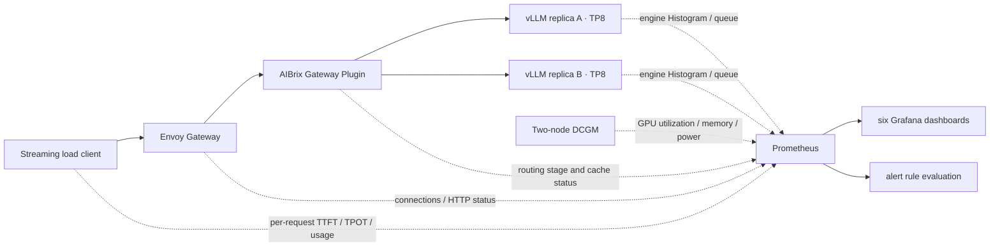

# AIBrix Production Practice: Using DeepSeek V4 Flash to Connect Load Testing, Dashboards, and Recovery Validation

AIBrix targets large-model inference services on Kubernetes, providing components such as model-aware routing, runtime metric integration, cache-related capabilities, and scaling. Its responsibilities differ from vLLM's: vLLM executes the model, while AIBrix organizes multiple model replicas into a service that can be routed and managed. This article follows a real request path and records how performance numbers, runtime status, and recovery actions corroborate one another. [AIBrix project](https://github.com/vllm-project/aibrix/tree/v0.7.0)

The workload carrying business traffic is DeepSeek-V4-Flash-0731. V4 Flash is a MoE model with implementation features such as sparse attention and mHC; 0731 is the officially released checkpoint, bundled with DSpark-related modules. Whether a draft module exists and whether speculative decoding is enabled in the deployment are two separate things. This run uses a validated vLLM runtime with ordinary Prefill/Decode colocation, TP8, and FP8 KV Cache, **without DSpark enabled, and without P/D separation or an external distributed KV Cache**. The model service context limit is set to 32K, which does not mean the model's maximum context capability has been validated. [vLLM's DeepSeek V4 Flash recipe](https://recipes.vllm.ai/deepseek-ai/DeepSeek-V4-Flash)

This is a real GPU exercise targeting production problems, while still retaining experimental boundaries: the shared control plane has not been reworked for cross-node high availability, Prometheus uses ephemeral storage on demand, and the test entry point is only reachable inside the cluster. The sections below separately list the actual validation results and the work still required before production rollout.

## 1. Inventory Existing Capabilities First, Then Fill Gaps

The cluster already has AIBrix v0.7.0, Envoy Gateway v1.2.8, Envoy v1.33.2, Redis, and the DCGM exporter. No standalone Prometheus/Grafana workloads ready for direct use were found, nor were Prometheus Operator CRDs present. Therefore, standalone Prometheus with Kubernetes Service Discovery was adopted, avoiding the introduction of an Operator for a single performance validation.

GPU resources were checked at two levels simultaneously: Kubernetes allocated resource requests, and actual GPU usage on the nodes. Only when both nodes simultaneously satisfied 8 free GPUs, 8 GPUs with idle memory and utilization, did model deployment proceed. This article uses `gpu-worker-a` and `gpu-worker-b` to denote these two machines; they are anonymized logical names.

| Layer | This Deployment | Isolation and Observation Scope |
| --- | --- | --- |
| Model | Two Deployment replicas, each TP8 | Independent model name, Service, and Pod labels |
| GPU | 8×H20-3e per node, 16 GPUs total | Only collect DCGM data from the two selected nodes |
| Routing | Reuse existing AIBrix and Envoy | Model statistics filtered by model name; shared gateway metrics explicitly labeled as all-tenant |
| Load generator | Async streaming client on CPU nodes | No GPU requests; only sends load to the test model |
| Prometheus | 15-second scrape, 24-hour or 8GB retention cap | `emptyDir`, not a persistent monitoring platform |
| Grafana | Six dashboard categories, fixed datasource UID | ClusterIP, login authentication, configuration supplied via ConfigMap |
| Alerting | Eight Prometheus rules | Validate evaluation status; no external notification receivers connected |

Each model replica requests 8 GPUs, 64 CPU, and 256Gi memory, with limits of 160 CPU and 1200Gi. `/dev/shm` is 128Gi; the model directory is mounted read-only, and the writable compilation cache is stored separately. These resource settings are a choice for this experiment and cannot be directly applied as a capacity standard for all models.

## 2. Build the Request Path and Evidence Path Together



AIBrix discovers replicas based on model labels and creates an HTTPRoute for the standalone model. We checked the route's `Accepted=True` and `ResolvedRefs=True`, then sent real requests through the gateway to verify return values. Route accepted, Pod Ready, and the model generating content each prove different layers and do not substitute for one another.

A request exceeding the service context limit was also sent: requesting 40,000 output tokens under the 32K limit, and the entry point returned the expected HTTP 400. This negative validation is recorded separately and is not mixed into the success rate of normal performance requests.

The deployment sets hard cross-node Pod anti-affinity, `maxSurge: 0`, `maxUnavailable: 1`, a 180-second termination grace period, and a PDB of `minAvailable: 1`. The two nodes exactly accommodate two eight-GPU replicas, so there are not enough GPUs for a third-replica surge update. During updates, capacity reduction must be accepted, or extra nodes must be prepared in advance.

### Image Sync Success Status Is Not Enough

When actually installing the monitoring components, the sync backend returned success, but the nodes still reported `ImagePullBackOff / not found`. After verification, the full sync chain from source repository to production repository and then to the target cluster repository was completed, and only then did the two monitoring Pods start successfully.

The acceptance criterion for this issue should be the target image's manifest/digest, CPU architecture, and the actual node pull result. A completed copy job is only an intermediate state and cannot serve as the sole basis for the image being deployable. This run retained the sync records, pull errors, and Pod Ready status to avoid misdiagnosing an installation problem as a model or Kubernetes scheduling problem.

## 3. Each of the Six Dashboard Categories Answers One Operational Question

This run references the official AIBrix v0.7.0 scope of four dashboard categories — control plane, Envoy, Gateway Plugin, and vLLM — re-adapts the queries for the actual running version, and then adds a client overview and a GPU capacity dashboard. It does not declare completion simply by importing upstream JSON. [Upstream observability assets](https://github.com/vllm-project/aibrix/tree/v0.7.0/observability)

| Dashboard | Main Observations | Interpretation Boundaries |
| --- | --- | --- |
| Overview | Client TTFT/TPOT, stage throughput, scrape status | Client latency includes entry point and transport overhead |
| Control plane | Reconcile, errors, Workqueue, CPU/RSS | Shared controller statistics, not request counts for a specific model |
| Envoy | HTTP status, in-flight requests, connections, memory | Shared entry point includes other models; full streaming request duration is not TTFT |
| Routing & cache | Success stages, failure stages, replica distribution, Prefix Cache, KV water level | Cache indexer online does not equal cache hit |
| vLLM engine | TTFT, request-average TPOT, ITL, queue, Prefill, throughput | Uses metric names actually exported by the current engine |
| GPU & capacity | GPU/memory/power/temperature, Tensor/DRAM activity, CPU | GPU utilization does not equal Tensor Core activity |

Browser rendering checks were actually performed for all six dashboard categories, and all 63 queries were verified to have no expression errors. The screenshots below select the same historical test window, covering re-runs, cache load, and the single-replica recovery process; current values after scale-down should be distinguished from this history.


In the overview, client stage throughput is an aggregate value of completed tiers and therefore remains as a horizontal line; engine throughput reflects real-time changes within the scrape window. When reading the charts, first locate the load-test phase, then compare TTFT, queue, and replica status.


In the engine dashboard, replica A's metric gaps correspond to this eviction and cold start; replica B continues serving. The low-load window after recovery cannot be treated as peak throughput.


The GPU dashboard uses node logical aliases and shows the eight-GPU distribution. Resident GPU memory and GPU compute activity are different concepts; high memory usage while idle does not mean requests are still being processed.

### Version Differences That Cannot Be Ignored

The current vLLM uses `vllm:request_time_per_output_token_seconds` to represent the distribution of request-average TPOT, and `vllm:kv_cache_usage_perc` for the KV water level. The old dashboard's `time_per_output_token_seconds` and `gpu_cache_usage_perc`, as well as the old CPU swap/cache panels, cannot be carried over directly.

Prefix Cache hit rate is calculated using token counters:

```promql
sum by (replica) (
  rate(vllm:prefix_cache_hits_total{job="aibrix-vllm"}[1m])
)
/
sum by (replica) (
  rate(vllm:prefix_cache_queries_total{job="aibrix-vllm"}[1m])
)
```

When the denominator is zero, NaN means there is no computable query volume in that window and cannot be interpreted as a hit rate of zero.

Running requests, waiting requests, and active connections are all Gauges and should be plotted directly as water levels; `rate()` applies to Counters. AIBrix's `gateway_request_model_success_total` also includes stages such as request headers, request body, and response, so filtering for `status="gateway_request_success"` is mandatory; the four stages must not be summed as four successful requests. Failure-stage counts also do not guarantee they equal the deduplicated count of failed requests. Plugin-stage success cannot substitute for full client stream success; business status and stream termination conditions must be checked separately.

Some Gateway metrics whose names carry `bucket_total` are essentially bucketed Counters, not standard Prometheus Histograms. Without verifying cumulative buckets and the semantics of the `le` label, `histogram_quantile()` cannot be applied directly.

### TTFT, TPOT, and ITL Viewed Separately

| Metric | Client-Side Definition in This Run | Corresponding Engine-Side Observation |
| --- | --- | --- |
| TTFT | From POST initiation to first non-empty content/inference fragment | `time_to_first_token_seconds` |
| Request-average TPOT | `(最后内容片段时间 − 首个内容片段时间) / (completion_tokens − 1)` | `request_time_per_output_token_seconds` |
| ITL | SSE fragment intervals can only be called fragment intervals | `inter_token_latency_seconds` is a separate Histogram |
| E2E | From request initiation to receipt of full stream end | `e2e_request_latency_seconds` |

Output token count is taken from the server's final `usage.completion_tokens` segment; SSE chunk count is not treated as token count. The TPOT end time does not use `[DONE]` or the usage frame arrival time, to avoid mixing tail protocol overhead into per-token generation time.

When computing P95 across replicas, aggregate the buckets first, then derive the quantile:

```promql
histogram_quantile(
  0.95,
  sum by (le) (
    rate(vllm:time_to_first_token_seconds_bucket{
      job="aibrix-vllm",
      model_name="dsv4-flash-aibrix-perf"
    }[1m])
  )
)
```

The P95 of two replicas must not be averaged. The dashboard Histogram gives an interpolated estimate within buckets; the quantiles in the load-test table below are computed directly from per-request raw records, and the two will not match digit for digit.

When buckets are coarse, the gap can be significant: real samples concentrate between two boundaries, and the interpolated P95 is not necessarily close to the exact per-request P95. When accepting tail latency, bucket boundaries, sample counts, and client results should all be checked; two dashboards showing different values alone does not justify concluding a gateway latency regression.

## 4. Establish a Performance Baseline with Fixed Output and Tiered Load

Use the `/v1/completions` streaming interface with `temperature=0`, `ignore_eos=true`, `max_tokens=256`, and fixed output length to compare service behavior. This is synthetic performance load, not a response-quality evaluation.

For short input, a unique nonce is prepended before the text below, then the body is repeated 30 times; long input repeats it 260 times. Actual token counts are taken from usage; no claim is made that different random nonces produce exactly identical token counts.

```text
Request <unique nonce>
The service tracks request latency, token throughput, cache utilization,
and healthy replicas.
...（重复正文）
Continue with a technical explanation.
```

Cache load places the same long prefix at the front and only changes the nonce at the end. Before the formal routing comparison, both replicas received warm-up requests with the same long prefix; each subsequently received its own concurrent warm-up. This therefore mainly observes request distribution under a hot-prefix scenario and cannot be used to derive standalone benefits under a cold cache.

Each tier is closed-loop concurrency: the client issues the next request only after one completes; each tier runs for at least 60 seconds, waits for all requests in that tier to finish, then moves to the next tier. The actual arrival rate decreases as responses slow down, so these numbers are not capacity limits at fixed RPS and do not cover production traffic burst distributions.

| Scenario | Concurrency | Success/Requests | Output tok/s | TTFT P95 / ms | TPOT P95 / ms |
| --- | ---: | ---: | ---: | ---: | ---: |
| Single-replica direct | 1 | 35/35 | 146.8 | 157.3 | 6.25 |
| Gateway C1 | 1 | 35/35 | 145.9 | 163.4 | 6.24 |
| Gateway C4 · first round | 4 | 108/108 | 453.2 | 309.1 | 7.10 |
| Gateway C16 · first round | 16 | 368/368 | 1547.0 | 3086.7 | 8.96 |
| Gateway C32 · first round | 32 | 672/672 | 2755.2 | 811.3 | 10.90 |
| ~4448-token long input | 16 | 200/200 | 817.8 | 2738.2 | 17.32 |
| Hot-prefix Random · first round | 16 | 64/64 | 162.6 | 33747.2 | 156.15 |
| Hot-prefix Prefix Cache · first round | 16 | 288/288 | 1211.5 | 13728.5 | 9.51 |
| Gateway C4 · re-run | 4 | 124/124 | 520.2 | 318.0 | 7.11 |
| Gateway C16 · re-run | 16 | 400/400 | 1677.7 | 551.4 | 9.22 |
| Gateway C32 · re-run | 32 | 672/672 | 2729.7 | 816.5 | 11.03 |
| Hot-prefix Random · re-run | 16 | 66/66 | 203.0 | 26761.0 | 116.99 |
| Hot-prefix Prefix Cache · re-run | 16 | 369/369 | 1529.2 | 345.3 | 9.47 |

All 3,401 requests across the 13 measured tiers succeeded. Both rounds of results are retained; the significant spikes in the cache scenarios were not removed. Tier averages and quantiles are only observations from this synthetic load and cannot be directly promised as production SLOs.


In the retest, the TTFT P95 for C16 was 551 ms, and for C32 it was 817 ms; C32's total output throughput was about 2,730 token/s. C4's P95 changed little, but P99 dropped from about 14.93 seconds to 323 ms, showing that looking only at the mean or a single percentile can easily miss a few extremely slow requests.

Full data is available in [stage summary JSON](../../assets/practices/aibrix-dsv4-observability/benchmark-summary.json), [desensitized per-request records](../../assets/practices/aibrix-dsv4-observability/requests.jsonl.gz), and [routing distribution statistics](../../assets/practices/aibrix-dsv4-observability/routing-counts.json).

### Warm-up passed, but compilation may still occur during inference

The first batch of exploration requests showed a TTFT of about 16 seconds, and subsequent requests with the same shape stabilized at the hundred-millisecond level. We kept the exploration data and added warm-up before re-measuring each concurrency level. However, two rounds of concurrent warm-up per level still did not cover all shapes formed by dynamic batching: the logs clearly recorded that TileLang JIT triggered by `mhc_pre_big_fuse_broadcast_with_norm_tilelang` occurred during inference, accompanied by tail latency spikes.

This shows that the success of `/health` and the success of the first request do not mean that all production shapes have been warmed up. In practice, a warm-up matrix should be designed based on input length, concurrency, decoding batch size, and routing distribution, and then the same level should be retested to confirm tail latency. Spikes must not be removed directly from the report, nor should all TTFT increases be attributed to the gateway.

The logs also show that when Breakable CUDA Graph is enabled, vLLM's `torch.compile` pipeline is turned off, but TileLang JIT still occurs. Disabling compilation at one layer does not mean that the entire inference stack has no first-time compilation overhead.

### Cache hit and load balancing need to be observed together

By checking the Gateway's `request_start` logs against the test model and the official measurement time window, the first round of C32 requests fell evenly across the two replicas, 336 each; the same long-prefix Prefix Cache routing assigned all 288 first-round requests to replica A. Here we used model name and window matching, and did not treat client-generated request IDs as tracking identifiers that necessarily remain unchanged across gateways.

Prefix affinity does change request distribution, but it can also concentrate a hot prefix onto a single replica. In this test, the random cache load still showed runtime JIT during retesting, so **we did not obtain a comparison sufficient to quantify the independent benefits of the two routing methods**. Production capacity decisions should consider hit rate, replica queues, TTFT, and load skew together; a high hit rate alone does not guarantee higher throughput or lower tail latency.

## 5. Verifying operational mechanisms with replica traffic removal and recovery

First, we maintained short-input streaming requests at concurrency 4, then removed one test replica via the Eviction API. The probe lasted about 600.6 seconds, with a total of **928 requests, 926 complete successes, and 2 read timeouts**, for a success rate of about 99.78%; no automatic retries were performed. This was counted separately from the previous 3,401 performance requests.

| Verification point | Actual result |
| --- | --- |
| First replica eviction | Eviction returned 201, the other replica continued to serve |
| Second replica protection | Only an Eviction dry-run was performed, returned 429, indicating PDB violation; no second eviction was executed |
| New Pod creation → Scheduled | 91 seconds, including old replica exit and hard anti-affinity wait |
| New Pod creation → Ready | **541 seconds, about 9 minutes 1 second** |
| Weight loading | Logs recorded about 47.4 seconds; the remaining time also includes initialization and compilation warm-up |
| Post-recovery generation verification | The new replica actually generated 16 output tokens, and both Service endpoints recovered |
| Alerts | Replica target decrease and collection failure entered firing; after recovery, all 12 targets were UP and all 8 rules were inactive |

During recovery, one surviving replica carried the traffic. Both timeout requests occurred near the eviction; after receiving HTTP 200, they waited about 92 seconds without completing the stream. The new Pod's compilation cache uses emptyDir, so rebuilding requires re-warming up; therefore, the 47-second weight loading cannot be considered as 47 seconds to scale-up readiness. [Recovery verification summary](../../assets/practices/aibrix-dsv4-observability/recovery-summary.json)

After the test, the model Deployment was scaled down to 0; Prometheus, Grafana, and the CPU client were retained, and the raw request and monitoring interval data were transferred back to the local environment.

PDB constrains voluntary interruptions initiated via the Eviction API; it does not prevent direct Pod deletion, nor can it withstand involuntary failures such as node outages. The Deployment's rolling update strategy, application termination handling, endpoint removal, and gateway cache refresh each have different responsibilities. Therefore, the drill must preserve request success rate, Pod/Endpoint timeline, and alert status simultaneously; a screenshot of two Pods Running is not enough to declare recovery verification complete.

The two abnormal requests observed this time both received HTTP 200, but did not complete the full stream, eventually resulting in socket read timeouts. Therefore, looking only at HTTP status statistics overestimates user experience; streaming services must also verify end markers, usage, and client timeouts.

This baseline **did not verify lossless traffic removal**. For production, the next step should separately verify the routing propagation wait after endpoint removal, application in-flight request draining, the coordination of `preStop` with termination grace period, and the semantics of request cancellation. The wait time should be set based on the longest request and measured routing propagation time; a fixed sleep cannot be casually added and declared as solved. These not-yet-executed improvements were not counted as passed items this time.

## 6. Alerts must be explainable before considering notifications

The eight rules cover replica metric target decrease, collection failure, client request errors, TTFT budget, queueing, KV watermark, GPU temperature, and controller errors. The example TTFT budget is P95 greater than 1 second, and requires sufficient samples in the window; this is only a demonstration threshold and needs to be recalibrated based on product interaction and load type.

Alert states need to be distinguished: `inactive` means the condition is not met, `pending` means waiting for the duration, and `firing` means the trigger condition is met. Rule health being `ok` only means the expression evaluation succeeded. Without an Alertmanager or enterprise alerting platform's receiving chain, `firing` does not mean that on-call personnel have received the notification.

No alerts were sent to any external recipients this time. When formally receiving notifications, routing, inhibition, maintenance silences, on-call ownership, and recovery notifications should also be verified to avoid meaningless alert storms caused by replica updates.

## 7. What still needs to be added to move to production

| Aspect | Verified this time | Still needed for production |
| --- | --- | --- |
| Release and rollback | Independent model, anti-affinity, probes, PDB, real requests | Image digest, release approval chain, canary ratio, rollback version retention |
| Capacity and latency | Tiered concurrency, long inputs, cache load, TTFT/TPOT | Fixed arrival rate, real prompt distribution, capacity margin under SLO |
| Failure recovery | Single-replica drill as scoped in this article | Node loss, cross-failure-domain, gateway/control plane/Redis failures |
| High availability | Model replicas across two nodes | Shared gateway and control plane cross-node deployment, state storage recovery strategy |
| Autoscaling | Candidate metrics such as queueing, throughput, KV | Validate strategy after clarifying GPU quota and cold start latency, avoid jitter |
| Security entry | Dedicated model path in cluster, Grafana login | Identity authentication, tenant quotas, concurrency/token limits, timeouts, audit |
| Observability | Twelve collection targets, six dashboards, eight rules | Persistence or remote_write, long-term retention, backup and alert receiving chain |

### GPU topology and NUMA cannot be omitted

This time, each replica used eight GPUs of the entire machine for TP, avoiding the random assignment of four-GPU containers across interconnect groups, but this does not mean that CPU, memory, and GPU have automatically achieved optimal affinity. On-site execution of `nvidia-smi topo -m` confirmed that all eight GPUs are NV18; GPU 0–3 belong to NUMA 0, and GPU 4–7 belong to NUMA 1. Good GPU interconnect does not eliminate the cost of cross-NUMA on the host side. This time, CPU requests and limits were not equal, which is a Burstable configuration, and the effect of exclusive core binding was not verified. In production, core binding and memory policies should be evaluated in conjunction with CPU Manager, Topology Manager, and device plugin capabilities, and retested with the same load.

Multi-node TP, EP, or P/D also adds variables such as network interfaces, RDMA, transport backends, and cross-node bandwidth. This time, the two replicas each used TP8 within a single node, so the recovery and throughput results here cannot be used to prove cross-node parallel performance. Related topology and communication issues should be verified independently before being compared in the same metric chain.

### Scale-up speed is constrained by model startup and warm-up

The Autoscaler requests GPUs only after detecting queueing, and does not immediately get a replica that can carry business. End-to-end scale-up time includes at least queue scheduling, image pulling, weight checking, weight loading, communication and cache initialization, compilation and graph capture, Ready, and representative request warm-up. Production needs to decide the resident margin and maximum burst based on this time, rather than only pursuing the lowest replica count during idle periods.

## 8. Reusable materials

Deployment templates, dashboard JSON, collection and alert rules, and streaming client are available in the [complete example directory](https://github.com/runzhliu/aik8s/tree/main/examples/aibrix-dsv4-observability). The templates use the `inference-lab` namespace, and nodes, images, and model PVCs are all rendered from local configuration; after modifying to your own actual environment, run dry-run first, then deploy.

For clusters with Prometheus Operator installed, the same collection targets can be converted to ServiceMonitor/PodMonitor, and rules to PrometheusRule; check whether label selectors and namespace selectors actually match. Without Operator, creating ServiceMonitor objects does not automatically produce collection behavior.

Related reading: [Deploying AIBrix on an existing cluster](aibrix-existing-cluster.md), [DeepSeek V4 Flash H20 deployment and stress testing](deepseek-v4-flash-h20-evaluation.md), [AIBrix multi-node and P/D real-world testing](aibrix-gpu-multinode-pd-production.md).
