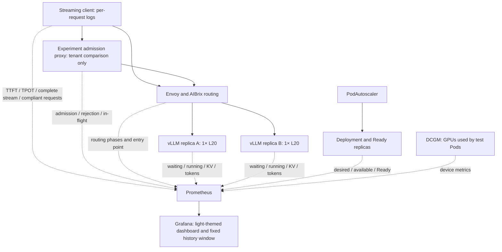

# AIBrix in Production: Qwen3.8-27B Capacity, Drain, and Overload Protection on L20

> Follow-up: [Controlled comparison of cache routing and tail latency](aibrix-routing-cache-tradeoffs.md) clears the cache at each stage separately, comparing cold and hot initial states with hot prefix. This article retains the original online cache test and does not mix its statistics with later data.

Qwen3.8-27B is a 27-billion-parameter dense vision-language model that follows the Qwen3.5 hybrid attention architecture, combining Gated DeltaNet and Gated Attention across 64 layers. The official release provides fine-grained FP8 weights; the model's native context length is 262,144 tokens, and it supports image and video understanding as well as thinking control. Its relatively small single-replica footprint makes it suitable for observing inference platform behavior under replica scaling, contention between long and short requests, and cache routing. [Official model documentation](https://huggingface.co/Qwen/Qwen3.8-27B-FP8)

This article uses **Qwen3.8-27B-FP8, one replica on a single L20, with vLLM and AIBrix v0.7.0**. The service is configured for text-only, 32K context, with MTP disabled; therefore the performance results below do not represent multimodal, native maximum context, or speculative decoding capabilities.

In the earlier [DeepSeek V4 Flash observability in practice](aibrix-dsv4-observability.md), we wired up request, engine, gateway, and GPU metrics end to end. This time we go further: when a traffic burst arrives, does scaling happen in time? Does a normal Pod termination break in-flight streams? What does protecting short requests cost? Does a rising cache hit rate prove the routing algorithm is better?

This round saved **13 formal test phases with 2,566 actual request records**, plus calibration requests that were not mixed into the formal statistics. After completion, the autoscaler objects for this experiment were deleted and the GPU Deployment was scaled down to 0. This article is a bounded record of actual measurements; KPA's actual scaling behavior, controlled cold-cache tests, and some advanced capabilities have not been fully verified and should not be treated as a complete production acceptance.

## 1. Environment and Measurement Definitions

| Item | Actual configuration |
| --- | --- |
| Model runtime | In-container version `0.26.0b2.dev1+g3b102b576`; image tags are not used as a substitute for version |
| Per-replica GPU | 1×L20, TP=1; node shared with other workloads |
| Service capacity | Primary comparison is 1 / 2 replicas; cold-start APA once expected 4, but never formed 4 Ready replicas |
| Engine limits | `max-model-len=32768`, `max-num-seqs=8`, `max-num-batched-tokens=8192` |
| Cache | FP8 KV Cache, GPU memory utilization 0.90, Prefix Cache and Chunked Prefill enabled |
| Per-replica CPU / memory | requests 4 CPU / 48Gi; limits 16 CPU / 128Gi; shared memory 16Gi |
| Model storage | Read-only shared storage; writable compilation cache mounted separately |
| Monitoring | Reuses Prometheus/Grafana; model, client, gateway, controller, Kubernetes, and DCGM metrics |
| Naming | L20-A / L20-B in figures are logical node aliases; public queries use an example namespace |

### First, define what "success" means

The client calls `/v1/completions` through the AIBrix entry point, using streaming responses, `temperature=0`, `ignore_eos=true`, and requests token usage in the response. Only an HTTP 200, content appearing, receipt of `[DONE]`, and a valid output usage count as a complete streaming success. All successful responses in the formal phases were checked to confirm the output token count matched the configuration.

- **TTFT**: Time from client POST to receipt of the first content chunk, including entry point and transport overhead.
- **TPOT**: `(最后内容时间 - 首段内容时间) / (输出 token 数 - 1)`, averaged per request; SSE chunking and network buffering can affect client-side observation.
- **E2E**: Time from client request initiation to the end of the complete stream.
- **Compliant request**: Complete streaming success, with TTFT ≤ 2 seconds, TPOT ≤ 150 milliseconds, and E2E ≤ 30 seconds, all three satisfied simultaneously.

P95 values in the tables come from per-request data using linear interpolation, counting only successful complete streams. The `histogram_quantile()` in Grafana provides sliding-window, histogram-bucket interpolated estimates and cannot be expected to exactly match the raw P95 of the full round. Rejections and failures must be shown alongside successes; low latency on successful samples must not be used to mask them. [vLLM metrics documentation](https://docs.vllm.ai/en/stable/usage/metrics/)

### Actual prompts used

Ordinary requests place a unique nonce at the front to avoid all requests naturally sharing a full prefix:

```text
Request <每条请求不同的 nonce>
The service tracks request latency, token throughput, cache utilization, and healthy replicas.
...重复上述句子 N 次...
Continue with a technical explanation.
```

Capacity tests use N=30 with a fixed output of 128 tokens; in tenant tests, A uses N=30 / output 64, and B uses N=90 / output 512. Actual tenant test inputs are approximately 513–522 tokens for A and 1,472–1,482 tokens for B. Cache tests use N=300 / output 64, placing the repeated body first and the unique nonce last to form a shareable prefix. This is synthetic performance load; generated answer quality is not scored.

In the open arrival-rate test, when the client reaches 48 in-flight requests, it abandons that scheduled arrival and records it as `dropped_arrivals`. These requests never reach the server and must be counted against load delivery. In fixed-concurrency tests, a new request is issued after the previous one finishes, so the number of requests may differ across phases of the same duration.

## 2. Six dashboards tie service behavior together



| Dashboard | Primary question it answers | Scope notes |
| --- | --- | --- |
| Overview | Are requests complete and compliant, and where does latency occur? | Client perspective; HTTP 200 and complete stream results are separated |
| Scaling | When does Ready capacity form after desired increases? | Observe waiting requests and available replicas together |
| Engine | Is degradation caused by queueing, decoding, cache, or preemption? | TTFT / TPOT / KV / Prefix Cache / token throughput |
| Routing and entry | Do AIBrix phases fail, and is the entry point congested? | Plugins filtered by model; shared Envoy includes other workloads |
| GPU and capacity | How do compute, GPU memory, and power of the test GPU change? | Filtered by test Pod labels; node is not exclusive |
| Control plane | Do reconciliations error, and does the work queue back up? | Shared controller statistics; cannot be attributed directly to the test model |

Historical exports cover **46 queries**, each of which returned finite values at least once; this indicates the observability chain works, not that every phase has samples in every chart. Query interval is 15 seconds with a 1-minute rate window. Below, fixed time ranges are selected per case to avoid the current idle state after scale-down masking test evidence.

Common query examples; replace label values with your own model and scrape job:

```promql
# 先看排队，再看运行；Gauge 直接读取
sum(vllm:num_requests_waiting{job="qwen-lab-engine",model_name="qwen38-aibrix-lab"})
sum(vllm:num_requests_running{job="qwen-lab-engine",model_name="qwen38-aibrix-lab"})

# 客户端 TTFT P95；不要平均各 Pod 的 P95
histogram_quantile(0.95, sum by(le) (
  rate(qwen_lab_ttft_seconds_bucket{job="qwen-lab-client",phase="kpa-min2-wave"}[1m])
))

# 完整成功且达到三项 SLO 的请求率
sum(rate(qwen_lab_good_requests_total{job="qwen-lab-client"}[1m]))
```

AIBrix success-phase counters may record request headers, request bodies, and response handling separately. Summing all `status` values double-counts the same request. Production success rate should be based on complete requests at the client or business egress; phase metrics are for locating where failures occur.

## 3. Capacity: cold-start APA did not keep up with this burst

All wave phases use the same open arrival rate: 60 seconds × 0.2 RPS, 240 seconds × 1.6 RPS, 90 seconds × 0.2 RPS, for **414 scheduled arrivals** total. Request shape is N=30 with 128 output tokens.

| Strategy and starting condition | Actually sent / complete success | Client drops | Compliant requests | TTFT P95 |
| --- | ---: | ---: | ---: | ---: |
| Fixed 1 replica | 309 / 309 | 105 | 28 | 40.381 s |
| APA, starting from 1 Ready replica | 309 / 309 | 105 | 28 | 40.398 s |
| APA, waiting for 2 Ready replicas first | 414 / 414 | 0 | 414 | 0.298 s |
| Fixed 2 replicas | 414 / 414 | 0 | 414 | 0.299 s |
| KPA, waiting for 2 Ready replicas first | 414 / 414 | 0 | 414 | 0.299 s |

<picture>
  <source media="(max-width: 600px)" srcset="/assets/practices/aibrix-qwen-l20/grafana-capacity-mobile.png">
  
</picture>

The cold-start APA targets 4 running requests per replica, with a minimum of 1 and maximum of 4 replicas. The smoothed load metric rose late; desired replicas did reach 4, but only 1 was Ready, 2 more were still starting, and the 4th had no allocatable GPU. New replicas did not form usable serving capacity before the burst ended.

The left and right load segments in the figure correspond to the fixed single-replica and cold-start APA phases respectively. The client histogram has coarse buckets in the long-latency range, so the window P95 can display as roughly one minute; the precise full-round TTFT P95 is the 40.381 / 40.398 s in the table. Production monitoring should use finer buckets around the actual SLO and overload range.

Therefore, "the Autoscaler already changed replicas to 4" is not equivalent to "4 GPUs are already absorbing traffic." Even though all actually sent requests in the single-replica phase succeeded, 105 scheduled arrivals were dropped at the client, and only 28 requests met the SLO.

After adjusting the range to 2–3 and waiting for two Ready replicas before applying the same wave, low-latency results were obtained. A fixed two-replica setup achieved nearly identical results, supporting the conclusion that **this load requires pre-provisioned two-replica capacity**; this cannot be used to claim APA is better than fixed capacity.

### How far KPA verification went in this round

<picture>
  <source media="(max-width: 600px)" srcset="/assets/practices/aibrix-qwen-l20/grafana-kpa-mobile.png">
  
</picture>

KPA is configured with a minimum of 2, maximum of 3, and a target of 4 running requests. All 414/414 requests in this round were compliant, with TPOT P95 at 59.8 ms and E2E P95 at 7.87 s. However, across 36 capacity observation points, desired and Ready replicas both remained at 2, so **no actual scaling was triggered**. This proves that two replicas can carry this wave under this configuration, but does not verify KPA's full scale-up-to-scale-down behavior, nor can it be used to compare APA/KPA response speed.

## 4. Drain: a 180-second Pod grace period can still break streams

Both groups start with two Ready replicas, sustaining load at C=4, N=30, output 512 tokens for 180 seconds; approximately 30 seconds in, one model Pod in this experiment is deleted normally. The client waits for all issued requests to finish, and failures are also written to the record.

| Configuration | Actual requests | Complete success | Failures | TTFT P95 of successful requests |
| --- | ---: | ---: | ---: | ---: |
| Original drain configuration | 24 | 22 | 2 | 0.536 s |
| Added engine drain and preStop | 28 | 28 | 0 | 0.634 s |

The two failures in the original configuration had already received HTTP 200 but never completed the stream, ultimately timing out on read at approximately 91.2 and 92.9 seconds. Counting only HTTP status would misrecord these two requests as successes.

<picture>
  <source media="(max-width: 600px)" srcset="/assets/practices/aibrix-qwen-l20/grafana-drain-before-mobile.png">
  
</picture>

Checking the actual container code revealed that the `shutdown_timeout` default value in the currently running version is 0; the parameter documentation maps 0 to abort, with positive values waiting for in-engine requests to complete. The Pod's `terminationGracePeriodSeconds: 180` is only the total time Kubernetes allows the process to exit; it does not automatically modify the engine's internal exit policy.

The fix has three layers:

1. Add `--shutdown-timeout 90` to vLLM so the engine waits for existing requests.
2. Add a 10-second preStop to allow propagation time for routing and Endpoint updates; this time itself does not provide distributed completion confirmation.
3. Keep the 180-second Pod grace period to cover preStop, engine drain, and process cleanup.

Below is the key configuration fragment; `args` should be appended to the full startup arguments and must not replace the original argument list with these two items:

```yaml
spec:
  template:
    spec:
      terminationGracePeriodSeconds: 180
      containers:
        - name: vllm
          # 在原 args 中追加 --shutdown-timeout 和 "90"
          lifecycle:
            preStop:
              exec:
                command: ["python3", "-c", "import time; time.sleep(10)"]
```

AIBrix v0.7.0's Ready Pod filtering logic excludes Pods that are terminating. Only verified version behavior is used here; the drain annotation from newer documentation is not treated as a verified configuration in this round. [v0.7.0 Pod filtering implementation](https://github.com/vllm-project/aibrix/blob/v0.7.0/pkg/utils/pod.go)

<picture>
  <source media="(max-width: 600px)" srcset="/assets/practices/aibrix-qwen-l20/grafana-drain-after-mobile.png">
  
</picture>

The retest achieved 28/28 complete successes, and the drain logs also recorded completing requests before shutting down the engine. Both rounds use fixed-concurrency mode, so the total request counts differ, and replica node placement changed between rounds; therefore the 24→28 change must not be interpreted as a throughput improvement from the drain parameters. This is a small-sample normal-termination verification and does not cover forced deletion, node power loss, OOMKill, or network interruption.

## 5. Overload protection: short requests get faster, but the cost must be shown alongside

This group makes two logical tenants arrive alternately, at a total rate of 1.4 RPS over 150 seconds, with A/B each having 105 planned arrivals. A is short-output interactive traffic, B is long-input, long-output requests. Both groups pass through the same experimental admission proxy to reduce the proxy's own interference with the control.

The protection group allows A at most 4 in-flight requests and B at most 2 in-flight requests, with quota held until the stream ends; exceeding the limit returns HTTP 429. **This is an entry concurrency control implemented by this experiment itself, not AIBrix's native tenant isolation feature**. Tenant headers are used only to construct experimental traffic and do not represent identity authentication.

| Mode / Tenant | Planned arrivals | Actually sent | Client drops | Full success | Active 429 | SLO-meeting requests | Successful request TTFT P95 |
| --- | ---: | ---: | ---: | ---: | ---: | ---: | ---: |
| Unprotected / A | 105 | 87 | 18 | 87 | 0 | 15 | 42.294 s |
| Unprotected / B | 105 | 85 | 20 | 85 | 0 | 0 | 43.861 s |
| Protected / A | 105 | 105 | 0 | 105 | 0 | 105 | 0.303 s |
| Protected / B | 105 | 105 | 0 | 10 | 95 | 10 | 0.592 s |

<picture>
  <source media="(max-width: 600px)" srcset="/assets/practices/aibrix-qwen-l20/grafana-admission-mobile.png">
  
</picture>

Short-request A's SLO-meeting count rose from 15 to 105, but B had **95/105 actively rejected**. This result shows that concurrency admission can protect interactive latency; it does not create more GPU capacity, nor does it give all tenants a higher success rate.

Public charts must simultaneously retain planned arrivals, client drops, 429s, full-stream failures, and SLO-meeting counts. In particular, one must not only write "latency dropped to 0.3 seconds" while omitting the rejection cost for long requests. Production scenarios also need to decide whether B enters a bounded asynchronous queue, obtains an independent resource pool, or accepts an explicit rejection policy.

The experimental proxy's quota is a single-process counter. When the production entry is deployed with multiple replicas, trusted identity, cross-replica quota consistency, quota reclamation after request cancellation, and a jittered retry budget are needed; directly adding proxy replicas will amplify the effective quota, and this experimental implementation cannot be taken as-is for a distributed rate-limiting system.

## 6. Cache: Hits Observed, Warm-Up Interference Also Observed

The cache comparison uses C=4, N=300, fixed output 64, with 60 seconds of load per segment. The strategy order is least-request → prefix-cache → prefix-cache → least-request, with each segment completing 68 requests.

| Order | Routing policy | Full success | TTFT P95 |
| --- | --- | ---: | ---: |
| 1 | least-request A | 68 / 68 | 1.198 s |
| 2 | prefix-cache A | 68 / 68 | 0.284 s |
| 3 | prefix-cache B | 68 / 68 | 0.291 s |
| 4 | least-request B | 68 / 68 | 0.287 s |

<picture>
  <source media="(max-width: 600px)" srcset="/assets/practices/aibrix-qwen-l20/grafana-cache-mobile.png">
  
</picture>

If only the first two segments are taken, one would conclude that prefix-cache is several times faster. But the fourth segment, least-request, also reaches about 0.29 seconds, indicating significant interference from warm-up and historical state.

No `/reset_prefix_cache` usable for a unified reset in this round was found in the APIs exposed by the current service; the four segments retained engine cache and routing index state, and only a single hotspot prefix was used. Therefore these results should be called **online cache routing cross-observation**, which is not yet sufficient to prove that a given strategy is superior under controlled cold cache, multi-prefix contention, or cache migration.

Prefix hit rate is calculated by token, not by request hit ratio:

```promql
sum by(node_alias)(rate(vllm:prefix_cache_hits_total{job="qwen-lab-engine"}[1m]))
/
sum by(node_alias)(rate(vllm:prefix_cache_queries_total{job="qwen-lab-engine"}[1m]))
```

When the denominator is zero there is no computable query volume, and NaN cannot be treated as 0% hit rate. Traffic shape, cache initial state, routing order, and actual placement all need to be saved with the results.

## 7. How Production Configuration Can Be Put into Practice

**Include startup time in the capacity budget.** Estimate the scale-ahead lead time based on the actual time from image pull, model read, compilation, and Ready to the first complete request. Keep enough pre-ready replicas for online services with obvious bursts; desired replicas are meaningful only if GPUs can be scheduled and Pods can become Ready in time.

**Combine SLO with request cost.** Monitor TTFT, request-average TPOT, E2E, full-stream, and goodput simultaneously. Long inputs mainly increase Prefill cost; long outputs extend Decode occupancy; rate limiting by average request count may not control resource contention, and token budgets, in-flight limits, and bounded queuing need to be combined.

**Reserve capacity for updates and exits.** This experiment uses `maxSurge: 1` and `maxUnavailable: 0`, but this depends on additional GPUs. Without spare cards, an update method that allows capacity degradation should be chosen, and traffic should be reduced in advance. Soft topology spreading cannot guarantee cross-node disaster recovery; whether to use hard constraints, PDBs, and cross-fault-domain replicas must be verified against the actual node count and resource reserves.

**Align entry, engine, and Kubernetes timeouts.** The total duration of streaming requests differs from idle timeout; gateway connection keep-alive, client read timeout, engine drain, preStop, and Pod grace period all need to be checked together. After normal exit verification passes, business consequences such as cancellation, retry, forced failure, and duplicate billing still need to be verified separately.

**Pin the runtime and verify precision and kernels.** This runtime has FP8 KV scale default values and fallback hints for some L20 kernel configurations. The performance load did not verify answer quality under these settings, so FP8 losslessness or optimally tuned hardware cannot be claimed on this basis. After upgrading the engine, parameters, model implementation, metric names, and quality baselines should be re-checked.

**Upgrade experimental monitoring into a platform capability with retention policies.** Keeping historical exports is sufficient for this round's review; production needs storage and retention time set according to the fault-tracing period, access control, backup, and alert notifications. Metrics from shared gateways and controllers must indicate their statistical scope to avoid attributing fluctuations caused by other models to the current model.

## 8. Verification Not Yet Completed and Evidence Download

| Scope | Current status |
| --- | --- |
| 1 / 2 replica, cold-start APA, two-replica KPA waveform | Actual load and monitoring data obtained |
| Full-stream on normal Pod deletion, engine exit fix | Pre- and post-fix verification completed; forced failures not covered |
| Short/long tenant overload protection | Self-built proxy comparison completed; not native distributed quota verification |
| Single-hotspot online cache cross-strategy | Completed; cache initial state not unified |
| 4 Ready replica baseline | Not completed, insufficient actual idle resources |
| KPA actual scale-up and scale-down, APA/KPA algorithm comparison | Not completed, current waveform did not trigger KPA scale-up |
| Multi-prefix, controlled cold cache and routing causal comparison | Not completed |
| P/D, external KV Connector, LoRA, batch entry | Corresponding compatibility and load verification not completed; not inferred as unsupported |
| Standalone gateway / control plane HA fault injection | Not executed, no destructive operations on shared components |

All GPU test replicas have been released; monitoring and local evidence are retained. The following files use logical names and remove fields such as request IDs and internal addresses, with the time series using the start of the first formal phase as the relative time origin:

- [Phase summaries and complete method parameters](../../assets/practices/aibrix-qwen-l20/results.json)
- [2,566 per-request records JSONL](../../assets/practices/aibrix-qwen-l20/requests.jsonl)
- [Historical metric export of 46 queries](../../assets/practices/aibrix-qwen-l20/metrics.json)
- Complete six-category run dashboards: [Overview](../../assets/practices/aibrix-qwen-l20/full-qwen-lab-overview.json), [Scaling](../../assets/practices/aibrix-qwen-l20/full-qwen-lab-scaling.json), [Engine](../../assets/practices/aibrix-qwen-l20/full-qwen-lab-engine.json), [Routing and entry](../../assets/practices/aibrix-qwen-l20/full-qwen-lab-routing.json), [GPU and capacity](../../assets/practices/aibrix-qwen-l20/full-qwen-lab-gpu.json), [Control plane](../../assets/practices/aibrix-qwen-l20/full-qwen-lab-control.json).
- Grafana case dashboards: [Capacity](../../assets/practices/aibrix-qwen-l20/dashboard-capacity.json), [Before exit fix](../../assets/practices/aibrix-qwen-l20/dashboard-drain-before.json), [After exit fix](../../assets/practices/aibrix-qwen-l20/dashboard-drain-after.json), [Admission](../../assets/practices/aibrix-qwen-l20/dashboard-admission.json), [Cache](../../assets/practices/aibrix-qwen-l20/dashboard-cache.json), [KPA](../../assets/practices/aibrix-qwen-l20/dashboard-kpa.json).

The dashboard JSON uses data source UID `prometheus`, with namespace example `inference-lab`, retaining this experiment's metric, job, and model label conventions. Before importing into other clusters, these labels need to be mapped and the corresponding client metrics deployed; importing the JSON alone will not produce experimental data. Fixed-window screenshots are used for review, and dashboards with default relative time are used for viewing during re-execution.
