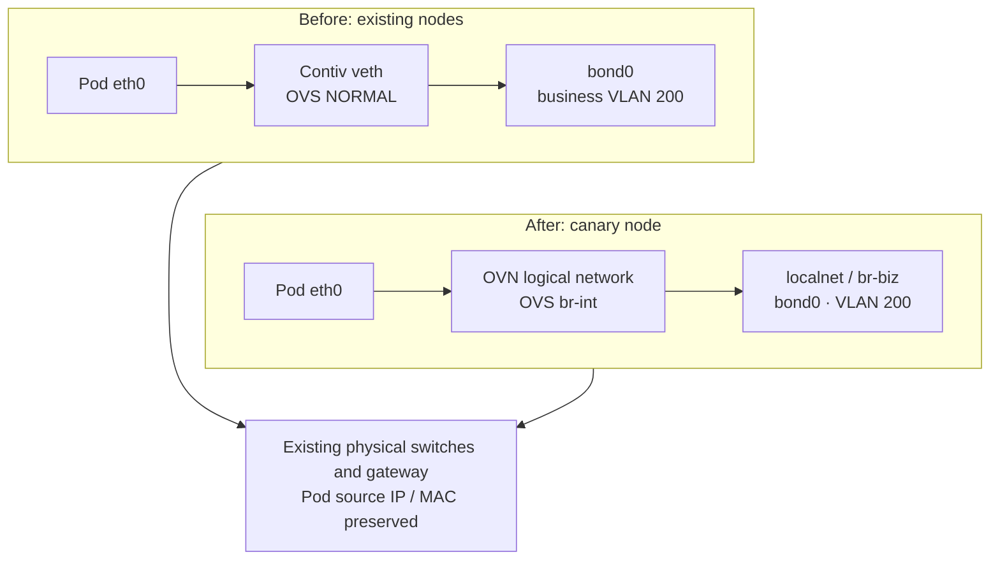
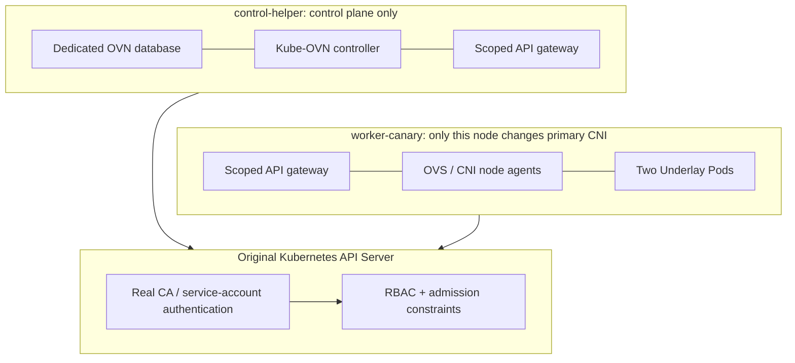

# From Contiv to Kube-OVN: A Single-Node Migration Keeping the Physical VLAN

The difficult part of replacing a container network is often keeping the rules of the existing data center: the same business subnet, VLAN uplink, and physical gateway, while preserving host management connectivity.

This experiment selected one node from a Kubernetes test cluster running a customized Contiv implementation. The node first left the original cluster for an isolated Kube-OVN Underlay test, then rejoined it. **After rejoining, the node became Ready. Two ordinary Pods used physical-network addresses, and bidirectional HTTP between the new Pods and existing Contiv Pods passed. Other nodes retained their original networking.** The canary ran neither Contiv netplugin, Cilium, nor kube-proxy.

This article reconstructs archived observations; the network was not switched again to prepare it. Cluster names, node names, internal domains, IPs, MACs, VLANs, and internal paths have been replaced. Example addresses are not original addresses. Test counts, packet lengths, and success/failure records are preserved. Below, `worker-canary` is the test node and `control-helper` hosts the new network's control components.

## 1. What the Existing Network Had to Preserve

The original Contiv deployment was maintained internally. Its behavior cannot be inferred from the maintenance status of the community project. In this environment, Netmaster managed the shared address pool, host-level netplugin created Pod interfaces, and Open vSwitch (OVS) attached workloads to physical VLANs. Cilium chained onto the existing network to supply Service handling and other capabilities on the original nodes. See [Contiv, OVS, and Cilium Chained Networking in Practice](contiv-ovs-cilium-network.md) for that original path.

| Item | Experimental baseline and requirement |
| --- | --- |
| Kubernetes / containerd | 1.30.4 / 1.7.14 |
| New CNI | Kube-OVN 1.16.12; distributed through an internal image registry and pinned by digest |
| Physical uplink | Preserve Linux `bond0`, its two physical members, and 802.3ad link aggregation |
| Business network | Example VLAN 200, Pod subnet `10.244.8.0/22`, physical gateway `10.244.8.1` |
| Management network | Example VLAN 210; retain the management IP and original SSH return path on `bond0.210` |
| Change scope | Replace only `worker-canary`'s primary CNI; keep other nodes on the original chain |
| Workload requirement | Direct Pod-IP access and bidirectional old/new connectivity; Services are outside rejoin-stage acceptance |

CNI stands for Container Network Interface; IPAM is IP Address Management; VLAN is Virtual Local Area Network. Here, Underlay means that Pods use the physical network's addressing and VLAN forwarding rather than a separate tunneled business-address space. Kube-OVN maintains logical networks through Open Virtual Network (OVN), with OVS executing forwarding.

The migration preserves the physical-network contract. It does not require identical bridges, flow tables, or Pod MACs. Contiv's original `NORMAL` switching path differs from the flow tables compiled by OVN. Sharing a VLAN does not imply identical control planes or recovery procedures.



The diagram shows how both types of node reach the same physical network. Management interface `bond0.210` retains its configuration but still shares the underlying Bond with business traffic; their failure domains are not fully separated.

## 2. Separate the Two Acceptance Stages

Installing the new CNI directly into the original cluster would combine controller scope, old sandbox cleanup, physical wiring, and address ownership into one problem. Instead, the drained node first became an isolated experimental cluster. Only after validating the network itself did it rejoin the original cluster.

| Stage | Deployment and observed result | What this does not establish |
| --- | --- | --- |
| Isolated-node validation | Ordinary Pods moved from an initial mixed network to pure Underlay; 6 ordinary Pods and 10 functional checks passed, including Service and DNS tests | The same Service path is not thereby validated after rejoining |
| Rejoining the original cluster | 2 ordinary Underlay Pods; 12 node-local checks passed, with separate reverse HTTP from an original Pod and direct office-client access | No Service, ClusterIP DNS, or NodePort validation; no cluster-wide CNI migration |

The isolated stage initially enabled Underlay–Overlay Interconnection (U2O). This consumes an additional Underlay address and can affect Pod routing choices. To meet the final physical-gateway requirement, the default business Overlay subnet was removed, U2O was disabled, and the business Underlay became the default network. Ordinary Pods were checked to use the physical gateway again.

The internal `join` network remained for node-to-OVN connectivity. It was not an Overlay address pool for ordinary workloads. To determine whether business traffic is pure Underlay, inspect Pod addresses, routes, logical-switch localnet ports, and actual packets. A daemon argument containing `geneve` is insufficient on its own.

The isolated-stage “pure Underlay adjustment and acceptance” took **43.8 seconds**. That excludes earlier node cleanup, image preparation, and Bond rewiring, so it is not a complete migration duration.

The handoff retained the original kubelet identity, runtime and CNI configuration, OVSDB state, interfaces, routes, and address-allocation records. Old Pods should exit while their old CNI service is still available so CNI DEL can reclaim their networks; the residual-sandbox problem encountered here is discussed below. Old network agents on the target were then stopped, and competing OVS management of the same physical interface had to be excluded before Kube-OVN took over. Replacing one CNI configuration file while two agents still manage the uplink is insufficient, and deleting the entire OVS database is no substitute for a scoped handoff.

## 3. Establish IPAM Ownership Before Starting New Pods

A tempting mistake is to select addresses that do not answer ping and hand them to the new CNI. A missing response only describes that observation; it does not prevent Netmaster from assigning the address elsewhere a moment later.

For this experiment, the original Netmaster's allocation API first created reservation endpoints for six addresses, marking them occupied in the shared pool. Only then could Kube-OVN allocate those six addresses. These reservations were control-plane records, not duplicate interfaces using the same IPs on the physical network. Reservation owners and the original allocation bitmap were checked individually.

The six positions are represented below with anonymized addresses:

```text
10.244.8.18  10.244.8.29  10.244.8.33
10.244.8.38  10.244.8.43  10.244.8.57
```

The Kube-OVN `Subnet` retained the original `/22` mask and physical gateway, using `excludeIps` to exclude everything else. Shrinking the Pod mask simply because only a few addresses are needed would change which destinations the Pod considers on-link.

| Stage | Formally held by the original allocator | Used by Kube-OVN | Available to Kube-OVN |
| --- | --- | --- | --- |
| Isolated pure Underlay | 6 | 6, including CoreDNS and a probe Pod | 0 |
| Rejoined cluster | 6, still held | 2, business client / server | 4 |

Available capacity here means the deliberately restricted experimental pool, not free space across the physical `/22`. Extra replicas during rolling updates need addresses too. When all six slots are occupied, more ordinary Pods cannot simply be added.

Reservations work for a bounded experiment. Production should instead delegate non-overlapping ranges explicitly and define their reclamation lifecycle. Creating a Kube-OVN IPPool does not automatically exclude its addresses from Netmaster. Per-Pod integration with the old IPAM would also require idempotent allocation, concurrency handling, failure compensation, deletion/release, and reconciliation after controller restarts.

## 4. Wiring Choice: Why the Final Setup Used bond0 Directly

The same business VLAN can be tagged at different layers. The difference is who owns tagging and whether management interfaces need relocation.

| Attachment | ProviderNetwork uplink | Kube-OVN `Vlan.id` | Tagging responsibility |
| --- | --- | --- | --- |
| Linux VLAN subinterface | `bond0.200` | `0` | Linux handles VLAN 200; OVN localnet adds no extra tag |
| Raw Bond, used in the final experiment | `bond0` | `200` | OVN / OVS handles business VLAN 200 |

Both can connect to the same physical VLAN. However, processing the tag in a Linux subinterface and then configuring another business tag in OVN cannot be combined blindly. A mismatch can cause double tagging or incorrect classification; identical VLAN numbers do not guarantee connectivity.

The original wiring already used OVS and `bond0` for business traffic while retaining the management IP on a Linux management-VLAN subinterface. The second attachment kept that structure closest to the original. No additional `bond0.200` was created, and switch configuration was not changed for this experiment. [Kube-OVN Underlay interface and VLAN definitions](https://kubeovn.github.io/docs/v1.16.x/en/start/underlay/#create-vlan)

### 4.1 The Three Resources Have Different Responsibilities

`ProviderNetwork` selects the node's physical interface, `Vlan` binds the business tag to that provider, and `Subnet` defines Pod addressing, gateway, and allocation limits. The following is the anonymized structure of the applied configuration. **It omits experimental authorization isolation and installation settings and is not a standalone installation bundle for an existing cluster.**

```yaml
apiVersion: kubeovn.io/v1
kind: ProviderNetwork
metadata:
  name: biz
spec:
  defaultInterface: bond0
  nodeSelector:
    matchLabels:
      kubernetes.io/hostname: worker-canary
      example.net/cni-canary: "true"
  exchangeLinkName: false
  autoCreateVlanSubinterfaces: false
  preserveVlanInterfaces: false
  vlanInterfaces: []
---
apiVersion: kubeovn.io/v1
kind: Vlan
metadata:
  name: business-vlan
spec:
  id: 200
  provider: biz
---
apiVersion: kubeovn.io/v1
kind: Subnet
metadata:
  name: business-underlay
spec:
  protocol: IPv4
  cidrBlock: 10.244.8.0/22
  gateway: 10.244.8.1
  vlan: business-vlan
  namespaces: [cni-canary]
  default: true
  logicalGateway: false
  u2oInterconnection: false
  natOutgoing: false
  enableLb: false
  disableGatewayCheck: false
  mtu: 1500
  excludeIps:
    - 10.244.8.1..10.244.8.17
    - 10.244.8.19..10.244.8.28
    - 10.244.8.30..10.244.8.32
    - 10.244.8.34..10.244.8.37
    - 10.244.8.39..10.244.8.42
    - 10.244.8.44..10.244.8.56
    - 10.244.8.58..10.244.11.254
```

`logicalGateway: false` preserves the physical gateway; `u2oInterconnection: false` disables business Underlay/Overlay interconnection; `natOutgoing: false` matches the goal of retaining Pod source IPs. Because Services were outside rejoin-stage acceptance, `enableLb` was `false`. Nor is `default: true` a per-node switch: its effective scope depended on the controller isolation described below.

### 4.2 preserveVlanInterfaces Does Not Mean “Leave Interfaces Untouched”

The name can be misleading. In the pinned version, the relevant implementation creates OVS internal ports and transfers addresses and routes from the original VLAN interfaces. Preserving network functionality does not mean preserving the original Linux interface's identity, address ownership, and wiring unchanged. [VLAN interface implementation in 1.16.12](https://github.com/kubeovn/kube-ovn/blob/v1.16.12/pkg/daemon/ovs_linux.go)

This experiment left that workflow disabled to retain the management VLAN subinterface. Before/after checks covered its ifindex, MAC, addresses, MTU, return route, and Bond members. This configuration worked on the tested node; it is not a universal guarantee for every Linux distribution, network-management service, or NIC combination.

Management and business traffic still shared the physical uplink, so OVS failures could affect remote management. A dedicated physical management interface and out-of-band console would provide a stronger recovery path than VLAN separation on the same Bond alone.

### 4.3 Follow the OVS Structure Through to the Wire

The wiring summary below replaces bridge names, port names, and VLAN identifiers:

```text
Bridge br-biz
  Port bond0                     trunks: [0, 200]
  Port patch-localnet-to-br-int   type: patch

Bridge br-int
  Pod veth ports
  patch port to br-biz

Management: bond0.210             existing IP / route retained
Absent:     bond0.200             no new business VLAN subinterface
```

`br-int` executes OVN logical-network flow tables. A localnet connects the logical switch to the physical provider network, and patch ports connect the OVS bridges. Business packets then leave through VLAN 200 on `bond0`. For off-subnet destinations, the Pod's default route points to the original physical gateway.

The isolated pure Underlay stage captured the following ICMP headers. Only relevant fields are retained; IPs and MACs are replaced:

```text
02:00:00:00:20:29 > 02:00:00:00:20:01, ethertype 802.1Q,
length 1518: vlan 200, ethertype IPv4,
10.244.8.29 > 10.244.8.1: ICMP echo request, length 1480

02:00:00:00:20:01 > 02:00:00:00:20:29, ethertype 802.1Q,
length 1518: vlan 200, ethertype IPv4,
10.244.8.1 > 10.244.8.29: ICMP echo reply, length 1480
```

Together with a 1472-byte ICMP payload, DF (Don't Fragment), and 3 packets sent / 3 received, this confirms that the tested path carried a 1500-byte IP packet. The 1518-byte Ethernet frame includes one 802.1Q tag and excludes the FCS (Frame Check Sequence). This does not establish all paths, all packet sizes, or sustained throughput.

## 5. Rejoining the Original Cluster: DaemonSet Placement Is Insufficient

DaemonSet selectors can limit node agents to one node, while the controller may still observe and reconcile cluster-wide Nodes, Namespaces, and Pods. Restricting where CNI is installed does not restrict which objects a controller processes. The pinned version's default-subnet selection also reads Pod and Namespace network annotations. [Pod network handling in 1.16.12](https://github.com/kubeovn/kube-ovn/blob/v1.16.12/pkg/controller/pod.go)

Therefore, running the default full-cluster installer and then pointing to a one-node selector would not establish isolation. Before rejoining, this experiment built and tested a bounded experimental control plane.



The scoped API gateway was custom-built for this experiment. It is not an official Kube-OVN “single-node primary CNI mode.” Connections in the diagram show component relationships and API boundaries, not business-packet forwarding hops.

| Layer | Applied constraint | Verification |
| --- | --- | --- |
| Node agents | OVS / CNI DaemonSets only on the canary; no node agents or host CNI-directory mounts on the helper | Workload placement, mounts, and running processes |
| API visibility | Node lists and Watches expose only the canary; Namespaces only the experiment; Pods only the permitted scope | Allowed/denied requests against the real API; 12 checks passed |
| RBAC | Role-Based Access Control restricts changes to other Nodes, Namespaces, and Pods | 5 authorization checks passed, including expected denials |
| Admission | ValidatingAdmissionPolicy restricts experimental Pod placement and rejects Cilium on the canary via direct binding or DaemonSet node affinity | 5 admission checks passed, including expected denials |
| Scheduling | Dedicated canary labels and a NoSchedule taint remain | Normal workloads stay away; experimental Pods select the node and tolerate the taint |
| Before/after comparison | No observed changes to other Node / Pod OVN annotations; original Cilium template hash and selector unchanged | Snapshot comparison; 9 post-change checks passed |

The gateway used the real API Server CA and projected ServiceAccount tokens. Components were not made to appear successful through fabricated API data. Nevertheless, the gateway depends on version-specific client behavior and remains a custom experiment mechanism. Admission rules also cover the defined resources and placement paths, not every privileged actor or arbitrary network plugin.

A taint alone is insufficient too: a DaemonSet may carry tolerations, and specifying `nodeName` bypasses normal scheduler placement. Actual placement was therefore inspected, and admission cases verified rejection of the two known Cilium placement paths.

The helper hosted the OVN database and controller using a dedicated data directory without taking over its NICs or OVS. Remote control-plane placement and one-node data-plane installation are separate properties that must both be checked.

## 6. Diagnosing NotReady: Permissions, Caches, and Protection Logic

The node remained NotReady during part of the rejoin. This involved several interacting causes: old runtime state, scoped API rules, and protective rollback behavior.

| Observation | Actual cause | Handling and recheck |
| --- | --- | --- |
| Old sandbox cleanup failed | The old experimental CNI socket had stopped, but the runtime retained sandbox records that depended on it | Separate stopped residual records from active containers; confirm the old control plane and workloads are stopped rather than restarting the old network to remove records |
| Controller permission self-check was denied | The scoped gateway did not allow SelfSubjectAccessReview, the API for querying the caller's own authorization | Permit real self-access reviews while confirming writes to other nodes remain denied |
| Node briefly Ready, then NotReady again | The CNI informer cache needed a TLS Secret; denial prevented readiness, the stage deadline expired, and the guard stopped kubelet | Allow read-only Get / List / Watch for only `kube-ovn-tls` in the experiment namespace, force name filtering, then rerun acceptance |

TLS means Transport Layer Security. Fixing cache startup required neither global Secret reads nor arbitrary Secret writes. After narrowing access by resource, name, and verb, both component startup and continued denial of out-of-scope requests were verified.

In the final recovery window, CNI became ready about **9 seconds** after recovery began, the two ordinary Pods were ready after about **13 seconds**, and the 12 node-local checks completed after about **15 seconds**. These times exclude preceding diagnosis.

Node Ready indicates node health conditions, not Pod data-plane correctness. NotReady does not necessarily mean SSH has failed either. One NotReady period here followed the protection logic deliberately stopping kubelet and therefore its heartbeats.

A known issue remained: the controller periodically attempted to read the CertificateSigningRequest (CSR) cache and the scoped gateway denied it. OVN IPsec was disabled; global certificate reading and approval were not granted. This did not block the tested data paths, but it is another reason the custom gateway is not yet a production support model.

## 7. SSH Protection: Restore Access Before Resuming Anything

Business and management traffic share a Bond. A long-lived SSH session is insufficient protection: its survival does not prove new connections can authenticate.

The experiment used three layers:

1. **Independent node guard:** a system service checked the management IP, return interface and gateway, Bond mode and members, interface identity, MTU, and SSH listener. It did not depend on Kubernetes being healthy.
2. **Fresh external authentication probes:** the office client periodically established a new SSH authentication chain and wrote a heartbeat tagged with the current run identifier. An old open session was not accepted as proof of health. A heartbeat older than 45 seconds aborted the stage.
3. **Independent stage deadline:** a rollback deadline was armed before switching. A stuck installer or disconnected session could not wait indefinitely. Rollback was disarmed only after acceptance results were persisted and external probes were still fresh.

Rollback first marked the experiment aborted, stopped kubelet and the CNI agent that could reattach the uplink, detached the Bond from the experimental business bridge, and restored management addresses and routes. It did not resume the test or automatically reconstruct the complete original Contiv service.

A full return to the old network additionally requires restoring runtime identity, the sole primary CNI configuration, host network services, and the old plugin from backups, followed by fresh-Pod validation. Original IPAM reservations must remain until all Kube-OVN users of those addresses have exited.

The external SSH observation window during rejoin contained **90 samples: 89 successes and 1 failure**. The failed authentication chain exited in roughly 0.232 seconds and later probes recovered. The evidence cannot distinguish jump-host authentication failure from target-node connectivity failure, so this cannot be described as uninterrupted SSH throughout.

## 8. What Final Acceptance Established

The figure below is generated from anonymized archived JSON, covering node-local acceptance and isolation checks. It is an experiment-record visualization, not a live dashboard or Grafana screenshot. Original internal files are not public attachments.


The [anonymized acceptance data](../../assets/practices/contiv-to-kubeovn-underlay/acceptance-evidence.json) preserves both stages' counts, individual checks, and the SSH failure record.

| Observed path after rejoin | Recorded result | What it establishes |
| --- | --- | --- |
| New Kube-OVN Pod → new Pod | Expected Nginx HTTP body | Ordinary Pod networking on the canary works |
| New Pod → existing Contiv Pod | Expected content from two existing HTTP endpoints | Old/new nodes communicate over the original physical business network |
| Existing Contiv Pod → new Pod | HTTP 200 and a 612-byte Nginx body | Reverse direct connectivity works, beyond outbound-only validation |
| Office client → new Pod | Direct HTTP succeeded | The physical Pod IP is reachable from the office network |
| New Pod → physical gateway | 2 ICMP probes, no loss | Physical gateway path works in that sample |
| New Pod → control-plane management address | 2 ICMP probes, no loss | Cross-subnet physical routing works in that sample |
| Host → new Pod | Correct HTTP body | Host-to-Underlay-Pod connectivity works |

Both rejoined-stage Pods used the physical default gateway and MTU 1500. Kube-OVN generated MACs different from the original reservation records. Bidirectional HTTP and gateway communication demonstrate that this physical network accepted those MACs, but switch port-security configuration was not inspected. Environments with MAC-count limits, static IP–MAC bindings, or DHCP snooping / ARP inspection must check those policies first.

Service / DNS success belongs to the isolated stage. The rejoined stage installed neither kube-proxy nor Cilium and did not enable Subnet load balancing; earlier results cannot be carried forward. Kube-OVN Underlay supports Services, but that does not establish correct discovery, forwarding, and return paths in every mixed-CNI cluster.

## 9. Collect Evidence Layer by Layer

The following commands read state only. Pod names, namespace, and addresses are examples; use an authorized method to access the host.

```bash
kubectl get node worker-canary -o wide
kubectl -n cni-canary get pods -o wide
kubectl get provider-network biz -o yaml
kubectl get vlan business-vlan -o yaml
kubectl get subnet business-underlay -o yaml

# On the canary host
ip -j -d link show bond0
ip -j addr show bond0.210
ip route get 192.0.2.10
ovs-vsctl show
ovs-vsctl port-to-br bond0
ovs-vsctl list-ports br-int

# Inside an ordinary Pod
kubectl -n cni-canary exec underlay-client -- ip addr show eth0
kubectl -n cni-canary exec underlay-client -- ip route
kubectl -n cni-canary exec underlay-client -- curl -fsS http://10.244.8.33
```

A useful order is: the runtime's selected CNI configuration → controller address allocation and annotations → local CNI cache and socket readiness → veth attachment to OVS → localnet / ProviderNetwork → VLAN, ARP, and return routing → bidirectional old/new Pod requests → separate Service and DNS acceptance.

OVN flow tables cannot be diagnosed by looking only for `NORMAL`. Continue with logical switches, ports, counters, and traces. An OVS internal interface reporting DOWN also does not establish that the entire data plane is down.

## 10. What Remains Before a Production Replacement

This experiment completed **one node's primary-CNI replacement while preserving the physical VLAN contract**. It supports further evaluation of Kube-OVN Underlay, not an immediate whole-cluster replacement.

| Remaining issue | Production prerequisite |
| --- | --- |
| Shared address pools | One defined owner for delegation, exclusion, and release, including concurrent allocation and failure compensation; no permanent dependence on temporary reservations |
| Services and discovery | Validate ClusterIP, DNS, NodePort, external traffic policies, return paths, and network policies; identify the Service implementation |
| Control-plane support model | Replace the version-dependent experiment gateway with a maintainable migration architecture, or prefer workload migration to a separate new Kube-OVN cluster |
| High availability and recovery | OVN database/controller availability, persistent-state backup, control-plane failures, and upgrades |
| Node lifecycle | Pod recreation, address reclamation, node/runtime restarts, Bond failures, and complete rollback exercises |
| Capacity and performance | Multi-node throughput/latency, Pod creation rate, controller queues, OVS CPU/flow scale, ARP pressure, and address headroom |
| Physical-network contract | VLAN trunks, aggregation, MTU, multiple-MAC access, gateways, and return routes, with configuration changes confirmed by the network team |

This run did not test sustained throughput, long-lived connections, cross-node Kube-OVN migration, or production scale, and it did not establish a speed advantage over Contiv. Compatibility with the existing physical network addresses one part of migration feasibility. Production adoption also requires coherent address management, Services, control-plane operations, and recovery.

For a new cluster, delegating a separate address range in advance, agreeing on business VLANs and physical gateways, and deploying a complete Kube-OVN stack is generally easier to operate than maintaining two primary CNIs indefinitely in one existing cluster. Where the old environment must remain, validate the single-node boundary, bidirectional traffic, and rollback before deciding how to expand.

## References

- [Kube-OVN 1.16 Underlay installation and physical-network requirements](https://kubeovn.github.io/docs/v1.16.x/en/start/underlay/#environment-requirements)
- [Kube-OVN 1.16.12 ProviderNetwork fields](https://github.com/kubeovn/kube-ovn/blob/v1.16.12/pkg/apis/kubeovn/v1/provider-network.go)
- [Kube-OVN 1.16.12 node VLAN and OVS wiring implementation](https://github.com/kubeovn/kube-ovn/blob/v1.16.12/pkg/daemon/ovs_linux.go)
- [Kube-OVN 1.16.12 Pod network selection and handling](https://github.com/kubeovn/kube-ovn/blob/v1.16.12/pkg/controller/pod.go)
- [Anonymized acceptance data for this case](../../assets/practices/contiv-to-kubeovn-underlay/acceptance-evidence.json)
