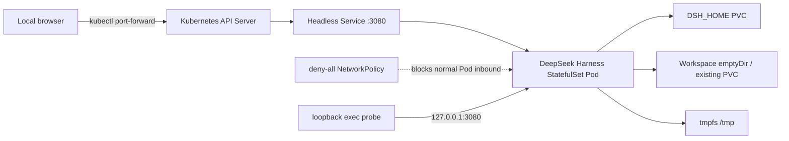

# From Docker to Kubernetes: DeepSeek Harness, Built-in Chromium, and DSH Plugin in Practice

After DeepSeek Harness was open-sourced, some people summarized it as "DeepSeek open-sourced a web application." That description overlooks the Agent Runtime behind the Web Surface: model adaptation, sessions, tools, permissions, workspace, sub-agents, plugins, and the headless entry point all share the same execution core. The Web is not just a chat page; it can be packaged as a Native App or deployed directly to a remote development machine or the cloud. Compared with repackaging a CLI Agent into a remote terminal and mobile entry point, it is naturally better suited for cross-device access.

This project first packages the official npm runtime into a reproducible Docker image, then deploys it to a Kubernetes 1.30.4 test cluster. Following the earlier approach of the OpenClaw and Chrome all-in-one image, it places Chromium, Xvfb, Openbox, noVNC, and DeepSeek Harness into the same OCI image, and implements the integration layer between Harness and the browser as a standalone `@runzhliu/dsh-browser-desktop` plugin.

This is not a "page opens, so deployment succeeded" demo. What is truly worth recording: the Agent Runtime simultaneously holds session state, a workspace, Shell/PTY subprocesses, model credentials, and code execution capabilities, so a traditional web application Deployment template cannot directly cover these boundaries. Testing also revealed that a deny-all NetworkPolicy blocks kubelet HTTP probes in the current Cilium environment, causing the already-started process to be killed by the liveness probe. Ultimately, an in-container loopback exec probe preserved network isolation and restored correct health checks.

The accompanying implementation is at [runzhliu/deepseek-harness-docker](https://github.com/runzhliu/deepseek-harness-docker). If you want to first understand image building, `node-pty`, EROFS, `HOME`/`DSH_HOME`, and Cordis Patch, read [DeepSeek Harness Docker, Compose, and Helm Deployment in Practice](../rag-agent/deepseek-harness-runtime-containerization.md) first. To understand Cordis, Profile, Agent Loop, and event-sourced sessions, start with [DeepSeek Harness GitHub Repository Deep Dive](../rag-agent/deepseek-harness-repository-analysis.md).


This diagram shows the current all-in-one boundary: a remote computer or phone accesses via Tailscale, `port-forward`, or a protected HTTPS entry point; Kubernetes manages the Pod; a single OCI image inside the Pod contains DeepSeek Harness Web, the Browser Plugin, and the Chromium desktop; PVC stores Harness state, browser Profile, and workspace. This is not Docker-in-Docker; Docker builds the image, and the test cluster actually starts the image with a CRI container runtime.

## 1. Experimental Conclusions First

| Item | Measured Result |
| --- | --- |
| Kubernetes | 1.30.4 test cluster, linux/amd64 |
| CNI | Cilium 1.16.1, enforcing NetworkPolicy |
| Harness | `@deepseek-ai/dsh@0.1.0-rc.6` |
| Image | `runzhliu/deepseek-harness:0.1.0-rc.6` |
| Built-in browser | Debian Chromium, Xvfb, Openbox, x11vnc, websockify/noVNC |
| DSH Plugin | `@runzhliu/dsh-browser-desktop@0.1.0` |
| Controller | Single-replica StatefulSet |
| State storage | 5 GiB RWO local LVM PVC, Bound |
| Workspace | `emptyDir` this time; cleared on Pod recreation |
| Runtime user | UID/GID 1000, non-root |
| Root filesystem | Read-only; only `$DSH_HOME`, `/workspace`, and `/tmp` writable |
| Network entry | Headless Service; no Ingress, NodePort, or LoadBalancer |
| Network policy | Deny all inbound Pod traffic by default |
| Verification | Pod `1/1 Ready`, 0 restarts; port-forward returns HTTP 200 |

The initial slim baseline without the Chromium desktop pulled about 190 MB from Docker Hub in 28.401 seconds. After fixing the probe, the new Pod startup log printed the Web address, and in-container `dsh --version` returned `0.1.0-rc.6`. Accessing the homepage locally via the API Server proxy downloaded 12,109 Bytes of HTML in about 89 ms. After adding the full desktop stack, the local Docker image is about 2.46 GB, which buys a reproducible visual browser environment but also significantly increases image distribution and cold-start costs.

This round did not inject a model API Key, nor did it claim "Web is usable" as "Agent model calls have been verified." Before real production use, model Provider, Shell/PTY, file tools, permission approval, and sandbox behavior must be tested separately.

## 2. Why the Agent Runtime Is Worth Orchestrating with Kubernetes

`npx @deepseek-ai/dsh web` is already enough for an individual to quickly open a page. Putting it into Kubernetes is not about making a simple experience complex, but about turning a set of runtime constraints that tend to drift into declarative objects:

| Agent Runtime problem | Corresponding Kubernetes capability |
| --- | --- |
| Fixed Node, native modules, and DSH version | Immutable image, Tag/Digest |
| Process exit, hang, and upgrade | StatefulSet, Probe, rolling update |
| Profile, settings, credentials, and sessions | `$DSH_HOME` PVC |
| Code actually modified by the Agent | Dedicated Workspace Volume |
| API Key and Provider credentials | Secret, runtime injection |
| CPU, memory, and process runaway | requests/limits, PID boundaries |
| Unauthenticated Web and code execution interface | Service, NetworkPolicy, trusted entry point |
| Audit and reproducibility | Manifest, Event, logs, and version records |

The most critical part is lifecycle layering. Images can be rebuilt, but Harness state must not be lost with them; the workspace can be replaced, and it should not be mixed with credentials, Profile, and sessions in the same anonymous directory.

## 3. Deployment Topology This Time



No public entry point was deliberately created here. Harness Web currently lacks authentication, TLS, and Origin security boundaries suitable for direct exposure, and its backend can read and write files and start a Shell. Using port-forward through the API Server during testing confines the access surface to the operator's local machine.

## 4. Building Chromium into the Image and Integrating It via the DSH Plugin

The current image is not simply adding an `chromium` package; it combines a complete, interactive desktop runtime chain:

```text
DeepSeek Harness Web :3080
        │
        ├── @runzhliu/dsh-browser-desktop
        │       └── Chromium DevTools :9222
        │
        └── noVNC :6080
                └── websockify → x11vnc :5900
                                  └── Xvfb :99 + Openbox + Chromium
```

The Dockerfile installs Chromium and desktop components using Debian native-architecture packages and adds Noto CJK fonts, so both `linux/amd64` and `linux/arm64` can build native images. Compose configures 1 GiB `/dev/shm` for Chromium; the launcher adds `--no-sandbox` only to the browser process, while the container as a whole retains `cap_drop: ALL` and `no-new-privileges`.

`deepseek-harness-entrypoint` is responsible for preparing the plugin, starting Xvfb/Openbox, x11vnc, websockify/noVNC, Chromium, and DSH, and uniformly handling signals and subprocess exit. Chromium exposes a DevTools Endpoint on 9222 reachable only from the container loopback; the entry script automatically restarts it after abnormal exit. The browser Profile is placed in `/home/node/.dsh/chrome-profile` and persisted together with Harness state.


`@runzhliu/dsh-browser-desktop@0.1.0` is a standalone DSH Plugin, not an iframe hardcoded into the Web page. It adds an entry point through `sidebar.footer.action`, displays a movable, resizable, and maximizable panel through `shell.overlay`, and registers the `browser_open` Agent tool. When the user asks to "open a certain address with the browser," the Host side creates a tab via CDP, and the Web Client then automatically expands the visual desktop in the same container.

The plugin can be packaged and installed independently:

```bash
npm pack ./plugins/dsh-browser-desktop --pack-destination /tmp
dsh plugin --profile web add \
  /tmp/runzhliu-dsh-browser-desktop-0.1.0.tgz
```

The plugin is only responsible for Harness Host/WebUI integration and does not separately install Chromium, Xvfb, or noVNC; the Docker image in the repository is the complete reference runtime. This layering lets other DSH environments reuse the plugin and avoids mixing UI integration and desktop process management into one inseparable startup script.

### 4.1 Tailscale and Mobile Voice Entry Point

One value of the Web Surface is cross-device access. A practical personal scenario: the project and DSH stay on a development machine or test cluster at home, exposing only a controlled entry point through the Tailscale Tailnet; while away, the user opens DSH in a mobile browser, enters modification requirements by voice, lets the Agent operate the mounted `/workspace`, and then views the page and verifies results through the built-in Chromium.

This does not mean ports 3080 and 6080 can be exposed publicly. The reference implementation's noVNC has no separate authentication, and DSH can access Shell, files, and model credentials, so at minimum Tailnet identity and ACLs, minimal port exposure, a controlled HTTPS entry point, and credential isolation are required. Tailscale provides private connectivity and an identity foundation; it does not automatically replace application authorization and the Agent Sandbox.

## 5. Why StatefulSet Instead of a Multi-Replica Deployment

Harness Profile, model settings, credential references, session events, and domain storage live in `$DSH_HOME`. The Web Surface is also closer to a single-user development entry point than to a stateless service that already has shared session coordination and multi-tenant identity.

Therefore, this deployment uses a single StatefulSet replica:

- Pod name and state volume binding are stable;
- The same `$DSH_HOME` is remounted after Pod recreation;
- PVC is retained by default on Helm uninstall or scale-down;
- Horizontal scaling is not used to fake high availability.

A single replica is not high availability. This PVC is also local LVM, so recovery after a node failure is constrained by local volume topology. For cross-node recovery, storage that supports the corresponding topology and failure semantics would be needed, and Harness's own contract for concurrent access and migration would need to be verified.

## 6. Minimal Helm Configuration

The test cluster only covers public images and an RWO StorageClass, with no credentials written into values:

```yaml
image:
  repository: runzhliu/deepseek-harness
  tag: 0.1.0-rc.6
  pullPolicy: IfNotPresent

persistence:
  storageClass: <RWO_STORAGE_CLASS>
  size: 5Gi

networkPolicy:
  enabled: true
  ingress: []
```

Installation command:

```bash
helm --kube-context <TEST_CONTEXT> upgrade --install deepseek-harness \
  charts/deepseek-harness \
  --namespace deepseek-harness \
  --create-namespace \
  -f values-test.yaml \
  --wait \
  --timeout 5m
```

The Chart also sets the following security defaults:

- `automountServiceAccountToken: false`;
- UID/GID 1000 and `runAsNonRoot: true`;
- RuntimeDefault seccomp;
- Drop all Linux capabilities;
- `allowPrivilegeEscalation: false`;
- Read-only root filesystem;
- `/tmp` uses a size-limited memory `emptyDir`.

## 7. The First Real Problem: NetworkPolicy Blocked the Probes Too

On the first installation, the image, PVC, and Web process were all normal:

```text
dsh web: http://127.0.0.1:3080 (LAN: http://<POD_IP>:3080)
```

But the Pod could not become Ready, and Events kept appearing:

```text
Readiness probe failed: dial tcp <POD_IP>:3080: i/o timeout
Liveness probe failed: context deadline exceeded
Container failed liveness probe, will be restarted
```

The old Pod accumulated 6 restarts in total. The problem was not Node.js, image architecture, PVC permissions, or Harness startup, but the interaction of the following configuration:

1. NetworkPolicy sets `ingress: []` for the Harness Pod;
2. Cilium enforces host-to-Pod inbound policy in this cluster;
3. kubelet initiates the `httpGet` Probe using the Pod IP;
4. The Web is already listening, but probe traffic is dropped by the policy before entering the container.

Attempting to allow the node CIDR with only the standard NetworkPolicy `ipBlock` did not match in this host-probe path. Simply disabling the NetworkPolicy would restore the probes but would re-expose the unauthenticated code execution interface to other Pods in the cluster, which is not a reasonable fix.

## 8. The Correct Fix: In-Container Loopback Exec Probe

What the health check really needs to verify is the Web process in this container; it does not need to traverse the Pod network. Therefore, readiness/liveness was changed to an in-container Node.js `fetch`:

```yaml
livenessProbe:
  exec:
    command:
      - node
      - -e
      - >-
        fetch('http://127.0.0.1:3080/').then((response) =>
        process.exit(response.ok ? 0 : 1)).catch(() => process.exit(1))
  initialDelaySeconds: 20
  periodSeconds: 20
  timeoutSeconds: 3

readinessProbe:
  exec:
    command:
      - node
      - -e
      - >-
        fetch('http://127.0.0.1:3080/').then((response) =>
        process.exit(response.ok ? 0 : 1)).catch(() => process.exit(1))
  initialDelaySeconds: 5
  periodSeconds: 10
  timeoutSeconds: 3
```

This change has three effects:

- It still checks real HTTP status rather than only checking that the Node process exists;
- It does not require adding an inbound exception for kubelet on 3080;
- The deny-all NetworkPolicy can continue to be enforced.

The StatefulSet was in the OrderedReady update flow at the time, and the old Pod had never become Ready, so the template update did not trigger an immediate replacement. After deleting the only test Pod, the controller rebuilt it according to the new revision and remounted the original PVC; the new Pod eventually `1/1 Ready`, with a restart count of 0.

## 9. Acceptance cannot rely on the homepage alone

First check the controller, Endpoint, PVC, and policies:

```bash
kubectl --context <TEST_CONTEXT> -n deepseek-harness \
  get pod,statefulset,service,endpoints,pvc,networkpolicy -o wide
```

This run's results: StatefulSet `1/1`, Pod `Running/Ready`, Endpoint pointing to 3080, PVC is `Bound`, and the NetworkPolicy still selects only the Harness Pod with no ingress rules.

Next, verify the version and write boundaries:

```bash
kubectl --context <TEST_CONTEXT> -n deepseek-harness \
  exec deepseek-harness-0 -- sh -lc '
    id
    dsh --version
    test -w /workspace && echo workspace-writable
    test -w /home/node/.dsh && echo dsh-home-writable
    test ! -w / && echo root-not-writable
  '
```

The measured output shows UID/GID 1000, DSH `0.1.0-rc.6`, with the two mounted directories writable while the root directory is not.

Finally, access from the operator's local machine:

```bash
kubectl --context <TEST_CONTEXT> -n deepseek-harness \
  port-forward service/deepseek-harness 3080:3080

curl --fail http://127.0.0.1:3080/
```

The homepage returns HTTP 200. Do not change the Service to NodePort or add a public Ingress just to avoid running one port-forward command.

## 10. What Kubernetes solves, and what it does not

This experiment has demonstrated that Kubernetes can manage Harness's image versions, single-instance lifecycle, stateful volumes, health checks, network ingress, and security context. It has not yet demonstrated the following capabilities:

- Correctness and failover of model providers;
- Complete behavior of Harness tool approval and the Linux Sandbox on the target kernel;
- Multi-user identity, authorization, quotas, and auditing;
- Multi-replica shared Sessions or Workspaces;
- Cross-node state recovery after node failure;
- Strong isolation when running untrusted code.

Containers and Kubernetes limit which host resources a process can see; Harness's own permission system limits which tools the Agent can invoke. To execute untrusted code, you still need to evaluate gVisor, Kata, microVMs, standalone credential proxies, and controlled outbound networking. A Pod using a non-root user and a read-only root filesystem should not be described as a complete multi-tenant Agent Sandbox.

## 11. From OpenClaw to DeepSeek Harness: the point is not "putting it in a Pod"

More and more Agent projects are beginning to carry a Shell, browser, filesystem, plugins, and long-lived sessions. They are no longer just a web page that calls a model API, but a Runtime with state, permissions, and an execution environment.

Docker's value is turning dependencies, versions, and startup contracts into executable installation documentation; Kubernetes's value is continuing to manage the state, resources, identity, networking, and lifecycle of these Runtimes. What is truly worth reusing is not a YAML file that "just runs," but the following set of clear boundaries:

```text
镜像负责版本与运行依赖
StatefulSet 负责单实例生命周期
DSH_HOME PVC 负责 Harness 状态
Workspace Volume 负责用户代码
Secret 负责 Provider 凭据
NetworkPolicy 负责访问面
Probe 负责真实健康状态
更强 RuntimeClass 负责不可信执行隔离
```

For temporary personal local experimentation, `npx` or Docker Compose remains the preferred choice. Kubernetes only begins to show its value when you need team reproducibility, persistence, resource governance, version upgrades, and security boundaries. Orchestration is not the goal; turning the implicit assumptions of the Agent Runtime into an observable, upgradeable, recoverable contract is the goal.

## 12. References

- [DeepSeek Harness](https://github.com/deepseek-ai/deepseek-harness)
- [DeepSeek Harness Docker Community Implementation](https://github.com/runzhliu/deepseek-harness-docker)
- [DeepSeek Harness GitHub Repository Deep Dive](../rag-agent/deepseek-harness-repository-analysis.md)
- [DeepSeek Harness Docker, Compose, and Helm Deployment in Practice](../rag-agent/deepseek-harness-runtime-containerization.md)
- [Agent Sandbox Selection and Architecture Analysis](../rag-agent/agent-sandbox-selection.md)
