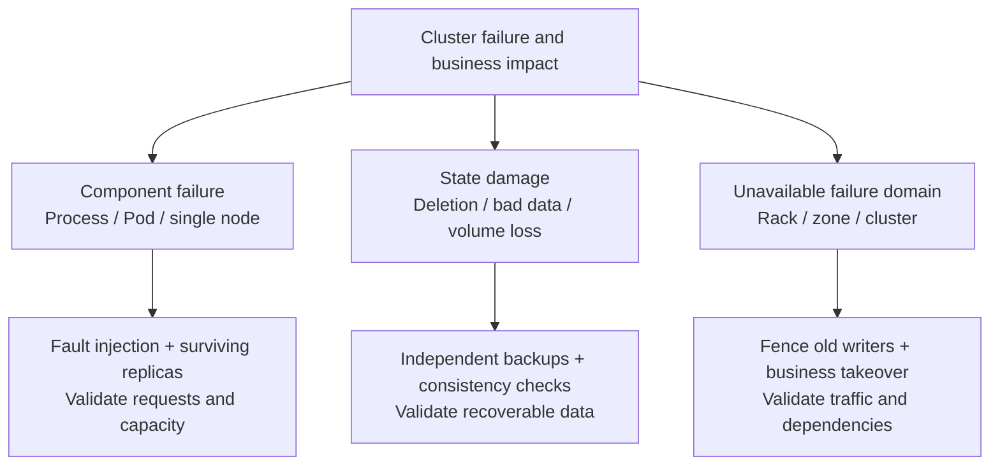
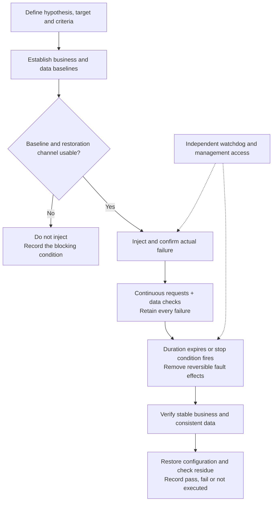
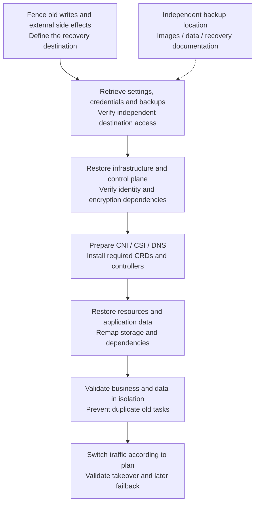

# Kubernetes disaster recovery drills — fault injection, backup restoration and acceptance for cluster administrators

“Have you performed Kubernetes disaster recovery drills?” is really a question about which business capabilities survive a particular failure, whether acknowledged data is lost, how long recovery takes, and what evidence supports those conclusions.

Deleting a Pod and watching a Deployment create a replacement validates only a small part of the problem. Cluster administrators must also handle an unreachable API Server, etcd quorum loss, disconnected nodes whose processes are still running, volumes that cannot reattach, and backups that cannot be restored elsewhere.

This review uses official documentation checked on October 23, 2026, with earlier measurements from this repository as limited examples. Configuration and timing examples are drill designs, not results of new installations or fault injections in this round.

## 1. Distinguish high availability, chaos engineering and disaster recovery

| Direction | Question | Typical validation |
| --- | --- | --- |
| High Availability, HA | Can surviving capacity continue serving after a failure? | Stop an API Server, proxy or worker node and observe requests and capacity |
| Chaos Engineering | Do assumptions about failure behavior hold? | Deliberately inject delay, loss, process exit or resource pressure while checking business behavior |
| Disaster Recovery, DR | Can service and data be recovered when the original environment is unusable? | Restore independent backups into an isolated environment or execute business takeover across clusters |

Chaos engineering can validate both HA designs and DR procedures, but fault-injection tools generally do not rebuild lost data for you. Conversely, a completed backup job does not establish that online requests remain successful during failure.



*One application may need all three validation paths. Multiple replicas sharing a host, storage or power supply still have common failure points.*

## 2. Choose the task before choosing the tool

This compares primary roles, not exhaustive feature support. Check individual fault types, runtime compatibility and permissions against the selected version.

| Tool | Best suited to | Organization and interface | Does not replace |
| --- | --- | --- | --- |
| Chaos Mesh | Pod, network, resource and dependency faults in Kubernetes | CRDs, workflows, schedules and Dashboard | Business probes, independent backups and whole-cluster recovery |
| LitmusChaos | Team experiments, fault libraries and probe-based acceptance | ChaosCenter, experiment orchestration and Resilience Probes | Correct business criteria and data-consistency checks |
| ChaosBlade | Host, container, Kubernetes and application-layer faults | Execution tools and Operator; the platform interface is a separate component | Installing a command-line tool does not establish a complete drill platform |
| Krkn | Infrastructure resilience involving clusters, nodes, networks and storage | Command line / scenario containers, plus a separate Dashboard | Cross-cluster data recovery and business takeover procedures |
| Chaos Toolkit | Experiments combining internal APIs, scripts and checks | Declarative hypotheses, actions, probes and rollback | Implementing and maintaining injection, restoration and authorization logic |
| Velero | Backup and restoration of Kubernetes resources and supported persistent-volume data | Backup / Restore resources, command line and plugins | Online injection, database transaction recovery and full etcd restoration |
| `kubectl`, cloud APIs and targeted scripts | A few explicit actions, including device or cloud-resource tests | Easy to start; action and recovery logic remain your responsibility | Automatically obtaining audit, reliable cleanup or team workflows |

CRD means Custom Resource Definition, a Kubernetes API extension. An Operator uses controllers to manage such resources continuously. Dashboard means a graphical management page, not proof that an interface has been installed in the target cluster.

### Chaos Mesh: a useful starting point for Kubernetes administrators

Chaos Mesh includes Dashboard, Controller Manager and Chaos Daemon. The daemon commonly runs as a highly privileged DaemonSet and injects faults through target namespaces. Creating an experiment object in one namespace therefore does not fully isolate the underlying execution capability. Check authorization, target selection and execution-node scope together. [Architecture and permission boundaries](https://chaos-mesh.org/docs/)

Pod, network and resource faults can be reviewed as resources before adding orchestration. However, `pod-kill` deletes a Pod once, while `pod-failure` uses a different implementation; neither name should be interpreted as power loss. The official documentation explains that `pod-failure` replaces container images and may even leave a Pod appearing Ready without effective probes. [Actual PodChaos mechanisms](https://chaos-mesh.org/docs/simulate-pod-chaos-on-kubernetes/)

### LitmusChaos: connect experiment verdicts to business probes

Litmus provides platform management and experiments. Probes can check HTTP, commands, Kubernetes objects or Prometheus queries, with modes for checks before, during and after faults. The useful distinction is between executing an action and maintaining acceptable business behavior. [Litmus documentation](https://docs.litmuschaos.io/), [probe types and timing](https://docs.litmuschaos.io/docs/concepts/probes/)

If probes retry, retain the first failure as well as the final verdict. A passing verdict may mean a later retry succeeded, not that no requests were lost in between.

### ChaosBlade, Krkn and Chaos Toolkit: three complementary directions

ChaosBlade is an Alibaba open-source project covering execution tools and platform components. It is relevant for teams already exercising hosts and application faults. Its Kubernetes Operator interacts with host namespaces, so the selector in a custom resource alone does not establish the impact boundary. [Project overview](https://chaosblade.io/en/docs/), [Operator implementation](https://chaosblade.io/blog/2022/11/01/chaosblade-operator/)

Krkn provides node, network, storage and other infrastructure scenarios through different execution entry points. Its documentation recommends running control outside the tested cluster where possible, which matters for control-plane and whole-cluster failures. [Krkn scenarios](https://krkn-chaos.dev/docs/), [execution options and Dashboard](https://krkn-chaos.dev/docs/installation/)

Chaos Toolkit suits teams with existing internal operations APIs that want reusable scripts under an experiment specification. It separates steady-state hypotheses, actions, probes and rollbacks. Defining a rollback does not automatically undo deleted data, broken connections or external side effects. [Experiment specification](https://chaostoolkit.org/reference/api/experiment/)

For an initial Kubernetes program, I would start with **Chaos Mesh plus independent business probes**. Compare LitmusChaos when multi-team experiment management is the priority, and Krkn or ChaosBlade when node, network-domain or platform scenarios dominate.

**Develop backup restoration with tools such as Velero in parallel**. This is a suggested learning path for administrators, not a general performance ranking.

## 3. Which failures should cluster administrators cover?

LB below means Load Balancer; DNS means Domain Name System.

| Layer | Example action | Required observations | Unsupported additional conclusion |
| --- | --- | --- | --- |
| Application / Pod | Delete one controller-managed replica | Request errors, readiness removal, in-flight work and replacement | Node power loss and volume recovery validated |
| Process / runtime | Stop a selected process on a dedicated node | Whether old processes survive, orphaned resources and reconstruction | Running Pod means internal work recovered |
| Node | Separately test planned drain and unplanned disconnection | Detection, eviction, rescheduling, capacity and old-node writes | Both actions follow the same recovery path |
| API Server / LB | Stop one backend and test a connection black hole | New connections, long connections, WATCH and mutations | Removing a backend immediately moves every connection |
| scheduler / controller-manager | Switch leader or interrupt one instance | New-Pod scheduling, reconciliation backlog and recovery | Existing business traffic proves a healthy control plane |
| etcd | In isolation, test minority failure, quorum loss and snapshot restore | Writes, election, disk latency and controller convergence | Any surviving minority can accept writes |
| DNS / network / ingress | Targeted delay, loss or DNS outage | New and existing connections, caches, timeouts and retry amplification | One Pod-level fault covers rack-switch failure |
| CNI / CSI | Separately test control components and node agents | Existing workloads, new Pods, new mounts and data paths | Stopping a plugin controller necessarily breaks existing data paths |
| Storage | Read/write delay, mount failure and restore on dedicated test volumes | Checksums, reattachment, duplicate writes and recovery source | A snapshot covers loss of the entire storage cluster |
| External dependencies | Unavailable registry, object storage, identity or certificate service | Cache-hit and cache-miss paths | Existing tasks working means new tasks can start |
| Failure domain / cluster | Isolate a zone or test remote takeover | Actual capacity, writer fencing, DNS / LB and replication | Same-node replicas validate that failure domain |

CNI means Container Network Interface; CSI means Container Storage Interface. How independently their control and data paths behave depends on the deployed implementation.

### Drain, Pod deletion and node disconnection are different experiments

`kubectl drain` normally uses the Eviction API. A PDB (PodDisruptionBudget) constrains these voluntary disruptions; it does not prevent direct Pod deletion, hardware failure or sudden power loss. Passing planned maintenance does not establish the same recovery time for unplanned failure. [Kubernetes disruptions and PDBs](https://kubernetes.io/docs/concepts/workloads/pods/disruptions/)

For stateful work, a NotReady node may only have lost its management network while its processes can still access storage. Starting the same writer elsewhere can produce concurrent writes. Validate fencing: isolating the old writer through power, networking or storage permissions. Kubernetes non-graceful shutdown procedures also require confirming that the old node is actually shut down; `out-of-service` is not a generic fast-recovery switch. [Node shutdown and volume-detachment conditions](https://kubernetes.io/docs/concepts/cluster-administration/node-shutdown/)

## 4. Design an experiment with a decidable outcome

An experiment description needs six explicit elements: **hypothesis, target, actual fault action, continuous observation, recovery method and acceptance criteria**. The following design example needs thresholds adjusted to a real workload baseline.

| Element | Example definition for losing one replica |
| --- | --- |
| Hypothesis | Two distributed Web replicas retain sufficient business capacity after losing one |
| Target | One Pod with a recorded UID in the test namespace, not an unspecified “service” |
| Fault | Delete one Pod while retaining the other, the owning controller, storage and probes |
| Load | Fixed request rate; separately record new connections, reused connections, writes and streams |
| Stop conditions | Sustained error threshold, affected non-target resources or lost restoration access |
| Acceptance | Confirmed injection, stable business recovery, data and side-effect checks, restored configuration and complete temporary-resource cleanup |



*Place experiment control, observation and restoration access outside the tested failure domain where possible. A watchdog can restore known settings; it cannot resurrect deleted data or processes.*

Before execution, inspect host network and process namespaces, privileged mode and host-directory mounts. A host-network Pod may share the host network namespace. With the host PID namespace, PID 1 visible inside the container may be the host process. Establish targets using actual container, process and namespace identities instead of selecting a PID or interface based only on an experiment label.

### A NetworkChaos example with explicit scope

This example **was not executed**. It demonstrates scoped configuration: choose one experimentally labeled frontend Pod in `chaos-lab` and add 100 milliseconds of latency toward backend Pods in that namespace for 30 seconds. It does not disconnect a node or fail an entire cluster.

```yaml
apiVersion: chaos-mesh.org/v1alpha1
kind: NetworkChaos
metadata:
  name: frontend-to-backend-delay
  namespace: chaos-lab
spec:
  action: delay
  mode: one
  selector:
    namespaces:
      - chaos-lab
    labelSelectors:
      app: frontend-demo
      chaos-demo: "true"
  direction: to
  target:
    mode: all
    selector:
      namespaces:
        - chaos-lab
      labelSelectors:
        app: backend-demo
        chaos-demo: "true"
  delay:
    latency: 100ms
  duration: 30s
```

There is no further application-port filter: other traffic between selected sources and destinations may also be affected. Before application, inspect actual candidates, network namespaces, the CNI data path and kernel `NET_SCH_NETEM` support. The official documentation specifically requires keeping Controller Manager connected to Chaos Daemon during injection, or the network fault may not be recoverable. [NetworkChaos behavior and prerequisites](https://chaos-mesh.org/docs/simulate-network-chaos-on-kubernetes/)

`duration` schedules removal at the tool layer; it is not an independent guarantee when control connectivity disappears. Check resource status, actual injection timing, removal and residual rules. Removing a finalizer alone does not establish that the node is repaired. [Experiment lifecycle and cleanup](https://chaos-mesh.org/docs/run-a-chaos-experiment/)

## 5. Define recovery time, recovery point and success separately

RTO means Recovery Time Objective; RPO means Recovery Point Objective. Agree on targets before the exercise and compare measured recovery time and data loss against them. Do not retrospectively present observed results as pre-existing commitments.

| Event | Hypothetical time since failure |
| --- | ---: |
| Actual failure | 0 seconds |
| Probe detects the anomaly | 5 seconds |
| Alert reaches the on-call responder | 12 seconds |
| Replacement Pod becomes Ready | 70 seconds |
| Business begins continuously meeting agreed criteria | 110 seconds |
| The predefined 60-second stable observation completes | 170 seconds |

Here the retrospectively confirmed recovery interval starts at 110 seconds, and acceptance completes at 170 seconds. Report both instead of presenting the 70-second Pod readiness as business recovery. If the objective is recovery within 120 seconds, state which time definition governs acceptance; do not change it afterward.

RPO is not simply “a backup every 5 minutes means at most 5 minutes lost.” Failed backups, replication backlog, transaction commits and application consistency matter. Test writes need unique IDs, acknowledgment records and checksums. Reconcile every acknowledged ID after restoration, including missing and duplicate results. The highest sequence number alone can hide gaps. Timed-out requests that might have committed need separate reconciliation, not silent replacement by retries.

## 6. Why an existing backup may still be unrestorable

Separate at least four classes of recovery material:

| Material | Protects | Frequently missing |
| --- | --- | --- |
| Git / infrastructure declarations | Desired cluster, network and workload configuration | Runtime-created resources, data and external assets |
| etcd snapshot | Kubernetes API object state | Persistent-volume contents, registries and actual database data |
| Resource and volume backups | Namespaces, workloads and selected volume data | External databases, cross-volume transactions and driver / storage dependencies |
| Application-native backups | Database logs, transaction state, training checkpoints and similar data | Platform certificates, ingress, authorization and resource reconstruction |

Velero orchestrates resource and supported-volume restoration. Its DR documentation also describes read-only Backup Storage Locations on the recovery side to reduce the risk of restoration activities changing the backup source. [Velero disaster recovery](https://velero.io/docs/v1.18/disaster-case/)

A CSI snapshot may still depend on the original storage system. If the failure model includes losing that entire system, verify that data actually moves to independent backup storage and that the destination has compatible drivers, StorageClasses and capacity. Velero CSI Snapshot Data Movement addresses a data-transfer path; a snapshot reference alone is not a remote data copy. [CSI snapshot data movement](https://velero.io/docs/v1.18/csi-snapshot-data-movement/)

Databases also need transaction-consistent designs. Backup hooks can perform application-required preparation and cleanup, but do not infer the correct backup protocol for arbitrary databases. Readable files and a transaction-consistent recovery point are different requirements. [Velero Backup Hooks](https://velero.io/docs/v1.18/backup-hooks/)

### Distinguish repairing etcd membership from restoring a logical cluster

Three etcd members need two for quorum; five need three. Minority failure and quorum loss require different handling, and adding LB backends cannot restore consensus. A partitioned minority's inability to write should not be mistaken for split-brain where both sides can commit. [etcd cluster size and quorum](https://etcd.io/docs/v3.6/faq/)

Restore snapshots in isolation using a procedure matched to the version and topology. All restored members use the same snapshot to form a logical cluster. Kubernetes controllers also face revision rollback and cache issues; official etcd recovery guidance explains `--bump-revision` and `--mark-compacted`. Plan these parameters against the version and write volume rather than copying a fixed increment. [etcd disaster recovery](https://etcd.io/docs/v3.6/op-guide/recovery/)

Protect certificates, PKI (Public Key Infrastructure) material and encryption dependencies separately. With Kubernetes encryption at rest, etcd ciphertext without the required encryption configuration or usable KMS (Key Management Service) keys may leave restored objects unreadable. [Encryption at rest and key backup](https://kubernetes.io/docs/tasks/administer-cluster/encrypt-data/)

### Restore ordering and writer isolation matter in another environment



*A dependency diagram, not a universal one-click restore order. Restoring the original control plane's etcd and creating a new cluster for application-level restoration are separate paths. Do not replay the same objects through both without a deliberate plan.*

Block scheduled jobs, consumers, notifications, payments and other side effects from running prematurely in the recovery environment. Cross-cluster takeover also needs real surviving capacity, replication state, DNS caches and LB changes checked. Moving traffic does not establish a safe transfer of data-writing authority.

## 7. Organize metrics and evidence

I recommend four evidence layers linked by one experiment ID and timeline:

| Layer | Evidence to retain |
| --- | --- |
| Experiment action | Target UID, version and configuration, action parameters, confirmed effect, removal and cleanup |
| Kubernetes state | Pod / Node / EndpointSlice transitions, events, scheduling and mounting times, controller logs |
| Client and application | Every request's outcome and duration, stream interruptions, business results, data IDs and side effects |
| Infrastructure | API latency, etcd election and disk latency, node resources, networking and storage |

Grafana aligns curves, but retain raw requests and logs. A 2-second collection interval can miss shorter failures; coarse `rate` windows can smooth them away. State aggregation windows and denominators. Missing monitoring data is unknown, not healthy.

### What an earlier measurement demonstrates

In the earlier [CubeSandbox multi-replica experiment](../rag-agent/cubesandbox-ha-load-balancer-practice.md), API, Master and Proxy each temporarily had two replicas on one node, with one Pod deleted per case. All 33 create/command/delete workflows completed, but both established Proxy command streams disconnected while the independent guest counter progressed. New-request success, connection continuity and task continuity need separate checks.


*A real screenshot from a prior repository experiment, not proof of a new Chaos Mesh, Litmus or other platform installation. Success panels show the minimum over 2 seconds. The two original streams were not automatically reattached. This validates same-node component faults only, not Kubernetes node or site disaster recovery.*

## 8. Progress from the first exercise to an ongoing practice

A practical progression is:

1. **Start with a dedicated stateless application.** Use two replicas, fixed requests and independent probes. Test one Pod failure and targeted network delay, checking that removal leaves no residue.
2. **Extend to control-plane components and nodes.** Separate planned maintenance, unplanned disconnection and leader transitions; align control-state changes and continuous business traffic.
3. **Validate stateful recovery separately.** Use test data and isolated writers. Exercise independent backups, reattachment, transaction consistency and actual data loss.
4. **Then validate failure-domain takeover.** Cover capacity and dependencies across nodes, zones or clusters. Several VMs on one host do not substitute for an actual rack failure domain.
5. **Integrate validated cases into change acceptance.** Rerun relevant scenarios after upgrades, CNI / CSI replacements, ingress changes or storage changes. Retain per-version results for comparable regression history.

Frequency should follow business objectives, risk and changes rather than a universal weekly power-off rule. Exercise the people and access paths too: alert delivery, authorized login, backup credentials and recovery documents that may themselves depend on the failed cluster.

Google SRE's data-integrity practice emphasizes regular verification of actual restoration instead of merely having backup files. The same applies to Kubernetes: reading and validating recovered data elsewhere turns a backup into recovery evidence. [Google SRE data-integrity practice](https://sre.google/sre-book/data-integrity/)

Stop conditions must reach the experiment controller. AWS FIS uses CloudWatch alarms as stop conditions, a useful product example. A self-hosted platform likewise needs to verify that a trigger stops further injection instead of merely notifying someone. [AWS FIS stop conditions](https://docs.aws.amazon.com/fis/latest/userguide/stop-conditions.html)

## 9. Deliverables that support retrospectives and honest interview answers

A useful report should directly answer:

- Which architectural hypothesis was tested, and what were the actual failure domain and target?
- Did injection take effect, for how long, and which resources were retained throughout?
- What happened separately to new requests, long connections, in-flight mutations, data and external side effects?
- Did measured recovery time and data loss meet the pre-agreed objectives?
- How were restoration and cleanup confirmed, and which cases failed, were blocked or remain unexecuted?
- What changed after the findings, and did retesting preserve original denominators and produce comparable results?

An administrator can explain how they selected failures, established impact boundaries, built independent observation, identified recovery bottlenecks and retested. If only a single-Pod exercise was completed, state that boundary and describe the subsequent node, storage and full-restoration plan. Installing a tool is not the same as passing a complete DR acceptance test.

## Further reading

- [Reliability, checkpoints and failure recovery](../reliability.md)
- [Reliability engineering across hundreds of clusters](kubernetes-fleet-reliability.md)
- [API Server L4 and L7 load balancing](kube-apiserver-load-balancing.md)
- [CubeSandbox component failure and recovery](../rag-agent/cubesandbox-failure-recovery-practice.md)
- [Multi-node training frameworks and failure recovery](../training/distributed-training-frameworks-recovery.md)
