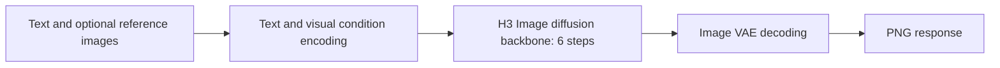

# MiniMax-H3-Image on One H20-3e: vLLM-Omni and SGLang Deployment and Load Testing

MiniMax-H3-Image is an open-weight image generation model in the MiniMax H3 family. It supports text-to-image generation and editing conditioned on reference images. In these experiments, we run vLLM-Omni and SGLang separately on one H20-3e each in Kubernetes to test 2048 × 2048 generation, reference-image editing, different workloads and concurrency levels, with actual images and GPU monitoring as evidence. Nodes and offload configurations differ, so compare the deployment configurations. [Model card](https://huggingface.co/MiniMaxAI/MiniMax-H3-Image) · [vLLM-Omni recipe](https://recipes.vllm.ai/MiniMaxAI/MiniMax-H3-Image)

According to the recipe, the image generation backbone has about 33.1B parameters, the paired text encoder about 33.4B, and an image VAE is separate. Default generation uses six distilled diffusion steps. It is related to the family's audio-video model, but this article tests the separate image model and API, not video generation. [Model components](https://recipes.vllm.ai/MiniMaxAI/MiniMax-H3-Image)



This is a simplified conceptual flow. Layerwise offload applies to the encoder in this experiment; actual execution also includes scheduling, memory transfers and API encoding/decoding.

!!! note "Measured results"
    Each engine completed 51 formal benchmark batches and 504 / 504 successful requests that returned decodable images with the requested dimensions. Warmups, quality samples and boundary tests are counted separately. The vLLM-Omni 16-reference request returned the expected HTTP 400; the original runner counts this as a failure and reports partial, so job status alone cannot determine the experiment outcome.

## Conclusions: one GPU works, but throughput and waiting time differ

**Each tested configuration runs on one H20-3e and is suitable for low-concurrency image generation and editing.** For multiple users, introduce a queue and plan capacity first. Both engines completed 504 / 504 formal requests, but success only means an HTTP response with a decodable PNG at the requested dimensions; it does not establish prompt fidelity.

| Question | What this test found |
| --- | --- |
| How long for one image? | For 2048×2048 text-to-image at concurrency 1, median round P50 was 9.442 seconds for vLLM-Omni and 8.382 seconds for SGLang. Each value is the median of three round P50s and includes receipt of the full HTTP response, but not an external gateway. |
| Does concurrency improve throughput? | In these 2048×2048 batches, raising concurrency from 1 to 4 changed vLLM-Omni throughput from about 0.105 to 0.106 images/s while P50 rose from 9.44 to 37.53 seconds. SGLang changed from about 0.118 to 0.120 images/s while P50 rose from 8.38 to 33.16 seconds. Additional concurrency mostly increased waiting in these short batches; do not extrapolate them into sustained production capacity. |
| What does 4K cost? | At 4096×4096 and concurrency 1, text-to-image P50 was about 46.50 seconds for vLLM-Omni and 45.13 seconds for SGLang. In the same vLLM-Omni configuration, 4K took about 4.9 times the 2048×2048 P50; this is an observation for the tested prompt and configuration. |
| Which engine should I choose? | SGLang had lower latency for the cases highlighted here, but the nodes and text-encoder offload configurations differ; this does not prove an inherent engine advantage. Where GPU memory is tight, first validate the tested vLLM-Omni layerwise-offload configuration. For more reference images, evaluate SGLang and separately validate output quality. |
| What resources are needed? | Sampled GPU-memory peaks were about 72.66 GiB for vLLM-Omni and 121.06 GiB for SGLang. Workloads and offload strategies differ; these are neither a fair memory ranking nor minimum requirements. One vLLM-Omni container memory-peak observation was about 230 GiB including file page cache. Neither tested configuration can be copied directly to one 48 GB L20. |

**Deployment guidance:** start an internal trial with one GPU and low concurrency, a bounded queue, task status and timeouts, and monitor GPU memory, host memory and shared storage. Process start to readiness took about 385 seconds for vLLM-Omni and 375 seconds for SGLang, excluding image pull and scheduling; a resident service avoids reloading on every request. Before scaling for higher throughput, benchmark multiple replicas, multiple GPUs and cost using representative traffic and images.

**Evaluate multiple references separately.** In this run, the vLLM-Omni eight-image request succeeded but the output did not preserve the requested count and order; its tested image rejected 16 references. SGLang accepted 16 and returned a decodable image, but some inputs were repeated and count, order and identity have not been validated. API success does not establish multi-image understanding, and the observed version limits do not necessarily apply to other releases.

## Actual generated samples

All images below came from responses returned by the tested model server. Display copies were resized to a maximum edge of 1280 pixels and compressed as WebP; the generated contents were not redrawn or retouched. The original outputs are 2048 × 2048 PNGs. Results can vary with seed and software version.


*Portrait sample: a rainy tram stop and a dark blue coat; seed 42. The person is model-generated.*


*Landscape sample: a winding road through a valley after rain; seed 42.*


*Product sample: a metal water bottle, a pale stone table and a green leaf; seed 42. The model added an unrequested mark to the bottle.*


*Spatial-relation sample: the prompt requested a red cube to the left of a blue sphere and a green cylinder behind the sphere. This seed-42 sample broadly shows those relations.*

Text generation also requires careful inspection. The main title in the first image largely follows the request, but meaningless small text appears at the edges. The second prompt requested two lines, `Kubernetes` and `云原生`; both are legible in this sample. One successful sample does not establish general text accuracy, and an HTTP success does not validate spelling.


*English poster and bilingual sign, both with seed 42; each represents a single sample.*

## Actual edit example

We constructed a simple reference image containing a blue circle and a red square, and asked the model to change the square to green while retaining the circle and background.


*Input on the left and actual output on the right, resized and placed side by side for comparison. The requested color change is present, but unchanged regions are not guaranteed to be pixel-identical.*

The prompt was:

```text
<Picture 1> shows simple geometric shapes. Change the red square to green while keeping the blue circle and background unchanged.
```

Multiple-reference tests also show why interface success and visual quality are different. One request each with four and eight references returned decodable 2048×2048 PNGs in about 35.60 and 70.13 seconds respectively. The eight-image result contains a nine-cell grid, so it did not preserve the requested number and order. A request with 16 references returned HTTP 400, with an error saying that this server accepts at most nine images. This applies to the tested image, not necessarily every version; exactly nine references were not tested.


*The eight actual reference fixtures in submission order, combined here only for display; the request sent eight separate files.*


*Actual output with eight references and seed 42; a successful response does not mean that the requested number and order were preserved.*

In formal 2048×2048 concurrency-1 performance tests, two-reference and four-reference workloads each ran three rounds of six requests, all successful at 18 / 18 each. The median of round P50s was 20.939 seconds for two images and 35.475 seconds for four; median throughput was 0.04760 and 0.02813 images/s respectively. All inputs were synthetic 512 × 512 geometric fixtures, so these results do not represent the performance or quality of complex photos or larger reference sets.

## Environment and scope

| Item | Configuration |
| --- | --- |
| GPU | 1 × H20-3e, 141 GB class memory |
| Engine | vLLM 0.33.0; vLLM-Omni `0.1.dev4171+gc958c8f5f` |
| Software | Python 3.12.3, PyTorch 2.14.0+cu130, Diffusers 0.40.0, Transformers 5.19.0 |
| Model | MiniMax-H3-Image with the local H3 `text_encoder`; original precision |
| Memory strategy | Layerwise text-encoder offload to host RAM; not all weights are GPU-resident |
| Host resources | Pod requests 16 CPUs / 256 GiB memory, with limits of 32 CPUs / 384 GiB; requests are neither measured usage nor minimum requirements |
| Workload | Text-to-image and single/multiple-reference edits; default 6 steps; fixed request sizes and seeds; geometric references are 512 × 512 |
| Deployment | An isolated Kubernetes Job with a read-only model mount |

The official recipe describes the generation backbone, text encoder, and VAE as separate components. Backbone parameter count alone does not determine memory requirements for the whole system. Network and filesystem performance can also affect loading from shared storage. [Components and request specification](https://recipes.vllm.ai/MiniMaxAI/MiniMax-H3-Image)

The tested image digest is `sha256:77c3f76764346918576ba4183daf169240070b659c919c7fff45df31bbf333c9`. This digest identifies an image in an internal registry and does not imply that an image under the same name is publicly pullable. We did not recompute hashes of the already-synchronized model weights.

The excerpt below shows the experiment container's Kubernetes resources. The model directory was mounted from existing read-only storage; the image, storage volume and scheduling constraints must be filled in for the target environment. These are the resources requested in this run, not a generally recommended minimum.

```yaml
resources:
  requests:
    cpu: "16"
    memory: 256Gi
    nvidia.com/gpu: "1"
  limits:
    cpu: "32"
    memory: 384Gi
    nvidia.com/gpu: "1"
```

Readiness through `/v1/models` took about 385 seconds from process start, excluding image pull and Pod queueing. The first 2048×2048 text-to-image request took about 9.78 seconds and the first single-image edit about 15.17 seconds. These are one-request smoke tests, not stable throughput estimates.

In the container's one-second `nvidia-smi` samples between 09:40 and 12:43 Beijing time, the highest GPU-memory sample was about 72.66 GiB. The earlier DCGM screenshot window, sampled every five seconds, observed about 69.27 GiB; the sampling intervals and time windows differ. A cgroup query during the run reported a memory peak of about 230.0 GiB, including file page cache; this is not equivalent to the model process's resident memory. The final cgroup peak at exit was not recorded. This is the sampled peak for this run, not a peak or minimum requirement for other workloads. Leave headroom for both GPU and host memory.

The same configuration should not be assumed to fit on a single 48 GB L20: observed GPU memory usage exceeds its advertised capacity. Whether additional offload, quantization, or multiple GPUs can run it, and at what performance, requires separate testing; this experiment did not test those options.

[Download per-second GPU samples for this run](../../assets/practices/minimax-h3-image-h20/gpu-samples.csv). The raw CSV has no header; fields are UTC timestamp, GPU index inside the container, GPU name, utilization (%), GPU memory used (MiB), power (W), and temperature (°C), in that order.

## Actual monitoring screenshot


*Desktop screenshot from an isolated experiment Grafana. The charts show utilization, GPU memory, power and temperature for the GPU assigned to the experiment. It covers sample generation, not the complete concurrency benchmark. A reading of 100% GPU utilization alone does not prove optimal throughput.*


*Observed curves during sustained requests, covering the concurrency-1 and concurrency-2 stages; the sampling interval is five seconds.*


*Actual screenshot during the 4K text-to-image benchmark. The experiment's monitoring job exited and was restarted independently; the screenshot covers only the period after restart and does not imply continuous monitoring across the gap. The GPU job also has an independent one-second sampling record.*

## Starting the server and sending a request

The following is an equivalent Linux Docker entry point. Set `MODEL_DIR` to the downloaded model directory, including `text_encoder/`. The experiment used an internal mirror with the same content digest as the public image below. This example uses host networking and requires host port 8000 to be free.

```bash
export MODEL_DIR=/path/to/MiniMax-H3-Image
docker run --rm -it --gpus 1 --network host --ipc host \
  -v "$MODEL_DIR:/models/MiniMax-H3-Image:ro" \
  --entrypoint /bin/bash \
  vllm/vllm-omni@sha256:77c3f76764346918576ba4183daf169240070b659c919c7fff45df31bbf333c9
```

In the pinned image, the presence of both a local `text_encoder/` directory and an external encoder locator in `model_index.json` caused a conflict. We mapped the model into a temporary working directory and removed only the external locator from the temporary copy, keeping the first two fields. Neither the weights nor the original model directory were modified. Other loader versions may support a direct local encoder path; check the corresponding documentation first.

The example below creates a temporary view from read-only `MODEL_SOURCE`. It removes the third item only when that item actually identifies the `text_encoder` subfolder; unexpected layouts raise an error. `/work/MiniMax-H3-Image` must not already exist.

```bash
export MODEL_SOURCE=/models/MiniMax-H3-Image
python3 - <<'PY'
import json, os
from pathlib import Path
src = Path(os.environ['MODEL_SOURCE'])
dst = Path('/work/MiniMax-H3-Image')
dst.mkdir(parents=True, exist_ok=False)
for item in src.iterdir():
    if item.name not in ('model_index.json', 'v1'):
        (dst / item.name).symlink_to(item.resolve(), target_is_directory=item.is_dir())
data = json.loads((src / 'model_index.json').read_text())
enc = data.get('text_encoder')
if not isinstance(enc, list) or not (src / 'text_encoder').is_dir():
    raise ValueError('Unexpected local text encoder layout')
if len(enc) == 3 and isinstance(enc[2], dict) and enc[2].get('subfolder') == 'text_encoder':
    data['text_encoder'] = enc[:2]
elif len(enc) != 2:
    raise ValueError('Unexpected encoder metadata')
(dst / 'model_index.json').write_text(json.dumps(data, indent=2) + '\n')
PY
```

The core parameters used are shown below. `/work/MiniMax-H3-Image` is the temporary directory; `127.0.0.1` limits access to the test container. Production deployments need separate network, authentication, queueing and rate-limit decisions.

```bash
export HF_HUB_OFFLINE=1 TRANSFORMERS_OFFLINE=1
vllm serve /work/MiniMax-H3-Image \
  --omni --host 127.0.0.1 --port 8000 --num-gpus 1 \
  --diffusion-offload-config '{"mode":"layer","components":["text_encoder"]}'
```

Once ready, send a text-to-image request through the compatible API. The model name must match the value returned by `/v1/models`:

```bash
curl -sS http://127.0.0.1:8000/v1/images/generations \
  -H 'Content-Type: application/json' \
  -d '{"model":"/work/MiniMax-H3-Image","prompt":"A brushed silver water bottle on a pale stone table beside a single green leaf, clean studio product photography.","size":"2048x2048","seed":42,"response_format":"b64_json"}' \
  > response.json
python3 -c 'import base64,json; open("generated.png","wb").write(base64.b64decode(json.load(open("response.json"))["data"][0]["b64_json"]))'
```

Reference-image editing uses a multipart request to `/v1/images/edits`. Repeat the `image` field for multiple images; references such as `<Picture 1>` are one-based. Check the interface supported by the actual image version. The official recipe notes that outputs below the default generation area can be generated on a larger canvas and resized; output resolution alone does not determine cost. [Request specification](https://recipes.vllm.ai/MiniMaxAI/MiniMax-H3-Image)

```bash
curl -sS http://127.0.0.1:8000/v1/images/edits \
  -F 'model=/work/MiniMax-H3-Image' \
  -F 'image=@edit-source-blue-circle-red-square.png;type=image/png' \
  -F 'prompt=<Picture 1> shows simple geometric shapes. Change the red square to green while keeping the blue circle and background unchanged.' \
  -F 'size=2048x2048' -F 'seed=42' -F 'response_format=b64_json' \
  > edit-response.json
python3 -c 'import base64,json; open("edited.png","wb").write(base64.b64decode(json.load(open("edit-response.json"))["data"][0]["b64_json"]))'
```

The [prompt and reference-image manifest](../../assets/practices/minimax-h3-image-h20/fixtures/cases.json), [reference fixtures](../../assets/practices/minimax-h3-image-h20/fixtures.zip), and [benchmark script](../../assets/practices/minimax-h3-image-h20/bench.py) are available for review. The reference images contain geometric shapes created for this experiment. The script records each request and fixes the test matrix used here. Before running it, set the required environment variables and deadline shown at the beginning of the script and provide sufficient storage. The run includes a [per-request CSV](../../assets/practices/minimax-h3-image-h20/requests.csv) and batch records in [JSONL](../../assets/practices/minimax-h3-image-h20/groups.jsonl) / [CSV](../../assets/practices/minimax-h3-image-h20/groups.csv). Per-request data also includes warmups and the expected over-limit rejection, so not every row belongs in a formal success-rate calculation.

### SGLang Diffusion: completed comparison

Using the same weights, prompts and reference fixtures, SGLang image `0.0.0.dev1+g2c597c922` loaded on a different single-H20-3e node and passed one text-to-image and one single-reference editing smoke test. Process start to `/v1/models` readiness took about 375 seconds. The two requests took about 46.11 and 16.90 seconds and returned decodable 2048×2048 images. These first requests are not formal comparative performance results. All 504 / 504 requests across 51 formal benchmark batches succeeded; including warmups, samples and protocol tests, 566 / 566 succeeded. The node and offload strategies differ and must be stated in any comparison.

In the same multiple-reference protocol cases, SGLang returned a decodable image for one request each with 4, 8 and 16 references; the 16-reference request took about 164.38 seconds. Some of the 16 inputs are repeated fixtures, so this shows request acceptance and an image response, not correct object count, order or identity. The tested vLLM-Omni image returned HTTP 400 for the same 16 inputs; this difference applies to the pinned images tested here, not necessarily all versions.

In formal 2048×2048 text-to-image testing at concurrency 1, SGLang completed three rounds at 12 / 12 successes each. Round P50 values were 8.382, 8.379 and 8.385 seconds, with a median of 8.382 seconds. The vLLM-Omni result above for the same request shape was 9.442 seconds. The runs used different nodes and offload strategies—SGLang component offload and vLLM layerwise offload—so the difference cannot be attributed to engine implementation alone.

Text-to-image concurrency levels 1, 2, 4 and 8 have each completed three rounds of 12 / 12 successful requests. The figure shows the median round throughput and request P50 for each run, both measured through complete HTTP response receipt.


*The runs used different nodes and offload strategies. The metrics have independent vertical scales; complete data is linked below.*

Single-reference editing at concurrency 1, 2 and 4 also completed three rounds each at 12 / 12 successes. SGLang's median P50 values were 13.210, 26.218 and 52.542 seconds; vLLM-Omni's were 14.930, 29.719 and 59.587 seconds. This result is not a complete model-quality or production-capacity assessment.


*Single-reference editing medians across three rounds; the nodes, offload strategies and the vertical scales for the two metrics differ.*

For 2720×1536 text-to-image, concurrency 1 and 4 each completed three rounds at 12 / 12 successes. SGLang's median P50 values were 8.320 and 33.000 seconds, versus 9.400 and 37.354 seconds for vLLM-Omni. Landscape editing at concurrency 1 and 4 also completed three rounds each at 12 / 12, with median P50 values of 13.047 and 51.956 seconds for SGLang versus 14.849 and 59.130 seconds for vLLM-Omni.

For 4096×4096 text-to-image at concurrency 1, all three SGLang rounds succeeded at 6 / 6; median P50 was about 45.13 seconds and median throughput 0.02203 images/s, versus about 46.50 seconds and 0.02137 images/s for vLLM-Omni. All three concurrency-2 rounds also succeeded at 6 / 6, with SGLang median P50 of about 89.37 seconds and median throughput of 0.02228 images/s, versus about 92.27 seconds and 0.02158 images/s for vLLM-Omni. All three 4K single-reference editing rounds at concurrency 1 also succeeded at 6 / 6: SGLang median P50 was about 52.85 seconds and throughput was 0.01882 images/s, versus about 54.94 seconds and 0.01810 images/s for vLLM-Omni. All three 4K editing concurrency-2 rounds also succeeded at 6 / 6: median P50 was 104.765 seconds for SGLang versus 109.108 seconds for vLLM-Omni. Three two-reference editing rounds at concurrency 1 also succeeded at 6 / 6, with median P50 of 18.442 seconds for SGLang versus 20.939 seconds for vLLM-Omni. All three four-reference editing rounds at concurrency 1 also succeeded at 6 / 6, with median P50 of 30.738 seconds for SGLang versus 35.475 seconds for vLLM-Omni. Node and offload configuration differences still limit the comparison.

From 14:23 to 17:15 Beijing time, the highest SGLang one-second GPU-memory sample was about 121.06 GiB; this interval includes one 16-reference request. The 72.66 GiB vLLM-Omni observation above is from a separate run. Nodes, offload strategies and completed reference workloads differ, so the peak difference cannot be attributed directly to the engines.

Download SGLang [batch records](../../assets/practices/minimax-h3-image-h20/sglang-groups.jsonl), [per-request records](../../assets/practices/minimax-h3-image-h20/sglang-requests.csv), and [GPU samples](../../assets/practices/minimax-h3-image-h20/sglang-gpu-samples.csv). Per-request records include warmups and protocol tests and must not all be counted as formal benchmark requests.


*First SGLang text-to-image output using the product prompt and seed 42 above; the display copy is resized and compressed from the original 2048×2048 PNG.*


*Light-theme desktop screenshot during SGLang loading and sample generation. The engines use different offload strategies, so differences in the memory curves cannot be attributed directly to engine implementation.*

First use a GPU container with the local model and encoder, then run the temporary-view commands above. The experiment used a fixed digest in an internal mirror; the public upstream candidate is shown below. Registry synchronization may change manifest digests, so verify versions and dependencies in the target environment:

```bash
export MODEL_DIR=/path/to/MiniMax-H3-Image
docker run --rm -it --gpus 1 --network host --ipc host \
  -v "$MODEL_DIR:/models/MiniMax-H3-Image:ro" \
  --entrypoint /bin/bash \
  lmsysorg/sglang@sha256:dc9929c7f471f31d66aa11da7779a49e1fdb75fd2b120257ff181c55b52c2b74
```

After running the same `MODEL_SOURCE` temporary-view code in the container, the actual server command was:

```bash
export HF_HUB_OFFLINE=1 TRANSFORMERS_OFFLINE=1
sglang serve --model-type diffusion \
  --model-path /work/MiniMax-H3-Image \
  --host 127.0.0.1 --port 8000 --num-gpus 1 \
  --warmup-mode off --text-encoder-cpu-offload true \
  --served-model-name minimax-h3-image
```

Reuse the `/v1/images/generations` and `/v1/images/edits` requests above with `model` changed to `minimax-h3-image`. This image's diffusion CLI did not list `--text-encoder-path`, so options from other versions cannot be assumed to work; `--text-encoder-cpu-offload true` is not the same as the vLLM layerwise offload above. [Official SGLang recipe](https://docs.sglang.io/cookbook/diffusion/MiniMax/MiniMax-H3-Image)

Parameter roles: `--model-type diffusion` selects the image-generation backend; `--warmup-mode off` skips server-start warmup, so the first request can incur extra initialization; `--text-encoder-cpu-offload true` enables CPU offload for the text encoder; `--served-model-name` sets the request model name. Unspecified options use this image's defaults and should not be assumed identical to vLLM.

## Formal benchmark: text-to-image concurrency 1, 2, 4 and 8

The formal benchmark fixes image size, prompt, seed and inference settings. Warmups, individual outcomes, end-to-end latency and the complete request denominator are retained independently. Concurrency means simultaneous client submissions; it does not imply that the GPU executes them in parallel. The suite covers text-to-image, image editing, different aspect ratios and multiple references. A successful response is not a visual-quality pass.

The experiment exclusively used its assigned GPU, but CPU and shared storage were not completely isolated. Manual landscape sample retrieval overlapped the second landscape text-to-image concurrency-4 round and the second landscape edit concurrency-1 round; retrieving a 4K warmup image overlapped the first 4K text-to-image concurrency-1 round. These batches retain their original data, and should not be described as controlled comparisons free from I/O interference.

Three formal batches of 2048 × 2048 text-to-image at concurrency 1 have finished. Each round submitted 12 requests; warmups are excluded.

| Round | Successful / requests | Throughput (images/s) | Request P50 (s) | Request P95 (s) |
| --- | --- | --- | --- | --- |
| 1 | 12 / 12 | 0.10503 | 9.442 | 9.489 |
| 2 | 12 / 12 | 0.10489 | 9.446 | 9.629 |
| 3 | 12 / 12 | 0.10501 | 9.440 | 9.472 |

Median throughput across rounds is 0.10501 images/s, and the median of the three P50 values is 9.442 seconds. Latency runs from client submission until the complete HTTP response is received. Success also requires a decodable PNG with the requested dimensions; aesthetics and text accuracy need separate review. P95 uses the nearest-rank method on just 12 requests per round and only describes these observations.

All three concurrency-2 rounds also succeeded at 12 / 12 requests each. Their throughputs were 0.10622, 0.10624 and 0.10618 images/s; P50 values were 18.721, 18.723 and 18.709 seconds. Median throughput across rounds was about 0.10622 images/s, only about 1.2% higher than concurrency 1, while the median of round P50s rose to about 18.721 seconds. With this single-GPU configuration, submitting two requests at once mainly increased waiting time. Other concurrency levels and hardware still need measurement.

All three concurrency-4 rounds also succeeded at 12 / 12. Throughputs were 0.10609, 0.10625 and 0.10635 images/s, while P50 values were 37.542, 37.528 and 37.494 seconds. Their medians were 0.10625 images/s and 37.528 seconds. This stage also showed no substantial throughput gain.

All three concurrency-8 rounds also succeeded at 12 / 12. Throughputs were 0.10626, 0.10606 and 0.10638 images/s, while P50 values were 61.258, 61.347 and 60.964 seconds. Their medians were 0.10626 images/s and 61.258 seconds. With only 12 requests per round, the batch's queueing behavior differs from a sustained production load; this P50 should not be extrapolated as long-term online latency.


*Each value is the median of its corresponding metric across three rounds. The panels have independent vertical scales and their values and units are not directly comparable.*

Throughput is successful responses divided by the time from batch start until the last HTTP response is received. The client decodes and saves each image during the batch, so intermediate file writes can affect when subsequent requests are launched. Requests used loopback access and exclude external network and gateway latency.

Based on completed tests, start a single-GPU deployment with a bounded queue, visible job state, and a concurrency limit. Client and gateway timeouts need to cover both queueing and generation. Monitor host memory and shared storage as well. Multi-GPU behavior, other serving versions, long-duration stability, and application-specific visual quality were not validated at this stage and do not support a production capacity guarantee.

### Single-image editing baseline

Three 2048 × 2048 single-reference editing rounds at concurrency 1 have completed, each with 12 / 12 successful requests. Throughputs were 0.06665, 0.06664 and 0.06666 images/s; request P50 values were 14.929, 14.930 and 14.931 seconds. The median throughput was 0.06665 images/s and the median P50 about 14.930 seconds.

The three concurrency-2 rounds also each succeeded at 12 / 12, with throughputs of 0.06710, 0.06710 and 0.06707 images/s and P50s of 29.720, 29.705 and 29.719 seconds. Their medians were 0.06710 images/s and 29.719 seconds.

The three concurrency-4 rounds each succeeded at 12 / 12, with throughputs of 0.06684, 0.06687 and 0.06695 images/s and P50s of 59.687, 59.554 and 59.587 seconds. Their medians were 0.06687 images/s and 59.587 seconds. The input was the geometric fixture shown above; this does not represent every reference size, count or content.


*Single-reference editing medians across three rounds; the two metrics use independent vertical axes.*

### Landscape and higher resolutions

Three 2720 × 1536 text-to-image rounds at concurrency 1 have completed, each with 12 / 12 successes. Throughputs were 0.10523, 0.10521 and 0.10552 images/s, and P50 values were 9.400, 9.404 and 9.396 seconds. The median throughput was 0.10523 images/s and the median P50 was 9.400 seconds.

The concurrency-4 rounds also each succeeded at 12 / 12, with throughputs of 0.10678, 0.10657 and 0.10678 images/s and P50s of 37.354, 37.432 and 37.345 seconds. Their medians were 0.10678 images/s and 37.354 seconds.


*Actual output from a formal landscape concurrency-1 batch, originally 2720 × 1536 and resized and compressed for display; the same product prompt and seed 42 were used.*

All three landscape single-reference editing rounds at concurrency 1 succeeded at 12 / 12. Throughputs were 0.06702, 0.06684 and 0.06685 images/s, while P50 values were 14.841, 14.854 and 14.849 seconds. Their medians were 0.06685 images/s and 14.849 seconds.

All three concurrency-4 rounds also succeeded at 12 / 12. Throughputs were 0.06739, 0.06737 and 0.06753 images/s; P50 values were 59.121, 59.259 and 59.130 seconds. Their medians were 0.06739 images/s and 59.130 seconds.


*Actual sample with a 512 × 512 square reference and landscape output, originally 2720 × 1536. This illustrates an aspect-ratio change, not pixel-level fidelity. For production use, the official recipe recommends preparing references with an aspect ratio matching the target where possible.*

Three 4096 × 4096 text-to-image rounds at concurrency 1 have completed, each with 6 / 6 successes. Throughputs were 0.02138, 0.02136 and 0.02137 images/s, and P50 values were 46.487, 46.528 and 46.499 seconds. The median throughput was 0.02137 images/s and median P50 was 46.499 seconds. Compared with the 9.442-second median of round P50s for 2048×2048 at concurrency 1 under the same configuration, this is about 4.9 times as long. This observation uses one fixed prompt and hardware setup; it is not a universal resolution-to-latency ratio.

Each of the three 4K concurrency-2 rounds also succeeded at 6 / 6, with throughputs of 0.02159, 0.02157 and 0.02158 images/s and P50s of 92.222, 92.302 and 92.267 seconds. Their medians were 0.02158 images/s and 92.267 seconds.

The three 4K single-reference editing rounds at concurrency 1 each succeeded at 6 / 6. Throughputs were 0.01811, 0.01810 and 0.01810 images/s, and P50 values were 54.939, 54.950 and 54.937 seconds. Their medians were 0.01810 images/s and 54.939 seconds. Each concurrency-2 round also succeeded at 6 / 6, with throughput of 0.01825 images/s in all three rounds and P50s of 109.099, 109.108 and 109.135 seconds; the median P50 was 109.108 seconds.


*4K editing warmup output, originally a 4096 × 4096 PNG; the displayed copy is resized and compressed.*

During the first 4K concurrency-1 round we retrieved an approximately 48 MiB warmup PNG. That retrieval may have shared CPU and storage I/O with the round. We retain the round and its original values; the result should not be interpreted as completely free from external I/O interference.


*Median of round P50s for 2048×2048 and 4096×4096 text-to-image; rounds contain 12 and 6 requests respectively.*

The images below come from a separate 4K warmup request that took about 46.55 seconds and is excluded from formal results. The original is a 4096 × 4096 PNG. The first image below is a resized full view; the second crops a 1600 × 1600 region of the original and resizes it to 1280 × 1280 to show bottle detail. Both are WebP display copies.


*Full view and detail from the same 4K seed-42 warmup request. The bottle contains a mark that the prompt did not request.*

[Official model card](https://huggingface.co/MiniMaxAI/MiniMax-H3-Image) · [Official vLLM-Omni recipe](https://recipes.vllm.ai/MiniMaxAI/MiniMax-H3-Image) · [Diffusers model documentation](https://huggingface.co/docs/diffusers/main/api/pipelines/minimax_h3_image)
