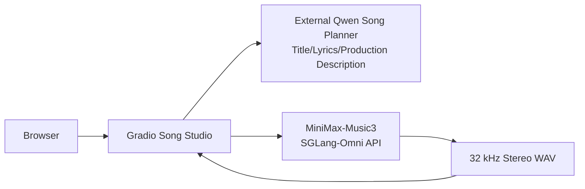

# Deploying MiniMax-Music3 with SGLang-Omni: From a Single Idea to a Complete Song

Generative music applications typically involve two completely different types of models: one that understands creative intent, writes lyrics, and organizes production descriptions, and another that actually renders lyrics and production conditions into audio. This article documents a working implementation: deploying MiniMax-Music3 with SGLang-Omni on a GPU cluster, connecting an OpenAI-compatible LLM as the "song planner," and finally using Gradio to provide a simplified creation interface similar to Suno.

## Release Background: From Online Music Products to a Deployable Model

MiniMax's investment in generative music did not start with Music 3. Its public product line can be traced back to [Music-01](https://www.minimax.io/news/music-01), released on August 31, 2024: it was already capable of generating vocals and accompaniment simultaneously, but the maximum duration per generation was approximately 60 seconds. Subsequently, [Music 1.5](https://www.minimax.io/news/minimax-music-15) extended song duration to 4 minutes in September 2025, and [Music 2.0](https://www.minimax.io/news/minimax-music-20) continued to strengthen vocals, instrumentation, and section structure in October of the same year; by early 2026, [Music 2.5](https://www.minimax.io/news/minimax-music-25) and [Music 2.6](https://www.minimax.io/news/music-26) pushed section-level control, instrumental expression, and cover-song capabilities toward a more complete song production pipeline.

On August 7, 2026, the [MiniMaxAI/MiniMax-Music3](https://huggingface.co/MiniMaxAI/MiniMax-Music3) model repository went live on Hugging Face, publishing downloadable model assets. Six days later, on August 13, the SGLang-Omni mainline added Music 3 inference support via [PR #1521](https://github.com/sgl-project/sglang-omni/pull/1521), along with an official [deployment and invocation example](https://github.com/sgl-project/sglang-omni/blob/main/docs/cookbook/minimax_music3.md). Less than a week elapsed between the model's public release and mainstream inference framework integration, indicating strong engineering demand for "self-deployable text-to-music" solutions.

As of this article's verification date of August 17, 2026, the model repository has recorded 8,639 downloads and 864 likes in approximately ten days. These numbers do not directly represent audio quality rankings or market share, but they are sufficient to show high developer interest. The more important impact of Music 3 is that generative music no longer has to remain confined to vendor web products; teams can chain public model assets, programmable inference services, LLM-based lyric planning, and their own UI into a private workflow, with reproducible control over prompts, seeds, duration, and A/B versions.

This solution has been verified on a single 45 GiB NVIDIA L20. Generating a 20-second song took approximately 27 seconds; two 10-second pieces generated sequentially with adjacent seeds took 26.6 seconds and 18.6 seconds, respectively. These numbers are the result of a single functional verification and should not be treated as a rigorous performance benchmark.

## 1. Final Architecture

The application consists of three parts: a user-facing Gradio UI, an LLM responsible for song planning, and a MiniMax-Music3 service responsible for audio rendering.



Users only need to enter a description like the following:

> A Mandarin narrative R&B song about a rainy night, an old train station, and a letter never sent; the verse tells a story, the chorus melody opens up, with piano and Chinese-style instrumental accents.

The external Qwen first expands it into structured lyrics and English production notes, and MiniMax-Music3 then completes the vocal and accompaniment generation for the entire piece.


*Figure 1: The running Gradio quick-creation page. After entering a creative idea, users can choose style, language, duration, and A/B versions; lyrics and production descriptions can be auto-generated or manually edited before submitting to Music3.*

## 2. First, Understand What MiniMax-Music3 Is

MiniMax-Music3 is not a "TTS with background music." It accepts two core inputs:

- `input`: Lyrics with section tags such as `[Verse]` and `[Chorus]`.
- `instructions`: Description of genre, BPM, key, mood, voice character, instrumentation, and mixing.

The model then generates a 32 kHz stereo WAV that already contains vocals and accompaniment. The official SGLang-Omni documentation notes that the model internally includes a Qwen3 autoregressive backbone, an RVQ deep decoder, a Flow-Matching DIT, and VAE and DAC-style waveform decoders. Audio is generated at 25 frames per second, therefore:

```text
max_new_tokens = 目标秒数 × 25
```

For example, a 10-second preview uses `250`, and 30 seconds uses `750`. This parameter is a duration upper bound; the model may also generate an end-of-sequence token early.

Currently, MiniMax-Music3 does not accept `ref_audio`, `ref_text`, or specifying `voice`. Voice character can only be described in text, for example "a warm, restrained male voice" or "a female voice with slight breathiness"; you cannot upload a reference recording and ask it to replicate a specific person.

## 3. Why Hugging Face Weights Cannot Be Directly Handed to Vanilla SGLang

What you download from Hugging Face is only model assets; it is not equivalent to a general-purpose `transformers` model that can be started directly. The complete directory contains at least a structure like:

```text
MiniMax-Music3/
├── config.json
├── qwen_7B/
│   ├── qwen_7B/
│   │   ├── config.json
│   │   └── model-*.safetensors
│   └── qwen3-8B-tokenizer-music/
├── flowmatching_vae.pth
└── dav.pth
```

Among these, Qwen3 is only responsible for predicting discrete audio frames; behind it are the RVQ, DIT/VAE, and waveform decoding stages. A vanilla SGLang Server or `AutoModelForCausalLM` only understands the language model portion; it does not know how to orchestrate these audio stages and will not return WAV.

Therefore, the correct relationship is:

```text
Hugging Face 权重 + SGLang-Omni 的 MiniMaxMusic3PipelineConfig = 可调用的音乐 API
```

This also explains "where Qwen is used":

1. **Qwen inside Music3**: Part of the model weights; it predicts lyrics and production descriptions into audio tokens. Users do not chat with it directly.
2. **External Qwen planning service**: An independent LLM that expands a single creative idea into a song title, lyrics, and production notes; it does not generate audio.

The two Qwen instances operate at different layers and cannot replace each other.

## 4. Building an Offline-Startable SGLang-Omni Image

At deployment time, the SGLang-Omni source code and dependencies in the upstream base image may lag behind the Music3 support code. To avoid accessing GitHub or PyPI when production Pods start, we use a build approach that pins the base image digest and pins the SGLang-Omni commit.

The core Dockerfile does four main things:

1. Base on a CUDA/SGLang image with a pinned digest.
2. Pin the SGLang-Omni revision to prevent build results from drifting with `main`.
3. Install the complete Music3 dependencies and a matching FlashInfer.
4. Import `MiniMaxMusic3PipelineConfig` and compile UI scripts at build time to catch dependency errors early.

```bash
docker buildx build \
  --builder <BUILDX_BUILDER> \
  --platform linux/amd64 \
  --file Dockerfile \
  --provenance=false \
  --sbom=false \
  --output type=image,name=REGISTRY/PROJECT/sglang-omni:minimax-music3-c737bb2-cu13,push=true,oci-mediatypes=false \
  .
```

Model weights are not copied into the runtime image; instead, at startup they point to a prepared model directory via `--model-path`. How model assets enter the runtime environment is outside the scope of this article.

If the official project later publishes an image that exactly matches the target commit, CUDA, and FlashInfer, it can be used directly as a replacement; otherwise, pinning source code and dependencies is more stable than installing temporarily at Pod startup.

## 5. Deploying Music3 on a Single GPU

The key startup parameters for the model container are as follows:

```yaml
command: ["sgl-omni"]
args:
  - serve
  - --model-path
  - /model-runtime
  - --host
  - 0.0.0.0
  - --port
  - "8000"
  - --max-running-requests
  - "1"
  - --mem-fraction-static
  - "0.65"
```

On a single L20, the AR and DIT/DAV stages can be colocated. `--max-running-requests=1` prioritizes stable GPU memory on a single card; `--mem-fraction-static=0.65` leaves enough space for both the Qwen KV cache and the acoustic stages.

UI scripts can be managed separately through a ConfigMap, so modifying the interface does not require rebuilding the large runtime image. Below, a standard `kubectl` is used, with placeholders for the kubeconfig context, namespace, and resource manifest:

```bash
kubectl --context <GPU_CONTEXT> --namespace <NAMESPACE> apply \
  -f <DEPLOYMENT_MANIFEST>

kubectl --context <GPU_CONTEXT> --namespace <NAMESPACE> rollout status \
  deployment/sglang-minimax-music3 --timeout=12m

kubectl --context <GPU_CONTEXT> --namespace <NAMESPACE> get pods \
  -l app.kubernetes.io/name=sglang-minimax-music3 -o wide
```

On first startup, Music3 loads the Qwen weights and DIT/DAV and captures CUDA Graphs. Only after the Pod shows `2/2 Running` are both the UI and API ready.

## 6. Calling the Music API Directly

For debugging, you can first set up port forwarding:

```bash
kubectl --context <GPU_CONTEXT> --namespace <NAMESPACE> port-forward \
  service/<MUSIC3_SERVICE> 17860:7860 18000:8000 \
  --address 127.0.0.1
```

First check the health status:

```bash
curl http://127.0.0.1:18000/health
```

Then generate a 10-second preview:

```bash
curl -X POST http://127.0.0.1:18000/v1/audio/speech \
  -H 'Content-Type: application/json' \
  -d '{
    "model": "MiniMaxAI/MiniMax-Music3",
    "input": "[Verse]\n雨打旧车站\n信折在口袋\n[Chorus]\n风停了 心却乱",
    "instructions": "Mandarin narrative R&B at 88 BPM in a minor key: felt piano, dry hip-hop drums, round bass, subtle guzheng and bamboo flute, warm intimate male vocal, restrained cinematic nostalgia",
    "seed": 260817,
    "max_new_tokens": 250,
    "response_format": "wav",
    "stream": false
  }' \
  --output music3-test.wav
```

Lyrics section tags must occupy their own line. Do not write them as `[Verse] 雨打旧车站`; otherwise, lyrics on the same line after the tag may be lost during normalization.

## 7. Using an LLM to Automatically Write Lyrics and Production Descriptions

The UI connects to a separate OpenAI-compatible Qwen service. The address and model name are configured through environment variables and should not be hardcoded into a public article:

```text
SONG_PLANNER_API_BASE=http://<LLM_SERVICE>:8000/v1
SONG_PLANNER_MODEL=<LYRIC_MODEL>
```

Its task is not to "write a poem out of thin air" but to output structured JSON that can be handed directly to Music3:

```json
{
  "title": "雨夜旧站",
  "lyrics": "[Intro]\n...\n[Verse]\n...\n[Chorus]\n...",
  "caption": "Global Metadata: ...\n\nVocal Details: ...\n\nArrangement: ..."
}
```

The key settings in the request are as follows:

```python
payload = {
    "model": os.environ["SONG_PLANNER_MODEL"],
    "messages": [
        {
            "role": "system",
            "content": (
                "You are a professional songwriter and music producer. "
                "Return one JSON object with title, lyrics and caption. "
                "Use section tags on their own lines. Caption paragraphs must "
                "start with Global Metadata, Vocal Details and Arrangement. "
                "Describe musical attributes rather than imitating a real artist."
            ),
        },
        {
            "role": "user",
            "content": (
                "Creative brief: 雨夜、旧车站和没送出的信\n"
                "Style: Mandarin narrative R&B, piano, Chinese instruments\n"
                "Target duration: 30 seconds\nLanguage: 中文"
            ),
        },
    ],
    "temperature": 0.75,
    "max_tokens": 1800,
    "response_format": {"type": "json_object"},
    "chat_template_kwargs": {"enable_thinking": False},
}
```

The most critical setting here is `enable_thinking=False`. In our first test, we kept Qwen's long-thinking mode enabled; the reasoning process consumed the output budget, and the final body JSON was truncated. After disabling thinking mode, the model returned the complete plan directly, and latency dropped noticeably.

After receiving the result, three layers of validation should be performed:

1. The HTTP status code must be successful.
2. `message.content` must be a non-empty string and parseable as a JSON object.
3. Neither `lyrics` nor `caption` may be empty, and the lyrics tag format must be correct.

Then map Qwen's result to Music3:

```text
Qwen.title   -> UI 歌名和历史记录
Qwen.lyrics  -> Music3 input
Qwen.caption -> Music3 instructions
```

It should be emphasized that the LLM should translate the user's singer preferences into high-level musical attributes, such as "Mandarin narrative R&B, syncopated drums, piano, Chinese instruments, conversational verses, and an expanding chorus melody," rather than asking it to replicate a real singer's voice, melody, or specific works.

## 8. Why an A/B Seed Workflow

Music3 is reproducible when the lyrics, caption, seed, and duration are exactly the same. Changing the seed produces a different arrangement and vocal result under the same creative idea. Therefore, the UI provides by default:

- Version A: A random or user-specified seed.
- Version B: `Seed + 1`.
- Keep the same lyrics, caption, and duration for a fair comparison.
- When reusing from the work library, execute `Seed + 1` again to continue exploring variants.

The single-GPU deployment is set to single concurrency, so A/B versions are generated sequentially. This is more stable than letting two requests compete for GPU memory simultaneously. In practice, it is recommended to first generate a 10-second preview to confirm the voice character and arrangement direction, then submit a 30-second or full song.

## 9. Verification Checklist

After deployment is complete, you can check in the following order:

```bash
# GPU Pod 与两个容器
kubectl --context <GPU_CONTEXT> --namespace <NAMESPACE> get pods \
  -l app.kubernetes.io/name=sglang-minimax-music3

# API 日志中应出现 reference_audio: false 和服务启动完成
kubectl --context <GPU_CONTEXT> --namespace <NAMESPACE> logs \
  deployment/sglang-minimax-music3 -c api --tail=100

# UI 日志
kubectl --context <GPU_CONTEXT> --namespace <NAMESPACE> logs \
  deployment/sglang-minimax-music3 -c ui --tail=100
```

At the application layer, at least four real verifications should be completed:

1. `/health` returns `200` and shows the preprocessing, AR, and DIT/DAV stages as healthy.
2. Qwen can return the complete `title/lyrics/caption` JSON.
3. Music3 can generate RIFF/WAV, and the actual duration matches `max_new_tokens / 25`.
4. The UI can preview and download generated results, with A/B versions using adjacent but different seeds.

## 10. Summary of Common Issues

### The Hugging Face weights are already downloaded; why can it still not start?

Because Music3 is not a single-stage language model. SGLang-Omni's dedicated pipeline is needed to connect Qwen, RVQ, DIT/VAE, and the waveform decoder.

### Is it mandatory to rebuild the image?

If an existing image's SGLang-Omni revision, CUDA, and FlashInfer already include and are compatible with Music3, it can be pulled directly. In this article's environment, the public base image and the required source code had a version gap, so a fixed-version runtime image was built once. Subsequent changes to the Gradio UI only use a ConfigMap and do not require rebuilding the large image.

### Why not let Music3 write lyrics itself?

The Qwen inside Music3 is an audio-token backbone, not a general-purpose conversational model exposed externally. A separate Qwen planning service is better suited to handling theme, narrative, section length, language, and arrangement structure.

### Can I upload a voice clip as the singer's timbre?

The current Music3 interface does not support this. If you need reference audio to control global timbre and production style, you can independently deploy ACE-Step 1.5; if you want to convert singing timbre under authorized conditions, you can use the post-processing chain of "Music3 generation → vocal separation → Seed-VC voice conversion → remixing."

## 11. Conclusion

The core of this solution is not simply chaining two models together, but clear division of labor: the LLM turns vague creative ideas into structured song plans, MiniMax-Music3 focuses on audio generation, and Gradio converges complex parameters into one-sentence creation, professional editing, A/B comparison, and work playback.

Once the runtime version, model directory, and Qwen output constraints are all handled correctly, MiniMax-Music3 can be used as an ordinary OpenAI-style audio service, and end users do not need to touch ComfyUI node graphs or low-level audio tokens.

## References

- [SGLang-Omni: MiniMax Music 3 Cookbook](https://github.com/sgl-project/sglang-omni/blob/main/docs/cookbook/minimax_music3.md)
- [MiniMaxAI/MiniMax-Music3](https://huggingface.co/MiniMaxAI/MiniMax-Music3)
- [ACE-Step 1.5 Tutorial](https://github.com/ace-step/ACE-Step-1.5/blob/main/docs/en/Tutorial.md)
- [Seed-VC](https://github.com/Plachtaa/seed-vc)
